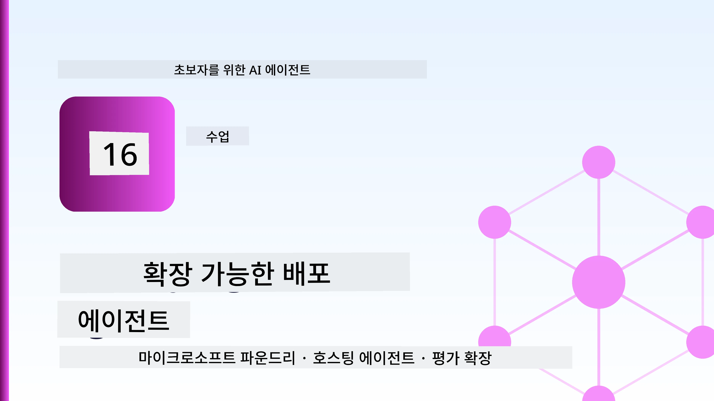
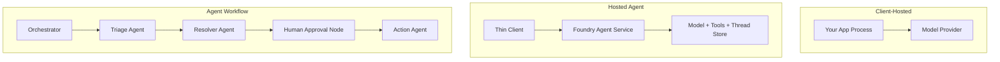
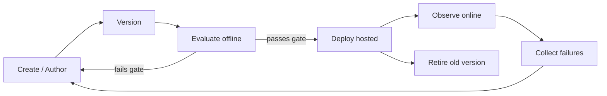
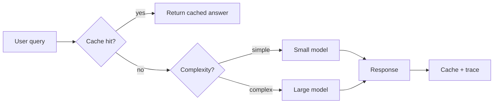
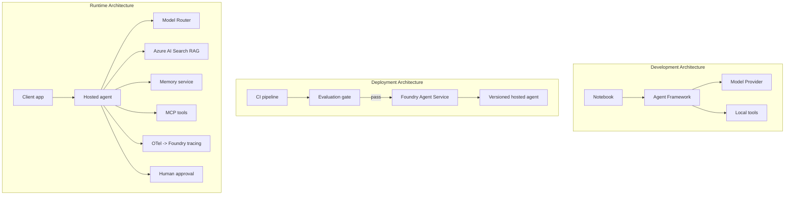

# Microsoft Foundry로 확장 가능한 에이전트 배포하기



지금까지 이 과정에서는 노트북 안에서 실행되고 `az login`과 소수의 환경 변수에 의해 작동하는 에이전트를 구축했습니다. 이것이 바로 학습하는 올바른 방법입니다. 하지만 수천 명의 고객이 새벽 3시에 의존하는 에이전트를 운영하는 방식으로는 적합하지 않습니다.

이 강의는 "내 컴퓨터에서는 작동한다"에서 "프로덕션에서 신뢰할 수 있고 경제적으로 작동한다"로 이어지는 간극에 대해 다룹니다. 우리는 <strong>Microsoft Foundry</strong>와 <strong>Microsoft Foundry Agent Service</strong>를 사용하여 이 간극을 메우고, 도구, 검색, 메모리, 평가, 모니터링이 포함된 실제 고객 지원 에이전트를 구축합니다.

## 소개

이 강의에서 다룰 내용은 다음과 같습니다:

- <strong>프로토타입 에이전트</strong>와 <strong>배포된 에이전트</strong>의 차이점과 전환이 모델 <em>주변</em> 모든 것에 관한 이유.
- 에이전트를 위한 **배포 패턴**: 클라이언트 호스팅, 서비스 호스팅(Hosted Agents), 워크플로우 오케스트레이션.
- Microsoft Foundry의 **에이전트 수명 주기** — 생성, 버전 관리, 배포, 평가, 관찰, 폐기.
- **확장 전략**: 모델 라우팅, 캐싱, 동시성, 상태 비저장 설계.
- OpenTelemetry 및 Foundry 추적을 통한 **관찰 가능성**.
- 모델 선택, 라우팅, 평가 게이트를 통한 **비용 최적화**.
- **기업 고려사항**: 거버넌스, 인간 승인, MCP 서버를 프로덕션에 안전하게 운영하기.

## 학습 목표

이 강의를 완료하면 다음을 알게 됩니다:

- 주어진 에이전트 작업량에 알맞은 배포 패턴 선택하기.
- 에이전트를 Microsoft Foundry Agent Service에 배포하여 버전 관리, 거버넌스, 관찰 가능하게 만들기.
- 에이전트에 추적 계측을 적용하고, 각 릴리스 전에 실행되는 평가 파이프라인 연결하기.
- 확장 시 지연 시간과 비용을 통제하기 위한 모델 라우팅 및 캐싱 적용하기.
- 위험이 높은 작업에 대해 인간 승인 게이트 추가하고 MCP 서버를 프로덕션에 안전하게 통합하기.

## 전제 조건

이 강의는 이전 강의를 완료했으며 다음에 능숙하다고 가정합니다:

- [Microsoft Agent Framework](../14-microsoft-agent-framework/README.md)를 사용해 에이전트 구축하기 (강의 14).
- [도구 사용](../04-tool-use/README.md) (강의 4) 및 [Agentic RAG](../05-agentic-rag/README.md) (강의 5).
- [에이전트 메모리](../13-agent-memory/README.md) (강의 13) 및 [Agentic Protocols / MCP](../11-agentic-protocols/README.md) (강의 11).
- [관찰 가능성 및 평가](../10-ai-agents-production/README.md) (강의 10) — 이 강의는 이를 직접 확장합니다.

또한 다음이 필요합니다:

- <strong>Azure 구독</strong>과 최소 한 개의 배포된 채팅 모델을 포함한 **Microsoft Foundry 프로젝트**.
- 인증된 **Azure CLI** (`az login`).
- Python 3.12+와 저장소 내 패키지 [`requirements.txt`](../../../requirements.txt).

## 프로토타입에서 프로덕션으로: 실제로 달라지는 것

프로토타입 에이전트와 프로덕션 에이전트는 동일한 핵심 루프 — 추론, 도구 호출, 응답 — 을 공유합니다. 변화하는 것은 그 루프를 감싸는 모든 것입니다. 모델은 프로덕션 에이전트의 약 20%, 나머지 80%는 운영의 골격입니다.

| 관심사 | 프로토타입 | 프로덕션 |
| --- | --- | --- |
| <strong>호스팅</strong> | 당신의 노트북에서 실행 | 호스팅 서비스로 실행되며, 버전 관리되고 단계적으로 배포됨 |
| **ID** | 당신의 `az login` 토큰 | 권한 범위가 설정된 관리형 ID |
| <strong>상태</strong> | 메모리 내, 재시작 시 소실 | 외부화됨 (스레드 저장소, 메모리 서비스) |
| **장애 대응** | 추적을 직접 확인 | 재시도, 폴백, 데드레터, 경고 |
| <strong>비용</strong> | "몇 센트 정도" | 요청별 추적, 라우팅, 캐싱, 예산 관리 |
| <strong>품질</strong> | 출력물을 육안 검사 | 모든 릴리스 전에 자동 평가 |
| <strong>신뢰</strong> | 모든 작업 직접 승인 | 정책 + 위험 작업에 대한 인간 개입 |

이 표를 기억하세요. 아래의 각 섹션은 이 행들 중 하나에 대응합니다.

## 에이전트 배포 패턴

자주 결합해 사용하는 세 가지 패턴이 있습니다.

### 1. 클라이언트 호스팅 에이전트

에이전트 객체가 <em>당신</em>의 애플리케이션 프로세스 내부에 존재합니다. 당신의 코드가 모델 제공자를 직접 호출하며, 추론 루프가 당신 서비스 내에서 실행됩니다. 이전 강의들이 모두 이 방식을 사용했습니다.

- **적용 시점**: 루프에 대한 완전한 제어권, 맞춤 미들웨어가 필요하거나 이미 존재하는 백엔드에 에이전트를 임베딩할 때.
- <strong>단점</strong>: 확장성, 상태 관리, 복원력을 직접 책임져야 합니다.

### 2. 호스팅 에이전트 (Foundry Agent Service)

에이전트가 Microsoft Foundry 내 <em>리소스로 등록</em>됩니다. Foundry가 추론 루프를 호스팅하고, 스레드를 저장하며, 콘텐츠 안전 및 RBAC를 시행하고, 포털에서 에이전트를 가시화합니다. 당신의 앱은 스레드를 생성하고 응답을 읽는 가벼운 클라이언트가 됩니다.

- **적용 시점**: 내구성, 내장 관찰 가능성, 거버넌스, 그리고 운영 복잡도 감소를 원할 때.
- <strong>단점</strong>: 관리되는 런타임 대가로 낮은 수준 제어 권한 감소.

### 3. 에이전트 워크플로우

여러 에이전트(및 도구)가 명시적 제어 흐름 — 순차 단계, 분기, 인간 승인 노드, 일시 중지와 재개가 가능한 내구성 체크포인트 — 를 가진 그래프로 구성됩니다. 이는 Microsoft Agent Framework의 <strong>워크플로우</strong> 기능을 배포 규모에 적용한 것입니다.

- **적용 시점**: 단일 작업이 여러 전문화된 에이전트에 걸치거나 중간에 승인 단계가 필요할 때.
- <strong>단점</strong>: 더 많은 구성 요소; 오케스트레이션 수준의 관찰 가능성이 필요.



## Microsoft Foundry에서의 에이전트 수명 주기

에이전트 배포는 일회성 `push`이 아닙니다. 그것은 루프이며, 소프트웨어 릴리스 주기와 아주 비슷합니다. 왜냐하면 실제로 똑같기 때문입니다.



[강의 10](../10-ai-agents-production/README.md)에서 이어지는 핵심 아이디어: **오프라인 평가는 부차적 과정이 아니라 게이트입니다.** 새로운 에이전트 버전은 평가 문턱을 통과하지 않으면 배포되지 않습니다. 온라인 관찰 가능성은 실제 실패를 오프라인 테스트 세트로 피드백합니다. 이것이 전 과정입니다.

## 확장 전략

에이전트를 확장하는 것은 상태 비저장 웹 API를 확장하는 것과 다릅니다. 각 요청은 여러 비싼 모델 및 도구 호출을 유발할 수 있기 때문입니다. 네 가지 기법이 대부분 부하를 처리합니다.

**상태 비저장 요청 처리.** 프로세스 메모리에 사용자별 상태를 저장하지 마십시오. 대화 스레드는 Foundry 스레드 저장소나 메모리 서비스에 저장하여 어떤 인스턴스가 어떤 요청도 처리할 수 있게 하십시오. 이것이 수평 확장을 가능케 합니다 — 인스턴스를 추가하며 고정 세션이 필요 없습니다.

**모델 라우팅.** 모든 요청이 가장 강력하고 비싼 모델을 필요로 하지 않습니다. 간단한 요청—의도 분류, 짧은 사실 답변—은 작고 빠른 모델에 보내고, 진짜 추론 경우에는 큰 모델을 예약하십시오. Foundry의 <strong>Model Router</strong>가 이 작업을 돕거나, 경량 분류기를 직접 구현할 수 있습니다. 이 실습에서 직접 만들어 봅니다.

**응답 캐싱.** 많은 지원 질의가 거의 중복입니다("비밀번호를 어떻게 재설정합니까?"). 흔한 질문의 답변을 캐싱하여 모델 호출 없이 서비스를 제공합니다. 적당한 캐시 적중률만으로도 비용과 지연을 크게 줄일 수 있습니다.

**동시성 및 백프레셔.** 모델 제공자는 속도 제한이 있습니다. 동시성 한도를 두고 지수 백오프가 포함된 재시도를 사용하며 정상적으로 실패 처리하십시오(대기열에 "처리 중" 응답을 보내는 것이 500 오류보다 낫습니다).



## 프로덕션에서의 관찰 가능성

못 보는 것은 운영할 수 없습니다. 강의 10에서 다룬 바와 같이, Microsoft Agent Framework는 **OpenTelemetry** 추적을 기본 지원합니다 — 모든 모델 호출, 도구 실행, 오케스트레이션 단계가 스팬이 됩니다. 프로덕션에서는 이러한 스팬을 Microsoft Foundry(또는 OTel 호환 백엔드)에 내보내어 다음을 할 수 있습니다:

- 단일 고객 불만을 모든 모델 및 도구 호출 전반에 걸쳐 추적.
- 시간에 따른 요청별 p50/p95 지연 및 비용 관찰.
- 오류율 급증 및 비용 이상 현상을 사용자(또는 재무 팀)가 감지하기 전에 경고.

```python
from agent_framework.observability import get_tracer

tracer = get_tracer()

with tracer.start_as_current_span("support_request") as span:
    span.set_attribute("customer.tier", "enterprise")
    span.set_attribute("routed.model", "gpt-5-nano")
    # agent execution is traced automatically inside this span
```

`customer.tier` 및 `routed.model` 같은 속성이 수많은 추적을 해답 가능한 질문으로 전환합니다("기업 고객이 너무 자주 작은 모델로 라우팅되고 있나요?").

## 비용 최적화

프로덕션 에이전트 비용은 주로 토큰 비용이 지배적입니다. 세 가지 수단, 영향력 순서대로:

1. **모델 크기 적합화.** 평가 문턱을 통과하는 작은 모델은 거의 항상 크고 평가를 통과하는 모델보다 저렴합니다. 평가를 사용해 작은 모델이 충분히 좋다는 것을 입증하고, 안전을 위해 무조건 가장 큰 모델을 선택하는 것을 피하십시오.
2. **복잡도에 따른 라우팅.** 위와 같이, 큰 모델 추론이 필요한 요청에만 큰 모델 비용을 지불하십시오.
3. **공격적인 캐싱.** 가장 저렴한 모델 호출은 아예 호출하지 않는 것입니다.

평가 게이트와 비용 관리는 두 각도에서 본 같은 규율입니다: 평가가 <em>품질 바닥</em>을 알려주고, 라우팅과 캐싱이 그 바닥의 <em>비용</em>에 최대한 가깝게 유지해 줍니다.

## 기업 배포 시 고려사항

**거버넌스.** Hosted Agents는 Foundry의 RBAC, 콘텐츠 안전, 감사 로깅을 상속받습니다. 각 에이전트에 필요한 최소 권한을 가진 관리형 ID를 부여하십시오 — 지식 기반 읽기 전용 액세스, 티켓팅 API 범위 액세스, 그 외에는 없음.

**인간 개입.** 일부 작업은 즉시 자동화하기에 너무 중대한 경우가 있습니다 — 환불 처리, 계정 삭제, 법무팀에 에스컬레이션. Microsoft Agent Framework는 **승인 필요** 도구를 지원합니다: 에이전트가 작업을 제안하면 실행이 일시 중지되고, 사람이 승인하거나 거부한 후 워크플로우가 재개됩니다. [강의 6](../06-building-trustworthy-agents/README.md)에서 기본 기능을 봤고 여기서 배포합니다.

**프로덕션 MCP.** [MCP](../11-agentic-protocols/README.md)는 표준 인터페이스를 통해 외부 도구를 에이전트가 사용할 수 있게 합니다. 프로덕션에서는 모든 MCP 서버를 신뢰할 수 없는 경계로 취급하십시오: 서버 버전 고정, 권한 범위가 설정된 ID로 실행, 출력 검증, 비밀 정보 절대 노출 금지. MCP 서버는 의존성이며, 의존성은 패치, 감사, 속도 제한이 필요합니다.



이 세 가지 다이어그램 — 개발, 배포, 런타임 — 은 에이전트의 세 단계 생애입니다. 이어지는 실습은 이를 구축하는 방법을 안내합니다.

## 실습: 생산 준비가 된 고객 지원 에이전트

[`code_samples/16-python-agent-framework.ipynb`](./code_samples/16-python-agent-framework.ipynb)를 열고 처음부터 끝까지 진행하십시오. 모든 프로덕션 고려사항이 적용된 <strong>Contoso 고객 지원 에이전트</strong>를 조립할 것입니다:

1. **도구 호출** — 주문 상태 조회 및 지원 티켓 열기.
2. **RAG** — 지식 기반에서 정책 질문 답변 (Azure AI Search, 그리고 Search 리소스 없이도 노트북이 실행되도록 인메모리 폴백 포함).
3. <strong>메모리</strong> — 대화 턴 간 고객 기억.
4. **모델 라우팅** — 복잡도 분류기가 각 요청을 작은 모델 또는 큰 모델에 라우팅.
5. **응답 캐싱** — 반복 질문은 캐시에서 제공.
6. **인간 승인** — 임계값을 넘는 환불은 인간 승인 대기.
7. **평가 파이프라인** — 작은 오프라인 테스트 세트가 에이전트를 점수 매기고 릴리스 게이트 역할.
8. **관찰 가능성** — 모든 요청 주변에 OpenTelemetry 추적.

### 단계별 설명

노트북은 각 생산 관련 사항이 독립적인 실행 가능한 섹션으로 구성되어 있습니다. 핵심은 라우팅과 캐싱이 결합된 요청 핸들러입니다:

```python
async def handle_support_request(query: str, customer_id: str) -> str:
    # 1. Serve from cache when we can.
    cached = response_cache.get(normalize(query))
    if cached:
        return cached

    # 2. Route by complexity to control cost.
    model = "gpt-5-nano" if is_simple(query) else "gpt-5-mini"

    # 3. Run the agent inside a trace span for observability.
    with tracer.start_as_current_span("support_request") as span:
        span.set_attribute("routed.model", model)
        span.set_attribute("customer.id", customer_id)
        response = await support_agent.run(query, model=model)

    # 4. Cache and return.
    response_cache.set(normalize(query), response.text)
    return response.text
```

릴리스를 보호하는 평가 게이트는 다음과 같습니다:

```python
async def evaluation_gate(agent, test_cases, threshold: float = 0.8) -> bool:
    passed = 0
    for case in test_cases:
        result = await agent.run(case["input"])
        if score_response(result.text, case["expected"]) >= 0.8:
            passed += 1
    pass_rate = passed / len(test_cases)
    print(f"Evaluation pass rate: {pass_rate:.0%} (gate: {threshold:.0%})")
    return pass_rate >= threshold  # only deploy if the gate passes
```

모든 줄을 읽어보세요 — 노트북은 기본 기능만 작게 유지하여 프레임워크 호출 뒤에 숨겨진 부분이 없습니다.

## 배포된 에이전트를 스모크 테스트로 검증하기

위 평가 게이트는 에이전트 객체에 대해 <em>오프라인</em>으로 실행됩니다. 에이전트를 Hosted Agent로 배포한 후에는 한 가지 더, 훨씬 저렴한 검사가 필요합니다: **배포된 엔드포인트가 실제로 응답하는가?**

"성공적으로" 배포되었다는 것은 제어 평면이 정의를 수락했다는 것뿐이며, 에이전트가 응답함을 증명하지 않습니다. 누락된 의존성, 잘못된 모델 라우팅, 만료된 연결은 아무 것도 반환하지 않는 녹색 배포 상태를 남길 수 있습니다. <strong>스모크 테스트</strong>는 전 평가 비용 없이 몇 초 만에, 매 배포 시 이를 잡아냅니다.

이 저장소는 [AI Smoke Test](https://github.com/marketplace/actions/ai-smoke-test) GitHub Action 기반의 즉시 사용 가능한 스모크 테스트 파이프라인을 제공합니다:

- <strong>카탈로그</strong> — [`tests/lesson-16-smoke-tests.json`](../../../tests/lesson-16-smoke-tests.json)는 Contoso 지원 에이전트용 프롬프트와 검증을 포함합니다 (근거 있는 정책 답변, 주문 조회, 주제 유지, 다중 턴 스레드 연속성). 다른 강의 에이전트용 카탈로그는 같이 위치 — [`tests/README.md`](../tests/README.md) 참고.
- <strong>워크플로우</strong> — [`.github/workflows/smoke-test.yml`](../../../.github/workflows/smoke-test.yml)는 Azure OIDC로 로그인하고 각 프롬프트를 에이전트 Responses 엔드포인트에 POST하며, 검증 실패시 작업을 실패 처리.

```yaml
- name: Smoke-test hosted agent
  uses: JFolberth/ai-smoketest@v1
  with:
    project_endpoint: ${{ inputs.project_endpoint }}
    agent_name: ContosoSupportAgent
    tests_file: tests/lesson-16-smoke-tests.json
```

에이전트를 배포한 후 **Actions** 탭에서 실행하고 Foundry 프로젝트 엔드포인트와 에이전트 이름을 제공합니다. 연합 아이덴티티는 Foundry 프로젝트 범위에서 **Azure AI User** 역할이 필요합니다. 계층을 피라미드로 생각하세요: 스모크 테스트(도달 가능 및 응답 여부)는 매 배포 시 실행되고, 오프라인 평가(출시할 만큼 충분한지)는 승격 전에 실행되며, 온라인 평가(실제 환경에서 어떻게 동작하는지)는 지속적으로 실행됩니다.

## 지식 점검

과제로 넘어가기 전에 이해도를 테스트해 보세요.

**1. 프로덕션 에이전트에서 "모델"이 차지하는 비중은 대략 얼마이며 나머지는 무엇인가요?**

<details>
<summary>답변</summary>

모델은 시스템의 소수 부분으로, 대략 20% 정도로 자주 언급됩니다. 나머지는 운영 구조로서 호스팅 및 버전 관리, 아이덴티티 및 RBAC, 외부화된 상태, 실패 처리, 비용 추적, 평가, 그리고 인간 개입 제어를 포함합니다. 프로덕션으로 이전하는 것은 주로 추론 루프 <em>주변에</em> 모든 것을 구축하는 것입니다.
</details>

**2. 언제 클라이언트 호스팅된 에이전트 대신 Hosted Agent를 선택하나요?**

<details>
<summary>답변</summary>

내장된 내구성(지속되고 재개 가능한 스레드), 관찰 가능성, 콘텐츠 안전성 및 RBAC가 포함된 관리형 런타임을 원하고, 추론 루프의 저수준 제어 일부를 포기하는 대신 운영 표면적을 줄이려 할 때 Hosted Agent를 선택합니다. 클라이언트 호스팅은 루프에 대한 완전한 제어가 필요하거나 기존 백엔드에 에이전트를 임베드할 때 선호됩니다.
</details>

**3. 확장 가능한 에이전트가 각자의 프로세스 메모리에서 상태를 유지하지 않아야 하는 이유는 무엇인가요?**

<details>
<summary>답변</summary>

어떤 인스턴스든 모든 요청을 처리할 수 있어야 하며, 이것이 스티키 세션 없이 수평 확장을 가능하게 합니다. 사용자별 대화 상태는 스레드 저장소나 메모리 서비스에 외부화됩니다. 상태가 프로세스 메모리에 있다면 재시작 시 상태를 잃게 되고 로드를 자유롭게 분산할 수 없습니다.
</details>

**4. 모델 라우팅이 해결하는 문제는 무엇이며 이것이 평가와 어떤 관련이 있나요?**

<details>
<summary>답변</summary>

라우팅은 간단한 요청을 작고 저렴하며 빠른 모델로 보내고, 큰 모델은 진짜 추론에 예약하여 대기 시간과 비용을 모두 제어합니다. 이것은 작은 모델이 특정 요청 범위에 충분히 좋은지 평가하는 <em>검증</em>이 필요하므로 평가와 관련이 있습니다 — 평가 없는 라우팅은 단순히 추측입니다.
</details>

**5. "평가 게이트"란 무엇이며 라이프사이클에서 어디에 위치하나요?**

<details>
<summary>답변</summary>

평가 게이트는 새로운 에이전트 버전에 대해 오프라인 테스트 세트를 실행하고, 통과율이 기준값을 넘지 않으면 배포를 차단합니다. 라이프사이클에서 "버전"과 "배포" 사이에 위치해 품질을 릴리스의 전제 조건으로 만듭니다. 이는 출시 후 점검하는 대신 사전 조건으로 작용합니다.
</details>

**6. MCP 서버를 프로덕션에서 신뢰할 수 없는 경계로 취급해야 하는 이유는 무엇인가요?**

<details>
<summary>답변</summary>

MCP 서버는 에이전트가 호출하는 외부 종속성이기 때문입니다. 버전을 고정하고, 범위가 지정된 아이덴티티로 실행하며, 출력 결과를 검증하고, 속도 제한을 적용하고, 절대 비밀을 노출하지 않아야 합니다 — 이는 모든 서드파티 종속성에 적용하는 동일한 규율입니다. 출력이 에이전트의 추론에 흘러들어가므로 검증되지 않은 신뢰는 보안 위험입니다.
</details>

**7. 보통 프로덕션 에이전트 비용에 가장 큰 영향을 미치는 단일 변경사항은 무엇이며 그 이유는?**

<details>
<summary>답변</summary>

모델의 적절한 크기 조절 — 평가 게이트를 통과하는 가장 작은 모델을 사용하는 것입니다. 비용은 주로 토큰에 의해 지배되며, 품질 기준을 충족하는 더 작은 모델이 거의 항상 더 큰 모델보다 저렴합니다. 캐싱과 라우팅으로 비용을 더 줄일 수 있지만, 올바른 기본 모델 선택이 가장 큰 1차 영향력을 가집니다.
</details>

**8. `customer.tier` 및 `routed.model` 같은 스팬 속성은 관찰 가능성에서 어떤 역할을 하나요?**

<details>
<summary>답변</summary>

원시 추적 데이터를 답변 가능한 비즈니스 질문으로 변환합니다. 속성이 없으면 스팬 벽에 다름없지만, 속성이 있으면 "기업 고객이 너무 자주 작은 모델로 라우팅되고 있나요?" 또는 "어떤 모델이 가장 느린 요청을 처리하나요?" 같은 질문을 할 수 있습니다. 속성은 운영에 중요한 차원별로 원격 측정 데이터를 분할하는 방법입니다.
</details>

## 과제

실험실에서 만든 고객 지원 에이전트를 다음 특정 시나리오에 맞게 강화하세요: **SaaS 회사의 구독 청구 지원 에이전트.**

제출물에는 다음이 포함되어야 합니다:

1. 청구 관련 도구로 <strong>도구를 교체</strong>하세요: `get_subscription_status`, `get_invoice`, `issue_credit` (50달러 이상 크레딧은 인간 승인이 필요함).
2. 회사의 환불 정책, 청구 주기, 해지 정책을 다루는 <strong>3개의 RAG 문서</strong>를 추가하세요.
3. 최소 8개의 사례로 <strong>평가 세트를 확장</strong>하고, 그중 최소 2개는 반드시 인간 승인 경로를 촉발해야 하며, 평가 게이트가 올바르게 통과 또는 실패하는지 확인하세요.
4. <strong>비용 보고서 1개를 추가</strong>하세요: 10개의 혼합 쿼리가 에이전트를 통해 실행된 후, 작은 모델로 간 쿼리 수, 큰 모델로 간 쿼리 수, 캐시에서 서비스된 쿼리 수를 출력하세요.

모델 라우팅 규칙으로 어떤 것을 선택했는지, 그리고 실제 트래픽으로 어떻게 검증할지 간략한 단락(마크다운 셀)을 작성하세요. 정답은 없으며, 프로덕션 관련 고려 사항이 일관성 있게 연결되었는지가 평가 기준입니다.

## 요약

이번 레슨에서 Microsoft Foundry를 사용해 에이전트를 프로토타입에서 프로덕션으로 이전했습니다:

- 프로덕션으로 가는 점프는 주로 모델 주변의 **운영 구조** — 호스팅, 아이덴티티, 상태, 실패 처리, 비용, 품질, 신뢰입니다.
- 세 가지 **배포 패턴** — 클라이언트 호스팅, Hosted Agents, 에이전트 워크플로우 — 과 각각이 적합한 상황을 배웠습니다.
- <strong>에이전트 라이프사이클</strong>을 거치며 오프라인 **평가가 릴리스 게이트** 역할을 하고 온라인 관찰 가능성이 실패를 테스트 세트로 피드백하는 과정을 확인했습니다.
- **확장 전략** — 상태 비저장 설계, 모델 라우팅, 캐싱, 한정된 동시성 — 을 적용하고 이를 <strong>비용 최적화</strong>와 연결했습니다.
- **엔터프라이즈 제어**: RBAC, 인간 개입 승인, 그리고 프로덕션 안전 MCP 통합을 적용했습니다.
- 이러한 모든 고려 사항을 하나로 묶어 실행 가능한 코드로 만든 <strong>프로덕션 준비 고객 지원 에이전트</strong>를 구축했습니다.

다음 레슨은 반대 여정을 택합니다: 클라우드로 확장하는 대신, 에이전트를 <em>내려</em> 개발자 단일 머신에서 완전히 로컬로 실행합니다.

## 추가 자료

- <a href="https://learn.microsoft.com/azure/ai-foundry/what-is-azure-ai-foundry" target="_blank">Microsoft Foundry 문서</a>
- <a href="https://learn.microsoft.com/azure/ai-foundry/agents/overview" target="_blank">Microsoft Foundry Agent Service 개요</a>
- <a href="https://learn.microsoft.com/en-us/agent-framework/overview/?wt.mc_id=youtube_26688_organicsocial_reactor&pivots=programming-language-python" target="_blank">Microsoft Agent Framework</a>
- <a href="https://learn.microsoft.com/en-us/azure/ai-foundry/openai/concepts/model-router" target="_blank">Microsoft Foundry의 모델 라우터</a>
- <a href="https://learn.microsoft.com/azure/search/search-what-is-azure-search" target="_blank">Azure AI 검색</a>
- <a href="https://opentelemetry.io/" target="_blank">OpenTelemetry</a>
- <a href="https://github.com/marketplace/actions/ai-smoke-test" target="_blank">AI 스모크 테스트 GitHub 액션</a>
- <a href="https://modelcontextprotocol.io/" target="_blank">모델 컨텍스트 프로토콜 (MCP)</a>

## 이전 레슨

[컴퓨터 사용 에이전트 구축 (CUA)](../15-browser-use/README.md)

## 다음 레슨

[로컬 AI 에이전트 만들기](../17-creating-local-ai-agents/README.md)

---

<!-- CO-OP TRANSLATOR DISCLAIMER START -->
**면책 조항**:
이 문서는 AI 번역 서비스 [Co-op Translator](https://github.com/Azure/co-op-translator)를 사용하여 번역되었습니다. 정확성을 기하기 위해 노력하고 있으나, 자동 번역은 오류나 부정확한 부분이 있을 수 있음을 유의하시기 바랍니다. 원본 문서의 원어본이 권위 있는 자료로 간주되어야 합니다. 중요한 정보의 경우, 전문가의 인간 번역을 권장합니다. 이 번역 사용으로 인해 발생하는 오해나 잘못된 해석에 대해 당사는 책임을 지지 않습니다.
<!-- CO-OP TRANSLATOR DISCLAIMER END -->