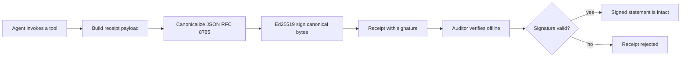
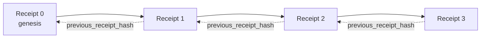

[수업 영상 보기: 암호화 영수증으로 AI 에이전트 보안 강화](https://youtu.be/PLACEHOLDER_VIDEO_ID)

> _(수업 14 / 15 패턴에 맞춰 Microsoft 콘텐츠 팀에서 병합 후 수업 영상과 썸네일을 추가할 예정입니다.)_

# 암호화 영수증으로 AI 에이전트 보안 강화

## 소개

이 수업에서 다룰 내용:

- AI 에이전트를 위한 감사 추적 기록이 준수, 디버깅, 신뢰에 왜 중요한지.
- 암호화 영수증이 무엇이고, 서명되지 않은 로그 라인과 어떻게 다른지.
- 평범한 Python에서 에이전트의 툴 호출에 대해 서명된 영수증을 생성하는 방법.
- 오프라인에서 영수증을 검증하고 변조를 감지하는 방법.
- 영수증을 체인으로 연결하여 하나를 제거하거나 순서를 바꾸면 체인이 끊어지는 방식.
- 영수증이 증명하는 것과 명시적으로 증명하지 않는 것.

## 학습 목표

이 수업을 완료하면 다음을 알게 됩니다:

- 에이전트 행동의 암호학적 출처를 동기부여하는 실패 모드를 식별하는 방법.
- 정규화된 JSON 페이로드에 대해 Ed25519 서명된 영수증을 생성하는 방법.
- 서명자의 공개 키만 사용하여 독립적으로 영수증을 검증하는 방법.
- 수정된 영수증에 대해 재검증을 실행하여 변조를 감지하는 방법.
- 해시 체인으로 연결된 영수증 시퀀스를 구축하고 그 체인의 중요성을 설명하는 방법.
- 영수증이 증명하는 것(귀속, 무결성, 순서)과 증명하지 않는 것(행동의 정확성, 정책의 건전성)의 경계를 인지하는 방법.

## 문제: 당신 에이전트의 감사 추적

Contoso Travel을 위한 AI 에이전트를 배포했다고 상상해보세요. 이 에이전트는 고객 요청을 읽고, 항공편 API를 호출하여 옵션을 조회하고, 고객을 대신해 좌석을 예약합니다. 지난 분기, 에이전트는 50,000건의 예약을 처리했습니다.

오늘 감사를 위해 감사관이 왔습니다. 그들은 간단한 질문을 합니다: "에이전트가 한 일을 보여주세요."

당신은 로그 파일을 넘깁니다. 감사관은 그것들을 보고 더 어려운 질문을 합니다: "이 로그가 편집되지 않았다는 걸 어떻게 알죠?"

이것이 감사 추적 기록 문제입니다. 오늘날 대부분의 에이전트 배포는 다음에 의존합니다:

- **애플리케이션 로그**: 에이전트 자체가 작성하며, 파일 시스템 접근 권한이 있는 누구나 편집 가능.
- **클라우드 로깅 서비스**: 플랫폼 차원에서 변조 탐지 가능하지만 감사관이 플랫폼 운영자를 신뢰해야 함.
- **데이터베이스 트랜잭션 로그**: 데이터베이스 변경에 적합하나 임의의 툴 호출에는 부적합.

이들 어느 것도 감사관이 누군가(당신, 클라우드 제공자, 데이터베이스 벤더)를 신뢰하지 않고는 질문에 답할 수 없습니다. 내부 용도라면 그 신뢰가 허용되지만, 규제되는 워크로드(금융, 의료, EU AI 법안 대상 등)에는 그렇지 않습니다.

암호학적 영수증은 서명된 진술을 독립적으로
검증할 수 있게 만듭니다. 감사자는 여전히 서명 키와
진술을 생성한 구성 요소를 신뢰하기 위한 아웃오브밴드 이유가 필요합니다. 내장된 키는 자체 일관성을 증명하지만,
발급자 신원이나 집행 위치를 증명하지 않습니다.

## 암호화 영수증이란?

영수증은 에이전트가 수행한 일을 기록하는 JSON 객체로, 디지털 서명으로 서명되어 있습니다.



최소한의 영수증은 다음과 같습니다:

```json
{
  "type": "agent.tool_call.v1",
  "agent_id": "contoso-travel-bot",
  "tool_name": "lookup_flights",
  "tool_args_hash": "sha256:a3f9c1...",
  "result_hash": "sha256:7b2e1d...",
  "policy_id": "contoso-travel-policy-v3",
  "timestamp": "2026-04-25T14:30:00Z",
  "sequence": 47,
  "previous_receipt_hash": "sha256:9d4e6a...",
  "signature": {
    "alg": "EdDSA",
    "sig": "c5af83...",
    "public_key": "8f3b2c..."
  }
}
```

세 가지 속성이 역할을 합니다:

1. <strong>서명</strong>. 영수증은 에이전트의 게이트웨이가 Ed25519 개인 키를 사용하여 서명합니다. 해당 공개 키를 가진 사람은 누구나 오프라인에서 서명을 검증할 수 있습니다. 신뢰하는 당사자는 그 키를 고정하거나 영수증 외부의 신뢰할 수 있는 레지스트리에서 해당 키를 확인해야 합니다. 서명된 필드를 변조하면 서명이 무효화됩니다.

2. **정규화 인코딩**. 서명하기 전에 JSON 정규화 방식(JCS, RFC 8785)을 써서 직렬화합니다. 이는 동일한 논리적 영수증을 만드는 구현들이 바이트 단위로 동일한 출력을 보장합니다. 정규화가 없으면 서로 다른 JSON 직렬화기가 같은 내용에 대해 다른 서명을 만듭니다.

3. **해시 체이닝**. `previous_receipt_hash` 필드는 각 영수증을 이전 영수증과 연결합니다. 영수증을 제거하거나 재정렬하면 제시된 순서가 깨집니다. 잘림이나 서명자가 제어하는 재작성도 감지하려면 고정된 현재 체인 헤드, 독립적으로 목격된 체크포인트, 또는 인증된 폐쇄 집단 커밋먼트가 필요합니다.

이 속성들은 세 가지 보장을 함께 제공합니다:

- **키에 대한 귀속**: 이 키가 이 콘텐츠에 서명했습니다. 조직 또는 개인의 신원은 신뢰할 수 있는 키 바인딩을 필요로 합니다.
- <strong>무결성</strong>: 서명 이후 내용이 변하지 않았습니다.
- **검증된 시퀀스 내의 정렬**: 이 영수증은 그 선행 항목에 연결됩니다.

## Python에서 영수증 생성하기

영수증을 생성하는 특수한 라이브러리는 필요하지 않습니다. 암호학 기본 도구는 널리 존재하고, 로직도 몇십 줄의 Python 코드입니다.

`code_samples/18-signed-receipts.ipynb`의 핸즈온 실습은 전체 흐름을 단계별로 안내합니다. 버전 관리되는 `code_samples/18-signed-receipts.execution-receipt.json`은 강의의 저장된 출력물을 변경하지 않고 최신 클린 실행에서의 정확한 노트북 해시, Python 환경, 셀 수 및 검사 항목을 기록합니다. 요약 버전:

```python
import json
import hashlib
import base64
from nacl import signing
from jcs import canonicalize  # RFC 8785 canonical JSON

def b64url_nopad(data: bytes) -> str:
    return base64.urlsafe_b64encode(data).decode("ascii").rstrip("=")

def sha256_canonical(obj) -> str:
    """SHA-256 of a Python object's JCS-canonical JSON form."""
    return f"sha256:{hashlib.sha256(canonicalize(obj)).hexdigest()}"

# Generate or load a signing key (in production, store in a key vault)
signing_key = signing.SigningKey.generate()
verify_key = signing_key.verify_key
TRUSTED_PUBLIC_KEYS = {b64url_nopad(bytes(verify_key))}  # pinned out of band by the verifier

# Build the receipt payload (no signature yet)
tool_args = {"origin": "SYD", "destination": "LAX"}
tool_result = [{"flight": "QF11", "price": 1850, "stops": 0}]

payload = {
    "type": "agent.tool_call.v1",
    "agent_id": "contoso-travel-bot",
    "tool_name": "lookup_flights",
    "tool_args_hash": sha256_canonical(tool_args),
    "result_hash": sha256_canonical(tool_result),
    "policy_id": "contoso-travel-policy-v3",
    "timestamp": "2026-04-25T14:30:00Z",
    "sequence": 0,
    "previous_receipt_hash": None,
}

# Canonicalize and sign the JCS bytes directly. PureEdDSA hashes internally.
canonical_bytes = canonicalize(payload)
signature_bytes = signing_key.sign(canonical_bytes).signature

# Attach a structured signature object.
receipt = {
    **payload,
    "signature": {
        "alg": "EdDSA",
        "sig": b64url_nopad(signature_bytes),
        "public_key": b64url_nopad(bytes(verify_key)),
    },
}
```

전부 서명 파이프라인입니다. 노트북의 연습문제에서 각 단계를 자세히 다룹니다.

## 영수증 검증과 변조 감지

검증은 반대 작업입니다:

```python
import base64
import hashlib
from nacl import signing
from nacl.exceptions import CryptoError
from jcs import canonicalize

def b64url_decode(s: str) -> bytes:
    padding = "=" * ((4 - len(s) % 4) % 4)
    return base64.b64decode(s + padding, altchars=b"-_", validate=True)

def verify_receipt(receipt: dict, trusted_public_keys: set[str]) -> bool:
    # The signature is a structured object: {"alg", "sig", "public_key"}.
    if not isinstance(receipt, dict):
        return False
    sig_obj = receipt.get("signature")
    if not isinstance(sig_obj, dict) or sig_obj.get("alg") != "EdDSA":
        return False
    try:
        # An inline key proves only self-consistency. Trust is configured out of band.
        public_key = sig_obj.get("public_key")
        signature = sig_obj.get("sig")
        if not isinstance(public_key, str) or not isinstance(signature, str):
            return False
        if public_key not in trusted_public_keys:
            return False
        payload = {k: v for k, v in receipt.items() if k != "signature"}
        canonical_bytes = canonicalize(payload)
        verify_key = signing.VerifyKey(b64url_decode(public_key))
        verify_key.verify(canonical_bytes, b64url_decode(signature))
        return True
    except (CryptoError, TypeError, ValueError, KeyError, OverflowError):
        return False
```

이 함수는 영수증과 신뢰 당사자의 고정된 키 집합을 받아
`True`는 서명이 수락된 키에 대해 유효한 경우에만 반환됩니다. 검증에는
네트워크 호출이 필요하지 않지만 키 신뢰는 여전히 외부 구성 결정 사항입니다.

변조 감지 실험에서는 노트북이 다음을 다룹니다:

1. 유효한 영수증을 생성하고 검증이 성공함을 확인.
2. `tool_args_hash` 필드의 한 바이트를 변경.
3. 재검증을 실행해 실패하는 것을 확인.

이것이 영수증이 변조탐지 가능함을 실제로 보여줍니다: 어떤 작은 수정도 서명을 깨뜨립니다.

## 다단계 에이전트를 위한 영수증 체인

한 개 영수증은 한 행동만 보호합니다. 여러 영수증의 체인이 행동 시퀀스를 보호합니다.



각 영수증은 이전 영수증의 해시를 기록합니다. 영수증 2를 살짝 제거하려면 공격자가 아래 중 하나를 해야 합니다:

- 영수증 3의 `previous_receipt_hash` 필드를 수정 (영수증 3 서명 무효화),
- 수정된 영수증 3에 대해 새 서명을 위조 (에이전트 개인키 필요).

비공개 키가 보호되고 검증자가 독립적으로 목격된 체인
헤드를 고정하면 이러한 공격은 감지될 수 있다. 키를 각 영수증 안에 게시하는 것만으로는
충분하지 않다: 서명자나 공격자는 다른 키를 제시하거나 접미부를 다시 쓰거나
의존 당사자가 외부의 신뢰 및 완전성 앵커를 보유하고 있지 않는 한 체인을 잘라낼 수 있다.

노트북은 다음을 다룹니다:

1. 세 개의 영수증 체인 구축.
2. 각 영수증의 `previous_receipt_hash`가 이전 영수증의 실제 해시와 일치하는지 검증.
3. 중간 영수증 하나를 변조하고 그 지점에서 체인이 깨지는 것을 확인.

이것이 외부 감사인이 자신의
고정된 발행자 키와 체인 체크포인트 아래에서, 당신의 변경 가능한 로그 저장소를 신뢰하지 않고 검증할 수 있는 감사 추적을 생성하는 방법입니다.

## 영수증이 증명하는 것 (그리고 증명하지 않는 것)

이 수업에서 가장 중요한 부분입니다. 영수증은 강력하지만 그 힘엔 경계가 있습니다.

**영수증이 증명하는 세 가지:**

1. <strong>귀속</strong>: 특정 키가 특정 페이로드에 서명함.
2. <strong>무결성</strong>: 페이로드가 서명 이후 변하지 않음.
3. **제시되고 검증된 순서 내에서의 정렬**: 이 영수증은 해당 선행 항목에 연결됩니다.

**영수증이 증명하지 않는 것들:**

1. <strong>정확성</strong>: 에이전트 행동이 올바른지 여부. 오답에 대해서도 영수증은 똑같이 서명될 수 있음.
2. **정책 준수**: `policy_id`에 언급된 정책이 실제 평가됐거나, 체크했다면 행동을 허용했을지. 영수증은 주장된 내용을 기록할 뿐, 강제된 내용을 기록하지 않음.
3. **키 이상의 신원**: 영수증은 "이 키가 이 내용을 서명함"만 명시. "이 사람이 승인함"은 말하지 않음. 키를 사람이나 조직에 연결하려면 별도의 신원 인프라가 필요함(디렉터리, 공개 키 레지스트리 등).
4. **입력의 진실성**: 에이전트가 조작된 프롬프트를 받고 행동해도 영수증은 행동을 충실히 기록. 영수증은 입력 검증의 하류이며, 그것을 대체하지 않음.
5. **실행 또는 실제 세계의 영향**: 사후 호출 영수증은 발급자가 주장하는 발생한 일을 기록합니다. 입증이나 외부 효과의 조정에는 실제 실행자 또는 제공자 경계로부터의 증거가 필요합니다.
6. <strong>완전성</strong>: 영수증의 부재는 차단되었거나, 누락되었거나, 분실되었거나, 계측되지 않았음을 의미할 수 있습니다. 부재는 인증된 폐쇄된 집단 내에서만 증거가 됩니다.
7. **신뢰된 시간**: 서명된 타임스탬프는 서명자가 그 값을 가졌다는 것을 증명할 뿐, 그 값이 정확했음을 증명하지는 않습니다. 신뢰된 시간은 별도의 시간 권위 기관이나 목격된 체크포인트가 필요합니다.

이 경계가 중요한 이유 두 가지:

- 영수증이 어디까지 유용한지 알려줌: 조직 경계를 넘어 에이전트 행동을 감사 가능하고 변조 탐지 가능하게 만듦.
- 무엇이 추가로 필요한지도 알려줌: 입력 검증(수업 6), 정책 시행(아래 간단히 다룸), 신원 인프라(본 수업 범위 밖).

흔한 실수는 "영수증이 있으니 통제된다"고 가정하는 것입니다. 그렇지 않습니다. 영수증은 토대이며, 통제는 그 위에 구축하는 시스템입니다.

## 승인자의 서명을 정확한 작업에 결부하기

위의 항목 3은 별도의 섹션으로 다룰 가치가 있다: 작업 영수증은 "이 키가 이 내용을 서명했다"라고만 말할 뿐, 결코 "사람이 이를 승인했다"라고는 하지 않는다. 환불, 삭제, 전신 송금과 같은 고위험 작업의 경우 별도의 승인자 서명이 정확한 작업을 구속할 수 있다. 해당 키를 사람과 연결하는 것과 사람의 존재를 확인하는 것은 여전히 별개의 책임으로 남아 있다.

후속 노트북 `code_samples/human-authorization-receipts.ipynb`은 수업의 영수증과 같은 봉투 형태로 두 번째 영수증 종류 `human.approval.v1`을 추가한다(형식화된 페이로드가 정규 JCS 바이트에 대해 Ed25519로 서명되며, `signature` 객체는 서명된 바이트 밖에 위치한다). 승인자 키는 <strong>전체 정규화된 작업과 그 다이제스트</strong>에 서명한다; 에이전트 키는 <strong>동일한 작업 다이제스트</strong>와 `parent_approval_ref`, 즉 승인의 `receipt_hash`를 포함하는 클레임에 서명하는데, 이는 위에서 만든 체인에서 `previous_receipt_hash`와 동일한 관례이다. 하나의 `verify_chain`는 두 아티팩트를 **별도의 고정된 키 레지스트리**(승인자 키 대 에이전트 키) 아래에서 검증하므로 코드 경로는 공유되지만 권한은 결코 공유되지 않는다.

이로써 얻는 속성, 신중히 표현하면: *고정된 승인자 키가 정확히 이
동작에 서명했고, 에이전트 키는 나중에 동일한 동작 다이제스트를 담은 서명문에 서명했다.*
그것은 유용한 증거이지만, 그 자체만으로 그 동작이 실행되었다는 증거는 아니다. 실행을
제어하려면, 정확한 승인도 실제 실행기 경계에서 예약되어 한 번 소비되어야 하며;
알 수 없는 공급자 결과는 무작정 재시도되는 대신 알려지지 않은 상태로 남아 있어야 한다.
노트북의 거부 픽스처는 영수증 체인 계층을 테스트한다:

- 변조, 혼란스러운 대리인, 양쪽에서 위조된 키, 그리고 형식이 잘못된 입력;
- **오래된 권한**: 여전히 검증되는 서명이지만, 정책 버전이 변경되었거나, 승인자 키가 고정된 레지스트리에서 교체되었거나, 또는 제공된 검증 시간 이전에 승인이 만료되어 어쨌든 거부되는 경우;
- **다이제스트 대체**: 유효 서명된 행동 영수증이 실제 승인과 다른 정규화 행동에 묶이는 경우.

각 실패는 서로 다른 사유로 거부하므로, 거부를 읽는 감사자는 권한이 만료되었는지 또는 주장된 동작이 변경되었는지를 알 수 있습니다. 검증은 읽기 전용이고 반복 가능하며: 승인을 소모하거나 공급자를 호출하지 않습니다. 별도의 실행자는 내구성 있고 원자적인 재생 방지와 명시적인 성공, 실패, 및 불확정 결과를 필요로 합니다. 인간 승인 영수증은 이 수업에서 정의한 교육적 구성물이며 `draft-farley-acta-signed-receipts`에서 정의한 영수증 유형이 아닙니다.

## 프로덕션 참고자료

이 수업의 Python 코드는 일부러 최소화되어 있어 모든 줄을 읽고 정확히 무슨 일이 일어나는지 알 수 있습니다. 프로덕션에서는 두 가지 선택지가 있습니다:

1. **암호학 기본 도구에 직접 구현하기.** 위 50줄 코드는 많은 용도에 충분합니다. PyNaCl(Ed25519)과 `jcs` 패키지(정규화 JSON)는 잘 관리되고 감사된 라이브러리입니다.

2. **프로덕션 영수증 라이브러리 사용하기.** 여럿 오픈소스 프로젝트가 키 교체, 배치 검증, JWK 세트 배포, 정책 엔진 통합 등 부가 기능과 함께 같은 패턴을 구현합니다:
   - 서명 파이프라인은 독립 IETF 인터넷 초안([`draft-farley-acta-signed-receipts`](https://datatracker.ietf.org/doc/draft-farley-acta-signed-receipts/), 개정 02)의 JCS 및 서명 범위 규칙을 사용합니다. 이 수업의 단순 교육용 영수증은 초안의 `{payload, signature}` 형식과 다르며, 준수 구현으로 제시되지 않습니다. 초안은 자체 와이어 형식 대상 구현을 위한 공유 적합성 테스트 벡터([agent-governance-testvectors](https://github.com/ScopeBlind/agent-governance-testvectors))를 공개합니다.
   - Microsoft Agent Governance Toolkit은 Cedar 기반 정책 결정과 영수증을 조합합니다; 해당 저장소의 Tutorial 33에서 종단간 예시를 참조하세요.
   - `protect-mcp` (npm)과 `@veritasacta/verify` (npm) 패키지는 Node 기반 영수증 서명 및 오프라인 검증 구현을 제공합니다. MCP 서버에 무결성 감사 추적을 래핑하며, 일시 중단된 행동이 WebAuthn 기반 데스크톱 흐름에서 승인 영수증을 행동 다이제스트에 묶어 발행하는 공동서명 플로우를 포함합니다. 이는 위 인간 승인 노트북과 같은 승인-영수증 패턴입니다.
   - **[nobulex](https://github.com/arian-gogani/nobulex)** Python SDK (`pip install nobulex`)는 LangChain 및 CrewAI 통합과 함께 동일한 Ed25519+JCS 서명 패턴을 제공하며, 교차 검증 테스트 벡터와 [OWASP PR #2210](https://github.com/OWASP/CheatSheetSeries/pull/2210)을 통한 컴플라이언스 맵핑을 포함합니다.
- **[EMILIA Protocol](https://github.com/emiliaprotocol/emilia-protocol)** 는 보완적인 정확한 동작 집행 계층을 제공합니다: 오프라인으로 검증 가능한 승인 영수증, 고정된 WebAuthn 또는 쿼럼 권한, 실행자 경계에서의 일회성 소비, 그리고 명시적인 불확정 결과 경로. 그 프레임워크 어댑터들은 영수증을 외부 효과가 발생했다는 증명이라기보다 필요한 증거로 취급합니다.

직접 구현과 라이브러리 사용 사이 결정은 테스트된 JWT 라이브러리를 쓸지 직접 만들지의 고민과 동일합니다: 둘 다 합리적 선택, 라이브러리는 시간 절약 및 감사 면적 감소, 직접 구현은 기본 개념을 완전히 이해하게 합니다. 이 수업은 직접 구현 경로를 가르쳐 두 가지 선택지 모두에 기초를 제공합니다.

## 이해도 점검

연습문제로 넘어가기 전 이해도를 점검하세요.

**1. 영수증은 에이전트의 개인 Ed25519 키로 서명됩니다. 감사관은 공개 키만 가졌습니다. 감사관이 영수증을 오프라인에서 검증할 수 있을까요?**

<details>
<summary>답변</summary>

예, 암호학적 검증에는 공개 키와 서명된 바이트만 필요합니다. 해당
감사자는 여전히 영수증과는 독립적으로 수락된 공개 키를 획득하여 고정해야 합니다.
그런 신뢰 구성이 설정된 후에는 네트워크 호출이 필요하지 않습니다.
</details>

**2. 공격자가 영수증의 `policy_id` 필드를 더 관대한 정책으로 주장하도록 수정했습니다. 서명은 원본 페이로드 위에 되어 있습니다. 검증 시 어떻게 됩니까?**

<details>
<summary>답변</summary>


검증에 실패했습니다. 서명은 원본 페이로드의 표준 바이트에 대해 계산되었으며, 어떤 필드를 변경하면 해당 바이트가 변경되어 서명이 무효가 됩니다. 공격자는 새로 유효한 서명을 만들기 위해 개인 키가 필요하지만, 이를 가지고 있지 않습니다.
</details>

**3. 영수증에 원시 인수와 결과 대신 `tool_args_hash` 및 `result_hash`가 포함되는 이유는 무엇인가요?**

<details>
<summary>답변</summary>

두 가지 이유입니다. 첫째, 영수증은 원시 콘텐츠(개인 식별 정보, 비즈니스 데이터)가 노출되는 문제가 있는 환경에서 보관하거나 전송해야 할 수 있습니다. 해시는 영수증을 작고 비공개로 유지하며, 감사자는 해시가 별도로 저장된 실제 콘텐츠 사본과 일치하는지 확인합니다. 둘째, 해시는 고정 크기이며, 해시를 사용하는 영수증은 입력 및 출력 크기에 관계없이 크기가 제한됩니다.
</details>

**4. `previous_receipt_hash` 필드는 각 영수증을 이전 것과 연결합니다. 공격자가 체인 중간에서 영수증 하나를 몰래 삭제하면 무엇이 무효가 되나요?**

<details>
<summary>답변</summary>

다음에 제시된 영수증은 더 이상 예상되는 선행 항목과 연결되지 않으므로 검증
그 제시된 순서에 대한 검증은 그 간극 이후부터 실패한다. 서명자가 개인
키를 제어한다면 접미사를 다시 쓰거나 잘라낼 수 있다. 이를 탐지하려면 고정된 현재 헤드,
외부 체크포인트 또는 인증된 모집단 커밋먼트가 필요하다.
</details>

**5. 영수증이 깨끗하게 검증되었다면, 에이전트의 행동이 올바르거나 건전하며 정책을 준수했다는 증거가 되나요?**

<details>
<summary>답변</summary>

아니요. 고정된 키와 체인 컨텍스트 하에서는, 유효한 영수증이 서명 귀속을 증명하고,
콘텐츠 무결성 및 제시된 선행 항목에 대한 연결을 증명합니다. 이것은
행위가 올바르게 수행되었거나 실행되었음을, 정책이 평가되었음을, 타임스탬프가
신뢰할 수 있음을, 또는 기록 집합이 완전함을 증명하지 않습니다. 이것은 이 교훈에서 가장 중요한 경계입니다.
</details>

## 실습 연습

`code_samples/18-signed-receipts.ipynb`를 열고 네 섹션을 모두 완성하세요:

1. **섹션 1**: 첫 번째 영수증에 서명하고 검증합니다.
2. **섹션 2**: 영수증을 변조하고 검증 실패를 관찰합니다.
3. **섹션 3**: 세 개의 영수증 체인을 구축하고 체인 무결성을 검증합니다.
4. **섹션 4**: Microsoft 에이전트 프레임워크로 구축된 에이전트에 이 패턴을 적용합니다: 도구 호출을 영수증 서명으로 감싸고 영수증을 독립적으로 검증합니다.

**도전 과제 1:** 직접 선택한 추가 필드(예: 추적용 요청 ID)로 영수증 스키마를 확장하고 표준 서명 로직에 포함시키고 검증이 통과하는지 확인하세요. 그런 다음 서명 후 필드를 변경하고 검증 실패를 확인하세요. 이는 표준 인코딩의 모든 바이트가 서명에 어떻게 기여하는지 이해하는 데 도움이 됩니다.

**도전 과제 2:** 두 개의 영수증을 SHA-256 해시로 결합(표준 바이트를 결정적 순서로 연결)하고, 결과 해시를 세 번째 영수증의 새 필드에 삽입하여 서명하세요. 세 개의 영수증 모두가 계속 검증될 수 있음을 확인하세요. 이는 한 단계 포함 증명입니다: 세 번째 영수증 소지자는 첫 두 영수증이 서명 시점에 존재함을 내용 노출 없이 증명할 수 있습니다. 이는 선택적 공개 영수증이 대규모로 활용하는 패턴입니다(Merkle 커밋, RFC 6962).

## 결론

암호화 영수증은 AI 에이전트에 다음과 같은 감사 추적을 제공합니다:

- **고정된 신뢰에 따라 독립적으로 검증 가능**: 수용된 공개 키와 서명된 바이트를 가진 당사자는 서비스 의존성 없이 검증할 수 있습니다.
- **변조 탐지 가능**: 어떤 수정도 서명을 무효화함.
- **이식 가능**: 영수증은 작은 JSON 파일로, 어디서든 보관, 전송, 검증 가능.
- **표준 준수**: Ed25519(RFC 8032), JCS(RFC 8785), SHA-256 등 널리 배포된 프리미티브 기반.

그것들은 입력 검증, 정책 시행, 실행자 승인의 대체물이 아니다,
결과 증거, 완전성 통제, 또는 신원 인프라. 그것들은 그러한 계층을 위한 토대
입니다. 규제 대상이거나 다중 조직의 워크플로에서, 영수증은 특정
발행자 진술을 감사인의 자체 신뢰 구성 하에서 독립적으로 확인 가능하게 만든다.

가장 중요한 요지: 영수증은 특정 키가 특정
내용. 전달된 타임스탬프는 별도로 시간 증명이 없는 한 서명자의 주장이다. 한
영수증은 그 내용이 사실이었다는 것, 어떤 행위가 실행되었다는 것, 또는
기록 집합이 완전하다는 것을 증명하지 않는다. 이러한 구분을 엄격히 유지하라.

## 운영 체크리스트

이 수업에서 실제 환경으로 영수증 서명 에이전트를 배포할 준비가 되었을 때:

- [ ] **서명 키를 개발자 노트북에서 분리하세요.** Azure Key Vault, AWS KMS, 하드웨어 보안 모듈을 사용하세요. 영수증 서명에 사용되는 개인 키는 절대 소스 제어나 애플리케이션 머신에 평문으로 존재해서는 안 됩니다.
- [ ] **검증자 키 신뢰를 구축합니다.** JWK 세트나 레지스트리를 통해 키를 게시한 다음, 의존 당사자들이 개별 영수증 외부에서 허용된 발행자 식별자, 키 세트 및 키 교체 정책을 고정하도록 하세요. 인라인 키만으로는 신뢰 앵커가 되지 않습니다.
- [ ] **체인을 외부에 앵커링하세요.** 주기적으로 최신 체인 헤드 해시를 투명성 로그(Sigstore Rekor, RFC 3161 타임스탬프 권한, 또는 두 번째 내부 시스템)에 작성하여 외부자가 "이 체인이 이 시점에 존재했음"을 확인할 수 있게 합니다.
- [ ] **영수증을 불변으로 저장하세요.** 추가 전용 블롭 저장소(Azure Storage 불변성 정책, AWS S3 Object Lock)는 내부자가 저장소 계층에서 기록을 다시 쓰는 것을 방지합니다.
- [ ] **보존 기간을 결정하세요.** 많은 컴플라이언스 규정이 다년간 보존을 요구합니다. 영수증 증가에 대비하세요(영수증 하나당 약 500바이트, 일일 1만 호출 시 연간 약 1.8GB).
- [ ] **영수증이 포함하지 않는 사항을 문서화하세요.** 영수증은 귀속, 무결성, 순서를 증명합니다. 운영 매뉴얼에는 입력 검증, 정책 집행, 속도 제한, 신원 인프라 등 영수증과 함께 사용되는 추가 제어들을 명확히 명시해야 합니다.

### AI 에이전트 보안에 관한 추가 질문이 있나요?

[Microsoft Foundry Discord](https://aka.ms/ai-agents/discord)에 참여하여 다른 학습자들과 만나고, 오피스 아워에 참석해 AI 에이전트 질문에 답을 받으세요.

## 이 수업을 넘어서

이 수업은 단일 영수증 서명과 해시 체인 시퀀스를 다룹니다. 동일한 프리미티브들은 거버넌스가 성숙됨에 따라 만나게 될 여러 고급 패턴을 구성합니다:

- **선택적 공개.** 영수증 필드가 개별적으로 커밋될 때(RFC 6962 스타일 머클 트리), 특정 필드를 특정 감사자에게 공개하고 나머지 필드는 노출 없이 변하지 않았음을 증명할 수 있습니다. 동일한 영수증이 포괄적 감사(완전성을 원하는)와 GDPR 같은 데이터 최소화 규정(감사자가 필요한 만큼만 보길 원하는)을 모두 만족해야 할 때 유용합니다.
- **영수증 취소.** 서명 키가 유출되면 특정 시점부터 해당 키로 서명된 모든 영수증을 신뢰하지 않도록 표시해야 합니다. 표준 패턴: 단명 서명 키와 발행된 취소 목록, 또는 취소 항목이 포함된 투명성 로그.
- **양방향/분할 서명 영수증.** 일부 구현체는 서명 페이로드를 실행 전(`authorization_*`)과 실행 후(`result_*`) 절반으로 나누어 독립 서명을 하고, 인가 결정과 관측 결과가 서로 다른 주체나 시점에서 생성될 때 유용합니다. 이 패턴은 본 수업에서 배운 영수증 형식 위에 추가로 적용됩니다.
- **페이로드 구성.** 영수증은 `result_hash`에 포함된 바이트를 봉인합니다. 실제 페이로드는 단일 도구 호출 결과보다 풍부한 경우가 많으며, 선행 결정 논리(모델 예측, 고려된 옵션, 증거와 그 완전성, 위험 자세, 책임 체인, 게이트 결과)가 모두 단일 영수증으로 봉인될 수 있습니다. 이는 영수증 형식을 최소한으로 유지하면서 도메인별로 페이로드 스키마가 진화할 수 있게 합니다.
- **교차 구현 일치.** 동일 영수증 형식의 독립적 여러 구현(Python, TypeScript, Rust, Go)이 공유 테스트 벡터로 상호 검증됩니다. 자체 구현 시 공개 벡터로 검증해 와이어 호환성을 확인할 수 있습니다.
- **포스트-양자 마이그레이션.** Ed25519는 오늘날 널리 배포되어 있지만 양자 저항성이 없다. 단지 `alg` 레이블만으로는 마이그레이션이 아니다: 프로필은 ML-DSA 키 인코딩, 정규화된 서명 바이트, 검증, 신뢰 당사자 정책, 다운그레이드 저항성, 그리고 전환 의미론을 정의해야 한다. 호환성 주장을 하기 전에 공유 벡터에 대해 이중 서명 전환을 계획하고 테스트하라.

## 추가 자료

- <a href="https://datatracker.ietf.org/doc/draft-farley-acta-signed-receipts/" target="_blank">IETF 인터넷 초안: 기계 간 접근 제어를 위한 서명된 결정 영수증</a>
- <a href="https://learn.microsoft.com/azure/ai-studio/responsible-use-of-ai-overview" target="_blank">책임 있는 AI 개요 (Azure AI)</a>
- <a href="https://datatracker.ietf.org/doc/html/rfc8032" target="_blank">RFC 8032: 에드워즈 곡선 디지털 서명 알고리즘 (EdDSA)</a>
- <a href="https://datatracker.ietf.org/doc/html/rfc8785" target="_blank">RFC 8785: JSON 표준화 스킴 (JCS)</a>
- <a href="https://datatracker.ietf.org/doc/html/rfc6962" target="_blank">RFC 6962: 인증서 투명성</a> (선택적 공개 영수증에서 사용하는 머클 트리 구성)
- <a href="https://github.com/microsoft/agent-governance-toolkit/blob/main/docs/tutorials/33-offline-verifiable-receipts.md" target="_blank">Microsoft Agent Governance Toolkit, 튜토리얼 33: 오프라인 검증 가능한 결정 영수증</a>
- <a href="https://github.com/ScopeBlind/agent-governance-testvectors" target="_blank">이 수업에서 사용한 영수증 형식의 교차 구현 일치 테스트 벡터 (Apache-2.0)</a>
- <a href="https://pynacl.readthedocs.io/" target="_blank">PyNaCl 문서</a> (Python의 Ed25519)

## 이전 수업

[로컬 AI 에이전트 만들기](../17-creating-local-ai-agents/README.md)

---

<!-- CO-OP TRANSLATOR DISCLAIMER START -->
**면책 조항**:
이 문서는 AI 번역 서비스 [Co-op Translator](https://github.com/Azure/co-op-translator)를 사용하여 번역되었습니다. 정확성을 기하기 위해 노력하고 있으나, 자동 번역은 오류나 부정확한 부분이 있을 수 있음을 유의하시기 바랍니다. 원본 문서의 원어본이 권위 있는 자료로 간주되어야 합니다. 중요한 정보의 경우, 전문가의 인간 번역을 권장합니다. 이 번역 사용으로 인해 발생하는 오해나 잘못된 해석에 대해 당사는 책임을 지지 않습니다.
<!-- CO-OP TRANSLATOR DISCLAIMER END -->
