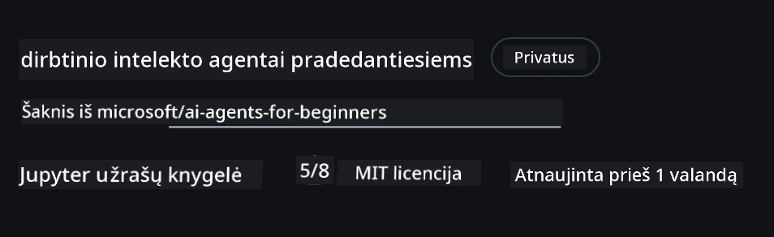
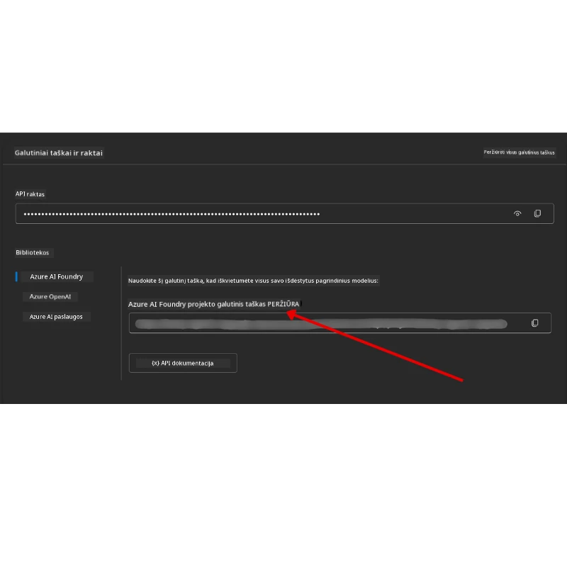

# Kurso nustatymas

## Įvadas

Ši pamoka apims, kaip paleisti šio kurso kodo pavyzdžius.

## Prisijunkite prie kitų besimokančių ir gaukite pagalbos

Prieš pradėdami kopijuoti savo repo, prisijunkite prie [AI Agents For Beginners Discord kanalo](https://aka.ms/ai-agents/discord), kad gautumėte pagalbą dėl nustatymo, užduotumėte klausimus apie kursą arba susisiektumėte su kitais besimokančiais.

## Nukopijuokite arba šakokite šį repozitoriją

Norėdami pradėti, prašome nukopijuoti arba šakoti GitHub repozitoriją. Tai sukurs jūsų pačių kurso medžiagos versiją, kad galėtumėte paleisti, testuoti ir koreguoti kodą!

Tai galima padaryti spustelėjus nuorodą <a href="https://github.com/microsoft/ai-agents-for-beginners/fork" target="_blank">šakoti repozitoriją</a>

Dabar turėtumėte turėti savo fork`intą šios kursų versiją šiame šlinke:



### Paviršutinis klonas (rekomenduojama dirbtuvių / Codespaces atveju)

  >Pilna repozitorija gali būti didelė (~3 GB), jei atsisiunčiate visą istoriją ir visus failus. Jei dalyvaujate tik dirbtuvėse arba reikia tik keletos pamokų aplankų, paviršutinis klonas (arba sparse klonas) atsisiunčia daug mažiau.

#### Greitas paviršutinis klonas — minimalus istorijos kiekis, visi failai

Žemiau pateiktose komandose pakeiskite `<your-username>` savo fork URL (arba upstream URL, jei pageidaujate).

Norėdami nuklonuoti tik naujausios patvirtinimo istoriją (mažas atsisiuntimas):

```bash
git clone --depth 1 https://github.com/<your-username>/ai-agents-for-beginners.git
```

Norėdami klonuoti konkretų šaką:

```bash
git clone --depth 1 --branch <branch-name> https://github.com/<your-username>/ai-agents-for-beginners.git
```

#### Dalinis (sparse) klonas — minimalūs blob'ai + tik pasirinktų aplankų atsisiuntimas

Tai naudoja dalinį klonavimą ir sparse-checkout (reikalauja Git 2.25+ ir rekomenduojama modernaus Git su dalinio klonavimo palaikymu):

```bash
git clone --depth 1 --filter=blob:none --sparse https://github.com/<your-username>/ai-agents-for-beginners.git
```

Įeikite į repozitorijos aplanką:

```bash
cd ai-agents-for-beginners
```

Tuomet nurodykite, kuriuos aplankus norite (žemiau pateiktas pavyzdys rodo du aplankus):

```bash
git sparse-checkout set 00-course-setup 01-intro-to-ai-agents
```

Po klonavimo ir failų patikrinimo, jei jums reikalingi tik failai ir norite atlaisvinti vietos (be git istorijos), prašome ištrinti repozitorijos meta duomenis (💀negrįžtama – prarasite visas Git funkcijas):

```bash
# zsh/bash
rm -rf .git
```

```powershell
# PowerShell
Remove-Item -Recurse -Force .git
```

#### Naudojant GitHub Codespaces (rekomenduojama išvengti didelių vietinių atsisiuntimų)

- Sukurkite naują Codespace šiai repozitorijai per [GitHub UI](https://github.com/codespaces).  

- Naujojo codespace terminale paleiskite vieną iš aukščiau nurodytų paviršutinių/sparse klonavimo komandų, kad į Codespace darbo erdvę įtrauktumėte tik reikiamus pamokų aplankus.
- Pasirinktinai: po klonavimo Codespaces pašalinkite .git, kad atgautumėte vietos (žr. aukščiau komandas meta duomenų pašalinimui).
- Pastaba: jei norite atidaryti repozitoriją tiesiogiai Codespaces (be papildomo klonavimo), atminkite, kad Codespaces sukonstruos devcontainer aplinką ir gali paruošti daugiau nei jums reikia.

#### Patarimai

- Visada keiskite klonavimo URL savo fork'u, jei norite redaguoti/pakeisti.
- Jei vėliau reikės daugiau istorijos ar failų, juos galite atsisiųsti arba koreguoti sparse-checkout, kad įtrauktumėte papildomus aplankus.

## Kodo vykdymas

Šis kursas siūlo keletą Jupyter užrašinių, kuriuos galite paleisti, kad įgytumėte praktinės patirties kuriant AI agentus.

Kodo pavyzdžiai naudoja **Microsoft Agent Framework (MAF)** su `FoundryChatClient`, kuris jungiasi prie **Microsoft Foundry Agent Service V2** (Atsakymų API) per **Microsoft Foundry**.

Visi Python užrašiniai yra pažymėti `*-python-agent-framework.ipynb`.

## Reikalavimai

- Python 3.12+
  - **PASTABA**: Jei neturite įdiegto Python3.12, būtinai jį įdiekite. Tuomet sukurkite savo venv naudodami python3.12, kad būtų įdiegtos tinkamos versijos iš requirements.txt failo.
  
    >Pavyzdys

    Sukurkite Python venv katalogą:

    ```bash
    python -m venv venv
    ```

    Tada aktyvuokite venv aplinką:

    ```bash
    # zsh/bash
    source venv/bin/activate
    ```
  
    ```dos
    # Command Prompt for Windows
    venv\Scripts\activate
    ```

- .NET 10+: Norėdami naudoti pavyzdinius .NET kodus, įsitikinkite, kad įdiegėte [.NET 10 SDK](https://dotnet.microsoft.com/download/dotnet/10.0) arba naujesnę versiją. Tada patikrinkite savo įdiegtos .NET SDK versiją:

    ```bash
    dotnet --list-sdks
    ```

- **Azure CLI** — Reikalingas autentifikacijai. Įdiekite iš [aka.ms/installazurecli](https://aka.ms/installazurecli).
- **Azure prenumerata** — Prieiga prie Microsoft Foundry ir Microsoft Foundry Agent Service.
- **Microsoft Foundry projektas** — Projektas su išdiegta modelo (pvz., `gpt-5-mini`). Peržiūrėkite [1 žingsnį](#step-1-create-a-microsoft-foundry-project) žemiau.

Į šio saugyklos šaknį įtraukėme `requirements.txt` failą, kuriame yra visos reikalingos Python paketų priklausomybės, kad būtų galima paleisti pavyzdinius kodus.

Juos galite įdiegti vykdydami šią komandą terminale šios saugyklos šaknyje:

```bash
pip install -r requirements.txt
```

Rekomenduojame sukurti Python virtualią aplinką, kad išvengtumėte bet kokių konfliktų ir problemų.

## VSCode nustatymas

Įsitikinkite, kad naudojate tinkamą Python versiją VSCode aplinkoje.


## Microsoft Foundry ir Microsoft Foundry Agent Service nustatymas

### 1 žingsnis: Sukurkite Microsoft Foundry projektą

Norint paleisti užrašų knygutes, jums reikia Microsoft Foundry **projekto** su išdiegta modelo. Sukurkite projektą tiesiogiai dabartinėje Microsoft Foundry aplinkoje; centras nėra būtinas.

1. Eikite į [ai.azure.com](https://ai.azure.com) ir prisijunkite su savo Azure paskyra.
2. Pasirinkite **Create project** ir sekite nurodymus, kad sukurtumėte projektą.
3. Projekte išdiekite modelį (pvz., `gpt-5-mini`) iš **Models + Endpoints** → **Deploy model**.

### 2 žingsnis: Gaukite savo projekto galinį tašką ir modelio išdiegimo pavadinimą

Iš savo projekto Microsoft Foundry portale:

- **Projekto galinis taškas** — Eikite į **Overview** puslapį ir nukopijuokite galinio taško URL.



- **Modelio išdiegimo pavadinimas** — Eikite į **Models + Endpoints**, pasirinkite savo išdiegtą modelį ir pažymėkite **Deployment name** (pvz., `gpt-5-mini`).

### 3 žingsnis: Prisijunkite prie Azure naudodami `az login`

Dauguma užrašų knygų autentifikuojasi per jūsų **Azure CLI prisijungimą** — naudojant `AzureCliCredential` arba `DefaultAzureCredential` (abi naudoja jūsų `az login` sesiją) iš `azure-identity` paketo — taigi joms nereikia API raktų. Kai kurie pamokų ir pasirenkamų integracijų atvejai naudoja API raktus; patikrinkite kiekvienos pamokos išankstines sąlygas dėl papildomų aplinkos kintamųjų. Tam reikia būti prisijungus per Azure CLI.

1. **Įdiekite Azure CLI**, jei dar to nepadarėte: [aka.ms/installazurecli](https://aka.ms/installazurecli)

2. **Prisijunkite** paleisdami:

    ```bash
    az login
    ```

    Arba jei esate nuotolinėje/Codespace aplinkoje be naršyklės:

    ```bash
    az login --use-device-code
    ```

3. **Pasirinkite savo prenumeratą**, jei bus paprašyta — pasirinkite tą, kurioje yra jūsų Foundry projektas.

4. **Patikrinkite**, ar esate prisijungę:

    ```bash
    az account show
    ```

> **Kodėl `az login`?** Sąsiuviniai autentifikuojasi naudojant `AzureCliCredential` (arba `DefaultAzureCredential`, kuris taip pat paima jūsų Azure CLI prisijungimą) iš `azure-identity` paketo. Tai reiškia, kad jūsų Azure CLI sesija pateikia prisijungimo duomenis – nereikia jokio API rakto ar slaptažodžių jūsų `.env` faile. Tai yra [geriausia saugumo praktika](https://learn.microsoft.com/azure/developer/ai/keyless-connections).

### 4 žingsnis: Sukurkite savo `.env` failą

Nukopijuokite pavyzdinį failą:

```bash
# zsh/bash
cp .env.example .env
```

```powershell
# PowerShell
Copy-Item .env.example .env
```

Atidarykite `.env` ir užpildykite šias dvi reikšmes:

```env
AZURE_AI_PROJECT_ENDPOINT=https://<your-project>.services.ai.azure.com/api/projects/<your-project-id>
AZURE_AI_MODEL_DEPLOYMENT_NAME=gpt-5-mini
```

| Kintamasis | Kur jį rasti |
|----------|-----------------|
| `AZURE_AI_PROJECT_ENDPOINT` | Foundry portalas → jūsų projektas → **Apžvalgos** puslapis |
| `AZURE_AI_MODEL_DEPLOYMENT_NAME` | Foundry portalas → **Modeliai + Galiniai taškai** → jūsų diegto modelio pavadinimas |

Tai viskas daugeliui pamokų! Sąsiuviniai automatiškai autentifikuosis per jūsų `az login` sesiją.

### 5 žingsnis: Įdiekite Python priklausomybes

```bash
pip install -r requirements.txt
```

Rekomenduojame tai vykdyti virtualioje aplinkoje, kurią sukūrėte anksčiau.

## Pasirinktinė konfigūracija: Azure AI Search (5 ir 16 pamokos)

5 (Agentic RAG) ir 16 pamokų sąsiuviniai veikia iš karto su **atminties pagrindu veikiančia žinių baze** – nereikia papildomų Azure išteklių. Jei norite, kad jie naudotų tikrą **Azure AI Search** indeksą, atkreipkite dėmesį, kad **16 pamokos sąsiuvinis šiuo metu naudoja autentifikaciją per raktą**: jis pereina nuo atminties paieškos prie Azure AI Search tik tada, kai yra nustatyta **ir** `AZURE_SEARCH_SERVICE_ENDPOINT` **ir** `AZURE_SEARCH_API_KEY`, kitu atveju lieka su atminties paieška – todėl norint naudoti tikrą indeksą, būtina nustatyti ir administratoriaus raktą. Autentifikacija be rakto naudojant Microsoft Entra ID (RBAC) yra rekomenduojama jūsų gamybiniam kodui, nuosekliai su `az login` srautu, naudojamu visur šiame kurse.

Toliau pateikti RBAC žingsniai taikomi šios demonstracinės medžiagos pavyzdžiams ir jūsų pačių kodui. Jie neįjungia autentifikacijos be rakto 16 pamokos sąsiuvinyje; 16 pamoka vis dar reikalauja tiek galinio taško, tiek administratoriaus rakto Azure AI Search naudojimui.

1. **Įjunkite vaidmenimis pagrįstą prieigą** savo paieškos paslaugoje:

    ```bash
    az search service update --name <service-name> --resource-group <resource-group> --auth-options aadOrApiKey
    ```

2. **Priskirkite sau reikalingus vaidmenis** (kurti/įkelti indeksus ir vykdyti užklausas):

    ```bash
    az role assignment create --assignee <your-user-or-principal-id> --role "Search Service Contributor" --scope $(az search service show -g <resource-group> -n <service-name> --query id -o tsv)
    az role assignment create --assignee <your-user-or-principal-id> --role "Search Index Data Contributor" --scope $(az search service show -g <resource-group> -n <service-name> --query id -o tsv)
    ```

3. **Pridėkite galinio taško URL** į savo `.env` failą:

| Kintamasis | Kur jį rasti |
|----------|-----------------|
| `AZURE_SEARCH_SERVICE_ENDPOINT` | Azure portalas → jūsų **Azure AI Search** išteklius → **Apžvalga** → URL |
| `AZURE_SEARCH_API_KEY` | Būtina (kartu su galiniu tašku), kad įjungtumėte Azure AI Search 16 pamokos sąsiuvinyje, kuris naudoja autentifikaciją su raktu. Azure portalas → **Nustatymai** → **Raktai** → pirminis administratoriaus raktas |

> **Kodėl be raktų?** Administratoriaus raktai suteikia pilną rašymo prieigą prie jūsų paieškos paslaugos ir gali išsiskirti per `.env` failus. Naudojant RBAC, vietoje to naudojama jūsų `az login` tapatybė — tas pats be raktų Entra ID modelis, kurį naudoja kursų užrašų knygelės (per `AzureCliCredential` / `DefaultAzureCredential`). Žr. [Prisijungimas prie Azure AI Search naudojant roles](https://learn.microsoft.com/azure/search/search-security-rbac).

Žr. [Azure AI Search nustatymo gidas](./AzureSearch.md) dėl pilnų indekso kūrimo pavyzdžių Python ir .NET kalbomis.

## Papildomas nustatymas pamokoms, kurios tiesiogiai naudoja Azure OpenAI (6 ir 8 pamokos)

Kai kuriuose 6 ir 8 pamokų užrašų knygelėse **Azure OpenAI** naudojamas tiesiogiai (naudojant **Responses API**), o ne per Microsoft Foundry projektą. Šie pavyzdžiai anksčiau naudojo GitHub Models, kuris yra pasenęs ir nepalaiko Responses API. Pridėkite šiuos kintamuosius į savo `.env` failą:

| Kintamasis | Kur jį rasti |
|----------|-----------------|
| `AZURE_OPENAI_ENDPOINT` | Azure portalas → jūsų **Azure OpenAI** išteklius → **Keys and Endpoint** → Endpoint (pvz., `https://<your-resource>.openai.azure.com`) |
| `AZURE_OPENAI_DEPLOYMENT` | Jūsų išdėstytos modelio pavadinimas (pvz., `gpt-5-mini`), palaikantis Responses API |
| `AZURE_OPENAI_API_KEY` | Pasirinktinai — tik jei naudojate raktų pagrindu veikiančią autentifikaciją vietoje `az login` / Entra ID |

> Responses API naudoja stabilų `/openai/v1/` galinį tašką, todėl `api-version` nereikia. Prisijunkite naudodami `az login`, kad naudotumėte be raktų Entra ID autentifikaciją.

## Alternatyvus tiekėjas: MiniMax (OpenAI suderinamas)

[MiniMax](https://platform.minimaxi.com/) siūlo didelio konteksto modelius (iki 204K ženklų) per OpenAI suderinamą API. Kadangi Microsoft Agent Framework'o `OpenAIChatClient` veikia su bet kuriuo OpenAI suderinamu galiniu tašku, galite naudoti MiniMax kaip pakaitalą pamokoms, kurios naudoja `OpenAIChatClient`.

Pridėkite šiuos kintamuosius į savo `.env` failą:

| Kintamasis | Kur jį rasti |
|----------|-----------------|
| `MINIMAX_API_KEY` | [MiniMax platforma](https://platform.minimaxi.com/) → API raktai |
| `MINIMAX_BASE_URL` | Naudokite `https://api.minimax.io/v1` (numatytoji reikšmė) |
| `MINIMAX_MODEL_ID` | Naudojamo modelio pavadinimas (pvz., `MiniMax-M3`) |

**Pavyzdiniai modeliai**: `MiniMax-M3` (rekomenduojamas), `MiniMax-M2.7`, `MiniMax-M2.7-highspeed` (greitesni atsakymai). Modelių pavadinimai ir prieinamumas gali keistis, o prieiga prie tam tikro modelio gali priklausyti nuo jūsų paskyros.

Kodo pavyzdžiai, naudojantys `OpenAIChatClient` (pvz., 14-os pamokos viešbučių rezervavimo darbo eiga) automatiškai aptiks ir naudos jūsų MiniMax konfigūraciją, kai nustatytas `MINIMAX_API_KEY`.

## Alternatyvus tiekėjas: Novita AI (OpenAI suderinamas)

[Novita AI](https://novita.ai/llm-api) teikia OpenAI suderinamą API atviro kodo ir pažangioms LLM (DeepSeek, Llama, Qwen ir kt.). Kadangi Microsoft Agent Framework'o `OpenAIChatClient` veikia su bet kuriuo OpenAI suderinamu tašku, galite naudoti Novita AI kaip pakaitalą Azure OpenAI arba OpenAI.

Pridėkite šiuos kintamuosius į savo `.env` failą:

| Kintamasis | Kur rasti |
|----------|-----------------|
| `NOVITA_API_KEY` | [Novita AI valdymo skydelis](https://novita.ai/settings/key-management) → API raktai |
| `NOVITA_BASE_URL` | Naudokite `https://api.novita.ai/openai/v1` (numatytoji reikšmė) |
| `NOVITA_MODEL_ID` | Naudojamo modelio pavadinimas (pvz., `moonshotai/kimi-k3`) |

**Pavyzdiniai modeliai**: `moonshotai/kimi-k3`, `zai-org/glm-5.2`, `deepseek/deepseek-v4-flash-0731`. Novita AI taip pat talpina daugelio kitų atviro kodo modelių šeimas (Llama, Qwen, GLM ir kt.) — patikrinkite [Novita AI modelių biblioteką](https://novita.ai/llm-api), kad sužinotumėte esamų modelių sąrašą ir jų modelių ID.

Dabartiniai pavyzdžiai automatiškai nenaudoja `NOVITA_*` kintamųjų. Norėdami naudoti Novita AI, perduokite šias reikšmes aiškiai kuriant `OpenAIChatClient` pavyzdyje, kurį vykdote.

## Alternatyvus tiekėjas: Foundry Local (Modelių vykdymas įrenginyje)

[Foundry Local](https://foundrylocal.ai) yra lengvas vykdymo laiko sprendimas, kuris atsisiunčia, valdo ir teikia kalbos modelius **visiškai jūsų paties kompiuteryje** per OpenAI suderinamą API — nereikalaujant debesies.

Kadangi Microsoft Agent Framework'o `OpenAIChatClient` veikia su bet kuriuo OpenAI suderinamu tašku, Foundry Local yra vietinis pakaitalas Azure OpenAI.

**1. Įdiekite Foundry Local**

```bash
# Windows
winget install Microsoft.FoundryLocal

# macOS
brew install foundrylocal
```

**2. Atsisiųskite ir paleiskite modelį** (tai taip pat paleidžia vietinę paslaugą):

```bash
foundry model list          # see available models
foundry model run phi-4-mini
```

**3. Įdiekite Python SDK**, naudojamą vietinio taško nustatymui:

```bash
pip install foundry-local-sdk
```

**4. Nukreipkite Microsoft Agent Framework į savo vietinį modelį:**

```python
from foundry_local import FoundryLocalManager
from agent_framework.openai import OpenAIChatClient

# Downloads (if needed) and serves the model locally, then discovers the endpoint/port.
manager = FoundryLocalManager("phi-4-mini")

chat_client = OpenAIChatClient(
    base_url=manager.endpoint,      # e.g. http://localhost:<port>/v1
    api_key=manager.api_key,        # always "not-required" for Foundry Local
    model_id=manager.get_model_info("phi-4-mini").id,
)

agent = chat_client.as_agent(
    name="LocalAgent",
    instructions="You are a helpful assistant running fully on-device.",
)
```

> **Pastaba:** Foundry Local atveria OpenAI suderinamą **Pokalbių užbaigimo** tašką. Naudokite jį vietiniam kūrimui ir neprisijungus. Norėdami pilnos **Atsakymų API** funkcionalumo (valstybės palaikomi pokalbiai ir kt.), naudokite Azure OpenAI arba Microsoft Foundry projektą.

## Papildomas parengimas 8 pamokai (Bing susiejimo darbo eiga)

Sąlyginio darbo eigos užrašų knyga 8 pamokoje naudoja **Bing susiejimą** per Microsoft Foundry. Jei planuojate vykdyti tą pavyzdį, pridėkite šį kintamąjį į savo `.env` failą:

| Kintamasis | Kur rasti |
|----------|-----------------|
| `BING_CONNECTION_ID` | Microsoft Foundry portale → jūsų projektas → **Valdymas** → **Sujungti ištekliai** → jūsų Bing ryšys → nukopijuokite ryšio ID |

## Trikčių šalinimas

### SSL sertifikato patvirtinimo klaidos macOS sistemoje

Jei naudojate macOS ir susiduriate su klaida, panašia į:

```plaintext
ssl.SSLCertVerificationError: [SSL: CERTIFICATE_VERIFY_FAILED] certificate verify failed: self-signed certificate in certificate chain
```

Tai yra žinoma problema su Python macOS, kai sistemos SSL sertifikatai nėra automatiškai patikimi. Išbandykite šiuos sprendimus iš eilės:

**Parinktis 1: Vykdykite Python Install Certificates scenarijų (rekomenduojama)**

```bash
# Replace 3.XX with your installed Python version (e.g., 3.12 or 3.13):
/Applications/Python\ 3.XX/Install\ Certificates.command
```

**Parinktis 2: Naudokite `connection_verify=False` savo užrašų knygelėje (tik GitHub Models užrašų knygelėms)**

6 pamokos užrašų knygelėje (`06-building-trustworthy-agents/code_samples/06-system-message-framework.ipynb`) jau įtraukta iškomentuota problemai spręsti skirta laikina priemonė. Iškomentuokite `connection_verify=False`, kai gaunate sertifikato klaidas:

```python
client = ChatCompletionsClient(
    endpoint=endpoint,
    credential=AzureKeyCredential(token),
    connection_verify=False,  # Disable SSL verification if you encounter certificate errors
)
```

> **⚠️ Įspėjimas:** SSL patikrinimo išjungimas (`connection_verify=False`) sumažina saugumą, praleidžiant sertifikato validavimą. Naudokite tai tik kaip laikinas priemones vystymo aplinkoje. Niekada nenaudokite gamybos aplinkoje.

**Parinktis 3: Įdiekite ir naudokite `truststore`**

```bash
pip install truststore
```

Tada pridėkite tai viršuje savo užrašų knygelėje ar scenarijuje prieš atliekant bet kokius tinklo kvietimus:

```python
import truststore
truststore.inject_into_ssl()
```

## Užstringote?

Jei kyla problemų vykdant šią konfigūraciją, prisijunkite prie mūsų <a href="https://discord.gg/kzRShWzttr" target="_blank">Azure AI bendruomenės Discord</a> arba <a href="https://github.com/microsoft/ai-agents-for-beginners/issues?WT.mc_id=academic-105485-koreyst" target="_blank">praneškite apie problemą</a>.

## Kita pamoka

Dabar esate pasirengę paleisti šio kurso kodą. Linkime sėkmės mokantis daugiau apie AI agentų pasaulį!

[Įvadas į AI agentus ir agentų naudojimo atvejus](../01-intro-to-ai-agents/README.md)

---

<!-- CO-OP TRANSLATOR DISCLAIMER START -->
**Atsakomybės apribojimas**:
Šis dokumentas buvo išverstas naudojant dirbtinio intelekto vertimo paslaugą [Co-op Translator](https://github.com/Azure/co-op-translator). Nors siekiame tikslumo, prašome atkreipti dėmesį, kad automatiniai vertimai gali turėti klaidų ar netikslumų. Originalus dokumentas jo gimtąja kalba laikomas autoritetingu šaltiniu. Svarbiai informacijai rekomenduojama naudoti profesionalų žmogiškąjį vertimą. Mes neatsakome už jokius nesusipratimus ar neteisingą interpretaciją, kilusią naudojantis šiuo vertimu.
<!-- CO-OP TRANSLATOR DISCLAIMER END -->