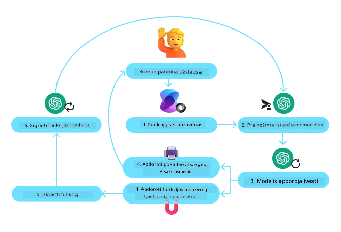
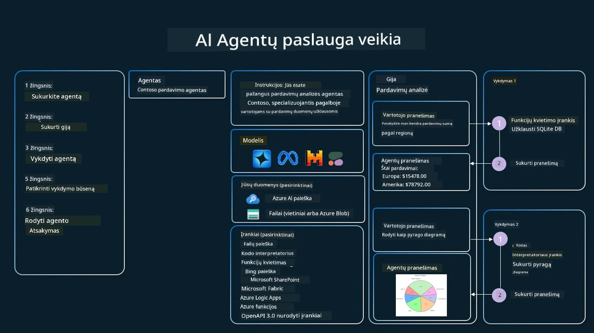

[](https://youtu.be/vieRiPRx-gI?si=cEZ8ApnT6Sus9rhn)

> _(Spustelėkite aukščiau esantį vaizdą, kad peržiūrėtumėte šio pamokos vaizdo įrašą)_

# Įrankių naudojimo dizaino šablonas

Įrankiai yra įdomūs, nes jie leidžia DI agentams turėti platesnį galimybių spektrą. Vietoj to, kad agentas turėtų ribotą veiksmų rinkinį, jis gali atlikti daug platesnį veiksmų spektrą pridėjus įrankį. Šiame skyriuje apžvelgsime įrankių naudojimo dizaino šabloną, kuris aprašo, kaip DI agentai gali naudoti specifinius įrankius siekdami savo tikslų.

## Įvadas

Šioje pamokoje bandysime atsakyti į šiuos klausimus:

- Kas yra įrankių naudojimo dizaino šablonas?
- Kokiuose naudojimo atvejuose jis gali būti taikomas?
- Kokie elementai/statybiniai blokai reikalingi šiam dizaino šablonui įgyvendinti?
- Kokie yra ypatingi aspektai kuriant patikimus DI agentus naudojant įrankių naudojimo dizaino šabloną?

## Mokymosi tikslai

Baigę šią pamoką, jūs galėsite:

- Apibrėžti įrankių naudojimo dizaino šabloną ir jo paskirtį.
- Identifikuoti naudojimo atvejus, kuriose tinka šis dizaino šablonas.
- Suprasti pagrindinius elementus reikalingus dizaino šablonui įgyvendinti.
- Atpažinti aspektus, svarbius užtikrinant pasitikėjimą DI agentais naudojant šį dizaino šabloną.

## Kas yra įrankių naudojimo dizaino šablonas?

**Įrankių naudojimo dizaino šablonas** orientuojasi į tai, kaip suteikti didelių kalbos modelių (LLM) galimybę sąveikauti su išoriniais įrankiais, siekiant konkrečių tikslų. Įrankiai yra kodas, kurį agentas gali vykdyti atlikti veiksmus. Įrankis gali būti paprasta funkcija, pavyzdžiui, skaičiuoklė, arba API kvietimas trečiosios šalies paslaugai, kaip akcijų kainų paieška ar orų prognozė. DI agentų kontekste įrankiai sukurti taip, kad agentai juos vykdytų reaguodami į **modello sukurtus funkcijų kvietimus**.

## Kokiuose naudojimo atvejuose jis gali būti taikomas?

DI agentai gali pasinaudoti įrankiais, kad įvykdytų sudėtingas užduotis, surinktų informaciją ar priimtų sprendimus. Įrankių naudojimo dizaino šablonas dažnai taikomas scenarijuose, reikalaujančiuose dinaminės sąveikos su išorinėmis sistemomis, tokiomis kaip duomenų bazės, internetinės paslaugos ar kodų interpretuotojai. Tai naudinga įvairiems naudojimo atvejams, pavyzdžiui:

- **Dinaminis informacijos gavimas:** Agentai gali užklausinėti išorines API ar duomenų bazes, kad gautų naujausius duomenis (pvz., užklausinėti SQLite duomenų bazę duomenų analizei, gauti akcijų kainas ar orų informaciją).
- **Kodo vykdymas ir interpretacija:** Agentai gali vykdyti kodą ar scenarijus spręsti matematines užduotis, generuoti ataskaitas ar atlikti simuliacijas.
- **Darbo srautų automatizavimas:** Automatizuoti pasikartojančias ar daugiasluoksnes darbo procesos integruojant įrankius, kaip užduočių planuotojai, el. pašto paslaugos ar duomenų srautai.
- **Klientų aptarnavimas:** Agentai gali sąveikauti su CRM sistemomis, bilietų platformomis ar žinių bazėmis, kad išspręstų vartotojo užklausas.
- **Turinio kūrimas ir redagavimas:** Agentai gali naudotis įrankiais, kaip gramatikos tikrintuvai, tekstų santraukos ar turinio saugos vertintojai, padedančiais kuriant turinį.

## Kokie elementai/statybiniai blokai reikalingi įrankių naudojimo dizaino šablonui įgyvendinti?

Šie elementai leidžia DI agentui atlikti įvairias užduotis. Pažvelkime į pagrindinius elementus, reikalingus įrankių naudojimo dizaino šablonui įgyvendinti:

- **Funkcijų/įrankių schemos**: Išsamūs aprašymai apie galimus įrankius, įskaitant funkcijos pavadinimą, paskirtį, reikalingus parametrus ir tikėtinus rezultatus. Šios schemos leidžia LLM suprasti, kokie įrankiai yra prieinami ir kaip sukurti galiojančias užklausas.

- **Funkcijų vykdymo logika**: Nustato, kaip ir kada įrankiai kviečiami, remiantis vartotojo ketinimu ir pokalbio kontekstu. Tai gali apimti planavimo modulius, maršrutizavimo mechanizmus ar sąlyginę eigą, leidžiančią dinamiškai nustatyti įrankių naudojimą.

- **Pranešimų tvarkymo sistema**: Komponentai, valdančios pokalbio eigą tarp vartotojo įvesties, LLM atsakymų, įrankių kvietimų ir jų rezultatų.

- **Įrankių integravimo sistema**: Infrastruktūra, jungianti agentą su įvairiais įrankiais, nesvarbu, ar tai paprastos funkcijos, ar sudėtingos išorinės paslaugos.

- **Klaidų valdymas ir validacija**: Mechanizmai, apdorojantys įrankių vykdymo klaidas, tikrinantys parametrus ir valdantys netikėtas reakcijas.

- **Būsenos valdymas**: Stebi pokalbio kontekstą, ankstesnius įrankių veiksmus ir nuolatinę informaciją, kad užtikrintų nuoseklumą kelių turų sąveikose.

Dabar pažvelkime į funkcijų/įrankių kvietimą detaliau.
 
### Funkcijų/įrankių kvietimas

Funkcijų kvietimas yra pagrindinis būdas, leidžiantis didelių kalbos modeliams (LLM) sąveikauti su įrankiais. Dažnai matysite, kad žodžiai „funkcija“ ir „įrankis“ vartojami sinonimiškai, nes „funkcijos“ (pakartotinai naudojamo kodo blokai) yra įrankiai, kuriuos agentai naudoja užduotims atlikti. Tam, kad funkcinis kodas būtų iškviestas, LLM turi palyginti vartotojo užklausą su funkcijos aprašymu. Tam yra siunčiama schema, kurioje yra visų galimų funkcijų aprašymai. LLM tuomet parenka tinkamiausią funkciją užduočiai ir grąžina jos pavadinimą bei argumentus. Pasirinkta funkcija vykdoma, jos atsakymas siunčiamas atgal LLM, kuris panaudoja informaciją atsakymui į vartotojo užklausą sukurti.

Kūrėjams, norintiems įdiegti funkcijų kvietimą agentams, reikės:

1. LLM modelio, palaikančio funkcijų kvietimą
2. Schemos, kurioje aprašytos funkcijos
3. Kodo kiekvienai aprašytai funkcijai

Iliustruokime tai pavyzdžiu, kaip gauti dabartinį laiką mieste:

1. **Inicijuoti LLM, palaikantį funkcijų kvietimą:**

    Ne visi modeliai palaiko funkcijų kvietimą, todėl svarbu patikrinti, ar jūsų naudojamas LLM tai palaiko.    <a href="https://learn.microsoft.com/azure/ai-services/openai/how-to/function-calling" target="_blank">Azure OpenAI</a> palaiko funkcijų kvietimą. Galime pradėti inicijuodami OpenAI klientą naudodami Azure OpenAI **Responses API** (stabilus `/openai/v1/` galinis taškas – nereikia `api_version`). 

    ```python
    # Initialize the OpenAI client for Azure OpenAI (Responses API, v1 endpoint)
    client = OpenAI(
        base_url=f"{os.environ['AZURE_OPENAI_ENDPOINT'].rstrip('/')}/openai/v1/",
        api_key=os.environ["AZURE_OPENAI_API_KEY"],
    )
    deployment_name = os.environ["AZURE_OPENAI_DEPLOYMENT"]
    ```

1. **Sukurti funkcijos schemą**:

    Toliau apibrėšime JSON schemą, kurioje bus funkcijos pavadinimas, aprašymas, ką funkcija atlieka, ir parametrai su jų aprašymais.
    Tada perduosime šią schemą anksčiau sukurtam klientui kartu su vartotojo užklausa sužinoti laiką San Franciske. Svarbu paminėti, kad **įrankio kvietimas** yra tai, kas gražinama, **o ne** galutinis atsakymas į klausimą. Kaip minėta anksčiau, LLM grąžina funkcijos pavadinimą, kurią jis pasirinko užduočiai, bei argumentus, kurie bus perduoti funkcijai.

    ```python
    # Function description for the model to read (Responses API flat tool format)
    tools = [
        {
            "type": "function",
            "name": "get_current_time",
            "description": "Get the current time in a given location",
            "parameters": {
                "type": "object",
                "properties": {
                    "location": {
                        "type": "string",
                        "description": "The city name, e.g. San Francisco",
                    },
                },
                "required": ["location"],
            },
        }
    ]
    ```
   
    ```python
  
    # Initial user message
    messages = [{"role": "user", "content": "What's the current time in San Francisco"}]

    # First API call: Ask the model to use the function
    response = client.responses.create(
        model=deployment_name,
        input=messages,
        tools=tools,
        tool_choice="auto",
        store=False,
    )

    # The Responses API returns tool calls as function_call items in response.output.
    # Append them to the conversation so the model has full context on the next turn.
    messages += response.output

    print("Model's response:")
    print(response.output)
  
    ```

    ```bash
    Model's response:
    [ResponseFunctionToolCall(arguments='{"location":"San Francisco"}', call_id='call_pOsKdUlqvdyttYB67MOj434b', name='get_current_time', type='function_call')]
    ```
  
1. **Funkcijos kodas, reikalingas užduočiai atlikti:**

    Dabar, kai LLM pasirinko, kuri funkcija turi būti paleista, reikia įgyvendinti ir vykdyti tą kodo dalį.
    Galime įgyvendinti laikrodžio gavimo kodą Python kalba. Taip pat reikės parašyti kodą, kuris iš atsakymo žinutės ištrauks funkcijos pavadinimą ir argumentus, kad gautume galutinį rezultatą.

    ```python
      def get_current_time(location):
        """Get the current time for a given location"""
        print(f"get_current_time called with location: {location}")  
        location_lower = location.lower()
        
        for key, timezone in TIMEZONE_DATA.items():
            if key in location_lower:
                print(f"Timezone found for {key}")  
                current_time = datetime.now(ZoneInfo(timezone)).strftime("%I:%M %p")
                return json.dumps({
                    "location": location,
                    "current_time": current_time
                })
      
        print(f"No timezone data found for {location_lower}")  
        return json.dumps({"location": location, "current_time": "unknown"})
    ```

     ```python
    # Handle function calls
    tool_calls = [item for item in response.output if item.type == "function_call"]
    if tool_calls:
        for tool_call in tool_calls:
            if tool_call.name == "get_current_time":

                function_args = json.loads(tool_call.arguments)

                time_response = get_current_time(
                    location=function_args.get("location")
                )

                # Return the tool result as a function_call_output item
                messages.append({
                    "type": "function_call_output",
                    "call_id": tool_call.call_id,
                    "output": time_response,
                })
    else:
        print("No tool calls were made by the model.")

    # Second API call: Get the final response from the model
    final_response = client.responses.create(
        model=deployment_name,
        input=messages,
        tools=tools,
        store=False,
    )

    return final_response.output_text
     ```

     ```bash
      get_current_time called with location: San Francisco
      Timezone found for san francisco
      The current time in San Francisco is 09:24 AM.
     ```

Funkcijų kvietimas yra daugumos, jei ne visų agentų įrankių naudojimo dizaino šablonų pagrindas, tačiau jį įgyvendinti nuo nulio gali būti sudėtinga.
Kaip sužinojome [2 pamokoje](../../../02-explore-agentic-frameworks), agentinės sistemos suteikia mums paruoštus statybinius blokus įrankių naudojimui įgyvendinti.
 
## Įrankių naudojimo pavyzdžiai su agentinėmis sistemomis

Štai keli pavyzdžiai, kaip galite įgyvendinti įrankių naudojimo dizaino šabloną su skirtingomis agentinėmis sistemomis:

### Microsoft agentų sistema

<a href="https://learn.microsoft.com/azure/ai-services/agents/overview" target="_blank">Microsoft agentų sistema</a> yra atviro kodo DI sistema DI agentams kurti. Ji supaprastina funkcijų kvietimo naudojimą, leidžiant apibrėžti įrankius kaip Python funkcijas su `@tool` dekoratoriumi. Sistema valdo komunikaciją tarp modelio ir jūsų kodo. Taip pat suteikia prieigą prie paruoštų įrankių, tokių kaip bylos paieška ir kodo interpretuotojas per `FoundryChatClient`.

Šis diagrama iliustruoja funkcijų kvietimo procesą naudojant Microsoft agentų sistemą:



Microsoft agentų sistemoje įrankiai apibrėžiami kaip dekoruotos funkcijos. Galime paversti anksčiau matytą `get_current_time` funkciją į įrankį, naudodami `@tool` dekoratorių. Sistema automatiškai serializuos funkciją ir jos parametrus, sukuriant schemą siuntimui LLM.

```python
import os
from agent_framework import tool
from agent_framework.foundry import FoundryChatClient
from azure.identity import AzureCliCredential

@tool(approval_mode="never_require")
def get_current_time(location: str) -> str:
    """Get the current time for a given location"""
    ...

# Create the client
provider = FoundryChatClient(
    project_endpoint=os.environ["AZURE_AI_PROJECT_ENDPOINT"],
    model=os.environ["AZURE_AI_MODEL_DEPLOYMENT_NAME"],
    credential=AzureCliCredential(),
)

# Create an agent and run with the tool
agent = provider.as_agent(name="TimeAgent", instructions="Use available tools to answer questions.", tools=get_current_time)
response = await agent.run("What time is it?")
```

#### Įrankiai iš MCP serverio

Įrankiai nebūtinai turi būti funkcijos jūsų pačių kode. Serveris, palaikantis Model Context Protocol (MCP, aprašytą [11 pamokoje](../11-agentic-protocols/README.md)), pateikia savo įrankius kartu su jų schemomis, ir sistema gali juos įkelti taip pat, kaip serializuoja dekoruotas funkcijas. `MCPStreamableHTTPTool` jungiasi prie tokio serverio per HTTP, nuskaito įrankių schemas ir siūlo jas modeliui kartu su vietiniais įrankiais.

Žemiau pateiktas pavyzdys naudoja interneto paieškos serverį, kurį teikia <a href="https://keenable.ai" target="_blank">Keenable</a>. Jį galima naudoti nemokamai be paskyros ar API rakto (užklausos ribojamos pagal IP), todėl vieninteliai paskyros duomenys yra jūsų modelio kredencialai. Kaip ir su bet kokiu išoriniu įrankiu, modelio rašomos užklausos siunčiamos į tą serverį.

```python
from agent_framework import MCPStreamableHTTPTool

web_search = MCPStreamableHTTPTool(
    name="Keenable web search",
    url="https://api.keenable.ai/mcp",
)

# Connecting loads the server's tool schemas; the agent decides when to call them
async with web_search:
    agent = provider.as_agent(
        name="ResearchAgent",
        instructions="Use available tools to answer questions.",
        tools=[web_search],
    )
    response = await agent.run("What is new in the latest Python release?")
    print(response.text)
```

Serveris publikuoja du įrankius, `search_web_pages` ir `fetch_page_content`. Kai reikia gauti naujausią informaciją, modelis kviečia `search_web_pages`, gauna atgal pavadinimus, URL ir tekstų ištraukas, ir iš jų rašo atsakymą, ta pati kilpa kaip ir aukščiau pateiktame `get_current_time` pavyzdyje.
  
### Microsoft Foundry agentų paslauga

<a href="https://learn.microsoft.com/azure/ai-services/agents/overview" target="_blank">Microsoft Foundry agentų paslauga</a> yra naujesnė agentinė sistema, skirta padėti kūrėjams saugiai kurti, diegti ir išplėsti aukštos kokybės DI agentus, nereikalaujant valdyti pagrindinių skaičiavimo ir duomenų saugojimo išteklių. Ji ypač naudinga verslo programoms, nes tai visiškai valdoma paslauga su verslo lygio saugumu.

Lyginant su tiesioginiu darbų su LLM API kūrimu, Microsoft Foundry agentų paslauga suteikia kai kurias privalumas, įskaitant:

- Automatinis įrankių kvietimas – nereikia analizuoti įrankio kvietimo, kvietimo vykdymo ir atsakymo valdymo; visa tai dabar vykdoma serverio pusėje
- Saugiai valdomi duomenys – vietoj to, kad valdytumėte pokalbio būseną patys, galite pasikliauti gijų saugojimu visos reikalingos informacijos
- Iš karto pasiruošę įrankiai – įrankiai, kuriais galite sąveikauti su savo duomenų šaltiniais, pvz., Bing, Azure AI Search ir Azure Functions.

Microsoft Foundry agentų paslaugos įrankius galima suskirstyti į dvi kategorijas:

1. Žinių įrankiai:
    - <a href="https://learn.microsoft.com/azure/ai-services/agents/how-to/tools/bing-grounding?tabs=python&pivots=overview" target="_blank">Pagrindimas su Bing paieška</a>
    - <a href="https://learn.microsoft.com/azure/ai-services/agents/how-to/tools/file-search?tabs=python&pivots=overview" target="_blank">Bylos paieška</a>
    - <a href="https://learn.microsoft.com/azure/ai-services/agents/how-to/tools/azure-ai-search?tabs=azurecli%2Cpython&pivots=overview-azure-ai-search" target="_blank">Azure AI Search</a>

2. Veiksmų įrankiai:
    - <a href="https://learn.microsoft.com/azure/ai-services/agents/how-to/tools/function-calling?tabs=python&pivots=overview" target="_blank">Funkcijų kvietimas</a>
    - <a href="https://learn.microsoft.com/azure/ai-services/agents/how-to/tools/code-interpreter?tabs=python&pivots=overview" target="_blank">Kodo interpretuotojas</a>
    - <a href="https://learn.microsoft.com/azure/ai-services/agents/how-to/tools/openapi-spec?tabs=python&pivots=overview" target="_blank">OpenAPI apibrėžti įrankiai</a>
    - <a href="https://learn.microsoft.com/azure/ai-services/agents/how-to/tools/azure-functions?pivots=overview" target="_blank">Azure Functions</a>

Agentų paslauga leidžia naudoti šiuos įrankius kartu kaip `toolset`. Ji taip pat naudoja `threads`, kurie seka pranešimų istoriją konkrečiame pokalbyje.

Įsivaizduokite, kad esate pardavimų agentas įmonėje Contoso. Norite sukurti pokalbių agentą, galintį atsakyti į klausimus apie jūsų pardavimų duomenis.

Žemiau pateikta iliustracija, kaip galėtumėte naudoti Microsoft Foundry agentų paslaugą analizuoti savo pardavimų duomenis:



Norėdami naudoti bet kurį iš šių įrankių su paslauga, galime sukurti klientą ir apibrėžti įrankį ar įrankių rinkinį. Praktiniam įgyvendinimui galime naudoti šį Python kodą. LLM galės pažvelgti į įrankių rinkinį ir nuspręsti, ar naudoti vartotojo sukurtą funkciją `fetch_sales_data_using_sqlite_query`, ar iš anksto paruoštą kodo interpretuotoją, priklausomai nuo vartotojo užklausos.

```python 
import os
from azure.ai.projects import AIProjectClient
from azure.identity import DefaultAzureCredential
from fetch_sales_data_functions import fetch_sales_data_using_sqlite_query # fetch_sales_data_using_sqlite_query function which can be found in a fetch_sales_data_functions.py file.
from azure.ai.projects.models import ToolSet, FunctionTool, CodeInterpreterTool

project_client = AIProjectClient.from_connection_string(
    credential=DefaultAzureCredential(),
    conn_str=os.environ["PROJECT_CONNECTION_STRING"],
)

# Initialize toolset
toolset = ToolSet()

# Initialize function calling agent with the fetch_sales_data_using_sqlite_query function and adding it to the toolset
fetch_data_function = FunctionTool(fetch_sales_data_using_sqlite_query)
toolset.add(fetch_data_function)

# Initialize Code Interpreter tool and adding it to the toolset. 
code_interpreter = CodeInterpreterTool()toolset.add(code_interpreter)

agent = project_client.agents.create_agent(
    model="gpt-5-mini", name="my-agent", instructions="You are helpful agent", 
    toolset=toolset
)
```

## Kokie yra ypatingi aspektai naudojant įrankių naudojimo dizaino šabloną kuriant patikimus DI agentus?

Dažna problema su SQL, dinamiškai sukuriamais LLM, yra saugumas, ypač SQL injekcijos ar piktybinių veiksmų rizika, pvz., duomenų bazės ištrynimas ar klastojimas. Nors šie rūpesčiai yra pagrįsti, juos galima veiksmingai sumažinti tinkamai sukonfigūruojant duomenų bazės prieigos teises. Daugumai duomenų bazių tai reiškia duomenų bazės sukonfigūravimą kaip tik skaitymo (read-only). Duomenų bazių paslaugoms, kaip PostgreSQL ar Azure SQL, programai turi būti priskirtos tik skaitymo (SELECT) teisės.

Programos paleidimas saugioje aplinkoje dar labiau sustiprina apsaugą. Verslo scenarijuose duomenys paprastai yra išgaunami ir transformuojami iš operacinių sistemų į tik skaitymui skirtą duomenų bazę arba duomenų sandėlį su vartotojui patogia schema. Šis požiūris užtikrina, kad duomenys yra saugūs, optimizuoti našumui ir prieinamumui, o programa turi apribotą, tik skaitymo prieigą.

## Pavyzdiniai kodai

- Python: [Agent Framework](./code_samples/04-python-agent-framework.ipynb)
- .NET: [Agent Framework](./code_samples/04-dotnet-agent-framework.md)

## Turite daugiau klausimų apie įrankių naudojimo dizaino šablonus?

Prisijunkite prie [Microsoft Foundry Discord](https://discord.com/invite/ATgtXmAS5D), kur galite susitikti su kitais mokiniais, dalyvauti konsulterijos valandose ir gauti atsakymus į klausimus apie DI agentus.

## Papildomi ištekliai

- <a href="https://microsoft.github.io/build-your-first-agent-with-azure-ai-agent-service-workshop/" target="_blank">Azure AI agentų paslaugos dirbtuvės</a>
- <a href="https://github.com/Azure-Samples/contoso-creative-writer/tree/main/docs/workshop" target="_blank">Contoso kūrybinio rašytojo multi-agento dirbtuvės</a>
- <a href="https://learn.microsoft.com/azure/ai-services/agents/overview" target="_blank">„Microsoft Agent Framework“ apžvalga</a>

## Šio agento pirminis testavimas (pasirinktinai)

Išmokę diegti agentus [16 pamokoje](../16-deploying-scalable-agents/README.md), galite šios pamokos `TravelToolAgent` (ar jis vis dar kviečia savo įrankius ir atsako?) išbandyti su [`tests/lesson-04-smoke-tests.json`](../../../tests/lesson-04-smoke-tests.json). Peržiūrėkite [`tests/README.md`](../tests/README.md), kaip jį paleisti.

## Ankstesnė pamoka

[Agentinių dizaino šablonų supratimas](../03-agentic-design-patterns/README.md)

## Kitoji pamoka

[Agentinis RAG](../05-agentic-rag/README.md)

---

<!-- CO-OP TRANSLATOR DISCLAIMER START -->
**Atsakomybės apribojimas**:
Šis dokumentas buvo išverstas naudojant dirbtinio intelekto vertimo paslaugą [Co-op Translator](https://github.com/Azure/co-op-translator). Nors siekiame tikslumo, prašome atkreipti dėmesį, kad automatiniai vertimai gali turėti klaidų ar netikslumų. Originalus dokumentas jo gimtąja kalba laikomas autoritetingu šaltiniu. Svarbiai informacijai rekomenduojama naudoti profesionalų žmogiškąjį vertimą. Mes neatsakome už jokius nesusipratimus ar neteisingą interpretaciją, kilusią naudojantis šiuo vertimu.
<!-- CO-OP TRANSLATOR DISCLAIMER END -->