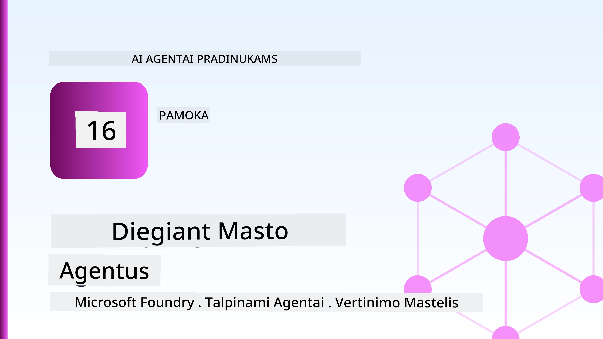
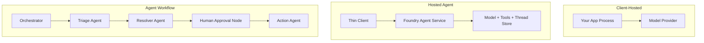
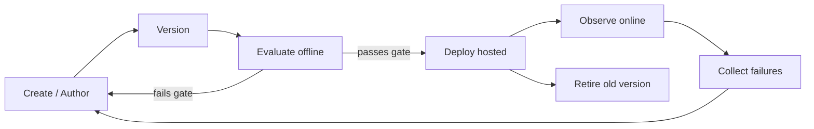
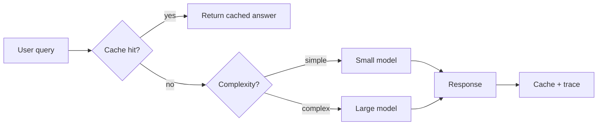
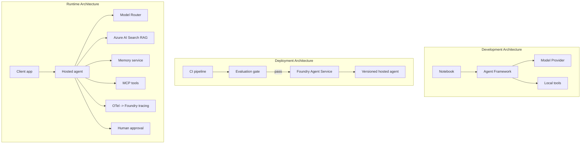

# Skalų Agentų Diegimas su Microsoft Foundry



Iki šiol kurse jūs kūrėte agentus, kurie veikia jūsų nešiojamajame kompiuteryje, viduje užrašų knygelėje, valdantys `az login` ir keletu aplinkos kintamųjų. Tai būtent teisingas būdas mokytis. Tačiau tai nėra tinkamas būdas paleisti agentą, nuo kurio priklauso tūkstančiai klientų 3 val. nakties.

Šis pamokas skirtas spragai tarp „veikia mano mašinoje“ ir „veikia patikimai ir už prieinamą kainą gamyboje“ užpildyti. Mes užpildome tą spragą naudodami **Microsoft Foundry** ir **Microsoft Foundry Agent Service**, kurdami realų klientų aptarnavimo agentą, turintį įrankius, paiešką, atmintį, vertinimą ir stebėseną.

## Įvadas

Ši pamoka apims:

- Skirtumą tarp **prototipo agento** ir **įdiegto agento**, ir kodėl perėjimas daugiausia susijęs su tuo, kas yra *aplink* modelį.
- Agentų **diegimo modelius**: klientų talpinimas, paslaugų talpinimas (hosted Agents) ir darbo eigos orkestravimas.
- **Agentų gyvenimo ciklą** Microsoft Foundry — kurti, versijuoti, diegti, vertinti, stebėti, pasitraukti.
- **Mastelio keitimo strategijas**: modelio maršrutizavimas, talpyklavimas, lygiagretumas, bevalstis dizainas.
- **Stebimumą** su OpenTelemetry ir Foundry sekimu.
- **Kaštų optimizavimą** per modelio pasirinkimą, maršrutizavimą ir vertinimo vartus.
- **Įmonių svarstymus**: valdymas, žmogaus patvirtinimas ir saugus MCP serverių paleidimas gamyboje.

## Mokymosi Tikslai

Baigę šią pamoką, mokėsite:

- Pasirinkti tinkamą diegimo modelį pagal agento darbo krūvį.
- Diegti agentą į Microsoft Foundry Agent Service, kad jis būtų versijuojamas, valdoma ir stebimas.
- Instrumentuoti agentą sekimui ir sukurti vertinimo grandinę, kuri veikia prieš kiekvieną išleidimą.
- Taikyti modelio maršrutizavimą ir talpyklavimą, kad išlaikytumėte vėlavimą ir kaštus kontroliuojamus mastelio didėjimo metu.
- Pridėti žmogaus patvirtinimo vartus rizikingiems veiksmams ir integruoti MCP serverį saugiu būdu gamyboje.

## Prieš Reikalingos Žinios

Ši pamoka daro prielaidą, kad jau išmokote ankstesnes pamokas ir esate įgudę:

- Kurti agentus su [Microsoft Agent Framework](../14-microsoft-agent-framework/README.md) (14 pamoka).
- [Įrankių naudojimas](../04-tool-use/README.md) (4 pamoka) ir [Agentic RAG](../05-agentic-rag/README.md) (5 pamoka).
- [Agentų atmintis](../13-agent-memory/README.md) (13 pamoka) ir [Agentic protokolai / MCP](../11-agentic-protocols/README.md) (11 pamoka).
- [Stebimumas ir vertinimas](../10-ai-agents-production/README.md) (10 pamoka) — ši pamoka tiesiogiai juo remiasi.

Jums taip pat reikės:

- **Azure prenumeratos** ir **Microsoft Foundry projekto** su bent vienu diegtu pokalbių modeliu.
- **Azure CLI** autentifikuotos (`az login`).
- Python 3.12+ ir paketus saugykloje [`requirements.txt`](../../../requirements.txt).

## Nuo Prototipo iki Gamybos: Kas Iš Tikrųjų Keičiasi

Prototipo agentas ir gamybos agentas dalijasi ta pačia pagrindine kilpa — mąstyti, kviesti įrankius, atsakyti. Kas keičiasi, tai viskas aplink tą kilpą. Modelis sudaro galbūt 20% gamybos agento; likę 80% yra operacinis karkasas.

| Rūpestis | Prototipas | Gamyba |
| --- | --- | --- |
| **Talpinimas** | Veikia jūsų užrašų knygelėje | Veikia kaip hostinta paslauga, versijuota ir išleidžiama |
| **Tapatybė** | Jūsų `az login` raktas | Valdoma tapatybė su riboto prieigos teisėmis |
| **Būsena** | Atmintyje, prarandama perkrovus | Išorinis saugojimas (temų saugykla, atminties paslauga) |
| **Klaidos** | Matote klaidos seką | Pakartojimai, atsarginiai variantai, dead-letter, įspėjimai |
| **Kaina** | „Tai keli centai“ | Sekama pagal užklausą, maršrutizuojama, talpyklaujama, biudžetuojama |
| **Kokybė** | Apžvelgiate rezultatą akimis | Automatiškai vertinama prieš kiekvieną išleidimą |
| **Pasitikėjimas** | Patvirtinate kiekvieną veiksmą | Politika + žmogus procese rizikingiems veiksmams |

Prisiminkite šią lentelę. Kiekviena žemiau esanti skyrius atitinka vieną iš eilučių.

## Agentų Diegimo Modeliai

Yra trys modeliai, kuriuos dažnai naudosite kartu.

### 1. Klientų Talpinami Agentai

Agentas egzistuoja *jūsų* programos procese. Jūsų kodas tiesiogiai kviečia modelio teikėją; mąstymo kilpa vyksta jūsų tarnyboje. Tai yra būdas, kurį naudojome ankstesnėse pamokose.

- **Naudokite, kai** jums reikalinga visiška kilpos kontrolė, pritaikyta tarpinė programinė įranga arba įterpiate agentą į esamą backend’ą.
- **Kompromisas**: mastelio keitimą, būseną ir patikimumą valdote patys.

### 2. Hostinti Agentai (Foundry Agent Service)

Agentas yra *užregistruotas kaip resursas* Microsoft Foundry. Foundry laiko mąstymo kilpą, saugo temas, užtikrina turinio saugumą ir RBAC, bei rodo agentą Foundry portale. Jūsų programa tampa plonu klientu, kuris kuria temas ir skaito atsakymus.

- **Naudokite, kai** norite patvarumo, įmontuoto stebimumo, valdymo ir mažesnio operacinio paviršiaus.
- **Kompromisas**: mažesnė žemo lygio kontrolė mainais į valdomą vykdymo aplinką.

### 3. Agentų Darbo Eigos

Keletas agentų (ir įrankių) sujungti į grafą su aiškiu valdymo srautu — sekantys veiksmai, šakos, žmogaus patvirtinimo mazgai, patvarūs kontroliniai taškai, kurie gali sustabdyti ir atnaujinti procesą. Tai Microsoft Agent Framework **Workflows** funkcionalumas, taikomas diegimo masteliu.

- **Naudokite, kai** viena užduotis apima kelis specializuotus agentus arba reikalauja patvirtinimo viduryje.
- **Kompromisas**: daugiau judančių dalių; reikia orkestravimo lygio stebimumo.



## Agentų Gyvenimo Ciklas Microsoft Foundry

Agentų diegimas nėra vienkartinė `push`. Tai kilpa, labai panaši į programinės įrangos išleidimo ciklą, nes būtent tokia ir yra.



Pagrindinė idėja, perimta iš [10 pamokos](../10-ai-agents-production/README.md): **offline vertinimas yra vartai, ne pabaigos mintis.** Nauja agento versija nepasileidžia, jei neperžengia jūsų vertinimo ribų. Tada internetinė stebėsena grąžina realių klaidų duomenis į offline testų rinkinį. Tai visa kilpa.

## Mastelio Keitimo Strategijos

Agentų mastelio keitimas skiriasi nuo bevalstės web API mastelio didinimo, nes kiekviena užklausa gali sukelti kelis brangius modelio ir įrankių kvietimus. Keturi būdai neša didžiąją apkrovą.

**Bevalstis užklausų apdorojimas.** Nešiokite jokios vartotojo būsenos savo proceso atmintyje. Išsaugokite pokalbių temas Foundry temų saugykloje arba atminties paslaugoje, kad bet kuri instancija galėtų apdoroti bet kurią užklausą. Tai leidžia horizontalų mastelio keitimą — pridėkite instancijų, be lipnių sesijų.

**Modelio maršrutizavimas.** Ne kiekviena užklausa reikalauja jūsų pajėgiausio (ir brangiausio) modelio. Paprastas užklausas — ketinimo klasifikavimą, trumpus faktinius atsakymus — maršrutizuokite į mažą, greitą modelį, o didelį modelį palikite tik tikram mąstymui. Foundry **Model Router** gali tai padaryti už jus, arba galite įgyvendinti lengvą klasifikatorių patys. Laboratorijoje sukursite DIY versiją.

**Atsakymų talpyklavimas.** Daug užklausų apie palaikymą yra beveik identiškos („kaip atstatyti slaptažodį?“). Talpyklaukite atsakymus į dažnus klausimus ir tieikite juos be modelio kvietimo. Net vidutinis talpyklos pataikymas žymiai sumažina kainas ir delsą.

**Lygiagretumas ir atgalinis slėgis.** Modelio teikėjai turi kvotų ribas. Apribokite lygiagrečių užklausų skaičių, naudokite pakartotinius bandymus su eksponentiniu laukimu ir elkitės atsargiai klaidos atveju (eiliuotas „mes dirbame“ atsakymas yra geriau nei 500 klaida).



## Stebimumas Gamyboje

Negalite valdyti to, ko nematote. Kaip aprašyta 10 pamokoje, Microsoft Agent Framework natūraliai išskiria **OpenTelemetry** sekas — kiekvienas modelio kvietimas, įrankio paleidimas ir orkestracijos žingsnis tampa spanu. Gamyboje eksportuojate tuos spanus į Microsoft Foundry (ar bet kurį OTel suderinamą backendą), kad galėtumėte:

- Sekti vieną kliento skundą nuo pradžios iki pabaigos per kiekvieną modelio ir įrankio kvietimą.
- Stebėti p50/p95 delsos ir kainos pokyčius per užklausą laikui bėgant.
- Įspėti apie klaidų dažnio šuolius ir kainų anomalijas prieš tai, kai jūsų naudotojai (ar finansų komanda) pastebi.

```python
from agent_framework.observability import get_tracer

tracer = get_tracer()

with tracer.start_as_current_span("support_request") as span:
    span.set_attribute("customer.tier", "enterprise")
    span.set_attribute("routed.model", "gpt-5-nano")
    # agent execution is traced automatically inside this span
```

Tokie atributai kaip `customer.tier` ir `routed.model` verčia daugybę sekų į atsakomuosius klausimus („ar įmonių klientai per dažnai nukreipiami į mažą modelį?“).

## Kaštų Optimizavimas

Gamybos agentų kaštus daugiausia lemia žetonai. Trys svirtelės, pagal poveikį:

1. **Teisingai pasirinkite modelio dydį.** Mažas modelis, praeinantis jūsų vertinimo vartus, beveik visada yra pigesnis už didelį, kuris taip pat juos praeina. Naudokite vertinimą, kad *įrodyti*, jog mažas modelis yra pakankamai geras, o ne automatiškai rinkitės didžiausią modelį atsargumo sumetimais.
2. **Maršrutizuokite pagal sudėtingumą.** Kaip ir aukščiau — mokėkite didelio modelio kainą tik už užklausas, kurioms reikia didelio modelio mąstymo.
3. **Agresyviai talpyklaukite.** Pigiausias modelio kvietimas yra tas, kurio niekada neatlikote.

Vertinimo vartai ir kaštų kontrolė yra ta pati disciplina, žiūrima iš dviejų perspektyvų: vertinimas nurodo *kokybės grindis*, o maršrutizavimas su talpyklavimu palaiko kaštus kuo arčiau tų grindų.

## Įmonių Diegimo Svarstymai

**Valdymas.** Hosted Agents paveldi Foundry RBAC, turinio saugumą ir audito žurnalus. Suteikite kiekvienam agentui valdomą tapatybę su mažiausiomis reikalingomis teisėmis — tik skaitymo prieigą prie žinių bazės, ribotą prieigą prie užduočių API, ir nieko daugiau.

**Žmogus procese.** Kai kurie veiksmai yra per svarbūs, kad būtų automatiškai atliekami — grąžinimo išdavimas, paskyros ištrynimas, eskalavimas teisiniams komandoms. Microsoft Agent Framework palaiko **patvirtinimą reikalaujančius** įrankius: agentas siūlo veiksmą, vykdymas sustabdomas, žmogus patvirtina arba atmeta, ir darbo eiga tęsiasi. Tai matėte pradiniame variante [6 pamokoje](../06-building-trustworthy-agents/README.md); čia tai diegiate.

**MCP gamyboje.** [MCP](../11-agentic-protocols/README.md) leidžia agentui naudoti išorinius įrankius per standartinę sąsają. Gamyboje elkitės su kiekvienu MCP serveriu kaip su nepasitikėjimo siena: įmalkite serverio versiją, paleiskite su ribotos prieigos tapatybe, tikrinkite jo išvestis ir niekada neatskleiskite jam slaptažodžių. MCP serveris yra priklausomybė, o priklausomybės gauna pataisas, auditą ir ribojimus.



Tie trys schemos — vystymas, diegimas, vykdymas — yra tas pats agentas trijuose gyvenimo etapuose. Sekanti laboratorija padės jums jį sukurti.

## Praktinė Laboratorija: Gamybos Lygio Klientų Aptarnavimo Agentas

Atidarykite [`code_samples/16-python-agent-framework.ipynb`](./code_samples/16-python-agent-framework.ipynb) ir dirbkite per ją nuo pradžios iki galo. Surinksite **Contoso klientų aptarnavimo agentą** su visais gamybos reikalavimais:

1. **Įrankių kvietimas** — užsakymų būsena ir atvirų palaikymo užklausų paieška.
2. **RAG** — atsakymai į politikos klausimus iš žinių bazės (Azure AI Search, su atminties atsarginio varianto įjungimu, kad užrašų knygutė veiktų net be Search resurso).
3. **Atmintis** — prisiminti klientą pokalbio metu.
4. **Modelio maršrutizavimas** — sudėtingumo klasifikatorius maršrutizuoja kiekvieną užklausą į mažą arba didelį modelį.
5. **Atsakymų talpyklavimas** — pasikartojantys klausimai aptarnaujami iš talpyklos.
6. **Žmogaus patvirtinimas** — grąžinimai virš ribos laukia žmogaus patvirtinimo.
7. **Vertinimo grandinė** — mažas offline testų rinkinys vertina agentą ir veikia kaip išleidimo vartai.
8. **Stebimumas** — OpenTelemetry sekimas aplink kiekvieną užklausą.

### Žingsnis po žingsnio

Užrašų knygutė struktūruota taip, kad kiekvienas gamybos aspektas būtų atskira, paleidžiama dalis. Širdis yra maršrutizavimo ir talpyklavimo užklausų apdorotojas:

```python
async def handle_support_request(query: str, customer_id: str) -> str:
    # 1. Serve from cache when we can.
    cached = response_cache.get(normalize(query))
    if cached:
        return cached

    # 2. Route by complexity to control cost.
    model = "gpt-5-nano" if is_simple(query) else "gpt-5-mini"

    # 3. Run the agent inside a trace span for observability.
    with tracer.start_as_current_span("support_request") as span:
        span.set_attribute("routed.model", model)
        span.set_attribute("customer.id", customer_id)
        response = await support_agent.run(query, model=model)

    # 4. Cache and return.
    response_cache.set(normalize(query), response.text)
    return response.text
```

Vertinimo vartai, saugantys išleidimą, atrodo štai taip:

```python
async def evaluation_gate(agent, test_cases, threshold: float = 0.8) -> bool:
    passed = 0
    for case in test_cases:
        result = await agent.run(case["input"])
        if score_response(result.text, case["expected"]) >= 0.8:
            passed += 1
    pass_rate = passed / len(test_cases)
    print(f"Evaluation pass rate: {pass_rate:.0%} (gate: {threshold:.0%})")
    return pass_rate >= threshold  # only deploy if the gate passes
```

Perskaitykite kiekvieną eilutę — užrašų knygutė palaiko pradinius elementus sąmoningai smulkius, kad niekas nebūtų paslėpta už framework iškvietimo.

## Įdiegtų Agentų Validavimas Dūmų Testais

Aukščiau minėti vertinimo vartai veikia *offline* su jūsų agento objektu. Kai agentas įdiegtas kaip Hosted Agent, reikia dar vieno, dar paprastesnio patikrinimo: **ar įdiegtas galinis taškas iš tikrųjų atsako?**

„Sėkmingas" diegimas tik įrodo, kad valdymo plokštė priėmė aprašymą — tai neįrodo, kad agentas reaguoja. Trūkstama priklausomybė, klaidingas modelio maršrutizavimas ar pasibaigusi jungtis gali palikti žalią diegimą, kuris nieko negrąžina. **Dūmų testas** tai sugauna per sekundes, kiekvieno diegimo metu, be pilno vertinimo kaštų.

Ši saugykla pateikia paruoštą naudoti dūmų testų grandinę, pagrįstą [AI Smoke Test](https://github.com/marketplace/actions/ai-smoke-test) GitHub Action:

- **Katalogas** — [`tests/lesson-16-smoke-tests.json`](../../../tests/lesson-16-smoke-tests.json) turi užklausas ir patvirtinimus Contoso aptarnavimo agentui (su politika suderinti atsakymai, užsakymų tikrinimas, temos palaikymas ir kelių pokalbių tęstinumas). Kitų pamokų agentų katalogai yra šalia — žr. [`tests/README.md`](../tests/README.md).
- **Darbo eiga** — [`.github/workflows/smoke-test.yml`](../../../.github/workflows/smoke-test.yml) prisijungia su Azure OIDC ir POST siunčia kiekvieną užklausą agentui į Responses galinį tašką, nutraukdama darbą jei bet kuris patvirtinimas nepavyksta.

```yaml
- name: Smoke-test hosted agent
  uses: JFolberth/ai-smoketest@v1
  with:
    project_endpoint: ${{ inputs.project_endpoint }}
    agent_name: ContosoSupportAgent
    tests_file: tests/lesson-16-smoke-tests.json
```

Vykdykite tai iš **Actions** skirtuko, kai jūsų agentas bus įdiegtas, pateikdami savo Foundry projekto galutinį tašką ir agento pavadinimą. Federuota tapatybė turi turėti **Azure AI User** vaidmenį Foundry projekto aplinkoje. Įsivaizduokite sluoksnius kaip piramidę: dūmų testai (pasiekiamas ir atsakantis?) vykdomi kiekvieno diegimo metu, neprisijungus vertinimas (ar pakankamai geras paleidimui?) vykdomas prieš pakėlimą, o prisijungus vertinimas (kaip sekasi gamtinėje aplinkoje?) vyksta nuolat.

## Žinių patikrinimas

Išbandykite savo supratimą prieš pereidami prie užduoties.

**1. Apie kiek procentų gamybiniame agente sudaro "modelis", o kas yra likusi dalis?**

<details>
<summary>Atsakymas</summary>

Modelis sudaro mažumą sistemos — dažnai minima apie 20%. Likusi dalis yra operacinis karkasas: talpinimas ir versijų valdymas, tapatybė ir RBAC, išorinė būsena, klaidų valdymas, sąnaudų sekimas, vertinimas ir žmogaus įtraukimo valdymas. Pereiti į gamybą daugiausia reiškia sukurti viską *aplink* samprotavimo ciklą.
</details>

**2. Kada rinktumėtės Hosted Agent vietoje kliento talpinamo agento?**

<details>
<summary>Atsakymas</summary>

Kai norite valdomos vykdymo aplinkos su įmontuotu patikimumu (gijos, kurios išlieka ir gali tęsti darbą), stebimumu, turinio saugumu ir RBAC, ir esate pasirengę atsisakyti šiek tiek žemesnio lygio kontrolės samprotavimo cikle mainais už mažesnį operacinį sudėtingumą. Kliento talpinimas geriausias, kai jums reikia visiškos kontrolės arba kai agentas integruojamas į esamą galinę sistemą.
</details>

**3. Kodėl mastelio keičiamas agentas turi būti bevalstis savo proceso atmintyje?**

<details>
<summary>Atsakymas</summary>

Kad bet kuri instancija gali apdoroti bet kurį užklausą, kas leidžia horizontaliai skalę be klijuojančių sesijų. Vartotojo pokalbio būsena yra išorinė gijų saugykloje arba atminties paslaugoje. Jei būsena būtų proceso atmintyje, ją prarastumėte perkrovus procesą ir negalėtumėte laisvai paskirstyti apkrovos.
</details>

**4. Kokią problemą sprendžia modelio maršrutizavimas ir kaip jis susijęs su vertinimu?**

<details>
<summary>Atsakymas</summary>

Maršrutizavimas nukreipia paprastas užklausas į mažą, pigų, greitą modelį, o didelį modelį rezervuoja tik tikram samprotavimui, valdomas tiek vėlavimas, tiek sąnaudos. Tai susiję su vertinimu, nes vertinimas yra tas, kuris *įrodo*, kad mažas modelis yra pakankamai geras konkrečiai užklausų klasei — maršrutizavimas be vertinimo yra spėjimas.
</details>

**5. Kas yra "vertinimo vartai" ir kur jie vyksta gyvavimo cikle?**

<details>
<summary>Atsakymas</summary>

Vertinimo vartai vykdo neprisijungus testų rinkinį prieš naują agento versiją ir blokuoja diegimą, jei nepraeina nustatytas slenkstis. Jie yra tarp "versijos" ir "diegimo" gyvavimo cikle, todėl kokybė tampa išleidimo sąlyga, o ne kažkuo, ką tikriname po leidimo.
</details>

**6. Kodėl MCP serveris gamyboje turėtų būti laikomas nepatikima riba?**

<details>
<summary>Atsakymas</summary>

Nes tai yra išorinė priklausomybė, į kurią jūsų agentas kreipiasi. Jūs turite fiksuoti jo versiją, vykdyti su ribota tapatybe, tikrinti jo išvestis, riboti užklausų dažnį ir niekada neatvirauti jam slaptos informacijos — tais pačiais principais, kaip ir su bet kuria trečiosios šalies priklausomybe. Jo išvestys patenka į agento samprotavimą, todėl netikrintas pasitikėjimas yra saugumo rizika.
</details>

**7. Koks vienas pakeitimas paprastai labiausiai įtakoja gamybinio agente kainą ir kodėl?**

<details>
<summary>Atsakymas</summary>

Tinkamas modelio dydis — naudoti mažiausią modelį, kuris vis dar praėjęs jūsų vertinimo vartus. Sąnaudos daugiausia lemia žetonai, ir mažesnis modelis, atitinkantis kokybės reikalavimus, beveik visuomet yra pigesnis už didesnį. Talpinimas ir maršrutizavimas tada dar labiau sumažina kainą, bet tinkamo bazinio modelio pasirinkimas yra didžiausias pirmo lygio efektas.
</details>

**8. Kokią funkciją stebumei turi apimties atributai kaip `customer.tier` ir `routed.model`?**

<details>
<summary>Atsakymas</summary>

Jie paverčia neapdorotus sekimus į atsakomas verslo užklausas. Be atributų turite daugybę sekimų; su jais galite paklausti "ar mūsų verslo klientai per dažnai maršrutizuojami į mažą modelį?" arba "kuris modelis apdoroja mūsų lėčiausias užklausas?" Atributai leidžia pjauti telemetriją pagal dimensijas, kurios svarbios jūsų veiklai.
</details>

## Užduotis

Paimkite laboratorijos klientų aptarnavimo agentą ir sustiprinkite jį konkrečiam scenarijui: **prenumeratos sąskaitų aptarnavimo agentas SaaS įmonei.**

Jūsų pateikimas turėtų:

1. **Pakeisti įrankius** į su sąskaitomis susijusius: `get_subscription_status`, `get_invoice` ir `issue_credit` (kreditams virš 50 USD reikia žmogiško patvirtinimo).
2. **Pridėti tris RAG dokumentus**, apimančius įmonės pinigų grąžinimo politiką, sąskaitų ciklą ir atsisakymo politiką.
3. **Išplėsti vertinimo rinkinį** iki bent aštuonių atvejų, įskaitant bent du, kurie *turėtų* suaktyvinti žmogiško patvirtinimo kelią, ir patvirtinti, kad jūsų vertinimo vartai teisingai praleidžia arba blokuoja.
4. **Pridėti vieną sąnaudų ataskaitą**: po dešimties įvairių užklausų paleidimo agentui, parodyti, kiek jų nukeliavo į mažą modelį, kiek į didelį ir kiek aptarnauta iš talpyklos.

Parašykite trumpą pastraipą (markdown lange) paaiškinančią, kokią modelio maršrutizavimo taisyklę pasirinkote ir kaip ją patvirtintumėte realiu srautu. Nėra vienintelio teisingo atsakymo — vertinama, ar gamybos aspektai sujungti nuosekliai.

## Santrauka

Šioje pamokoje jūs perkėlėte agentą nuo prototipo iki gamybos su Microsoft Foundry:

- Pereiti į gamybą daugiausia reiškia **operacinį karkasą** aplink modelį — talpinimą, tapatybę, būseną, klaidų valdymą, sąnaudas, kokybę ir pasitikėjimą.
- Sužinojote tris **diegimo modelius** — kliento talpinamą, Hosted Agent ir Agent Workflows — ir kada kurie tinkami.
- Perejote per **agento gyvavimo ciklą**, kur neprisijungus **vertinimas veikia kaip leidimo vartai**, o prisijungęs stebimumas sugrąžina klaidas į testų rinkinį.
- Taikėte **mastelio keitimo strategijas** — bezvalstį dizainą, modelio maršrutizavimą, talpinimą ir ribotą vienalaikumą — ir sujungėte juos su **sąnaudų optimizavimu**.
- Įdiegėte **verslo valdymą**: RBAC, žmogaus patvirtinimą ir gamybai saugią MCP integraciją.
- Sukūrėte **gamybai pasiruošusį klientų aptarnavimo agentą**, kuris jungia visus šiuos aspektus veikiantį kode.

Sekanti pamoka eina priešinga kryptimi: vietoj agentų tobulinimo debesyje, jūs juos *nukelsite* į vieną kūrėjo mašiną ir paleisite visiškai lokaliai.

## Papildomi ištekliai

- <a href="https://learn.microsoft.com/azure/ai-foundry/what-is-azure-ai-foundry" target="_blank">Microsoft Foundry dokumentacija</a>
- <a href="https://learn.microsoft.com/azure/ai-foundry/agents/overview" target="_blank">Microsoft Foundry Agent Service apžvalga</a>
- <a href="https://learn.microsoft.com/en-us/agent-framework/overview/?wt.mc_id=youtube_26688_organicsocial_reactor&pivots=programming-language-python" target="_blank">Microsoft Agent Framework</a>
- <a href="https://learn.microsoft.com/en-us/azure/ai-foundry/openai/concepts/model-router" target="_blank">Model Router Microsoft Foundry</a>
- <a href="https://learn.microsoft.com/azure/search/search-what-is-azure-search" target="_blank">Azure AI Search</a>
- <a href="https://opentelemetry.io/" target="_blank">OpenTelemetry</a>
- <a href="https://github.com/marketplace/actions/ai-smoke-test" target="_blank">AI Smoke Test GitHub Action</a>
- <a href="https://modelcontextprotocol.io/" target="_blank">Model Context Protocol (MCP)</a>

## Ankstesnė pamoka

[Kompiuterių naudojimo agentų kūrimas (CUA)](../15-browser-use/README.md)

## Kitoji pamoka

[Vietinių AI agentų kūrimas](../17-creating-local-ai-agents/README.md)

---

<!-- CO-OP TRANSLATOR DISCLAIMER START -->
**Atsakomybės apribojimas**:
Šis dokumentas buvo išverstas naudojant dirbtinio intelekto vertimo paslaugą [Co-op Translator](https://github.com/Azure/co-op-translator). Nors siekiame tikslumo, prašome atkreipti dėmesį, kad automatiniai vertimai gali turėti klaidų ar netikslumų. Originalus dokumentas jo gimtąja kalba laikomas autoritetingu šaltiniu. Svarbiai informacijai rekomenduojama naudoti profesionalų žmogiškąjį vertimą. Mes neatsakome už jokius nesusipratimus ar neteisingą interpretaciją, kilusią naudojantis šiuo vertimu.
<!-- CO-OP TRANSLATOR DISCLAIMER END -->