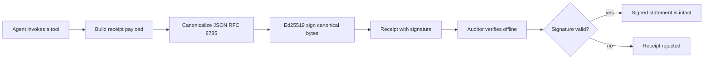
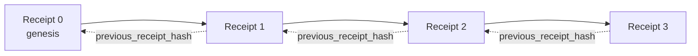

[Peržiūrėkite pamokos vaizdo įrašą: AI agentų apsauga su kriptografinėmis kvitomis](https://youtu.be/PLACEHOLDER_VIDEO_ID)

> _(Pamokos vaizdo įrašą ir miniatiūrą pridės Microsoft turinio komanda po sujungimo, atitinkančią pamokų 14 / 15 schemą.)_

# AI agentų apsauga su kriptografinėmis kvitomis

## Įvadas

Šioje pamokoje aptarsime:

- Kodėl AI agentų audito įrašai svarbūs atitikčiai, klaidų taisymui ir pasitikėjimui.
- Kas yra kriptografinė kvita ir kuo ji skiriasi nuo nepasirašyto žurnalo įrašo.
- Kaip sukurti pasirašytą kvitą agento įrankio iškvietimui naudojant paprastą Python.
- Kaip neprisijungus patikrinti kvitos autentiškumą ir aptikti klastojimą.
- Kaip susieti kvitas grandine taip, kad pašalinus arba perrikiavus vieną, grandinė nutrūktų.
- Ką kvitos įrodo ir ką jos aiškiai neįrodo.

## Mokymosi tikslai

Baigę šią pamoką žinosite, kaip:

- Nustatyti gedimo režimus, kurie skatina kriptografinį kilmės įrodymą agento veiksmams.
- Sukurti Ed25519 pasirašytą kvitą su kanoniniu JSON užkodu.
- Nepriklausomai patikrinti kvitą naudojant tik pasirašiusiojo viešąjį raktą.
- Aptikti klastojimą iš naujo patikrinant pakeistą kvitą.
- Sukurti hashu susietą kvitų seką ir paaiškinti, kodėl grandinė svarbi.
- Atpažinti ribą tarp to, ką kvitos įrodo (priskyrimą, vientisumą, tvarką) ir ko jos neįrodo (veiksmo teisingumo, politikos pagrįstumo).

## Problema: Jūsų agento audito istorija

Įsivaizduokite, kad įdiegėte AI agentą Contoso kelionėms. Agentas skaito klientų užklausas, kreipiasi į skrydžių API ieškodamas variantų ir rezervuoja vietas kliento vardu. Praėjusį ketvirtį agentas apdorojau 50 000 rezervacijų.

Šiandien atvyksta auditorius. Jie užduoda paprastą klausimą: „Parodykite, ką jūsų agentas darė.“

Jūs pateikiate žurnalo failus. Auditorius juos peržvelgia ir užduoda sunkesnį klausimą: „Kaip aš žinau, kad šie žurnalai nebuvo redaguoti?“

Tai yra audito istorijos problema. Dauguma agentų įdiegimų šiandien naudoja:

- **Programos žurnalus**: rašomus pačio agento, kuriuos gali redaguoti bet kas, turintis prieigą prie failų sistemos.
- **Debesų žurnalų paslaugas**: klastojimo aptikimas vyksta platformos lygmenyje, bet tik jei auditorius pasitiki platformos operatoriumi.
- **Duomenų bazės transakcijų žurnalus**: gerai tinka duomenų bazės pakeitimams, bet ne atsitiktiniams įrankių iškvietimams.

Joks iš jų negali atsakyti auditoriaus klausimo be to, kad auditorius pasėtų kam nors pasitikėti (jums, jūsų debesų tiekėjui, duomenų bazės tiekėjui). Vidiniam naudojimui toks pasitikėjimas dažnai yra priimtinas. Reguliuojamoje veikloje (finansai, sveikatos apsauga, bet kas pagal ES AI aktą) taip nėra.

Kriptografinės kvitos šią problemą sušvelnina pateikiant pasirašytą pareiškimą, kurį galima nepriklausomai
patikrinti. Auditorius vis tiek turi turėti nejudinamos priežasties pasitikėti pasirašymo raktu ir
komponentu, pagaminusiu pareiškimą. Įterptas raktas įrodo tik savitarpiškumą,
ne leidėjo tapatybę ar vykdymo vietą.

## Kas yra kriptografinė kvita?

Kvita yra JSON objektas, kuris įrašo, ką agentas padarė, pasirašytas skaitmeniniu parašu.



Minimalioji kvita atrodo taip:

```json
{
  "type": "agent.tool_call.v1",
  "agent_id": "contoso-travel-bot",
  "tool_name": "lookup_flights",
  "tool_args_hash": "sha256:a3f9c1...",
  "result_hash": "sha256:7b2e1d...",
  "policy_id": "contoso-travel-policy-v3",
  "timestamp": "2026-04-25T14:30:00Z",
  "sequence": 47,
  "previous_receipt_hash": "sha256:9d4e6a...",
  "signature": {
    "alg": "EdDSA",
    "sig": "c5af83...",
    "public_key": "8f3b2c..."
  }
}
```

Trys savybės atlieka darbą:

1. **Parašas**. Kvita pasirašyta agento vartų naudojamu Ed25519 privačiu raktu. Bet kas su atitinkamu viešuoju raktu gali neprisijungus patikrinti parašo autentiškumą. Patikimas asmuo privalo užfiksuoti šį raktą arba gauti jį iš patikimų registrų už kvitos ribų. Bet koks parašu pasirašytos srities klastojimas paneigia parašą.

2. **Kanoninis kodavimas**. Prieš pasirašant kvita serializuojama naudojant JSON Kanonizavimo Schemos (JCS, RFC 8785). Tai užtikrina, kad dvi įgyvendinimo rūšys, gaminančios tą pačią logišką kvitą, duoda bitų atitikmenį duomenis. Be kanonizavimo, skirtingi JSON serializatoriai gamintų skirtingus parašus tam pačiam turiniui.

3. **Hash sujungimas**. `previous_receipt_hash` laukas susieja kiekvieną kvitą su ankstesne. Pašalinus arba pakeitus vietą vienai kvitai, sugriūva pristatyta seka. Truncavimo arba rakto turėtojo valdomo perrašymo nustatymui taip pat reikalingas užfiksuotas dabartinis grandinės galas, nepriklausomas liudininkas arba patvirtinta uždaro populiacijos įsipareigojimo sistema.

Kartu šios savybės suteikia tris garantijas:

- **Priskyrimas prie rakto**: šis raktas pasirašė šį turinį. Organizacinė arba žmogaus tapatybė reikalauja patikimos raktų pririšimo.
- **Vientisumas**: turinys nesikeitė nuo pasirašymo momento.
- **Tvarka tikrintoje sekoje**: ši kvita susieta su ankstesne.

## Kvitos kūrimas Python kalba

Kvitos sukūrimui nereikia specialios bibliotekos. Kriptografiniai primityvai yra plačiai prieinami, o logika telpa į kelias dešimtis Python eilučių.

Praktinės užduotys `code_samples/18-signed-receipts.ipynb` veda per visą procesą. Versijos kontrolės dokumentas `code_samples/18-signed-receipts.execution-receipt.json` fiksuoja tikslią užrašų knygutės maišos vertę, Python aplinką, cell skaičių ir patikrinimus nuo paskutinio švaraus paleidimo, nekeisdamas pamokos išsaugotų rezultatų. Santrauka:

```python
import json
import hashlib
import base64
from nacl import signing
from jcs import canonicalize  # RFC 8785 canonical JSON

def b64url_nopad(data: bytes) -> str:
    return base64.urlsafe_b64encode(data).decode("ascii").rstrip("=")

def sha256_canonical(obj) -> str:
    """SHA-256 of a Python object's JCS-canonical JSON form."""
    return f"sha256:{hashlib.sha256(canonicalize(obj)).hexdigest()}"

# Generate or load a signing key (in production, store in a key vault)
signing_key = signing.SigningKey.generate()
verify_key = signing_key.verify_key
TRUSTED_PUBLIC_KEYS = {b64url_nopad(bytes(verify_key))}  # pinned out of band by the verifier

# Build the receipt payload (no signature yet)
tool_args = {"origin": "SYD", "destination": "LAX"}
tool_result = [{"flight": "QF11", "price": 1850, "stops": 0}]

payload = {
    "type": "agent.tool_call.v1",
    "agent_id": "contoso-travel-bot",
    "tool_name": "lookup_flights",
    "tool_args_hash": sha256_canonical(tool_args),
    "result_hash": sha256_canonical(tool_result),
    "policy_id": "contoso-travel-policy-v3",
    "timestamp": "2026-04-25T14:30:00Z",
    "sequence": 0,
    "previous_receipt_hash": None,
}

# Canonicalize and sign the JCS bytes directly. PureEdDSA hashes internally.
canonical_bytes = canonicalize(payload)
signature_bytes = signing_key.sign(canonical_bytes).signature

# Attach a structured signature object.
receipt = {
    **payload,
    "signature": {
        "alg": "EdDSA",
        "sig": b64url_nopad(signature_bytes),
        "public_key": b64url_nopad(bytes(verify_key)),
    },
}
```

Tai visas pasirašymo procesas. Pamokos užduotys peržvelgia kiekvieną žingsnį.

## Kvitos tikrinimas ir klastojimo aptikimas

Tikrinimas yra atvirkštinė operacija:

```python
import base64
import hashlib
from nacl import signing
from nacl.exceptions import CryptoError
from jcs import canonicalize

def b64url_decode(s: str) -> bytes:
    padding = "=" * ((4 - len(s) % 4) % 4)
    return base64.b64decode(s + padding, altchars=b"-_", validate=True)

def verify_receipt(receipt: dict, trusted_public_keys: set[str]) -> bool:
    # The signature is a structured object: {"alg", "sig", "public_key"}.
    if not isinstance(receipt, dict):
        return False
    sig_obj = receipt.get("signature")
    if not isinstance(sig_obj, dict) or sig_obj.get("alg") != "EdDSA":
        return False
    try:
        # An inline key proves only self-consistency. Trust is configured out of band.
        public_key = sig_obj.get("public_key")
        signature = sig_obj.get("sig")
        if not isinstance(public_key, str) or not isinstance(signature, str):
            return False
        if public_key not in trusted_public_keys:
            return False
        payload = {k: v for k, v in receipt.items() if k != "signature"}
        canonical_bytes = canonicalize(payload)
        verify_key = signing.VerifyKey(b64url_decode(public_key))
        verify_key.verify(canonical_bytes, b64url_decode(signature))
        return True
    except (CryptoError, TypeError, ValueError, KeyError, OverflowError):
        return False
```

Ši funkcija priima kvitą ir patikimo asmens užfiksuotų raktų rinkinį bei grąžina
`True` tik jei parašas galioja priimtino rakto atžvilgiu. Tikrinimui nereikia
tinklo skambučio, bet rakto patikimumas vis tiek yra išorinės konfigūracijos sprendimas.

Kad pamatytumėte klastojimo aptikimą veiksme, užduotyje žingsniuojama per:

1. Galimos kvitos sukūrimą ir jos tikrinimą.
2. Vieno baito redagavimą `tool_args_hash` lange.
3. Pakartotinį tikrinimą ir klaidos pastebėjimą.

Tai praktiškas įrodymas, kad kvitos yra atsparios klastojimui: bet kokia modifikacija, kad ir maža, nebegalioja parašo.

## Kvitos grandinavimas kelių etapų agentams

Viena pasirašyta kvita saugo vieną veiksmą. Kvitos grandinė saugo seką.



Kiekviena kvita įrašo ankstesnės kvitos maišą. Norint tyliai pašalinti antrą kvitą, piktadarys turėtų arba:

- Pakeisti trečios kvitos `previous_receipt_hash` lauką (sugriauna trečios kvitos parašą), ARBA
- Suklastoti naują parašą pakeistai trečiai kvitai (reikalingas agento privatus raktas).

Jei privatus raktas yra apsaugotas ir tikrintojas užfiksuoja nepriklausomai liudytą grandinės
galą, šie atakos būdai yra aptinkami. Rakto skelbimas kiekvienoje kvitoje nėra
pakankamas: pasirašytojas arba piktadarys gali pateikti kitą raktą, perrašyti galūnę ar
trumpinti grandinę, nebent patikimas asmuo turi išorinį pasitikėjimo ir išbaigtumo užtikrinimą.

Užduotyje žingsniuojama per:

1. Trijų kvitų grandinės kūrimą.
2. Tikrinant, ar kiekvieno kvito `previous_receipt_hash` atitinka ankstesnio kvito tikrąjį hash.
3. Lietimąsi su vienu kvitu viduryje ir matant grandinės nutrūkimą tiksliai ties tuo tašku.

Taip sukuriate audito kelią, kurį išorinis auditas gali patikrinti naudodamas savo
prizę emitento raktų ir grandinės kontrolinių taškų, nepasikliaudamas jūsų keičiama žurnalo saugykla.

## Ką įrodyti gali kvitai (ir ko jie neįrodo)

Tai svarbiausia šio pamokos dalis. Kvitu yra galingi, bet jų galia ribota.

**Kvitai įrodo tris dalykus:**

1. **Priskyrimą**: konkretus raktas pasirašė konkretų duomenų krepšelį.
2. **Integralumą**: duomenys nuo pasirašymo nebuvo pakeisti.
3. **Tvarką pateiktoje, patikrintoje sekoje**: šis kvitas susietas su tuo pirmtaku.

**Kvitai neįrodo:**

1. **Teisingumo**: kad agento veiksmas buvo teisingas veiksmas. Kvitas gali būti pasirašytas už neteisingą atsakymą taip pat tvarkingai kaip ir už teisingą.
2. **Politikos laikymosi**: kad politika nurodyta `policy_id` buvo iš tikrųjų įvertinta arba kad ji būtų leidusi šį veiksmą, jei būtų patikrinta. Kvitas įrašo tai, ką teigta, o ne tai, kas buvo įgyvendinta.
3. **Tapatybės už rakto ribų**: kvitas sako „šis raktas pasirašė šį turinį.“ Jis nesako „šis žmogus suteikė leidimą.“ Rakto su asmeniu ar organizacija siejimas reikalauja atskiros tapatybės infrastruktūros (katalogo, viešųjų raktų registro ir kt.).
4. **Įvesties teisingumą**: jei agentas gauna manipuliuotą užklausą ir veikia pagal ją, kvitas tiksliai įrašo veiksmą. Kvitu yra po įvesties patikros, ne jos pakaitalas.
5. **Vykdymą ar realų poveikį**: kvitas po iškvietimo įrašo, ką jo kūrėjas tvirtina įvykus. Priėmimo įrodymui arba išorinio poveikio suderinimui reikia įrodymų iš tikro vykdytojo ar paslaugos teikėjo ribos.
6. **Išsamumą**: trūkstamas kvitas gali reikšti užblokuotą, praleistą, dingusį arba neįrengtą. Trūkumas tampa įrodymu tik autentifikuotoje uždaroje populiacijoje.
7. **Patikimą laiką**: pasirašytas laiko žymuo įrodo, kad pasirašytojas turėjo tą reikšmę, o ne kad reikšmė buvo teisinga. Patikimas laikas reikalauja atskiros laiko institucijos arba liudytojo kontrolinio taško.

Ši riba yra svarbi dėl dviejų priežasčių:

- Tai pasako, kam kvitai yra naudingi: agento elgesio audituojamumui ir manipuliacijos aptikimui, net ir tarp organizacinių ribų.
- Tai parodo, kokių papildomų sluoksnių vis dar reikia: įvesties tikrinimo (pamoka 6), politikos įgyvendinimo (trumpai žemiau) ir tapatybės infrastruktūros (šios pamokos srities ribose).

Dažna klaida yra manyti, kad „turime kvitus“ reiškia „esame valdžioje.“ Ne. Kvitas yra pagrindas. Valdymas yra sistema, kurią kuriate virš jų.

## Patvirtinančio asmens parašo susiejimas su tiksliu veiksmu

3 punktas aukščiau vertas atskiros dalies: veiksmo kvitas sako „šis raktas pasirašė šį turinį,“ niekada „žmogus patvirtino šį veiksmą.“ Dėl didelės rizikos veiksmų (grąžinimų, ištrynimų, pervedimų) atskiras patvirtintojas gali pasirašyti tikslų veiksmą. To rakto su žmogumi susiejimas ir žmogaus dalyvavimo tikrinimas lieka atskiros atsakomybės.

Tolimesniame užrašyne `code_samples/human-authorization-receipts.ipynb` pridedama antrojo kvito rūšis, `human.approval.v1`, tokio pat formato kaip pamokos kvitai (tipizuotas duomenų krepšelis pasirašytas Ed25519 virš kanoninių JCS baitų, su `signature` objektu už pasirašytų baitų ribų). Patvirtintojo raktas pasirašo **pilną kanoninį veiksmą ir jo santrauką**; agento raktas pasirašo teiginį nešiojantį **tą patį veiksmų santrauką** ir `parent_approval_ref`, tai yra `receipt_hash` patvirtinimo, ta pati konvencija kaip `previous_receipt_hash` grandinėje, kurią sukūrėte aukščiau. Vienas `verify_chain` apdoroja abu artefaktus pagal **teisės aktų atskirus piniginius raktų registrus** (patvirtinančiųjų raktai prieš agentų raktus), todėl kodo kelias yra bendras, bet institucijos niekada nesimaišo.

Ši savybė, atsargiai suformuluota: *prisegtas patvirtintojo raktas pasirašė būtent
šį veiksmą, o agento raktas vėliau pasirašė pareiškimą nešiojantį tą patį veiksmų santrauką.*
Tai naudingi įrodymai, bet savaime nėra įrodymas, kad veiksmas buvo įvykdytas. Norint
valdyti vykdymą, tikslus patvirtinimas privalo būti rezervuotas ir sunaudotas kartą ties
tikrojo vykdytojo riba; nežinomi paslaugų teikėjo rezultatai turi likti nežinomi, o ne
būti aklai pakartotinai bandyti. Užrašyno netinkamumo testai tikrina kvitų grandinės sluoksnį:

- klastojimą, painiotą vykdytoją, suklastotus raktus bet kurioje pusėje bei netinkamą įvestį;
- **pasenusią instituciją**: parašas, kuris vis tiek tinka, bet atmestas, nes politika pasikeitė, patvirtintojo raktas pašalintas iš prisegtų registrų arba patvirtinimas baigėsi prieš pateiktą tikrinimo laiką;
- **santraukos pakeitimą**: teisėtai pasirašytas veiksmo kvitas, rodantis į *tikrą* patvirtinimą, kuris sieja *kitą* kanoninį veiksmą.

Kiekviena klaida atmetama su skirtinga priežastimi, todėl auditorius galintis atskirti, ar teisė paseno, ar teigiamas veiksmas pasikeitė. Patikrinimas yra tik skaitymui ir pakartotinas: jis nesunaudoja patvirtinimo ar nekviečia paslaugos teikėjo. Atsekamasis vykdytojas reikalauja patvarios, atominės pakartotinio paleidimo apsaugos ir aiškių sėkmės, nesėkmės ar neaiškių rezultatų. Žmogaus patvirtinimo kvitas yra edukacinė sudėtis, apibrėžta šioje pamokoje, ne kvitų rūšis, aprašyta `draft-farley-acta-signed-receipts`.

## Gamybiniai nuorodos

Šios pamokos Python kodas sąmoningai minimalus, kad galėtumėte perskaityti kiekvieną eilutę ir tiksliai suprasti, kas vyksta. Gamyboje turite dvi galimybes:

1. **Kurti tiesiogiai ant kriptografinių pradinukų.** 50 eilučių, kurias matėte aukščiau, yra pakankama daugeliui naudojimo atvejų. PyNaCl (Ed25519) ir `jcs` paketas (kanoninis JSON) yra gerai prižiūrimi ir auditavimi bibliotekos.

2. **Naudoti gamybinę kvitų biblioteką.** Keletas atvirojo kodo projektų įgyvendina tą patį modelį su papildomomis funkcijomis (raktų sukimasis, grupinis tikrinimas, JWK rinkinio platinimas, integracija su politikos varikliais):
   - Pasirašymo eiga naudoja JCS ir parašo aprėpties konvencijas nepriklausomame IETF Internet-Draft ([`draft-farley-acta-signed-receipts`](https://datatracker.ietf.org/doc/draft-farley-acta-signed-receipts/), pakeitimas 02). Šios pamokos plokščias edukacinis kvitas skiriasi nuo projekto `{payload, signature}` voko ir nėra pateiktas kaip atitinkantis įgyvendinimas. Projektas publikuoja bendrą atitikties rinkinį ([agent-governance-testvectors](https://github.com/ScopeBlind/agent-governance-testvectors)) įgyvendinimams, taikantiems jo laidininko formatą.
   - Microsoft agento valdymo įrankių komplektas sujungia kvitus su Cedar pagrįstais politikos sprendimais; žr. 33 pamoką tame saugykloje dėl visas procesas pavyzdžio.
   - `protect-mcp` (npm) ir `@veritasacta/verify` (npm) paketai suteikia Node pagrindu veikiantį kvitų pasirašymo ir neprisijungus tikrinimo įgyvendinimą, skirtą apvynioti bet kurį MCP serverį tamperį atpažįstančiu audito keliu, įskaitant laikymo kartu srautą, kuriame sustabdytas veiksmas išskiria patvirtinimo kvitą, susietą su veiksmo santrauka (WebAuthn palaikoma darbalaukio eigoje), tokia pati patvirtinimo kvitų schema kaip žmogiško patvirtinimo užrašyne aukščiau.
   - **[nobulex](https://github.com/arian-gogani/nobulex)** Python SDK (`pip install nobulex`) pateikia tą patį Ed25519 + JCS pasirašymo modelį Python kalboje su LangChain ir CrewAI integracijomis, įskaitant paskelbtus kryžminius patvirtinimo testų vektorius ir atitikties žemėlapį, prisidėtą per [OWASP PR #2210](https://github.com/OWASP/CheatSheetSeries/pull/2210).
   - **[EMILIA Protocol](https://github.com/emiliaprotocol/emilia-protocol)** suteikia papildomą tikslaus veiksmo vykdymo sluoksnį: neprisijungus patikrintinus patvirtinimo kvitus, prikaltą WebAuthn arba kvorum autorių, vienkartinį sunaudojimą vykdytojo ribose ir aiškiai nenuspėjamą išėjimo kelią. Jo sistemos adapteriai traktuoja kvitą kaip būtiną įrodymą, o ne kaip įrodymą, kad išorinis poveikis įvyko.

Sprendimas tarp savo kūrimo ir bibliotekos naudojimo atspindi sprendimą tarp savo JWT bibliotekos rašymo ir išbandytos bibliotekos naudojimo: abu yra pagrįsti; biblioteka taupo laiką ir sumažina audito paviršių; nuo nulio sukūrimas priverčia suprasti kiekvieną primityvą. Ši pamoka moko nuo nulio, kad turėtum pagrindą bet kuriam pasirinkimui.

## Žinių patikrinimas

Patikrinkite savo supratimą prieš pradėdami praktinę užduotį.

**1. Kvitą pasirašo agente privatus Ed25519 raktas. Auditorius turi tik viešąjį raktą. Ar auditorius gali neprisijungęs patikrinti kvitą?**

<details>
<summary>Atsakymas</summary>

Taip, kriptografinis patikrinimas reikalauja tik viešojo rakto ir pasirašytų baitų. 
Auditorius vis tiek turi nepriklausomai gauti ir įtvirtinti priimtą viešąjį raktą nepriklausomai nuo kvito. 
Po to tinklo užklausos nereikia.
</details>

**2. Užpuolikas pakeičia `policy_id` lauką kvite, teigdamas, kad jis buvo valdomas laisvesnės politikos. Parašas buvo ant originalaus paketo. Kas nutinka tikrinant?**

<details>
<summary>Atsakymas</summary>

Tikrinimas nepavyksta. Parašas buvo apskaičiuotas ant originalaus paketo kanoninių baitų; bet koks lauko pakeitimas pakeičia tuos baitus, todėl parašas tampa negaliojantis. Užpuolikas reikėtų privataus rakto, kad sukurtų naują galiojantį parašą, ko jis neturi.
</details>

**3. Kodėl kvitas apima `tool_args_hash` ir `result_hash` vietoje žaliųjų argumentų ir rezultato?**

<details>
<summary>Atsakymas</summary>

Dvi priežastys. Pirma, kvitas gali reikėti archyvuoti arba perduoti aplinkose, kur nutekėti žalią turinį (asmens duomenys, verslo informacija) yra problema. Maišymas laiko kvitą mažą ir turinį privačiu; auditorius patikrina, kad maišos atitinka atskirai saugomą tikrą turinį. Antra, maišos turi fiksuotą dydį; kvitas su maišomis yra apribotas dydžio, nepaisant įvesties ir išvesties dydžio.
</details>

**4. `previous_receipt_hash` laukas sujungia kiekvieną kvitą su jo pirmtaku. Jei užpuolikas tyliai pašalina vieną kvitą grandinės viduryje, kas tampa negaliojančiu?**

<details>
<summary>Atsakymas</summary>

Kitas pateiktas kvitas nebepasieks savo tikėtino pirmtako, todėl tikrinimas 
prieš pateiktą seką nepavyks nuo tuščios vietos. Jei pasirašytojas kontroliuoja privatų 
raktą, jis gali perrašyti arba sutrumpinti galūnę. Tai aptikti reikia pritvinkinto dabartinio galvos,
išorinio kontrolinio punkto arba autentifikuotos populiacijos įsipareigojimo.
</details>

**5. Kvitas patikrintas be problemų. Ar tai įrodo, kad agente veiksmas buvo teisingas, pagrįstas ar atitinkantis politiką?**

<details>
<summary>Atsakymas</summary>

Ne. Su pritvinkintu raktu ir grandinės kontekstu galiojantis kvitas įrodo parašo priskyrimą,
turinio integralumą ir sujungimą su pateiktu pirmtaku. Tai NEĮRODO,
kad veiksmas buvo teisingas ar įvykdytas, kad politika buvo įvertinta, kad laiko žyma yra
patikima, ar kad įrašų rinkinys yra pilnas. Tai svarbiausias pamokos riba.
</details>

## Praktinė užduotis

Atidarykite `code_samples/18-signed-receipts.ipynb` ir užbaikite visus keturis skyrius:

1. **1 skyrius**: Pasirašykite savo pirmą kvitą ir patikrinkite jį.
2. **2 skyrius**: Pakeiskite kvitą ir stebėkite, kaip patikrinimas nepavyksta.
3. **3 skyrius**: Sukurkite trijų kvitų grandinę ir patikrinkite jos vientisumą.
4. **4 skyrius**: Pritaikykite šabloną agentui, sukurtam su Microsoft Agent Framework: apsukite įrankio kvietimą kvito pasirašyme, tada nepriklausomai patikrinkite kvitą.

**Iššūkis 1:** išplėskite kvito schemą papildomu lauku, kurį pasirenkate (pavyzdžiui, užklausos ID stebėjimui), atnaujinkite kanoninį pasirašymo logiką, kad jį įtrauktumėte, ir patvirtinkite, kad kvitas vis dar tinkamai tikrinamas. Tada pakeiskite tą lauką po pasirašymo ir patvirtinkite, kad tikrinimas nepavyksta. Tai privers jus suprasti, kaip kiekvienas kanoninio kodavimo baitas prisideda prie parašo.

**Iššūkis 2:** Sumaišykite SHA-256 dviejų kvitų duomenis kartu (sujungdami jų kanoninius baitus deterministine tvarka) ir įterpkite gautą maišą kaip naują lauką trečiame kvite prieš jį pasirašydami. Patikrinkite, kad visi trys kvitai vis dar tinkamai tikrinami. Jūs ką tik sukūrėte vieno žingsnio įtraukimo įrodymą: bet kas, turintis trečią kvitą, gali įrodyti, kad pirmi du egzistavo jį pasirašant, neatskleisdamas jų turinio. Tai modelis, kurį plačiai naudoja selektyvios atskleidimo kvitai (Merkle įsipareigojimai, RFC 6962).

## Išvada

Kriptografiniai kvitai suteikia DI agentams audito taką, kuris yra:

- **Nepriklausomai patikrinamas pritvinkus pasitikėjimui**: šalis su priimtais viešaisiais raktais ir pasirašytais baitais gali patikrinti be paslaugos priklausomybės.
- **Apsaugotas nuo klastojimo**: bet koks modifikavimas nebegalioja parašo.
- **Nešiojamas**: kvitas yra mažas JSON failas; jis gali būti archyvuojamas, perduodamas ir tikrinamas bet kur.
- **Atitinka standartus**: sukurtas ant Ed25519 (RFC 8032), JCS (RFC 8785) ir SHA-256, visų plačiai diegiamų primityvų.

Jie nėra įvesties patikrinimo, politikos vykdymo, vykdytojo priėmimo,
rezultatų įrodymo, pilnumo kontrolės ar tapatybės infrastruktūros pakaitalas. Jie yra pagrindas
tiems sluoksniams. Reguliuojamuose ar daugorganizaciniuose procesuose kvitai leidžia konkrečius
išdavėjo pareiškimus nepriklausomai patikrinti auditoriaus savo pasitikėjimo konfigūracija.

Svarbiausias išmokimas: kvitai įrodo, kad konkretaus rakto turėtojas pasirašė konkretų
turinį. Laiko žyma yra pasirašančiojo teiginys, nebent tai būtų papildomai laiko patvirtinta. 
Kvitas neįrodo, kad jo turinys buvo teisingas, kad veiksmas buvo vykdytas, ar kad
įrašų rinkinys yra pilnas. Laikykite šias skirtis aiškiai.

## Gamybinis kontrolinis sąrašas

Kai būsite pasiruošę pereiti nuo šios pamokos prie kvito pasirašančių agentų diegimo tikroje aplinkoje:

- [ ] **Perkelkite pasirašymo raktą nuo kūrėjo nešiojamojo kompiuterio.** Naudokite Azure Key Vault, AWS KMS arba aparatinį saugumo modulį. Privatus raktas, pasirašantis jūsų kvitus, niekada neturi gyventi šaltinio kontrolėje ar atviru tekstu programų mašinose.
- [ ] **Nustatykite tikrintuvo rakto pasitikėjimą.** Paskelbkite raktus per JWK rinkinį arba registrą, tada turi šalių naudotojai pritvirtinti priimtos išdavėjo tapatybės, raktų rinkinio ir rotacijos politiką atskirai nuo atskirų kvitų. Vienas įterptas raktas nėra pasitikėjimo pamatas.
- [ ] **Pritvirtinkite grandinę išorėje.** Periodiškai įrašykite naujausio grandinės galvos maišą į skaidrumo žurnalą (Sigstore Rekor, RFC 3161 laiko ženklinimo institucija arba antra vidinė sistema), kad išorinė šalis galėtų patvirtinti „ši grandinė egzistavo tuo metu“.
- [ ] **Saugojimas turi būti nekintamas.** Tik prijungiamoji objektų saugykla (Azure Storage su nekintamumo politikomis, AWS S3 objektų blokavimas) neleidžia vidiniam asmeniui perrašyti istoriją saugyklos sluoksnyje.
- [ ] **Nuspręskite dėl saugojimo laikotarpio.** Daugelis atitikties režimų reikalauja daugiametės saugojimo. Planuokite kvitų augimą (kiekvienas kvitas yra ~500 baitų; agentas, atlieka 10 000 kvietimų per dieną, gamina ~1.8 GB per metus).
- [ ] **Dokumentuokite, ką kvitai neapima.** Kvitas įrodo priskyrimą, integralumą ir užsakymą. Jūsų veiklos vadovas turi aiškiai išvardinti, kokios papildomos kontrolės (įvesties tikrinimas, politikos vykdymas, apribojimų taikymas, tapatybės infrastruktūra) yra kartu su kvitais jūsų valdymo pozicijoje.

### Turite daugiau klausimų apie DI agentų saugumą?

Prisijunkite prie [Microsoft Foundry Discord](https://aka.ms/ai-agents/discord), kad susitikti su kitais mokiniais, dalyvauti konsultacijose ir gauti atsakymus į jūsų DI agentų klausimus.

## Toliau po šios pamokos

Ši pamoka apima vieno kvito pasirašymą ir hash-grandines eilutes. Tie patys primityvai sudaro keletą pažangesnių modelių, kuriuos galite sutikti savo valdymo pozicijos brendimo metu:

- **Selektiškas atskleidimas.** Kai kvito laukai yra nepriklausomai įsipareigojami (RFC 6962 stiliaus Merkle medis), galite atskleisti specifinius laukus specifiniams auditoriams ir įrodyti, kad likusieji nesikeitė neatskleisdami jų. Naudinga, kai tas pats kvitas turi patenkinti tiek išsamią auditą (reikalauja pilnumo), tiek duomenų mažinimo reglamentus, pvz., GDPR (norint, kad auditorius matytų kiek įmanoma mažiau).
- **Kvito panaikinimas.** Jei pasirašymo raktas kompromituotas, reikia būdo pažymėti visus to rakto pasirašytus kvitus kaip nepatikimus nuo tam tikros datos į priekį. Standartiniai modeliai: trumpalaikiai pasirašymo raktai kartu su paskelbtu panaikinimų sąrašu, arba skaidrumo žurnalas su panaikinimo įrašais.
- **Dvišaliai / padalinto parašo kvitai.** Kai kurios implementacijos padalija pasirašytą paketinį konkretų laiką į priešvykdymo (`authorization_*`) ir posvykdymo (`result_*`) dalis su nepriklausomais parašais, naudinga, kai autorizacijos sprendimą ir stebėtą rezultatą sukuria skirtingi veikėjai ar skirtingu laiku. Tai papildomai sudedama virš šioje pamokoje mokomo kvito formato.
- **Paketo sudėtis.** Kvitas užklijuoja bet kokius baitus, kuriuos įdedate į `result_hash`. Realiojo pasaulio paketiniai duomenys dažnai yra turtingesni nei vieno įrankio kvietimo rezultatas: prieš sprendimą grindžiantis mąstymas (modelio prognozė, apsvarstyti variantai, įrodymai ir jų pilnumas, rizikos pozicija, atsakomybės grandinė, vartų sprendimas) gali gyventi viduje pakete, užklijuotas vienu kvitu. Tai laiko kvito formatą minimalų, leidžiant domenų pagal domenus evoliucionuoti paketų schemoms.
- **Daugiaprograminė atitiktis.** Kelios nepriklausomos tos pačios kvito formato implementacijos (Python, TypeScript, Rust, Go) kryžminai tikrina prieš bendrus testinius vektorius. Jei kuriate savo implementaciją, patikrinimas prieš paskelbtus vektorius patvirtina signalo suderinamumą.
- **Po-kvantinė migracija.** Ed25519 šiandien plačiai naudojama, bet nėra atspari kvantiniams kompiuteriams. Vien tik `alg` žyma nėra migracija: profilis turi apibrėžti ML-DSA rakto kodavimą, kanonišką pasirašytų baitų formatą, patikrą, pasitikėjimo šalių politiką, atsparumą degradacijai ir perėjimo semantiką. Planuokite ir išbandykite dvigubo parašo perėjimą prieš bendrus vektorius prieš teigdami suderinamumą.

## Papildomi ištekliai

- <a href="https://datatracker.ietf.org/doc/draft-farley-acta-signed-receipts/" target="_blank">IETF interneto projektas: Pasirašyti sprendimų kvitai mašinų prieigos kontrolei</a>
- <a href="https://learn.microsoft.com/azure/ai-studio/responsible-use-of-ai-overview" target="_blank">Atsakingas DI apžvalga (Azure DI)</a>
- <a href="https://datatracker.ietf.org/doc/html/rfc8032" target="_blank">RFC 8032: Edvardo kreivės skaitmeninio parašo algoritmas (EdDSA)</a>
- <a href="https://datatracker.ietf.org/doc/html/rfc8785" target="_blank">RFC 8785: JSON kanonizavimo schema (JCS)</a>
- <a href="https://datatracker.ietf.org/doc/html/rfc6962" target="_blank">RFC 6962: Sertifikatų skaidrumas</a> (Merkle-vertynių konstrukcija, naudojama selektyviojo atskleidimo kvituose)
- <a href="https://github.com/microsoft/agent-governance-toolkit/blob/main/docs/tutorials/33-offline-verifiable-receipts.md" target="_blank">Microsoft Agent Governance Įrankių rinkinys, 33 pamoka: Neprisijungus tikrinami sprendimų kvitai</a>
- <a href="https://github.com/ScopeBlind/agent-governance-testvectors" target="_blank">Kryžminės įgyvendinimo atitikties testų vektoriai</a> šioje pamokoje naudotam kvito formatui (Apache-2.0)
- <a href="https://pynacl.readthedocs.io/" target="_blank">PyNaCl dokumentacija</a> (Ed25519 Python kalboje)

## Ankstesnė pamoka

[Vietinių DI agentų kūrimas](../17-creating-local-ai-agents/README.md)

---

<!-- CO-OP TRANSLATOR DISCLAIMER START -->
**Atsakomybės apribojimas**:
Šis dokumentas buvo išverstas naudojant dirbtinio intelekto vertimo paslaugą [Co-op Translator](https://github.com/Azure/co-op-translator). Nors siekiame tikslumo, prašome atkreipti dėmesį, kad automatiniai vertimai gali turėti klaidų ar netikslumų. Originalus dokumentas jo gimtąja kalba laikomas autoritetingu šaltiniu. Svarbiai informacijai rekomenduojama naudoti profesionalų žmogiškąjį vertimą. Mes neatsakome už jokius nesusipratimus ar neteisingą interpretaciją, kilusią naudojantis šiuo vertimu.
<!-- CO-OP TRANSLATOR DISCLAIMER END -->