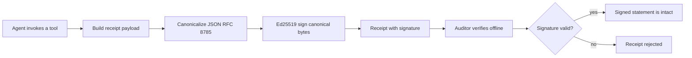
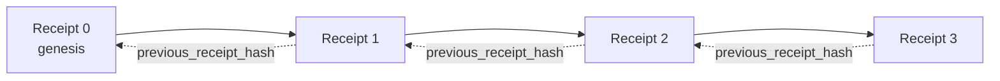

[Žiūrėkite pamokos vaizdo įrašą: AI agentų apsauga naudojant kriptografinius kvitus](https://youtu.be/PLACEHOLDER_VIDEO_ID)

> _(Pamokos vaizdo įrašas ir miniatiūra bus pridėti Microsoft turinio komandos po sujungimo, atitinkantys pamokos 14 / 15 modelį.)_

# AI agentų apsauga naudojant kriptografinius kvitus

## Įvadas

Šioje pamokoje aptarsime:

- Kodėl auditavimo pėdsakai AI agentams yra svarbūs atitikties, trikčių šalinimo ir pasitikėjimo požiūriu.
- Kas yra kriptografinis kvitas ir kuo jis skiriasi nuo nepasirašyto įrašo eilutės.
- Kaip sukurti pasirašytą kvitą už agento įrankio kvietimą paprastu Python kalbos pavyzdžiu.
- Kaip patikrinti kvitą neprisijungus ir aptikti klastojimą.
- Kaip sujungti kvitus grandine taip, kad kvito šalinimas ar pertvarkymas sulaužytų grandinę.
- Ką kvitai įrodo ir ką jie aiškiai neįrodo.

## Mokymosi tikslai

Baigę šią pamoką, mokėsite:

- Nustatyti gedimų režimus, kurie skatina kriptografinį veiksmų kilmės įrodymą agentams.
- Sukurti Ed25519 pasirašytą kvitą pagal kanoninį JSON turinį.
- Nepriklausomai patikrinti kvitą naudojant tik pasirašiusio asmens viešąjį raktą.
- Aptikti klastojimą pakartotinai atlikus patvirtinimą modifikuotam kvitui.
- Sukurti hash grandinę ir paaiškinti, kodėl ši grandinė yra svarbi.
- Atpažinti ribą tarp to, ką kvitai įrodo (priskyrimą, vientisumą, tvarką) ir ko jie neįrodo (veiksmo teisingumo, politikos galiojimo).

## Problema: jūsų agento audito pėdsakas

Įsivaizduokite, kad įdiegėte AI agentą Contoso Travel kompanijai. Agentas skaito klientų užklausas, iškviečia skrydžių API, kad surastų variantus, ir rezervuoja vietas kliento vardu. Praėjusį ketvirtį agentas apdorotų 50 000 rezervacijų.

Šiandien atvyksta auditas. Jie užduoda paprastą klausimą „Parodykite, ką jūsų agentas padarė“.

Pateikiate savo žurnalų failus. Auditorius juos peržiūri ir užduoda sunkesnį klausimą: „Kaip aš žinau, kad šie įrašai nebuvo redaguoti?“

Tai yra audito pėdsako problema. Dauguma šiandieninių agentų diegimų remiasi:

- **Programų žurnalais**: rašomais pačio agento, kuriuos gali redaguoti bet kas, turintis prieigą prie failų sistemos.
- **Debesų žurnalų paslaugomis**: klastojimą atpažįstančiomis platformos lygiu, bet tik jei auditorius pasitiki platformos operatoriumi.
- **Duomenų bazės transakcijų žurnalais**: puikiai tinka duomenų bazės pokyčiams, bet ne atsitiktiniams įrankių iškvietimams.

Jokia iš šių priemonių negali atsakyti auditoriaus klausimo nepasitelkdama pasitikėjimo kažkuo (jumis, jūsų debesų paslaugų teikėju, duomenų bazės tiekėju). Vidaus naudojimui toks pasitikėjimas dažnai priimtinas. Reguliuojamoms darbo krūvoms (finansams, sveikatos priežiūrai, ES AI aktui) – ne.

Kriptografiniai kvitai siaurina šią problemą, nes pasirašytą pareiškimą galima nepriklausomai
patikrinti. Auditorius vis tiek turi turėti išorinių priežasčių pasitikėti pasirašymo raktu ir
komponentu, sukūrusiu pareiškimą. Įterptas raktas įrodo savitikrumą,
bet ne išdavimo tapatybę ar vykdymo vietą.

## Kas yra kriptografinis kvitas?

Kvitas yra JSON objektas, fiksuojantis, ką agentas padarė, su parašu.



Minimalus kvitas atrodo taip:

```json
{
  "type": "agent.tool_call.v1",
  "agent_id": "contoso-travel-bot",
  "tool_name": "lookup_flights",
  "tool_args_hash": "sha256:a3f9c1...",
  "result_hash": "sha256:7b2e1d...",
  "policy_id": "contoso-travel-policy-v3",
  "timestamp": "2026-04-25T14:30:00Z",
  "sequence": 47,
  "previous_receipt_hash": "sha256:9d4e6a...",
  "signature": {
    "alg": "EdDSA",
    "sig": "c5af83...",
    "public_key": "8f3b2c..."
  }
}
```

Trys savybės atlieka darbą:

1. **Parašas**. Kvitas pasirašytas agento vartų naudojamu Ed25519 privačiu raktu. Bet kas su viešuoju atitinkamu raktu gali patikrinti parašą neprisijungus. Patikintojas turi pririšti tą raktą arba gauti jį iš patikimos registracijos už kvito ribų. Bet koks pasirašyto lauko klastojimas padaro parašą neteisingą.

2. **Kanoninis kodavimas**. Prieš pasirašant, kvitas serializuojamas naudojant JSON Kanonizavimo Schemos (JCS, RFC 8785). Tai užtikrina, kad du įgyvendinimai, duodantys tą patį logišką kvitą, sukurs baitais identišką išvestį. Be to kanonizacijos, skirtingi JSON serializatoriai duotų skirtingus parašus tai pačiai turiniui.

3. **Hash grandinavimas**. `previous_receipt_hash` laukas jungia kiekvieną kvitą prie ankstesnio. Kvito pašalinimas ar pertvarkymas nutraukia pateiktą ebkų seką. Trūkumo ar kvito valdytojo perrašymo aptikimui taip pat reikia pririšto dabartinio grandinės galvos, nepriklausomo liudies patvirtinimo arba autentifikuoto uždaro populiacijos įsipareigojimo.

Kartu šios savybės suteikia tris garantijas:

- **Priskyrimą raktui**: šis raktas pasirašė šį turinį. Organizacinė ar žmogaus tapatybė reikalauja patikimo rakto susiejimo.
- **Vientisumą**: turinys nuo pasirašymo nebuvo pakeistas.
- **Tvarką patvirtintoje sekos eilėje**: šis kvitas jungiasi prie ankstesnio kvito.

## Kvito kūrimas Python kalba

Kvito sukūrimui nereikia specialios bibliotekos. Kriptografiniai įrankiai yra plačiai prieinami, o logika tėra keli dešimtys Python eilučių.

Praktiniai pratimai `code_samples/18-signed-receipts.ipynb` parodo visą srautą. Šaltinių kontroliuojamas `code_samples/18-signed-receipts.execution-receipt.json` įrašo tikslią užrašo grotelę, Python aplinką, langelių skaičių ir patikrinimus iš naujausios švarios vykdymo versijos neišsaugodamas pamokos išvesties. Santraukos versija:

```python
import json
import hashlib
import base64
from nacl import signing
from jcs import canonicalize  # RFC 8785 canonical JSON

def b64url_nopad(data: bytes) -> str:
    return base64.urlsafe_b64encode(data).decode("ascii").rstrip("=")

def sha256_canonical(obj) -> str:
    """SHA-256 of a Python object's JCS-canonical JSON form."""
    return f"sha256:{hashlib.sha256(canonicalize(obj)).hexdigest()}"

# Generate or load a signing key (in production, store in a key vault)
signing_key = signing.SigningKey.generate()
verify_key = signing_key.verify_key
TRUSTED_PUBLIC_KEYS = {b64url_nopad(bytes(verify_key))}  # pinned out of band by the verifier

# Build the receipt payload (no signature yet)
tool_args = {"origin": "SYD", "destination": "LAX"}
tool_result = [{"flight": "QF11", "price": 1850, "stops": 0}]

payload = {
    "type": "agent.tool_call.v1",
    "agent_id": "contoso-travel-bot",
    "tool_name": "lookup_flights",
    "tool_args_hash": sha256_canonical(tool_args),
    "result_hash": sha256_canonical(tool_result),
    "policy_id": "contoso-travel-policy-v3",
    "timestamp": "2026-04-25T14:30:00Z",
    "sequence": 0,
    "previous_receipt_hash": None,
}

# Canonicalize and sign the JCS bytes directly. PureEdDSA hashes internally.
canonical_bytes = canonicalize(payload)
signature_bytes = signing_key.sign(canonical_bytes).signature

# Attach a structured signature object.
receipt = {
    **payload,
    "signature": {
        "alg": "EdDSA",
        "sig": b64url_nopad(signature_bytes),
        "public_key": b64url_nopad(bytes(verify_key)),
    },
}
```

Tai visas pasirašymo procesas. Užduotys užraše paeiliui nagrinėja kiekvieną žingsnį.

## Kvito tikrinimas ir klastojimo aptikimas

Tikrinimas yra atvirkštinė operacija:

```python
import base64
import hashlib
from nacl import signing
from nacl.exceptions import CryptoError
from jcs import canonicalize

def b64url_decode(s: str) -> bytes:
    # Strict: Python's decoder skips characters outside the alphabet and also
    # accepts padding, the standard +/ alphabet and non-zero spare bits.
    # Re-encoding and comparing accepts only the one unpadded base64url form.
    padding = "=" * ((4 - len(s) % 4) % 4)
    data = base64.urlsafe_b64decode(s + padding)
    if base64.urlsafe_b64encode(data).decode("ascii").rstrip("=") != s:
        raise ValueError("not canonical unpadded base64url")
    return data

def verify_receipt(receipt: dict, trusted_public_key: str) -> bool:
    # trusted_public_key is the issuer's key, obtained from somewhere other
    # than this receipt. Never use receipt["signature"]["public_key"] here:
    # see "What Receipts Prove (and What They Do Not)" below.
    # Fails closed: anything malformed returns False instead of raising.
    if not isinstance(receipt, dict) or not isinstance(trusted_public_key, str):
        return False
    sig_obj = receipt.get("signature")
    if not isinstance(sig_obj, dict) or sig_obj.get("alg") != "EdDSA":
        return False
    sig_b64 = sig_obj.get("sig")
    if not isinstance(sig_b64, str):
        return False

    try:
        # Reconstruct the payload that was actually signed (everything except signature).
        payload = {k: v for k, v in receipt.items() if k != "signature"}
        canonical_bytes = canonicalize(payload)
        verify_key = signing.VerifyKey(b64url_decode(trusted_public_key))
        verify_key.verify(canonical_bytes, b64url_decode(sig_b64))
        return True
    except (CryptoError, TypeError, ValueError, KeyError, OverflowError):
        return False
    except Exception:
        # An undecodable key or signature, or a payload that cannot be
        # canonicalized: fail closed rather than raise.
        return False
```

Ši funkcija paima kvitą ir išdavimo viešąjį raktą, grąžina `True`, jei parašas galioja, ir `False` kitu atveju, įskaitant neteisingą įvestį. Tinklo skambučio ar tikrinimo paslaugos nereikia: kai turite išdavimo raktą, tikrinimas vyksta vietoje ir neprisijungus. Tačiau tam reikia rakto, gauto iš šaltinio, kuriam kvitas nepriklauso.

Kad pamatytumėte klastojimo aptikimą, užrašas demonstruoja:

1. Galiojančio kvito sukūrimą ir sėkmingą jo patikrinimą.
2. Vienos `tool_args_hash` lauko bito modifikavimą.
3. Pakartotinį tikrinimą ir klaidos fiksavimą.
4. Vėl klastojimą, bet šįkart persirašant su užpuoliko sukurta rakto kopija ir tą raktą įdedant į kvitą.

4 žingsnis yra svarbiausias. Tas kvitas yra viduje savitikras: jo parašas tikras tai turiniui ir raktui kvito viduje, todėl jis patikrinamas prieš savo raktą. Sutrikimas atsiranda tik tikrinant prieš tikrą išdavimo raktą. 2 ir 3 žingsniai pagavo užpuolikus, kurie neatliko persirašymo; 4 žingsnis pagavo tą, kuris tai padarė.

Tai praktinis įrodymas, kad kvitai yra klastojimui atsparūs: bet koks pasirašyto lauko pakeitimas sulaužo parašą, jei tikrinama prieš raktą, kurį užpuolikas nepateikė. Patys `signature` objektai yra už pasirašytų baitų ribų, todėl rakto, kuriuo tikrinama, negalima gauti tiesiogiai iš kvito.

## Kvito grandinavimas daugiažingsniams agentams

Vienas pasirašytas kvitas saugo vieną veiksmą. Kvito grandinė saugo veiksmų seką.



Kiekvienas kvitas įrašo ankstesnio kvito hash reikšmę. Norint tyliai pašalinti 2 kvitą, užpuolikas turėtų:

- Pakeisti 3 kvito `previous_receipt_hash` lauką (pažeidžiant 3 kvito parašą), ARBA
- Sukurti naują 3 kvito parašą ant modifikuoto kvito (reikalauja agento privataus rakto).

Jei privatus raktas laikomas saugykloje, o tikrintojai patikrina kiekvieną kvitą prieš išdavimo viešąjį raktą, gautą nepriklausomai (publikuojamas JWK rinkinys arba fiksuota konfigūracija), nė vienas iš šių atakų negalimas be aptikimo. Rakto publikavimas kvite nepakanka: užpuolikas gali persirašyti su savo raktu ir įdėti jį vietoje, tai fiksas `04_resigned_receipt.json`.

Užrašas demonstruoja:

1. Trijų kvitų grandinės kūrimą.
2. Kiekvieno kvito `previous_receipt_hash` atitikimą ankstesnio kvito hash reikšmei.
3. Viduryje vieno kvito klastojimą ir grandinės nutrūkimą ties tuo tašku.

Taip sukuriamas audito pėdsakas, kurį išorinis auditorius gali patikrinti naudodamas
savo fiksuotus išdavimo raktus ir grandinės checkpoint'us, nepasitikėdamas jūsų keičiamu žurnalu.

## Ką kvitai įrodo (ir ko ne įrodo)

Tai svarbiausia pamokos dalis. Kviti yra galingi, bet jų galia ribota.

**Kvitai įrodo tris dalykus:**

1. **Priskyrimą**: konkretus raktas pasirašė konkretų turinį.
2. **Vientisumą**: turinys nuo pasirašymo nebuvo pakeistas.
3. **Tvarką pateiktoje, patikrinamoje sekoje**: šis kvitas jungiasi prie ankstesnio.

**Kvitai neįrodo:**

1. **Teisingumo**: kad agento veiksmas buvo teisingas. Kvitas gali būti pasirašytas ir už neteisingą atsakymą taip pat kaip ir už teisingą.
2. **Politikos laikymosi**: kad politika, susijusi su `policy_id`, buvo iš tikrųjų įvertinta ar leido veiksmą. Kvitas užrašo, kas buvo teigiama, ne kas įvykdyta.
3. **Tapatybės už rakto ribų**: kvitas sako „šis raktas pasirašė šį turinį.“ Nesako „žmogus tai patvirtino.“ Raktą susieti su žmogumi ar organizacija reikia atskiros identifikavimo infrastruktūros (adresyno, viešo rakto registro ir kt.).
4. **Įvesties sąžiningumo**: jei agentas gauna iškraipytą užklausą ir paklūsta jai, kvitas tiksliai registruoja veiksmą. Kviti yra po įvesties patvirtinimo, ne jo pakaitalas.
5. **Vykdymo ar realaus pasaulio poveikio**: kvitas po kvietimo įrašo, ką teigia išdavimo šalis. Veiksmo įrodymui ar poveikio suderinimui reikia įrodymų iš faktiško vykdytojo ar teikėjo ribos.
6. **Pilnumo**: trūkstantis kvitas gali reikšti užblokavimą, praleidimą, praradimą ar neįrašymą. Trūkumas tampa įrodymu tik autentiškoje uždaroje populiacijoje.
7. **Patikimo laiko**: pasirašytas laiko žymas įrodo, kad pasirašytojas turėjo reikšmę, ne kad reikšmė buvo teisinga. Patikimas laikas reikalauja atskiro laiko autoriteto arba liudijančio checkpoint'o.

**Raktas kvite nėra tas, kuriuo atliekate tikrinimą.** Tai kyla iš punkto 3 ir yra vienintelė vieta, kur skirtumas turi keisti jūsų kodą, o ne supratimą. Pavyzdyje esantis `public_key` yra tam, kad pavyzdys būtų vientisas. Tikrintojas jokiu būdu neturi pasitikėti juo. Bet kas gali paimti kvitą, pakeisti jį, pasirašyti su savo sukurtu raktu ir įterpti tą raktą; rezultatas bus patikrinamas puikiai prieš save. Tai fiksas `04_resigned_receipt.json` pas `sample_receipts/`, ir kodėl `verify_receipt` aukščiau priima raktą kaip argumentą, o ne skaito iš kvito. Gavę išdavimo raktą nepriklausomai, iš žemiau pateikto gamybos patikrinimo sąrašo JWK rinkinio ar kito tvirtinimo, tikrinkite prieš jį. Parašas, tikrintas raktu, gautu toje pačioje voko dėžutėje, įrodo tik voko savitikrumą.

Ši riba svarbi dėl dviejų priežasčių:

- Ji parodo, kam kvitai naudingi: daro agentų veiklą patikrinamą ir klastojimui atsparią, net tarp organizacijų sienų.
- Ji parodo, kokie papildomi sluoksniai vis dar reikalingi: įvesties patvirtinimas (6 pamoka), politikos vykdymas (šiek tiek žemiau), tapatybės infrastruktūra (nepamokoje).

Dažna klaida manyti, kad „turime kvitus“ reiškia „turime valdymą“. Ne taip. Kvitai yra pagrindas. Valdymas yra sistema, kurią sukuriate virš jų.

## Patvirtinančio asmens parašo susiejimas su tiksliu veiksmu

3 punktas aukščiau vertas atskiros dalies: veiksmo kvitas sako „šis raktas pasirašė šį turinį,“ niekada „žmogus tai patvirtino.“ Didesnio pavojaus veiksmams (grąžinimams, ištrynimams, pavedimams) atskiras patvirtinančio parašas gali susieti tikslų veiksmą. Raktų ryšys su žmogumi ir žmogaus buvimo tikrinimas lieka atskiros atsakomybės.

Toliau einantis užrašas `code_samples/human-authorization-receipts.ipynb` prideda antrą kvito tipą, `human.approval.v1`, tokiu pačiu kvito formatu kaip pamokos kvitai (tipuotas turinys pasirašytas Ed25519 pagal kanoninį JCS baitų formatą, `signature` objektas už pasirašytų baitų ribų). Patvirtinančio rakto parašas apima **visą kanoninį veiksmą su jo duomenų santrauka**; agento raktas pasirašo teiginį, turintį **tą patį veiksmo duomenų santrauką** ir `parent_approval_ref`, tai yra `receipt_hash` patvirtinimo data, ta pati konvencija kaip `previous_receipt_hash` grandinėje, kurią sukūrėte aukščiau. Vienas `verify_chain` tikrina abu artefaktus pagal **atskiros fiksuotos rakto registrus** (patvirtinančių ir agentų raktai), todėl kodo kelias bendras, bet valdžios institucijos - ne.

Ši savybė, aprašyta atsargiai: *fiksuotas patvirtinančio raktas pasirašė būtent šį veiksmą,
ir agento raktas vėliau pasirašė teiginį, turintį tą patį veiksmų duomenų santrauką.*
Tai naudingas įrodymas, bet pats savaime neįrodo, kad veiksmas buvo įvykdytas. Norint
kontroliuoti vykdymą, tikslus patvirtinimas turi būti rezervuotas ir sunaudotas vieną kartą
faktiniame vykdytojo lygyje; nežinomi tiekėjo rezultatai turi likti nežinomi, o ne būti
aklai bandomi iš naujo. Užrašo abejonių deriniai testuoja kvitų grandinės sluoksnį:

- klastojimą, sumaišiusį tarpininką, suklastotus raktus bet kurioje pusėje ir neteisingą įvestį;
- **pasenusią valdžią**: parašas vis dar tikrina, bet atmestas, nes pasikeitė politika, patvirtinančio raktas buvo pašalintas iš fiksuotos registracijos arba patvirtinimas pasibaigė iki pateiktos tikrinimo datos;
- **santraukos pakeitimą**: galiojančiai pasirašytas veiksmo kvitas, nurodantis *tikrą* patvirtinimą, kuris sieja *kitokį* kanoninį veiksmą.

Kiekvienas gedimas atsako su skirtinga priežastimi, todėl auditorius gali nustatyti, ar valdžia paseno, ar veiksmas pasikeitė. Tikrinimas yra tik skaitymo ir kartojamas: jis nesunaudoja patvirtinimo ir nekviečia tiekėjo. Atskiram vykdytojui reikalinga patvari, atominė peržiūros apsauga su aiškiais sėkmės, nesėkmės ir nežinomais rezultatais. Žmogaus patvirtinimo kvitas yra šios pamokos apmokomas objektų derinys, ne `draft-farley-acta-signed-receipts` apibrėžtas kvito tipas.

## Gamybinės nuorodos

Šioje pamokoje pateiktas Python kodas yra tyčia minimalus, kad galėtumėte perskaityti kiekvieną eilutę ir tiksliai suprasti, kas vyksta. Produkcijoje turite dvi galimybes:

1. **Kurti tiesiogiai ant kriptografinių pradininkų.** 50 eilučių, kurias matėte aukščiau, yra pakankamos daugeliui atvejų. PyNaCl (Ed25519) ir `jcs` paketas (kanoninis JSON) yra gerai prižiūrimos ir audituojamos bibliotekos.

2. **Naudoti gamybinę kvito biblioteką.** Keletas atvirojo kodo projektų įgyvendina tą patį modelį su papildomomis funkcijomis (raktų sukimasis, grupinis patikrinimas, JWK rinkinio platinimas, integracija su politikos varikliais):
   - Pasirašymo srautas naudoja JCS ir parašų apimties konvencijas nepriklausomame IETF Internet-Draft dokumente ([`draft-farley-acta-signed-receipts`](https://datatracker.ietf.org/doc/draft-farley-acta-signed-receipts/), 02 redakcija). Šios pamokos plokščias mokymosi kvitas skiriasi nuo projekto `{payload, signature}` vokelio ir nėra pateiktas kaip atitinkantis įgyvendinimas. Projektas skelbia bendrą atitikties rinkinį ([agent-governance-testvectors](https://github.com/ScopeBlind/agent-governance-testvectors)) įgyvendinimams, orientuotiems į jo laidų formatą.
   - Microsoft Agent Governance Toolkit sudaro kvitus su Cedar pagrįstomis politikos sprendimais; pamatykite toje saugykloje esančią Pamoką 33 kaip pilną pavyzdį.
   - `protect-mcp` (npm) ir `@veritasacta/verify` (npm) paketai teikia Node pagrįstą kvitų pasirašymo ir neprisijungus vykdomo patikrinimo įgyvendinimą, skirtą apvynioti bet kokį MCP serverį su klastojimui atspariu audito pėdsaku, įskaitant delsimo su bendru pasirašymu srautą, kai sustabdyta veiksmo operacija išleidžia patvirtinimo kvitą, susietą su veiksmo santrauka (WebAuthn pagrįstas darbalaukio sraute), tai pats patvirtinimo kvito modelis, kaip žmogaus autorizacijos užraše aukščiau.
   - **[nobulex](https://github.com/arian-gogani/nobulex)** Python SDK (`pip install nobulex`) teikia tą patį Ed25519 + JCS pasirašymo modelį Python kalboje su LangChain ir CrewAI integracijomis, įskaitant skelbiamus kryžminio tikrinimo testų vektorius ir atitikties žemėlapį, kuris prisidėtas per [OWASP PR #2210](https://github.com/OWASP/CheatSheetSeries/pull/2210).
   - **[EMILIA Protocol](https://github.com/emiliaprotocol/emilia-protocol)** teikia papildomą tikslų veiksmų įgyvendinimo sluoksnį: neprisijungus patikrintus patvirtinimo kvitus, prisegtą WebAuthn ar kvorum autoritetą, vienkartinį suvartojimą vykdytojo ribose ir aiškų neapibrėžto rezultato kelią. Jo programinės įrangos adapteriai traktuoja kvitą kaip būtiną įrodymą, o ne įrodymą, kad išorinis poveikis įvyko.

Sprendimas kurti savo pačių ar naudoti biblioteką yra panašus į sprendimą rašyti savo JWT biblioteką ar naudoti patikrintą: abi yra pagrįstos; biblioteka sutaupo laiko ir sumažina auditų paviršių; kūrimas nuo nulio priverčia jus suprasti kiekvieną pradininką. Ši pamoka moko nuo nulio kelią, kad turėtumėte pagrindą abiem variantams.

## Žinių patikrinimas

Patikrinkite savo supratimą prieš pereinant prie praktinės užduoties.

**1. Kvitas pasirašytas agento privačiu Ed25519 raktu. Auditorius turi tik viešą raktą. Ar auditorius gali patikrinti kvitą neprisijungęs?**

<details>
<summary>Atsakymas</summary>

Taip, kriptografinis tikrinimas reikalauja tik viešojo rakto ir pasirašytų baitų. Auditorius
turi nepriklausomai gauti ir prisegti priimtą viešąjį raktą, nepriklausomai nuo kvito.
Po to, kai nustatoma pasitikėjimo konfigūracija, tinklo užklausos nebereikia.
</details>

**2. Užpuolikas pakeičia kvito lauką `policy_id`, teigdamas, kad jis buvo valdomas liberalesne politika. Parašas buvo už pradinio paketo. Kas nutinka tikrinant?**

<details>
<summary>Atsakymas</summary>

Tikrinimas nepavyksta. Parašas buvo skaičiuojamas pagal originalaus paketo kanoninius baitus; pakeitus bet kurį paketo lauką, tie baitai pasikeičia, todėl parašas tampa neteisėtas. Užpuolikas turėtų turėti privatų raktą, kad galėtų sukurti naują galiojantį parašą, tačiau jo neturi.
</details>

**3. Kodėl kvitas įtraukia `tool_args_hash` ir `result_hash` vietoj žaliųjų argumentų ir rezultatų?**

<details>
<summary>Atsakymas</summary>

Dvi priežastys. Pirma, kvitas gali būti saugomas arba perduodamas aplinkoje, kur nutekėti žali turinys (PII, verslo duomenys) būtų problema. Maišymas leidžia kvitą laikyti mažą ir turinį privatumą; auditorius patikrina, ar maišos atitinka atskirai saugomą faktinį turinį. Antra, maišos turi fiksuotą dydį; kvitas su maišais yra riboto dydžio, nepriklausomai nuo įvedimų ir išvedimų dydžio.
</details>

**4. Laukas `previous_receipt_hash` sujungia kiekvieną kvitą su jo pirmtaku. Jei užpuolikas tyliai ištrintų vieną kvitą iš grandinės vidurio, kas taptų neteisėta?**

<details>
<summary>Atsakymas</summary>

Kiekvienas kvitas, kuris yra po ištrintojo. Jų `previous_receipt_hash` laukai nebetinka tikrosios grandinės (nes kvitas, į kurį jie nurodė, nebeegzistuoja arba grandinė dabar rodo kitą pirmtaką). Norint paslėpti ištrynimą, užpuolikas turėtų perpasirašyti kiekvieną vėlesnį kvitą, tam reikalingas leidėjo privatus raktas. Persirašymas su kitu raktu nepavyksta tikrinant su leidėjo raktu.
</details>

**5. Kvitas patikimai praeina patikrinimą. Ar tai įrodo, kad agento veiksmas buvo teisingas, tvirtas ar atitiko politiką?**

<details>
<summary>Atsakymas</summary>

Ne. Prie prisegto rakto ir grandinės konteksto, galiojantis kvitas įrodo parašo priskyrimą,
turinio vientisumą ir nuorodą į pateiktą pirmtaką. Jis NEĮRODO, kad
veiksmas buvo teisingas ar įvykdytas, kad politika buvo įvertinta, kad laiko žyma yra
patikima, ar kad įrašų rinkinys yra pilnas. Tai svarbiausia pamokos riba.
</details>

## Praktinė užduotis

Atidarykite `code_samples/18-signed-receipts.ipynb` ir užbaikite visas keturias skiltis:

1. **1 skiltis**: pasirašykite pirmąjį kvitą ir patikrinkite jį.
2. **2 skiltis**: pakeiskite kvitą ir stebėkite patikrinimo nesėkmę.
3. **3 skiltis**: sukurkite trijų kvitų grandinę ir patikrinkite grandinės vientisumą.
4. **4 skiltis**: pritaikykite modelį agentui, sukurtam su Microsoft Agent Framework: apvyniokite įrankio kvietimą su kvito pasirašymu, tada nepriklausomai patikrinkite kvitą.

**Papildomas iššūkis 1:** išplėskite kvito schemą savo pasirinktų papildomų laukų (pavyzdžiui, užklausos ID sekimui), atnaujinkite kanoninę pasirašymo logiką, kad jį įtrauktumėte, ir įsitikinkite, kad kvitas vis dar gali būti sėkmingai tikrinamas. Tada pakeiskite lauką po pasirašymo ir patvirtinkite, kad tikrinimas nepavyko. Tai privers jus suprasti, kaip kiekvienas kanoninės koduotės baitas prisideda prie parašo.

**Papildomas iššūkis 2:** sujįkite SHA-256 maišą dviejų savo kvitų (sukonkatenavę jų kanoninius baitus deterministine tvarka) ir įterpkite gautą santrauką kaip naują lauką trečiajame kvite prieš jį pasirašant. Patikrinkite, ar visi trys kvitai vis dar sėkmingai tikrinami. Jūs ką tik sukūrėte vieno žingsnio įtraukties įrodymą: bet kas, turintis trečiąjį kvitą, gali įrodyti, kad pirmi du egzistavo tuo metu, kai jis buvo pasirašytas, nereikalaujant atskleisti jų turinio. Tai modelis, kurį plataus masto selektyvaus atskleidimo kvitai naudoja (Merkle įsipareigojimai, RFC 6962).

## Išvada

Kriptografiniai kvitai suteikia AI agentams audito pėdsaką, kuris yra:

- **Nepriklausomai patikrinamas prie prisegto pasitikėjimo**: šalis, turinti priimtus viešuosius raktus ir pasirašytus baitus, gali patikrinti be paslaugos priklausomybės.
- **Klastojimui atsparus**: bet koks modifikavimas nebegalioja parašo.
- **Nešiojamas**: kvitas yra mažas JSON failas; jį galima archyvuoti, perduoti ir bet kur patikrinti.
- **Standartų atitikties**: pagrįstas Ed25519 (RFC 8032), JCS (RFC 8785) ir SHA-256, visais plačiai naudojamais pradininkais.

Jie nėra pakaitalas įvesties patikrai, politikos vykdymui, vykdytojo priėmimui,
rezultatų įrodymams, pilnumo kontrolėms ar tapatybės infrastruktūrai. Jie yra
šių sluoksnių pagrindas. Reguliuojamuose arba daugiainstituciniuose darbo procesuose kvitai leidžia konkrečius
leidėjo pareiškimus nepriklausomai patikrinti auditoriaus sutartame pasitikėjimo kontekste.

Svarbiausias išmoktas dalykas: kvitai įrodo, kad tam tikras raktas pasirašė tam tikrą
turinį. Nešama laiko žyma yra pasirašytojo pareiškimas, nebent atskirai laiko pažymėta. Kvitas
neįrodo, kad jo turinys buvo tikras, kad veiksmas buvo vykdomas ar kad
įrašų rinkinys yra pilnas. Laikykite šiuos skirtumus griežtai.

## Gamybos kontrolinis sąrašas

Kai būsite pasiruošę pereiti nuo šios pamokos prie kvito pasirašytų agentų diegimo realioje aplinkoje:

- [ ] **Perkelkite pasirašymo raktą nuo kūrėjo nešiojamo kompiuterio.** Naudokite Azure Key Vault, AWS KMS arba aparatinį saugumo modulį. Privatus raktas, pasirašantis kvitus, neturi niekada būti saugomas šaltinio valdyme ar paprastu tekstu taikomosiose mašinose.
- [ ] **Nustatykite tikrinimo rakto pasitikėjimą.** Paskelbkite raktus per JWK rinkinį arba registrą, tada priklausomos šalys turi prisegti priimtą leidėjo identitetą, raktų rinkinį ir sukimų politiką už pavienių kvitų ribų. Vien inline raktas nėra pasitikėjimo ankru.
- [ ] **Išorinai pririškite grandinę.** Periodiškai užrašykite naujausio grandinės viršūnės maišą į skaidrumo žurnalą (Sigstore Rekor, RFC 3161 laiko žymos institucija ar antra vidinė sistema), kad išorinė šalis galėtų patvirtinti „ši grandinė egzistavo tuo laiku“.
- [ ] **Saugojimui naudokite nekeičiamą priemonę.** Tik pridėti skirti kaupikliai (Azure Storage su nekeičiamumo politika, AWS S3 Object Lock) neleidžia vidiniams pakeitimams istorijos lygyje.
- [ ] **Nustatykite saugojimo laikotarpį.** Daugelis atitikties režimų reikalauja daugelio metų saugojimo. Planavimas dėl kvitų augimo (kiekvienas kvitas ~500 baitų; agentas, atlikiantis 10 tūkst. kvietimų per dieną, generuoja ~1,8 GB per metus).
- [ ] **Dokumentuokite, ko kvitai neapima.** Kvitai įrodo priskyrimą, vientisumą ir tvarką. Jūsų veiksmų vadove aiškiai išvardinkite papildomas kontroles (įvesties patikra, politikos vykdymas, greičio ribojimas, tapatybės infrastruktūra), kurios veikia šalia kvitų jūsų valdymo pozoje.

### Turite daugiau klausimų apie AI agentų saugumą?

Prisijunkite prie [Microsoft Foundry Discord](https://aka.ms/ai-agents/discord), susipažinkite su kitais mokiniais, dalyvaukite konsultacijose ir gaukite atsakymus į savo AI agentų klausimus.

## Už šios pamokos ribų

Ši pamoka apima vieno kvito pasirašymą ir maišais grandinę. Tos pačios pradinės priemonės sudaro keletą pažangesnių modelių, su kuriais galite susidurti, kai jūsų valdymo poza bręsta:

- **Selektiškas atskleidimas.** Kai kvito laukai yra nepriklausomai įsipareigojami (RFC 6962 tipo Merkle medis), galite atskleisti konkrečius laukus specific auditoriams ir įrodyti, kad kiti liko nepakeisti, jų neatskleisdami. Naudinga, kai tas pats kvitas turi atitikti tiek išsamų auditą (reikalaujantį pilnumo), tiek duomenų minimizavimo reglamentus, pvz., GDPR (leisdama auditoriams matyti kuo mažiau).
- **Kvito atšaukimas.** Jei pasirašymo raktas yra kompromituotas, reikia būdo pažymėti visus su tuo raktu pasirašytus kvitus kaip nepatikimus nuo tam tikro laiko taško. Standartiniai modeliai: trumpalaikiai pasirašymo raktai su paskelbtu atšaukimo sąrašu arba skaidrumo žurnalas su atšaukimo įrašais.
- **Dvipusis / padalintas pasirašymas kvituose.** Kai kurie įgyvendinimai dalija pasirašytą paketą į prieš vykdymą (`authorization_*`) ir po vykdymo (`result_*`) dalis su nepriklausomais parašais, naudinga, kai autorizacijos sprendimą ir stebėtą rezultatą generuoja skirtingi veikėjai ar skirtingu laiku. Tai derinasi su šioje pamokoje mokomu kvito formatu.
- **Paketo sudėtis.** Kvitas užriša bet kokius baitus, kuriuos įdedate į `result_hash`. Realūs paketai dažnai yra turtingesni nei vieno įrankio kvietimo rezultatas: prieš sprendimą atliekamas samprotavimas (modelio prognozė, svarstyti variantai, įrodymai ir jų pilnumas, rizikos pozicija, atsakomybės grandinė, sprendimo rezultatas) visa tai gali būti įpaketa kvito viduje, užrišta vienu kvitu. Tai palaiko kvito formatą minimalistiniu, leidžiant plėtoti paketo schemas pagal sritis.
- **Kryžminė atitiktis tarp įgyvendinimų.** Keletas nepriklausomų tų pačių kvito formatų įgyvendinimų (Python, TypeScript, Rust, Go) tikrina vienas kitą pagal bendrus testų vektorius. Jei kuriate savo įgyvendinimą, tikrinimas pagal paskelbtus vektorius patvirtina laidų suderinamumą.
- **Po kvantinės migracijos.** Ed25519 šiandien plačiai naudojamas, bet nėra kvantinį atsparus. Vien etiketė `alg` nėra migracija: profilis turi apibrėžti ML-DSA rakto kodavimą, kanoninius pasirašytus baitus, tikrinimą, priklausomų šalių politiką, degradacijos atsparumą ir perėjimo semantiką. Planuokite ir išbandykite dvigubo parašo perėjimą pagal bendrus vektorius prieš teigdami suderinamumą.

## Papildomi ištekliai

- <a href="https://datatracker.ietf.org/doc/draft-farley-acta-signed-receipts/" target="_blank">IETF Internet-Draft: Pasirašyti sprendimų kvitai mašininiam prieigos valdymui</a>
- <a href="https://learn.microsoft.com/azure/ai-studio/responsible-use-of-ai-overview" target="_blank">Atsakingo DI apžvalga (Azure AI)</a>
- <a href="https://datatracker.ietf.org/doc/html/rfc8032" target="_blank">RFC 8032: Edwardso kreivės skaitmeninio parašo algoritmas (EdDSA)</a>
- <a href="https://datatracker.ietf.org/doc/html/rfc8785" target="_blank">RFC 8785: JSON kanonizavimo schema (JCS)</a>
- <a href="https://datatracker.ietf.org/doc/html/rfc6962" target="_blank">RFC 6962: Sertifikatų skaidrumas</a> (Merkle medžio konstrukcija, naudojama selektyvaus atskleidimo kvituose)
- <a href="https://github.com/microsoft/agent-governance-toolkit/blob/main/docs/tutorials/33-offline-verifiable-receipts.md" target="_blank">Microsoft Agent Governance Toolkit, Pamoka 33: Neprisijungus tikrinami sprendimų kvitai</a>
- <a href="https://github.com/ScopeBlind/agent-governance-testvectors" target="_blank">Kryžminio įgyvendinimo atitikties testų vektoriai</a> kvito formato, naudojamo šioje pamokoje (Apache-2.0)
- <a href="https://pynacl.readthedocs.io/" target="_blank">PyNaCl dokumentacija</a> (Ed25519 Python kalboje)

## Ankstesnė pamoka

[Vietinių dirbtinio intelekto agentų kūrimas](../17-creating-local-ai-agents/README.md)

---

<!-- CO-OP TRANSLATOR DISCLAIMER START -->
**Atsakomybės apribojimas**:
Šis dokumentas buvo išverstas naudojant dirbtinio intelekto vertimo paslaugą [Co-op Translator](https://github.com/Azure/co-op-translator). Nors siekiame tikslumo, prašome atkreipti dėmesį, kad automatiniai vertimai gali turėti klaidų ar netikslumų. Originalus dokumentas jo gimtąja kalba laikomas autoritetingu šaltiniu. Svarbiai informacijai rekomenduojama naudoti profesionalų žmogiškąjį vertimą. Mes neatsakome už jokius nesusipratimus ar neteisingą interpretaciją, kilusią naudojantis šiuo vertimu.
<!-- CO-OP TRANSLATOR DISCLAIMER END -->