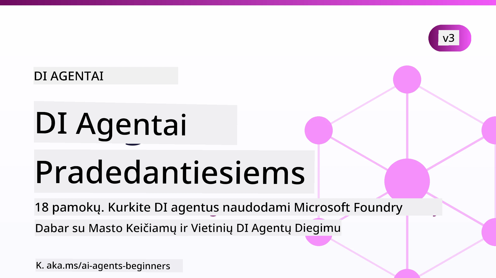

# AI agentai pradedantiesiems – kursas



## Kursas, kuriame mokoma visko, ką reikia žinoti norint pradėti kurti AI agentus

[](https://github.com/microsoft/ai-agents-for-beginners/blob/master/LICENSE?WT.mc_id=academic-105485-koreyst)
[](https://GitHub.com/microsoft/ai-agents-for-beginners/graphs/contributors/?WT.mc_id=academic-105485-koreyst)
[](https://GitHub.com/microsoft/ai-agents-for-beginners/issues/?WT.mc_id=academic-105485-koreyst)
[](https://GitHub.com/microsoft/ai-agents-for-beginners/pulls/?WT.mc_id=academic-105485-koreyst)
[](http://makeapullrequest.com?WT.mc_id=academic-105485-koreyst)

### 🌐 Daugiažodė kalbų palaikymas

#### Vertimus palaiko [Co-op Translator](https://github.com/Azure/co-op-translator)

<!-- CO-OP TRANSLATOR LANGUAGES TABLE START -->
[Arabų](../ar/README.md) | [Bengalų](../bn/README.md) | [Bulgarų](../bg/README.md) | [Birmos (Mjanmaro)](../my/README.md) | [Kinų (supaprastinta)](../zh-CN/README.md) | [Kinų (tradicinė, Honkongas)](../zh-HK/README.md) | [Kinų (tradicinė, Makao)](../zh-MO/README.md) | [Kinų (tradicinė, Taivanas)](../zh-TW/README.md) | [Kroatų](../hr/README.md) | [Čekų](../cs/README.md) | [Danų](../da/README.md) | [Olandų](../nl/README.md) | [Estų](../et/README.md) | [Suomių](../fi/README.md) | [Prancūzų](../fr/README.md) | [Vokiečių](../de/README.md) | [Graikų](../el/README.md) | [Hebrajų](../he/README.md) | [Hindi](../hi/README.md) | [Vengrų](../hu/README.md) | [Indoneziečių](../id/README.md) | [Italų](../it/README.md) | [Japonų](../ja/README.md) | [Kannada](../kn/README.md) | [Khmerų](../km/README.md) | [Korėjiečių](../ko/README.md) | [Lietuvių](./README.md) | [Malajų](../ms/README.md) | [Malajalų](../ml/README.md) | [Maratų](../mr/README.md) | [Nepaliečių](../ne/README.md) | [Nigerijos pidžino](../pcm/README.md) | [Norvegų](../no/README.md) | [Persų (Farsi)](../fa/README.md) | [Lenkų](../pl/README.md) | [Portugalų (Brazilija)](../pt-BR/README.md) | [Portugalų (Portugalija)](../pt-PT/README.md) | [Pandžabų (Gurmukhi)](../pa/README.md) | [Rumunų](../ro/README.md) | [Rusų](../ru/README.md) | [Serbų (kirilica)](../sr/README.md) | [Slovakų](../sk/README.md) | [Slovėnų](../sl/README.md) | [Ispanų](../es/README.md) | [Suahelių](../sw/README.md) | [Švedų](../sv/README.md) | [Tagalo (Filipinų)](../tl/README.md) | [Tamilų](../ta/README.md) | [Telugų](../te/README.md) | [Tailando](../th/README.md) | [Turkų](../tr/README.md) | [Ukrainiečių](../uk/README.md) | [Urdu](../ur/README.md) | [Vietnamiečių](../vi/README.md)

> **Pirmenybę teikiate vietiniam klonavimui?**
>
> Ši saugykla turi daugiau nei 50 kalbų vertimų, kurie žymiai padidina atsisiuntimo dydį. Norėdami klonuoti be vertimų, naudokite ribotą atsisiuntimą:
>
> **Bash / macOS / Linux:**
> ```bash
> git clone --filter=blob:none --sparse https://github.com/microsoft/ai-agents-for-beginners.git
> cd ai-agents-for-beginners
> git sparse-checkout set --no-cone '/*' '!translations' '!translated_images'
> ```
>
> **CMD (Windows):**
> ```cmd
> git clone --filter=blob:none --sparse https://github.com/microsoft/ai-agents-for-beginners.git
> cd ai-agents-for-beginners
> git sparse-checkout set --no-cone "/*" "!translations" "!translated_images"
> ```
>
> Tai suteikia jums viską, ko reikia kursui baigti, su daug greitesniu atsisiuntimu.
<!-- CO-OP TRANSLATOR LANGUAGES TABLE END -->

**Dėl papildomų kalbų pasirinkimų žr. [Co-op Translator palaikomas kalbas](https://github.com/Azure/co-op-translator/blob/main/docs/supported-languages.md).**

[](https://GitHub.com/microsoft/ai-agents-for-beginners/watchers/?WT.mc_id=academic-105485-koreyst)
[](https://GitHub.com/microsoft/ai-agents-for-beginners/network/?WT.mc_id=academic-105485-koreyst)
[](https://GitHub.com/microsoft/ai-agents-for-beginners/stargazers/?WT.mc_id=academic-105485-koreyst)

[](https://discord.com/invite/ATgtXmAS5D)


## 🌱 Pradžia

Šiame kurse yra pamokos, apimančios AI agentų kūrimo pagrindus. Kiekviena pamoka apima savą temą, tad pradėkite ten, kur jums patogiausia!

Šiam kursui yra kelių kalbų palaikymas. Žr. mūsų [galimas kalbas čia](#-multi-language-support).

Jei tai pirmas kartas, kai dirbate su generatyviniais AI modeliais, pažiūrėkite mūsų [Generatyvinis AI pradedantiesiems](https://aka.ms/genai-beginners) kursą, kuriame yra 21 pamoka apie GenAI kūrimą.

Nepamirškite [įvertinti (🌟) šį repo](https://docs.github.com/en/get-started/exploring-projects-on-github/saving-repositories-with-stars?WT.mc_id=academic-105485-koreyst) ir [padaryti forką](https://github.com/microsoft/ai-agents-for-beginners/fork), kad galėtumėte paleisti kodą.

### Susipažinkite su kitais besimokančiaisiais, gaukite atsakymus į savo klausimus

Jei stringate ar turite klausimų apie AI agentų kūrimą, prisijunkite prie mūsų specialaus Discord kanalo [Microsoft Foundry Discord](https://aka.ms/ai-agents/discord).

### Ko jums reikės

Kiekviena šio kurso pamoka turi kodo pavyzdžių, kurie randami code_samples kataloge. Galite [padaryti forką](https://github.com/microsoft/ai-agents-for-beginners/fork) šiai saugyklai sukurti savo kopiją.

Šiuose pavyzdžiuose naudojamas Microsoft Agent Framework su Microsoft Foundry Agent Service V2:

- [Microsoft Foundry](https://aka.ms/ai-agents-beginners/ai-foundry) - Reikalinga Azure paskyra

Šis kursas naudoja šias Microsoft AI agentų platformas ir paslaugas:

- [Microsoft Agent Framework (MAF)](https://learn.microsoft.com/agent-framework/overview/)
- [Microsoft Foundry Agent Service V2](https://aka.ms/ai-agents-beginners/ai-agent-service)

Kai kurie kodo pavyzdžiai taip pat palaiko alternatyvius OpenAI suderinamus tiekėjus, tokius kaip [MiniMax](https://platform.minimaxi.com/), siūlantį didelio konteksto modelius (iki 204K ženklų). Išsamesnę informaciją žiūrėkite [kurso nustatymuose](./00-course-setup/README.md).

Daugiau informacijos apie kodo vykdymą šiam kursui ieškokite [kurso nustatymuose](./00-course-setup/README.md).

## 🙏 Norite padėti?

Turite pasiūlymų ar radote rašybos ar kodo klaidų? [Praneškite apie problemą](https://github.com/microsoft/ai-agents-for-beginners/issues?WT.mc_id=academic-105485-koreyst) arba [Sukurkite pull request](https://github.com/microsoft/ai-agents-for-beginners/pulls?WT.mc_id=academic-105485-koreyst)


## 📂 Kiekviena pamoka apima

- Rašytinę pamoką README faile ir trumpą vaizdo įrašą
- Python kodo pavyzdžius, naudojant Microsoft Agent Framework su Microsoft Foundry
- Nuorodas į papildomus šaltinius mokymuisi tęsti


## 🗃️ Pamokos

| **Pamoka**                                   | **Tekstas & Kodas**                                    | **Vaizdo įrašas**                                                  | **Papildomas mokymasis**                                                                     |
|----------------------------------------------|----------------------------------------------------|------------------------------------------------------------|----------------------------------------------------------------------------------------|
| Įvadas į AI agentus ir agentų naudojimo atvejus       | [Nuoroda](./01-intro-to-ai-agents/README.md)          | [Vaizdo įrašas](https://youtu.be/3zgm60bXmQk?si=z8QygFvYQv-9WtO1)  | [Nuoroda](https://aka.ms/ai-agents-beginners/collection?WT.mc_id=academic-105485-koreyst) |
| AI agentūros sistemų tyrinėjimas              | [Nuoroda](./02-explore-agentic-frameworks/README.md)  | [Vaizdo įrašas](https://youtu.be/ODwF-EZo_O8?si=Vawth4hzVaHv-u0H)  | [Nuoroda](https://aka.ms/ai-agents-beginners/collection?WT.mc_id=academic-105485-koreyst) |
| AI agentų dizaino šablonų supratimas     | [Nuoroda](./03-agentic-design-patterns/README.md)     | [Vaizdo įrašas](https://youtu.be/m9lM8qqoOEA?si=BIzHwzstTPL8o9GF)  | [Nuoroda](https://aka.ms/ai-agents-beginners/collection?WT.mc_id=academic-105485-koreyst) |
| Įrankių naudojimo dizaino šablonas                      | [Nuoroda](./04-tool-use/README.md)                    | [Vaizdo įrašas](https://youtu.be/vieRiPRx-gI?si=2z6O2Xu2cu_Jz46N)  | [Nuoroda](https://aka.ms/ai-agents-beginners/collection?WT.mc_id=academic-105485-koreyst) |
| Agentų RAG                                  | [Nuoroda](./05-agentic-rag/README.md)                 | [Vaizdo įrašas](https://youtu.be/WcjAARvdL7I?si=gKPWsQpKiIlDH9A3)  | [Nuoroda](https://aka.ms/ai-agents-beginners/collection?WT.mc_id=academic-105485-koreyst) |
| Patikimų AI agentų kūrimas               | [Nuoroda](./06-building-trustworthy-agents/README.md) | [Vaizdo įrašas](https://youtu.be/iZKkMEGBCUQ?si=jZjpiMnGFOE9L8OK ) | [Nuoroda](https://aka.ms/ai-agents-beginners/collection?WT.mc_id=academic-105485-koreyst) |
| Planavimo dizaino šablonas                      | [Nuoroda](./07-planning-design/README.md)             | [Vaizdo įrašas](https://youtu.be/kPfJ2BrBCMY?si=6SC_iv_E5-mzucnC)  | [Nuoroda](https://aka.ms/ai-agents-beginners/collection?WT.mc_id=academic-105485-koreyst) |
| Daugiaagentės sistemos dizaino šablonas                   | [Nuoroda](./08-multi-agent/README.md)                 | [Vaizdo įrašas](https://youtu.be/V6HpE9hZEx0?si=rMgDhEu7wXo2uo6g)  | [Nuoroda](https://aka.ms/ai-agents-beginners/collection?WT.mc_id=academic-105485-koreyst) |
| Metakognicijos dizaino šablonas                 | [Nuoroda](./09-metacognition/README.md)               | [Vaizdo įrašas](https://youtu.be/His9R6gw6Ec?si=8gck6vvdSNCt6OcF)  | [Nuoroda](https://aka.ms/ai-agents-beginners/collection?WT.mc_id=academic-105485-koreyst) |
| AI agentai gamyboje                      | [Nuoroda](./10-ai-agents-production/README.md)        | [Vaizdo įrašas](https://youtu.be/l4TP6IyJxmQ?si=31dnhexRo6yLRJDl)  | [Nuoroda](https://aka.ms/ai-agents-beginners/collection?WT.mc_id=academic-105485-koreyst) |
| Naudojant agentų protokolus (MCP, A2A ir NLWeb) | [Nuoroda](./11-agentic-protocols/README.md)           | [Vaizdo įrašas](https://youtu.be/X-Dh9R3Opn8)                                 | [Nuoroda](https://aka.ms/ai-agents-beginners/collection?WT.mc_id=academic-105485-koreyst) |
| Konteksto inžinerija AI agentams            | [Nuoroda](./12-context-engineering/README.md)         | [Vaizdo įrašas](https://youtu.be/F5zqRV7gEag)                                 | [Nuoroda](https://aka.ms/ai-agents-beginners/collection?WT.mc_id=academic-105485-koreyst) |
| Agentų atminties valdymas                      | [Nuoroda](./13-agent-memory/README.md)     |      [Vaizdo įrašas](https://youtu.be/QrYbHesIxpw?si=vZkVwKrQ4ieCcIPx)                                                      |                                                                                        |
| Microsoft Agent Framework tyrinėjimas                         | [Nuoroda](./14-microsoft-agent-framework/README.md)                            |                                                            |                                                                                        |
| Kompiuterinių naudojimosi agentų kūrimas (CUA)           | [Nuoroda](./15-browser-use/README.md)     |                                                            | [Nuoroda](https://docs.browser-use.com/examples/templates/playwright-integration)         |
| Mastelio keičiamų agentų diegimas                    | [Nuoroda](./16-deploying-scalable-agents/README.md) |                                                    | [Nuoroda](https://learn.microsoft.com/azure/ai-foundry/agents/overview)                   |
| Vietinių AI agentų kūrimas                     | [Nuoroda](./17-creating-local-ai-agents/README.md)  |                                                    | [Nuoroda](https://learn.microsoft.com/azure/ai-foundry/foundry-local/)                    |
| AI agentų saugumo užtikrinimas                           | [Nuoroda](./18-securing-ai-agents/README.md)  |                                                            | [Nuoroda](https://aka.ms/ai-agents-beginners/collection?WT.mc_id=academic-105485-koreyst) |

## 🎒 Kiti kursai

Mūsų komanda kuria ir kitus kursus! Pažiūrėkite:

<!-- CO-OP TRANSLATOR OTHER COURSES START -->
### LangChain
[](https://aka.ms/langchain4j-for-beginners)
[](https://aka.ms/langchainjs-for-beginners?WT.mc_id=m365-94501-dwahlin)
[](https://github.com/microsoft/langchain-for-beginners?WT.mc_id=m365-94501-dwahlin)
---

### Azure / Edge / MCP / agentai
[](https://github.com/microsoft/AZD-for-beginners?WT.mc_id=academic-105485-koreyst)
[](https://github.com/microsoft/edgeai-for-beginners?WT.mc_id=academic-105485-koreyst)
[](https://github.com/microsoft/mcp-for-beginners?WT.mc_id=academic-105485-koreyst)
[](https://github.com/microsoft/ai-agents-for-beginners?WT.mc_id=academic-105485-koreyst)

---
 
### Generatyvinis AI serija
[](https://github.com/microsoft/generative-ai-for-beginners?WT.mc_id=academic-105485-koreyst)
[-9333EA?style=for-the-badge&labelColor=E5E7EB&color=9333EA)](https://github.com/microsoft/Generative-AI-for-beginners-dotnet?WT.mc_id=academic-105485-koreyst)
[-C084FC?style=for-the-badge&labelColor=E5E7EB&color=C084FC)](https://github.com/microsoft/generative-ai-for-beginners-java?WT.mc_id=academic-105485-koreyst)
[-E879F9?style=for-the-badge&labelColor=E5E7EB&color=E879F9)](https://github.com/microsoft/generative-ai-with-javascript?WT.mc_id=academic-105485-koreyst)

---
 
### Pagrindinis mokymasis
[](https://aka.ms/ml-beginners?WT.mc_id=academic-105485-koreyst)
[](https://aka.ms/datascience-beginners?WT.mc_id=academic-105485-koreyst)
[](https://aka.ms/ai-beginners?WT.mc_id=academic-105485-koreyst)
[](https://github.com/microsoft/Security-101?WT.mc_id=academic-96948-sayoung)
[](https://aka.ms/webdev-beginners?WT.mc_id=academic-105485-koreyst)
[](https://aka.ms/iot-beginners?WT.mc_id=academic-105485-koreyst)
[](https://github.com/microsoft/xr-development-for-beginners?WT.mc_id=academic-105485-koreyst)

---
 
### Copilot serija
[](https://aka.ms/GitHubCopilotAI?WT.mc_id=academic-105485-koreyst)
[](https://github.com/microsoft/mastering-github-copilot-for-dotnet-csharp-developers?WT.mc_id=academic-105485-koreyst)
[](https://github.com/microsoft/CopilotAdventures?WT.mc_id=academic-105485-koreyst)
<!-- CO-OP TRANSLATOR OTHER COURSES END -->

## 🌟 Bendruomenės padėkos

Dėkojame [Shivam Goyal](https://www.linkedin.com/in/shivam2003/) už svarbių kodų pavyzdžių pateikimą, rodant veikiančią Agentic RAG.

## Dalyvavimas

Šis projektas kviečia teikti indėlius ir pasiūlymus. Daugeliui indėlių privaloma sutikti su
Indėlio licencijos sutartimi (CLA), kurioje deklaruojate, kad turite teisę ir iš tikrųjų suteikiate mums
teisę naudoti jūsų indėlį. Daugiau informacijos rasite <https://cla.opensource.microsoft.com>.

Kai pateikiate pull request, CLA robotas automatiškai nustatys, ar reikia pateikti
CLA ir pažymės PR atitinkamai (pvz., būsenos tikrinimą, komentarą). Tiesiog sekite
roboto pateiktas instrukcijas. Tai reikės atlikti tik kartą visiems mūsų CLA naudojantiems repo.

Šis projektas priėmė [Microsoft atvirojo kodo elgesio kodeksą](https://opensource.microsoft.com/codeofconduct/).
Daugiau informacijos rasite [Elgesio kodekso DUK](https://opensource.microsoft.com/codeofconduct/faq/) arba
susisiekite su [opencode@microsoft.com](mailto:opencode@microsoft.com) dėl papildomų klausimų ar pastabų.

## Prekės ženklai

Šiame projekte gali būti projektų, produktų ar paslaugų prekės ženklų arba logotipų. Leidžiamas Microsoft
prekės ženklų ar logotipų naudojimas įpareigoja ir turi vadovautis
[Microsoft prekės ženklų ir prekės ženklų naudojimo gairėmis](https://www.microsoft.com/legal/intellectualproperty/trademarks/usage/general).
Keistuose šio projekto variantuose naudojamas Microsoft prekės ženklų ar logotipų naudojimas neturi sukelti painiavos ar
reikšti Microsoft rėmimą. Bet koks trečiųjų šalių prekės ženklų ar logotipų naudojimas yra subject to tų trečiųjų šalių politikų.

## Pagalbos gavimas


Jei užstrigote ar turite klausimų apie DI programėlių kūrimą, prisijunkite:

[](https://aka.ms/foundry/discord)

Jei turite atsiliepimų apie produktą ar klaidų kūrimo metu, apsilankykite:

[](https://aka.ms/foundry/forum)

---

<!-- CO-OP TRANSLATOR DISCLAIMER START -->
**Atsakomybės apribojimas**:
Šis dokumentas buvo išverstas naudojant dirbtinio intelekto vertimo paslaugą [Co-op Translator](https://github.com/Azure/co-op-translator). Nors siekiame tikslumo, prašome atkreipti dėmesį, kad automatiniai vertimai gali turėti klaidų ar netikslumų. Originalus dokumentas jo gimtąja kalba laikomas autoritetingu šaltiniu. Svarbiai informacijai rekomenduojama naudoti profesionalų žmogiškąjį vertimą. Mes neatsakome už jokius nesusipratimus ar neteisingą interpretaciją, kilusią naudojantis šiuo vertimu.
<!-- CO-OP TRANSLATOR DISCLAIMER END -->