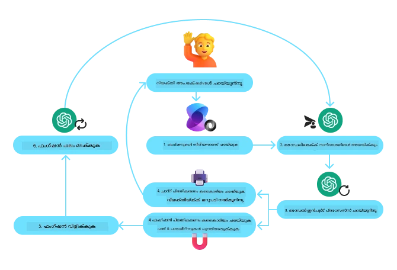
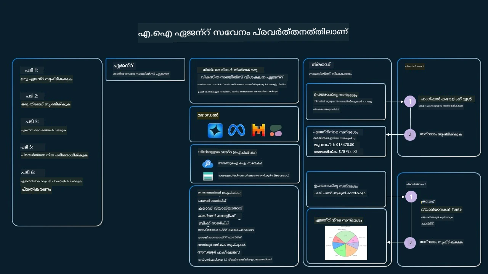

[](https://youtu.be/vieRiPRx-gI?si=cEZ8ApnT6Sus9rhn)

> _(ഈ പാഠത്തിന്റെ വീഡിയൊ കാണാൻ മുകളിൽ ചിത്രത്തിൽ ക്ലിക്ക് ചെയ്യുക)_

# ടൂൾ ഉപയോഗ രൂപകൽപ്പന മാതൃക

ടൂളുകൾ രസകരമാണ് കാരണം അവ AI ഏജന്റുകൾക്ക് വിപുലമായ കഴിവുകൾ നൽകുന്നു. ഏജന്റിന് നിർവഹിക്കാനാവുന്ന പ്രവർത്തനങ്ങളുടെ നിർബന്ധിത സെറ്റ് ഉണ്ടാവുന്നതിന് പകരം, ഒരു ടൂൾ ചേർത്താൽ, ഏജന്റ് ഇപ്പോൾ വിപുലമായ പ്രവർത്തനങ്ങൾ ചെയ്യാൻ കഴിയും. ഈ അദ്ധ്യായത്തിൽ, നാം ടൂൾ ഉപയോഗ രൂപകൽപ്പന മാതൃകയെ കുറിച്ച് നോക്കും, ഇത് എങ്ങനെ AI ഏജന്റ്‌ಗಳು അവരുടെ ലക്ഷ്യങ്ങൾക്ക് എത്താൻ പ്രത്യേക ടൂളുകൾ ഉപയോഗിക്കാമെന്ന് വിവരിക്കുന്നു.

## പരിചയം

ഈ പാഠത്തിൽ, നാം താഴെയുള്ള ചോദ്യങ്ങൾക്ക് ഉത്തരമണയാൻ ശ്രമിക്കുന്നു:

- ടൂൾ ഉപയോഗ രൂപകൽപ്പന മാതൃക എന്താണ്?
- ഇത് ഏതു ഉപയോഗക്കേസുകൾക്ക് പ്രയോഗിക്കാം?
- രൂപകൽപ്പന മാതൃക നടപ്പിലാക്കാൻ ആവശ്യമായ ഘടകങ്ങൾ/നിർമാണ ഘടകങ്ങൾ എന്തെല്ലാം ആണ്?
- വിശ്വസനീയമായ AI ഏജന്റുകൾ നിർമ്മിക്കാൻ ടൂൾ ഉപയോഗ രൂപകൽപ്പന മാതൃക ഉപയോഗിക്കുമ്പോൾ പ്രത്യേക പരിഗണനകൾ എന്തെല്ലാം ആണ്?

## പഠന ലക്ഷ്യങ്ങൾ

ഈ പാഠം പൂർത്തിയാക്കിയ ശേഷം, നിങ്ങൾക്ക് സാധിക്കേണ്ടതുണ്ട്:

- ടൂൾ ഉപയോഗ രൂപകൽപ്പന മാതൃകയും അതിന്റെ ഉദ്ദേശ്യവും നിർവ്വചിക്കുക.
- ടൂൾ ഉപയോഗ രൂപകൽപ്പന മാതൃക ആരംഭിക്കാവുന്ന ഉപയോഗക്കേസുകൾ തിരിച്ചറിയുക.
- രൂപകൽപ്പന മാതൃക നടപ്പിലാക്കാൻ ആവശ്യമായ പ്രധാന ഘടകങ്ങൾ മനസ്സിലാക്കുക.
- ഈ രൂപകൽപ്പന മാതൃക ഉപയോഗിക്കുന്ന AI ഏജൻറുകളുടെ വിശ്വസനീയത ഉറപ്പാക്കുന്നതിനുള്ള പരിഗണനകൾ തിരിച്ചറിയുക.

## ടൂൾ ഉപയോഗ രൂപകൽപ്പന മാതൃക എന്താണ്?

**ടൂൾ ഉപയോഗ രൂപകൽപ്പന മാതൃക** LLM-കൾക്ക് പ്രത്യേക ലക്ഷ്യങ്ങൾ പൂർത്തിയാക്കാൻ ബാഹ്യ ടൂളുകളുമായി ഇടപഴകാനുള്ള കഴിവ് നൽകുന്നതിൽ ശ്രദ്ധ കേന്ദ്രീകരിക്കുന്നു. ടൂളുകൾ കോഡ് ആണ്, ഏജൻറ് പ്രവർത്തനങ്ങൾ നിർവഹിക്കാൻ പ്രവർത്തിപ്പിക്കാവുന്നതാണ്. ഒരു ടൂൾ കാൽക്കുലേറ്റർ പോലുള്ള ലഘുഫംഗ്ഷൻ ആകാമോ, സ്റ്റോക്ക് വില കണ്ടെത്തൽ അല്ലെങ്കിൽ കാലാവസ്ഥ പ്രവചനത്തിനായുള്ള മൂന്നാം കക്ഷി സേവനത്തിന് API കോളായിരിക്കും. AI ഏജന്റുകളുടെ സന്ദർഭത്തിൽ, ടൂളുകൾ **മോഡൽ-ജനിത പ്രവർത്തന കോളുകൾ**ക്കായി ഏജൻറുകൾ നിർവഹിച്ചു തുടങ്ങുന്നു.

## ഇത് ഏതു ഉപയോഗക്കേസുകൾക്ക് പ്രയോഗിക്കാം?

AI ഏജന്റുകൾ സങ്കീർണമായ കാര്യങ്ങൾ പൂർത്തിയാക്കാൻ, വിവരങ്ങൾ ശേഖരിക്കാൻ, അല്ലെങ്കിൽ തീരുമാനങ്ങൾ എടുക്കാൻ ടൂളുകൾ പ്രയോജനപ്പെടുത്താം. ടൂൾ ഉപയോഗ രൂപകൽപ്പന മാതൃക ബാഹ്യ സിസ്റ്റങ്ങളുമായി ഡൈനാമിക് ഇടപെടൽ ആവശ്യമുള്ള സാഹചര്യങ്ങളിൽ, ഉദാഹരണത്തിന് ഡാറ്റാബേസുകൾ, വെബ് സർവീസുകൾ അല്ലെങ്കിൽ കോഡ് വ്യാഖ്യാതാക്കൾ പോലുള്ളവയിൽ വ്യാപകമായി ഉപയോഗിക്കുന്നു. ഇതുവഴി പല വേറിട്ട സന്ദർഭങ്ങളിലുണ്ടാക്കാവുന്നതാണ്, ഉദാഹരണങ്ങൾ:

- **ഡൈനാമിക് വിവര ശേഖരണം:** ഏജന്റുകൾ ഏറ്റവും പുതിയ ഡാറ്റ നേടാൻ ബാഹ്യ APIകൾ അല്ലെങ്കിൽ ഡാറ്റാബേസുകൾ ചോദ്യം ചെയ്യാം (ഉദാ. ഡാറ്റാ വിശകലനത്തിന് SQLite ഡാറ്റാബേസ് ചോദ്യം ചെയ്യൽ, സ്റ്റോക്ക് വിലകൾ അല്ലെങ്കിൽ കാലാവസ്ഥ വിവരങ്ങൾ പിടിക്കൽ).
- **കോഡ് നിർവ്വഹണവും വ്യാഖ്യാനവും:** ഗണിത പ്രശ്‌നങ്ങൾ പരിഹരിക്കാനോ റിപ്പോർട്ടുകൾ സൃഷ്ടിക്കാനോ സിമുലേഷനുകൾ നടത്താനോ ഏജന്റുകൾ കോഡ് അല്ലെങ്കിൽ സ്‌ക്രിപ്റ്റുകൾ പ്രവർത്തിപ്പിക്കാം.
- **വർക്ക്‌ഫ്ലോ ഓട്ടോമേഷൻ:** ടാസ്‌ക് ഷെഡ്യൂളറുകൾ, ഇമെയിൽ സർവീസുകൾ, ഡാറ്റ പൈപ്പ്‌ലൈനുകൾ പോലുള്ള ടൂളുകൾ സംയോജിപ്പിച്ച് പുനരാവൃതമായ അല്ലെങ്കിൽ ബഹു പട അവലോകന പ്രവർത്തനങ്ങൾ ഓട്ടോമേറ്റ് ചെയ്യൽ.
- **കസ്റ്റമർ പിന്തുണ:** CRM സിസ്റ്റങ്ങളും ടിക്കറ്റ് പ്ലാറ്റ്‌ഫോമുകളും അറിവ് ബേസുകളും ചേർന്ന് ഉപഭോക്തൃ ചോദ്യങ്ങൾ പരിഹരിക്കാൻ ഏജന്റുകൾ ഇടപഴകുന്നു.
- **ഉള്ളടക്കം സൃഷ്ടിയിലും എഡിറ്റിംഗിലും:** വ്യാകരണ പരിശോധന, ആശയം സംക്ഷേപণ, അല്ലെങ്കിൽ ഉള്ളടക്കം സുരക്ഷാ തരം പരിശോധിക്കൽ പോലുള്ള ടൂളുകൾ എജന്റുകൾ പ്രയോജനപ്പെടുത്തി ഉള്ളടക്കം സൃഷ്ടിയിൽ സഹായം നൽകുന്നു.

## ടൂൾ ഉപയോഗ രൂപകൽപ്പന മാതൃക നടപ്പിലാക്കാൻ ആവശ്യമായ ഘടകങ്ങൾ/നിർമ്മാണ ഘടകങ്ങൾ എന്തെല്ലാം?

ഈ നിർമ്മാണ ഘടകങ്ങൾ AI ഏജന്റിന വിലയിരുത്താവുന്ന പല പ്രവർത്തനങ്ങളും സാധ്യമാക്കുന്നു. ടൂൾ ഉപയോഗ രൂപകൽപ്പന മാതൃക നടപ്പിലാക്കാൻ ആവശ്യമായ പ്രധാന ഘടകങ്ങൾ ഇവിടെ പരിശോധിക്കാം:

- **ഫംഗ്ഷൻ/ടൂൾ സ്കീമകൾ**: ലഭ്യമായ ടൂളുകളുടെ വിശദമായ നിർവചനങ്ങൾ, ഫംഗ്ഷൻ പേര്, ഉദ്ദേശ്യം, ആവശ്യമായ പാരാമീറ്ററുകൾ, പ്രതീക്ഷിക്കുന്ന ഔട്ട്പുട്ടുകൾ എന്നിവ ഉൾപ്പെടുന്നു. ഈ സ്കീമകൾ LLM-ക്ക് ലഭ്യമായ ടൂളുകൾ മനസിലാക്കാനും സാധുവായ അഭ്യർത്ഥനകൾ നിർമ്മിക്കാനുമുള്ള സഹായം നൽകുന്നു.

- **ഫംഗ്ഷൻ നിർവഹണ തർക്കശാസ്ത്രം**: ഉപയോക്താവിന്റെ ഉദ്ദേശവും സംവാദ സാന്ദർഭവും അടിസ്ഥാനമാക്കി ടൂളുകൾ എപ്പോൾ, എങ്ങനെ വിളിക്കപ്പെടും എന്ന് നിയന്ത്രിക്കുന്നു. പ്ലാനർ മോഡ്യൂളുകൾ, റൂട്ടിംഗ് സംവിധാനം, അല്ലെങ്കിൽ സന്ധിഗ്ധ പ്രവാഹങ്ങൾ ഉൾപ്പെടാം ഇത്.

- **സന്ദേശ ചിക ്കര ണവണ സംവിധാന ം**: ഉപയോക്തൃ ഇൻപുട്ടുകൾ, LLM പ്രതികരണങ്ങൾ, ടൂൾ കോളുകൾ, ടൂൾ ഔട്ട്പുട്ടുകൾ എന്നിവ തമ്മിലുള്ള സംവാദ പ്രവാഹം നിയന്ത്രിക്കുന്ന ഘടകങ്ങൾ.

- **ടൂൾ ഇന്റഗ്രേഷൻ ഫ്രെയിംവർക്ക്**: ഏജന്റിനെ വിവിധ ടൂളുകളുമായി ബന്ധിപ്പിക്കുന്ന അദ്ധിഹിതം, ലളിതമായ ഫംഗ്ഷനുകളായാലും സങ്കീർണ്ണമായ ബാഹ്യ സേവനങ്ങളായാലും.

- **പിശക് കൈകാര്യം & സാധുത പരിശോധന:** ടൂൾ നിർവഹണത്തിലെ പൊട്ടിപ്പോകലുകൾ കൈകാര്യം ചെയ്യാനുള്ള, പാരാമീറ്ററുകൾ സാധുത പരിശോധിക്കൽ, അവിശ്വാസകരമായ പ്രതികരണങ്ങൾ നിയന്ത്രിക്കുന്ന യന്ത്രങ്ങൾ.

- **സ്റ്റേറ്റ് മാനേജ്‌മെന്റ്**: സംവാദ സാന്ദർഭം, മുമ്പുള്ള ടൂൾ ഇടപെടലുകൾ, സ്ഥിരമായ ഡാറ്റ എന്നിവ ട്രാക്ക് ചെയ്യുന്നു, ബഹു ടേൺ ഇടപെടലുകളിൽ സ്ഥിരത ഉറപ്പാക്കുന്നു.

അടുത്തതായി, ഫംഗ്ഷൻ/ടൂൾ കോളിങ് കൂടുതൽ വിശദമായി നോക്കാം.
 
### ഫംഗ്ഷൻ/ടൂൾ കോളിംഗ്

ഫംഗ്ഷൻ കോളിംഗ് ആണ് വലിയ ഭാഷാ മാതൃകകൾ (LLMs) ടൂളുകളുമായി ഇടപഴകാൻ ഉപയോഗിക്കുന്ന പ്രധാന മാർഗം. 'ഫംഗ്ഷൻ' ഉം 'ടൂൾ' ഉം പലപ്പോഴും പരസ്പരം ഉപയോഗിക്കുന്നത് കാണാം കാരണം 'ഫംഗ്ഷനുകൾ' (പുനരുപയോഗിക്കാവുന്ന കോഡിന്റെ ബ്ലോക്കുകൾ) എജന്റുകൾ പ്രവർത്തനങ്ങൾ നടത്താൻ ഉപയോഗിക്കുന്ന 'ടൂളുകളാണ്'. ഒരു ഫംഗ്ഷന്റെ കോഡ് പ്രവർത്തിപ്പിക്കാൻ, ഒരു LLM-ഓം ഉപയോക്താവിന്റെ അഭ്യർത്ഥന ഫംഗ്ഷൻ വിവരണത്തിൻെറോട് താരതമ്യം ചെയ്യണം. ഇതിനു എല്ലാ ലഭ്യമായ ഫംഗ്ഷനുകളുടെ വിവരണങ്ങൾ അടങ്ങിയ ഒരു സ്കീമ LLM-ට അയക്കപ്പെടുന്നു. LLM തുടർന്ന് ഏറ്റവും അനുയോജ്യമായ ഫംഗ്ഷൻ തിരഞ്ഞെടുത്ത് അതിന്റെ പേര്, പാരാമീറ്ററുകൾ തിരിച്ചുകൊടുക്കും. തിരഞ്ഞെടുത്ത ഫംഗ്ഷൻ പ്രവർത്തിപ്പിച്ച്, അതിന്റെ പ്രതികരണം LLM-യിലേക്ക് ആക്കുമ്പോൾ ഉപയോക്താവിന്റെ അഭ്യർത്ഥനയ്ക്ക് പ്രതികരിക്കാൻ ഉപയോഗിക്കും.

ഏജന്റുകൾക്കായി ഫംഗ്ഷൻ കോളിംഗ് നടപ്പിലാക്കാൻ നിങ്ങളുടെ ആവശ്യങ്ങൾ:

1. ഫംഗ്ഷൻ കോളിംഗ് പിന്തുണയുള്ള LLM മോഡൽ
2. ഫംഗ്ഷൻ വിവരണങ്ങൾ അടങ്ങിയ സ്കീമ
3. ഓരോ ഫംഗ്ഷനിലും നിർവഹിക്കേണ്ട കോഡ്

ഒരു നഗരത്തിലെ നിലവിലെ സമയം എടുക്കാനുള്ള ഉദാഹരണം ഉപയോഗിക്കാം:

1. **ഫംഗ്ഷൻ കോളിംഗ് പിന്തുണയുള്ള LLM ആരംഭിക്കുക:**

    എല്ലാ മോഡലുകളും ഫംഗ്ഷൻ കോളിംഗ് പിന്തുണയ്ക്കുന്നില്ല, അതിനാൽ നിങ്ങൾ ഉപയോഗിക്കുന്ന LLM പിന്തുണയാണെന്ന് ഉറപ്പാക്കുക. <a href="https://learn.microsoft.com/azure/ai-services/openai/how-to/function-calling" target="_blank">Azure OpenAI</a> ഫംഗ്ഷൻ കോളിംഗ് പിന്തുണയ്ക്കുന്നു. നാം Azure OpenAI **Responses API** (സ്ഥിരമായ `/openai/v1/` എണ്ട്പോയിന്റ് — `api_version` ആവശ്യമില്ല) എതിർവശത്തിരിച്ച് OpenAI ക്ലയന്റ് ആരംഭിക്കാം.

    ```python
    # Initialize the OpenAI client for Azure OpenAI (Responses API, v1 endpoint)
    client = OpenAI(
        base_url=f"{os.environ['AZURE_OPENAI_ENDPOINT'].rstrip('/')}/openai/v1/",
        api_key=os.environ["AZURE_OPENAI_API_KEY"],
    )
    deployment_name = os.environ["AZURE_OPENAI_DEPLOYMENT"]
    ```

1. **ഫംഗ്ഷൻ സ്കീമ സൃഷ്ടിക്കുക**:

    അടുത്തതായി ഫംഗ്ഷൻ പേര്, ഫംഗ്ഷൻ എന്താണ് ചെയ്യുന്നത് എന്ന വിവരണം, ഫംഗ്ഷൻ പാരാമീറ്ററുകളുടെ പേര്, വിവരണം എന്നിവ അടങ്ങിയ JSON സ്കീമ നിർവചിക്കും.
    തുടർന്ന് ഈ സ്കീമ മുൻപുതന്നെ സൃഷ്ടിച്ച ക്ലയന്റിന് ഉൾപ്പെടുത്തും, ഉപയോക്താവ് San Francisco-യിൽ സമയം കാണിക്കുന്ന അഭ്യർത്ഥനയുമായി കൂടി അയയ്ക്കും. ശ്രദ്ധിക്കേണ്ടത്, **ടൂൾ കോളാണ്** മറുപടി, **അടുത്തുപ്പോലെ അവസാന ഉത്തരമല്ല**. മുൻപ് പറഞ്ഞതുപോലെ, LLM ആ പ്രവർത്തനത്തിന് തിരഞ്ഞെടുത്ത ഫംഗ്ഷന്റെ പേര്, പാരാമീറ്ററുകൾ തിരിച്ചുകൊടുക്കുന്നു.

    ```python
    # Function description for the model to read (Responses API flat tool format)
    tools = [
        {
            "type": "function",
            "name": "get_current_time",
            "description": "Get the current time in a given location",
            "parameters": {
                "type": "object",
                "properties": {
                    "location": {
                        "type": "string",
                        "description": "The city name, e.g. San Francisco",
                    },
                },
                "required": ["location"],
            },
        }
    ]
    ```
   
    ```python
  
    # Initial user message
    messages = [{"role": "user", "content": "What's the current time in San Francisco"}]

    # First API call: Ask the model to use the function
    response = client.responses.create(
        model=deployment_name,
        input=messages,
        tools=tools,
        tool_choice="auto",
        store=False,
    )

    # The Responses API returns tool calls as function_call items in response.output.
    # Append them to the conversation so the model has full context on the next turn.
    messages += response.output

    print("Model's response:")
    print(response.output)
  
    ```

    ```bash
    Model's response:
    [ResponseFunctionToolCall(arguments='{"location":"San Francisco"}', call_id='call_pOsKdUlqvdyttYB67MOj434b', name='get_current_time', type='function_call')]
    ```
  
1. **പണി നിർവഹിക്കാൻ ആവശ്യമായ ഫംഗ്ഷൻ കോഡ്:**

    ഇനി LLM തിരഞ്ഞെടുത്ത ഫംഗ്ഷൻ പ്രവർത്തിപ്പിക്കേണ്ട കോഡ് നടപ്പിലാക്കുകയും പ്രവർത്തിപ്പിക്കുകയും ചെയ്യും.
    Python-ലിൽ നിലവിലെ സമയം എടുക്കാനുള്ള കോഡ് എഴുതാം. ഫംഗ്ഷൻ സ്ഥിരീകരണ വിവരങ്ങൾ response_message-ൽ നിന്നെടുക്കും വിധം കോഡ് എഴുതേണ്ടിവരും.

    ```python
      def get_current_time(location):
        """Get the current time for a given location"""
        print(f"get_current_time called with location: {location}")  
        location_lower = location.lower()
        
        for key, timezone in TIMEZONE_DATA.items():
            if key in location_lower:
                print(f"Timezone found for {key}")  
                current_time = datetime.now(ZoneInfo(timezone)).strftime("%I:%M %p")
                return json.dumps({
                    "location": location,
                    "current_time": current_time
                })
      
        print(f"No timezone data found for {location_lower}")  
        return json.dumps({"location": location, "current_time": "unknown"})
    ```

     ```python
    # Handle function calls
    tool_calls = [item for item in response.output if item.type == "function_call"]
    if tool_calls:
        for tool_call in tool_calls:
            if tool_call.name == "get_current_time":

                function_args = json.loads(tool_call.arguments)

                time_response = get_current_time(
                    location=function_args.get("location")
                )

                # Return the tool result as a function_call_output item
                messages.append({
                    "type": "function_call_output",
                    "call_id": tool_call.call_id,
                    "output": time_response,
                })
    else:
        print("No tool calls were made by the model.")

    # Second API call: Get the final response from the model
    final_response = client.responses.create(
        model=deployment_name,
        input=messages,
        tools=tools,
        store=False,
    )

    return final_response.output_text
     ```

     ```bash
      get_current_time called with location: San Francisco
      Timezone found for san francisco
      The current time in San Francisco is 09:24 AM.
     ```

ഫംഗ്ഷൻ കോളിംഗ് ടൂൾ ഉപയോഗ രൂപകൽപ്പനയിലെ ഹൃദയമാണ്, എന്നാൽ ഇത് തൊട്ടടുത്ത് അടിസ്ഥാനത്തിൽ ആരംഭിക്കുന്നത് ചിലപ്പോൾ സങ്കീർണ്ണമാണാകാം.
നാം [അദ്ധ്യായം 2](../../../02-explore-agentic-frameworks) ൽ പഠിച്ചതു പോലെ, ഏജന്റിക് ഫ്രെയിംവർക്ക്‌ಗಳು ടൂൾ ഉപയോഗത്തിന് പൂരക നിർമ്മാണഘടകങ്ങൾ നൽകുന്നു.
 
## ഏജന്റിക് ഫ്രെയിംവർക്ക് ഉപയോഗിച്ചുള്ള ടൂൾ ഉപയോഗ ഉദാഹരണങ്ങൾ

വിവിധ ഏജന്റിക് ഫ്രെയിംവർക്ക് ഉപയോഗിച്ച് ടൂൾ ഉപയോഗ രൂപകൽപ്പന മാതൃക എങ്ങനെ നടപ്പിലാക്കാം എന്നതിനുള്ള ചില ഉദാഹരണങ്ങൾ:

### Microsoft ഏജന്റ് ഫ്രെയിംവർക്ക്

<a href="https://learn.microsoft.com/azure/ai-services/agents/overview" target="_blank">Microsoft ഏജന്റ് ഫ്രെയിംവർക്ക്</a> AI ഏജന്റുകൾ നിർമ്മിക്കാൻ ഒരു ഓപ്പൺ സോഴ്സ് ഫ്രെയിംവർക്ക് ആണ്. ഫംഗ്ഷൻ കോളിംഗ് പ്രക്രിയ ലളിതമാക്കുന്നു, ടൂളുകൾ Python ഫംഗ്ഷനുകളായി `@tool` ഡെക്കറേറ്റർ ഉപയോഗിച്ച് നിർവചിക്കാം. മോഡൽ, കോഡ് തമ്മിലുള്ള സംവാദം ഫ്രെയിംവർക്ക് കൈകാര്യം ചെയ്യുന്നു. File Search, Code Interpreter പോലുള്ള പൂർവ്വ നിർമിത ടൂളുകൾ `FoundryChatClient` വഴി ലഭ്യമാക്കുന്നു.

താഴെ കാണുന്ന ചിത്രം Microsoft ഏജന്റ് ഫ്രെയിംവർക്ക് ഉപയോഗിച്ച് ഫംഗ്ഷൻ കോളിംഗിന്റെ പ്രക്രിയ വ്യാഖ്യാനിക്കുന്നു:



Microsoft ഏജന്റ് ഫ്രെയിംവർക്കിൽ, ടൂളുകൾ ഡെക്കറേറ്റുചെയ്ത ഫംഗ്ഷനുകളായി നിർവചിക്കുന്നു. മുൻപ് കണ്ട `get_current_time` ഫംഗ്ഷൻ ടൂൾ ആക്കി മാറ്റാൻ `@tool` ഡെക്കറേറ്റർ ഉപയോഗിക്കാം. ഫ്രെയിംവർക്ക് ഫംഗ്ഷൻ, പാരാമീറ്ററുകൾ സീരിയലൈസ് ചെയ്ത് LLM-ന് അയയ്ക്കാനുള്ള സ്കീമ സൃഷ്ടിക്കും.

```python
import os
from agent_framework import tool
from agent_framework.foundry import FoundryChatClient
from azure.identity import AzureCliCredential

@tool(approval_mode="never_require")
def get_current_time(location: str) -> str:
    """Get the current time for a given location"""
    ...

# Create the client
provider = FoundryChatClient(
    project_endpoint=os.environ["AZURE_AI_PROJECT_ENDPOINT"],
    model=os.environ["AZURE_AI_MODEL_DEPLOYMENT_NAME"],
    credential=AzureCliCredential(),
)

# Create an agent and run with the tool
agent = provider.as_agent(name="TimeAgent", instructions="Use available tools to answer questions.", tools=get_current_time)
response = await agent.run("What time is it?")
```

#### MCP സർവറിൽ നിന്നുള്ള ടൂളുകൾ

ടൂളുകൾ നിങ്ങളുടെ സ്വന്തം കോഡിലെ ഫംഗ്ഷനുകളാകേണ്ടതില്ല. മോഡൽ കോൺടെക്സ്റ്റ് പ്രോട്ടോക്കോൾ (MCP, [അദ്ധ്യായം 11](../11-agentic-protocols/README.md) ൽ പഠിച്ചതുപോലെ) സംസാരിക്കുന്ന ഒരു സർവർ തന്റെ ടൂളുകൾ സ്കീമുകളുമായി പ്രസിദ്ധീകരിക്കുന്നു, ഫ്രെയിംവർക്ക് അത് ഡെക്കറേറ്റുചെയ്ത ഫംഗ്ഷൻ പോലെ സീരിയലൈസ് ചെയ്ത് ഉപയോഗിക്കാനാകും. `MCPStreamableHTTPTool` HTTP വഴി MCP സർവറുമായി ബന്ധിപ്പിച്ച് ടൂൾ സ്കീമകൾ വായിച്ച്, മോഡലിന് പ്രാദേശിക ടൂളുകളെ പുറമേ നൽകുന്നു.

താഴെയുള്ള ഉദാഹരണം <a href="https://keenable.ai" target="_blank">Keenable</a> പോർവെച്ചു നടത്തുന്ന വെബ് സേർച്ച് സർവർ ഉപയോഗിക്കുന്നു. അക്കൗണ്ട് അല്ലെങ്കിൽ API കീ ഇല്ലാതെใช้ฟรี (IP അടിസ്ഥാനത്തിൽ റേറ്റ് ലിമിറ്റേഷൻ ഉണ്ട്), അതിനാൽ മോഡലിനുള്ള ക്രെഡൻഷ്യലുകൾ മാത്രം ആവശ്യമാണ്. ഏതെങ്കിലും ദൂരെ ടൂൾ പോലെയുള്ള, മോഡൽ എഴുതുന്ന അന്വേഷണങ്ങൾ ആ സർവറിലേക്ക് അയയ്ക്കുന്നു.

```python
from agent_framework import MCPStreamableHTTPTool

web_search = MCPStreamableHTTPTool(
    name="Keenable web search",
    url="https://api.keenable.ai/mcp",
)

# Connecting loads the server's tool schemas; the agent decides when to call them
async with web_search:
    agent = provider.as_agent(
        name="ResearchAgent",
        instructions="Use available tools to answer questions.",
        tools=[web_search],
    )
    response = await agent.run("What is new in the latest Python release?")
    print(response.text)
```

സർവർ രണ്ട് ടൂളുകൾ പ്രസിദ്ധീകരിക്കുന്നു, `search_web_pages`, `fetch_page_content`. ഇപ്പോഴുള്ള വിവരങ്ങൾ ആവശ്യമായപ്പോൾ, മോഡൽ `search_web_pages` വിളിക്കുന്നു, ടൈറ്റിലുകൾ, URLs, ടെക്സ്റ്റ് സ്‌നിപ്പറ്റുകൾ ലഭിക്കുന്നു, അവയിൽനിന്ന് മറുപടി എഴുതുന്നു, മുകളിലെ `get_current_time` ഉദാഹരണത്തിലെ പോലെ.
  
### Microsoft ഫൗണ്ട്രി ഏജന്റ് സർവീസ്

<a href="https://learn.microsoft.com/azure/ai-services/agents/overview" target="_blank">Microsoft ഫൗണ്ട്രി ഏജന്റ് സർവീസ്</a> ഒരു പുതിയ ഏജന്റിക് ഫ്രെയിംവർക്ക് ആണ്, ഇത് റുത്തിക്കാർക്ക് ഉയർന്ന നിലവാരമുള്ള, വിശാലമായ AI ഏജന്റുകൾ സുരക്ഷിതമായി നിർമ്മിക്കാനും വിന്യസിക്കാനും സ്കെയിൽ ചെയ്യാനും സഹായിക്കുന്നു, അടിസ്ഥാന കംപ്യൂട്ട്- памяти വിഭവങ്ങൾ കൈകാര്യം ചെയ്യേണ്ട ആവശ്യമില്ലാതെ. പ്രത്യേകിച്ച് എന്റർപ്രൈസ് അപ്ലിക്കേഷനുകൾക്കു ഇത് പ്രയോജനപ്രദമാണ്, കാരണം ഇത് പൂർണ്ണമായും മാനേജു ചെയ്‌തിരിക്കുന്ന സർവീസ് ആൻഡ് എന്റർപ്രൈസ് ഗ്രേഡ് സുരക്ഷയുണ്ട്.

LLM API നേരിട്ട് വികസിപ്പിക്കുന്നതോടുള്ള താരതമ്യത്തിൽ Microsoft ഫൗണ്ട്രി ഏജന്റ് സർവീസ് ചില അനുകൂലതകൾ നൽകുന്നു:

- ഓട്ടോമാറ്റിക് ടൂൾ കോളിംഗ് – ടൂൾ കോളിനെ വിശകലനം ചെയ്യാനും ടൂൾ പ്രവർത്തിപ്പിക്കാനും മറുപടി കൈകാര്യം ചെയ്യാനും ആവശ്യമില്ല; ഇവ എല്ലാം സർവർ-അവശ്യമായി നടക്കുന്നു.
- സുരക്ഷിതമായി മാനേജുചെയ്യപ്പെടുന്ന ഡാറ്റ – നിങ്ങളുടെ സ്വന്തം സംവാദ നില കൈകാര്യം ചെയ്യുന്നതിന് പകരം എല്ലാ വിവരങ്ങളും സൂക്ഷിക്കാൻ ത്രെഡുകൾ ആശ്രയിക്കാം.
- പുറമേ തന്നെ ലഭ്യമാകുന്ന ടൂളുകൾ – Bing, Azure AI Search, Azure Functions പോലുള്ള ഡാറ്റാ ഉറവിടങ്ങളുമായി ഇടപഴകാൻ ഉപയോഗിക്കുന്ന ടൂളുകൾ.

Microsoft ഫൗണ്ട്രി ഏജന്റ് സർവീസ് ലഭ്യമാക്കിയ ടൂളുകൾ രണ്ട് വിഭാഗങ്ങളായി അറിയാം:

1. അറിവ് ടൂളുകൾ:
    - <a href="https://learn.microsoft.com/azure/ai-services/agents/how-to/tools/bing-grounding?tabs=python&pivots=overview" target="_blank">Bing Search-ന്റെ ഗ്രൗണ്ടിംഗ്</a>
    - <a href="https://learn.microsoft.com/azure/ai-services/agents/how-to/tools/file-search?tabs=python&pivots=overview" target="_blank">ഫയൽ തിരയൽ</a>
    - <a href="https://learn.microsoft.com/azure/ai-services/agents/how-to/tools/azure-ai-search?tabs=azurecli%2Cpython&pivots=overview-azure-ai-search" target="_blank">Azure AI Search</a>

2. പ്രവർത്തന ടൂളുകൾ:
    - <a href="https://learn.microsoft.com/azure/ai-services/agents/how-to/tools/function-calling?tabs=python&pivots=overview" target="_blank">ഫംഗ്ഷൻ കോളിംഗ്</a>
    - <a href="https://learn.microsoft.com/azure/ai-services/agents/how-to/tools/code-interpreter?tabs=python&pivots=overview" target="_blank">കോഡ് വ്യാഖ്യാതാവ്</a>
    - <a href="https://learn.microsoft.com/azure/ai-services/agents/how-to/tools/openapi-spec?tabs=python&pivots=overview" target="_blank">OpenAPI നിർവചിച്ച ടൂളുകൾ</a>
    - <a href="https://learn.microsoft.com/azure/ai-services/agents/how-to/tools/azure-functions?pivots=overview" target="_blank">Azure Functions</a>

ഏജന്റ് സർവീസ് ഈ ടൂളുകൾ ആദ്യത്തെ `toolset` ആയി ചേർത്ത് ഉപയോഗിക്കാൻ അനുവദിക്കുന്നു. അത് കൂടാതെ, പ്രത്യേക സംവാദത്തിലെ സന്ദേശങ്ങളുടെ ചരിത്രം പിന്തുടരാൻ `threads` ഉപയോഗിക്കുന്നു.

നിങ്ങളൊരു Contoso എന്ന കമ്പനി സെയിൽസ് ഏജന്റ് ആണെന്നും കരുതുക. നിങ്ങളുടെ സെയിൽസ് ഡാറ്റയെക്കുറിച്ചുള്ള ചോദ്യങ്ങൾക്ക് മറുപടി നൽകുന്ന ഒരു സംവാദ ഏജന്റ് വികസിപ്പിക്കാൻ നിങ്ങൾ ആഗ്രഹിക്കുന്നു.

Microsoft ഫൗണ്ട്രി ഏജന്റ് സർവീസ് ഉപയോഗിച്ച് സെയിൽസ് ഡാറ്റ വിശകലനം ചെയ്യുന്ന രീതിയെ കുറിച്ചുള്ള ചിത്രം താഴെ കാണിക്കുന്നു:



ഈ സേവനത്തോടൊപ്പം ഈ ഉപകരണങ്ങളിൽ ഏതൊരു ഉപകരണം ഉപയോഗിക്കാൻ ഞങ്ങൾ ഒരു ക്ലയന്റ് സൃഷ്ടിച്ച് ഒരു ഉപകരണം അല്ലെങ്കിൽ ഉപകരണസമാഹാരം നിർവചിക്കാം. ഇത് പ്രായോഗികമായി നടപ്പിലാക്കാൻ ഞങ്ങൾ താഴെ കൊടുത്തിരിക്കുന്ന Python കോഡ് ഉപയോഗിക്കാം. LLM ഉപകരണസമാഹാരം പരിശോധിച്ച് ഉപയോക്താവിന്റെ അഭ്യർത്ഥന അനുസരിച്ച് ഉപയോക്താവും നിർമിച്ച ഫംഗ്ഷൻ, `fetch_sales_data_using_sqlite_query`, അല്ലെങ്കിൽ മുൻകൂട്ടി നിർമ്മിച്ച കോഡ് ഇൻറർപ്രിറ്റർ ഉപയോഗിക്കണമെന്ന് തീരുമാനിക്കാനാകും.

```python 
import os
from azure.ai.projects import AIProjectClient
from azure.identity import DefaultAzureCredential
from fetch_sales_data_functions import fetch_sales_data_using_sqlite_query # fetch_sales_data_using_sqlite_query function which can be found in a fetch_sales_data_functions.py file.
from azure.ai.projects.models import ToolSet, FunctionTool, CodeInterpreterTool

project_client = AIProjectClient.from_connection_string(
    credential=DefaultAzureCredential(),
    conn_str=os.environ["PROJECT_CONNECTION_STRING"],
)

# Initialize toolset
toolset = ToolSet()

# Initialize function calling agent with the fetch_sales_data_using_sqlite_query function and adding it to the toolset
fetch_data_function = FunctionTool(fetch_sales_data_using_sqlite_query)
toolset.add(fetch_data_function)

# Initialize Code Interpreter tool and adding it to the toolset. 
code_interpreter = CodeInterpreterTool()toolset.add(code_interpreter)

agent = project_client.agents.create_agent(
    model="gpt-5-mini", name="my-agent", instructions="You are helpful agent", 
    toolset=toolset
)
```

## വിശ്വസ്തമായ AI ഏജന്റുകളെ നിര്‍മ്മിക്കുന്നതിന് ടൂൾ ഉപയോഗ ഡിസൈൻ പാറ്റേൺ ഉപയോഗിക്കുമ്പോഴുള്ള പ്രത്യേക പരിഗണനകൾ എന്തെല്ലാമാണെന്ന്?

LLM-കൾ സൃഷ്ടിക്കുന്ന ഡൈനാമിക് SQL-ൽ സാധാരണയായി ഉയരുന്ന പ്രശ്നം സുരക്ഷയാണ്, പ്രത്യേകിച്ച് SQL ഇഞ്ചക്ഷൻ അഥവാ മാലിഷ്യസ് പ്രവർത്തനങ്ങൾ പോലുള്ള അപകടം, ഉദാഹരണത്തിന് ഡാറ്റാബേസ് ഡ്രോപ് ചെയ്യുക അല്ലെങ്കിൽ തട്ടിപ്പ് നടത്തുക എന്നിവ. ഈ ആശങ്കകൾ ശരിയാണ്, പക്ഷേ, ഡാറ്റാബേസ് ആക്സസ് പെർമിഷനുകൾ ശരിയായി ക്രമീകരിച്ചാൽ അത് കാര്യക്ഷമമായി തടയാം. അധികപക്ഷം ഡാറ്റാബേസുകൾക്കായി ഇത് വായന മാത്രം (read-only) ആയി ക്രമീകരിക്കുന്നതാണ്. PostgreSQL അല്ലെങ്കിൽ Azure SQL പോലുള്ള ഡാറ്റാബേസ് സേവനങ്ങളിൽ, ആപ്പ് ഒരു വായനാ മാത്രം (SELECT) റോളുംകൊടുക്കണം.

ആപ്പ് ഒരു സുരക്ഷിതമായ പരിസരത്തിൽ പ്രവർത്തിപ്പിക്കുന്നത് കൂടുതൽ സംരക്ഷണം സജ്ജമാക്കുന്നു. എന്റർപ്രൈസ് സാഹചര്യങ്ങളിൽ, ഡാറ്റ സാധാരണയായി ഓപ്പറേഷണൽ സിസ്റ്റങ്ങളിൽ നിന്നും എടുത്ത് മാറ്റിമറിച്ച് ഒരു വായനാ മാത്രം ഡാറ്റാബേസ് അല്ലെങ്കിൽ ഡാറ്റാ വെയർഹൗസിലേക്ക് മാറ്റും, ഒരു ഉപയോക്തൃ സൗഹൃദമുള്ള സ്കീമയോടെ. ഈ രീതിയിൽ ഡാറ്റ സുരക്ഷിതമാക്കി, പ്രകടനം മെച്ചപ്പെടുത്തി, ആക്സസ് സുലഭമാക്കി, ആപ്പിന് നിയന്ത്രിതമായ, വായനാ മാത്രം ആക്സസ് നൽകുന്നു.

## സാമ്പിൾ കോഡുകൾ

- Python: [Agent Framework](./code_samples/04-python-agent-framework.ipynb)
- .NET: [Agent Framework](./code_samples/04-dotnet-agent-framework.md)

## ടൂൾ ഉപയോഗ ഡിസൈൻ പാറ്റേണുകൾ സംബന്ധിച്ച് കൂടുതൽ ചോദ്യങ്ങളോ?

[Microsoft Foundry Discord](https://discord.com/invite/ATgtXmAS5D) ൽ ചേരുക, മറ്റുള്ള പഠിതാക്കളെ കാണുക, ഓഫീസിനോടുള്ള സമയങ്ങളിൽ പങ്കെടുക്കുക, നിങ്ങളുടെ AI ഏജന്റുകളുമായി ബന്ധപ്പെട്ട ചോതയറുകൾക്ക് ഉത്തരം കണ്ടെത്തുക.

## അധിക സ്രോതസുകൾ

- <a href="https://microsoft.github.io/build-your-first-agent-with-azure-ai-agent-service-workshop/" target="_blank">Azure AI Agents Service Workshop</a>
- <a href="https://github.com/Azure-Samples/contoso-creative-writer/tree/main/docs/workshop" target="_blank">കണ്ടോസോ ക്രിയേറ്റീവ് റൈറ്റർ മൾട്ടി-ഏജന്റ് വർക്ക്ഷോപ്പ്</a>
- <a href="https://learn.microsoft.com/azure/ai-services/agents/overview" target="_blank">മൈക്രോസോഫ്‌റ്റ് ഏജന്റ് ഫ്രെയിംവർക്കിന്റെ അവലോകനം</a>

## ഈ ഏജന്റ് സ്‌മോക്ക്-ടെസ്റ്റിംഗ് (ഐച്ഛികം)

[പാഠം 16](../16-deploying-scalable-agents/README.md) ലെ ഏജന്റുകൾ വിന്യസിക്കുന്നത് പഠിച്ചശേഷം, നിങ്ങൾക്ക് ഈ പാഠത്തിലെ `TravelToolAgent` (ഇത് ഇനിയും അതിന്റെ ടൂളുകൾ വിളിക്കുന്നുണ്ടോ, ഉത്തരം നൽകുന്നുണ്ടോ?) [`tests/lesson-04-smoke-tests.json`](../../../tests/lesson-04-smoke-tests.json) ഉപയോഗിച്ച് സ്‌മോക്ക്-ടെസ്റ്റ് ചെയ്യാവുന്നതാണ്. ഇതു എങ്ങനെ നടത്താമെന്നു കാണുക [`tests/README.md`](../tests/README.md).

## മുൻപത്തെ പാഠം

[ഏജന്റിക് ഡിസൈൻ പാറ്റേണുകൾ മനസ്സിലാക്കൽ](../03-agentic-design-patterns/README.md)

## അടുത്ത പാഠം

[ഏജന്റിക് RAG](../05-agentic-rag/README.md)

---

<!-- CO-OP TRANSLATOR DISCLAIMER START -->
**അറിയിപ്പ്**:
ഈ രേഖ AI പരിഭാഷാ സേവനം [Co-op Translator](https://github.com/Azure/co-op-translator) ഉപയോഗിച്ച് പരിഭാഷപ്പെടുത്തിയതാണ്. ഞങ്ങൾ കൃത്യതയ്ക്കായി ശ്രമിക്കുന്നുവെങ്കിലും, ഓട്ടോമേറ്റഡ് പരിഭാഷകളിൽ പിഴവുകൾ അല്ലെങ്കിൽ തെറ്റായ വിവരങ്ങൾ ഉണ്ടാകാൻ സാധ്യതയുണ്ട്. അതിന്റെ സ്വാഭാവിക ഭാഷയിലുള്ള അസൽ രേഖയാണ് പ്രാമാണികമായ ഉറവിടമായി പരിഗണിക്കേണ്ടത്. നിർണായകമായ വിവരങ്ങൾക്ക്, പ്രൊഫഷണൽ മനുഷ്യ പരിഭാഷ ശുപാർശ ചെയ്യുന്നു. ഈ പരിഭാഷ ഉപയോഗിച്ച് ഉണ്ടാകുന്ന തെറ്റിദ്ധാരണകൾ അല്ലെങ്കിൽ തെറ്റായ വ്യാഖ്യാനങ്ങൾക്കായി ഞങ്ങൾ ഉത്തരവാദികളല്ല.
<!-- CO-OP TRANSLATOR DISCLAIMER END -->