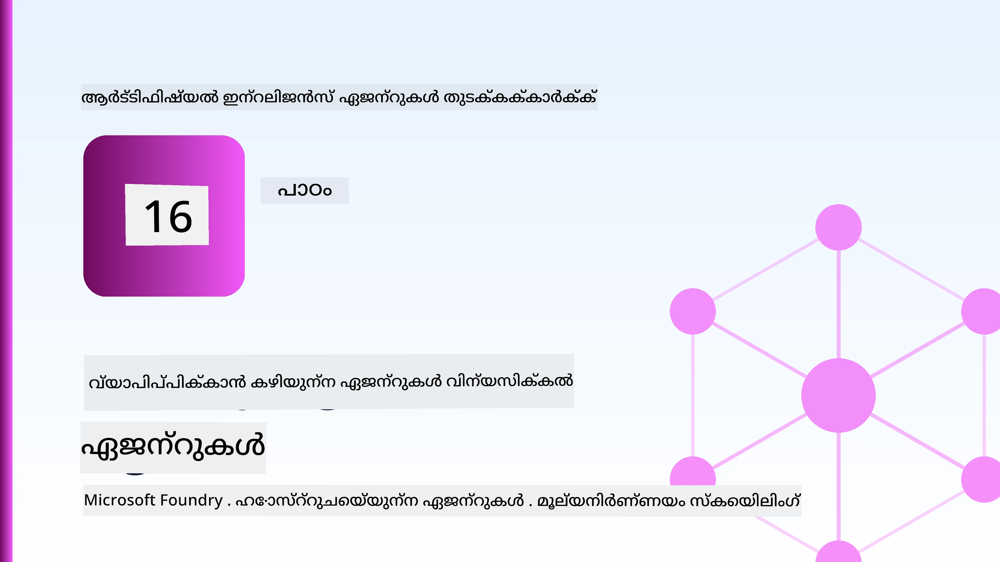
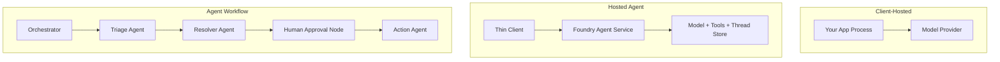
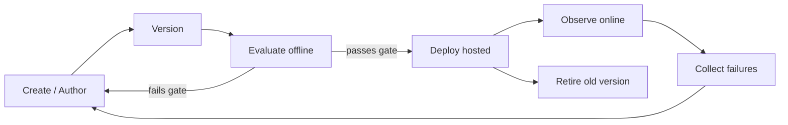
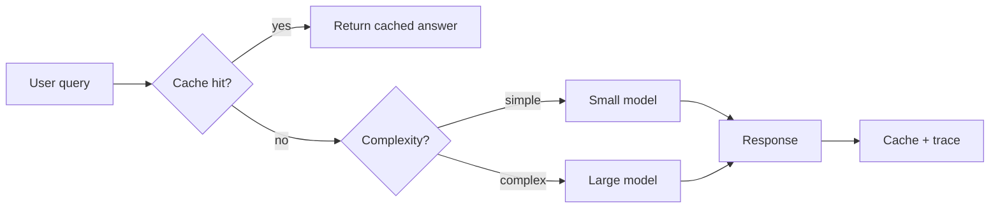
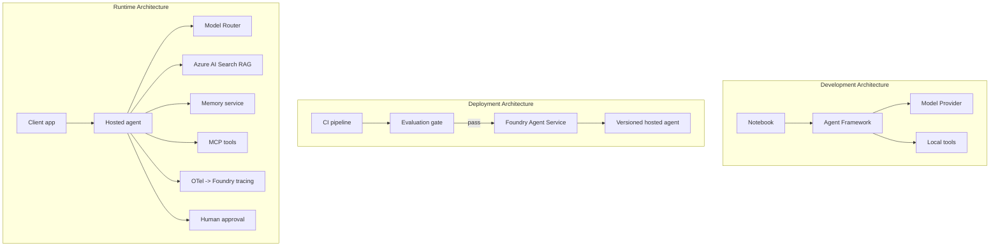

# Microsoft Foundry ന്റെ സഹായത്തോടെ സ്കോളബിള്‍ ഏജന്റുകള്‍ വിന്യസിക്കല്‍



ഈ കോഴ്‌സ് വരെ, നിങ്ങൾ ലാപ്പ്‌ടോപ്പിൽ, ഒരു നോട്ട്‌ബുക്കിനുള്ളില്‍, `az login` നും ചില പരിസ്ഥിതി വ്യത്യാസങ്ങളാൽ പ്രവർത്തിക്കുന്ന ഏജന്റുകൾ നിർമ്മിച്ചു. ഇത് പഠിക്കാനുള്ള ശരിയായ വഴി തന്നെയാണ്. പക്ഷേ, രാത്രി 3 മണിക്ക് ആയിരക്കണക്കിന് ഉപഭോക്താക്കളുടെ ആശ്രിതമായ ഏജന്റിനെ ഓടിക്കാൻ ഇത് ശരിയായ മാർഗം അല്ല.

"ഇത് എന്റെ മെഷീനില്‍ പ്രവർത്തിക്കുന്നു" എന്നതും "പ്രൊഡക്ഷനിൽ വിശ്വാസ്യതയോടും കുറഞ്ഞ ചെലവിലും പ്രവർത്തിക്കുന്നു" എന്നതിന്റെ ഇടയിലുള്ള പാതി ഈ പാഠത്തിൽ ആക്കുകയാണ്. **Microsoft Foundry**യും **Microsoft Foundry Agent Service** ഉം ഉപയോഗിച്ചാണ് ഞങ്ങൾ അത് നടത്തുന്നത്, മറ്റ് ഉപകരണങ്ങൾ, തിരികെ വീഡിയോ എൻട്രികൾ, ഓർമ്മ, मूल्यാംശന, ഒരു നിരീക്ഷണ സംവിധാനം ഉള്ള യാഥാർത്ഥ്യ ഉപഭോക്തൃ പിന്തുണ ഏജന്റ് നിർമ്മിച്ച്.

## പരിചയം

ഈ പാഠം ചർച്ച ചെയ്യുന്നത്:

- **പ്രോട്ടോടൈപ്പ് ഏജന്റ്** ഉം **വിന്യസിച്ച ഏജന്റ്** ഉം തമ്മിലുള്ള വ്യത്യാസം, കൂടാതെ തരം മാറ്റം മോഡലിന് ചുറ്റുമുള്ള എല്ലാം തന്നെ എന്ന കാര്യം.
- ഏജന്റുകൾക്കുള്ള **വിന്യാസ മാതൃകകൾ**: ക്ലയന്റ്-ഹോസ്റ്റുചെയ്തത്, സർവീസ്-ഹോസ്റ്റുചെയ്തത് (Hosted Agents), പ്രവർത്തനക്രമം ഒരുക്കിയതും.
- Microsoft Foundry-യിലെ **ഏജന്റ് ജീവചക്രം** — സൃഷ്ടിക്കുക, പതിപ്പ് നിര്‍മ്മിക്കുക, വിന്യസിക്കുക, മൂല്യനിര്‍ണയം നടത്തുക, നിരീക്ഷിക്കുക, പ്രായസം ചെയ്യുക.
- **സ്കെയ്ലിംഗ് തന്ത്രങ്ങൾ**: മോഡൽ റൂട്ടിംഗ്, കാഷിംഗ്, ഒരുമിച്ചുള്ള പ്രവർത്തനം, സ്റ്റേറ്റ്ലെസ്സ് ഡിസൈൻ.
- OpenTelemetry-ഉം Foundry ട്രേസിംഗും ഉപയോഗിച്ചുള്ള **നിരീക്ഷണ ശേഷി**.
- മോഡൽ തിരഞ്ഞെടുപ്പ്, റൂട്ടിംഗ്, മൂല്യനിർണയ വാതിൽപ്പടികൾ വഴി **ചെലവ് മെച്ചപ്പെടുത്തൽ**.
- **എന്റര്‍പ്രൈസ് പരിഗണനകൾ**: ഗവേണൻസ്, മാനവ അംഗീകാരം, MCP സെർവർ പ്രൊഡക്ഷനിൽ സുരക്ഷിതമായി ഓടിക്കൽ.

## പഠന ലക്ഷ്യങ്ങൾ

ഈ പാഠം പൂർത്തിയാക്കിയശേഷം, നിങ്ങൾ അറിയും:

- ഒരു ഏജന്റ് ജോലിഭാരത്തിനു അനുയോജ്യമായ വിന്യാസ മാതൃക തിരഞ്ഞെടുക്കാൻ.
- Microsoft Foundry Agent Service-ലേക്ക് ഒരു ഏജന്റ് വിന്യസിച്ച് പതിപ്പുവും, ഗവേണൻസും, നിരീക്ഷണ ശേഷിയും ഉണ്ടാകാൻ.
- ട്രേസിംഗിനുള്ള ഉപകരണങ്ങൾ ഉൾപ്പെടുത്തിയുള്ള ഏജന്റിനെ സജ്ജമാക്കുകയും എല്ലാ റിലീസിനും മുൻപ് പ്രവർത്തനപരിശോധന പൈപ്പ്‌ലൈൻ ചേർക്കുകയും ചെയ്യാൻ.
- സ്കെയിലിൽ വൈകിപ്പാട് കുറയ്ക്കാൻ മോഡൽ റൂട്ടിംഗ്, കാഷിംഗ് പ്രയോഗിക്കാൻ.
- ഉയർന്ന റിസ്‌ക് പ്രവർത്തനങ്ങൾക്ക് മാനവ അംഗീകാരം നൽകുകയും MCP സെർവർ പ്രൊഡക്ഷനിൽ സുരക്ഷിതമായി സംയോജിപ്പിക്കുകയും ചെയ്യാൻ.

## മുൻകൈകൾ

ഈ പാഠം മുൻകൈകളായി എടുത്തിരിക്കുന്ന പാഠങ്ങൾ പൂർത്തിയാക്കിയിട്ടുണ്ടെന്നു കരുതുന്നു, കൂടാതെ ഇനിപ്പറയുന്ന കാര്യങ്ങളിൽ നിഷ്‌ഠയുള്ളതും:

- [Microsoft Agent Framework](../14-microsoft-agent-framework/README.md) ഉപയോഗിച്ച് ഏജന്റുകൾ നിർമ്മിച്ചത് (പാഠം 14).
- [ഉപകരണ ഉപയോഗം](../04-tool-use/README.md) (പാഠം 4) ഉം [Agentic RAG](../05-agentic-rag/README.md) (പാഠം 5) ഉം.
- [Agent മെമ്മറി](../13-agent-memory/README.md) (പാഠം 13) ഉം [Agentic പ്രോട്ടോകോളുകൾ / MCP](../11-agentic-protocols/README.md) (പാഠം 11) ഉം.
- [നിരീക്ഷണ ശേഷിയും മൂല്യനിർണയവും](../10-ai-agents-production/README.md) (പാഠം 10) — ഈ പാഠം അതിന്റെ നേരിട്ട് അടിസ്ഥാനമാണ്.

കൂടാതെ നിങ്ങൾക്ക് ആവശ്യമായ കാര്യങ്ങൾ:

- ഒരു **Azure സബ്സ്ക്രിപ്ഷൻ** കൂടാതെ കുറഞ്ഞത് ഒരു വിന്യാസിച്ച ചാറ്റ് മോഡൽ ഉള്ള **Microsoft Foundry പ്രോജക്ട്**.
- **Azure CLI** സാധൂകരിച്ചിരിക്കുന്നതാണ് (`az login`).
- Python 3.12+ വീതം റിപോസിറ്ററിയിലുള്ള പാക്കേജുകൾ [`requirements.txt`](../../../requirements.txt).

## പ്രോട്ടോടൈപ് നിന്ന് പ്രൊഡക്ഷനിലേക്ക്: യഥാർത്ഥത്തിൽ എന്താണ് മാറുന്നത്

പ്രോട്ടോടൈപ്പ് ഏജന്റും പ്രൊഡക്ഷൻ ഏജന്റും പ്രധാനമായ ലൂപ് ഓർക്കുന്നു — കാരണം കണ്ടെത്തുക, ഉപകരണങ്ങൾ വിളിക്കുക, പ്രതികരിക്കുക. ലൂപിനെ ചുറ്റിപ്പറ്റി ഉള്ളവയാണ് മാറുന്നത്. മോഡൽ ഒരു പ്രൊഡക്ഷൻ ഏജന്റിന്റെ ഏകദേശം 20% ആണ്; മറുവശം 80% പ്രവർത്തന ഘടനയാണ്.

| ശ്രദ്ധ | പ്രോട്ടോടൈപ്പ് | പ്രൊഡക്ഷൻ |
| --- | --- | --- |
| **ഹോസ്റ്റിംഗ്** | നിങ്ങളുടെ നോട്ട്‌ബുക്കിൽ ഓടുന്നു | ഒരു ഹോസ്റ്റുചെയ്ത സേവനമായി, പതിപ്പു ചെയ്തു പുറത്തിറക്കം നടത്തുന്നു |
| **ഐഡന്റിറ്റി** | നിങ്ങളുടെ `az login` ടോക്കൺ | സ്കോപ്പ് ചെയ്‌ത RBAC ഉള്ള മാനേജ് ചെയ്ത ഐഡന്റിറ്റി |
| **സ്ഥിതി** | ഓർമ്മയിൽ, റീസ്റ്റാർട്ടിൽ നഷ്ടപ്പെടും | ബാഹ്യവത്കൃതം (ത്രീഡ് സ്റ്റോർ, മെമ്മറി സർവീസ്) |
| **പരാജയം** | ട്രെയ്സ്ബാക്ക് കാണാം | റിട്രൈസ്, ഫാൾബാക്ക്, ഡെഡ്-ലെട്ടർ, അലേർട്ടുകൾ |
| **ചെലവ്** | "ചില സെന്റുകൾ മാത്രം" | അഭ്യർത്ഥനപ്രതി ട്രാക്ക് ചെയ്‌തസം, റൂട്ടിംഗ്, കാഷിംഗ്, ബജറ്റ് നിർണ്ണയം |
| **ഗുണമേന്മ** | നിങ്ങൾ നേർത്തത് കാണാം | എല്ലാ റിലീസിനും മുമ്പ് ഓട്ടോമാറ്റിക്കായ മൂല്യനിർണ്ണയം |
| **വിശ്വാസം** | എല്ലാ പ്രവർത്തനത്തിനും നിങ്ങൾ അംഗീകരിക്കും | നയവും മാനവ-ഇൻ-ദ-ലൂപ്പ് വൈറലും സുരക്ഷിത പ്രവർത്തനങ്ങള്‍ക്കായി |

ഈ പട്ടിക മനസ്സിലാക്കുക. താഴെ ഓരോ വിഭാഗവും ഈ വരികളോട് സൂക്ഷ്മമായി ബന്ധപ്പെട്ടു.

## ഏജന്റ് വിന്യാസ മാതൃകകൾ

നിങ്ങൾ പലപ്പോഴും സംയോജിപ്പിച്ച് ഉപയോഗിക്കുന്ന മൂന്ന് മാതൃകകൾ ഉണ്ട്.

### 1. ക്ലയന്റ്-ഹോസ്റ്റുചെയ്ത ഏജന്റുകൾ

ഏജന്റ് ഒബ്ജക്റ്റ് നിങ്ങളുടെ ആപ്ലിക്കേഷൻ പ്രോസസിന്റെ ഉള്ളിലായിരിക്കും. നിങ്ങളുടെ കോഡ് നേരിട്ട് മോഡൽ പ്രൊവൈഡറെ വിളിക്കും; കാരണം ലൂപ് നിങ്ങളുടെ സർവീസിനുള്ളിൽ പ്രവർത്തിക്കും. ഇതാണ് മുമ്പത്തെ എല്ലാ പാഠങ്ങളിലും ചെയ്തിരുന്നത്.

- **ഉപയോഗിക്കുക എപ്പോൾ** നിങ്ങൾക്ക് ലുപ്പിനെ മുഴുവനായും നിയന്ത്രണം വേണമെങ്കിൽ, ഇഷ്ടാനുസൃത മിഡിൽവെയർ ഉപയോഗിക്കേണ്ടതിനും, അല്ലെങ്കിൽ ഏജന്റ് നിലവിലുള്ള ബാക്ക്എന്‍ഡിൽ ഉൾപ്പെടുത്തേണ്ടതിന്.
- **പര്യവസാനം**: സ്കെയ്ലിംഗ്, സ്ഥിതികൾ, മിനുക്കുള്ള പ്രതിരോധം നിങ്ങൾ തന്നെയാണ് കൈകാര്യം ചെയ്‌തേണ്ടത്.

### 2. ഹോസ്റ്റുചെയ്ത ഏജന്റുകൾ (Foundry Agent Service)

ഏജന്റ് Microsoft Foundry-യിൽ *ഒരു റിസോഴ്സ് ആയി രജിസ്റ്റർ* ചെയ്‌തതാണ്. Foundry കാരണം ലുപ്പിനെയും, ത്രീഡുകളെയും സംഭരിക്കുന്നു, ഉള്ളടക്ക സുരക്ഷയും RBAC-യും പ്രാബല്യത്തിൽ വരുത്തുന്നു, ഏജന്റ് Foundry പോർട്ടലിൽ കാണാവുന്നതാക്കുന്നു. നിങ്ങളുടെ ആപ്പ് തthin ക്ലയന്റ് ആയി മാറുന്നു, ത്രീഡുകൾ സൃഷ്ടിക്കുകയും പ്രതികരണങ്ങൾ വായിക്കുകയും ചെയ്യും.

- **ഉപയോഗിക്കുക എപ്പോൾ** നിങ്ങൾക്ക് ദൈർഘ്യമുള്ളതും, തെറ്റായ വസ്തുതകൾകൂർ അനുഭവിക്കുന്നതാണ്, ഗവേണൻസും കുറഞ്ഞ പ്രവർത്തന ഭാരം വേണമെങ്കിൽ.
- **പര്യവസാനം**: മാനേജചെയ്ത റൺടൈം എടുക്കുന്നതിനായി കുറച്ചു താഴ്ന്ന തല നിയന്ത്രണം.

### 3. ഏജന്റ് പ്രവർത്തനക്രമങ്ങൾ

നിരവധി ഏജന്റുകളും ഉപകരണങ്ങളും വ്യക്തമായ നിയന്ത്രണ പ്രവാഹത്തോടെ ഒരു ഗ്രാഫിൽ ചേർക്കാം — തുടർച്ചയായ ചുവടുകൾ, ശാഖീകരണം, മാനവ അംഗീകാരം നൽകേണ്ട നോഡുകൾ, ദൈർഘ്യമുള്ള ചെക്‌പോയിന്റുകൾ, ഇടയ്‌ക്ക് നിർത്തുക-തുടരുക കഴിയും. Microsoft Agent Framework-ലെ **വർക്ക്ഫ്ലോസ്** സവിശേഷത വിന്യാസ സ്കെയിലിൽ ഇത് പ്രയോഗിക്കുന്നു.

- **ഉപയോഗിക്കുക എപ്പോൾ** ഒരാളെ അധിക വിദഗ്ധ ഏജന്റുകളിലേക്ക് കടന്നുപോകുന്ന ഒരു ജോലി യോ ഒരു അംഗീകാര ഘട്ടം വേണമെങ്കിൽ.
- **പര്യവസാനം**: കൂടുതൽ സങ്കീർണ്ണ ഘടകങ്ങൾ; ഏകീകരണ-തല നിരീക്ഷണം ആവശ്യമുണ്ട്.



## Microsoft Foundry-ൽ ഏജന്റ് ജീവചക്രം

ഏജന്റ് വിന്യാസം ഒരിക്കൽ മാത്രമല്ല `push`. ഇത് ഒരു ലൂപാണ്, സോഫ്റ്റ്‌വെയർ റിലീസ് സൈക്കിൾ പറ്റിയതാണ് കാരണം അത് തന്നെയുള്ളതാണ്.



പ്രധാന ആശയം [Lesson 10](../10-ai-agents-production/README.md) നിന്നും കൊണ്ടുവന്നത്: **ഓഫ്ലൈൻ മൂല്യനിർണ്ണയം ഒരു ഗേറ്റ് ആണ്, പശ്ചാത്തലമല്ല**. പുതിയ ഏജന്റ് പതിപ്പ് നിങ്ങളുടെ മൂല്യനിർണ്ണയം ത്രെഷ്ഹോൾഡ് ക്ലിയർ ചെയ്ക്കാതെ ഇറങ്ങുന്നില്ല. ഓൺലൈനിൽ നിരീക്ഷണ ശേഷം യാഥാര്ത്യ പരാജയങ്ങൾ ഓഫ്ലൈൻ പരീക്ഷയിൽ മാത്രമല്ല, ലൂപ്പിൻറെ ഭാഗമാണ്.

## സ്കെയ്ലിംഗ് തന്ത്രങ്ങൾ

ഏജന്റ് സ്കെയ്ലിംഗ് സ്റ്റേറ്റ്ലെസ്സ് വെബ് API-ൽനിന്ന് വ്യത്യസ്തമാണ്, ഓരോ അഭ്യർത്ഥനയും ചിലവേറിയ മോഡൽ, ഉപകരണം വിളികളെ ആശ്രയിക്കുന്നു. നാല് തന്ത്രങ്ങൾ ഭാരം കൂടുതലായി കൈകാര്യം ചെയ്യുന്നു.

**സ്റ്റേറ്റ്ലെസ്സ് അഭ്യർത്ഥന കൈകാര്യം.** നിങ്ങളുടെ പ്രോസസ്സ് ഓർമ്മയിൽ ഒരൊറ്റ ഉപയോക്താവിന്റെ സ്ഥിതി സൂക്ഷിക്കരുത്. കൗൺസലേഷൻ ത്രീഡുകൾ Foundry ത്രീഡ് സ്റ്റോറിലോ, മെമ്മറി സർвീസിലോ സംരക്ഷിക്കുക, അങ്ങനെ ഏതൊരു ഇൻസ്റ്റൻസും അഭ്യർത്ഥന കൈകാര്യം ചെയ്യാൻ കഴിയും. ഇതാണ് നിങ്ങൾക്ക് ഹോരിസോന്റൽ സ്കെയ്ലിംഗ് സാധ്യമാക്കുന്നത് — ഇൻസ്റ്റൻസുകൾ കൂട്ടുക, സ്റ്റിക്കി സെഷനുകൾ ഇല്ല.

**മോഡൽ റൂട്ടിംഗ്.** എല്ലാ അഭ്യർത്ഥനകൾക്കും ഏറ്റവും കഴിവുള്ള (അധിക ചെലവേറിയ) മോഡലും വേണ്ട. ലളിതമായ അഭ്യർത്ഥനകൾ — ഉദ്ദേശം തിരിച്ചറിയൽ, ചെറിയ സംഭവം-സൂത്രവാദ ഉത്തരം— ഒരു ചെറിയ, വേഗത്തിലുള്ള മോഡലിലേയ്ക്ക് റൂട്ടു ചെയ്യുക, യഥാർത്ഥ കാരണം നിർണ്ണയിക്കുന്നതിനു വലിയ മോഡൽ സംരക്ഷിക്കുക. Foundry യുടെ **Model Router** ഈ പ്രവർത്തനം നടത്താൻ കഴിയും, അല്ലെങ്കിൽ നിങ്ങൾ സ്വയം ലളിതമായ ക്ലാസിഫയർ നിർമ്മിക്കാം. ലാബിൽ ഡിഐവൈ വേർഷൻ നിർമ്മിക്കും.

**പ്രതികരണ കാഷിംഗ്.** പല സഹായ ക്വറി പലവട്ടം പുനഃസൃഷ്ടി നടക്കുന്നു ("എനിക്ക് എങ്ങനെ പിൺകോഡ് പുനഃസജ്ജമാക്കാം?"). സാധാരണ ചോദ്യങ്ങൾക്ക് ഉത്തരം കാഷ് ചെയ്തു മോഡൽ ഹിറ്റ് ചെയ്യാതെ തന്നെ നൽകുക. കുറഞ്ഞതുമായ കാഷിംഗ് താളം ചെലവും വൈകിയും കുറക്കുന്നു.

**ഒരുമിച്ചുള്ള പ്രവർത്തനം, പിന്നറ്റ്രഷർ.** മോഡൽ പ്രൊവൈഡർമാർക്ക് നിരക്ക് നിയന്ത്രണങ്ങളുണ്ട്. നിങ്ങളുടെ ഒരുമിച്ചുള്ള പ്രവർത്തനം പരിധിയിലാക്കുക, ചൂട്-വീണൽ ഫെക്ക്സ് ബി-ഓഫ് ഉപയോഗിച്ചു പുനരാരംഭിക്കുക, പൊരുത്തപെടുന്ന വിധത്തിൽ പരാജയം പ്രകടിപ്പിക്കുക (ക്യു ചെയ്തു രേഖപ്പെടുത്തി "നാം അതിൽ സജീവമാണ്" എന്ന പ്രതികരണം 500-ൽനിന്ന് നല്ലതാണ്).



## പ്രൊഡക്ഷനിൽ നിരീക്ഷണ ശേഷി

നിങ്ങൾ കാണാതെ പ്രവർത്തിപ്പിക്കാൻ കഴിയില്ല. പാഠം 10-ലെ പോലെ, Microsoft Agent Framework **OpenTelemetry** ട്രേസുകൾ നിറയ്ക്കുന്നു — ഓരോ മോഡൽ വിളിയും, ഉപകരണം വിളിയും, ഓർക്കസ്ട്രേഷൻ ചുവടും ഒരു സ്പാൻ ആക്കുന്നു. പ്രൊഡക്ഷനിൽ ആ സ്പാൻസ് Microsoft Foundry-യിലോ (അല്ലെങ്കിൽ ഏതെങ്കിലും OTel-അനുരൂപ ബാക്ക്എന്റിലോ) എക്സ്പോർട്ട് ചെയ്യുന്നു, അതുകൊണ്ട് നിങ്ങള്‍ക്ക്:

- ഓരോ ഉപഭോക്തൃ പരാതിയെയും മോഡൽ, ഉപകരണം വിളികളുടേയും അവസാനം മുതൽ അവസാനം വരെ ട്രേസ് ചെയ്യാം.
- അഭ്യർത്ഥനപ്രതി p50/p95 വൈകിപ്പാട്, ചെലവ് കാലക്രമേണ നിരീക്ഷിക്കുക.
- ഉപയോക്താക്കളും സാമ്പത്തിക സംഘവും മുൻകൂറായി ശ്രദ്ധിക്കുമെന്ന് മുമ്പ് പിശക് നിരക്കും ചെലവ് അനോമലി പരിപാലിക്കുക.

```python
from agent_framework.observability import get_tracer

tracer = get_tracer()

with tracer.start_as_current_span("support_request") as span:
    span.set_attribute("customer.tier", "enterprise")
    span.set_attribute("routed.model", "gpt-5-nano")
    # agent execution is traced automatically inside this span
```

`customer.tier` ഉം `routed.model` ഉം പോലെയുള്ള ഗുണങ്ങൾ ട്രേസുകളുടെ മതിലും ചോദ്യങ്ങൾക്കുള്ള ഉത്തരം ("എന്റർപ്രൈസ് ഉപഭോക്താക്കൾക്ക് ചെറു മോഡലിലേക്ക് അധികം റൂട്ടിംഗ് നടക്കുമോ?") ഉണ്ടാക്കുന്നു.

## ചെലവ് മെച്ചപ്പെടുത്തൽ

പ്രൊഡക്ഷൻ ഏജന്റുകളുടെ ചെലവ് ടോക്കനുകളിൽ ആണ് കൂടുതലായി. മൂന്നു നിയന്ത്രണങ്ങൾ, പ്രാധാന്യമനുസരിച്ച്:

1. **മോഡലിന്റെ ശരിയായ വലിപ്പം തിരഞ്ഞെടുക്കുക.** മുറ વચ્ચે നല്ല മൂല്യനിർണയ ഗേറ്റു കടന്ന ചെറു മോഡൽ വലിയ മോഡലിനേക്കാളുംफ्तിതരമായ വിലവരുമാനം നൽകുന്നു. വിലക്ക് പകരം ഏറ്റവും വലിയ മോഡലിലേക്ക് നേരിട്ടു പോകരുത്.
2. **സങ്കീർണ്ണത പ്രകാരം റൂട്ടുചെയ്യുക.** മുകളിലത്തെ പോലെ — വലിയ മോഡൽ വില ആവശ്യമായ അഭ്യർത്ഥനകൾക്കു മാത്രമേ നൽകൂ.
3. **ആഗ്രസീവായി കാഷിംഗ്.** നിങ്ങൾ ഒരിക്കലും ചെയ്യാത്ത മോഡൽ വിളിക്കാണ് ഏറ്റവും കുറഞ്ഞ ചെലവ്.

മൂല്യനിർണയ വാതിലുകളും ചെലവ് നിയന്ത്രണവും ഒരേ ശാസ്ത്രത്തെ വ്യത്യസ്ത കാഴ്ചപ്പാടുകളിൽ നിന്നാണ്: മൂല്യനിർണയം *ഗുണനിലവാരത്തിന്റെ അടിത്തറ* പറയുന്നു, റൂട്ടിംഗ്, കാഷിംഗ് ആ അടിത്തറയിലുള്ള *ചെലവ്* ആണ് ശ്രദ്ധിക്കുന്നത്.

## എന്റര്‍പ്രൈസ് വിന്യാസ പരിഗണനകൾ

**ഗവർണൻസ്.** ഹോസ്റ്റുചെയ്ത ഏജന്റുകൾ Foundry-യുടെ RBAC, ഉള്ളടക്ക സുരക്ഷ, ഓഡിറ്റ് ലോഗിംഗ് ഉൾക്കൊള്ളുന്നു. ഓരോ ഏജന്റിനും കുറഞ്ഞ പ്രതിരോധത്തും വേണ്ട മാനേജ് ചെയ്‌ത ഐഡന്റിറ്റി നൽകുക — അറിവു ശേഖരം വായ_only_ACCESS, ടിക്കറ്റിംഗ് API യിലേക്ക് സ്കോപ്പിയുള്ള പ്രാപ്തി, ഇതിലും കൂടീൽ വേണ്ടത് ഇല്ല.

**മാനവ-ഇൻ-ദ-ലൂപ്പ്.** ചില പ്രവർത്തനങ്ങൾ മുഴുവനായി ഓട്ടോമേറ്റു ചെയ്യാൻ അമിതപാതികളാണ് — റീഫണ്ട് നൽകല്‍, അക്കൗണ്ട് ഡിലീറ്റ് ചെയ്യല്‍, നിയമ സംഘം ഇടപെടല്‍. Microsoft Agent Framework **അംഗീകാരം ആവശ്യമായ** ഉപകരണങ്ങളെ പിന്തുണയ്ക്കുന്നു: ഏജന്റ് പ്രവർത്തനം നിർദ്ദേശിക്കുന്നു, നിര്‍വഹണം താൽക്കാലം നിർത്തുന്നു, ഒരു മാനവൻ അംഗീകരിക്കാനോ നിരസിക്കാനോ ഇടപെടുന്നു, workflow മടങ്ങി ആരംഭിക്കുന്നു. ഇത് [Lesson 6](../06-building-trustworthy-agents/README.md) ൽ കാണാം; ഇവിടെ വിന്യാസിക്കുന്നു.

**MCP പ്രൊഡക്ഷനിൽ.** [MCP](../11-agentic-protocols/README.md) നിങ്ങളുടെ ഏജന്റ് പുറം ഉപകരണങ്ങളെ സാധാpരിക ഇന്റർഫേസിലൂടെ ഉപയോഗിക്കാൻ അനുവദിക്കുന്നു. പ്രൊഡക്ഷനിൽ, ഓരോ MCP സെർവറിനും പ്രതിരോധമില്ലാത്ത അതിര്‍വാരമായി സമീപിക്കുക: സെർവർ പതിപ്പ് പിന്‍തുടരുക, സ്കോപ്പ് ചെയ്ത ഐഡന്റിറ്റിയോടുകൂടി ഓടിക്കുക, അതിന്റെ output-കൾ വിശകലനം ചെയ്യുക, ഒട്ടും രഹസ്യങ്ങൾ വെളിപ്പെടുത്തരുത്. MCP സെർവർ ഒരു ആശ്രിതമാണ്, ആശ്രിതങ്ങൾ പാച്ച്, ഓഡിറ്റ്, നിരക്ക് പരിമിതപ്പെടുത്തിയിട്ടുണ്ട്.



ആ മൂന്ന് ചിത്രങ്ങൾ — വികസനം, വിന്യാസം, റൺടൈം — ഏജന്റിന്റെ മൂന്ന് ജീവിത ഘട്ടങ്ങളാണ്. തുടർന്നുള്ള ലാബ് അത് നിർമ്മിക്കാനുള്ള മാർഗ്ഗം നടത്തും.

## പ്രാക്ടിക്കൽ ലാബ്: പ്രൊഡക്ഷന്‍-സജ്ജം ഉപഭോക്തൃ പിന്തുണ ഏജന്റ്

[`code_samples/16-python-agent-framework.ipynb`](./code_samples/16-python-agent-framework.ipynb) തുറന്ന് തുടക്കം മുതൽ അവസാനം വരെ ചെയ്തു കാണുക. നിങ്ങൾ ഒരു **Contoso ഉപഭോക്തൃ പിന്തുണ ഏജന്റ്** പണിയുകയാണിത്, എല്ലാ പ്രൊഡക്ഷൻ ആശങ്കകളും ഉൾപ്പെടുത്തിയ:

1. **ഉപകരണ വിളിക്കൽ** — ഓർഡർ സ്റ്റാറ്റസ് കണ്ടുപിടിക്കുക, സഹായ ടിക്കറ്റുകൾ തുറക്കുക.
2. **RAG** — അറിവു ശേഖരത്തിൽ നിന്നുള്ള നയം ചോദ്യങ്ങൾക്ക് ഉത്തരം നൽകുക (Azure AI Search, അനുസ്മരണ ഡാറ്റാബേസ് ഇല്ലാത്ത വിഹിതത്തിൽ നോട്ട്‌ബുക്ക് ഇതിനായി ഓടുന്നു).
3. **മെമ്മറി** — സംവാദം വിലയിടുവുകളിൽ ഉപഭോക്താവിനെ ഓർക്കുക.
4. **മോഡൽ റൂട്ടിംഗ്** — സങ്കീർണ്ണത ക്ലാസിഫയർ ഓരോ അഭ്യർത്ഥനയും ചെറിയ മോഡലിലേക്കോ വലിയ മോഡലിലേക്കോ റൂട്ടു ചെയ്യുന്നു.
5. **പ്രതികരണ കാഷിംഗ്** — ആവിറങ്ങുന്ന ചോദ്യങ്ങൾ കാഷിൽ നിന്നു നൽകുന്നു.
6. **മാനവ അംഗീകാരം** — പരിധിയ്ക്കും മുകളിൽ റീഫണ്ടുകൾ മാനവ അനുമതിക്കായി നിർത്തുന്നു.
7. **മൂല്യനിർണ്ണയ പൈപ്പ്‌ലൈൻ** — ചെറിയ ഓഫ്ലൈന ടെസ്റ്റ് സെറ്റ് ഏജന്റിനെ സ്കോർ ചെയ്ത് റിലീസ് ഗേറ്റായി പ്രവർത്തിക്കുന്നു.
8. **നിരീക്ഷണ ശേഷി** — ഓരോ അഭ്യർത്ഥനയ്ക്കും ചുറ്റും OpenTelemetry ട്രേസിംഗ്.

### കവിത

നോട്ട്‌ബുക്ക് അങ്ങിനെ ക്രമീകരിച്ചിരിക്കുന്നു, ഓരോ പ്രൊഡക്ഷൻ ആശങ്ക ഒരു സ്വതന്ത്ര, പ്രവർത്തനക്ഷമ വിഭാഗമാണ്. അതിന്റെ ഹൃദയം റൂട്ടിംഗ് പ്ലസ് കാഷിംഗ് അഭ്യർത്ഥന കൈകാര്യം ചെയ്യുന്നതാണ്:

```python
async def handle_support_request(query: str, customer_id: str) -> str:
    # 1. Serve from cache when we can.
    cached = response_cache.get(normalize(query))
    if cached:
        return cached

    # 2. Route by complexity to control cost.
    model = "gpt-5-nano" if is_simple(query) else "gpt-5-mini"

    # 3. Run the agent inside a trace span for observability.
    with tracer.start_as_current_span("support_request") as span:
        span.set_attribute("routed.model", model)
        span.set_attribute("customer.id", customer_id)
        response = await support_agent.run(query, model=model)

    # 4. Cache and return.
    response_cache.set(normalize(query), response.text)
    return response.text
```

റിലീസ് സംരക്ഷിക്കുന്ന മൂല്യനിർണ്ണയ ഗേറ്റ് ഇങ്ങനെ കാണപ്പെടുന്നു:

```python
async def evaluation_gate(agent, test_cases, threshold: float = 0.8) -> bool:
    passed = 0
    for case in test_cases:
        result = await agent.run(case["input"])
        if score_response(result.text, case["expected"]) >= 0.8:
            passed += 1
    pass_rate = passed / len(test_cases)
    print(f"Evaluation pass rate: {pass_rate:.0%} (gate: {threshold:.0%})")
    return pass_rate >= threshold  # only deploy if the gate passes
```

ഓരോ വരിയും വായിക്കുക — നോട്ട്‌ബുക്ക് പ്രാഥമിക ഘടകങ്ങളെ ചെറുതായി സൂക്ഷിക്കുന്നു, ഒന്നും ഫ്രെയിംവർക്ക് കോൾ പിന്നിൽ മറച്ചിട്ടില്ല.

## വിന്യസിച്ച ഏജന്റിനുള്ള സ്മോക്ക് ടെസ്റ്റ് ബാധ്യത

മേൽ പറഞ്ഞ മൂല്യനിർണയ ഗേറ്റ് *ഓഫ്ലൈനിൽ* നിങ്ങളുടെ ഏജന്റ് ഒബ്ജക്റ്റിനെ നേരിടുന്നു. ഹോസ്റ്റുചെയ്ത ഏജന്റ് ആയി വിന്യസിച്ചതിനു ശേഷം, നിങ്ങൾക്ക് ഇനി ഒരു ചെലവില്ലാത്ത പരിശോധന കൂടി വേണം: **വിന്യസിച്ച എൻഡ്‌പോയിന്റ് യഥാർത്ഥത്തിൽ ഉത്തരം നൽകുന്നു എന്നുമാറ്റം?**

"വിജയകരമായി" വിന്യസിച്ചതു കൊണ്ടു മാത്രം കൺട്രോളു പ്ലെയ്ന്‍ ഡിഫിനിഷൻ സ്വീകരിച്ചതേ തെളിയിക്കുന്നു — ഏജന്റ് മറുപടി നൽകുന്നു എന്ന് അല്ല. ഒരൊറ്റ ആശ്രിതം കാണാതായാൽ, മോഡൽ റൂട്ടിംഗ് തെറ്റായാൽ, അല്ലെങ്കിൽ കാലഹരണപ്പെട്ട ബന്ധം ഏത് സജീവ വിന്യാസവും മറുപടി ഇല്ലാതെ വിടാം. ഒരു **സ്മോക്ക് ടെസ്റ്റ്** ഈ പ്രശ്നം സെക്കൻഡുകളോടെ എല്ലായ്പ്പോഴും പിടിക്കും, മുഴുവൻ മൂല്യനിർണയ ചെലവ് സര്‍വ്വമില്ലാതെ.

ഈ റിപോസിറ്ററി ഉപയോഗിക്കാൻ സജ്ജമായ സ്മോക്ക് ടെസ്റ്റ് പൈപ്പ്‌ലൈൻ [AI Smoke Test](https://github.com/marketplace/actions/ai-smoke-test) GitHub പ്രവർത്തനത്തിൽ സ്ഥാപിച്ചിരിക്കുന്നു:

- **കാറ്റലോഗ്** — [`tests/lesson-16-smoke-tests.json`](../../../tests/lesson-16-smoke-tests.json) Contoso പിന്തുണ ഏജന്റ് വേണ്ടി പ്രോംപ്റ്റുകളും ഉറപ്പുകളും ഉൾക്കൊള്ളുന്നു (നയം അടിസ്ഥാനത്തിലുള്ള ഉത്തരം, ഓർഡർ തിരയൽ, വിഷയം പാലിക്കൽ, മൾട്ടി-ടേൺ ത്രീഡ് തുടർച്ച). മറ്റു പാഠങ്ങളിലെ ഏജന്റുകൾക്കും കാറ്റലോഗുകൾ ഇതിന്റെ അരികിലാണ് — [`tests/README.md`](../tests/README.md) കാണുക.
- **ഫ്ലോ** — [`.github/workflows/smoke-test.yml`](../../../.github/workflows/smoke-test.yml) Azure OIDC-ൽ ലോഗിൻ ചെയ്ത് ഓരോ പ്രോംപ്റ്റും ഏജന്റിന്റെ Responses എൻഡ്‌പോയിന്റിലേക്ക് POST ചെയ്യുന്നു, ഏതെങ്കിലും ഉറപ്പു നഷ്ടം സംഭവിച്ചാൽ ജോബ് പരാജയപ്പെടുത്തുന്നു.

```yaml
- name: Smoke-test hosted agent
  uses: JFolberth/ai-smoketest@v1
  with:
    project_endpoint: ${{ inputs.project_endpoint }}
    agent_name: ContosoSupportAgent
    tests_file: tests/lesson-16-smoke-tests.json
```

നിങ്ങളുടെ ഏജന്റ് വിന്യസിച്ച ശേഷം **Actions** ടാബിൽ നിന്ന് ഇത് റണ്‍ ചെയ്യുക, നിങ്ങളുടെ Foundry പ്രോജക്ട് എന്റ്പോയിന്റും ഏജന്റ് നാമവും നൽകുക. ഫെഡറേറ്റഡ് ഐഡന്റിറ്റി Foundry പ്രോജക്ട് സ്കോപ്പിൽ **Azure AI User** റോളുള്ളത് ആവശ്യമുണ്ട്. ഇപ്പോൾ ലെയറുകൾ ഒരു പിരാമിഡ് പോലെ ചിന്തിക്കുക: എല്ലാ ഡിപ്പ്ലോയ്മെന്റിലും സ്മോക്ക് ടെസ്റ്റുകൾ (പ്രാപ്യമാണോ, പ്രതികരിക്കുന്നുണ്ടോ?) നടക്കും, പ്രമോഷന്റെ മുമ്പ് ഓഫ്‌ലൈൻ മൂല്യനിർണയം (സിപ്പിംഗിന് വേണ്ടത്ര നല്ലതാണോ?) നടക്കും, ഓൺലൈൻ മൂല്യനിർണയം (പൊതുവിൽ അത് എങ്ങനെ പ്രവര്‍ത്തിക്കുന്നു?) തുടര്‍ച്ചയായി നടക്കും.

## അറിവ് പരിശോധന

അസൈൻമെന്റിലേക്ക് മാറുന്നതിന് മുമ്പ് നിങ്ങളുടെ ബോധം പരിശോധിക്കുക.

**1. ഒരു പ്രൊഡക്ഷൻ ഏജന്റിന്റെ "മോഡൽ" എത്രത്തോളം ഭാഗമാണ്, ബാക്കി എന്താണ്?**

<details>
<summary>ഉത്തരം</summary>

മോഡൽ സിസ്റ്റത്തിന്റെ ന്യൂനപക്ഷമാണ് — സാധാരണയായി ഏകദേശം 20% എന്നാണു പറയുന്നത്. ബാക്കി പ്രവർത്തന ചട്ടക്കൂടാണ്: ഹോസ്റ്റിംഗും വേർഷനിംഗും, ഐഡന്റിറ്റി, RBAC, ബാഹ്യസ്ഥിതിവിവരം, പരാജയ കൈകാര്യം ചെയ്‌തൽ, ചെലവ് ട്രാക്കിംഗ്, മൂല്യനിർണയം, മനുഷ്യനിർവ്വഹിത നിയന്ത്രണങ്ങൾ എന്നിവ. പ്രൊഡക്ഷനിലേക്ക് മാറ്റുന്നത് കൂടുതലായി ആ ചിന്തന ചക്രത്തിനു ചുറ്റുമുള്ള എല്ലാം നിർമ്മിക്കുന്നത് ആണ്.
</details>

**2. ഏപ്പോൾ നിങ്ങൾ ഒരു ക്ലയന്റ്-ഹോസ്റ്റുചെയ്ത ഏജന്റിനേക്കാൾ ഹോസ്റ്റഡ് ഏജന്റ് തിരഞ്ഞെടുക്കും?**

<details>
<summary>ഉത്തരം</summary>

ബിൽറ്റ്-ഇൻ ദൈർഘ്യത (സ്ഥിരമായി നിലനിൽക്കുന്ന ത്രെഡുകൾ), ഓബ്സർവബിലിറ്റി, ഉള്ളടക്കസുരക്ഷ, RBAC എന്നിവ ഉൾക്കൊള്ളിക്കുന്ന നിയന്ത്രിത റൺടൈം നിങ്ങൾക്ക് ആവശ്യമുണ്ടെങ്കിൽ, നീച നിലയിലെ ചിന്തന ചക്രത്തിന്റെ നിയന്ത്രണം തഴുകാനും പ്രവർത്തന ഭൂപ്രദേശം കുറയ്ക്കാനും തയ്യാറാണെങ്കിൽ ഹോസ്റ്റഡ് ഏജന്റ് ഉപയോഗിക്കാം. ചക്രം മുഴുവൻ നിയന്ത്രണം ആവശ്യമെങ്കിൽ അല്ലെങ്കിൽ ഏജന്റ് നിലവിലുള്ള ബാക്ക്‌എൻഡിലേക്ക് സംയോജിപ്പിക്കുമ്പോൾ ക്ലയന്റ്-ഹോസ്റ്റുചെയ്തതാണ് ಉತ್ತಮം.
</details>

**3. സ്കെയ്ലബിൾ ഏജന്റ് അതിന്റെ പ്രോസസ് മെമ്മറിയിൽ സ്റ്റേറ്റ്‌ലെസ് ആകേണ്ടത് എന്തുകൊണ്ട്?**

<details>
<summary>ഉത്തരം</summary>

ഏതെങ്കിലും ഇൻസ്റ്റൻസ് എന്തെങ്കിലും അഭ്യർത്ഥന കൈകാര്യം ചെയ്യാൻ കഴിയും, ഇത് സ്റ്റിക്കി സെഷനുകൾ ഇല്ലാതെ ഹൊറിസോണ്ടൽ സ്‌കെയ്ലിംഗ് അനുവദിക്കുന്നതാണ്. പ്രയോക്തൃ സംഭാഷണ സ്ഥിതി ത്രെഡ്സ്റ്റോർ അല്ലെങ്കിൽ മെമ്മറി സർവീസിലേക്ക് ബാഹ്യസ്ഥിതിയാക്കിയിട്ടാണ്. സ്ഥിതി പ്രോസസ് മെമ്മറിയിൽ ഉണ്ടെങ്കിൽ റീസ്റ്റാർട്ടിൽ അത് നഷ്ടമാകും, ലോഡ് സ്വതന്ത്രമായി തകർക്കാനാകില്ല.
</details>

**4. മോഡൽ റൂട്ടിങ് പരിഹരിക്കുന്ന പ്രശ്‌നം എന്തും, അത് മൂല്യനിർണയവുമായി എങ്ങനെ ബന്ധപ്പെട്ടു?**

<details>
<summary>ഉത്തരം</summary>

റൂട്ടിങ് ലളിതമായ അഭ്യർത്ഥനകൾ ചെറിയ, ചുലുങ്ങിയ, വേഗത്തിലുള്ള മോഡലിലേക്ക് അയയ്ക്കുകയും വലിയ മോഡൽ യഥാർത്ഥ ചിന്തനത്തിനായി സംരക്ഷിക്കുകയും ചെയ്യുന്നു, വൈകല്യവും ചെലവും നിയന്ത്രിക്കുന്നു. മൂല്യനിർണയം അതിനെ സംബന്ധിച്ച കാര്യമാണ് കാരണം മൂല്യനിർണയമാണ് ചെറിയ മോഡൽ ഒരു അഭ്യർത്ഥനയുടെ വർഗ്ഗത്തിനായി മതിയെന്ന് തെളിയിക്കുന്നത് — മൂല്യനിർണയമില്ലാതെ റൂട്ടിങ് വെറുതെയൊരു തന്ത്രമാണ്.
</details>

**5. "മൂല്യനിർണയ ഗേറ്റ്" എന്താണ്, അത് ജീവിതചക്രത്തിന്റെ എവിടെ വന്നിരിക്കുന്നു?**

<details>
<summary>ഉത്തരം</summary>

ഒരു മൂല്യനിർണയ ഗേറ്റ് ഒരു പുതിയ ഏജന്റ് വേർഷനെതിരെ ഓഫ്‌ലൈൻ ടെസ്റ്റ് സെറ്റ് പ്രവർത്തിപ്പിക്കുകയും, പാസ്സ് നിരക്ക് ഒരു പരിധി തകർക്കാതെ ഡിപ്ലോയ്മെന്റ് ബ്ലോക്ക് ചെയ്യുകയും ചെയ്യുന്നു. ഇത് "version"നും "deploy"നും ഇടയിൽ നിൽക്കുന്നു, ഗുണമേന്മ ഒരു റിലീസ് മുൻ‌കരുതൽ ആക്കുന്നു, അയക്കുന്നതിനു ശേഷം പരിശോധിക്കൽ അല്ല.
</details>

**6. പ്രൊഡക്ഷനിൽ MCP സേർവറെ അനാവിഷ്കൃതമായ ഒരു അതിരായി പരിഗണിക്കേണ്ടത് എന്തുകൊണ്ട്?**

<details>
<summary>ഉത്തരം</summary>

അത് നിങ്ങളുടെ ഏജന്റ് വിളിക്കുന്ന ഒരു ബാഹ്യ ആശ്രയം ആണ്. അതിന്റെ വേർഷൻ പിന്‍ വയ്ക്കണം, സ്കോപ്പ് ചെയ്ത ഐഡന്റിറ്റിയോടെ ഇത് പ്രവർത്തിപ്പിക്കണം, അതിന്റെ ഔട്ട്പുട്ടുകൾ പരിശോധിക്കണം, നിരക്കുകുറച്ചുകൊണ്ട് നിയന്ത്രിക്കണം, അതിനോടു രഹസ്യങ്ങൾ പങ്കുവയ്ക്കരുത് — ഏതെങ്കിലും മൂന്നാം കക്ഷി ആശ്രയത്തിൽ നിങ്ങൾ പാലിക്കുന്ന ശൈലിയഗമമ്. അതിന്റെ ഔട്ട്പുട്ടുകൾ നിങ്ങളുടെ ഏജന്റിന്റെ ചിന്തനത്തിലേക്ക് ഒഴുകുന്നു, അത് സ്ഥിരീകരിക്കാത്ത വിശ്വാസം സുരക്ഷാ അപകടമാണ്.
</details>

**7. സാധാരണയായി പ്രൊഡക്ഷൻ ഏജന്റിന്റെ ചെലവിൽ ഏറ്റവും വലിയ സ്വാധീനം ചെലുത്തുന്ന ഏക മാറ്റം ഏതാണ്, എന്തുകൊണ്ട്?**

<details>
<summary>ഉത്തരം</summary>

മോഡൽ ശരിയായ വീതത്തിൽ തിരഞ്ഞെടുക്കൽ — നിങ്ങളുടെ മൂല്യനിർണയ ഗേറ്റ് കടന്നുപോകുന്ന ഏറ്റവും ചെറുതായ മോഡൽ ഉപയോഗിക്കൽ. ചെലവ് ടോക്കണുകളാൽ നിയന്ത്രിക്കപ്പെടുന്നു, മനസിലാവുന്ന ഗുണമേന്മയിൽ ചെറിയ മോഡൽ വലിയതിനെക്കാൾ കൂടുതലായി ശഷിക്കുന്നു. കാഷിങ്, റൂട്ടിങ് ചെലവ് കൂടുതൽ കുറയ്ക്കുന്നു, എന്നാൽ ശരിയായ അടിസ്ഥാന മോഡൽ തിരഞ്ഞെടുക്കലാണ് ഒന്നാം ഘട്ടത്തിൽ ഏറ്റവും വലിയ ഫലം.
</details>

**8. `customer.tier`, `routed.model` പോലുള്ള സ്‌പാൻ ആട്രിബ്യൂട്ട്‌ಗಳು ഓബ്സർവബിലിറ്റിയിൽ എന്ത് പങ്കുവഹിക്കുന്നു?**

<details>
<summary>ഉത്തരം</summary>

അവ അസംസ്കൃത ട്രേസുകളെ ഉത്തരം നൽകാവുന്ന ബിസിനസ്സ് ചോദ്യങ്ങളായി മാറ്റുന്നു. ആട്രിബ്യൂട്ടുകൾ ഇല്ലാതെ നിങ്ങൾക്ക് സ്പാനുകളുടെ ഭിത്തിയുണ്ട്; അവയോടൊപ്പം നിങ്ങൾ ചോദിക്കാൻ കഴിയുന്നു "എന്റർപ്രൈസ് ഉപഭോക്താക്കൾ ചെറു മോഡലിലേക്കു കൂടുതലായി റൂട്ടു ചെയ്യപ്പെടുന്നുണ്ടോ?" അല്ലെങ്കിൽ "എന്ത് മോഡൽ നമ്മുടെ ഏറ്റവും മന്ദഗതിയിലുള്ള അഭ്യർത്ഥനകൾ കൈകാര്യം ചെയ്യുന്നു?" ആട്രിബ്യൂട്ടുകൾ നിങ്ങളുടെ പ്രവര്‍ത്തനത്തിന് ഉള്ള ശ്രദ്ധാപൂർണ്ണ കോണുകളിൽ ടെലിമെട്രി വിഭാഗീകരിക്കുന്നതിനും സഹായിക്കുന്നു.
</details>

## അസൈൻമെന്റ്

ലാബിൽ നിന്നുള്ള കസ്റ്റമർ സപ്പോർട്ട് ഏജന്റ് എടുത്ത് ഒരു പ്രത്യേക സംഭവവിവരത്തിന് സുസജ്ജമാക്കുക: **ഒരു SaaS കമ്പനിക്കുള്ള സബ്സ്ക്രിപ്ഷൻ ബില്ലിംഗ് സപ്പോർട്ട് ഏജന്റ്.**

നിങ്ങളുടെ സമർപ്പണം ഇതിങ്ങനെ ആയിരിക്കണം:

1. ബില്ലിംഗുമായി ബന്ധപ്പെട്ട ചേരുവകൾ ഉപയോഗിച്ച് **ഉപകരണങ്ങൾ മാറ്റുക**: `get_subscription_status`, `get_invoice`, `issue_credit` ($50 മുകളില്‍ ക്രെഡിറ്റുകൾക്ക് മാനവ അംഗീകാരം ആവശ്യമാണ്).
2. കമ്പനിയുടെ റീഫണ്ട് നയം, ബില്ലിംഗ് സൈകിൽ, റദ്ദാക്കല്‍ നയം എന്നിവ ഉൾക്കൊള്ളുന്ന മൂന്നു RAG ഡൊക്കുമെന്റുകൾ **കൂടാതെ ചേർക്കുക**.
3. കുറഞ്ഞത് എട്ട് കേസുകൾ ഉൾപ്പെടുന്ന മൂല്യനിർണയ സെറ്റ് **വിപുലമാക്കുക**, അതിൽ കുറഞ്ഞത് രണ്ട് കേസുകൾ മനുഷ്യ അംഗീകാരം ട്രിഗറാക്കേണ്ടതും ഉൾപ്പെടണം. നിങ്ങളുടെ മൂല്യനിർണയ ഗേറ്റ് ശരിയായി പാസ്സോ ഫെയ്ല്‍ ആണോ എന്ന് സ്ഥിരീകരിക്കുക.
4. ഒന്നുകിൽ ചെലവ് റിപ്പോര്‍ട്ട് **ചേർക്കുക**: ഏജന്റിലൂടെ പത്ത് മിക്‌സ് ചെയ്ത അന്വേഷണങ്ങൾ നടത്തഫലമായി എത്ര ചെറിയ മോഡലിലേക്ക്, എത്ര വലിയ മോഡലിലേയ്ക്ക്, എത്ര കാഷിൽ നിന്നു ലഭിച്ചു എന്ന് പുറപ്പെടുവിക്കുക.

ഒരു ചെറിയ പാരഗ്രാഫ് (markdown സെല്ലിൽ) എഴുതുക, നിങ്ങൾ തിരഞ്ഞെടുത്ത മോഡൽ റൂട്ടിങ് നിയമവും അത് യഥാർത്ഥ ട്രാഫിക്കുമായി എങ്ങനെ സ്ഥിരീകരിക്കുന്നതും വിശദീകരിക്കുക. ഏകദേശം ശരിയാകേണ്ട ഉത്തരം ഒന്നിലധികമുണ്ട് — പ്രൊഡക്ഷൻ പ്രശ്‌നങ്ങൾ എങ്ങനെ ചേർന്നു പ്രവർത്തിക്കുന്നു എന്നതിനെയാണ് നിങ്ങൾ മൂല്യനിർണയം ചെയ്യപ്പെടുക.

## സംഗ്രഹം

ഈ പാഠത്തിൽ നിങ്ങൾ ഒരു ഏജന്റ് Microsoft Foundry ഉപയോഗിച്ച് പ്രോട്ടോടൈപ്പിൽനിന്ന് പ്രൊഡക്ഷനിലേക്ക് മാറ്റി:

- പ്രൊഡക്ഷനിലേക്ക് പോകുന്നത് കൂടുതലായി മോഡലിന് ചുറ്റുമുള്ള **ഓപ്പറേഷണൽ ചട്ടക്കൂട്** — ഹോസ്റ്റിംഗ്, ഐഡന്റിറ്റി, സ്ഥിതി, പരാജയ കൈകാര്യം, ചെലവ്, ഗുണമേന്മ, വിശ്വാസം.
- നിങ്ങൾ പഠിച്ച മൂന്ന് **ഡിപ്ലോയ്മെന്റ് പാറ്റേണുകൾ** — ക്ലയന്റ്-ഹോസ്റ്റുചെയ്ത, ഹോസ്റ്റഡ് ഏജന്റുകൾ, ഏജന്റ് വർക്‌ഫ്ലോസ് — എപ്പോൾ ഏതൊക്കെ അനുയോജ്യമാണെന്ന്.
- നിങ്ങൾ കണക്കാക്കിയ **ഏജന്റ് ജീവിതചക്രം**, ഓഫ്ലൈൻ **മൂല്യനിർണയം റിലീസ് ഗേറ്റായി** പ്രവർത്തിക്കുകയും ഓൺലൈൻ ഓബ്സർവബിലിറ്റി പരാജയങ്ങളെ ടെസ്റ്റ് സെറ്റിലേക്ക് തിരിച്ചയയ്ക്കുകയും ചെയ്യുന്നു.
- നിങ്ങൾ നടപ്പാക്കിയ **സ്കെയ്ലിംഗ് തന്ത്രങ്ങൾ** — സ്റ്റേറ്റ്‌ലെസ് ഡിസൈൻ, മോഡൽ റൂട്ടിങ്, കാഷിങ്, പരിമിതമായ സമകാലികത — ഇവ **ചെലവ് മെച്ചപ്പെടുത്തലുമായി** ബന്ധിപ്പിച്ചു.
- നിങ്ങൾ ചേർത്ത **എൻറർപ്രൈസ് നിയന്ത്രണങ്ങൾ**: RBAC, മനുഷ്യ നിർമ്മിത അംഗീകാരം, പ്രൊഡക്ഷന് സുരക്ഷിതമായ MCP വിന്യസനം.
- നിങ്ങൾ നിർമ്മിച്ചത് **പ്രൊഡക്ഷൻ-നിറഞ്ഞ കസ്റ്റമർ സപ്പോർട്ട് ഏജന്റ്**, ഇവയിൽ ഓരോന്നും runnable code-ൽ ചേർത്ത്.

അടുത്ത പാഠം മറുവശത്ത് takes ഒരു യാത്രയാണ്: ഏജന്റുകൾ മേഘത്തിലേക്ക് സ്കെയിൽ ചെയ്യുന്നതിന് പകരം, നിങ്ങൾ അവ *_ഒരു ഡെവലപ്പർ മിഷീൻ_*-ലേക്ക് ഇറക്കി പൂർണമായും ലോക്കലി റൺ ചെയ്യും.

## അധിക സ്രോതസ്സുകൾ

- <a href="https://learn.microsoft.com/azure/ai-foundry/what-is-azure-ai-foundry" target="_blank">Microsoft Foundry ഡോക്യുമെന്റേഷൻ</a>
- <a href="https://learn.microsoft.com/azure/ai-foundry/agents/overview" target="_blank">Microsoft Foundry Agent Service അവലോകനം</a>
- <a href="https://learn.microsoft.com/en-us/agent-framework/overview/?wt.mc_id=youtube_26688_organicsocial_reactor&pivots=programming-language-python" target="_blank">Microsoft Agent Framework</a>
- <a href="https://learn.microsoft.com/en-us/azure/ai-foundry/openai/concepts/model-router" target="_blank">Microsoft Foundryയിലെ മോഡൽ റൂട്ടർ</a>
- <a href="https://learn.microsoft.com/azure/search/search-what-is-azure-search" target="_blank">Azure AI Search</a>
- <a href="https://opentelemetry.io/" target="_blank">OpenTelemetry</a>
- <a href="https://github.com/marketplace/actions/ai-smoke-test" target="_blank">AI Smoke Test GitHub ആക്ഷൻ</a>
- <a href="https://modelcontextprotocol.io/" target="_blank">Model Context Protocol (MCP)</a>

## മുൻപത്തെ പാഠം

[Building Computer Use Agents (CUA)](../15-browser-use/README.md)

## അടുത്ത പാഠം

[Creating Local AI Agents](../17-creating-local-ai-agents/README.md)

---

<!-- CO-OP TRANSLATOR DISCLAIMER START -->
**അറിയിപ്പ്**:
ഈ രേഖ AI പരിഭാഷാ സേവനം [Co-op Translator](https://github.com/Azure/co-op-translator) ഉപയോഗിച്ച് പരിഭാഷപ്പെടുത്തിയതാണ്. ഞങ്ങൾ കൃത്യതയ്ക്കായി ശ്രമിക്കുന്നുവെങ്കിലും, ഓട്ടോമേറ്റഡ് പരിഭാഷകളിൽ പിഴവുകൾ അല്ലെങ്കിൽ തെറ്റായ വിവരങ്ങൾ ഉണ്ടാകാൻ സാധ്യതയുണ്ട്. അതിന്റെ സ്വാഭാവിക ഭാഷയിലുള്ള അസൽ രേഖയാണ് പ്രാമാണികമായ ഉറവിടമായി പരിഗണിക്കേണ്ടത്. നിർണായകമായ വിവരങ്ങൾക്ക്, പ്രൊഫഷണൽ മനുഷ്യ പരിഭാഷ ശുപാർശ ചെയ്യുന്നു. ഈ പരിഭാഷ ഉപയോഗിച്ച് ഉണ്ടാകുന്ന തെറ്റിദ്ധാരണകൾ അല്ലെങ്കിൽ തെറ്റായ വ്യാഖ്യാനങ്ങൾക്കായി ഞങ്ങൾ ഉത്തരവാദികളല്ല.
<!-- CO-OP TRANSLATOR DISCLAIMER END -->