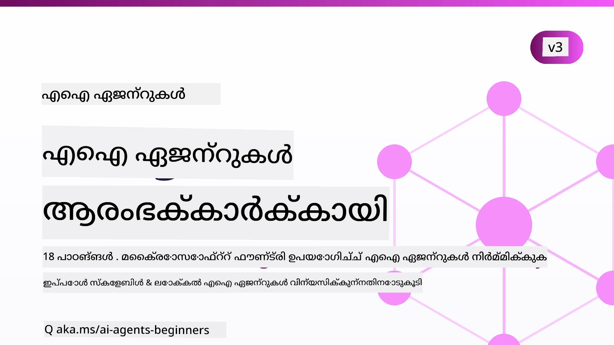

# തുടക്കക്കാർക്കുള്ള AI ഏജന്റുകൾ - ഒരു കോഴ്‌സ്



## AI ഏജന്റുകൾ നിർമ്മിക്കാൻ തുടങ്ങാൻ നിങ്ങൾക്ക് അറിയേണ്ട എല്ലാ കാര്യങ്ങളും പഠിപ്പിക്കുന്ന ഒരു കോഴ്‌സ്

[](https://github.com/microsoft/ai-agents-for-beginners/blob/master/LICENSE?WT.mc_id=academic-105485-koreyst)
[](https://GitHub.com/microsoft/ai-agents-for-beginners/graphs/contributors/?WT.mc_id=academic-105485-koreyst)
[](https://GitHub.com/microsoft/ai-agents-for-beginners/issues/?WT.mc_id=academic-105485-koreyst)
[](https://GitHub.com/microsoft/ai-agents-for-beginners/pulls/?WT.mc_id=academic-105485-koreyst)
[](http://makeapullrequest.com?WT.mc_id=academic-105485-koreyst)

### 🌐 ബഹുഭാഷാ പിന്തുണ

#### [Co-op പരിഭാഷകൻ](https://github.com/Azure/co-op-translator) ഉപയോഗിച്ച് പരിഭാഷകൾ സംരക്ഷിക്കുന്നു

<!-- CO-OP TRANSLATOR LANGUAGES TABLE START -->
[അറബി](../ar/README.md) | [ബംഗ്ലാ](../bn/README.md) | [ബൾഗേറിയൻ](../bg/README.md) | [ബർമീസ് (മ്യാൻമാർ)](../my/README.md) | [ചൈനീസ് (സംക്ഷിപ്ത)](../zh-CN/README.md) | [ചൈനീസ് (പരമ്പരാഗതം, ഹോംഗ് കോങ്)](../zh-HK/README.md) | [ചൈനീസ് (പരമ്പരാഗതം, മകാവ്)](../zh-MO/README.md) | [ചൈനീസ് (പരമ്പരാഗതം, തായ്‌വാൻ)](../zh-TW/README.md) | [ക്രൊവേഷ്യൻ](../hr/README.md) | [ചെക്ക്](../cs/README.md) | [ഡെൻമാർക്ക്](../da/README.md) | [ഡച്ച്](../nl/README.md) | [എസ്റ്റോണിയൻ](../et/README.md) | [ഫിനിഷ്](../fi/README.md) | [ഫ്രഞ്ച്](../fr/README.md) | [ജർമ്മൻ](../de/README.md) | [ഗ്രീക്ക്](../el/README.md) | [ഹീബ്രു](../he/README.md) | [ഹിന്ദി](../hi/README.md) | [ഹങ്കേറിയൻ](../hu/README.md) | [ഇന്തോണേഷ്യൻ](../id/README.md) | [ഇറ്റാലിയൻ](../it/README.md) | [ജാപ്പനീസ്](../ja/README.md) | [കർണാടക](../kn/README.md) | [ഖ്മെർ](../km/README.md) | [കൊറിയൻ](../ko/README.md) | [ലിതുവാനിയൻ](../lt/README.md) | [മലയ്](../ms/README.md) | [മലയാളം](./README.md) | [മണിപ്പുരി (മേരെത്തി മായക്)](../mni/README.md) | [മറाठी](../mr/README.md) | [നേപ്പാളി](../ne/README.md) | [നായജീരിയൻ പിഡ്ജിൻ](../pcm/README.md) | [നോർവീജിയൻ](../no/README.md) | [പേർഷ്യൻ (ഫാര്‍സി)](../fa/README.md) | [പോളിഷ്](../pl/README.md) | [പോർച്ചുഗീസ് (ബ്രസീൽ)](../pt-BR/README.md) | [പോർച്ചുഗീസ് (പോർച്ചുഗൽ)](../pt-PT/README.md) | [പഞ്ചാബി (ഗുരുമുഖി)](../pa/README.md) | [റോമാനിയൻ](../ro/README.md) | [റഷ്യൻ](../ru/README.md) | [സെർബിയൻ (സെറിലിക്)](../sr/README.md) | [സ്ലൊവാക്](../sk/README.md) | [സ്ലോവേനിയൻ](../sl/README.md) | [സ്പാനിഷ്](../es/README.md) | [സ്വാഹിലി](../sw/README.md) | [സ്വീഡിഷ്](../sv/README.md) | [തഗലോഗ് (ഫിലിപിനോ)](../tl/README.md) | [തമിൽ](../ta/README.md) | [തെലുങ്ക്](../te/README.md) | [തായ്](../th/README.md) | [ടർക്കിഷ്](../tr/README.md) | [ഉക്രേനിയൻ](../uk/README.md) | [ഉർദു](../ur/README.md) | [വിയറ്റ്നാമീസ്](../vi/README.md)

> **സ്ഥലീയമായി ക്ലോൺ ചെയ്യാൻ ആഗ്രഹമുണ്ടോ?**
>
> ഈ റിപോസിറ്ററിയിൽ 50-ലധികം ഭാഷാ പരിഭാഷകൾ ഉൾപ്പെടുന്നു, ഇത് ഡൗൺലോഡ് വലുപ്പം നിർണായകമായി വർദ്ധിപ്പിക്കുന്നു. പരിഭാഷകൾ കൂടാതെ ക്ലോൺ ചെയ്യാൻ, സ്പാര്സ് ചെക്ക്ഔട്ട് ഉപയോഗിക്കുക:
>
> **ബാശ് / മാക്‌ഒഎസ് / ലിനക്സ്:**
> ```bash
> git clone --filter=blob:none --sparse https://github.com/microsoft/ai-agents-for-beginners.git
> cd ai-agents-for-beginners
> git sparse-checkout set --no-cone '/*' '!translations' '!translated_images'
> ```
>
> **സി‌എം‌ഡി (Windows):**
> ```cmd
> git clone --filter=blob:none --sparse https://github.com/microsoft/ai-agents-for-beginners.git
> cd ai-agents-for-beginners
> git sparse-checkout set --no-cone "/*" "!translations" "!translated_images"
> ```
>
> ഇതു കൊണ്ട് കോഴ്‌സ് പൂർത്തിയാക്കാൻ ആവശ്യമായ എല്ലാ കാര്യങ്ങളും വേഗത്തിലെ ഡൗൺലോഡുമായി ലഭിക്കും.
<!-- CO-OP TRANSLATOR LANGUAGES TABLE END -->

**കൂടുതൽ ഭാഷാ തിരഞ്ഞെടുപ്പുകൾക്കായി, [Co-op Translatorയുടെ പിന്തുണയുള്ള ഭാഷകൾ](https://github.com/Azure/co-op-translator/blob/main/docs/supported-languages.md) കാണുക.**

[](https://GitHub.com/microsoft/ai-agents-for-beginners/watchers/?WT.mc_id=academic-105485-koreyst)
[](https://GitHub.com/microsoft/ai-agents-for-beginners/network/?WT.mc_id=academic-105485-koreyst)
[](https://GitHub.com/microsoft/ai-agents-for-beginners/stargazers/?WT.mc_id=academic-105485-koreyst)

[](https://discord.com/invite/ATgtXmAS5D)


## 🌱 തുടങ്ങാം

ഈ കോഴ്‌സ് AI ഏജന്റുകൾ നിർമ്മിക്കുന്ന അടിസ്ഥാനങ്ങൾ ആസ്പദമാക്കി പാഠങ്ങൾ ഉൾക്കൊള്ളുന്നു. ഓരോ പാഠവും തന്റെ വിഷയത്തെ അടിസ്ഥാനമാക്കിയുള്ളതാണ്, നിങ്ങൾക്ക് ഇഷ്ടമുള്ളതിടത്ത് നിന്ന് തുടങ്ങിയാലും 됩니다!

ഈ കോഴ്‌സിന് ബഹുഭാഷാ പിന്തുണ ഉണ്ട്. ഞങ്ങളുടെ [ലഭ്യമായ ഭാഷകൾ ഇവിടെ](#-multi-language-support) കാണുക.

നിങ്ങൾ ആദ്യമായി ജനറേറ്റീവ് AI മോഡലുകളുമായി പ്രവർത്തിക്കുന്നുവെങ്കിൽ, 21 പാഠങ്ങളുള്ള [തുടക്കക്കാർക്കുള്ള ജനറേറ്റീവ് AI](https://aka.ms/genai-beginners) കോഴ്‌സ് നോക്കൂ.

[ഈ റിപ്പോയ്ക്ക് സ്റ്റാർ (🌟) നൽകാനും](https://docs.github.com/en/get-started/exploring-projects-on-github/saving-repositories-with-stars?WT.mc_id=academic-105485-koreyst) [റിപ്പോ ഫോർക്കുചെയ്യാനും](https://github.com/microsoft/ai-agents-for-beginners/fork) മറക്കരുത്, കോഡ് പ്രവർത്തിപ്പിക്കാൻ.

### മറ്റു പഠിതാക്കളുമായി சந்தിക്കുക, നിങ്ങളുടെ ചോദ്യങ്ങൾക്ക് മറുപടി ലഭിക്കുക

AI ഏജന്റുകൾ നിർമ്മിക്കുന്നതിൽ നിങ്ങൾക്ക് ബുദ്ധിമുട്ട് ഉണ്ടെങ്കിൽ അല്ലെങ്കിൽ ചോദ്യങ്ങൾ ഉണ്ടായാൽ, [Microsoft Foundry Discord](https://aka.ms/ai-agents/discord) ൽ ഞങ്ങളുടെ സമർപ്പിത Discord ചാനലിൽ ചേരുക.

### നിങ്ങൾക്ക് ആവശ്യമുള്ളത്

ഈ കോഴ്‌സിലെ ഓരോ പാഠവും കോഡ് ഉദാഹരണങ്ങളും ഉൾക്കൊള്ളുന്നു, അത് code_samples ഫോൾഡറിൽ കാണാം. നിങ്ങളുടെ സ്വന്തം കോപ്പി സൃഷ്ടിക്കാൻ [ഈ റിപ്പോ ഫോര്‍ക്ക് ചെയ്യുക](https://github.com/microsoft/ai-agents-for-beginners/fork).

ഈ വ്യായാമങ്ങളിലെ കോഡ് ഉദാഹരണങ്ങൾMicrosoft Agent Framework മൈക്രോസോഫ്റ്റ് ഫൗണ്ട്രി ഏജന്റ് സർവീസ് V2 ഉപയോഗിക്കുന്നു:

- [Microsoft Foundry](https://aka.ms/ai-agents-beginners/ai-foundry) - Azure അക്കൗണ്ട് ആവശ്യമാണ്

ഈ കോഴ്‌സ്Microsoft നൽ‌കുന്ന താഴെ പറയുന്ന AI ഏജന്റ് ഫ്രെയിമ്വർക്കുകളും സർവീസുകളും ഉപയോഗിക്കുന്നു:

- [Microsoft Agent Framework (MAF)](https://learn.microsoft.com/agent-framework/overview/)
- [Microsoft Foundry Agent Service V2](https://aka.ms/ai-agents-beginners/ai-agent-service)

ചില കോഡ് സാമ്പിളുകൾ ഓപ്പൺഎഐ-സമൃദ്ധ പ്രൊവൈഡറായ [MiniMax](https://platform.minimaxi.com/) പോലുള്ള മറ്റ് പ്രൊവൈഡറുകളേയും പിന്തുണയ്ക്കുന്നു, കൂടാതെ 204K ടോക്കണുകൾ വരെ വലിയ കണ്ടെക്‌സ്‌റ്റ് മോഡലുകൾ നൽകുന്നു. ക്രമീകരണ വിവരംക്കായി [കോഴ്‌സ് സെറ്റപ്പ്](./00-course-setup/README.md) കാണുക.

ഈ കോഴ്‌സിനു വേണ്ടിയുള്ള കോഡ് റണ്ണ് ചെയ്യുന്നതിനെക്കുറിച്ച് കൂടുതൽ വിവരങ്ങൾക്ക് [കോഴ്‌സ് സെറ്റപ്പ്](./00-course-setup/README.md) കാണുക.

## 🙏 സഹായിക്കാൻ ആഗ്രഹമുണ്ടോ?

നിർദ്ദേശങ്ങളുണ്ടോ അല്ലെങ്കിൽ വ്യാകരണം അല്ലെങ്കിൽ കോഡ് പിശകുകൾ കണ്ടെത്തിയോ? [ഇഷ്യു ഉയർത്തുക](https://github.com/microsoft/ai-agents-for-beginners/issues?WT.mc_id=academic-105485-koreyst) അല്ലെങ്കിൽ [പുൾ റിക്വസ്റ്റ് സൃഷ്ടിക്കുക](https://github.com/microsoft/ai-agents-for-beginners/pulls?WT.mc_id=academic-105485-koreyst)


## 📂 ഓരോ പാഠവും ഉൾക്കൊള്ളുന്നത്

- READMEയിൽ ഉള്ള എഴുത്തുപാഠവും ഒരു ചെറു വീഡിയോയും
- Microsoft Agent Framework മൈക്രോസോഫ്റ്റ് ഫൗണ്ട്രി ഉപയോഗിച്ചുള്ള Python കോഡ് സാമ്പിളുകൾ
- പഠനതുടർച്ചക്ക് അധിക റിസോഴ്‌സുകൾക്കുള്ള ലിങ്കുകൾ


## 🗃️ പാഠങ്ങൾ

| **പാഠം**                                   | **എഴുത്തും കോഡും**                                    | **വീഡിയോ**                                                  | **അധിക പഠനം**                                                                     |
|----------------------------------------------|----------------------------------------------------|------------------------------------------------------------|----------------------------------------------------------------------------------------|
| AI ഏജന്റുകളുടെ പരിചയം കൂടിയും ഉപയോഗ കേസുകളും       | [ലിങ്ക്](./01-intro-to-ai-agents/README.md)          | [വീഡിയോ](https://youtu.be/3zgm60bXmQk?si=z8QygFvYQv-9WtO1)  | [ലിങ്ക്](https://aka.ms/ai-agents-beginners/collection?WT.mc_id=academic-105485-koreyst) |
| AI ഏജന്റിക് ഫ്രെയിംവർക്സ് പരിശോധിക്കൽ              | [ലിങ്ക്](./02-explore-agentic-frameworks/README.md)  | [വീഡിയോ](https://youtu.be/ODwF-EZo_O8?si=Vawth4hzVaHv-u0H)  | [ലിങ്ക്](https://aka.ms/ai-agents-beginners/collection?WT.mc_id=academic-105485-koreyst) |
| AI ഏജന്റിക് ഡിസൈൻ പാറ്റേൻസ് മനസ്സിലാക്കൽ     | [ലിങ്ക്](./03-agentic-design-patterns/README.md)     | [വീഡിയോ](https://youtu.be/m9lM8qqoOEA?si=BIzHwzstTPL8o9GF)  | [ലിങ്ക്](https://aka.ms/ai-agents-beginners/collection?WT.mc_id=academic-105485-koreyst) |
| ടൂൾ ഉപയോഗ ഡിസൈൻ പാറ്റേൺ                      | [ലിങ്ക്](./04-tool-use/README.md)                    | [വീഡിയോ](https://youtu.be/vieRiPRx-gI?si=2z6O2Xu2cu_Jz46N)  | [ലിങ്ക്](https://aka.ms/ai-agents-beginners/collection?WT.mc_id=academic-105485-koreyst) |
| ഏജന്റിക് RAG                                  | [ലിങ്ക്](./05-agentic-rag/README.md)                 | [വീഡിയോ](https://youtu.be/WcjAARvdL7I?si=gKPWsQpKiIlDH9A3)  | [ലിങ്ക്](https://aka.ms/ai-agents-beginners/collection?WT.mc_id=academic-105485-koreyst) |
| വിശ്വസനീയമായ AI ഏജന്റുകൾ നിർമ്മിക്കുന്നത്               | [ലിങ്ക്](./06-building-trustworthy-agents/README.md) | [വീഡിയോ](https://youtu.be/iZKkMEGBCUQ?si=jZjpiMnGFOE9L8OK ) | [ലിങ്ക്](https://aka.ms/ai-agents-beginners/collection?WT.mc_id=academic-105485-koreyst) |
| പ്ലാനിങ് ഡിസൈൻ പാറ്റേൺ                      | [ലിങ്ക്](./07-planning-design/README.md)             | [വീഡിയോ](https://youtu.be/kPfJ2BrBCMY?si=6SC_iv_E5-mzucnC)  | [ലിങ്ക്](https://aka.ms/ai-agents-beginners/collection?WT.mc_id=academic-105485-koreyst) |
| ബഹു-ഏജന്റ് ഡിസൈൻ പാറ്റേൺ                   | [ലിങ്ക്](./08-multi-agent/README.md)                 | [വീഡിയോ](https://youtu.be/V6HpE9hZEx0?si=rMgDhEu7wXo2uo6g)  | [ലിങ്ക്](https://aka.ms/ai-agents-beginners/collection?WT.mc_id=academic-105485-koreyst) |
| മെറ്റകോഗ്നിഷൻ ഡിസൈൻ പാറ്റേൺ                 | [ലിങ്ക്](./09-metacognition/README.md)               | [വീഡിയോ](https://youtu.be/His9R6gw6Ec?si=8gck6vvdSNCt6OcF)  | [ലിങ്ക്](https://aka.ms/ai-agents-beginners/collection?WT.mc_id=academic-105485-koreyst) |
| ഉത്പാദനത്തിലുള്ള AI ഏജന്റുകൾ                      | [ലിങ്ക്](./10-ai-agents-production/README.md)        | [വീഡിയോ](https://youtu.be/l4TP6IyJxmQ?si=31dnhexRo6yLRJDl)  | [ലിങ്ക്](https://aka.ms/ai-agents-beginners/collection?WT.mc_id=academic-105485-koreyst) |
| ഏജന്റിക് പ്രോട്ടോക്കോളുകൾ (MCP, A2A, NLWeb) ഉപയോഗിക്കൽ | [ലിങ്ക്](./11-agentic-protocols/README.md)           | [വീഡിയോ](https://youtu.be/X-Dh9R3Opn8)                                 | [ലിങ്ക്](https://aka.ms/ai-agents-beginners/collection?WT.mc_id=academic-105485-koreyst) |
| AI ഏജന്റുകൾക്കുള്ള കോൺടെക്‌സ്‌റ്റ് എഞ്ചിനീയറിംഗ്            | [ലിങ്ക്](./12-context-engineering/README.md)         | [വീഡിയോ](https://youtu.be/F5zqRV7gEag)                                 | [ലിങ്ക്](https://aka.ms/ai-agents-beginners/collection?WT.mc_id=academic-105485-koreyst) |
| ഏജന്റിക് മെമ്മറി നയിക്കൽ                      | [ലിങ്ക്](./13-agent-memory/README.md)     |      [വീഡിയോ](https://youtu.be/QrYbHesIxpw?si=vZkVwKrQ4ieCcIPx)                                                      |                                                                                        |
| മൈക്രോസോഫ്റ്റ് ഏജന്റ് ഫ്രെയിംവർക്ക് പരിശോധിക്കൽ                         | [ലിങ്ക്](./14-microsoft-agent-framework/README.md)                            |                                                            |                                                                                        |
| കമ്പ്യൂട്ടർ ഉപയോഗ ഏജന്റുകൾ (CUA) നിർമ്മിക്കൽ           | [ലിങ്ക്](./15-browser-use/README.md)     |                                                            | [ലിങ്ക്](https://docs.browser-use.com/examples/templates/playwright-integration)         |
| സ്കെയിലബിൾ ഏജന്റുകൾ വിന്യസിക്കൽ                    | [ലിങ്ക്](./16-deploying-scalable-agents/README.md) |                                                    | [ലിങ്ക്](https://learn.microsoft.com/azure/ai-foundry/agents/overview)                   |
| പ്രാദേശിക AI ഏജന്റുകൾ സൃഷ്ടിക്കൽ                     | [ലിങ്ക്](./17-creating-local-ai-agents/README.md)  |                                                    | [ലിങ്ക്](https://learn.microsoft.com/azure/ai-foundry/foundry-local/)                    |
| AI ഏജന്റുകൾ സുരക്ഷിതമാക്കൽ                           | [ലിങ്ക്](./18-securing-ai-agents/README.md)  |                                                            | [ലിങ്ക്](https://aka.ms/ai-agents-beginners/collection?WT.mc_id=academic-105485-koreyst) |

## 🎒 മറ്റ് കോഴ്‌സുകൾ

ഞങ്ങളുടെ സംഘം മറ്റ് കോഴ്‌സുകൾ ഒരുക്കുന്നു! പരിശോധിച്ച് നോക്കൂ:

<!-- CO-OP TRANSLATOR OTHER COURSES START -->
### LangChain
[](https://aka.ms/langchain4j-for-beginners)
[](https://aka.ms/langchainjs-for-beginners?WT.mc_id=m365-94501-dwahlin)
[](https://github.com/microsoft/langchain-for-beginners?WT.mc_id=m365-94501-dwahlin)
---

### Azure / Edge / MCP / ഏജന്റുകൾ
[](https://github.com/microsoft/AZD-for-beginners?WT.mc_id=academic-105485-koreyst)
[](https://github.com/microsoft/edgeai-for-beginners?WT.mc_id=academic-105485-koreyst)
[](https://github.com/microsoft/mcp-for-beginners?WT.mc_id=academic-105485-koreyst)
[](https://github.com/microsoft/ai-agents-for-beginners?WT.mc_id=academic-105485-koreyst)

---
 
### ജനറേറ്റീവ് AI സീരീസ്
[](https://github.com/microsoft/generative-ai-for-beginners?WT.mc_id=academic-105485-koreyst)
[-9333EA?style=for-the-badge&labelColor=E5E7EB&color=9333EA)](https://github.com/microsoft/Generative-AI-for-beginners-dotnet?WT.mc_id=academic-105485-koreyst)
[-C084FC?style=for-the-badge&labelColor=E5E7EB&color=C084FC)](https://github.com/microsoft/generative-ai-for-beginners-java?WT.mc_id=academic-105485-koreyst)
[-E879F9?style=for-the-badge&labelColor=E5E7EB&color=E879F9)](https://github.com/microsoft/generative-ai-with-javascript?WT.mc_id=academic-105485-koreyst)

---
 
### പ്രാഥമിക പഠനം
[](https://aka.ms/ml-beginners?WT.mc_id=academic-105485-koreyst)
[](https://aka.ms/datascience-beginners?WT.mc_id=academic-105485-koreyst)
[](https://aka.ms/ai-beginners?WT.mc_id=academic-105485-koreyst)
[](https://github.com/microsoft/Security-101?WT.mc_id=academic-96948-sayoung)
[](https://aka.ms/webdev-beginners?WT.mc_id=academic-105485-koreyst)
[](https://aka.ms/iot-beginners?WT.mc_id=academic-105485-koreyst)
[](https://github.com/microsoft/xr-development-for-beginners?WT.mc_id=academic-105485-koreyst)

---
 
### കോപൈലറ്റ് ശ്രേണി
[](https://aka.ms/GitHubCopilotAI?WT.mc_id=academic-105485-koreyst)
[](https://github.com/microsoft/mastering-github-copilot-for-dotnet-csharp-developers?WT.mc_id=academic-105485-koreyst)
[](https://github.com/microsoft/CopilotAdventures?WT.mc_id=academic-105485-koreyst)
<!-- CO-OP TRANSLATOR OTHER COURSES END -->

## 🌟 കമ്മ്യൂണിറ്റി നന്ദി

ഏജന്റിക് RAG കാണിക്കുന്ന പ്രധാന കോഡ് സാമ്പിളുകളുമായി സംഭാവന നൽകിയ [ഷിവാം ഗോയൽ](https://www.linkedin.com/in/shivam2003/) എന്നവർക്ക് നന്ദി. 

## സംഭാവന ചെയ്യുക

ഈ പ്രോജക്ട് സംഭാവനകളും നിർദ്ദേശങ്ങളും സ്വാഗതം ചെയ്യുന്നു.  കൂടുതൽ സംഭാവനകൾക്കും നിങ്ങൾക്ക് ഒരുപാട്
അവകാശങ്ങളുണ്ട്, അതുപോലെ തന്നെ നിങ്ങളെ CLA (Contributor License Agreement) യിൽ ഒപ്പുവെക്കേണ്ടതുണ്ട്
നിങ്ങളുടെ സംഭാവന ഉപയോഗിക്കാൻ ഞങ്ങൾക്ക് അവകാശമുണ്ട്.എന്ന വിവരം വ്യക്തമായി ഉറപ്പുവരുത്താൻ. കൂടുതൽ വിവരങ്ങൾക്ക് <https://cla.opensource.microsoft.com> സന്ദർശിക്കുക.

നിങ്ങൾ ഒരു പുൾ റിക്വസ്റ്റ് സമർപ്പിക്കുമ്പോൾ, CLA ബോട്ടു സ്വയം നിർണയിക്കും നിങ്ങളുടെ CLA ആവശ്യമാണോ എന്ന്
കൂടി PR-നെ അനുയോജ്യമായി അളക്കും (ഉദാ: സ്റ്റാറ്റസ് ചെക്ക്, കമന്റ്). ബോട്ടിന്റെ നിർദ്ദേശങ്ങൾ പാലിക്കുക.
നിങ്ങൾ ഇതു മുഴുവൻ റിപ്പോസിറ്ററികളിലും ഒരിക്കൽ മാത്രം ചെയ്യേണ്ടതാണ്.

ഈ പ്രോജക്ട് [Microsoft Open Source Code of Conduct](https://opensource.microsoft.com/codeofconduct/) സ്വീകരിച്ചു.
കൂടുതൽ വിവരങ്ങൾക്ക് [Code of Conduct FAQ](https://opensource.microsoft.com/codeofconduct/faq/) കാണുക അല്ലെങ്കിൽ
കൂടുതൽ ചോദ്യങ്ങളോടോ കമന്റുകളോടോ [opencode@microsoft.com](mailto:opencode@microsoft.com) ബന്ധപ്പെടുക.

## ട്രേഡ്മാർക്ക്‌സ്

ഈ പ്രോജക്ട് പ്രോജക്ടുകൾ, ഉൽപ്പന്നങ്ങൾ, അല്ലെങ്കിൽ സേവനങ്ങൾക്കുള്ള ട്രേഡ്മാർക്കുകളോ അല്ലെങ്കിൽ ലോഗോകളോ അടക്കം ആകാമ്. Microsoft
ട്രേഡ്മാർക്കുകളോ ലോഗോകളോ ബന്ധപ്പെട്ടാനുയോജ്യമായ ഉപയോഗം
[Microsoft's Trademark & Brand Guidelines](https://www.microsoft.com/legal/intellectualproperty/trademarks/usage/general) അനുസരിക്കണം.
ഈ പ്രോജക്ടിന്റെ മാറ്റം വന്ന പതിപ്പുകളിൽ Microsoft ട്രേഡ്മാർക്കുകളോ ലോഗോകളോ ഉപയോഗിക്കുന്നത്混乱 ഉണ്ടാക്കരുത് അല്ലെങ്കിൽ Microsoft പിന്തുണ ഉണ്ടെന്നു സൂചിപ്പിക്കരുത്.
മൂന്നാംകക്ഷി ട്രേഡ്മാർക്കുകളോ ലോഗോകളോ ഉപയോഗിക്കുന്നത് ആ മൂന്നാംകക്ഷികളുടെ നിബന്ധനകൾക്ക് വിധേയമാണ്.

## സഹായം ലഭിക്കൽ


നിങ്ങൾ ബോധപ്രധാനമായ പ്രയാസത്തിൽപ്പെടുകയോ AI അപ്ലിക്കേഷനുകൾ നിർമ്മിക്കുന്നതിൽ ഏതെങ്കിലും ചോദ്യം ഉണ്ടാകുകയോ ചെയ്താൽ, ചേർക്കുക:

[](https://aka.ms/foundry/discord)

ഉൽപ്പന്ന പ്രത്യുപാദനമോ ബഗ്ഗുകളോ ഉണ്ടെങ്കിൽ സന്ദർശിക്കുക:

[](https://aka.ms/foundry/forum)

---

<!-- CO-OP TRANSLATOR DISCLAIMER START -->
**അറിയിപ്പ്**:
ഈ രേഖ AI പരിഭാഷാ സേവനം [Co-op Translator](https://github.com/Azure/co-op-translator) ഉപയോഗിച്ച് പരിഭാഷപ്പെടുത്തിയതാണ്. ഞങ്ങൾ കൃത്യതയ്ക്കായി ശ്രമിക്കുന്നുവെങ്കിലും, ഓട്ടോമേറ്റഡ് പരിഭാഷകളിൽ പിഴവുകൾ അല്ലെങ്കിൽ തെറ്റായ വിവരങ്ങൾ ഉണ്ടാകാൻ സാധ്യതയുണ്ട്. അതിന്റെ സ്വാഭാവിക ഭാഷയിലുള്ള അസൽ രേഖയാണ് പ്രാമാണികമായ ഉറവിടമായി പരിഗണിക്കേണ്ടത്. നിർണായകമായ വിവരങ്ങൾക്ക്, പ്രൊഫഷണൽ മനുഷ്യ പരിഭാഷ ശുപാർശ ചെയ്യുന്നു. ഈ പരിഭാഷ ഉപയോഗിച്ച് ഉണ്ടാകുന്ന തെറ്റിദ്ധാരണകൾ അല്ലെങ്കിൽ തെറ്റായ വ്യാഖ്യാനങ്ങൾക്കായി ഞങ്ങൾ ഉത്തരവാദികളല്ല.
<!-- CO-OP TRANSLATOR DISCLAIMER END -->