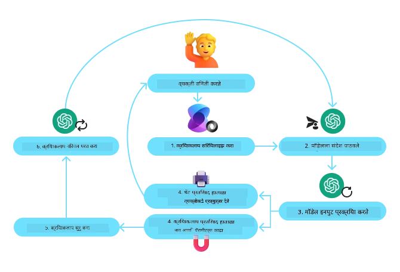
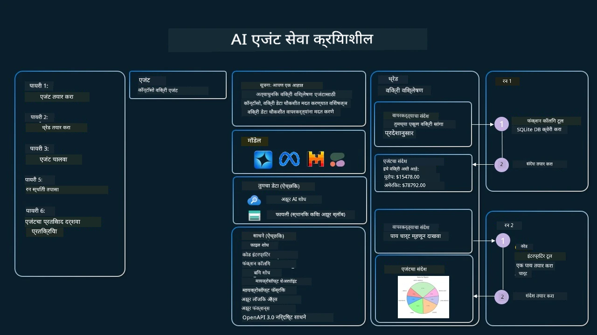

[](https://youtu.be/vieRiPRx-gI?si=cEZ8ApnT6Sus9rhn)

> _(या आधीच्या प्रतिमेवर क्लिक करून या धड्याचा व्हिडिओ पहा)_

# टूल वापर डिझाइन पॅटर्न

टूल्स मनोरंजक आहेत कारण ते AI एजंट्सना आणखी विस्तृत क्षमतांचा वापर करण्याची अनुमती देतात. एजंटकडे केवळ काही क्रिया करण्याची क्षमता असण्याऐवजी, एका टूल जोडल्यावर, एजंट आता अनेक प्रकारच्या क्रिया करू शकतो. या प्रकरणात, आपण टूल वापर डिझाइन पॅटर्न पाहणार आहोत, जे कसे AI एजंट्स विशिष्ट टूल्स वापरून त्यांचे उद्दिष्ट साध्य करू शकतात हे सांगते.

## परिचय

या धड्यात, आपण खालील प्रश्नांची उत्तरे शोधणार आहोत:

- टूल वापर डिझाइन पॅटर्न म्हणजे काय?
- कोणत्या उपयोगाच्या प्रकरणांमध्ये ते लागू केले जाऊ शकते?
- डिझाइन पॅटर्न अंमलात आणण्यासाठी कोणते घटक/बांधणीचे घटक आवश्यक आहेत?
- विश्वासार्ह AI एजंट तयार करताना टूल वापर डिझाइन पॅटर्न वापरताना कोणत्या विशेष बाबी विचारात घ्याव्या लागतात?

## शिकण्याचे उद्दिष्टे

या धडा पूर्ण केल्यानंतर, आपण करू शकाल:

- टूल वापर डिझाइन पॅटर्न आणि त्याचा उद्देश व्याख्यायित करणे.
- टूल वापर डिझाइन पॅटर्न कुठल्या उपयोगाच्या प्रकरणांमध्ये लागू आहे हे ओळखणे.
- डिझाइन पॅटर्न अंमलात आणण्यासाठी आवश्यक मुख्य घटक समजून घेणे.
- या डिझाइन पॅटर्नचा वापर करणाऱ्या AI एजंट्समध्ये विश्वासार्हतेसाठी आवश्यक बाबी मान्य करणे.

## टूल वापर डिझाइन पॅटर्न म्हणजे काय?

**टूल वापर डिझाइन पॅटर्न** LLMs ला विशिष्ट उद्दिष्ट साध्य करण्यासाठी बाह्य टूल्सशी संवाद साधण्याची क्षमता देण्यावर लक्ष केंद्रित करते. टूल्स म्हणजे एजंटद्वारे क्रिया करण्यासाठी वापरली जाणारी कोड. टूल एक साधा फंक्शन असू शकतो, जसे कॅल्क्युलेटर, किंवा तृतीय-पक्ष सेवा कॉल, जसे स्टॉक प्राइस लुकअप किंवा हवामान अंदाज. AI एजंटस संदर्भात, टूल्स हे **मॉडेल-जनरेट केलेल्या फंक्शन कॉल्स** च्या प्रतिसादात एजंटद्वारे चालवण्यासाठी डिझाइन केलेले आहेत.

## कोणत्या उपयोगाच्या प्रकरणांमध्ये ते लागू होते?

AI एजंट्स टूल्सचा वापर करून गुंतागुंतीचे कामे पूर्ण करू शकतात, माहिती मिळवू शकतात, किंवा निर्णय घेऊ शकतात. टूल वापर डिझाइन पॅटर्न बहुतेक वेळा डेटाबेस, वेब सेवा किंवा कोड इंटरप्रेटर सारख्या बाह्य प्रणालींसोबत डायनामिक संवाद आवश्यक असलेल्या परिस्थितींमध्ये वापरला जातो. ह्या क्षमतेचा उपयोग खालील अनेक उपयोग प्रकरणांसाठी होतो:

- **डायनॅमिक माहिती शोध:** एजंट्स बाह्य API किंवा डेटाबेस वरून अप-टू-डेट डेटा प्राप्त करू शकतात (उदा. डेटाबेसमधून SQLite क्वेरी, स्टॉक किंमती किंवा हवामान माहिती घेणे).
- **कोड अंमलबजावणी आणि व्याख्या:** एजंट्स गणितीय समस्या सोडवण्यासाठी, अहवाल तयार करण्यासाठी, किंवा सिम्युलेशन्स करण्यासाठी कोड/स्क्रिप्ट्स चालवू शकतात.
- **कार्यप्रवाह ऑटोमेशन:** कार्य वेळापत्रक, ईमेल सेवा, किंवा डेटा पाइपलाइन सारखे टूल्स जोडून अनेक पायऱ्यांच्या किंवा पुनरावृत्ती कार्यांची स्वयंचलित व्यवस्था करणे.
- **ग्राहक समर्थन:** एजंट्स CRM प्रणाली, तिकीट व्यवस्थापन प्लॅटफॉर्म, किंवा ज्ञानकोशाशी संवाद साधून वापरकर्त्यांच्या प्रश्नांची उत्तरे देऊ शकतात.
- **सामग्री निर्मिती व संपादन:** एजंट्स व्याकरण तपासणी, मजकूर सारांश, किंवा सामग्री सुरक्षा मूल्यांकन करणाऱ्या टूल्सचा वापर करून सामग्री निर्मितीत मदत करतात.

## टूल वापर डिझाइन पॅटर्न अंमलात आणण्यासाठी आवश्यक घटक/बांधणीच्या घटक काय आहेत?

हे घटक AI एजंटला विविध प्रकारची कामे पार पाडण्याची परवानगी देतात. टूल वापर डिझाइन पॅटर्न अंमलात आणण्यासाठी आवश्यक मुख्य घटक खालीलप्रमाणे आहेत:

- **फंक्शन/टूल स्कीमा:** उपलब्ध टूल्सची सविस्तर व्याख्या, जसे की फंक्शन नाव, उद्देश, आवश्यक पॅरामीटर्स, आणि अपेक्षित आउटपुट. हे स्कीमा LLM ला कोणते टूल्स उपलब्ध आहेत आणि योग्य विनंत्या कशा तयार कराव्यात हे समजण्यास मदत करतात.

- **फंक्शन अंमलबजावणी लॉजिक:** वापरकर्त्याच्या हेतूवर आणि संभाषणाच्या संदर्भावर आधारित टूल्स कॉधी/केव्हा कॉल करावेत हे नियंत्रित करते. यात नियोजन मॉड्यूल्स, राउटिंग यंत्रणा, किंवा सशर्त प्रवाह असू शकतात जे टूल्सचा वापर गतिशीलपणे ठरवतात.

- **मेसेज हँडलिंग सिस्टीम:** वापरकर्त्याच्या इनपुट, LLM प्रतिक्रिया, टूल कॉल्स, आणि टूल आउटपुट यांच्यातील संभाषण प्रवाह व्यवस्थापित करणारे घटक.

- **टूल इंटिग्रेशन फ्रेमवर्क:** एजंटला विविध टूल्सशी जोडणारी पायाभूत सुविधा, मग ती सोप्या फंक्शन असोत किंवा जटिल बाह्य सेवा.

- **त्रुटी हँडलिंग व प्रमाणीकरण:** टूल अंमलबजावणीतील अयशस्वीपणा हाताळणे, पॅरामीटर्सची प्रमाणीकरण करणे, आणि आकस्मिक प्रतिसादांची व्यवस्थापना.

- **स्थिती व्यवस्थापन:** संभाषणाचा संदर्भ, मागील टूल संवाद, आणि सातत्यपूर्ण डेटा ट्रॅक करणे जे बहु-टर्न संवादांमध्ये सुसंगतता सुनिश्चित करते.

पुढे, आपण फंक्शन/टूल कॉलिंग अधिक सविस्तर पाहूया.
 
### फंक्शन/टूल कॉलिंग

फंक्शन कॉलिंग ही मोठ्या भाषिक मॉडेल्स (LLMs) ना टूल्सशी संवाद साधण्याचा मुख्य मार्ग आहे. तुम्ही 'फंक्शन' आणि 'टूल' हे शब्द सहसा एकत्र वापरलेले पाहाल कारण 'फंक्शन्स' (पुन्हा वापरायोग्य कोड ब्लॉक्स) हे 'टूल्स' आहेत ज्यांचा वापर एजंट्स कामे करण्यासाठी करतात. एखाद्या फंक्शनचा कोड चालवण्यासाठी, LLM ला वापरकर्त्याच्या विनंतीची तुलना फंक्शनच्या वर्णनाशी करावी लागते. हे करण्यासाठी, उपलब्ध फंक्शन्सच्या वर्णनांसह एक स्कीमा LLM कडे पाठवला जातो. नंतर LLM सर्वात योग्य फंक्शन निवडतो आणि त्याचे नाव व तर्क परत पाठवतो. निवडलेले फंक्शन कॉल केले जाते, त्याची प्रतिक्रिया LLM कडे पाठवली जाते, आणि LLM ती माहिती वापरून वापरकर्त्याच्या विनंतीला उत्तर देतो.

एजंटसाठी फंक्शन कॉलिंग अंमलात आणण्यासाठी डेव्हलपर्सला आवश्यक आहे:

1. फंक्शन कॉलिंगला समर्थन देणारे LLM मॉडेल
2. फंक्शन वर्णने असलेले स्कीमा
3. प्रत्येक फंक्शनसाठी कोड

शहरातील सध्याचा वेळ मिळवण्याचे उदाहरण वापरून समजावून घेऊया:

1. **फंक्शन कॉलिंगला समर्थन देणारे LLM प्रारंभ करा:**

    सर्व मॉडेल्स फंक्शन कॉलिंगला समर्थन देत नाहीत, त्यामुळे वापरत असलेल्या LLM कडे ते आहे की नाही हे तपासणे महत्त्वाचे आहे. <a href="https://learn.microsoft.com/azure/ai-services/openai/how-to/function-calling" target="_blank">Azure OpenAI</a> फंक्शन कॉलिंगला समर्थन करते. आपण Azure OpenAI **Responses API** विरुद्ध OpenAI क्लायंट सुरू करू शकतो (स्थिर `/openai/v1/` एन्डपॉईंट — `api_version` आवश्यक नाही). 

    ```python
    # Initialize the OpenAI client for Azure OpenAI (Responses API, v1 endpoint)
    client = OpenAI(
        base_url=f"{os.environ['AZURE_OPENAI_ENDPOINT'].rstrip('/')}/openai/v1/",
        api_key=os.environ["AZURE_OPENAI_API_KEY"],
    )
    deployment_name = os.environ["AZURE_OPENAI_DEPLOYMENT"]
    ```

1. **फंक्शन स्कीमा तयार करा**:

    नंतर आपण JSON स्वरूपातील स्कीमा तयार करू जे फंक्शनचे नाव, फंक्शन काय करते याचे वर्णन, आणि फंक्शन पॅरामीटर्सची नावे आणि वर्णने यांचा समावेश असेल.
    नंतर ह्या स्कीमाला पूर्वी तयार केलेल्या क्लायंटला पाठवू, तसेच वापरकर्त्याचे 'सॅन फ्रान्सिस्को मध्ये वेळ शोधा' अशी विनंतीही देऊ. महत्त्वाचं म्हणजे, फंक्शन कॉल केलेली सूचना म्हणजे अंतिम उत्तर नाही; LLM फक्त निवडलेल्या फंक्शनचे नाव व त्याला आवश्यक तर्क परत पाठवतो.

    ```python
    # Function description for the model to read (Responses API flat tool format)
    tools = [
        {
            "type": "function",
            "name": "get_current_time",
            "description": "Get the current time in a given location",
            "parameters": {
                "type": "object",
                "properties": {
                    "location": {
                        "type": "string",
                        "description": "The city name, e.g. San Francisco",
                    },
                },
                "required": ["location"],
            },
        }
    ]
    ```
   
    ```python
  
    # Initial user message
    messages = [{"role": "user", "content": "What's the current time in San Francisco"}]

    # First API call: Ask the model to use the function
    response = client.responses.create(
        model=deployment_name,
        input=messages,
        tools=tools,
        tool_choice="auto",
        store=False,
    )

    # The Responses API returns tool calls as function_call items in response.output.
    # Append them to the conversation so the model has full context on the next turn.
    messages += response.output

    print("Model's response:")
    print(response.output)
  
    ```

    ```bash
    Model's response:
    [ResponseFunctionToolCall(arguments='{"location":"San Francisco"}', call_id='call_pOsKdUlqvdyttYB67MOj434b', name='get_current_time', type='function_call')]
    ```
  
1. **काम करण्यासाठी आवश्यक फंक्शनचा कोड:**

    आता LLM ने कोणता फंक्शन चालवायचा हे निवडलं आहे, त्याचा कोड अंमलात आणावा लागेल.
    आपण पायथनमध्ये सध्याचा वेळ मिळवण्याचे कोड लिहू शकतो. तसेच प्रतिसाद संदेशातून नाव आणि तर्क काढण्यासाठी कोड लिहावे लागेल जेणेकरून अंतिम उत्तर मिळेल.

    ```python
      def get_current_time(location):
        """Get the current time for a given location"""
        print(f"get_current_time called with location: {location}")  
        location_lower = location.lower()
        
        for key, timezone in TIMEZONE_DATA.items():
            if key in location_lower:
                print(f"Timezone found for {key}")  
                current_time = datetime.now(ZoneInfo(timezone)).strftime("%I:%M %p")
                return json.dumps({
                    "location": location,
                    "current_time": current_time
                })
      
        print(f"No timezone data found for {location_lower}")  
        return json.dumps({"location": location, "current_time": "unknown"})
    ```

     ```python
    # Handle function calls
    tool_calls = [item for item in response.output if item.type == "function_call"]
    if tool_calls:
        for tool_call in tool_calls:
            if tool_call.name == "get_current_time":

                function_args = json.loads(tool_call.arguments)

                time_response = get_current_time(
                    location=function_args.get("location")
                )

                # Return the tool result as a function_call_output item
                messages.append({
                    "type": "function_call_output",
                    "call_id": tool_call.call_id,
                    "output": time_response,
                })
    else:
        print("No tool calls were made by the model.")

    # Second API call: Get the final response from the model
    final_response = client.responses.create(
        model=deployment_name,
        input=messages,
        tools=tools,
        store=False,
    )

    return final_response.output_text
     ```

     ```bash
      get_current_time called with location: San Francisco
      Timezone found for san francisco
      The current time in San Francisco is 09:24 AM.
     ```

फंक्शन कॉलिंग बहुतेक एजंट टूल वापर डिझाइनचा मध्यबिंदू आहे, तरीही ते नव्याने तयार करणे कधी कधी आव्हानात्मक असू शकते.
आपण [Lesson 2](../../../02-explore-agentic-frameworks) मध्ये शिकले की एजंटिक फ्रेमवर्क्स आपल्याला टूल वापराच्या बांधणीसाठी आधीच तयार घटक पुरवतात.
 
## एजंटिक फ्रेमवर्क्ससह टूल वापर उदाहरणे

येथे विविध एजंटिक फ्रेमवर्क्स वापरून टूल वापर डिझाइन पॅटर्न कसा अंमलात आणता येईल याची काही उदाहरणे आहेत:

### Microsoft Agent Framework

<a href="https://learn.microsoft.com/azure/ai-services/agents/overview" target="_blank">Microsoft Agent Framework</a> हे AI एजंट बनवण्यासाठी एक मुक्त स्रोत AI फ्रेमवर्क आहे. हे फंक्शन कॉलिंग वापरणे सोपे करते, कारण आपण टूल्सना Python फंक्शन्स म्हणून `@tool` डेकॉरेटर वापरून परिभाषित करू शकता. फ्रेमवर्क मॉडेल आणि तुमच्या कोडमधील संवाद नियंत्रित करते. तसेच `FoundryChatClient` द्वारे फाईल शोध आणि कोड इंटरप्रेटरसारखे पूर्वनिर्मित टूल्ससुद्धा उपलब्ध करून देते.

खालील आकृती Microsoft Agent Framework सह फंक्शन कॉलिंग प्रक्रियेचे चित्रण करते:



Microsoft Agent Framework मध्ये, टूल्स डेकोरेटेड फंक्शन्स म्हणून परिभाषित केले जातात. आपण आधी पाहिलेला `get_current_time` फंक्शन `@tool` डेकोरेटर वापरून टूलमध्ये रूपांतरित करू शकतो. फ्रेमवर्क आपोआप फंक्शन आणि त्याचे पॅरामीटर्स सिरीयलाइज करून LLM कडे पाठवण्यासाठी स्कीमा तयार करते.

```python
import os
from agent_framework import tool
from agent_framework.foundry import FoundryChatClient
from azure.identity import AzureCliCredential

@tool(approval_mode="never_require")
def get_current_time(location: str) -> str:
    """Get the current time for a given location"""
    ...

# Create the client
provider = FoundryChatClient(
    project_endpoint=os.environ["AZURE_AI_PROJECT_ENDPOINT"],
    model=os.environ["AZURE_AI_MODEL_DEPLOYMENT_NAME"],
    credential=AzureCliCredential(),
)

# Create an agent and run with the tool
agent = provider.as_agent(name="TimeAgent", instructions="Use available tools to answer questions.", tools=get_current_time)
response = await agent.run("What time is it?")
```

#### MCP सर्व्हरकडून टूल्स

टूल्स तुमच्या स्वतःच्या कोडमधील फंक्शन असणे आवश्यक नाही. मॉडेल कॉन्टेक्स्ट प्रोटोकॉल (MCP, [Lesson 11](../11-agentic-protocols/README.md) मध्ये समजावलेले) वापरणारा सर्व्हर त्याच्या टूल्स आणि स्कीमास प्रकाशित करतो, आणि फ्रेमवर्क डेकोरेटेड फंक्शनच्या सारखाच त्यांना लोड करू शकतो. `MCPStreamableHTTPTool` असा सर्व्हर HTTP द्वारे जोडतो, टूल स्कीमास वाचतो, आणि लॅकल टूल्स सोबत मॉडेलला उपलब्ध करून देतो.

खालील उदाहरण @<a href="https://keenable.ai" target="_blank">Keenable</a> या वेब शोध सर्व्हरचा वापर करते. हे खाते किंवा API कीशिवाय विनामूल्य वापरता येते (विनंती IP नुसार मर्यादित), त्यामुळे फक्त तुमच्या मॉडेलचे क्रेडेन्शियल्स लागतात. कोणत्याही रिमोट टूलसारखे, मॉडेल लिहिलेल्या क्वेरीज त्या सर्व्हरला पाठवल्या जातात.

```python
from agent_framework import MCPStreamableHTTPTool

web_search = MCPStreamableHTTPTool(
    name="Keenable web search",
    url="https://api.keenable.ai/mcp",
)

# Connecting loads the server's tool schemas; the agent decides when to call them
async with web_search:
    agent = provider.as_agent(
        name="ResearchAgent",
        instructions="Use available tools to answer questions.",
        tools=[web_search],
    )
    response = await agent.run("What is new in the latest Python release?")
    print(response.text)
```

सर्व्हर दोन टूल प्रकाशित करते, `search_web_pages` आणि `fetch_page_content`. जेव्हा एखाद्या प्रश्नाला सध्याची माहिती हवी असते, तेव्हा मॉडेल `search_web_pages` कॉल करते, त्याला शीर्षके, URL आणि मजकूर तुकडी परत मिळतात, आणि त्या वापरून त्याचे उत्तर लिहितो, जे वरील `get_current_time` उदाहरणासारखे आहे.
  
### Microsoft Foundry Agent Service

<a href="https://learn.microsoft.com/azure/ai-services/agents/overview" target="_blank">Microsoft Foundry Agent Service</a> हा एक नवीन एजंटिक फ्रेमवर्क आहे जो डेव्हलपर्सना सुरक्षितपणे उच्च दर्जाचे, विस्तारयोग्य AI एजंट तयार करण्याची, डिप्लॉय करण्याची, आणि स्केल करण्याची परवानगी देतो, ज्यासाठी अधूर्या गणना आणि संग्रहण संसाधनांची काळजी घ्यावी लागत नाही. हा विशेषतः एंटरप्राइझ अनुप्रयोगांसाठी उपयुक्त आहे कारण हा पूर्णपणे व्यवस्थापित सेवा असून एंटरप्राइझ दर्जाची सुरक्षा देते.

LLM API ने थेट विकास करण्याच्या तुलनेत, Microsoft Foundry Agent Service चे काही फायदे आहेत:

- स्वयंचालित टूल कॉलिंग – टूल कॉल पार्स करणे, टूल चालवणे, आणि प्रतिसाद हाताळण्याची गरज नाही; हे सर्व आता सर्व्हर बाजूने होते
- सुरक्षित व्यवस्थापित डेटा – आपला स्वतःचा संभाषण स्थिती व्यवस्थापित करण्याऐवजी, थ्रेड्सवर पूर्ण माहिती साठवता येते
- तयार पूर्वनिर्मित टूल्स – Bing, Azure AI Search, आणि Azure Functions सारख्या डेटा स्रोतांशी संवाद साधण्यासाठी टूल्स.

Microsoft Foundry Agent Service मधील टूल्स दोन विभागांत विभागले जाऊ शकतात:

1. ज्ञान टूल्स:
    - <a href="https://learn.microsoft.com/azure/ai-services/agents/how-to/tools/bing-grounding?tabs=python&pivots=overview" target="_blank">Bing Search सोबत ग्राउंडिंग</a>
    - <a href="https://learn.microsoft.com/azure/ai-services/agents/how-to/tools/file-search?tabs=python&pivots=overview" target="_blank">फाईल शोध</a>
    - <a href="https://learn.microsoft.com/azure/ai-services/agents/how-to/tools/azure-ai-search?tabs=azurecli%2Cpython&pivots=overview-azure-ai-search" target="_blank">Azure AI Search</a>

2. क्रिया टूल्स:
    - <a href="https://learn.microsoft.com/azure/ai-services/agents/how-to/tools/function-calling?tabs=python&pivots=overview" target="_blank">फंक्शन कॉलिंग</a>
    - <a href="https://learn.microsoft.com/azure/ai-services/agents/how-to/tools/code-interpreter?tabs=python&pivots=overview" target="_blank">कोड इंटरप्रेटर</a>
    - <a href="https://learn.microsoft.com/azure/ai-services/agents/how-to/tools/openapi-spec?tabs=python&pivots=overview" target="_blank">OpenAPI परिभाषित टूल्स</a>
    - <a href="https://learn.microsoft.com/azure/ai-services/agents/how-to/tools/azure-functions?pivots=overview" target="_blank">Azure Functions</a>

एजंट सर्व्हिस आपल्याला हे टूल्स `toolset` म्हणून एकत्र वापरण्याची परवानगी देते. हे देखील `threads` वापरते जे विशिष्ट संभाषणातील मेसेजेसचा इतिहास ठेवतात.

समजा तुम्ही Contoso नावाच्या कंपनीत विक्री एजंट आहात. तुम्हाला एक संभाषणात प्रतिसाद देणारा एजंट विकसित करायचा आहे जो विक्री डेटा विषयी प्रश्नांची उत्तरे देऊ शकतो.

खालील प्रतिमा दर्शवते की Microsoft Foundry Agent Service कसा वापरून तुमचा विक्री डेटा विश्लेषित करू शकता:



या सेवेसह कोणतेही टूल वापरण्यासाठी आपण क्लायंट तयार करू शकतो आणि टूल किंवा टूलसेट परिभाषित करू शकतो. हे प्रत्यक्षात अंमलात आणण्यासाठी खालील पायथन कोड वापरू शकतो. एलएलएम टूलसेट पाहून वापरकर्त्याने तयार केलेला फंक्शन `fetch_sales_data_using_sqlite_query` वापरणे की पूर्वनिर्मित कोड इंटरप्रेटर वापरणे हा निर्णय घेईल.

```python 
import os
from azure.ai.projects import AIProjectClient
from azure.identity import DefaultAzureCredential
from fetch_sales_data_functions import fetch_sales_data_using_sqlite_query # fetch_sales_data_using_sqlite_query function which can be found in a fetch_sales_data_functions.py file.
from azure.ai.projects.models import ToolSet, FunctionTool, CodeInterpreterTool

project_client = AIProjectClient.from_connection_string(
    credential=DefaultAzureCredential(),
    conn_str=os.environ["PROJECT_CONNECTION_STRING"],
)

# Initialize toolset
toolset = ToolSet()

# Initialize function calling agent with the fetch_sales_data_using_sqlite_query function and adding it to the toolset
fetch_data_function = FunctionTool(fetch_sales_data_using_sqlite_query)
toolset.add(fetch_data_function)

# Initialize Code Interpreter tool and adding it to the toolset. 
code_interpreter = CodeInterpreterTool()toolset.add(code_interpreter)

agent = project_client.agents.create_agent(
    model="gpt-5-mini", name="my-agent", instructions="You are helpful agent", 
    toolset=toolset
)
```

## विश्वासार्ह AI एजंट तयार करताना टूल वापर डिझाइन पॅटर्न वापरण्याचे विशेष विचार काय आहेत?

LLMs द्वारे डायनॅमिकली तयार SQL शी संबंधित सामान्य चिंता म्हणजे सुरक्षा, विशेषतः SQL इंजेक्शन किंवा दुर्भावनायुक्त क्रिया जसे की डेटाबेस ड्रॉप करणे किंवा त्यात फेरफार करणे. ही चिंता खरी आहे, परंतु योग्य प्रकारे डेटाबेस प्रवेश परवानग्या सेट करून ती प्रभावीपणे टाळली जाऊ शकते. बहुतेक डेटाबेससाठी, डेटाबेसला ‘रिक्त वाचन’ (read-only) मोडमध्ये कॉन्फिगर करणे आवश्यक आहे. पोस्टग्रेसक्यूएल किंवा Azure SQL सारख्या डेटाबेस सेवांसाठी, अॅपला ‘रिक्त वाचन’ (SELECT) भूमिका दिली जावी.

अॅप सुरक्षित वातावरणात चालविणे सुरक्षा वाढवते. एंटरप्राइज संदर्भात, डेटाचा संग्रहक आणि रूपांतरण कार्यकारी प्रणालींपासून एका रीड-ओन्ली डेटाबेस किंवा डेटा वेअरहाऊस मध्ये केला जातो ज्यात वापरकर्ता-अनुकूल स्कीमा असतो. या पद्धतीने डेटा सुरक्षित असतो, कार्यक्षमता आणि प्रवेशयोग्यता सुधारते, आणि अॅपला मर्यादित, रीड-ओन्ली प्रवेश मिळतो.

## नमुना कोड्स

- Python: [Agent Framework](./code_samples/04-python-agent-framework.ipynb)
- .NET: [Agent Framework](./code_samples/04-dotnet-agent-framework.md)

## टूल वापर डिझाइन पॅटर्नसंबंधी अजून प्रश्न आहेत का?

[Microsoft Foundry Discord](https://discord.com/invite/ATgtXmAS5D) मध्ये सामील व्हा, इतर शिकणाऱ्यांशी भेटा, ऑफिस आवर्सला उपस्थित व्हा आणि तुमचे AI एजंट्सविषयी प्रश्न विचारा.

## अतिरिक्त संसाधने

- <a href="https://microsoft.github.io/build-your-first-agent-with-azure-ai-agent-service-workshop/" target="_blank">Azure AI एजंट्स सर्व्हिस कार्यशाळा</a>
- <a href="https://github.com/Azure-Samples/contoso-creative-writer/tree/main/docs/workshop" target="_blank">Contoso Creative Writer मल्टी-एजंट कार्यशाळा</a>
- <a href="https://learn.microsoft.com/azure/ai-services/agents/overview" target="_blank">Microsoft एजंट फ्रेमवर्क अवलोकन</a>

## या एजंटचे स्मोक-टेस्टिंग (ऐच्छिक)

तुम्ही [Lesson 16](../16-deploying-scalable-agents/README.md) मध्ये एजंट्स तैनात करण्यास शिकल्यानंतर, तुम्ही या धड्याचा `TravelToolAgent` स्मोक-टेस्ट करू शकता (ते अद्याप त्यांचे साधने कॉल करते का आणि उत्तर देते का?) [`tests/lesson-04-smoke-tests.json`](../../../tests/lesson-04-smoke-tests.json) वापरून. ते कसे चालवायचे ते पाहण्यासाठी [`tests/README.md`](../tests/README.md) पहा.

## मागील धडा

[Agentic Design Patterns समजून घेणे](../03-agentic-design-patterns/README.md)

## पुढचा धडा

[Agentic RAG](../05-agentic-rag/README.md)

---

<!-- CO-OP TRANSLATOR DISCLAIMER START -->
**अस्वीकरण**:
हा दस्तऐवज AI भाषांतर सेवा [Co-op Translator](https://github.com/Azure/co-op-translator) चा वापर करून अनुवादित केला आहे. जरी आम्ही अचूकतेसाठी प्रयत्न करतो, तरी कृपया लक्षात घ्या की स्वयंचलित भाषांतरांमध्ये त्रुटी किंवा अचूकतेची कमतरता असू शकते. मूळ दस्तऐवज त्याच्या मूळ भाषेत अधिकृत स्रोत मानला पाहिजे. महत्त्वाची माहिती असल्यास, व्यावसायिक मानवी भाषांतराची शिफारस केली जाते. या भाषांतराच्या वापरामुळे उद्भवणाऱ्या कोणत्याही गैरसमज किंवा चुकीच्या अर्थलावणीसाठी आम्ही जबाबदार नाही.
<!-- CO-OP TRANSLATOR DISCLAIMER END -->