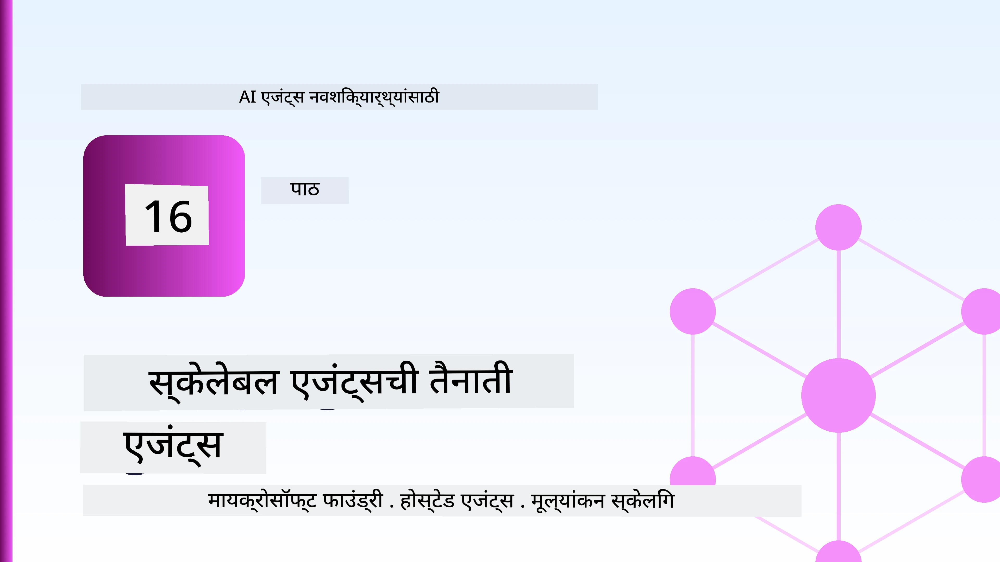
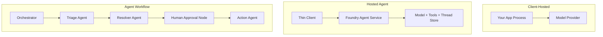
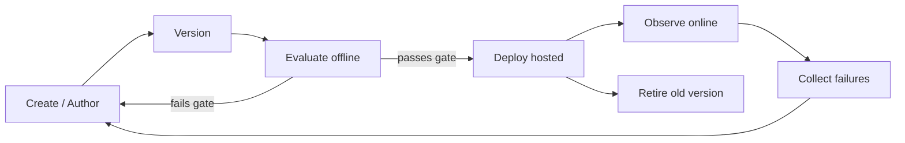
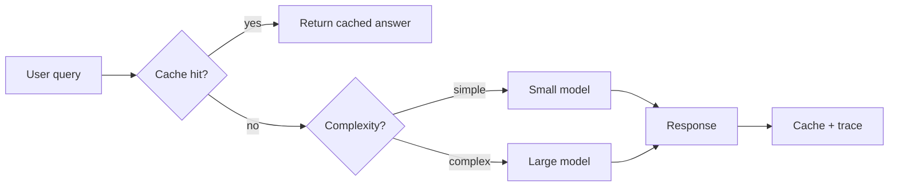
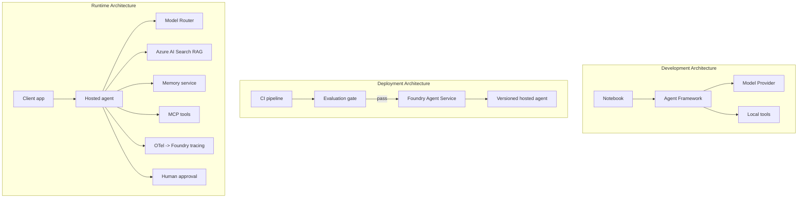

# मायक्रोसॉफ्ट फाउंड्रीसह स्केलेबल एजंट्सची तैनाती



आतापर्यंतच्या कोर्समध्ये तुम्ही असे एजंट तयार केले जे तुमच्या लॅपटॉपवर, नोटबुकमध्ये, `az login` आणि काही पर्यावरणीय चलांनी चालतात. हे शिकण्याचा अगदी योग्य मार्ग आहे. परंतु हजारो ग्राहक 3 वाजता सकाळी अवलंबून असलेल्या एजंटला चालवण्यासाठी तो योग्य मार्ग नाही.

हा धडा "माझ्या मशीनवर चालते" आणि "उत्पादनात विश्वासार्ह आणि स्वस्तरीत्या चालते" यामधील अंतराबाबत आहे. आम्ही हा अंतर Microsoft Foundry आणि Microsoft Foundry Agent Service वापरून पूर्ण करतो, आणि आम्ही साधनांसह, पुनर्प्राप्ती, स्मृती, मूल्यांकन, आणि देखरेख असलेल्या वास्तविक ग्राहक समर्थन एजंटचा निर्माण करून करतो.

## परिचय

हा धडा खालील विषयांचा आढावा घेईल:

- **प्रोटोटाइप एजंट** आणि **तैनात एजंट** यातील फरक, आणि का ही संक्रमण मुख्यत्वे मॉडेलच्या *भोवतीच* सर्व काही असते.
- एजंटसाठी **तैनाती नमुने**: क्लायंट-होस्टेड, सेवा-होस्टेड (Hosted Agents), आणि वर्कफ्लो-संघटित.
- Microsoft Foundry वरील **एजंटचा जीवनचक्र** — तयार करणे, आवृत्ती करणे, तैनात करणे, मूल्यांकन करणे, निरीक्षण करणे, निवृत्त होणे.
- **स्केलिंग धोरणे**: मॉडेल राउटिंग, कॅशिंग, समवेतता, आणि स्टेटलेस डिझाईन.
- OpenTelemetry आणि Foundry ट्रेसिंगसह **निरीक्षणक्षमता**.
- मॉडेल निवड, राउटिंग, आणि मूल्यांकन गेट्सद्वारे **खर्चाचे अनुकूलन**.
- **उद्योग विस्तार विचार**: शासन, मानवी मान्यता, आणि उत्पादनात एमसीपी सर्व्हर सुरक्षितपणे चालवणे.

## शिकण्याचे उद्दिष्टे

हा धडा पूर्ण केल्यावर, तुम्हाला माहित असेल की कसे:

- दिलेल्या एजंट कामाचा भारासाठी योग्य तैनाती नमुना निवडायचा.
- एजंट Microsoft Foundry Agent Service मध्ये तैनात करायचा जेणेकरून तो आवृत्तीत, शासित, आणि निरीक्षणीय असेल.
- प्रत्येक प्रकाशनाआधी चालणाऱ्या मूल्यांकन पाइपलाईनसाठी एजंटला ट्रेसिंगसाठी इन्स्ट्रुमेंट करायचे आणि वायर करायचे.
- स्केलवर विलंब आणि खर्च नियंत्रणात ठेवण्यासाठी मॉडेल राउटिंग आणि कॅशिंग लागू करायचे.
- उच्च धोका क्रियांसाठी मानवी मान्यता गेट जोडायचे आणि एमसीपी सर्व्हर उत्पादन सुरक्षित मार्गाने जोडायचे.

## पूर्वअटी

हा धडा गृहित धरतो की तुम्ही मागील धडे पूर्ण केले आहेत आणि खालील बाबींमध्ये आरामदायक आहात:

- [Microsoft Agent Framework](../14-microsoft-agent-framework/README.md) (धडा 14) सह एजंट तयार करणे.
- [Tool Use](../04-tool-use/README.md) (धडा 4) आणि [Agentic RAG](../05-agentic-rag/README.md) (धडा 5).
- [Agent Memory](../13-agent-memory/README.md) (धडा 13) आणि [Agentic Protocols / MCP](../11-agentic-protocols/README.md) (धडा 11).
- [Observability and Evaluation](../10-ai-agents-production/README.md) (धडा 10) — हा धडा थेट त्यावर आधारित आहे.

तुम्हाला पुढील गोष्टींही आवश्यक असतील:

- एक **Azure सदस्यत्व** आणि किमान एक तैनात चॅट मॉडेलसह एक **Microsoft Foundry प्रकल्प**.
- प्रमाणित केलेला **Azure CLI** (`az login`).
- Python 3.12+ आणि रेपॉजिटरीतील पॅकेजेस [`requirements.txt`](../../../requirements.txt).

## प्रोटोटाइप ते उत्पादन: काय प्रत्यक्षात बदलते

एक प्रोटोटाइप एजंट आणि एक उत्पादन एजंट हे एकाच मूलभूत लूप शेअर करतात — विचार करणे, साधने कॉल करणे, प्रतिसाद देणे. जे बदलते ते त्या लूपभोवतीचे सर्व काही आहे. उत्पादन एजंटमध्ये मॉडेल कदाचित 20% भाग असतो; उरलेले 80% ऑपरेशनल कंकाल आहे.

| बाब | प्रोटोटाइप | उत्पादन |
| --- | --- | --- |
| **होस्टिंग** | तुमच्या नोटबुकवर चालते | होस्टेड सेवा म्हणून चालते, आवृत्तीकृत आणि रोलआउट केलेले |
| **ओळख** | तुमचा `az login` टोकन | स्कोप केलेल्या RBAC सह व्यवस्थापित ओळख |
| **स्थिती** | इन-मेमरी, रिस्टार्टवर हरवते | बाह्यीकृत (थ्रेड स्टोअर, स्मृती सेवा) |
| **अपयश** | तुम्हाला ट्रेसबॅक दिसतो | पुनःप्रयत्न, बॅकलॅप्स, डेड-लेटर, अलर्ट्स |
| **खर्च** | "हे काही सेंट्स आहेत" | प्रत्येक विनंतीनुसार ट्रॅक केलेले, राउटेड, कॅश केलेले, बजेट केलेले |
| **गुणवत्ता** | तुम्ही आउटपुट पाहता | प्रत्येक प्रकाशनाआधी अप्रमाणित केली जाते |
| **विश्वास** | तुम्ही प्रत्येक क्रियेची मंजुरी देता | धोरण + धोका असलेल्या क्रियांसाठी मानवी-इन-दे-लूप |

या तक्त्याला लक्षात ठेवा. खालील प्रत्येक विभाग या रांगेपैकी एका अंकशी जुळतो.

## एजंट तैनाती नमुने

तुम्ही तीन नमुन्यांचा वापर करणार आहात, जे अनेकदा संयोजनात असतात.

### 1. क्लायंट-होस्टेड एजंट्स

एजंट ऑब्जेक्ट *तुमच्या* अनुप्रयोग प्रक्रियेमध्ये राहतो. तुमचा कोड थेट मॉडेल पुरवठादाराला कॉल करतो; विचार करण्याचा लूप तुमच्या सेवेत चालतो. पूर्वीच्या प्रत्येक धड्यात याच पद्धतीने काम झाले आहे.

- **जेव्हा वापरावे** जेव्हा तुम्हाला लूपवर पूर्ण नियंत्रण पाहिजे, सानुकूल मिडलवेअर पाहिजे, किंवा तुम्ही एजंट विद्यमान बॅकएंडमध्ये एम्बेड करत आहात.
- **व्यापार_ऑफ**: तुम्ही स्वतः स्केलिंग, स्थिती, आणि लवचिकता सांभाळता.

### 2. होस्टेड एजंट्स (Foundry Agent Service)

एजंट Microsoft Foundry मध्ये *संसाधन म्हणून नोंदणीकृत* असतो. Foundry विचार लूप होस्ट करतो, थ्रेडस संग्रहित करतो, सामग्री सुरक्षितता आणि RBAC लागू करतो, आणि एजंटला Foundry पोर्टलमध्ये दिसणीय बनवतो. तुमचा अ‍ॅप एक हलका क्लायंट होतो जो थ्रेड तयार करतो आणि प्रतिक्रिया वाचतो.

- **जेव्हा वापरावे** जेव्हा तुम्हाला टिकाऊपणा, अंगभूत निरीक्षणक्षमता, शासन, आणि कमी ऑपरेशनल क्षेत्र पाहिजे.
- **व्यापार_ऑफ**: व्यवस्थापित रनटाइमसाठी कमी पातळीचे नियंत्रण.

### 3. एजंट वर्कफ्लोज

अनेक एजंट (आणि साधने) स्पष्ट नियंत्रण प्रवाहासह ग्राफमध्ये जोडले जातात — अनुक्रमिक टप्पे, शाखा, मानवी मान्यता नोड्स, आणि टिकाऊ चेकपॉइंट्स जे थांबवू आणि पुन्हा सुरू करू शकतात. हे Microsoft Agent Framework मधील **वर्कफ्लोज** क्षमता तैनाती प्रमाणात वापरली जाते.

- **जेव्हा वापरावे** जेव्हा एकाच कार्यात अनेक खासगी एजंट्स असतील किंवा मध्ये मान्यता चरण आवश्यक असेल.
- **व्यापार_ऑफ**: अधिक हालचाल करणारे भाग; संघटन स्तराच्या निरीक्षणक्षमतेची गरज.



## Microsoft Foundry वरील एजंट जीवनचक्र

एजंट तैनात करणे एकदाच होणारे `push` नाही. हे एक लूप आहे, आणि ते सॉफ्टवेअर प्रकाशन चक्रासारखे दिसते कारण तेच आहे.



मुख्य कल्पना, [धडा 10](../10-ai-agents-production/README.md) मधून घेतलेली: **ऑफलाइन मूल्यांकन हे गेट आहे, केवळ विचार नंतर ची गोष्ट नाही.** नवीन एजंट आवृत्ती तुमचे मूल्यांकन निकष पार केल्यानंतरच वितरित केली जाते. ऑनलाइन निरीक्षण वास्तविक जगातील अयशस्वी प्रतिक्रिया तुमच्या ऑफलाइन चाचणी सेटमध्ये परत पाठवते. तो संपूर्ण लूप आहे.

## स्केलिंग धोरणे

एजंट स्केल करणे हे स्टेटलेस वेब API स्केल करण्यापेक्षा वेगळे आहे, कारण प्रत्येक विनंती अनेक महागड्या मॉडेल आणि साधनांसाठी कॉल करू शकते. चार तंत्रे सर्वाधिक भार वाहतात.

**स्टेटलेस विनंती हाताळणी.** तुमच्या प्रक्रियेच्या स्मृतीमध्ये कोणतीही वापरकर्ता स्थिती ठेऊ नका. संभाषण थ्रेड Foundry थ्रेड स्टोअर किंवा स्मृती सेवेत सतत संग्रहित करा जेणेकरून कोणताही इंस्टन्स कोणतीही विनंती हाताळू शकेल. हेच तुम्हाला आडव्याने स्केल करण्यास परवानगी देते — इंस्टन्स वाढवा, सिंकी सत्र नाही.

**मॉडेल राउटिंग.** प्रत्येक विनंतीसाठी तुमच्या सर्वात सामर्थ्यशाली (आणि सर्वात महागडे) मॉडेलची गरज नसते. साध्या विनंत्या — उद्दिष्ट वर्गीकरण, लहान तथ्यात्मक उत्तरे — लहान, जलद मॉडेलकडे राऊट करा, आणि मोठा मॉडेल खऱ्या विचारासाठी राखीव ठेवा. Foundry चे **Model Router** हे तुमच्यासाठी करू शकते, किंवा तुम्ही स्वतः एक हलका वर्गीकार राबवू शकता. तुम्ही प्रयोगशाळेत DIY आवृत्ती बनवाल.

**प्रतिक्रिया कॅशिंग.** अनेक समर्थन चौकशी जवळजवळ अचूक ("मी माझा पासवर्ड कसा रीसेट करतो?"). सामान्य प्रश्नांची उत्तरे कॅश करा आणि मॉडेलवर परिणाम न करता ती सेवा करा. अगदी थोड्या प्रमाणात कॅश हिट दरामुळे खर्च आणि विलंब दोन्ही लक्षणीयरीत्या कमी होतात.

**समवेतता आणि बॅकप्रेशर.** मॉडेल पुरवठादारांकडे दर मर्यादा असतात. तुमची समवेतता मर्यादित करा, एक्सपोनेंशियल बॅकऑफसह पुनःप्रयत्न वापरा, आणि सौम्य अपयश द्या (क्युव्ह केलेली "आम्ही काम करत आहोत" उत्तर 500 पेक्षा चांगली आहे).



## उत्पादनातील निरीक्षणक्षमता

तुम्ही जे पाहू शकत नाही ते तुम्ही चालवू शकत नाही. धडा 10 मध्ये दिल्याप्रमाणे, Microsoft Agent Framework मूळतः **OpenTelemetry** ट्रेसेस उत्सर्जित करतो — प्रत्येक मॉडेल कॉल, साधन आवाहन, आणि संघटन पाऊल एक स्पॅन होते. उत्पादनात तुम्ही ते स्पॅन Microsoft Foundry (किंवा कोणत्याही OTel-सुसंगत बॅकएंड) कडे निर्यात करता जेणेकरून तुम्ही:

- एका ग्राहक तक्रारीचा शेवटापर्यंत मागोवा घ्या प्रत्येक मॉडेल आणि साधन कॉलमध्ये.
- p50/p95 विलंब आणि खर्च प्रति विनंती कालांतराने पहा.
- त्रुटी दरातील उछाल आणि खर्च अज्ञाततेवर अलर्ट करा, तुमचे वापरकर्ते (किंवा तुमची आर्थिक टीम) जाणवण्याच्या अगोदर.

```python
from agent_framework.observability import get_tracer

tracer = get_tracer()

with tracer.start_as_current_span("support_request") as span:
    span.set_attribute("customer.tier", "enterprise")
    span.set_attribute("routed.model", "gpt-5-nano")
    # agent execution is traced automatically inside this span
```

`customer.tier` आणि `routed.model` सारखे गुणधर्म ट्रेसची भिंत उत्तर देणाऱ्या प्रश्नांमध्ये रुपांतर करतात ("उद्योग ग्राहकांना लहान मॉडेलकडे खूप वारंवार मार्गदर्शित केले जाते का?").

## खर्चाचे अनुकूलन

उत्पादन एजंटमधील खर्च टोकन्सद्वारे नियंत्रित केली जाते. परिणामाच्या क्रमाने तीन लीव्हर्स:

1. **मॉडेलचा योग्य आकार निवडा.** छोटा मॉडेल जो तुमचा मूल्यांकन गेट पार करतो तो मोठ्या मॉडेलच्या तुलनेत नेहमीच स्वस्त असतो जो तो देखील पार करतो. मोठ्या मॉडेलकडे पूर्वग्रह न करता छोटा मॉडेल पुरेसा असल्याचे मूल्यांकन वापरा.
2. **कठीणतेनुसार राउट करा.** वर नमूद केल्याप्रमाणे — केवळ मोठा मॉडेल आवश्यक असलेल्या विनंत्यांसाठी मोठा मॉडेलचा खर्च द्या.
3. **जोरदार कॅशिंग करा.** सर्वात स्वस्त मॉडेल कॉल तो आहे जो तुम्ही कधीच करत नाही.

मूल्यांकन गेट्स आणि खर्च नियंत्रण दोन्हीही एका विषयाचे दोन पैलू आहेत: मूल्यांकन तुम्हाला *गुणवत्तेचा तळ* सांगते, राउटिंग आणि कॅशिंग तुम्हाला त्या तळाच्या *खर्चाजवळ* ठेवतात.

## उद्योग तैनाती विचार

**शासन.** होस्टेड एजंट्स Foundry चे RBAC, सामग्री सुरक्षितता, आणि ऑडिट लॉगिंग वारसाहक्काने मिळवतात. प्रत्येक एजंटला त्याला आवश्यक कमी अधिकारांसह व्यवस्थापित ओळख द्या — ज्ञान कक्षेवरील केवळ वाचन प्रवेश, तिकीटिंग API वर स्कोप केलेला प्रवेश, अधिक नाही.

**मानवी-इन-दे-लूप.** काही क्रिया थेट स्वयंचलित करण्यासाठी फार महत्त्वाच्या असतात — परतावा जारी करणे, खाते हटवणे, कायदेशीर टीमकडे तत्तडी पाठवणे. Microsoft Agent Framework **मंजुरी आवश्यक** साधने समर्थन करते: एजंट क्रिया प्रस्तावित करतो, अंमलबजावणी थांबते, मानवी मंजुरी किंवा नाकारणी होते, आणि वर्कफ्लो पुन्हा सुरू होते. तुम्ही या प्राथमिकतेचा अभ्यास [धडा 6](../06-building-trustworthy-agents/README.md) मध्ये केला; येथे तुम्ही त्याची तैनात करता.

**उत्पादनात MCP.** [MCP](../11-agentic-protocols/README.md) तुमच्या एजंटला बाह्य साधने एकसंध इंटरफेसद्वारे वापरू देते. उत्पादनात, प्रत्येक MCP सर्व्हरला अविश्वसनीय सीमा समजा: सर्व्हर आवृत्ती पिन करा, स्कोप केलेल्या ओळखीने चालवा, त्याची आउटपुट सत्यापित करा, आणि त्याला कोडी कधीच उघडा नये. एमसीपी सर्व्हर एक अवलंबित्व आहे, आणि अवलंबित्वांना पॅच, ऑडिट आणि दरमर्यादा लावली जाते.



ही तीन आकृती — विकास, तैनाती, रनटाइम — हे जीवनाच्या तीन टप्प्यांतील एकच एजंट आहेत. पुढील प्रयोगशाळेने तुम्हाला ते तयार करण्यास मार्गदर्शन केले आहे.

## हाताळणी प्रयोगशाळा: उत्पादन-तयार ग्राहक समर्थन एजंट

 [`code_samples/16-python-agent-framework.ipynb`](./code_samples/16-python-agent-framework.ipynb) उघडा आणि तो संपूर्ण करा. तुम्ही एक **Contoso ग्राहक समर्थन एजंट** तयार करणार आहात ज्यात प्रत्येक उत्पादन चिंता जोडलेली आहे:

1. **साधन कॉल करणे** — ऑर्डर स्थिती तपासणे आणि समर्थन तिकीटे उघडणे.
2. **RAG** — ज्ञान कक्षेतील धोरण प्रश्नांची उत्तरे देणे (Azure AI Search, इन-मेमरी फॉलबॅकसह जेणेकरून नोटबुक संसाधनांशिवाय चालेल).
3. **स्मृती** — संभाषण टप्प्यांदरम्यान ग्राहक लक्षात ठेवणे.
4. **मॉडेल राउटिंग** — एक क्लिष्टता वर्गीकार प्रत्येक विनंती लहान किंवा मोठ्या मॉडेलकडे पाठवतो.
5. **प्रतिक्रिया कॅशिंग** — पुनरावृत्ती प्रश्न कॅशमधून सेवा दिले जातात.
6. **मानवी मंजुरी** — उच्च थ्रेशोल्डवर परतावा मानवी मंजुरीसाठी थांबतो.
7. **मूल्यांकन पाइपलाईन** — एक लहान ऑफलाइन चाचणी संच एजंटचे स्कोअर करतो आणि तो प्रकाशन गेट म्हणून कार्य करतो.
8. **निरीक्षणक्षमता** — प्रत्येक विनंतीभोवती OpenTelemetry ट्रेसिंग.

### वाटचाल मार्गदर्शन

नोटबुक असा आयोजित आहे की प्रत्येक उत्पादन चिंता स्वतंत्र, चालवता येणाऱ्या विभागात आहे. त्याचा मुख्य भाग म्हणजे राउटिंग-प्लस-कॅशिंग विनंती हाताळणी करणारा:

```python
async def handle_support_request(query: str, customer_id: str) -> str:
    # 1. Serve from cache when we can.
    cached = response_cache.get(normalize(query))
    if cached:
        return cached

    # 2. Route by complexity to control cost.
    model = "gpt-5-nano" if is_simple(query) else "gpt-5-mini"

    # 3. Run the agent inside a trace span for observability.
    with tracer.start_as_current_span("support_request") as span:
        span.set_attribute("routed.model", model)
        span.set_attribute("customer.id", customer_id)
        response = await support_agent.run(query, model=model)

    # 4. Cache and return.
    response_cache.set(normalize(query), response.text)
    return response.text
```

प्रकाशनाचे रक्षण करणारा मूल्यांकन गेट असे दिसतो:

```python
async def evaluation_gate(agent, test_cases, threshold: float = 0.8) -> bool:
    passed = 0
    for case in test_cases:
        result = await agent.run(case["input"])
        if score_response(result.text, case["expected"]) >= 0.8:
            passed += 1
    pass_rate = passed / len(test_cases)
    print(f"Evaluation pass rate: {pass_rate:.0%} (gate: {threshold:.0%})")
    return pass_rate >= threshold  # only deploy if the gate passes
```

प्रत्येक ओळ वाचा — नोटबुक फ्रेमवर्क कॉलच्या मागे काहीही लपवलेले नाही म्हणून प्रिमिटिव्हेस जाणून घेणे सोपे होते.

## तैनात एजंटची धूर तपासणी करून पडताळणी

वर दिलेला मूल्यांकन गेट *ऑफलाइन* तुमच्या एजंट ऑब्जेक्टवर चालतो. एकदा एजंट Hosted Agent म्हणून तैनात केल्यावर, तुम्हाला आणखी एक, आणखी स्वस्त तपासणी हवी: **तैनात केलेल्या एंडपॉइंटची खरोखर उत्तरे येत आहेत का?**

"यशस्वी" तैनाती फक्त कंट्रोल प्लेनने व्याख्या स्वीकारली हे सिद्ध करते — एजंट प्रतिसाद देत आहे हे नाही. विसरलेली अवलंब्यता, खराब मॉडेल राउटिंग, किंवा संपलेले कनेक्शन निरुपयोगी तैनाती तयार करु शकते जी काहीही परत करत नाही. **धूर तपासणी** ही काही सेकंदांतपैकी प्रत्येक तैनातीवर टिपते, पूर्ण मूल्यांकनाच्या खर्चाशिवाय.

हा रेपॉजिटरी तयार तयार धूर-चाचणी पाइपलाईन सह येतो जो [AI Smoke Test](https://github.com/marketplace/actions/ai-smoke-test) GitHub Action वर आधारित आहे:

- **कॅटलॉग** — [`tests/lesson-16-smoke-tests.json`](../../../tests/lesson-16-smoke-tests.json) मध्ये Contoso समर्थन एजंटसाठी प्रॉम्प्ट्स आणि दावे आहेत (स्थिर धोरण उत्तरे, ऑर्डर तपासणी, विषयावर राहणे, आणि मल्टि-टर्न थ्रेड सलगता). इतर धड्यांच्या एजंटसाठी कॅटलॉग त्याच ठिकाणी आहेत — पहा [`tests/README.md`](../tests/README.md).
- **वर्कफ्लो** — [`.github/workflows/smoke-test.yml`](../../../.github/workflows/smoke-test.yml) Azure OIDC शी लॉगिन करतो आणि प्रत्येक प्रॉम्प्ट एजंटच्या Responses एंडपॉइंटवर POST करतो, कोणताही दावा चुकला तर नोकरी अयशस्वी होते.

```yaml
- name: Smoke-test hosted agent
  uses: JFolberth/ai-smoketest@v1
  with:
    project_endpoint: ${{ inputs.project_endpoint }}
    agent_name: ContosoSupportAgent
    tests_file: tests/lesson-16-smoke-tests.json
```

एजंट तैनात केल्यानंतर **Actions** टॅबमधून चालवा, आपला Foundry प्रोजेक्ट एंडपॉईंट आणि एजंट नाव देऊन. फेडरेटेड आयडेंटिटीला Foundry प्रोजेक्ट स्कोपवर **Azure AI User** भूमिका आवश्यक आहे. स्तरांना पिरामिडच्या रूपात विचार करा: स्मोक टेस्ट्स (पहुंचण्याजोगे आहेत का आणि प्रतिसाद देत आहेत का?) प्रत्येक डिप्लॉयवर चालतात, ऑफलाइन मूल्यमापन (शिप करण्यासाठी पुरेसे चांगले आहे का?) प्रमोशनपूर्वी चालते, आणि ऑनलाइन मूल्यमापन (ती जंगलात कशी काम करत आहे?) सातत्याने चालते.

## ज्ञान तपासणी

असाईनमेंटकडे जाण्यापूर्वी आपले समज तपासा.

**1. उत्पादन एजंटच्या "मॉडेल" चे सुमारे कितपत प्रमाण आहे, आणि उर्वरित काय आहे?**

<details>
<summary>उत्तर</summary>

मॉडेल सिस्टमचा अल्पसंख्याक आहे — सहसा सुमारे २०% म्हणून उल्लेख केला जातो. उर्वरित म्हणजे ऑपरेशनल स्केलेटन: होस्टिंग आणि वर्शनिंग, ओळख आणि RBAC, बाह्यस्थिती, अपयश व्यवस्थापन, खर्च ट्रॅकिंग, मूल्यमापन, आणि मानव-इन-द-लूप नियंत्रण. उत्पादनाकडे जाणे मुख्यतः तर्क लूपच्या *भोवती* सर्व काही तयार करण्याबद्दल आहे.
</details>

**2. आपण क्लायंट-होस्टेड एजंटऐवजी Hosted Agent कधी निवडाल?**

<details>
<summary>उत्तर</summary>

जेव्हा आपण अंतर्भूत टिकाऊपणा (पुनः चालू ठेवू शकणारे थ्रेड्स), अवलोकनक्षमता, सामग्री सुरक्षा, आणि RBAC असलेला व्यवस्थापित रनटाइम इच्छित असाल आणि आपण कमी ऑपरेशनल पृष्ठभागासाठी तर्क लूपच्या काही कमी-स्तरीय नियंत्रणाचा त्याग करण्यास तयार असाल. क्लायंट-होस्टेड प्राधान्य जेव्हा पूर्ण लूपवर नियंत्रण आवश्यक असते किंवा एजंट विद्यमान बॅकएंडमध्ये एम्बेड करत असता तेव्हा.
</details>

**3. स्केलेबल एजंटचा स्वतःच्या प्रक्रिया मेमरीत स्थिती नसली पाहिजे का?**

<details>
<summary>उत्तर</summary>

त्यामुळे कोणतेही उदाहरण कोणत्याही विनंतीची हाताळणी करू शकते, जे क्षैतिज स्केलिंगसाठी स्टिकी सेशन्स शिवाय अनुमत करते. प्रति-युजर संभाषण स्थिती थ्रेड स्टोअर किंवा मेमरी सेवेत बाह्यकरण केलेले आहे. स्थिती जर प्रक्रिया मेमरीत राहिली असती तर पुनःप्रारंभावर ते गमावले जात होते आणि लोड मुक्तपणे वितरीत करता येत नव्हते.
</details>

**4. मॉडेल राउटिंग कोणता प्रश्न सोडवते, आणि ते मूल्यमापनाशी कसे संबंधित आहे?**

<details>
<summary>उत्तर</summary>

राउटिंग सोप्या विनंत्यांना लहान, स्वस्त, जलद मॉडेलकडे पाठवते आणि मोठ्या मॉडेलला खरी तर्कसंगतीसाठी राखून ठेवते, दोन्ही विलंब आणि खर्च नियंत्रित करते. ते मूल्यमापनाशी संबंधित आहे कारण मूल्यमापन हेच आहे जे लहान मॉडेल एका विनंती वर्गासाठी पुरेसे चांगले आहे याचा *पुरावा* देते — मूल्यमापनाशिवाय राउटिंग ही अंदाज आहे.
</details>

**5. “मूल्यमापन गेट” काय आहे आणि ते जीवनचक्रात कुठे असते?**

<details>
<summary>उत्तर</summary>

एक मूल्यमापन गेट नवीन एजंट आवृत्तीवर ऑफलाइन चाचणी संच चालवते आणि जर पास दर एक ठराविक मर्यादा ओलांडत नसेल तर डिप्लॉयमेंट ब्लॉक करते. ते जीवनचक्रात "आवृत्ती" आणि "डिप्लॉय" यामध्ये असते, गुणवत्ता हे रिलिजच्या आधीची अट बनवते, शिपिंगनंतर तपासणी नव्हे.
</details>

**6. उत्पादनात MCP सर्व्हरचा गैरविश्वसनीय मर्यादा म्हणून कसा विचार केला पाहिजे?**

<details>
<summary>उत्तर</summary>

कारण तो एक बाह्य अवलंबित्व आहे ज्यात आपला एजंट कॉल करतो. त्याची आवृत्ती ठरवावी, विशिष्ट ओळखीनिशी चालवावी, त्याच्या आउटपुट्सची पडताळणी करावी, रेट-लिमिट करावी, आणि त्याला कधीही रहस्ये उघड करू नये — हेच कार्य आपण कोणत्याही तृतीय-पक्ष अवलंबित्वावर करतो. त्याचे आउटपुट एजंटच्या तर्कात जाते, त्यामुळे पडताळणी केलेला विश्वास एक सुरक्षा धोका आहे.
</details>

**7. कोणता एकच बदल सामान्यतः उत्पादन एजंटच्या किंमतीवर सर्वात मोठा परिणाम करतो, आणि का?**

<details>
<summary>उत्तर</summary>

मॉडेलचा योग्य आकार घेणे — सर्वात लहान मॉडेल वापरणे जे अद्याप आपला मूल्यमापन गेट पार करते. खर्च मुख्यतः टोकन्सने नियंत्रित होतो, आणि गुणवत्तेच्या निकषांना पूर्ण करणारे लहान मॉडेल मोठ्या पेक्षा जवळजवळ नेहमीच स्वस्त असते. कॅशिंग आणि राउटिंग नंतर खर्च आणखी कमी करतात, परंतु योग्य बेस मॉडेल निवडणे सर्वात मोठा प्राथमिक परिणाम असतो.
</details>

**8. `customer.tier` आणि `routed.model` सारख्या स्पॅन अ‍ॅट्रिब्यूट्सचे अवलोकनक्षमतेत काय योगदान आहे?**

<details>
<summary>उत्तर</summary>

ते कच्च्या ट्रेसेसना उत्तर देणाऱ्या व्यवसाय प्रश्नांमध्ये रूपांतरित करतात. अ‍ॅट्रिब्यूट नसल्यास आपल्याकडे स्पॅन्सचा भिंत असतो; अ‍ॅट्रिब्यूट्समुळे आपण विचारू शकता "एंटरप्राइज ग्राहकांना लहान मॉडेलकडे खूपदा राउट केलं जातं का?" किंवा "कोणते मॉडेल आपली सर्वात धीमी विनंती हाताळते?" अ‍ॅट्रिब्यूट्स ही ती परिमाणे आहेत ज्याद्वारे आपण आपल्या ऑपरेशनसाठी महत्त्वाची टेलिमेट्री विभागता.
</details>

## असाईनमेंट

प्रयोगशाळेतील ग्राहक समर्थन एजंट घ्या आणि त्याला एका विशिष्ट परिस्थितीसाठी कडक करा: **SaaS कंपनीसाठी सदस्यता बिलिंग समर्थन एजंट.**

आपली सादरीकरणे हे असावे:

1. बिलिंग-संबंधित साधने त्यागा आणि त्यांची जागा घ्या: `get_subscription_status`, `get_invoice`, आणि `issue_credit` (५० डॉलर्सहून अधिक क्रेडिटसाठी मानवी मंजुरी आवश्यक आहे).
2. कंपनीच्या परतावा धोरण, बिलिंग सायकल, आणि रद्द धोरण यावर तीन RAG दस्तऐवज जोडा.
3. मूल्यमापन संच किमान आठ केसेस पर्यंत विस्तृत करा, ज्यामध्ये कमीतकमी दोन प्रकरणे मानवी-मान्यता मार्ग चालवण्यास कारणीभूत ठरतील आणि खात्री करा की आपला मूल्यमापन गेट योग्यरित्या पास किंवा फेल होतो.
4. एक खर्च अहवाल जोडा: एजंटमध्ये दहा मिश्रित क्वेरी चालविल्यानंतर, किती लहान मॉडेलकडे गेले, किती मोठ्या मॉडेलकडे गेले, आणि किती कॅशमधून सेवा दिली गेली हे छापा.

एक लहान परिच्छेद (markdown सेलमध्ये) लिहा तो स्पष्ट करतो की आपण कोणता मॉडेल-राउटिंग नियम निवडला आणि तो खऱ्या ट्रॅफिकसह कसा पडताळाल. कोणताही एकच अचूक उत्तर नाही — आपल्याला मूल्यांकन केलं जात आहे की उत्पादन चिंता सुसंगतपणे जोडल्या गेल्या आहेत का.

## सारांश

या धड्यात आपण Microsoft Foundry सह एजंट प्रोटोटाइपमधून उत्पादनात हलविला:

- उत्पादनाकडे जायचा मोठा भाग म्हणजे मॉडेलच्या भोवतीचा **ऑपरेशनल स्केलेटन** — होस्टिंग, ओळख, स्थिती, अपयश हाताळणी, खर्च, गुणवत्ता, आणि विश्वास.
- आपण तीन **डिप्लॉयमेंट पॅटर्न्स** शिकलात — क्लायंट-होस्टेड, Hosted Agents, आणि Agent Workflows — आणि प्रत्येक कधी लागू होतो.
- आपण **एजंट जीवनचक्र** पाहिलं, जिथे ऑफलाइन **मूल्यमापन हे रिलीज गेटसारखं काम करतं** आणि ऑनलाइन अवलोकन अपयशांना पुनरावलोकनासाठी परत फिड करतं.
- आपण **स्केलिंग धोरणे** वापरली — स्टेटलेस डिझाइन, मॉडेल राउटिंग, कॅशिंग, आणि सीमित समांतरता — आणि त्यांना **खर्च सुधारणा** शी जोडले.
- आपण **एंटरप्राइज नियंत्रण** जोडली: RBAC, मानव-इन-द-लूप मंजुरी, आणि उत्पादन-सुरक्षित MCP एकत्रीकरण.
- आपण एक **उत्पादन-तयार ग्राहक समर्थन एजंट** बनविला जो या प्रत्येक चिंतेला राबवणारे कोड जोडतो.

पुढचा धडा उलट प्रवास करतो: एजंट्सना मेघात वाढवण्याऐवजी, आपण त्यांना एका डेवलपर मशीनवर उतरवून पूर्णपणे स्थानिकरित्या चालवाल.

## अतिरिक्त स्रोत

- <a href="https://learn.microsoft.com/azure/ai-foundry/what-is-azure-ai-foundry" target="_blank">Microsoft Foundry दस्तऐवजीकरण</a>
- <a href="https://learn.microsoft.com/azure/ai-foundry/agents/overview" target="_blank">Microsoft Foundry Agent Service सारांश</a>
- <a href="https://learn.microsoft.com/en-us/agent-framework/overview/?wt.mc_id=youtube_26688_organicsocial_reactor&pivots=programming-language-python" target="_blank">Microsoft Agent Framework</a>
- <a href="https://learn.microsoft.com/en-us/azure/ai-foundry/openai/concepts/model-router" target="_blank">Microsoft Foundry मधील मॉडेल राउटर</a>
- <a href="https://learn.microsoft.com/azure/search/search-what-is-azure-search" target="_blank">Azure AI Search</a>
- <a href="https://opentelemetry.io/" target="_blank">OpenTelemetry</a>
- <a href="https://github.com/marketplace/actions/ai-smoke-test" target="_blank">AI स्मोक टेस्ट GitHub अ‍ॅक्शन</a>
- <a href="https://modelcontextprotocol.io/" target="_blank">मॉडेल कॉन्टेक्स्ट प्रोटोकॉल (MCP)</a>

## मागील धडा

[कंप्यूटर वापर एजंट्स तयार करणे (CUA)](../15-browser-use/README.md)

## पुढील धडा

[स्थानिक AI एजंट्स तयार करणे](../17-creating-local-ai-agents/README.md)

---

<!-- CO-OP TRANSLATOR DISCLAIMER START -->
**अस्वीकरण**:
हा दस्तऐवज AI भाषांतर सेवा [Co-op Translator](https://github.com/Azure/co-op-translator) चा वापर करून अनुवादित केला आहे. जरी आम्ही अचूकतेसाठी प्रयत्न करतो, तरी कृपया लक्षात घ्या की स्वयंचलित भाषांतरांमध्ये त्रुटी किंवा अचूकतेची कमतरता असू शकते. मूळ दस्तऐवज त्याच्या मूळ भाषेत अधिकृत स्रोत मानला पाहिजे. महत्त्वाची माहिती असल्यास, व्यावसायिक मानवी भाषांतराची शिफारस केली जाते. या भाषांतराच्या वापरामुळे उद्भवणाऱ्या कोणत्याही गैरसमज किंवा चुकीच्या अर्थलावणीसाठी आम्ही जबाबदार नाही.
<!-- CO-OP TRANSLATOR DISCLAIMER END -->