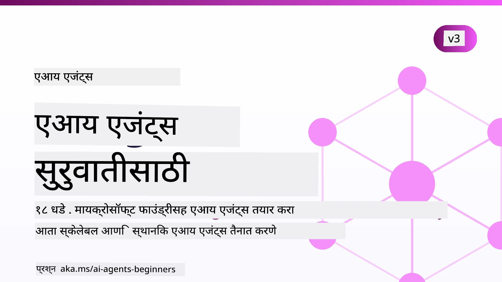

# AI एजंट्स फॉर बिगिनर्स - एक कोर्स



## AI एजंट्स तयार करण्यास सुरूवात करण्यासाठी आवश्यक असलेली सर्व काही शिकवणारा कोर्स

[](https://github.com/microsoft/ai-agents-for-beginners/blob/master/LICENSE?WT.mc_id=academic-105485-koreyst)
[](https://GitHub.com/microsoft/ai-agents-for-beginners/graphs/contributors/?WT.mc_id=academic-105485-koreyst)
[](https://GitHub.com/microsoft/ai-agents-for-beginners/issues/?WT.mc_id=academic-105485-koreyst)
[](https://GitHub.com/microsoft/ai-agents-for-beginners/pulls/?WT.mc_id=academic-105485-koreyst)
[](http://makeapullrequest.com?WT.mc_id=academic-105485-koreyst)

### 🌐 बहुभाषिक समर्थन

#### भाषांतर [Co-op Translator](https://github.com/Azure/co-op-translator) द्वारे राखले गेले आहे

<!-- CO-OP TRANSLATOR LANGUAGES TABLE START -->
[Arabic](../ar/README.md) | [Bengali](../bn/README.md) | [Bulgarian](../bg/README.md) | [Burmese (Myanmar)](../my/README.md) | [Chinese (Simplified)](../zh-CN/README.md) | [Chinese (Traditional, Hong Kong)](../zh-HK/README.md) | [Chinese (Traditional, Macau)](../zh-MO/README.md) | [Chinese (Traditional, Taiwan)](../zh-TW/README.md) | [Croatian](../hr/README.md) | [Czech](../cs/README.md) | [Danish](../da/README.md) | [Dutch](../nl/README.md) | [Estonian](../et/README.md) | [Finnish](../fi/README.md) | [French](../fr/README.md) | [German](../de/README.md) | [Greek](../el/README.md) | [Hebrew](../he/README.md) | [Hindi](../hi/README.md) | [Hungarian](../hu/README.md) | [Indonesian](../id/README.md) | [Italian](../it/README.md) | [Japanese](../ja/README.md) | [Kannada](../kn/README.md) | [Khmer](../km/README.md) | [Korean](../ko/README.md) | [Lithuanian](../lt/README.md) | [Malay](../ms/README.md) | [Malayalam](../ml/README.md) | [Manipuri (Meitei Mayek)](../mni/README.md) | [Marathi](./README.md) | [Nepali](../ne/README.md) | [Nigerian Pidgin](../pcm/README.md) | [Norwegian](../no/README.md) | [Persian (Farsi)](../fa/README.md) | [Polish](../pl/README.md) | [Portuguese (Brazil)](../pt-BR/README.md) | [Portuguese (Portugal)](../pt-PT/README.md) | [Punjabi (Gurmukhi)](../pa/README.md) | [Romanian](../ro/README.md) | [Russian](../ru/README.md) | [Serbian (Cyrillic)](../sr/README.md) | [Slovak](../sk/README.md) | [Slovenian](../sl/README.md) | [Spanish](../es/README.md) | [Swahili](../sw/README.md) | [Swedish](../sv/README.md) | [Tagalog (Filipino)](../tl/README.md) | [Tamil](../ta/README.md) | [Telugu](../te/README.md) | [Thai](../th/README.md) | [Turkish](../tr/README.md) | [Ukrainian](../uk/README.md) | [Urdu](../ur/README.md) | [Vietnamese](../vi/README.md)

> **स्थानिकपणे क्लोन करणे पसंत आहे?**
>
> या रेपॉजिटरीमध्ये 50+ भाषेतील भाषांतर समाविष्ट आहे ज्यामुळे डाउनलोड आकार खूप वाढतो. भाषांतरांशिवाय क्लोन करायचे असल्यास sparse checkout वापरा:
>
> **Bash / macOS / Linux:**
> ```bash
> git clone --filter=blob:none --sparse https://github.com/microsoft/ai-agents-for-beginners.git
> cd ai-agents-for-beginners
> git sparse-checkout set --no-cone '/*' '!translations' '!translated_images'
> ```
>
> **CMD (Windows):**
> ```cmd
> git clone --filter=blob:none --sparse https://github.com/microsoft/ai-agents-for-beginners.git
> cd ai-agents-for-beginners
> git sparse-checkout set --no-cone "/*" "!translations" "!translated_images"
> ```
>
> यामुळे तुम्हाला कोर्स पूर्ण करण्यासाठी आवश्यक असलेली सर्वकाही मिळते आणि डाउनलोड अधिक जलद होते.
<!-- CO-OP TRANSLATOR LANGUAGES TABLE END -->

**अधिक भाषिक विकल्पांसाठी [Co-op Translator चे समर्थित भाषा](https://github.com/Azure/co-op-translator/blob/main/docs/supported-languages.md) पहा.**

[](https://GitHub.com/microsoft/ai-agents-for-beginners/watchers/?WT.mc_id=academic-105485-koreyst)
[](https://GitHub.com/microsoft/ai-agents-for-beginners/network/?WT.mc_id=academic-105485-koreyst)
[](https://GitHub.com/microsoft/ai-agents-for-beginners/stargazers/?WT.mc_id=academic-105485-koreyst)

[](https://discord.com/invite/ATgtXmAS5D)


## 🌱 सुरुवात करताना

या कोर्समध्ये AI एजंट्स तयार करण्याच्या मूलभूत गोष्टींचा समावेश आहे. प्रत्येक धडा स्वतःचा विषय घेऊन तयार आहे त्यामुळे आपल्याला हवे तिकडे सुरुवात करा!

या कोर्ससाठी बहुभाषिक समर्थन उपलब्ध आहे. आमच्या [इथे उपलब्ध भाषांमध्ये](#-multi-language-support) पहा.

जर तुम्ही प्रथमच Generative AI मॉडेल्ससह काम करत असाल तर आमचा [Generative AI For Beginners](https://aka.ms/genai-beginners) कोर्स पहा, ज्यामध्ये GenAI सह तयार करण्यावर 21 धडे आहेत.

लक्षात ठेवा की [हा रेपॉजिटरी (🌟) स्टार करा](https://docs.github.com/en/get-started/exploring-projects-on-github/saving-repositories-with-stars?WT.mc_id=academic-105485-koreyst) आणि [हा रेपॉजिटरी फोर्क करा](https://github.com/microsoft/ai-agents-for-beginners/fork) कोड चालवण्यासाठी.

### इतर शिकलायांना भेटा, तुमचे प्रश्न विचारा

जर तुम्ही अडकलात किंवा AI एजंट्स तयार करण्याबाबत काही प्रश्न असतील, तर आमच्या समर्पित Discord चॅनेलमध्ये सहभागी व्हा [Microsoft Foundry Discord](https://aka.ms/ai-agents/discord).

### तुमच्याकडे काय आवश्यक आहे

या कोर्समधील प्रत्येक धड्यात कोडचे उदाहरणे असतात, जे code_samples फोल्डरमध्ये सापडतात. तुम्ही [हा रेपॉजिटरी फोर्क](https://github.com/microsoft/ai-agents-for-beginners/fork) करून स्वतःची कॉपी तयार करू शकता.

या उदाहरणांमधील कोड Microsoft Agent Framework आणि Microsoft Foundry Agent Service V2 वापरतात:

- [Microsoft Foundry](https://aka.ms/ai-agents-beginners/ai-foundry) - Azure खाते आवश्यक

या कोर्समध्ये Microsoft कडून पुढील AI एजंट फ्रेमवर्क आणि सेवांचा वापर केला जातो:

- [Microsoft Agent Framework (MAF)](https://learn.microsoft.com/agent-framework/overview/)
- [Microsoft Foundry Agent Service V2](https://aka.ms/ai-agents-beginners/ai-agent-service)

काही कोड उदाहरणांमध्ये OpenAI-सुसंगत पर्यायांसारखे [MiniMax](https://platform.minimaxi.com/) देखील वापरले जातात, जे मोठ्या संदर्भ मॉडेल्स (204K टोकन्सपर्यंत) ऑफर करतात. तपशीलांसाठी [कोर्स सेटअप](./00-course-setup/README.md) पहा.

या कोर्सचा कोड चालविण्याबाबत अधिक माहितीसाठी [कोर्स सेटअप](./00-course-setup/README.md) पहा.

## 🙏 मदत करू इच्छिता?

तुमच्याकडे सूचना आहेत किंवा स्पेलिंग किंवा कोडमध्ये चुका सापडल्या आहेत का? [एक समस्या नोंदवा](https://github.com/microsoft/ai-agents-for-beginners/issues?WT.mc_id=academic-105485-koreyst) किंवा [पुल विनंती तयार करा](https://github.com/microsoft/ai-agents-for-beginners/pulls?WT.mc_id=academic-105485-koreyst)


## 📂 प्रत्येक धड्यात काय असते

- README मध्ये लिहिलेला धडा आणि एक लहान व्हिडिओ
- Microsoft Agent Framework सह Python कोड उदाहरणे
- तुमच्या शिक्षणाला चालना देण्यासाठी अतिरिक्त संसाधनांशी दुवे


## 🗃️ धडे

| **धडा**                                   | **मजकूर आणि कोड**                                    | **व्हिडिओ**                                                  | **अतिरिक्त शिक्षण**                                                                     |
|----------------------------------------------|----------------------------------------------------|------------------------------------------------------------|----------------------------------------------------------------------------------------|
| AI एजंट्सची ओळख आणि वापर प्रकरणे       | [दुवा](./01-intro-to-ai-agents/README.md)          | [व्हिडिओ](https://youtu.be/3zgm60bXmQk?si=z8QygFvYQv-9WtO1)  | [दुवा](https://aka.ms/ai-agents-beginners/collection?WT.mc_id=academic-105485-koreyst) |
| AI एजंटिक फ्रेमवर्क्सची ओळख              | [दुवा](./02-explore-agentic-frameworks/README.md)  | [व्हिडिओ](https://youtu.be/ODwF-EZo_O8?si=Vawth4hzVaHv-u0H)  | [दुवा](https://aka.ms/ai-agents-beginners/collection?WT.mc_id=academic-105485-koreyst) |
| AI एजंटिक डिझाइन पॅटर्न्सची समज     | [दुवा](./03-agentic-design-patterns/README.md)     | [व्हिडिओ](https://youtu.be/m9lM8qqoOEA?si=BIzHwzstTPL8o9GF)  | [दुवा](https://aka.ms/ai-agents-beginners/collection?WT.mc_id=academic-105485-koreyst) |
| टूल वापर डिझाइन पॅटर्न                      | [दुवा](./04-tool-use/README.md)                    | [व्हिडिओ](https://youtu.be/vieRiPRx-gI?si=2z6O2Xu2cu_Jz46N)  | [दुवा](https://aka.ms/ai-agents-beginners/collection?WT.mc_id=academic-105485-koreyst) |
| एजंटिक RAG                                  | [दुवा](./05-agentic-rag/README.md)                 | [व्हिडिओ](https://youtu.be/WcjAARvdL7I?si=gKPWsQpKiIlDH9A3)  | [दुवा](https://aka.ms/ai-agents-beginners/collection?WT.mc_id=academic-105485-koreyst) |
| विश्वासार्ह AI एजंट्स तयार करणे               | [दुवा](./06-building-trustworthy-agents/README.md) | [व्हिडिओ](https://youtu.be/iZKkMEGBCUQ?si=jZjpiMnGFOE9L8OK ) | [दुवा](https://aka.ms/ai-agents-beginners/collection?WT.mc_id=academic-105485-koreyst) |
| नियोजन डिझाइन पॅटर्न                      | [दुवा](./07-planning-design/README.md)             | [व्हिडिओ](https://youtu.be/kPfJ2BrBCMY?si=6SC_iv_E5-mzucnC)  | [दुवा](https://aka.ms/ai-agents-beginners/collection?WT.mc_id=academic-105485-koreyst) |
| मल्टि-एजंट डिझाइन पॅटर्न                   | [दुवा](./08-multi-agent/README.md)                 | [व्हिडिओ](https://youtu.be/V6HpE9hZEx0?si=rMgDhEu7wXo2uo6g)  | [दुवा](https://aka.ms/ai-agents-beginners/collection?WT.mc_id=academic-105485-koreyst) |
| मेटाकॉग्निशन डिझाइन पॅटर्न                 | [दुवा](./09-metacognition/README.md)               | [व्हिडिओ](https://youtu.be/His9R6gw6Ec?si=8gck6vvdSNCt6OcF)  | [दुवा](https://aka.ms/ai-agents-beginners/collection?WT.mc_id=academic-105485-koreyst) |
| उत्पादनातील AI एजंट्स                      | [दुवा](./10-ai-agents-production/README.md)        | [व्हिडिओ](https://youtu.be/l4TP6IyJxmQ?si=31dnhexRo6yLRJDl)  | [दुवा](https://aka.ms/ai-agents-beginners/collection?WT.mc_id=academic-105485-koreyst) |
| एजंटिक प्रोटोकॉल्स वापरणे (MCP, A2A आणि NLWeb) | [दुवा](./11-agentic-protocols/README.md)           | [व्हिडिओ](https://youtu.be/X-Dh9R3Opn8)                                 | [दुवा](https://aka.ms/ai-agents-beginners/collection?WT.mc_id=academic-105485-koreyst) |
| AI एजंटसाठी संदर्भ अभियांत्रिकी            | [दुवा](./12-context-engineering/README.md)         | [व्हिडिओ](https://youtu.be/F5zqRV7gEag)                                 | [दुवा](https://aka.ms/ai-agents-beginners/collection?WT.mc_id=academic-105485-koreyst) |
| एजंटिक मेमरी व्यवस्थापन                      | [दुवा](./13-agent-memory/README.md)     |      [व्हिडिओ](https://youtu.be/QrYbHesIxpw?si=vZkVwKrQ4ieCcIPx)                                                      |                                                                                        |
| Microsoft Agent Framework शोधणे                         | [दुवा](./14-microsoft-agent-framework/README.md)                            |                                                            |                                                                                        |
| संगणक वापर एजंट्स तयार करणे (CUA)           | [दुवा](./15-browser-use/README.md)     |                                                            | [दुवा](https://docs.browser-use.com/examples/templates/playwright-integration)         |
| स्केलेबल एजंट्स तैनात करणे                    | [दुवा](./16-deploying-scalable-agents/README.md) |                                                    | [दुवा](https://learn.microsoft.com/azure/ai-foundry/agents/overview)                   |
| स्थानिक AI एजंट्स तयार करणे                     | [दुवा](./17-creating-local-ai-agents/README.md)  |                                                    | [दुवा](https://learn.microsoft.com/azure/ai-foundry/foundry-local/)                    |
| AI एजंट्स सुरक्षित करणे                           | [दुवा](./18-securing-ai-agents/README.md)  |                                                            | [दुवा](https://aka.ms/ai-agents-beginners/collection?WT.mc_id=academic-105485-koreyst) |

## 🎒 इतर कोर्सेस

आमच्या टीमकडून इतर कोर्सेस तयार केले जातात! पहा:

<!-- CO-OP TRANSLATOR OTHER COURSES START -->
### LangChain
[](https://aka.ms/langchain4j-for-beginners)
[](https://aka.ms/langchainjs-for-beginners?WT.mc_id=m365-94501-dwahlin)
[](https://github.com/microsoft/langchain-for-beginners?WT.mc_id=m365-94501-dwahlin)
---

### Azure / Edge / MCP / Agents
[](https://github.com/microsoft/AZD-for-beginners?WT.mc_id=academic-105485-koreyst)
[](https://github.com/microsoft/edgeai-for-beginners?WT.mc_id=academic-105485-koreyst)
[](https://github.com/microsoft/mcp-for-beginners?WT.mc_id=academic-105485-koreyst)
[](https://github.com/microsoft/ai-agents-for-beginners?WT.mc_id=academic-105485-koreyst)

---
 
### Generative AI Series
[](https://github.com/microsoft/generative-ai-for-beginners?WT.mc_id=academic-105485-koreyst)
[-9333EA?style=for-the-badge&labelColor=E5E7EB&color=9333EA)](https://github.com/microsoft/Generative-AI-for-beginners-dotnet?WT.mc_id=academic-105485-koreyst)
[-C084FC?style=for-the-badge&labelColor=E5E7EB&color=C084FC)](https://github.com/microsoft/generative-ai-for-beginners-java?WT.mc_id=academic-105485-koreyst)
[-E879F9?style=for-the-badge&labelColor=E5E7EB&color=E879F9)](https://github.com/microsoft/generative-ai-with-javascript?WT.mc_id=academic-105485-koreyst)

---
 
### मुख्य शिक्षण
[](https://aka.ms/ml-beginners?WT.mc_id=academic-105485-koreyst)
[](https://aka.ms/datascience-beginners?WT.mc_id=academic-105485-koreyst)
[](https://aka.ms/ai-beginners?WT.mc_id=academic-105485-koreyst)
[](https://github.com/microsoft/Security-101?WT.mc_id=academic-96948-sayoung)
[](https://aka.ms/webdev-beginners?WT.mc_id=academic-105485-koreyst)
[](https://aka.ms/iot-beginners?WT.mc_id=academic-105485-koreyst)
[](https://github.com/microsoft/xr-development-for-beginners?WT.mc_id=academic-105485-koreyst)

---
 
### कॉपायलट मालिका
[](https://aka.ms/GitHubCopilotAI?WT.mc_id=academic-105485-koreyst)
[](https://github.com/microsoft/mastering-github-copilot-for-dotnet-csharp-developers?WT.mc_id=academic-105485-koreyst)
[](https://github.com/microsoft/CopilotAdventures?WT.mc_id=academic-105485-koreyst)
<!-- CO-OP TRANSLATOR OTHER COURSES END -->

## 🌟 समुदायाचे आभार

महत्त्वपूर्ण कोड नमुने दाखविण्यासाठी [शिवम गोयल](https://www.linkedin.com/in/shivam2003/) यांचे आभार. 

## सहकार्य करणे

हा प्रकल्प योगदान आणि सूचना स्वीकारतो. बहुतेक योगदानांसाठी तुम्हाला
एक Contributor License Agreement (CLA) शी सहमती दर्शवावी लागते ज्यात तुम्ही हे हक्क,
देण्याचा आणि प्रत्यक्षात देण्याचा अधिकार दर्शवतो. अधिक माहितीसाठी, भेट द्या <https://cla.opensource.microsoft.com>.

जेव्हा तुम्ही पुल रिक्वेस्ट सबमिट करता, तेव्हा CLA बोट आपोआप ठरवेल की तुम्हाला CLA देणे आवश्यक आहे
आणि PR योग्य प्रकारे सज्ज करेल (उदा., स्थिती तपासणी, टिप्पणी). फक्त बोटने दिलेल्या सूचनांचे पालन करा.
तुम्हाला आमच्या CLA वापरणाऱ्या सर्व रेपॉमध्ये केवळ एकदाच हे करावे लागेल.

या प्रकल्पाने [Microsoft Open Source Code of Conduct](https://opensource.microsoft.com/codeofconduct/) स्वीकारला आहे.
अधिक माहितीसाठी [Code of Conduct FAQ](https://opensource.microsoft.com/codeofconduct/faq/) पहा किंवा
कोणत्याही अतिरिक्त प्रश्नांसाठी किंवा टिप्पण्यांसाठी [opencode@microsoft.com](mailto:opencode@microsoft.com) वर संपर्क करा.

## ट्रेडमार्क्स

या प्रकल्पात प्रकल्पांची, उत्पादने किंवा सेवा यांचे ट्रेडमार्क्स किंवा लोगो असू शकतात. Microsoft चे
ट्रेडमार्क्स किंवा लोगो वापरण्यासाठी परवानगी आवश्यक आहे आणि ते
[Microsoft च्या ट्रेडमार्क आणि ब्रँड मार्गदर्शक तत्त्वांचे](https://www.microsoft.com/legal/intellectualproperty/trademarks/usage/general) पालन करणे आवश्यक आहे.
या प्रकल्पाच्या सुधारित आवृत्त्यांमध्ये Microsoft ट्रेडमार्क्स किंवा लोगो वापरल्यास गोंधळ होऊ नये किंवा Microsoft च्या प्रायोजकत्वाचा भास होऊ नये.
तृतीय पक्षाच्या ट्रेडमार्क्स किंवा लोगोचा कोणताही वापर त्या तृतीय पक्षांच्या धोरणांवर अवलंबून आहे.

## मदत मिळवा


जर तुम्हाला अडचण आली किंवा AI अॅप्स तयार करताना काही प्रश्न असतील, तर सामील व्हा:

[](https://aka.ms/foundry/discord)

उत्पादनाबाबत अभिप्राय किंवा चुका असल्यास भेट द्या:

[](https://aka.ms/foundry/forum)

---

<!-- CO-OP TRANSLATOR DISCLAIMER START -->
**अस्वीकरण**:
हा दस्तऐवज AI भाषांतर सेवा [Co-op Translator](https://github.com/Azure/co-op-translator) चा वापर करून अनुवादित केला आहे. जरी आम्ही अचूकतेसाठी प्रयत्न करतो, तरी कृपया लक्षात घ्या की स्वयंचलित भाषांतरांमध्ये त्रुटी किंवा अचूकतेची कमतरता असू शकते. मूळ दस्तऐवज त्याच्या मूळ भाषेत अधिकृत स्रोत मानला पाहिजे. महत्त्वाची माहिती असल्यास, व्यावसायिक मानवी भाषांतराची शिफारस केली जाते. या भाषांतराच्या वापरामुळे उद्भवणाऱ्या कोणत्याही गैरसमज किंवा चुकीच्या अर्थलावणीसाठी आम्ही जबाबदार नाही.
<!-- CO-OP TRANSLATOR DISCLAIMER END -->