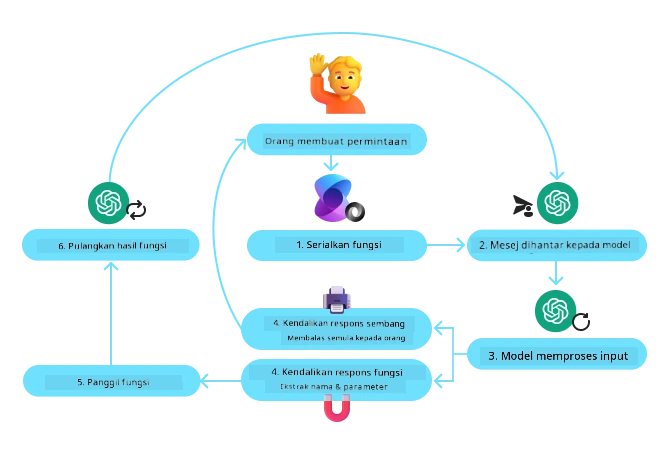
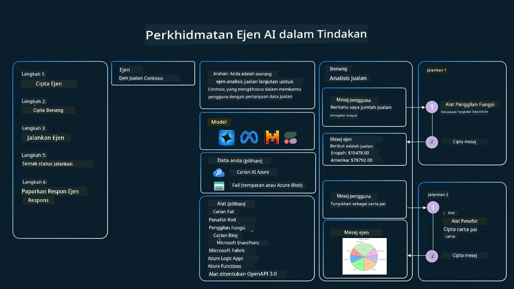

[](https://youtu.be/vieRiPRx-gI?si=cEZ8ApnT6Sus9rhn)

> _(Klik imej di atas untuk menonton video pelajaran ini)_

# Corak Reka Bentuk Penggunaan Alat

Alat menarik kerana ia membolehkan ejen AI memiliki pelbagai keupayaan yang lebih luas. Daripada ejen mempunyai set tindakan terhad yang boleh dilaksanakannya, dengan menambah alat, ejen kini boleh melaksanakan pelbagai tindakan. Dalam bab ini, kami akan melihat Corak Reka Bentuk Penggunaan Alat, yang menerangkan bagaimana ejen AI boleh menggunakan alat khusus untuk mencapai matlamat mereka.

## Pengenalan

Dalam pelajaran ini, kami ingin menjawab soalan-soalan berikut:

- Apakah corak reka bentuk penggunaan alat?
- Apakah kes penggunaan yang boleh diterapkan?
- Apakah elemen/blok binaan yang diperlukan untuk melaksanakan corak reka bentuk ini?
- Apakah pertimbangan khas untuk menggunakan Corak Reka Bentuk Penggunaan Alat bagi membina ejen AI yang boleh dipercayai?

## Matlamat Pembelajaran

Selepas menamatkan pelajaran ini, anda akan dapat:

- Mentakrifkan Corak Reka Bentuk Penggunaan Alat dan tujuannya.
- Mengenal pasti kes-kes penggunaan di mana Corak Reka Bentuk Penggunaan Alat boleh digunakan.
- Memahami elemen utama yang diperlukan untuk melaksanakan corak reka bentuk ini.
- Mengenali pertimbangan untuk memastikan kebolehpercayaan dalam ejen AI yang menggunakan corak reka bentuk ini.

## Apakah itu Corak Reka Bentuk Penggunaan Alat?

**Corak Reka Bentuk Penggunaan Alat** memberi tumpuan kepada memberi model bahasa besar (LLM) kebolehan untuk berinteraksi dengan alat luaran untuk mencapai matlamat tertentu. Alat adalah kod yang boleh dilaksanakan oleh ejen untuk melaksanakan tindakan. Alat boleh menjadi fungsi sederhana seperti kalkulator, atau panggilan API ke perkhidmatan pihak ketiga seperti semakan harga saham atau ramalan cuaca. Dalam konteks ejen AI, alat direka untuk dilaksanakan oleh ejen sebagai tindak balas kepada **panggilan fungsi yang dijana oleh model**.

## Apakah kes penggunaan yang boleh diterapkan?

Ejen AI boleh memanfaatkan alat untuk menyelesaikan tugas yang kompleks, mendapatkan maklumat, atau membuat keputusan. Corak reka bentuk penggunaan alat sering digunakan dalam senario yang memerlukan interaksi dinamik dengan sistem luaran, seperti pangkalan data, perkhidmatan web, atau penterjemah kod. Kebolehan ini berguna untuk beberapa kes penggunaan yang berbeza termasuk:

- **Pemerolehan Maklumat Dinamik:** Ejen boleh membuat pertanyaan kepada API luaran atau pangkalan data untuk mendapatkan data terkini (contohnya, membuat pertanyaan ke pangkalan data SQLite untuk analisis data, mendapatkan harga saham atau maklumat cuaca).
- **Pelaksanaan dan Tafsiran Kod:** Ejen boleh melaksanakan kod atau skrip untuk menyelesaikan masalah matematik, menjana laporan, atau menjalankan simulasi.
- **Automasi Aliran Kerja:** Mengautomasikan aliran kerja berulang atau berbilang langkah dengan mengintegrasikan alat seperti penjadual tugas, perkhidmatan e-mel, atau saluran data.
- **Sokongan Pelanggan:** Ejen boleh berinteraksi dengan sistem CRM, platform tiket, atau pangkalan pengetahuan untuk menyelesaikan pertanyaan pengguna.
- **Penjanaan dan Penyuntingan Kandungan:** Ejen boleh menggunakan alat seperti pemeriksa tatabahasa, perumus teks, atau penilai keselamatan kandungan untuk membantu tugas penciptaan kandungan.

## Apakah elemen/blok binaan yang diperlukan untuk melaksanakan corak reka bentuk penggunaan alat?

Blok binaan ini membolehkan ejen AI melaksanakan pelbagai tugas. Mari kita lihat elemen utama yang diperlukan untuk melaksanakan Corak Reka Bentuk Penggunaan Alat:

- **Skema Fungsi/Alat**: Definisi terperinci alat yang tersedia, termasuk nama fungsi, tujuan, parameter yang diperlukan, dan hasil yang dijangkakan. Skema ini membolehkan LLM memahami alat yang ada dan bagaimana membina permintaan yang sah.

- **Logik Pelaksanaan Fungsi**: Mengatur cara dan bila alat dipanggil berdasarkan niat pengguna dan konteks perbualan. Ini mungkin termasuk modul perancang, mekanisme penyaluran, atau aliran bersyarat yang menentukan penggunaan alat secara dinamik.

- **Sistem Pengurusan Mesej**: Komponen yang menguruskan aliran perbualan antara input pengguna, respons LLM, panggilan alat, dan output alat.

- **Rangka Kerja Integrasi Alat**: Infrastruktur yang menghubungkan ejen kepada pelbagai alat, sama ada fungsi sederhana atau perkhidmatan luaran yang kompleks.

- **Pengurusan Ralat & Pengesahan**: Mekanisme untuk mengendalikan kegagalan dalam pelaksanaan alat, mengesahkan parameter, dan mengurus respons yang tidak dijangka.

- **Pengurusan Keadaan**: Menjejaki konteks perbualan, interaksi alat sebelumnya, dan data berterusan untuk memastikan konsistensi sepanjang interaksi berbilang pusingan.

Seterusnya, mari lihat Panggilan Fungsi/Alat dengan lebih terperinci.
 
### Panggilan Fungsi/Alat

Panggilan fungsi adalah cara utama kami membolehkan Model Bahasa Besar (LLM) berinteraksi dengan alat. Anda sering melihat 'Fungsi' dan 'Alat' digunakan secara bergantian kerana 'fungsi' (blok kod boleh guna semula) adalah 'alat' yang digunakan ejen untuk melaksanakan tugas. Untuk kod fungsi dipanggil, LLM mesti membandingkan permintaan pengguna dengan penerangan fungsi. Untuk ini, satu skema yang mengandungi penerangan semua fungsi yang tersedia dihantar ke LLM. LLM kemudian memilih fungsi yang paling sesuai untuk tugas tersebut dan mengembalikan nama serta argumennya. Fungsi yang dipilih dipanggil, responsnya dihantar kembali kepada LLM, yang menggunakan maklumat itu untuk membalas permintaan pengguna.

Untuk pembangun melaksanakan panggilan fungsi untuk ejen, anda memerlukan:

1. Model LLM yang menyokong panggilan fungsi
2. Skema yang mengandungi penerangan fungsi
3. Kod untuk setiap fungsi yang diterangkan

Mari gunakan contoh mendapatkan masa semasa di sebuah bandar untuk menerangkan:

1. **Inisialisasi LLM yang menyokong panggilan fungsi:**

    Tidak semua model menyokong panggilan fungsi, jadi penting untuk memastikan LLM yang anda gunakan melakukannya. <a href="https://learn.microsoft.com/azure/ai-services/openai/how-to/function-calling" target="_blank">Azure OpenAI</a> menyokong panggilan fungsi. Kita boleh mula dengan memulakan klien OpenAI menggunakan **API Respons** Azure OpenAI (endpoint `/openai/v1/` yang stabil — tanpa perlu `api_version`). 

    ```python
    # Initialize the OpenAI client for Azure OpenAI (Responses API, v1 endpoint)
    client = OpenAI(
        base_url=f"{os.environ['AZURE_OPENAI_ENDPOINT'].rstrip('/')}/openai/v1/",
        api_key=os.environ["AZURE_OPENAI_API_KEY"],
    )
    deployment_name = os.environ["AZURE_OPENAI_DEPLOYMENT"]
    ```

1. **Cipta Skema Fungsi**:

    Seterusnya kami akan mentakrifkan skema JSON yang mengandungi nama fungsi, penerangan fungsi tersebut, serta nama dan penerangan parameter fungsi.
    Kami kemudian akan mengambil skema ini dan memberikannya kepada klien yang telah dicipta sebelum ini, berserta permintaan pengguna untuk mendapatkan masa di San Francisco. Yang penting untuk diperhatikan ialah **panggilan alat** yang dikembalikan, **bukan** jawapan akhir kepada soalan tersebut. Seperti yang disebutkan sebelum ini, LLM mengembalikan nama fungsi yang dipilih untuk tugas tersebut, dan argumen yang akan dipassing kepadanya.

    ```python
    # Function description for the model to read (Responses API flat tool format)
    tools = [
        {
            "type": "function",
            "name": "get_current_time",
            "description": "Get the current time in a given location",
            "parameters": {
                "type": "object",
                "properties": {
                    "location": {
                        "type": "string",
                        "description": "The city name, e.g. San Francisco",
                    },
                },
                "required": ["location"],
            },
        }
    ]
    ```
   
    ```python
  
    # Initial user message
    messages = [{"role": "user", "content": "What's the current time in San Francisco"}]

    # First API call: Ask the model to use the function
    response = client.responses.create(
        model=deployment_name,
        input=messages,
        tools=tools,
        tool_choice="auto",
        store=False,
    )

    # The Responses API returns tool calls as function_call items in response.output.
    # Append them to the conversation so the model has full context on the next turn.
    messages += response.output

    print("Model's response:")
    print(response.output)
  
    ```

    ```bash
    Model's response:
    [ResponseFunctionToolCall(arguments='{"location":"San Francisco"}', call_id='call_pOsKdUlqvdyttYB67MOj434b', name='get_current_time', type='function_call')]
    ```
  
1. **Kod fungsi yang diperlukan untuk melaksanakan tugas:**

    Setelah LLM memilih fungsi mana yang perlu dijalankan, kod yang melaksanakan tugas itu perlu diimplementasikan dan dilaksanakan.
    Kita boleh melaksanakan kod untuk mendapatkan waktu semasa menggunakan Python. Kita juga perlu menulis kod untuk mengekstrak nama dan argumen daripada response_message untuk mendapatkan hasil akhir.

    ```python
      def get_current_time(location):
        """Get the current time for a given location"""
        print(f"get_current_time called with location: {location}")  
        location_lower = location.lower()
        
        for key, timezone in TIMEZONE_DATA.items():
            if key in location_lower:
                print(f"Timezone found for {key}")  
                current_time = datetime.now(ZoneInfo(timezone)).strftime("%I:%M %p")
                return json.dumps({
                    "location": location,
                    "current_time": current_time
                })
      
        print(f"No timezone data found for {location_lower}")  
        return json.dumps({"location": location, "current_time": "unknown"})
    ```

     ```python
    # Handle function calls
    tool_calls = [item for item in response.output if item.type == "function_call"]
    if tool_calls:
        for tool_call in tool_calls:
            if tool_call.name == "get_current_time":

                function_args = json.loads(tool_call.arguments)

                time_response = get_current_time(
                    location=function_args.get("location")
                )

                # Return the tool result as a function_call_output item
                messages.append({
                    "type": "function_call_output",
                    "call_id": tool_call.call_id,
                    "output": time_response,
                })
    else:
        print("No tool calls were made by the model.")

    # Second API call: Get the final response from the model
    final_response = client.responses.create(
        model=deployment_name,
        input=messages,
        tools=tools,
        store=False,
    )

    return final_response.output_text
     ```

     ```bash
      get_current_time called with location: San Francisco
      Timezone found for san francisco
      The current time in San Francisco is 09:24 AM.
     ```

Panggilan Fungsi adalah teras kebanyakan, jika tidak semua, reka bentuk penggunaan alat ejen, namun melaksanakannya dari awal kadangkala boleh mencabar.
Seperti yang kita pelajari dalam [Pelajaran 2](../../../02-explore-agentic-frameworks) kerangka kerja ejen menyediakan blok binaan yang telah dibina untuk melaksanakan penggunaan alat.
 
## Contoh Penggunaan Alat dengan Kerangka Kerja Ejen

Berikut adalah beberapa contoh bagaimana anda boleh melaksanakan Corak Reka Bentuk Penggunaan Alat menggunakan kerangka kerja ejen yang berbeza:

### Kerangka Kerja Ejen Microsoft

<a href="https://learn.microsoft.com/azure/ai-services/agents/overview" target="_blank">Kerangka Kerja Ejen Microsoft</a> adalah kerangka kerja AI sumber terbuka untuk membina ejen AI. Ia memudahkan proses penggunaan panggilan fungsi dengan membenarkan anda mentakrifkan alat sebagai fungsi Python dengan penghias `@tool`. Kerangka kerja ini mengendalikan komunikasi dua hala antara model dan kod anda. Ia juga memberikan akses kepada alat yang telah dibina seperti Carian Fail dan Penterjemah Kod melalui `FoundryChatClient`.

Rajah berikut menggambarkan proses panggilan fungsi dengan Kerangka Kerja Ejen Microsoft:



Dalam Kerangka Kerja Ejen Microsoft, alat didefinisikan sebagai fungsi yang dihias. Kita boleh menukar fungsi `get_current_time` yang kita lihat sebelum ini menjadi alat dengan menggunakan penghias `@tool`. Kerangka kerja secara automatik akan menyusun fungsi dan parameternya, mencipta skema untuk dihantar ke LLM.

```python
import os
from agent_framework import tool
from agent_framework.foundry import FoundryChatClient
from azure.identity import AzureCliCredential

@tool(approval_mode="never_require")
def get_current_time(location: str) -> str:
    """Get the current time for a given location"""
    ...

# Create the client
provider = FoundryChatClient(
    project_endpoint=os.environ["AZURE_AI_PROJECT_ENDPOINT"],
    model=os.environ["AZURE_AI_MODEL_DEPLOYMENT_NAME"],
    credential=AzureCliCredential(),
)

# Create an agent and run with the tool
agent = provider.as_agent(name="TimeAgent", instructions="Use available tools to answer questions.", tools=get_current_time)
response = await agent.run("What time is it?")
```

#### Alat dari pelayan MCP

Alat tidak perlu menjadi fungsi dalam kod anda sendiri. Pelayan yang menggunakan Protokol Konteks Model (MCP, dibincangkan dalam [Pelajaran 11](../11-agentic-protocols/README.md)) menerbitkan alatnya bersama skema mereka, dan kerangka kerja boleh memuatkannya sama seperti ia menyusun fungsi yang dihias. `MCPStreamableHTTPTool` menyambung ke pelayan tersebut melalui HTTP, membaca skema alat, dan menawarkan alat tersebut kepada model bersama alat tempatan lain.

Contoh di bawah menggunakan pelayan carian web yang dihoskan oleh <a href="https://keenable.ai" target="_blank">Keenable</a>. Ia boleh digunakan secara percuma tanpa akaun atau kunci API (permintaan dihadkan kadar bagi setiap IP), jadi satu-satunya kelayakan yang anda perlukan adalah untuk model anda. Seperti mana-mana alat jauh, pertanyaan yang ditulis model dihantar ke pelayan tersebut.

```python
from agent_framework import MCPStreamableHTTPTool

web_search = MCPStreamableHTTPTool(
    name="Keenable web search",
    url="https://api.keenable.ai/mcp",
)

# Connecting loads the server's tool schemas; the agent decides when to call them
async with web_search:
    agent = provider.as_agent(
        name="ResearchAgent",
        instructions="Use available tools to answer questions.",
        tools=[web_search],
    )
    response = await agent.run("What is new in the latest Python release?")
    print(response.text)
```

Pelayan ini menerbitkan dua alat, `search_web_pages` dan `fetch_page_content`. Apabila soalan memerlukan maklumat terkini, model memanggil `search_web_pages`, mendapatkan kembali tajuk, URL dan petikan teks, dan menulis jawapannya berdasarkan itu, gelung yang sama seperti dalam contoh `get_current_time` di atas.
  
### Perkhidmatan Ejen Microsoft Foundry

<a href="https://learn.microsoft.com/azure/ai-services/agents/overview" target="_blank">Perkhidmatan Ejen Microsoft Foundry</a> adalah kerangka kerja ejen yang lebih baru yang direka untuk membolehkan pembangun membina, menggunakan, dan mengskala ejen AI yang berkualiti tinggi dan boleh dikembangkan secara selamat tanpa perlu mengurus sumber pengkomputeran dan penyimpanan asas. Ia sangat berguna untuk aplikasi perusahaan kerana ia adalah perkhidmatan yang diurus sepenuhnya dengan keselamatan kelas perusahaan.

Apabila dibandingkan dengan pembangunan menggunakan API LLM secara langsung, Perkhidmatan Ejen Microsoft Foundry menawarkan beberapa kelebihan, termasuk:

- Panggilan alat automatik – tiada perlu menganalisis panggilan alat, melaksanakan alat, dan mengendalikan respons; semua ini kini dilakukan di pihak pelayan
- Data diurus selamat – bukannya mengurus keadaan perbualan anda sendiri, anda boleh bergantung pada threads untuk menyimpan semua maklumat yang anda perlukan
- Alat siap guna – Alat yang boleh anda gunakan untuk berinteraksi dengan sumber data anda, seperti Bing, Azure AI Search, dan Azure Functions.

Alat yang tersedia dalam Perkhidmatan Ejen Microsoft Foundry boleh dibahagikan kepada dua kategori:

1. Alat Pengetahuan:
    - <a href="https://learn.microsoft.com/azure/ai-services/agents/how-to/tools/bing-grounding?tabs=python&pivots=overview" target="_blank">Grounding dengan Bing Search</a>
    - <a href="https://learn.microsoft.com/azure/ai-services/agents/how-to/tools/file-search?tabs=python&pivots=overview" target="_blank">Carian Fail</a>
    - <a href="https://learn.microsoft.com/azure/ai-services/agents/how-to/tools/azure-ai-search?tabs=azurecli%2Cpython&pivots=overview-azure-ai-search" target="_blank">Azure AI Search</a>

2. Alat Tindakan:
    - <a href="https://learn.microsoft.com/azure/ai-services/agents/how-to/tools/function-calling?tabs=python&pivots=overview" target="_blank">Panggilan Fungsi</a>
    - <a href="https://learn.microsoft.com/azure/ai-services/agents/how-to/tools/code-interpreter?tabs=python&pivots=overview" target="_blank">Penterjemah Kod</a>
    - <a href="https://learn.microsoft.com/azure/ai-services/agents/how-to/tools/openapi-spec?tabs=python&pivots=overview" target="_blank">Alat yang ditakrifkan oleh OpenAPI</a>
    - <a href="https://learn.microsoft.com/azure/ai-services/agents/how-to/tools/azure-functions?pivots=overview" target="_blank">Azure Functions</a>

Perkhidmatan Ejen membolehkan kita menggunakan alat-alat ini bersama sebagai satu `toolset`. Ia juga menggunakan `threads` yang merekod sejarah mesej daripada perbualan tertentu.

Bayangkan anda seorang ejen jualan di sebuah syarikat bernama Contoso. Anda ingin membangunkan ejen perbualan yang boleh menjawab soalan tentang data jualan anda.

Imej berikut menggambarkan bagaimana anda boleh menggunakan Perkhidmatan Ejen Microsoft Foundry untuk menganalisis data jualan anda:



Untuk menggunakan mana-mana alat ini dengan perkhidmatan, kita boleh mencipta klien dan mentakrif alat atau set alat. Untuk melaksanakan ini secara praktikal, kita boleh menggunakan kod Python berikut. LLM akan dapat melihat set alat dan membuat keputusan sama ada menggunakan fungsi yang dibuat pengguna, `fetch_sales_data_using_sqlite_query`, atau Penterjemah Kod yang telah dibina bergantung pada permintaan pengguna.

```python 
import os
from azure.ai.projects import AIProjectClient
from azure.identity import DefaultAzureCredential
from fetch_sales_data_functions import fetch_sales_data_using_sqlite_query # fetch_sales_data_using_sqlite_query function which can be found in a fetch_sales_data_functions.py file.
from azure.ai.projects.models import ToolSet, FunctionTool, CodeInterpreterTool

project_client = AIProjectClient.from_connection_string(
    credential=DefaultAzureCredential(),
    conn_str=os.environ["PROJECT_CONNECTION_STRING"],
)

# Initialize toolset
toolset = ToolSet()

# Initialize function calling agent with the fetch_sales_data_using_sqlite_query function and adding it to the toolset
fetch_data_function = FunctionTool(fetch_sales_data_using_sqlite_query)
toolset.add(fetch_data_function)

# Initialize Code Interpreter tool and adding it to the toolset. 
code_interpreter = CodeInterpreterTool()toolset.add(code_interpreter)

agent = project_client.agents.create_agent(
    model="gpt-5-mini", name="my-agent", instructions="You are helpful agent", 
    toolset=toolset
)
```

## Apakah pertimbangan khas untuk menggunakan Corak Reka Bentuk Penggunaan Alat bagi membina ejen AI yang boleh dipercayai?

Kebimbangan biasa dengan SQL yang dijana secara dinamik oleh LLM adalah keselamatan, terutamanya risiko suntikan SQL atau tindakan berniat jahat, seperti memadam atau mengganggu pangkalan data. Walaupun kebimbangan ini sah, ia boleh dikurangkan dengan berkesan melalui konfigurasi kebenaran akses pangkalan data yang betul. Untuk kebanyakan pangkalan data, ini melibatkan konfigurasi pangkalan data sebagai baca sahaja. Untuk perkhidmatan pangkalan data seperti PostgreSQL atau Azure SQL, aplikasi harus diberikan peranan baca sahaja (SELECT).

Menjalankan aplikasi di persekitaran yang selamat menambah perlindungan. Dalam senario perusahaan, data biasanya diekstrak dan diubah dari sistem operasi ke dalam pangkalan data baca sahaja atau gudang data dengan skema yang mesra pengguna. Pendekatan ini memastikan data selamat, dioptimumkan untuk prestasi dan kebolehcapaian, dan aplikasi mempunyai akses terhad hanya baca.

## Contoh Kod

- Python: [Kerangka Kerja Ejen](./code_samples/04-python-agent-framework.ipynb)
- .NET: [Kerangka Kerja Ejen](./code_samples/04-dotnet-agent-framework.md)

## Ada Lagi Soalan tentang Corak Reka Bentuk Penggunaan Alat?

Sertai [Microsoft Foundry Discord](https://discord.com/invite/ATgtXmAS5D) untuk bertemu dengan pelajar lain, menghadiri waktu pejabat dan dapatkan jawapan untuk soalan Ejen AI anda.

## Sumber Tambahan

- <a href="https://microsoft.github.io/build-your-first-agent-with-azure-ai-agent-service-workshop/" target="_blank">Bengkel Perkhidmatan Ejen Azure AI</a>
- <a href="https://github.com/Azure-Samples/contoso-creative-writer/tree/main/docs/workshop" target="_blank">Bengkel Multi-Ejen Penulis Kreatif Contoso</a>
- <a href="https://learn.microsoft.com/azure/ai-services/agents/overview" target="_blank">Gambaran Keseluruhan Rangka Kerja Ejen Microsoft</a>

## Ujian Asap Ejen Ini (Pilihan)

Selepas anda belajar untuk melancarkan ejen dalam [Pelajaran 16](../16-deploying-scalable-agents/README.md), anda boleh menjalankan ujian asap untuk `TravelToolAgent` pelajaran ini (adakah ia masih memanggil alat dan menjawab?) dengan [`tests/lesson-04-smoke-tests.json`](../../../tests/lesson-04-smoke-tests.json). Lihat [`tests/README.md`](../tests/README.md) untuk cara menjalankannya.

## Pelajaran Sebelumnya

[Memahami Corak Reka Bentuk Agentik](../03-agentic-design-patterns/README.md)

## Pelajaran Seterusnya

[Agentik RAG](../05-agentic-rag/README.md)

---

<!-- CO-OP TRANSLATOR DISCLAIMER START -->
**Penafian**:
Dokumen ini telah diterjemahkan menggunakan perkhidmatan terjemahan AI [Co-op Translator](https://github.com/Azure/co-op-translator). Walaupun kami berusaha untuk ketepatan, sila ambil maklum bahawa terjemahan automatik mungkin mengandungi kesilapan atau ketidaktepatan. Dokumen asal dalam bahasa asalnya harus dianggap sebagai sumber yang sahih. Untuk maklumat penting, terjemahan oleh manusia profesional adalah disyorkan. Kami tidak bertanggungjawab terhadap sebarang salah faham atau salah tafsir yang timbul daripada penggunaan terjemahan ini.
<!-- CO-OP TRANSLATOR DISCLAIMER END -->