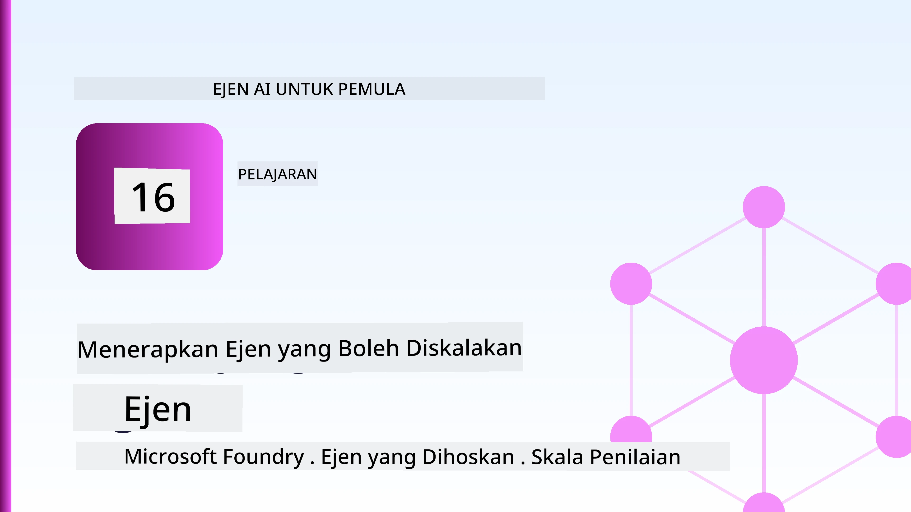
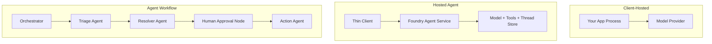
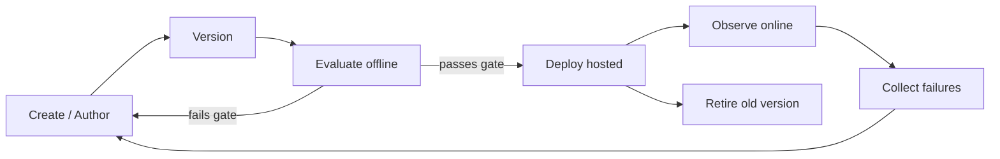
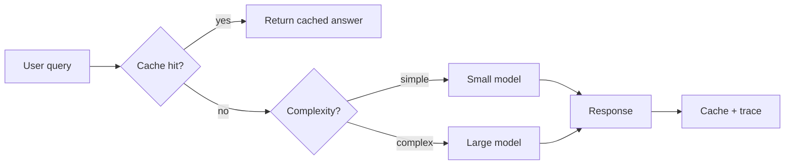
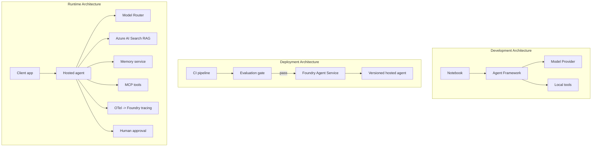

# Menyebarkan Ejen Skala dengan Microsoft Foundry



Sehingga titik ini dalam kursus, anda telah membina ejen yang berjalan pada komputer riba anda, di dalam buku nota, dipacu oleh `az login` dan sebilangan pemboleh ubah persekitaran. Itu adalah cara yang tepat untuk belajar. Ia bukan cara yang tepat untuk menjalankan ejen yang bergantung pada ribuan pelanggan pada pukul 3 pagi.

Pelajaran ini mengenai jurang antara "ia berfungsi pada mesin saya" dan "ia berfungsi, dengan boleh dipercayai dan mampu milik, dalam pengeluaran." Kita menutup jurang itu menggunakan **Microsoft Foundry** dan **Microsoft Foundry Agent Service**, dan kita melakukannya dengan membina ejen sokongan pelanggan sebenar yang mempunyai alat, pengambilan, memori, penilaian, dan pemantauan.

## Pengenalan

Pelajaran ini akan meliputi:

- Perbezaan antara **ejen prototaip** dan **ejen yang disebarkan**, dan mengapa peralihan itu kebanyakannya mengenai segala sesuatu *di sekeliling* model tersebut.
- **Corak penyebaran** untuk ejen: dihoskan klien, dihoskan perkhidmatan (Hosted Agents), dan dikawal oleh aliran kerja.
- **Kitaran hayat ejen** di Microsoft Foundry — buat, versi, sebarkan, nilai, perhati, bersara.
- **Strategi penskalaan**: penentuan laluan model, caching, serentak, dan reka bentuk tanpa status.
- **Kebolehlihatan (Observability)** dengan OpenTelemetry dan penjejakan Foundry.
- **Pengoptimuman kos** melalui pemilihan model, penentuan laluan, dan pintu penilaian.
- **Pertimbangan perusahaan**: tadbir urus, kelulusan manusia, dan menjalankan pelayan MCP dengan selamat dalam pengeluaran.

## Matlamat Pembelajaran

Setelah menyelesaikan pelajaran ini, anda akan tahu cara untuk:

- Memilih corak penyebaran yang betul untuk beban kerja ejen tertentu.
- Menyebarkan ejen ke Microsoft Foundry Agent Service supaya ia versi, terkawal, dan boleh diperhatikan.
- Menginstrumentasikan ejen untuk penjejakan dan menyambungkan saluran penilaian yang berjalan sebelum setiap pelepasan.
- Mengaplikasikan penentuan laluan model dan caching untuk memastikan latensi dan kos terkawal pada skala besar.
- Menambah pintu kelulusan manusia untuk tindakan berisiko tinggi dan mengintegrasikan pelayan MCP secara selamat dalam pengeluaran.

## Prasyarat

Pelajaran ini mengandaikan anda telah menyelesaikan pelajaran sebelumnya dan selesa dengan:

- Membina ejen dengan [Microsoft Agent Framework](../14-microsoft-agent-framework/README.md) (Pelajaran 14).
- [Penggunaan Alat](../04-tool-use/README.md) (Pelajaran 4) dan [Agentic RAG](../05-agentic-rag/README.md) (Pelajaran 5).
- [Memori Ejen](../13-agent-memory/README.md) (Pelajaran 13) dan [Protokol Agentic / MCP](../11-agentic-protocols/README.md) (Pelajaran 11).
- [Kebolehlihatan dan Penilaian](../10-ai-agents-production/README.md) (Pelajaran 10) — pelajaran ini dibina terus di atasnya.

Anda juga memerlukan:

- **Langganan Azure** dan **projek Microsoft Foundry** dengan sekurang-kurangnya satu model chat yang disebarkan.
- **Azure CLI** yang diautentikasi (`az login`).
- Python 3.12+ dan pakej dalam repositori [`requirements.txt`](../../../requirements.txt).

## Dari Prototaip ke Pengeluaran: Apa yang Sebenarnya Berubah

Ejen prototaip dan ejen pengeluaran berkongsi gelung teras yang sama — beralasan, panggil alat, balas. Apa yang berubah adalah segala sesuatu yang membalut gelung itu. Model mungkin hanya 20% dari ejen pengeluaran; 80% yang lain adalah rangka operasi.

| Perhatian | Prototaip | Pengeluaran |
| --- | --- | --- |
| **Penghosan** | Berjalan dalam buku nota anda | Berjalan sebagai perkhidmatan dihoskan, versi dan dilancar |
| **Identiti** | Token `az login` anda | Identiti terurus dengan RBAC tertumpu |
| **Keadaan** | Dalam ingatan, hilang pada muat semula | Dielakkan ke luar (penyimpanan utas, perkhidmatan memori) |
| **Kegagalan** | Anda melihat jejak balik | Cuba semula, fallback, dead-letter, amaran |
| **Kos** | "Ia beberapa sen" | Dikesan setiap permintaan, ditempatkan, disimpan dalam cache, dibajetkan |
| **Kualiti** | Anda menilai output secara visual | Dinilai secara automatik sebelum setiap pelepasan |
| **Kepercayaan** | Anda meluluskan setiap tindakan | Polisi + manusia-dalam-gelung untuk tindakan berisiko |

Ingat jadual ini. Setiap bahagian berikut memetakan kepada salah satu baris ini.

## Corak Penyebaran Ejen

Terdapat tiga corak yang akan anda gunakan, selalunya secara gabungan.

### 1. Ejen Di Hoskan oleh Klien

Objek ejen wujud dalam proses aplikasi *anda*. Kod anda memanggil pembekal model secara langsung; gelung beralasan berjalan dalam perkhidmatan anda. Ini adalah apa yang setiap pelajaran sebelum ini telah lakukan.

- **Gunakan apabila** anda memerlukan kawalan penuh ke atas gelung, middleware tersuai, atau anda menyisipkan ejen dalam backend sedia ada.
- **Tukar ganti**: anda memiliki kawalan penskalaan, keadaan, dan ketahanan sendiri.

### 2. Ejen Di Hoskan (Foundry Agent Service)

Ejen *didaftarkan sebagai sumber* dalam Microsoft Foundry. Foundry menghoskan gelung beralasan, menyimpan utas, menguatkuasakan keselamatan kandungan dan RBAC, serta menjadikan ejen kelihatan dalam portal Foundry. Aplikasi anda menjadi klien ringan yang mencipta utas dan membaca respons.

- **Gunakan apabila** anda mahukan ketahanan, kebolehlihatan terbina dalam, tadbir urus, dan kawasan operasi yang lebih kecil.
- **Tukar ganti**: kurang kawalan tahap rendah sebagai pertukaran untuk runtime yang diuruskan.

### 3. Aliran Kerja Ejen

Beberapa ejen (dan alat) digabungkan ke dalam graf dengan aliran kawalan eksplisit — langkah berurutan, bercabang, nod kelulusan manusia, dan titik cek tahan lama yang boleh berhenti dan disambung semula. Ini adalah keupayaan **Workflows** dalam Microsoft Agent Framework yang diterapkan pada skala penyebaran.

- **Gunakan apabila** satu tugas merangkumi beberapa ejen khusus atau memerlukan langkah kelulusan di tengah.
- **Tukar ganti**: lebih banyak bahagian bergerak; memerlukan kebolehlihatan tahap orkestrasi.



## Kitaran Hayat Ejen di Microsoft Foundry

Menyebarkan ejen bukan satu `push` satu kali. Ia sebuah gelung, dan ia kelihatan banyak seperti kitaran pelepasan perisian kerana itulah sebenarnya ia.



Idea utama, yang dibawa dari [Pelajaran 10](../10-ai-agents-production/README.md): **penilaian luar talian adalah pintu keselamatan, bukan pemikiran selepas.** Versi ejen baru tidak dihantar melainkan ia melepasi ambang penilaian anda. Kebolehlihatan dalam talian kemudian memberi maklum balas kegagalan dunia sebenar ke dalam set ujian luar talian anda. Itulah gelung keseluruhannya.

## Strategi Penskalaan

Penskalaan ejen berbeza daripada penskalaan API web tanpa status, kerana setiap permintaan boleh mencetus panggilan model dan alat yang mahal banyak kali. Empat teknik membawa sebahagian besar beban.

**Pengendalian permintaan tanpa status.** Jangan simpan keadaan per pengguna dalam memori proses anda. Kekalkan utas perbualan dalam stor utas Foundry atau perkhidmatan memori supaya mana-mana instance boleh mengendalikan mana-mana permintaan. Ini membolehkan anda skala secara mendatar — tambah instance, tiada sesi melekit.

**Penentuan laluan model.** Tidak setiap permintaan memerlukan model paling canggih (dan paling mahal) anda. Hantar permintaan mudah — pengelasan niat, jawapan fakta ringkas — ke model kecil dan cepat, dan simpan model besar untuk penalaran sebenar. **Model Router** Foundry boleh melakukan ini untuk anda, atau anda boleh melaksanakan pengelasan ringan sendiri. Anda akan bina versi DIY dalam makmal.

**Caching respons.** Banyak pertanyaan sokongan adalah hampir serupa ("bagaimana saya reset kata laluan?"). Simpan jawapan kepada soalan biasa dan hidangkan tanpa perlu panggil model langsung. Walaupun kadar cache hit sederhana mengurangkan kos dan latensi dengan ketara.

**Keserentakan dan tekanan belakang.** Pembekal model mempunyai had kadar. Hadkan keserentakan anda, gunakan cubaan semula dengan penangguhan eksponen, dan gagal dengan anggun (respons "kami sedang urus" yang diatur dalam antrian lebih baik daripada ralat 500).



## Kebolehlihatan Dalam Pengeluaran

Anda tidak dapat mengendalikan apa yang anda tidak dapat lihat. Seperti yang dibincangkan dalam Pelajaran 10, Microsoft Agent Framework mengeluarkan jejak **OpenTelemetry** secara asli — setiap panggilan model, panggilan alat, dan langkah orkestrasi menjadi satu span. Dalam pengeluaran, anda mengeksport span itu ke Microsoft Foundry (atau mana-mana backend yang serasi OTel) supaya anda boleh:

- Jejak satu aduan pelanggan dari hujung ke hujung merentasi setiap panggilan model dan alat.
- Memerhati latensi p50/p95 dan kos setiap permintaan dari masa ke masa.
- Amaran pada lonjakan kadar ralat dan anomali kos sebelum pengguna anda (atau pasukan kewangan anda) perasan.

```python
from agent_framework.observability import get_tracer

tracer = get_tracer()

with tracer.start_as_current_span("support_request") as span:
    span.set_attribute("customer.tier", "enterprise")
    span.set_attribute("routed.model", "gpt-5-nano")
    # agent execution is traced automatically inside this span
```

Atribut seperti `customer.tier` dan `routed.model` adalah apa yang menukar tembok jejak menjadi soalan yang boleh dijawab ("adakah pelanggan perusahaan sering diarahkan ke model kecil?").

## Pengoptimuman Kos

Kos dalam ejen pengeluaran didominasi oleh token. Tiga tuil, mengikut susunan impak:

1. **Saiz model yang betul.** Model kecil yang melepasi pintu penilaian anda hampir sentiasa lebih murah daripada model besar yang juga melepasi. Gunakan penilaian untuk *membuktikan* model kecil cukup baik daripada memilih model terbesar sebagai langkah berjaga-jaga.
2. **Penentuan laluan mengikut kerumitan.** Seperti di atas — bayar harga model besar hanya untuk permintaan yang memerlukan penalaran model besar.
3. **Cache secara agresif.** Panggilan model termurah adalah yang tidak pernah anda buat.

Pintu penilaian dan kawalan kos adalah disiplin yang sama dilihat dari dua sudut: penilaian memberitahu anda *lantai kualiti*, penentuan laluan dan caching memastikan anda sedekat mungkin kepada *kos* lantai tersebut.

## Pertimbangan Penyebaran Enterprise

**Tadbir urus.** Hosted Agents mewarisi RBAC, keselamatan kandungan, dan log audit Foundry. Beri setiap ejen identiti terurus dengan keistimewaan paling minimum yang diperlukan — akses baca sahaja ke pangkalan pengetahuan, akses bertumpu ke API tiket, tiada lebih.

**Manusia dalam gelung.** Beberapa tindakan terlalu besar kesannya untuk diotomasi sepenuhnya — mengeluarkan balik duit, memadam akaun, meningkatkan kepada pasukan undang-undang. Microsoft Agent Framework menyokong alat yang **memerlukan kelulusan**: ejen mencadangkan tindakan, pelaksanaan berhenti, manusia meluluskan atau menolak, dan aliran kerja disambung semula. Anda lihat asasannya dalam [Pelajaran 6](../06-building-trustworthy-agents/README.md); di sini anda menyebarkannya.

**MCP dalam pengeluaran.** [MCP](../11-agentic-protocols/README.md) membenarkan ejen anda menggunakan alat luaran melalui antara muka standard. Dalam pengeluaran, anggap setiap pelayan MCP sebagai sempadan yang tidak dipercayai: pin versi pelayan, jalankan dengan identiti tertumpu, sahkan output, dan jangan dedahkan rahsia kepadanya. Pelayan MCP adalah kebergantungan, dan kebergantungan perlu dikemas kini, diaudit, dan dihadkan kadar.



Tiga rajah itu — pembangunan, penyebaran, masa jalan — adalah ejen yang sama pada tiga peringkat hayatnya. Makmal yang berikut akan membimbing anda membinanya.

## Makmal Praktikal: Ejen Sokongan Pelanggan Sedia untuk Pengeluaran

Buka [`code_samples/16-python-agent-framework.ipynb`](./code_samples/16-python-agent-framework.ipynb) dan jalankan ia dari awal hingga akhir. Anda akan membina **ejen sokongan pelanggan Contoso** dengan setiap keperluan pengeluaran bersambung:

1. **Panggilan alat** — semak status pesanan dan buka tiket sokongan.
2. **RAG** — jawab soalan polisi dari pangkalan pengetahuan (Azure AI Search, dengan fallback dalam memori supaya buku nota berjalan tanpa sumber Search).
3. **Memori** — ingat pelanggan sepanjang pusingan perbualan.
4. **Penentuan laluan model** — pengelas kerumitan menghantar setiap permintaan ke model kecil atau besar.
5. **Caching respons** — soalan berulang dilayan dari cache.
6. **Kelulusan manusia** — pengembalian wang di atas ambang berhenti untuk kelulusan manusia.
7. **Saluran penilaian** — set ujian luar talian kecil menilai ejen dan bertindak sebagai pintu pelepasan.
8. **Kebolehlihatan** — penjejakan OpenTelemetry di sekitar setiap permintaan.

### Panduan

Buku nota disusun supaya setiap keperluan pengeluaran adalah bahagian yang berdiri sendiri dan boleh dijalankan. Intinya adalah pengendali permintaan routing-plus-caching:

```python
async def handle_support_request(query: str, customer_id: str) -> str:
    # 1. Serve from cache when we can.
    cached = response_cache.get(normalize(query))
    if cached:
        return cached

    # 2. Route by complexity to control cost.
    model = "gpt-5-nano" if is_simple(query) else "gpt-5-mini"

    # 3. Run the agent inside a trace span for observability.
    with tracer.start_as_current_span("support_request") as span:
        span.set_attribute("routed.model", model)
        span.set_attribute("customer.id", customer_id)
        response = await support_agent.run(query, model=model)

    # 4. Cache and return.
    response_cache.set(normalize(query), response.text)
    return response.text
```

Pintu penilaian yang menjaga pelepasan kelihatan seperti ini:

```python
async def evaluation_gate(agent, test_cases, threshold: float = 0.8) -> bool:
    passed = 0
    for case in test_cases:
        result = await agent.run(case["input"])
        if score_response(result.text, case["expected"]) >= 0.8:
            passed += 1
    pass_rate = passed / len(test_cases)
    print(f"Evaluation pass rate: {pass_rate:.0%} (gate: {threshold:.0%})")
    return pass_rate >= threshold  # only deploy if the gate passes
```

Baca setiap baris — buku nota mengekalkan asasannya kecil dengan sengaja supaya tiada yang tersembunyi di belakang panggilan kerangka.

## Mengesahkan Ejen yang Disebarkan dengan Ujian Asap

Pintu penilaian di atas dijalankan *luar talian* terhadap objek ejen anda. Setelah ejen disebarkan sebagai Hosted Agent, anda memerlukan satu lagi pemeriksaan, yang lebih murah: **adakah titik akhir yang disebarkan benar-benar menjawab?**

Penyebaran "berjaya" hanya membuktikan pesawat kawalan menerima definisi — ia tidak membuktikan ejen memberi respons. Kebergantungan yang hilang, penentuan laluan model salah, atau sambungan tamat boleh meninggalkan penyebaran hijau yang tidak memberi apa-apa jawapan. **Ujian asap** menangkap itu dalam beberapa saat, pada setiap penyebaran, tanpa kos penilaian penuh.

Repositori ini menyediakan saluran ujian asap sedia guna yang dibina atas GitHub Action [AI Smoke Test](https://github.com/marketplace/actions/ai-smoke-test):

- **Katalog** — [`tests/lesson-16-smoke-tests.json`](../../../tests/lesson-16-smoke-tests.json) mengandungi prompt dan pernyataan untuk ejen sokongan Contoso (jawapan dasar berasaskan fakta, pencarian pesanan, kekal pada topik, dan kesinambungan multi-pusingan). Katalog untuk ejen pelajaran lain disimpan bersama — lihat [`tests/README.md`](../tests/README.md).
- **Aliran kerja** — [`.github/workflows/smoke-test.yml`](../../../.github/workflows/smoke-test.yml) log masuk dengan Azure OIDC dan POST setiap prompt ke endpoint Respons ejen, gagal kerja pada sebarang kegagalan pernyataan.

```yaml
- name: Smoke-test hosted agent
  uses: JFolberth/ai-smoketest@v1
  with:
    project_endpoint: ${{ inputs.project_endpoint }}
    agent_name: ContosoSupportAgent
    tests_file: tests/lesson-16-smoke-tests.json
```

Jalankan dari tab **Actions** setelah ejen anda diterapkan, dengan membekalkan endpoint projek Foundry anda dan nama ejen. Identiti persekutuan memerlukan peranan **Azure AI User** pada skop projek Foundry. Fikirkan lapisan seperti piramid: ujian asap (boleh dicapai dan bertindak balas?) dijalankan pada setiap penerapan, penilaian luar talian (cukup baik untuk dihantar?) dijalankan sebelum promosi, dan penilaian dalam talian (bagaimana prestasinya di alam nyata?) dijalankan secara berterusan.

## Semakan Pengetahuan

Uji pemahaman anda sebelum bergerak ke tugasan.

**1. Anggaran berapa banyak daripada ejen produksi adalah "model," dan apa selebihnya?**

<details>
<summary>Jawapan</summary>

Model adalah minoriti sistem — sering dikatakan sekitar 20%. Selebihnya adalah kerangka operasi: penghosan dan pengurusan versi, identiti dan RBAC, keadaan terluar, pengendalian kegagalan, penjejakan kos, penilaian, dan kawalan manusia-dalam-laluan. Berpindah ke produksi kebanyakannya mengenai membina segala sesuatu *sekitar* gelung penaakulan.
</details>

**2. Bila anda akan memilih Hosted Agent berbanding ejen yang dihoskan klien?**

<details>
<summary>Jawapan</summary>

Apabila anda mahukan runtime yang diurus dengan ketahanan terbina dalam (benang yang berterusan dan boleh disambung semula), kemampuan pemerhatian, keselamatan kandungan, dan RBAC, dan anda sanggup bertukar kawalan tahap rendah gelung penaakulan untuk mengurangkan kawasan operasi. Klien dihoskan adalah lebih baik apabila anda memerlukan kawalan penuh ke atas gelung atau menggabungkan ejen dalam backend sedia ada.
</details>

**3. Mengapa ejen yang boleh diskala mesti tanpa keadaan dalam memori prosesnya sendiri?**

<details>
<summary>Jawapan</summary>

Supaya mana-mana instans boleh mengendalikan mana-mana permintaan, yang membolehkan skala mendatar tanpa sesi melekit. Keadaan perbualan per pengguna diterluarkan ke penyimpanan benang atau perkhidmatan memori. Jika keadaan tinggal dalam memori proses, anda akan kehilangannya apabila dimulakan semula dan tidak boleh mengedarkan beban dengan bebas.
</details>

**4. Masalah apa yang diselesaikan oleh penghalaan model, dan bagaimana ia berkaitan dengan penilaian?**

<details>
<summary>Jawapan</summary>

Penghalaan menghantar permintaan mudah kepada model kecil yang murah dan pantas dan mengekalkan model besar untuk penaakulan sebenar, mengawal kedua-dua latensi dan kos. Ia berkaitan dengan penilaian kerana penilaian adalah apa yang *membuktikan* model kecil itu cukup baik untuk kelas permintaan — penghalaan tanpa penilaian adalah meneka.
</details>

**5. Apakah "pagar penilaian" dan di manakah ia berada dalam kitar hayat?**

<details>
<summary>Jawapan</summary>

Pagar penilaian menjalankan set ujian luar talian terhadap versi ejen baru dan menghalang penerapan melainkan kadar lulus melepasi ambang. Ia berada di antara "versi" dan "terapkan" dalam kitar hayat, menjadikan kualiti satu syarat untuk pelepasan dan bukan sesuatu yang anda semak selepas penghantaran.
</details>

**6. Mengapa pelayan MCP harus dianggap sebagai sempadan yang tidak dipercayai dalam produksi?**

<details>
<summary>Jawapan</summary>

Kerana ia adalah pergantungan luaran yang ejen anda panggil. Anda harus mengepit versinya, jalankan dengan identiti berkawalan skop, sahkan keluarannya, hadkan kadar, dan jangan dedahkan rahsia kepadanya — disiplin yang sama anda gunakan untuk mana-mana pergantungan pihak ketiga. Keluaran daripadanya mengalir ke penaakulan ejen anda, jadi kepercayaan tanpa sah adalah risiko keselamatan.
</details>

**7. Perubahan tunggal mana yang biasanya mempunyai impak terbesar pada kos ejen produksi, dan mengapa?**

<details>
<summary>Jawapan</summary>

Menyesuaikan saiz model — menggunakan model terkecil yang masih melepasi pagar penilaian anda. Kos didominasi oleh token, dan model yang lebih kecil yang memenuhi bar kualiti hampir selalu lebih murah daripada yang lebih besar. Caching dan penghalaan kemudian mengurangkan kos lebih jauh, tetapi memilih model asas yang betul mempunyai kesan utama pertama.
</details>

**8. Peranan atribut jarak seperti `customer.tier` dan `routed.model` dalam pemerhatian?**

<details>
<summary>Jawapan</summary>

Mereka mengubah jejak mentah menjadi soalan perniagaan yang boleh dijawab. Tanpa atribut anda mempunyai dinding jarak; dengan mereka, anda boleh bertanya "adakah pelanggan perniagaan sedang sering dihantar ke model kecil?" atau "model mana yang mengendalikan permintaan kami yang paling perlahan?" Atribut adalah cara anda menghiris telemetri mengikut dimensi yang penting untuk operasi anda.
</details>

## Tugasan

Ambil ejen sokongan pelanggan dari makmal dan kuatkan untuk senario khusus: **ejen sokongan bil langganan untuk syarikat SaaS.**

Penyerahan anda harus:

1. **Gantikan alat** dengan yang berkaitan bil: `get_subscription_status`, `get_invoice`, dan `issue_credit` (kredit melebihi $50 memerlukan kelulusan manusia).
2. **Tambah tiga dokumen RAG** yang merangkumi polisi pemulangan, kitaran bil, dan polisi pembatalan syarikat.
3. **Perluas set penilaian** kepada sekurang-kurangnya lapan kes, termasuk sekurang-kurangnya dua yang *perlu* mencetuskan laluan kelulusan manusia, dan sahkan pagar penilaian anda lulus atau gagal dengan betul.
4. **Tambah satu laporan kos**: selepas menjalankan sepuluh pertanyaan campuran melalui ejen, cetak berapa banyak yang dihantar ke model kecil, berapa banyak kepada model besar, dan berapa banyak yang dilayani dari cache.

Tulis perenggan pendek (dalam sel markdown) menerangkan peraturan penghalaan model yang anda pilih dan bagaimana anda akan mengesahkannya dengan trafik sebenar. Tiada jawapan tunggal yang betul — anda dinilai berdasarkan sama ada kebimbangan produksi dipasang bersama secara serasi.

## Rumusan

Dalam pelajaran ini anda mengalihkan ejen dari prototaip ke produksi dengan Microsoft Foundry:

- Lonjakan ke produksi kebanyakannya tentang **kerangka operasi** sekitar model — penghosan, identiti, keadaan, pengendalian kegagalan, kos, kualiti, dan kepercayaan.
- Anda belajar tiga **corak penerapan** — klien dihoskan, Hosted Agents, dan Agent Workflows — dan bila setiap satu sesuai.
- Anda berjalan melalui **kitar hayat ejen**, di mana penilaian luar talian **bertindak sebagai pagar pelepasan** dan pemerhatian dalam talian memulangkan kegagalan ke set ujian.
- Anda gunakan **strategi skala** — reka bentuk tanpa keadaan, penghalaan model, caching, dan kebersamaan terbatas — dan menghubungkannya dengan **optimum kos**.
- Anda menghubungkan **kawalan perusahaan**: RBAC, kelulusan manusia-dalam-laluan, dan integrasi MCP selamat produksi.
- Anda membina **ejen sokongan pelanggan siap produksi** yang mengikat semua kebimbangan ini bersama dalam kod yang boleh dijalankan.

Pelajaran seterusnya mengambil perjalanan bertentangan: bukannya menskalakan ejen ke awan, anda akan membawanya *turun* ke mesin pembangun tunggal dan menjalankannya sepenuhnya secara tempatan.

## Sumber Tambahan

- <a href="https://learn.microsoft.com/azure/ai-foundry/what-is-azure-ai-foundry" target="_blank">Dokumentasi Microsoft Foundry</a>
- <a href="https://learn.microsoft.com/azure/ai-foundry/agents/overview" target="_blank">Tinjauan Perkhidmatan Ejen Microsoft Foundry</a>
- <a href="https://learn.microsoft.com/en-us/agent-framework/overview/?wt.mc_id=youtube_26688_organicsocial_reactor&pivots=programming-language-python" target="_blank">Rangka Kerja Ejen Microsoft</a>
- <a href="https://learn.microsoft.com/en-us/azure/ai-foundry/openai/concepts/model-router" target="_blank">Penghala Model dalam Microsoft Foundry</a>
- <a href="https://learn.microsoft.com/azure/search/search-what-is-azure-search" target="_blank">Azure AI Search</a>
- <a href="https://opentelemetry.io/" target="_blank">OpenTelemetry</a>
- <a href="https://github.com/marketplace/actions/ai-smoke-test" target="_blank">Tindakan GitHub Ujian Asap AI</a>
- <a href="https://modelcontextprotocol.io/" target="_blank">Protokol Konteks Model (MCP)</a>

## Pelajaran Sebelumnya

[Membangun Ejen Penggunaan Komputer (CUA)](../15-browser-use/README.md)

## Pelajaran Seterusnya

[Mewujudkan Ejen AI Tempatan](../17-creating-local-ai-agents/README.md)

---

<!-- CO-OP TRANSLATOR DISCLAIMER START -->
**Penafian**:
Dokumen ini telah diterjemahkan menggunakan perkhidmatan terjemahan AI [Co-op Translator](https://github.com/Azure/co-op-translator). Walaupun kami berusaha untuk ketepatan, sila ambil maklum bahawa terjemahan automatik mungkin mengandungi kesilapan atau ketidaktepatan. Dokumen asal dalam bahasa asalnya harus dianggap sebagai sumber yang sahih. Untuk maklumat penting, terjemahan oleh manusia profesional adalah disyorkan. Kami tidak bertanggungjawab terhadap sebarang salah faham atau salah tafsir yang timbul daripada penggunaan terjemahan ini.
<!-- CO-OP TRANSLATOR DISCLAIMER END -->