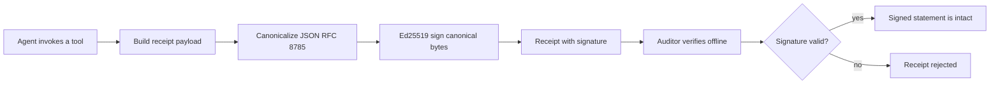
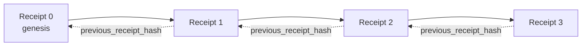

[Tonton video pelajaran: Mengamankan Ejen AI dengan Resit Kriptografi](https://youtu.be/PLACEHOLDER_VIDEO_ID)

> _(Video pelajaran dan gambar kecil akan ditambah oleh pasukan kandungan Microsoft selepas digabungkan, mengikut corak pelajaran 14 / 15.)_

# Mengamankan Ejen AI dengan Resit Kriptografi

## Pengenalan

Pelajaran ini akan merangkumi:

- Mengapa jejak audit untuk ejen AI penting untuk pematuhan, penyahpepijatan, dan kepercayaan.
- Apa itu resit kriptografi dan bagaimana ia berbeza daripada baris log yang tidak ditandatangani.
- Cara menghasilkan resit yang ditandatangani untuk panggilan alat ejen dalam Python biasa.
- Cara mengesahkan resit secara luar talian dan mengesan pengubahsuaian.
- Cara menyusun rantaian resit supaya membuang atau menyusun semula satu memecahkan rantaian.
- Apa yang dibuktikan oleh resit dan apa yang secara eksplisit tidak dibuktikan olehnya.

## Matlamat Pembelajaran

Selepas menamatkan pelajaran ini, anda akan tahu cara untuk:

- Kenal pasti mod kegagalan yang memotivasi asal-usul kriptografi untuk tindakan ejen.
- Menghasilkan resit yang ditandatangani Ed25519 ke atas muatan JSON kanonik.
- Mengesahkan resit secara bebas menggunakan hanya kunci awam penandatangan.
- Mengesan pengubahsuaian dengan menjalankan semula pengesahan ke atas resit yang diubah.
- Membina urutan resit yang dirantaikan hash dan menerangkan mengapa rantaian itu penting.
- Mengenal pasti sempadan antara apa yang dibuktikan oleh resit (atribusi, integriti, susunan) dan apa yang tidak (ketepatan tindakan, kesahihan polisi).

## Masalah: Jejak Audit Ejen Anda

Bayangkan anda telah melancarkan ejen AI untuk Contoso Travel. Ejen itu membaca permintaan pelanggan, memanggil API penerbangan untuk mencari pilihan, dan menempah tempat duduk bagi pihak pelanggan. Suku tahun lalu, ejen memproses 50,000 tempahan.

Hari ini seorang juruaudit tiba. Mereka bertanya soalan mudah: "Tunjukkan apa yang ejen anda lakukan."

Anda menyerahkan fail log anda. Juruaudit melihatnya dan bertanya soalan yang lebih sukar: "Bagaimana saya tahu log ini tidak diedit?"

Ini adalah masalah jejak audit. Kebanyakan penyebaran ejen hari ini bergantung kepada:

- **Log aplikasi**: ditulis oleh ejen itu sendiri, boleh diedit oleh sesiapa sahaja yang mempunyai akses sistem fail.
- **Perkhidmatan log awan**: bukti pengubahsuaian di peringkat platform tetapi hanya jika juruaudit mempercayai pengendali platform.
- **Log transaksi pangkalan data**: sesuai untuk perubahan pangkalan data tetapi bukan untuk panggilan alat sewenang-wenangnya.

Tiada satu pun daripada ini boleh menjawab soalan juruaudit tanpa memerlukan juruaudit mempercayai seseorang (anda, penyedia awan anda, vendor pangkalan data anda). Untuk kegunaan dalaman, kepercayaan itu biasanya boleh diterima. Untuk beban kerja yang dikawal selia (kewangan, penjagaan kesihatan, apa-apa yang tertakluk kepada Akta AI EU), ia tidak boleh.

Resit kriptografi mengecilkan masalah ini dengan menjadikan pernyataan bertandatangan boleh disahkan secara bebas. Juruaudit masih memerlukan alasan luar jalur untuk mempercayai kunci tandatangan dan
komponen yang menghasilkan pernyataan itu. Kunci terpadu membuktikan konsistensi sendiri,
bukan identiti penerbit atau penempatan penguatkuasaan.


## Apakah Resit Kriptografi?

Resit adalah objek JSON yang merekod apa yang dilakukan oleh ejen, ditandatangani dengan tandatangan digital.



Resit minimum kelihatan seperti ini:

```json
{
  "type": "agent.tool_call.v1",
  "agent_id": "contoso-travel-bot",
  "tool_name": "lookup_flights",
  "tool_args_hash": "sha256:a3f9c1...",
  "result_hash": "sha256:7b2e1d...",
  "policy_id": "contoso-travel-policy-v3",
  "timestamp": "2026-04-25T14:30:00Z",
  "sequence": 47,
  "previous_receipt_hash": "sha256:9d4e6a...",
  "signature": {
    "alg": "EdDSA",
    "sig": "c5af83...",
    "public_key": "8f3b2c..."
  }
}
```

Tiga sifat yang melakukan kerja:

1. **Tandatangan**. Resit ditandatangani oleh pintu masuk ejen menggunakan kunci peribadi Ed25519. Sesiapa sahaja yang mempunyai kunci awam sepadan boleh mengesahkan tandatangan itu secara luar talian. Pihak yang bergantung mesti menentukan kunci itu atau menyelesaikannya daripada daftar dipercayai di luar resit. Pengubahsuaian pada mana-mana medan yang ditandatangani membatalkan tandatangan.

2. **Pengekodan kanonik**. Sebelum menandatangani, resit diserialize menggunakan Skim Kanonikalisasi JSON (JCS, RFC 8785). Ini memastikan dua pelaksanaan yang menghasilkan resit logik yang sama menghasilkan output yang identik bait. Tanpa kanonikalisasi, penyerialize JSON yang berbeza akan menghasilkan tandatangan berbeza untuk kandungan yang sama.

3. **Rantaian hash**. Medan `previous_receipt_hash` menghubungkan setiap resit kepada yang sebelumnya. Membuang atau menyusun semula resit memecahkan urutan yang dipersembahkan. Mengesan pemotongan atau penulisan semula yang dikawal penandatangan juga memerlukan kepala rantaian semasa yang ditentukan, checkpoint yang disaksikan secara bebas, atau komitmen populasi tertutup yang diautentikasi.

Bersama-sama sifat-sifat ini memberikan tiga jaminan:

- **Atribusi kepada kunci**: kunci ini menandatangani kandungan ini. Identiti organisasi atau manusia memerlukan pengikatan kunci yang dipercayai.
- **Integriti**: kandungan tidak berubah sejak ditandatangani.
- **Susunan dalam urutan yang disahkan**: resit ini menghubungkan kepada pendahulunya.

## Menghasilkan Resit dalam Python

Anda tidak memerlukan perpustakaan khas untuk menghasilkan resit. Primitif kriptografi mudah didapati dan logiknya hanya beberapa baris kod Python.

Latihan praktikal dalam `code_samples/18-signed-receipts.ipynb` menerangkan aliran penuh. Buku nota yang dikawal sumber `code_samples/18-signed-receipts.execution-receipt.json` merekod hash buku nota yang tepat, persekitaran Python, bilangan sel, dan semakan dari pelaksanaan bersih terkini tanpa mengubah output yang disimpan dalam pelajaran. Versi ringkas:

```python
import json
import hashlib
import base64
from nacl import signing
from jcs import canonicalize  # RFC 8785 canonical JSON

def b64url_nopad(data: bytes) -> str:
    return base64.urlsafe_b64encode(data).decode("ascii").rstrip("=")

def sha256_canonical(obj) -> str:
    """SHA-256 of a Python object's JCS-canonical JSON form."""
    return f"sha256:{hashlib.sha256(canonicalize(obj)).hexdigest()}"

# Generate or load a signing key (in production, store in a key vault)
signing_key = signing.SigningKey.generate()
verify_key = signing_key.verify_key
TRUSTED_PUBLIC_KEYS = {b64url_nopad(bytes(verify_key))}  # pinned out of band by the verifier

# Build the receipt payload (no signature yet)
tool_args = {"origin": "SYD", "destination": "LAX"}
tool_result = [{"flight": "QF11", "price": 1850, "stops": 0}]

payload = {
    "type": "agent.tool_call.v1",
    "agent_id": "contoso-travel-bot",
    "tool_name": "lookup_flights",
    "tool_args_hash": sha256_canonical(tool_args),
    "result_hash": sha256_canonical(tool_result),
    "policy_id": "contoso-travel-policy-v3",
    "timestamp": "2026-04-25T14:30:00Z",
    "sequence": 0,
    "previous_receipt_hash": None,
}

# Canonicalize and sign the JCS bytes directly. PureEdDSA hashes internally.
canonical_bytes = canonicalize(payload)
signature_bytes = signing_key.sign(canonical_bytes).signature

# Attach a structured signature object.
receipt = {
    **payload,
    "signature": {
        "alg": "EdDSA",
        "sig": b64url_nopad(signature_bytes),
        "public_key": b64url_nopad(bytes(verify_key)),
    },
}
```

Itu adalah keseluruhan aliran penandatanganan. Latihan dalam buku nota tersebut menerangkan setiap langkah.

## Memeriksa Resit dan Mengesan Pengubahan

Pengesahan ialah operasi songsang:

```python
import base64
import hashlib
from nacl import signing
from nacl.exceptions import CryptoError
from jcs import canonicalize

def b64url_decode(s: str) -> bytes:
    # Strict: Python's decoder skips characters outside the alphabet and also
    # accepts padding, the standard +/ alphabet and non-zero spare bits.
    # Re-encoding and comparing accepts only the one unpadded base64url form.
    padding = "=" * ((4 - len(s) % 4) % 4)
    data = base64.urlsafe_b64decode(s + padding)
    if base64.urlsafe_b64encode(data).decode("ascii").rstrip("=") != s:
        raise ValueError("not canonical unpadded base64url")
    return data

def verify_receipt(receipt: dict, trusted_public_key: str) -> bool:
    # trusted_public_key is the issuer's key, obtained from somewhere other
    # than this receipt. Never use receipt["signature"]["public_key"] here:
    # see "What Receipts Prove (and What They Do Not)" below.
    # Fails closed: anything malformed returns False instead of raising.
    if not isinstance(receipt, dict) or not isinstance(trusted_public_key, str):
        return False
    sig_obj = receipt.get("signature")
    if not isinstance(sig_obj, dict) or sig_obj.get("alg") != "EdDSA":
        return False
    sig_b64 = sig_obj.get("sig")
    if not isinstance(sig_b64, str):
        return False

    try:
        # Reconstruct the payload that was actually signed (everything except signature).
        payload = {k: v for k, v in receipt.items() if k != "signature"}
        canonical_bytes = canonicalize(payload)
        verify_key = signing.VerifyKey(b64url_decode(trusted_public_key))
        verify_key.verify(canonical_bytes, b64url_decode(sig_b64))
        return True
    except (CryptoError, TypeError, ValueError, KeyError, OverflowError):
        return False
    except Exception:
        # An undecodable key or signature, or a payload that cannot be
        # canonicalized: fail closed rather than raise.
        return False
```

Fungsi ini mengambil resit dan kunci awam penerbit, dan mengembalikan `True` jika tandatangan itu sah dan `False` jika tidak, termasuk apabila input rosak. Tiada panggilan rangkaian dan tiada perkhidmatan pengesahan: setelah anda memegang kunci penerbit, pengesahan adalah secara tempatan dan luar talian sepenuhnya. Apa yang masih diperlukan ialah kunci itu, diperoleh dari tempat lain selain resit itu sendiri.

Untuk melihat pengesanan pengubahan secara amali, buku nota tersebut menerangkan:

1. Menghasilkan resit yang sah dan mengesahkan bahawa ia boleh disahkan.
2. Mengubah satu bait dari medan `tool_args_hash`.
3. Menjalankan semula pengesahan dan melihat ia gagal.
4. Mengubah sekali lagi, tetapi kali ini menandatangani semula dengan kunci yang dijana oleh penyerang dan menyematkan kunci itu dalam resit.

Langkah 4 adalah yang patut diluangkan masa. Resit itu konsisten secara dalaman: tandatangannya tulen untuk kandungannya dan untuk kunci yang dibawanya, jadi ia disahkan terhadap kunci di dalamnya. Ia gagal hanya apabila diperiksa terhadap kunci sebenar penerbit. Langkah 2 dan 3 menangkap penyerang yang tidak bersusah payah menandatangani semula; langkah 4 menangkap yang melakukannya.

Ini adalah demonstrasi praktikal bahawa resit adalah bukti perubahan: sebarang perubahan pada medan yang ditandatangani memecahkan tandatangan, dengan syarat anda mengesahkan terhadap kunci yang tidak disediakan oleh penyerang. Objek `signature` sendiri berada di luar bait bertandatangan, itulah sebabnya kunci yang anda sahkan mesti datang dari tempat lain selain resit.

## Membentuk Rantaian Resit untuk Ejen Berbilang Langkah

Satu resit bertandatangan melindungi satu tindakan. Rantaian resit melindungi satu urutan.



Setiap resit merekod hash resit sebelumnya. Untuk mengeluarkan resit 2 secara senyap, seorang penyerang perlu:

- Mengubah medan `previous_receipt_hash` resit 3 (memecahkan tandatangan resit 3), ATAU
- Memalsukan tandatangan baru pada resit 3 yang diubah (memerlukan kunci peribadi ejen).

Jika kunci peribadi berada dalam peti kekunci perkakasan dan pemeriksa memeriksa setiap resit terhadap kunci awam penerbit, yang diperoleh secara bebas (Set JWK yang diterbitkan atau nilai konfigurasi yang disematkan), kedua-dua serangan tidak dapat dilakukan tanpa dikesan. Menerbitkan kunci dalam setiap resit tidak mencukupi: penyerang boleh menandatangani semula dengan kunci mereka sendiri dan menyematkan kunci itu sebagai gantinya, yang merupakan fixture `04_resigned_receipt.json`.

Buku nota tersebut menerangkan:

1. Membina rantaian tiga resit.
2. Memeriksa bahawa `previous_receipt_hash` setiap resit sepadan dengan hash sebenar resit sebelumnya.
3. Mengubah salah satu resit di tengah dan melihat rantaian putus pada titik itu.

Inilah cara anda menghasilkan jejak audit yang boleh disahkan oleh juruaudit luar di bawah
kunci penerbit yang disematkan dan titik pemeriksaan rantaian sendiri, tanpa mempercayai stor log anda yang boleh diubah.

## Apa yang Resit Buktikan (dan Apa yang Tidak)

Ini adalah bahagian paling penting dalam pelajaran ini. Resit adalah berkuasa tetapi kuasanya terhad.

**Resit membuktikan tiga perkara:**

1. **Penetapan**: kunci tertentu menandatangani muatan tertentu.
2. **Integriti**: muatan tidak berubah sejak penandatanganan.
3. **Susunan dalam urutan yang disediakan dan disahkan**: resit ini berkait dengan pendahulunya.

**Resit TIDAK membuktikan:**

1. **Ketepatan**: bahawa tindakan ejen adalah tindakan yang betul. Resit boleh ditandatangani untuk jawapan yang salah sama mudahnya seperti untuk jawapan yang betul.
2. **Pematuhan dasar**: bahawa dasar yang dirujuk dalam `policy_id` benar-benar dinilai, atau bahawa ia akan membenarkan tindakan ini jika diperiksa. Resit merekod apa yang didakwa, bukan apa yang dilaksanakan.
3. **Identiti melangkaui kunci**: resit berkata "kunci ini menandatangani kandungan ini." Ia tidak berkata "manusia ini meluluskan ini." Menghubungkan kunci kepada orang atau organisasi memerlukan infrastruktur identiti yang berasingan (direktori, daftar kunci awam, dll.).
4. **Kebenaran input**: jika ejen menerima arahan yang dimanipulasi dan bertindak ke atasnya, resit merekod tindakan itu dengan setia. Resit adalah di bawah validasi input, bukan penggantinya.
5. **Pelaksanaan atau kesan dunia nyata**: resit pasca panggilan merekod apa yang diklaim oleh penerbitnya berlaku. Membuktikan kemasukan atau menyelesaikan kesan luaran memerlukan bukti dari pelaksana atau sempadan penyedia sebenar.
6. **Kelengkapan**: resit yang tiada boleh bermakna disekat, diabaikan, hilang, atau tidak diinstrumentasi. Ketiadaan menjadi bukti hanya dalam populasi tertutup yang disahkan.
7. **Masa terpercaya**: cap masa bertandatangan membuktikan penandatangan membawa nilai itu, bukan nilai itu benar. Masa terpercaya memerlukan kuasa masa berasingan atau titik pemeriksaan yang disaksikan.

**Kunci dalam resit bukanlah kunci yang anda sahkan.** Ini berdasarkan perkara 3, dan ia adalah satu-satunya tempat di mana perbezaan itu perlu mengubah kod anda, bukan pemahaman anda. `public_key` dalam contoh di atas ada supaya contoh itu berdiri sendiri. Pemeriksa tidak boleh mempercayainya. Sesiapa boleh mengambil resit, mengubahnya, menandatangani dengan kunci yang dijana mereka, dan menyematkan kunci itu; hasilnya disahkan sempurna terhadap dirinya sendiri. Itu adalah fixture `04_resigned_receipt.json` dalam `sample_receipts/`, dan itulah sebabnya `verify_receipt` di atas mengambil kunci sebagai argumen dan bukannya membacanya dari resit. Peroleh kunci penerbit secara bebas, daripada Set JWK dalam Senarai Semak Pengeluaran di bawah atau pengikat lain yang anda sematkan terlebih dahulu, dan sahkan berdasarkan itu. Tandatangan yang diperiksa dengan kunci yang datang dalam sampul yang sama hanya membuktikan bahawa sampul itu konsisten sendiri.

Sempadan ini penting atas dua sebab:

- Ia memberitahu apa kegunaan resit: menjadikan tingkah laku ejen boleh diaudit dan bukti perubahan, walaupun merentasi sempadan organisasi.
- Ia memberitahu lapisan tambahan yang masih anda perlukan: validasi input (Pelajaran 6), penguatkuasaan dasar (disinggung ringkas di bawah), dan infrastruktur identiti (di luar skop pelajaran ini).

Kesilapan biasa ialah menganggap bahawa "kami mempunyai resit" bermakna "kami ditadbir." Tidak begitu. Resit adalah asas. Tadbir urus adalah sistem yang anda bina di atasnya.

## Mengikat Tandatangan Penyelarasan kepada Tindakan Tepat

Item 3 di atas patut mendapat seksyen sendiri: resit tindakan berkata "kunci ini menandatangani kandungan ini," bukan "manusia ini meluluskan ini." Untuk tindakan berisiko tinggi (bayaran balik, penghapusan, pemindahan wang), tandatangan penyelarasan berasingan boleh mengikat tindakan tepat. Menghubungkan kunci itu kepada manusia dan memeriksa kehadiran manusia kekal tanggungjawab berasingan.

Buku nota seterusnya `code_samples/human-authorization-receipts.ipynb` menambah jenis resit kedua, `human.approval.v1`, dalam bentuk sampul yang sama seperti resit pelajaran (muatan berjenis yang ditandatangani oleh Ed25519 ke atas bait JCS kanoniknya, dengan objek `signature` di luar bait bertandatangan). Kunci penyelarasan menandatangani **tindakan kanonik penuh dan ringkasannya**; kunci ejen menandatangani tuntutan yang membawa **ringkasan tindakan yang sama** dan `parent_approval_ref`, `receipt_hash` kelulusan, konvensyen yang sama seperti `previous_receipt_hash` dalam rantaian yang anda bina di atas. Satu `verify_chain` melalui kedua-dua artifak di bawah **daftar kunci yang disematkan berasingan** (kunci penyelarasan vs kunci ejen), jadi laluan kod dikongsi tetapi pihak berkuasa tidak pernah sama.

Ciri yang dibeli ini, dinyatakan dengan teliti: *kunci penyelarasan yang disematkan menandatangani tindakan tepat ini,
dan kunci ejen kemudian menandatangani kenyataan yang membawa ringkasan tindakan yang sama.*
Itu adalah bukti yang berguna, tetapi ia bukan bukti semata-mata bahawa tindakan itu dilaksanakan. Untuk
kawalan pelaksanaan, kelulusan tepat mesti juga diperuntukkan dan digunakan sekali di
sempadan pelaksana sebenar; keputusan penyedia yang tidak diketahui mesti kekal tidak diketahui dan tidak
dicuba semula secara buta. Fixture penolakan dalam buku nota menguji lapisan rantaian resit:

- pengubahan, pengeliruan wakil, kunci palsu di kedua-dua belah, dan input rosak;
- **kuasa lapuk**: tandatangan yang masih sah, ditolak juga kerana versi dasar berubah, kunci penyelarasan diputar keluar dari daftar yang disematkan, atau kelulusan tamat sebelum masa pengesahan yang diberikan;
- **penggantian ringkasan**: resit tindakan yang sah ditandatangani menunjuk kepada kelulusan *sah* yang mengikat tindakan kanonik *berbeza*.

Setiap kegagalan menolak dengan sebab tertentu, jadi juruaudit yang membaca penolakan boleh tahu sama ada kuasa telah lapuk atau tindakan yang didakwa berubah. Pengesahan adalah baca sahaja dan boleh diulang: ia tidak menggunakan kelulusan atau memanggil penyedia. Pelaksana berasingan memerlukan perlindungan main balik atomik yang tahan lama dan hasil kejayaan, kegagalan, dan tidak pasti yang eksplisit. Resit kelulusan manusia adalah komposisi pendidikan yang ditakrifkan dalam pelajaran ini, bukan jenis resit yang ditakrifkan oleh `draft-farley-acta-signed-receipts`.

## Rujukan Pengeluaran

Kod Python dalam pelajaran ini sengaja dibuat minimum supaya anda boleh membaca setiap baris dan memahami dengan tepat apa yang sedang berlaku. Dalam produksi, anda mempunyai dua pilihan:

1. **Bangun terus atas primitif kriptografi.** 50 baris yang anda lihat di atas sudah mencukupi untuk banyak kes penggunaan. PyNaCl (Ed25519) dan pakej `jcs` (JSON kanonik) adalah perpustakaan yang dikendalikan dan diaudit dengan baik.

2. **Gunakan perpustakaan resit untuk produksi.** Beberapa projek sumber terbuka melaksanakan corak yang sama dengan ciri tambahan (putaran kunci, pengesahan kumpulan, pengedaran Set JWK, integrasi dengan enjin dasar):
   - Saluran penandatanganan menggunakan konvensyen JCS dan skop tandatangan dalam Draf Internet IETF yang bebas ([`draft-farley-acta-signed-receipts`](https://datatracker.ietf.org/doc/draft-farley-acta-signed-receipts/), semakan 02). Resit pendidikan rata dalam pelajaran ini berbeza daripada amplop `{payload, signature}` dalam draf dan tidak dibentangkan sebagai pelaksanaan yang mematuhi. Draf itu menerbitkan suite pematuhan bersama ([agent-governance-testvectors](https://github.com/ScopeBlind/agent-governance-testvectors)) untuk pelaksanaan yang menyasarkan format wayarnya.
   - Microsoft Agent Governance Toolkit menyusun resit dengan keputusan dasar berasaskan Cedar; lihat Tutorial 33 dalam repositori itu untuk contoh dari awal hingga akhir.
   - Pakej `protect-mcp` (npm) dan `@veritasacta/verify` (npm) menyediakan pelaksanaan berasaskan Node untuk penandatanganan resit dan pengesahan luar talian, yang bertujuan untuk membalut mana-mana pelayan MCP dengan jejak audit anti-rubah suai, termasuk aliran tahan-untuk-tandatangan bersama di mana tindakan yang dijeda mengeluarkan resit kelulusan yang terikat kepada pencernaan tindakan (disokong WebAuthn dalam aliran desktop), corak resit kelulusan yang sama seperti buku nota kebenaran manusia di atas.
   - **[nobulex](https://github.com/arian-gogani/nobulex)** SDK Python (`pip install nobulex`) menyediakan corak penandatanganan Ed25519 + JCS yang sama dalam Python dengan integrasi LangChain dan CrewAI, termasuk vektor ujian silang yang diterbitkan dan peta pematuhan yang disumbangkan melalui [OWASP PR #2210](https://github.com/OWASP/CheatSheetSeries/pull/2210).
   - **[EMILIA Protocol](https://github.com/emiliaprotocol/emilia-protocol)** menyediakan lapisan penguatkuasaan tindakan tepat pelengkap: resit kelulusan yang boleh disahkan luar talian, WebAuthn atau kuorum pihak berkuasa yang dipinkan, penggunaan sekali di sempadan pelaksana, dan laluan hasil tak tentu yang jelas. Penyesuai rangka kerjanya menganggap resit sebagai bukti perlu dan bukan bukti bahawa kesan luaran berlaku.

Keputusan antara membuat sendiri dan menggunakan perpustakaan mencerminkan keputusan antara menulis perpustakaan JWT sendiri dan menggunakan satu yang diuji: kedua-duanya munasabah; perpustakaan menjimatkan masa dan mengurangkan permukaan audit; pendekatan dari awal memaksa anda memahami setiap primitif. Pelajaran ini mengajar laluan dari awal supaya anda mempunyai asas untuk kedua-dua pilihan.

## Semakan Pengetahuan

Uji pemahaman anda sebelum beralih ke latihan praktikal.

**1. Resit ditandatangani dengan kunci peribadi Ed25519 ejen. Juruaudit hanya mempunyai kunci awam. Bolehkah juruaudit mengesahkan resit secara luar talian?**

<details>
<summary>Jawapan</summary>

Ya, pengesahan kriptografi hanya memerlukan kunci awam dan bait yang ditandatangani. 
Juruaudit masih perlu mendapatkan dan meminkan kunci awam yang diterima secara bebas daripada resit.
Tiada panggilan rangkaian diperlukan selepas konfigurasi kepercayaan itu ditetapkan.
</details>

**2. Penyerang mengubah medan `policy_id` dalam resit untuk menuntut ia dikawal oleh dasar yang lebih longgar. Tandatangan itu dibuat ke atas muatan asal. Apa yang berlaku semasa pengesahan?**

<details>
<summary>Jawapan</summary>

Pengesahan gagal. Tandatangan dikira ke atas bait kanonik muatan asal; mengubah mana-mana medan muatan mengubah bait tersebut, yang menyebabkan tandatangan itu tidak sah. Penyerang memerlukan kunci peribadi untuk menghasilkan tandatangan baru yang sah, yang mereka tidak miliki.
</details>

**3. Mengapa resit menyertakan `tool_args_hash` dan `result_hash` dan bukannya hujah mentah dan hasilnya?**

<details>
<summary>Jawapan</summary>

Dua sebab. Pertama, resit mungkin perlu diarkib atau dihantar dalam persekitaran di mana bocor kandungan mentah (PII, data perniagaan) adalah masalah. Penyulitan memastikan resit kecil dan kandungan peribadi; juruaudit mengesahkan bahawa hash sepadan dengan salinan kandungan sebenar yang disimpan secara berasingan. Kedua, hash mempunyai saiz tetap; resit dengan hash adalah terhad saiznya tanpa mengira besar input dan output.
</details>

**4. Medan `previous_receipt_hash` menghubungkan setiap resit kepada pendahulunya. Jika penyerang senyap memadam satu resit dari tengah rantai, apa yang menjadi tidak sah?**

<details>
<summary>Jawapan</summary>

Setiap resit yang datang selepas yang dipadam. Medan `previous_receipt_hash` mereka tidak lagi sepadan dengan rantai sebenar (kerana resit yang dirujuk tidak lagi wujud, atau rantai kini menunjuk kepada pendahulu yang berbeza). Untuk menyembunyikan pemadaman itu, penyerang perlu menandatangani semula setiap resit kemudian, yang memerlukan kunci peribadi penerbit. Penandatanganan semula dengan kunci lain gagal apabila diperiksa dengan kunci penerbit.
</details>

**5. Resit mengesahkan dengan bersih. Adakah itu membuktikan tindakan ejen itu betul, wajar, atau mematuhi dasar?**

<details>
<summary>Jawapan</summary>

Tidak. Di bawah kunci yang dipinkan dan konteks rantai, resit yang sah membuktikan atribusi tandatangan,
integriti kandungan, dan pautan kepada pendahulu yang dibentangkan. Ia TIDAK membuktikan bahawa 
tindakan itu betul atau dilaksanakan, bahawa dasar dinilai, bahawa penanda waktu itu 
dipercayai, atau bahawa set rekod lengkap. Ini adalah sempadan paling penting dalam pelajaran.
</details>

## Latihan Praktikal

Buka `code_samples/18-signed-receipts.ipynb` dan lengkapkan keempat-empat bahagian:

1. **Bahagian 1**: Tandatangani resit pertama anda dan sahkan ia.
2. **Bahagian 2**: Cuba mengubah suai resit dan perhatikan pengesahan gagal.
3. **Bahagian 3**: Bangunkan rantai tiga resit dan sahkan integriti rantai itu.
4. **Bahagian 4**: Gunakan corak itu pada ejen yang dibina dengan Microsoft Agent Framework: balut panggilan alat dalam penandatanganan resit, kemudian sahkan resit secara bebas.

**Cabaran lanjutan 1:** tambah skema resit dengan medan tambahan pilihan anda sendiri (contoh, ID permintaan untuk penjejakan), kemas kini logik penandatanganan kanonik untuk memasukkannya, dan sahkan resit masih boleh diproses semula melalui pengesahan. Kemudian ubah medan itu selepas penandatanganan dan sahkan pengesahan gagal. Ini memaksa anda memahami bagaimana setiap bait pengekodan kanonik menyumbang kepada tandatangan.

**Cabaran lanjutan 2:** Hash SHA-256 dua resit anda bersama (gabungkan bait kanonik mereka dalam susunan deterministik) dan sertakan hasil digest itu sebagai medan baru pada resit ketiga sebelum menandatanganinya. Sahkan ketiga-tiga resit masih boleh diproses semula. Anda baru sahaja membina bukti kemasukan satu langkah: sesiapa yang memegang resit ketiga boleh membuktikan dua pertama wujud semasa ia ditandatangani, tanpa perlu mendedahkan kandungan mereka. Ini adalah corak yang digunakan resit pendedahan selektif skala besar (komitmen Merkle, RFC 6962).

## Kesimpulan

Resit kriptografi memberi ejen AI jejak audit yang:

- **Boleh disahkan sendiri di bawah kepercayaan yang dipinkan**: pihak dengan kunci awam diterima dan bait yang ditandatangani boleh mengesahkan tanpa pergantungan perkhidmatan.
- **Anti-rubah suai**: sebarang pengubahsuaian menidakkan tandatangan.
- **Boleh dibawa**: resit adalah fail JSON kecil; ia boleh diarkib, dihantar, dan disahkan di mana-mana.
- **Selaras dengan piawaian**: dibina atas Ed25519 (RFC 8032), JCS (RFC 8785), dan SHA-256, semua primitif yang digunakan meluas.

Ia bukan pengganti untuk pengesahan input, penguatkuasaan dasar, kemasukan pelaksana,
bukti hasil, kawalan kesempurnaan, atau infrastruktur identiti. Ia adalah asas
bagi lapisan-lapisan itu. Dalam aliran kerja berbilang organisasi atau yang dikawal selia, resit membolehkan penyataan penerbit tertentu diperiksa secara bebas di bawah konfigurasi kepercayaan juruaudit sendiri.


## Senarai Semak Produksi

Apabila anda bersedia untuk beralih dari pelajaran ini ke menggunakan ejen menandatangani resit dalam persekitaran sebenar:

- [ ] **Pindahkan kunci penandatanganan dari komputer riba pembangun.** Gunakan Azure Key Vault, AWS KMS, atau modul keselamatan perkakasan. Kunci peribadi yang menandatangani resit anda tidak boleh hidup dalam kawalan sumber atau dalam teks biasa di mesin aplikasi.

- [ ] **Sauh rantai secara luaran.** Secara berkala tulis hash kepala rantai terkini ke log ketelusan (Sigstore Rekor, kuasa penanda masa RFC 3161, atau sistem dalaman kedua) supaya pihak luar boleh mengesahkan "rantai ini wujud pada masa ini."

- [ ] **Keputusan tentang pengekalan.** Banyak rejim pematuhan memerlukan pengekalan bertahun-tahun. Rancang untuk pertumbuhan resit (setiap resit ~500 bait; ejen membuat 10K panggilan sehari menghasilkan ~1.8 GB setahun).
- [ ] **Menetapkan kepercayaan kunci verififer.** Terbitkan kunci melalui JWK Set atau daftar, kemudian biarkan pihak bergantung menetapkan identiti penerbit yang diterima, set kunci, dan polisi putaran di luar resit individu. Kunci terselit sahaja bukanlah penanda kepercayaan.
- [ ] **Ikat rantai secara luaran.** Tulis berkala hash kepala rantai terkini ke log ketelusan (Sigstore Rekor, pihak berkuasa cap waktu RFC 3161, atau sistem dalaman kedua) supaya pihak luar dapat mengesahkan "rantai ini wujud pada masa ini."
- [ ] **Simpan resit secara kekal.** Simpanan blob hanya tambah (Azure Storage dengan polisi ketidakterubahan, AWS S3 Object Lock) menghalang orang dalam daripada menulis semula sejarah di lapisan penyimpanan.
- [ ] **Putuskan mengenai pengekalan.** Banyak rejim pematuhan memerlukan pengekalan bertahun-tahun. Rancang pertumbuhan resit (setiap resit adalah ~500 bait; ejen yang membuat 10K panggilan sehari menghasilkan ~1.8 GB setahun).
- [ ] **Dokumentasikan apa yang tidak dilindungi oleh resit.** Resit membuktikan atribusi, integriti, dan susunan. Buku panduan anda harus secara jelas menyenaraikan kawalan tambahan apa (pengesahan input, penguatkuasaan polisi, had kadar, infrastruktur identiti) yang berdampingan dengan resit dalam sikap tadbir urus anda.

### Ada Lagi Soalan tentang Memastikan Keselamatan Ejen AI?

Sertai [Microsoft Foundry Discord](https://aka.ms/ai-agents/discord) untuk bertemu dengan pelajar lain, menghadiri waktu pejabat, dan mendapatkan jawapan untuk soalan Ejen AI anda.

## Di Luar Pelajaran Ini

Pelajaran ini meliputi tandatangan resit tunggal dan urutan berantai hash. Primitif yang sama disusun menjadi beberapa corak lanjutan yang mungkin anda temui apabila sikap tadbir urus anda matang:

- **Pendedahan terpilih.** Apabila medan resit diikat secara bebas (pohon Merkle gaya RFC 6962), anda boleh mendedahkan medan tertentu kepada juruaudit tertentu dan membuktikan baki medan tidak berubah tanpa mendedahkannya. Berguna apabila resit yang sama perlu memenuhi kedua-dua audit menyeluruh (yang mahukan kesempurnaan) dan peraturan pengurangan data seperti GDPR (yang mahu juruaudit melihat sesedikit mungkin).
- **Pembatalan resit.** Jika kunci tandatangan dikompromi, anda perlu cara untuk menandakan semua resit yang ditandatangani oleh kunci tersebut sebagai tidak boleh dipercayai dari satu titik masa ke hadapan. Corak standard: kunci tandatangan yang berumur pendek ditambah senarai pembatalan yang diterbitkan, atau log ketelusan dengan entri pembatalan.
- **Resit tandatangan dwipihak / terbahagi.** Sesetengah pelaksanaan membahagikan beban yang ditandatangani kepada separuh sebelum pelaksanaan (`authorization_*`) dan selepas pelaksanaan (`result_*`) dengan tandatangan bebas, berguna apabila keputusan kebenaran dan hasil yang diperhatikan dihasilkan oleh pelaku berbeza atau pada masa berbeza. Ini disusun secara tambahan ke atas format resit yang diajar dalam pelajaran ini.
- **Komposisi beban.** Resit menutup apa sahaja bait yang anda letakkan dalam `result_hash`. Beban dunia nyata sering lebih kaya daripada hasil satu panggilan alat: penalaran sebelum keputusan (ramalan model, pilihan yang dipertimbangkan, bukti dan kesempurnaannya, sikap risiko, rantai akauntabiliti, hasil pintu gerbang) semua boleh berada dalam beban, ditutup oleh satu resit tunggal. Ini mengekalkan format resit minimum sambil membolehkan skema beban berkembang mengikut domain.
- **Penyesuaian pelbagai pelaksanaan.** Pelbagai pelaksanaan bebas format resit yang sama (Python, TypeScript, Rust, Go) memeriksa silang terhadap vektor ujian bersama. Jika anda bina pelaksanaan anda sendiri, memvalidasi dengan vektor yang diterbitkan mengesahkan keserasian wayar.
- **Migrasi pasca-kuantum.** Ed25519 banyak digunakan hari ini tetapi tidak tahan kuantum. Label `alg` sahaja bukan migrasi: profil mesti mendefinisikan pengekodan kunci ML-DSA, bait bertandatangan kanonik, pengesahan, polisi pihak bergantung, ketahanan penurunan taraf, dan semantik peralihan. Rancang dan uji peralihan tandatangan dwipihak terhadap vektor bersama sebelum membuat tuntutan keserasian.

## Sumber Tambahan

- <a href="https://datatracker.ietf.org/doc/draft-farley-acta-signed-receipts/" target="_blank">IETF Internet-Draft: Resit Keputusan Bertandatangan untuk Kawalan Akses Mesin-ke-Mesin</a>
- <a href="https://learn.microsoft.com/azure/ai-studio/responsible-use-of-ai-overview" target="_blank">Gambaran Keseluruhan AI Bertanggungjawab (Azure AI)</a>
- <a href="https://datatracker.ietf.org/doc/html/rfc8032" target="_blank">RFC 8032: Algoritma Tandatangan Digital Kurva Edwards (EdDSA)</a>
- <a href="https://datatracker.ietf.org/doc/html/rfc8785" target="_blank">RFC 8785: Skim Kanonikal JSON (JCS)</a>
- <a href="https://datatracker.ietf.org/doc/html/rfc6962" target="_blank">RFC 6962: Ketelusan Sijil</a> (Pembinaan pohon Merkle digunakan oleh resit pendedahan terpilih)
- <a href="https://github.com/microsoft/agent-governance-toolkit/blob/main/docs/tutorials/33-offline-verifiable-receipts.md" target="_blank">Kit Alat Tadbir Urus Ejen Microsoft, Tutorial 33: Resit Keputusan Verifikasi Luar Talian</a>
- <a href="https://github.com/ScopeBlind/agent-governance-testvectors" target="_blank">Vektor ujian kesesuaian antara pelaksanaan</a> untuk format resit yang digunakan dalam pelajaran ini (Apache-2.0)
- <a href="https://pynacl.readthedocs.io/" target="_blank">Dokumentasi PyNaCl</a> (Ed25519 dalam Python)

## Pelajaran Sebelumnya

[Mewujudkan Agen AI Tempatan](../17-creating-local-ai-agents/README.md)

---

<!-- CO-OP TRANSLATOR DISCLAIMER START -->
**Penafian**:
Dokumen ini telah diterjemahkan menggunakan perkhidmatan terjemahan AI [Co-op Translator](https://github.com/Azure/co-op-translator). Walaupun kami berusaha untuk ketepatan, sila ambil maklum bahawa terjemahan automatik mungkin mengandungi kesilapan atau ketidaktepatan. Dokumen asal dalam bahasa asalnya harus dianggap sebagai sumber yang sahih. Untuk maklumat penting, terjemahan oleh manusia profesional adalah disyorkan. Kami tidak bertanggungjawab terhadap sebarang salah faham atau salah tafsir yang timbul daripada penggunaan terjemahan ini.
<!-- CO-OP TRANSLATOR DISCLAIMER END -->