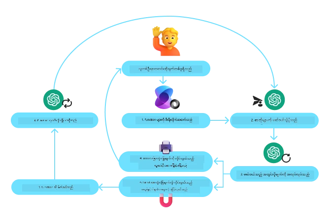
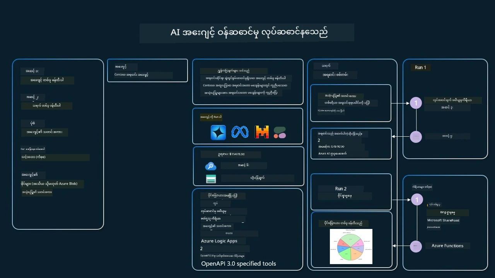

[](https://youtu.be/vieRiPRx-gI?si=cEZ8ApnT6Sus9rhn)

> _(ဤသင်ခန်းစာ ဗီဒီယိုကို ကြည့်ရန် အပေါ်တွင် ဓာတ်ပုံကို နှိပ်ပါ)_

# ကိရိယာ အသုံးပြု နည်းလမ်း ဒီဇိုင်း ပုံစံ

ကိရိယာများမှာ AI အေးဂျင့်များအတွက် ပိုမိုကျယ်ပြန့်သော စွမ်းရည်များရှိစေသောကြောင့် စိတ်ဝင်စားဖွယ်ရာဖြစ်သည်။ အေးဂျင့်သည် တစ်စုံတစ်ရာ လုပ်ဆောင်နိုင်သော အကန့်အသတ်ရှိသည့် လမ်းကြောင်းများသာရှိခြင်းမဟုတ်ဘဲ ကိရိယာတစ်ခု ထည့်သွင်းခြင်းဖြင့် အေးဂျင့်သည် လုပ်ဆောင်နိုင်သည့် လုပ်ဆောင်ချက်များစွာကို သဘောတူလာသည်။ ဒီအစိတ်အပိုင်းတွင် ကျွန်ုပ်တို့သည် AI အေးဂျင့်များသည် မည်သည့်နည်းဖြင့် သတ်မှတ်ထားသော ကိရိယာများကို အသုံးပြု၍ သူတို့ရဲ့ ရည်မှန်းချက်များအောင်မြင်အောင် ဆောင်ရွက်နိုင်ကြောင်း ဖော်ပြသည့် ကိရိယာ အသုံးပြု နည်းလမ်းဒီဇိုင်း ပုံစံကို ကြည့်မည်ဖြစ်သည်။

## မိတ်ဆက်

ဤသင်ခန်းစာတွင် ကျွန်ုပ်တို့ ရှာဖွေနေသော မေးခွန်းများမှာ -

- ကိရိယာအသုံးပြု နည်းလမ်းဒီဇိုင်း ပုံစံဆိုတာဘာလဲ?
- မည်သည့်အသုံးပြုမှုများတွင် အသုံးပြုနိုင်တာလဲ?
- ဒီဇိုင်းပုံစံကို အကောင်အထည်ဖော်ရန် လိုအပ်သော အစိတ်အပိုင်းများ / အဆောက်အအုံများကဘာတွေလဲ?
- ယုံကြည်စိတ်ချရသော AI အေးဂျင့်များ တည်ဆောက်ရာတွင် ကိရိယာ အသုံးပြု နည်းလမ်းဒီဇိုင်းပုံစံကို အသုံးပြုသည့်အခါ ထူးခြားစဉ်းစားရမည့် အချက်များကဘာတွေလဲ?

## သင်ယူနိုင်ရေး ရည်မှန်းချက်များ

ဤသင်ခန်းစာပြီးစီးပြီးနောက် သင်သည် -

- ကိရိယာ အသုံးပြု နည်းလမ်းဒီဇိုင်းပုံစံ၏ အဓိပ္ပါယ်နှင့် ရည်ရွယ်ချက်ကို သတ်မှတ်နိုင်မည်။
- ကိရိယာ အသုံးပြု နည်းလမ်းဒီဇိုင်းပုံစံကို သင့်လျော်သော အသုံးပြုမှုကဏ္ဍများကို ဖော်ထုတ်နိုင်မည်။
- ဒီဇိုင်းပုံစံအကောင်အထည်ဖော်ရာတွင် လိုအပ်သော အဓိက အစိတ်အပိုင်းများကို နားလည်နိုင်မည်။
- ဒီဇိုင်းပုံစံကို အသုံးပြုသော AI အေးဂျင့်များအတွက် ယုံကြည်စိတ်ချစေရေး ဆောင်ရွက်ရမည့် အချက်များကို မှတ်သားနိုင်မည်။

## ကိရိယာ အသုံးပြု နည်းလမ်းဒီဇိုင်းပုံစံ ဆိုတာဘာလဲ?

**ကိရိယာ အသုံးပြု နည်းလမ်းဒီဇိုင်းပုံစံ** သည် LLM များကို သတ်မှတ်ထားသော ရည်မှန်းချက်များအောင်မြင်ရန် အပြင်ခြား ကိရိယာများနှင့် ဆက်သွယ်နိုင်စေရန် တိုင်းထွာပေးသည်။ ကိရိယာအဆိုသည် ကိုယ်စားလှယ်တစ်ဦးက လုပ်ဆောင်ချက်များ ဆောင်ရွက်ရန် လုပ်ဆောင်နိုင်သည့် ကုဒ်ဖြစ်သည်။ ကိရိယာတစ်ခုမှာ စာရင်းကိုက်ကဲ့သို့ ရိုးရှင်းသော ချက်လက်ဖြစ်နိုင်သလို စတော့မော်ကွန်းတန်ဖိုးရှာဖွေရန် သို့မဟုတ် ရာသီဥတုခန့်မှန်းရန် တတိယ पक्ष ဝန်ဆောင်မှုသို့ API ခေါ်ဆိုမှုတစ်ခု ဖြစ်နိုင်သည်။ AI အေးဂျင့်များ စနစ်အတွင်းတွင် ကိရိယာများကို မော်ဒယ်များမှ ထုတ်ပေးသည့် function calls များကို တုံ့ပြန်၍ အေးဂျင့်များမှ ဆောင်ရွက်ရန် ဒီဇိုင်းဆွဲထားသည်။

## မည်သည့် အသုံးပြုမှုများတွင် အသုံးပြုနိုင်သနည်း?

AI အေးဂျင့်များသည် ကိရိယာများကို အသုံးပြု၍ ခက်ခဲတဲ့ အလုပ်များကို ပြီးမြောက်စေ거나 သတင်းအချက်အလက် ရယူနေခြင်း သို့မဟုတ် ဆုံးဖြတ်ချက်ချခြင်းများ ဆောင်ရွက်နိုင်သည်။ ကိရိယာအသုံးပြု နည်းလမ်းဒီဇိုင်းပုံစံသည် အပြင်ခြား စနစ်များနှင့် မျက်နှာစာပြန်အဖြစ် လှုပ်ရှားမှုလိုအပ်သော ပတ်ဝန်းကျင်များတွင် မကြာခဏ အသုံးပြုလေ့ရှိသည်။ ဥပမာများမှာ -

- **ဒိုင်နမစ် အချက်အလက် ရယူခြင်း:** အေးဂျင့်များသည် အပြင် API များ သို့မဟုတ် ဒေတာဘေ့စ်များကို မေးခြင်းဖြင့် လက်ရှိအချိန် သတင်းအချက်အလက်များ ရယူနိုင်သည် (ဥပမာ – ဒေတာ ခွဲခြမ်းစိတ်ဖြာရေးအတွက် SQLite ဒေတာဘေ့စ် မေးခြင်း၊ စတော့တန်ဖိုး သို့မဟုတ် ရာသီဥတု သတင်းရယူခြင်း)။
- **ကုဒ် အကောင်အထည် ဖော်ခြင်းနှင့် အဓိပ္ပာယ်ဖန်းတီးခြင်း:** အေးဂျင့်များသည် ကိန်းဂဏန်းပညာဆိုင်ရာ ပြဿနာများကို ဖြေရှင်း၊ အစီရင်ခံစာများ ဖန်တီး သို့မဟုတ် စမ်းသပ်မှုများဆောင်ရွက်ရန် ကုဒ် သို့မဟုတ် စာသားများ အကောင်အထည်ဖော်နိုင်သည်။
- **အလုပ်စဉ် အလိုအလျောက်လုပ်ခြင်း:** တာဝန်များ၌ ပြန်လည်ထပ်ခါတလဲလဲ သို့မဟုတ် အဆင့်အတန်းများ များစွာကို အလိုအလျောက်လုပ်ဆောင်ရန် ကိရိယာများကို တစ်စုတစ်စည်းပေါင်းစည်းခြင်း။
- **ဖောက်သည် ထောက်ခံမှု:** အသုံးပြုသူ မေးခွန်းများ ဖြေရှင်းရန် CRM စနစ်များ၊ တစ်ကတ်လျှောက်ပတ်လမ်းများ သို့မဟုတ် သတင်းအချက်အလက် အဆောက်အအုံများနှင့် ဆက်သွယ်ဆောင်ရွက်ခြင်း။
- **အကြောင်းအရာ ဖန်တီးခြင်းနှင့် တည်းဖြတ်ခြင်း:** စာမူစစ်စစ်ဆေးသူများ၊ စာသား အကျဉ်းချုပ်ရေးသူများ သို့မဟုတ် အကြောင်းအရာ လုံခြုံမှု ခွဲခြမ်းစိတ်ဖြာသူများ ကဲ့သို့သော ကိရိယာများကို အသုံးပြု၍ အကြောင်းအရာ ဖန်တီးရေးလုပ်ငန်းများကို ကူညီပေးခြင်း။

## ကိရိယာ အသုံးပြု နည်းလမ်းဒီဇိုင်းပုံစံကို အကောင်အထည် ဖော်ရန် လိုအပ်သော အစိတ်အပိုင်းများ / အဆောက်အအုံများကဘာတွေလဲ?

ဤအဆောက်အအုံများသည် AI အေးဂျင့်အား အလုပ်အများကြီး ပြီးမြောက်နိုင်စေသည်။ ကိရိယာ အသုံးပြု နည်းလမ်းဒီဇိုင်းပုံစံကို အကောင်အထည်ဖော်ရန် လိုအပ်သော အဓိကအစိတ်အပိုင်းများကို ကြည့်ကြမည်။

- **Function/Tool Schemas**: လက်ရှိအနေဖြင့် ရရှိနိုင်သော ကိရိယာများ၏ အသေးစိတ် ဖော်ပြချက်များ၊ function အမည်၊ ရည်ရွယ်ချက်၊ လိုအပ်သည့် ပါရာမီတာများနှင့် မျှော်လင့်ထားသော ထွက်ရှိချက်များကို ပါဝင်သည်။ ဤ schemas များကြောင့် LLM သည် ဘာကိရိယာများ ရရှိနိုင်သည့် နှင့် ဘယ်လို တောင်းဆိုမှုများ တည်ဆောက်ရမည်ကို နားလည်နိုင်သည်။

- **Function Execution Logic**: အသုံးပြုသူ ရည်ရွယ်ချက်နှင့် စကားလှမ်းအခြေအနေကို အခြေခံ၍ ကိရိယာများကို မည်သည့်အချိန်တွင်နှင့် မည်သို့ ခေါ်ယူရမည်ကို ထိန်းချုပ်သည်။ ၎င်းတွင် ပြုပြင်စီမံမှု မော်ဂျူးများ၊ ရလမ်းညွှန်ခြင်း စနစ်များ သို့မဟုတ် အခြေအနေခြုံငုံ စည်းမျဉ်းများ ပါဝင်နိုင်သည်။

- **Message Handling System**: အသုံးပြုသူ ထည့်သွင်းချက်များ၊ LLM ဖြေကြားချက်များ၊ ကိရိယာ ခေါ်ဆိုမှုများနှင့် ကိရိယာ ထွက်ရှိချက်များအကြား စကားပြောစီးဆင်းမှုကို စီမံခန့်ခွဲသော အစိတ်အပိုင်းများ။

- **Tool Integration Framework**: အေးဂျင့်ကို ရိုးရှင်းသော function များ သို့မဟုတ် ပိုမိုရှုပ်ထွေးသော အပြင်ခြား ဝန်ဆောင်မှုများနှင့် ချိတ်ဆက်ပေးသော အခြေခံအဆောက်အအုံ။

- **Error Handling & Validation**: ကိရိယာအလုပ်မရပ်တန့်မှုများကို ကိုင်တွယ်ခြင်း၊ ပါရာမီတာများကို စစ်ဆေးခြင်းနှင့် မမျှော်လင့်ထားသော တုံ့ပြန်ချက်များကို စီမံခန့်ခွဲခြင်း။

- **State Management**: စကားပြောအခြေအနေ၊ ယခင်ကိရိယာ အသုံးပြုမှုများနှင့် တည်ငြိမ်သော ဒေတာများကို မှတ်တမ်းတင်ကာ နောက်ဆက်တွဲ အပြောင်းအလဲများ၌ တပြတ်တည်းဖြစ်အောင် သေချာစေသည်။

နောက်တစ်ခုအနေဖြင့် Function/Tool ခေါ်ဆိုခြင်းကို ပိုမိုအသေးစိတ် ကြည့်မည်။
 
### Function/Tool ခေါ်ဆိုခြင်း

Function ခေါ်ဆိုခြင်းသည် အကြီးစားဘာသာစကား မော်ဒယ်များ (LLMs) ကို ကိရိယာများနှင့် ဆက်သွယ်ပေးသည့် အဓိကနည်းလမ်းဖြစ်သည်။ သင်သည် အမည်တွဲများစွာတွင် 'Function' နှင့် 'Tool' ကို အစားထိုးအသုံးပြုကြသည်။ ကိရိယာများသည် အေးဂျင့်များ၏ လုပ်ဆောင်ချက်များကို ဆောင်ရွက်ရန် အသုံးပြုသော reusable code block များဖြစ်သည်။ Function အက်ပလီကေးရှင်း၏ ကုဒ်ကို ခေါ်ယူနိုင်ဖို့အတွက် LLM သည် အသုံးပြုသူ၏ တောင်းဆိုမှုကို function ဖော်ပြချက်များနှင့် နှိုင်းယှဉ်ရမည်။ လုပ်ဆောင်ရန် function ပေါင်းများစွာ၏ ဖော်ပြချက်များပါဝင်သည့် schema တစ်ခုကို LLM ထံ သွားပို့သည်။ ထိုနောက် LLM သည် အကောင်းဆုံးသင့်တော်သော function ကို ရွေးချယ်၍ အမည်နှင့် အချက်အလက်များကို ပြန်ပေးသည်။ ရွေးချယ်ထားသော function ကို ခေါ်ယူပြီး ၎င်း၏ တုံ့ပြန်ချက်ကို LLM ထံ ပြန်ပို့သည်၊ ထို့နောက် LLM သည် သုံးစွဲသူတောင်းဆိုမှုအပေါ် အချက်အလက် များဖြင့် ဖြေကြားသည်။

ဒီဇိုင်းဆောင်ရွက်သူများသည် function calling ကို အေးဂျင့်များတွင် ဆောင်ရွက်ရန်အတွက် လိုအပ်တာများမှာ -

1. function calling ကို ထောက်ခံသော LLM မော်ဒယ်
2. function ဖော်ပြချက် ပါဝင်သည့် schema
3. ဖော်ပြထားသည့် function များအတွက် ကုဒ်များ

မြို့တစ်မြို့ရှိ လက်ရှိအချိန် ရယူခြင်းကို ဥပမာအဖြစ် အသုံးပြုကြည့္မည် -

1. **Function calling ထောက်ခံသည့် LLM ကို စတင်ဖြင့်လှူမည်**

    မော်ဒယ်တိုင်းတွင် function calling ထောက်ခံမှုရှိခြင်း မဟုတ်သကဲ့သို့ သင် အသုံးပြုနေသော LLM သည် ထိုအရာကို စစ်ဆေးရန် အရေးကြီးသည်။    <a href="https://learn.microsoft.com/azure/ai-services/openai/how-to/function-calling" target="_blank">Azure OpenAI</a> သည် function calling ကို ထောက်ခံပါသည်။ Azure OpenAI **Responses API** (stabilized `/openai/v1/` endpoint — `api_version` မလို) ကို OpenAI client မှာ စတင်ဆောင်ရွက်နိုင်သည်။

    ```python
    # Initialize the OpenAI client for Azure OpenAI (Responses API, v1 endpoint)
    client = OpenAI(
        base_url=f"{os.environ['AZURE_OPENAI_ENDPOINT'].rstrip('/')}/openai/v1/",
        api_key=os.environ["AZURE_OPENAI_API_KEY"],
    )
    deployment_name = os.environ["AZURE_OPENAI_DEPLOYMENT"]
    ```

1. **Function Schema တစ်ခု ဖန်တီးခြင်း**

    နောက်တစ်ဆင့်တွင် function အမည်၊ function အလုပ်လုပ်ပုံကို ဖော်ပြချက်၊ function ရဲ့ ပါရာမီတာများအမည်နှင့် ဖော်ပြချက်များ ပါဝင်သော JSON schema တစ်ခု ကို သတ်မှတ်မည်။ 
    ပြီးနောက်ဒီ schema ကို ယခင်က client ဖန်တီးထားသောနေရာသို့အသုံးပြုသူ၏ San Francisco မြို့၏ အချိန် ရှာဖွေရေး တောင်းဆိုမှုနှင့်တကွ ပေးပို့မည်။ အရေးကြီးသည်မှာ ဤသင်ခန်းစာတွင် function call တစ်ခုသာ ပြန်ထားသည်၊ မေးခွန်း၏ နောက်ဆုံးဖြေကြားချက် မဟုတ်ပါ။ ဤကဲ့သို့ပင် LLM သည် လုပ်ငန်းအတွက် ရွေးချယ်ထားသော function အမည်နှင့် အချက်အလက်များကို ပြန်ပေးသည်။

    ```python
    # Function description for the model to read (Responses API flat tool format)
    tools = [
        {
            "type": "function",
            "name": "get_current_time",
            "description": "Get the current time in a given location",
            "parameters": {
                "type": "object",
                "properties": {
                    "location": {
                        "type": "string",
                        "description": "The city name, e.g. San Francisco",
                    },
                },
                "required": ["location"],
            },
        }
    ]
    ```
   
    ```python
  
    # Initial user message
    messages = [{"role": "user", "content": "What's the current time in San Francisco"}]

    # First API call: Ask the model to use the function
    response = client.responses.create(
        model=deployment_name,
        input=messages,
        tools=tools,
        tool_choice="auto",
        store=False,
    )

    # The Responses API returns tool calls as function_call items in response.output.
    # Append them to the conversation so the model has full context on the next turn.
    messages += response.output

    print("Model's response:")
    print(response.output)
  
    ```

    ```bash
    Model's response:
    [ResponseFunctionToolCall(arguments='{"location":"San Francisco"}', call_id='call_pOsKdUlqvdyttYB67MOj434b', name='get_current_time', type='function_call')]
    ```
  
1. **အလုပ်စွမ်းဆောင်ရန် function ကုဒ်**

    LLM သည် ဘယ် function ကို ရွေးထားသည်ကို ဆုံးဖြတ်ပြီးနောက် ဆောင်ရွက်ရမည့် task ကို ကုဒ်ဖြင့် ပံ့ပိုးဆောင်ရွက်ရန် လိုအပ်သည်။
    Python ကို အသုံးပြုပြီး လက်ရှိအချိန် ရယူရန်ကုဒ်ရေးသားနိုင်သည်။ response_message မှ function အမည်နှင့် အချက်အလက်များကို ထုတ်ယူကာ နောက်ဆုံးရလဒ်ရယူရန် ကုဒ်ကိုလည်း ရေးရန် လိုအပ်ပါသည်။

    ```python
      def get_current_time(location):
        """Get the current time for a given location"""
        print(f"get_current_time called with location: {location}")  
        location_lower = location.lower()
        
        for key, timezone in TIMEZONE_DATA.items():
            if key in location_lower:
                print(f"Timezone found for {key}")  
                current_time = datetime.now(ZoneInfo(timezone)).strftime("%I:%M %p")
                return json.dumps({
                    "location": location,
                    "current_time": current_time
                })
      
        print(f"No timezone data found for {location_lower}")  
        return json.dumps({"location": location, "current_time": "unknown"})
    ```

     ```python
    # Handle function calls
    tool_calls = [item for item in response.output if item.type == "function_call"]
    if tool_calls:
        for tool_call in tool_calls:
            if tool_call.name == "get_current_time":

                function_args = json.loads(tool_call.arguments)

                time_response = get_current_time(
                    location=function_args.get("location")
                )

                # Return the tool result as a function_call_output item
                messages.append({
                    "type": "function_call_output",
                    "call_id": tool_call.call_id,
                    "output": time_response,
                })
    else:
        print("No tool calls were made by the model.")

    # Second API call: Get the final response from the model
    final_response = client.responses.create(
        model=deployment_name,
        input=messages,
        tools=tools,
        store=False,
    )

    return final_response.output_text
     ```

     ```bash
      get_current_time called with location: San Francisco
      Timezone found for san francisco
      The current time in San Francisco is 09:24 AM.
     ```

Function Calling သည်အဓိကအားဖြင့် agent tool အသုံးပြုမှုဒီဇိုင်းများတွင် အရေးပါသည်၊ သို့သော် scratch ကနေ implement ဖို့အချိန်တွင် စိန်ခေါ်မှုများ ဖြစ်ပေါ်နိုင်သည်။
[Lesson 2](../../../02-explore-agentic-frameworks) တွင် သင်ယူခဲ့သလို agentic frameworks များက tool အသုံးပြုမှုကို implement ဖို့ အဆောက်အအုံကြီးများကို အဆင်ပြေစွာပေးသည်။
 
## Agentic Frameworks အသုံးပြုပြီး Tool Use ဥပမာများ

မတူညီသော agentic frameworks များအသုံးပြုပြီး Tool Use ဒီဇိုင်န်းပုံစံကို ပြုလုပ်နည်း အတော်များများကို အောက်တွင် ဖော်ပြထားသည် -

### Microsoft Agent Framework

<a href="https://learn.microsoft.com/azure/ai-services/agents/overview" target="_blank">Microsoft Agent Framework</a> သည် AI agents တည်ဆောက်ရန် open-source AI framework တစ်ခုဖြစ်သည်။ Function calling ကိုလွယ်ကူစွာ အသုံးပြုနိုင်ရန် Python functions အဖြစ် tools များကို `@tool` decorator ဖြင့် သတ်မှတ်နိုင်စေသည်။ Framework သည် model နှင့် သင့်ကုဒ် အကြား တုံ့ပြန်ဆက်သွယ်မှုကို စီမံချက်သည်။ File Search နှင့် Code Interpreter ကဲ့သို့သော အသုံးပြုနိုင်သော tool များကို `FoundryChatClient` မှတဆင့် လက်ခံရရှိနိုင်သည်။

Function calling လုပ်ဆောင်မှုကို Microsoft Agent Framework ဖြင့် ယေဘုယျဒီဇိုင်း အောက်ပါဇယားက ဖော်ပြထားသည် -



Microsoft Agent Framework တွင် tools များကို decorated function အဖြစ် သတ်မှတ်သည်။ ယခင်က မြင်ခဲ့သော `get_current_time` function ကို `@tool` decorator ဖြင့် tool အဖြစ် ပြောင်းလဲနိုင်သည်။ Framework သည် function နှင့် parameter များကို auto serialize ပြုလုပ်ပြီး LLM သို့ ပို့ရန် schema သတ်မှတ်ပေးသည်။

```python
import os
from agent_framework import tool
from agent_framework.foundry import FoundryChatClient
from azure.identity import AzureCliCredential

@tool(approval_mode="never_require")
def get_current_time(location: str) -> str:
    """Get the current time for a given location"""
    ...

# Create the client
provider = FoundryChatClient(
    project_endpoint=os.environ["AZURE_AI_PROJECT_ENDPOINT"],
    model=os.environ["AZURE_AI_MODEL_DEPLOYMENT_NAME"],
    credential=AzureCliCredential(),
)

# Create an agent and run with the tool
agent = provider.as_agent(name="TimeAgent", instructions="Use available tools to answer questions.", tools=get_current_time)
response = await agent.run("What time is it?")
```

#### MCP server မှ tools များ

Tools များသည် သင့်ရဲ့ ကိုယ်ပိုင်ကုဒ် ထဲမှ functions ဖြစ်ရန် မလိုပါ။ Model Context Protocol (MCP, [Lesson 11](../11-agentic-protocols/README.md) တွင်ဖော်ပြထားသည်) ကို အသုံးပြုသည့် server တစ်ခုက tools များ၊ schema များနှင့်အတူ publish လုပ်ပြီး framework မှ decorated function များ အတိုင်း serialize ပြုလုပ်၍ ဖတ်သိနိုင်သည်။ `MCPStreamableHTTPTool` သည် HTTP ဖြင့် အဲဒီ server သို့ ချိတ်ဆက်ကာ tool schemas များကို ဖတ်ပြီး စနစ်တွင်ရှိသည့် local tools နှင့်အတူ model အနီးတွင် ပေးနိုင်သည်။

အောက်ပါ ဥပမာသည် <a href="https://keenable.ai" target="_blank">Keenable</a> မှ web search server ကို အသုံးပြုထားသည်။ အကောင့် သို့မဟုတ် API key မလိုအပ်ဘဲ အခမဲ့ အသုံးပြုနိုင်ပြီး (IP အလိုက် requests rate limit ကန့်သတ်ထားသည်) သင့် model အတွက် credential များကိုသာ လိုအပ်သည်။ Remote tools များကဲ့သို့ model က ရေးသော queries များကို server သို့ ပို့သည်။

```python
from agent_framework import MCPStreamableHTTPTool

web_search = MCPStreamableHTTPTool(
    name="Keenable web search",
    url="https://api.keenable.ai/mcp",
)

# Connecting loads the server's tool schemas; the agent decides when to call them
async with web_search:
    agent = provider.as_agent(
        name="ResearchAgent",
        instructions="Use available tools to answer questions.",
        tools=[web_search],
    )
    response = await agent.run("What is new in the latest Python release?")
    print(response.text)
```

Server သည် `search_web_pages` နှင့် `fetch_page_content` ဆိုသော tools နှစ်ခုကို publish လုပ်သည်။ မေးခွန်းတွင် လက်ရှိ သတင်းအချက်အလက်လိုအပ်လျှင် model သည် `search_web_pages` ကို ခေါ်ပြီး ခေါင်းစဉ်များ၊ URL များ၊ အပိုဒ်များ လက်ခံယူပြီး အဖြေကို ရေးသားသည်၊ အထက်ပါ `get_current_time` ဥပမာအတိုင်း လုပ်ဆောင်ချက်သည် ဆက်လက်ဖြစ်သည်။
  
### Microsoft Foundry Agent Service

<a href="https://learn.microsoft.com/azure/ai-services/agents/overview" target="_blank">Microsoft Foundry Agent Service</a> သည် developer များအတွက် underlying compute နှင့် storage resources များကို စီမံရန် မလိုအပ်ဘဲ လုံခြုံစိတ်ချစွာ AI agents များကို တည်ဆောက်၊ deploy၊ scale ပြုလုပ်နိုင်ရန် စီမံထားသော နောက်ဆုံးပေါ် agentic framework ဖြစ်သည်။ Enterprise application များအတွက် အထူးအသုံးဝင်ပြီး enterprise level လုံခြုံမှုပါတဲ့ fully managed service ဖြစ်သည်။

LLM API ကို တိုက်ရိုက် အသုံးပြုခြင်းနှင့် နှိုင်းယှဉ်ပါက Microsoft Foundry Agent Service သည် အောက်ပါအကျိုးများ ရှိသည်။

- Automatic tool calling – tool call ကို parse လုပ်ရန်၊ tool ကို ခေါ်ရန် နှင့် တုံ့ပြန်ချက်ကို ကိုင်တွယ်ရန် မလိုတော့ပဲ ဒီလုပ်ငန်းအားလုံးကို server-side မှ ပြုလုပ်ပေးသည်။
- Securely managed data – ကိုယ်ပိုင် conversation state ကို စီမံဖို့မလိုပဲ thread များတွင် လိုအပ်သော သတင်းအချက်အလက်အားလုံးကို သိမ်းဆည်းနိုင်သည်။
- Out-of-the-box tools – Bing, Azure AI Search, Azure Functions ကဲ့သို့ သင့်ဒေတာရင်းမြစ်များနှင့် အပြန်အလှန်ဆက်သွယ်ရန် တိုက်ရိုက်အသုံးပြုနိုင်သော tools များ ရှိသည်။

Microsoft Foundry Agent Service တွင် ရရှိနိုင်သော tools များကို နှစ်မျိုးထားနိုင်သည်။

၁။ အတတ်ပညာတူ tool များ:
    - <a href="https://learn.microsoft.com/azure/ai-services/agents/how-to/tools/bing-grounding?tabs=python&pivots=overview" target="_blank">Bing Search ဖြင့် Grounding</a>
    - <a href="https://learn.microsoft.com/azure/ai-services/agents/how-to/tools/file-search?tabs=python&pivots=overview" target="_blank">File Search</a>
    - <a href="https://learn.microsoft.com/azure/ai-services/agents/how-to/tools/azure-ai-search?tabs=azurecli%2Cpython&pivots=overview-azure-ai-search" target="_blank">Azure AI Search</a>

၂။ လုပ်ဆောင်ရေး tool များ:
    - <a href="https://learn.microsoft.com/azure/ai-services/agents/how-to/tools/function-calling?tabs=python&pivots=overview" target="_blank">Function Calling</a>
    - <a href="https://learn.microsoft.com/azure/ai-services/agents/how-to/tools/code-interpreter?tabs=python&pivots=overview" target="_blank">Code Interpreter</a>
    - <a href="https://learn.microsoft.com/azure/ai-services/agents/how-to/tools/openapi-spec?tabs=python&pivots=overview" target="_blank">OpenAPI သတ်မှတ်ထားသော tools</a>
    - <a href="https://learn.microsoft.com/azure/ai-services/agents/how-to/tools/azure-functions?pivots=overview" target="_blank">Azure Functions</a>

Agent Service က tools များကို `toolset` အဖြစ် ပေါင်းစပ် သုံးနိုင်စေသည်။ သာလွန်သော message conversation history ကို သိမ်းဆည်းဖို့ `threads` ကိုလည်း အသုံးပြုသည်။

Contoso ဆိုတဲ့ ကုမ္ပဏီမှာ sales agent တစ်ယောက်ဖြစ်ကြောင်း စဉ်းစားကြည့်ပါ။ သင့်ရဲ့ sales ဒေတာများအတွက် မေးခွန်းများကို ဖြေချင်သော conversational agent တစ်ခု ဖန်တီးလိုသည်။

Microsoft Foundry Agent Service ကိုသုံးပြီး သင့် sales data ကို စစ်တမ်းခွဲခြမ်းဖော်ပြသည့် အောက်ပါပုံကို ကြည့်ရှုပါ -



ဆာဗစ်ထဲတွင် tools များကို အသုံးပြုရန် client တစ်ခု ဖန်တီးပြီး tool သို့မဟုတ် toolset တစ်ခု သတ်မှတ်နိုင်သည်။ အကောင်အထည်ဖော်ရန် Python ကုဒ်အောက်ပါအတိုင်းဖြစ်ပြီး LLM သည် user ဖန်တီးထားသော function `fetch_sales_data_using_sqlite_query` သို့မဟုတ် pre-built Code Interpreter တစ်ခုကို အသုံးပြုမည်ဟုဆုံးဖြတ်နိုင်သည်။

```python 
import os
from azure.ai.projects import AIProjectClient
from azure.identity import DefaultAzureCredential
from fetch_sales_data_functions import fetch_sales_data_using_sqlite_query # fetch_sales_data_using_sqlite_query function which can be found in a fetch_sales_data_functions.py file.
from azure.ai.projects.models import ToolSet, FunctionTool, CodeInterpreterTool

project_client = AIProjectClient.from_connection_string(
    credential=DefaultAzureCredential(),
    conn_str=os.environ["PROJECT_CONNECTION_STRING"],
)

# Initialize toolset
toolset = ToolSet()

# Initialize function calling agent with the fetch_sales_data_using_sqlite_query function and adding it to the toolset
fetch_data_function = FunctionTool(fetch_sales_data_using_sqlite_query)
toolset.add(fetch_data_function)

# Initialize Code Interpreter tool and adding it to the toolset. 
code_interpreter = CodeInterpreterTool()toolset.add(code_interpreter)

agent = project_client.agents.create_agent(
    model="gpt-5-mini", name="my-agent", instructions="You are helpful agent", 
    toolset=toolset
)
```

## ယုံကြည်စိတ်ချရသော AI agents တည်ဆောက်ရာတွင် Tool Use ဒီဇိုင်န်းပုံစံအသုံးပြုရာတွင် အထူးစဉ်းစားရမည့်အချက်များ မည်သည့်အချို့ရှိသနည်း؟

LLMs မှ dynamically generate လုပ်သော SQL များအတွက် သာမာန်စိုးရိမ်ချက်မှာ လုံခြုံမှုနှင့်ပတ်သက်ပြီး SQL injection သို့မဟုတ် database ကို ဖျက်ဆီးမှုများဖြစ်ပေါ်နိုင်ခြေ ဖြစ်သည်။ သို့သော် ဒီစိုးရိမ်ချက်များကို database access permissions ကို သေချာ configure လုပ်ခြင်းဖြင့် ကင်းရှင်းနိုင်သည်။ database များအတွက်အများအားဖြင့် read-only configuration သွင်းမည်ဖြစ်သည်။ PostgreSQL သို့မဟုတ် Azure SQL ကဲ့သို့ database services များအတွက် app သည် read-only (SELECT) role ပေးထားသင့်သည်။

app ကို လုံခြုံသော ပတ်ဝန်းကျင်တစ်ခုတွင် မောင်းနှင်ခြင်းက အကာအကွယ် ပိုမိုကောင်းမွန်စေသည်။ စီးပွားရေးအခြေအနေတွေမှာ operational system များမှ ဒေတာကို extract လုပ်ပြီး read-only database သို့ data warehouse တစ်ခုထဲသို့ ပြောင်းလဲ၍ user-friendly schema ဖြင့် သိမ်းဆည်းသည်။ ဤနည်းလမ်းသည် ဒေတာကို လုံခြုံစေပြီး၊ performance နှင့် အသုံးပြုရလွယ်ကူမှုအတွက် optimize လုပ်ထားပြီး app သည် read-only access သာရှိပါသည်။

## နမူနာကုဒ်များ

- Python: [Agent Framework](./code_samples/04-python-agent-framework.ipynb)
- .NET: [Agent Framework](./code_samples/04-dotnet-agent-framework.md)

## Tool Use Design Pattern သာမက AI agents များအကြောင်း မေးစရာများရှိပါသလား?

[Microsoft Foundry Discord](https://discord.com/invite/ATgtXmAS5D) တွင် တက်ရောက်ပြီး သင်ယူသူများနှင့် တွေ့ဆုံ၊ office hours သို့ တက်ရောက်၍ AI Agents မေးခွန်းများ ဖြေရှင်းစေပါ။

## နောက်ထပ်အရင်းအမြစ်များ

- <a href="https://microsoft.github.io/build-your-first-agent-with-azure-ai-agent-service-workshop/" target="_blank">Azure AI Agents Service Workshop</a>
- <a href="https://github.com/Azure-Samples/contoso-creative-writer/tree/main/docs/workshop" target="_blank">Contoso Creative Writer Multi-Agent Workshop</a>
- <a href="https://learn.microsoft.com/azure/ai-services/agents/overview" target="_blank">Microsoft Agent Framework Overview</a>

## ဒီအေဂျင့်ကို Smoke-Test ပြုလုပ်ခြင်း (ရွေးချယ်နိုင်)

[စာသင်ခန်း 16](../16-deploying-scalable-agents/README.md) တွင် အေဂျင့်များကို စွဲထားနိုင်ပြီးနောက်၊ ဒီစာသင်ခန်းရဲ့ `TravelToolAgent` ကို [`tests/lesson-04-smoke-tests.json`](../../../tests/lesson-04-smoke-tests.json) ဖြင့် smoke-test ပြုလုပ်နိုင်သည် (ယင်းသည် မည်သည့်ကိရိယာများကိုခေါ်သလဲ၊ ဖြေဆိုနိုင်သလဲဆိုတာ)။ ကိုင်တွယ်ပြီးပုံစံအား [`tests/README.md`](../tests/README.md) တွင် ကြည့်ရှုနိုင်သည်။

## ယခင်စာသင်ခန်း

[Agentic Design Patterns ကိုနားလည်ခြင်း](../03-agentic-design-patterns/README.md)

## နောက်တစ်ခန်းစာသင်ခန်း

[Agentic RAG](../05-agentic-rag/README.md)

---

<!-- CO-OP TRANSLATOR DISCLAIMER START -->
**ပြောကြားချက်**
ဤစာတမ်းကို AI ဘာသာပြန်ဝန်ဆောင်မှု [Co-op Translator](https://github.com/Azure/co-op-translator) အသုံးပြု၍ ဘာသာပြန်ထားပါသည်။ ကျွန်ုပ်တို့သည် တိကျမှန်ကန်မှုအတွက် ကြိုးပမ်းနေသော်လည်း၊ စက်ကိရိယာဘာသာပြန်ခြင်းများတွင် အမှားများ သို့မဟုတ် မှားယွင်းချက်များ ပါဝင်နိုင်ကြောင်း သတိပြုပါရန် လိုအပ်ပါသည်။ မူလစာတမ်းကို မူရင်းဘာသာဖြင့်သာ ယုံကြည်စိတ်ချရသော အချက်အလက်အဖြစ် သတ်မှတ်သင့်သည်။ အရေးကြီးသည့် သတင်းအချက်အလက်များအတွက် ပရော်ဖက်ရှင်နယ် လူသားဘာသာပြန်သူဝန်ဆောင်မှုကို အကြံပြုပါသည်။ ဤဘာသာပြန်ချက်ကို အသုံးပြုခြင်းမှ ဖြစ်ပေါ်လာသော နားလည်မှုကွာခြားမှုများ သို့မဟုတ် မမှန်ကန်သော အသုံးပြုမှုများအတွက် ကျွန်ုပ်တို့ တာဝန်မခံပါ။
<!-- CO-OP TRANSLATOR DISCLAIMER END -->