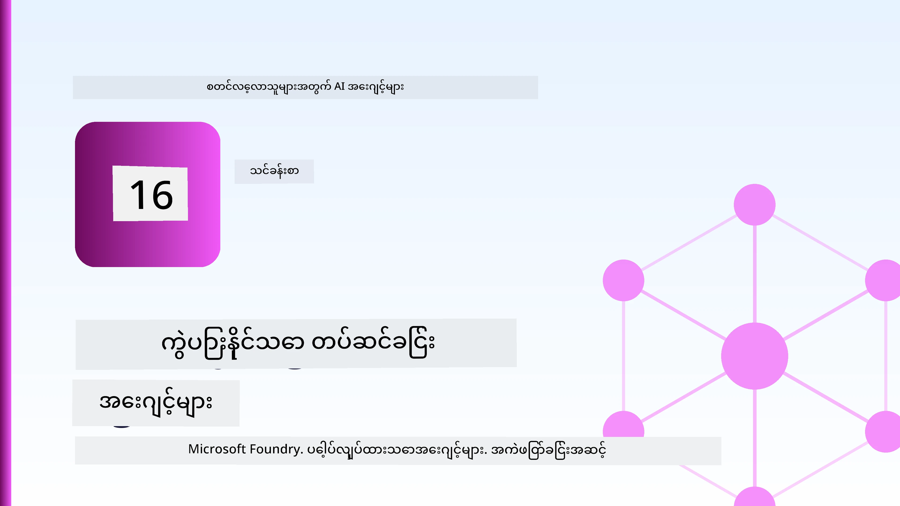
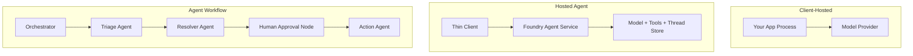
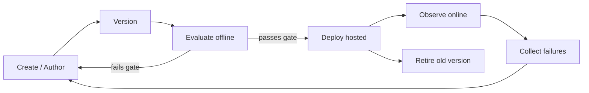
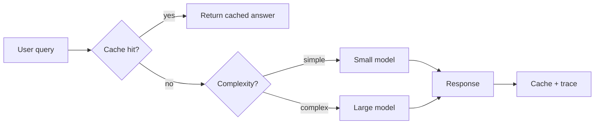
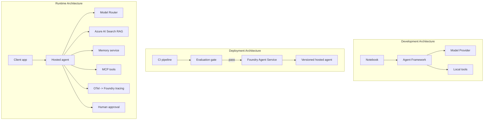

# Microsoft Foundry ဖြင့် ပမာဏတိုး Agents များ တင်သွင်းခြင်း



ဒီအဆင့်အထိ သင်ဟာ မိမိလပ်တော့ပေါ်မှာ အက်ဂျင့်တွေကို တည်ဆောက်ပြီး၊ notebook ထဲမှာ၊ `az login` နဲ့ ပတ်ဝန်းကျင် အချို့နဲ့ စီမံခန့်ခွဲထားပါတယ်။ ဒါဟာ မိမိသင်ယူရန် အလွန်မှန်ကန်တဲ့ နည်းလမ်းပါ။ ဒါပေမယ့်လည်း လူထောင်အနည်းငယ်က မနက်ပိုင်း ၃ နာရီမှာ ဆွဲဆောင်ထားတဲ့ အက်ဂျင့်ကို လည်ပတ်ဖို့အတွက် မမှန်ကန်ပါဘူး။

ဒီသင်ခန်းစာက "ငါ့စက်မှာ အလုပ်လုပ်တယ်" နဲ့ "တည်ငြိမ်စွာ အလုပ်လုပ်တယ်၊ စီးပွားရေးထုံးစံနဲ့" ဆိုတဲ့ ကြားက ဖောက်သည်များအတွက် Microsoft Foundry နှင့် Microsoft Foundry Agent Service ကို အသုံးပြုပြီး သက်သေပြထောက်ခံမှုရှိတဲ့ အကောင်အထည်ဖော် စာရင်းသွင်းတဲ့ လုပ်ငန်းစဉ်ကို သင်ယူ၍ ဖြစ်သည်။

## နိဒါန်း

ဒီသင်ခန်းစာတွင် ဖော်ပြရန်ရှိသည်မှာ -

- **prototype အက်ဂျင့်** နှင့် **တင်သွင်းထားသော အက်ဂျင့်** တို့အကြား ကွာခြားချက်နှင့် အဓိကအားဖြင့် မော်ဒယ်အပြင်ပတ်ဝန်းကျင်တွင် ဖြစ်ပေါ်သည့် ရွေ့လျားမှု။
- အက်ဂျင့်များအတွက် **တင်သွင်း နည်းပုံစံများ**: client-hosted, service-hosted (Hosted Agents), နှင့် workflow-orchestrated။
- Microsoft Foundry တွင် **အက်ဂျင့်သက်တမ်းစဉ်** — ဖန်တီး၊ ဗားရှင်းထုတ်, တင်သွင်း၊ သုံးသပ်၊ စောင့်ကြည့်၊ ထုတ်ပယ်။
- **ပမာဏတိုးနည်းပြချက်များ**: မော်ဒယ်နည်းလမ်းရွေးခြင်း၊ caching, concurrency, နှင့် Stateless ဒီဇိုင်း။
- OpenTelemetry နှင့် Foundry tracing ဖြင့် **အသိပညာကို မွမ်းမံခြင်း**။
- မော်ဒယ်ရွေးချယ်ခြင်း၊ နည်းလမ်းသွားလမ်းကြောင်းနှင့် သုံးသပ်ရေးခြင်းမှတဆင့် **ကုန်ကျစရိတ် ထိန်းချုပ်မှု**။
- **လုပ်ငန်းအဖွဲ့အတွက် စဉ်းစားစရာများ**: အုပ်ချုပ်မှု၊ လူ့အတည်ပြုမှုနှင့် MCP servers ကို လုံခြုံစွာ ထိန်းသိမ်းခြင်း။

## သင်ယူရမည့် ရည်ရွယ်ချက်များ

ဒီသင်ခန်းစာပြီးဆုံးသည်နှင့်အတူ သင်သည် -

- အက်ဂျင့်အလုပ်အတွက် သင့်တော်သည့် တင်သွင်း နည်းပုံစံကို ရွေးချယ်နိုင်မည်။
- Microsoft Foundry Agent Service သို့ အက်ဂျင့်တင်သွင်း ပြီး ဗားရှင်း၊ အုပ်ချုပ်မှု၊ နှင့် အသိပညာရှိ စေလွှတ်နိုင်မည်။
- Tracing အတွက် အက်ဂျင့်ကို တပ်ဆင်ပြီး စေလွှတ်ခြင်းတိုင်း မတိုင်မီ သုံးသပ်ရေး လုပ်ငန်းစဉ်ကို ချိတ်ဆက်နိုင်မည်။
- ပမာဏတိုးအဆင့်တွင် နည်းလမ်းအလျား/ရွေ့လမ်းနှင့် caching ကို အသုံးပြုပြီး ချိန်ဆန်မှုနှင့် စရိတ် ထိန်းချုပ်နိုင်မည်။
- အမြင့်မားသော အန္တရာယ်ရှိ လုပ်ဆောင်ချက်များအတွက် လူ့အတည်ပြုမှု များ နှင့် MCP server ကို ထိန်းသိမ်းမှု စနစ် တက်ကြွစွာထည့်သွင်းနိုင်မည်။

## ကြိုတင်စွဲချက်များ

ဒီသင်ခန်းစာက အရင်က သင်ခန်းစာများပြီးမြောက်ပြီး သင် မျှော်လင့်ထားသည်။

- [Microsoft Agent Framework](../14-microsoft-agent-framework/README.md) (Lesson 14) ဖြင့် အက်ဂျင့်များ တည်ဆောက်နိုင်ခြင်း။
- [Tool Use](../04-tool-use/README.md) (Lesson 4) နှင့် [Agentic RAG](../05-agentic-rag/README.md) (Lesson 5) ကို အသုံးပြုနိုင်ခြင်း။
- [Agent Memory](../13-agent-memory/README.md) (Lesson 13) နှင့် [Agentic Protocols / MCP](../11-agentic-protocols/README.md) (Lesson 11) ကို နားလည်ကြောင်း။
- [Observability and Evaluation](../10-ai-agents-production/README.md) (Lesson 10) — ဤသင်ခန်းစာကို တိုက်ရိုက်ဆက်လက်ပါသည်။

သင်အနေဖြင့် လည်းလိုအပ်လိမ့်မည်မှာ -

- အနည်းဆုံး တစ်ခု chat မော်ဒယ်တင်သွင်းပြီးသား အတူ **Azure subscription** နှင့် **Microsoft Foundry project** တစ်ခု။
- **Azure CLI** ဖြင့် အတည်ပြုထားသည် (`az login`)။
- Python 3.12+ နှင့် များသော စနစ်တပ်ဆင်ထားသော ပက်ကေ့ချ်များ [`requirements.txt`](../../../requirements.txt) မှာ ရှိသည်။

## Prototype မှ Production သို့: ဘာတွေ ပြောင်းလဲသွားလဲ

Prototype agent တစ်ခုနှင့် production agent တစ်ခုမှာ အခြေခံ loop တူညီသည် — ရည်ရွယ်ချက်, call tools, တုံ့ပြန်မှု။ ပြောင်းလဲသွားတာက loop ခြုံကိုင်ထားတဲ့ အခြားပတ်ဝန်းကျင်တွေအားလုံးပါ။ Model သည် production agent ၂၀% ပမာဏသာ ဖြစ်သည်; ၈၀% ကျော်ဖြစ်သည်မှာ operation မူကြမ်းဖြစ်သည်။

| စိတ်ပူရမှု | Prototype | Production |
| --- | --- | --- |
| **Hosting** | သင်၏ notebook အတွင်းတွင် run သည် | Hosted service အဖြစ် run ပေးသည်၊ versioning နှင့် rollout ပါပါသည် |
| **Identity** | သင်၏ `az login` token | Scoped RBAC ပါရှိသော managed identity |
| **State** | In-memory ဖြစ်ပြီး restart ဆိုသော် မရှိတော့ပါ | Externalised (thread store, memory service) အဖြစ်ရှိသည် |
| **Failure** | သင်သည် traceback ကို ထင်ရှားမြင်သာ | Retry, fallback, dead-letter, alert များရှိသည် |
| **Cost** | "အနည်းငယ်ကုန်ကျသည်" | တောင်းဆိုမှုအလိုက် တွက်ချက်ခြင်း၊ routing, caching, ဘတ်ဂျက်ထားသည် |
| **Quality** | သင်သည် ထွက်လာမှုကို ကိုယ့်မြင်သဘောဖြင့် ကြည့်သည် | မထုတ်လုပ်ခင် အလိုအလျောက် သုံးသပ်သည် |
| **Trust** | သင်သည် တစ်ချက်ချင်း အတည်ပြုသည် | Policy နှင့် လူတွင်မဟုတ်မီ စဉ်ဆက်ဖြင့် လုပ်ဆောင်မှုများအတွက် သေချာစွာ ထိန်းချုပ်သည် |

၎င်းဇယားကို မှတ်သားထားပါ။ အောက်ပါ အပိုင်းတစ်ခုချင်းစီသည် ဤဇယားတန်းစီ တစ်ခုနှင့် အတူတကွ ရှိသည်။

## Agent Deployment မော်ဒယ်များ

သင် အများအားဖြင့် သုံးမည့် မော်ဒယ် သုံးမျိုးရှိသည်။

### ၁။ Client-Hosted Agents

Agent object သည် သင်၏ application process အတွင်းရှိသည်။ သင်၏ ကုဒ်သည် Model ပေးသွင်းသူကို တိုက်ရိုက် call လုပ်သည်; reasoning loop သည် သင့်ဝန်ဆောင်မှုတွင် run ဖြစ်သည်။ များသော ယခင် သင်ခန်းစာတစ်ခုချင်းစီသည် အဖြစ် ဒီပုံစံဖြင့် ရှိနေသည်။

- **အသုံးပြုရန် ရက်တန့်** loop အတိုင်းလိုက် ချုပ်ကိုင်လိုသော နေရာ၊ custom middleware လိုအပ်ခြင်း သို့မဟုတ် agent ကို အခြေခံ backend အတွင်း ထည့်သွင်းထားချင်ရင်။
- **Trade-off**: တိုးချဲ့ခြင်း, အခြေအနေ, သေချာမှုကို သင်ပိုင်ခွင့် ရှိပါသည်။

### ၂။ Hosted Agents (Foundry Agent Service)

Agent သည် Microsoft Foundry တွင် resource အဖြစ် *မှတ်ပုံတင်* လုပ်ထားသည်။ Foundry မှ reasoning loop ကို host လုပ်၊ thread များသိမ်းဆည်း၊ content safety နှင့် RBAC ကို ပေါ်တင်၊ agent ကို Foundry portal တွင် မြင်သာစေသည်။ သင့် app သည် thin client တစ်ခုဖြစ်ပြီး thread များ ဖန်တီးခြင်းနှင့် တုံ့ပြန်ချက်များ ဖတ်ရှုခြင်း ပြုလုပ်သည်။

- **အသုံးပြုရန် ရက်တန့်** durability, တည်ဆောက်ထားသော observability, အုပ်ချုပ်မှုနှင့် သာမန် operation ကိုလျော့ချချင်ပါက။
- **Trade-off**: managed runtime ဖြင့် မူလ control အနည်းငယ် ပေးသွားရသည်။

### ၃။ Agent Workflows

Agents များ (နှင့် tools များ) ရုပ်ပုံ ဂရပ်တစ်ခုအဖြစ် ဖွဲ့စည်းထားသည်၊ ထပ်တလဲလဲ control flow ပါရှိသည် — အဆင့်လိုက် လုပ်ငန်းစဉ်များ၊ ခွဲခြားခြင်း၊ လူတစ်ဦးဦးစီးမှု ရှိသည့်၊ ကာလအာဏာဖြတ်များ ပိတ်-ဖွင့် လုပ်နိုင်သည်။ ဒါက Microsoft Agent Framework **Workflows** စွမ်းဆောင်ရည်ဖြစ်ပြီး deployment အဆင့် ဖြင့် သုံးသည်။

- **အသုံးပြုရန် ရက်တန့်** အလုပ်တစ်ခုမှာ အထူးပြု agent များစွာစုပေါင်း၍ သို့မဟုတ် အလယ်တွင် လူတစ်ဦး၏ အတည်ပြုမှု လိုအပ်သော အဆင့်တစ်ခုပါဝင်သည်။
- **Trade-off**: နည်းပညာပိုင်းမှာပို၍ ပြောင်းလဲမှုများများရှိသည်; orchestration အဆင့် observability လိုအပ်သည်။



## Microsoft Foundry တွင် Agent အလည်စဉ်

Agent တစ်ခု တပ်ဆင်ခြင်းသည် တစ်ကြိမ်ပြုလုပ်ပြီးဆုံးသည့် `push` မဟုတ်ပါ။ ၎င်းမှာ loop တစ်ခုဖြစ်ပြီး software release cycle နှင့် ဆင်တူသည်။



ကျိုးကြောင်း ဆက်စပ်သော စိတ်ကူးအနေဖြင့် [Lesson 10](../10-ai-agents-production/README.md) မှ လွှဲပြောင်းလာသည်။ **offline သုံးသပ်ခြင်းမှာ မမှားသောတံခါးဖြစ်ပြီး နောက်ကွယ်က သဘောတရား မဟုတ်ပါ။** agent version အသစ်သည် သင်၏ သုံးသပ်မှု အဆင့်သို့ ရောက်မကြပါက မထုတ်ဖြန့်ရပါ။ Online observability က then real-world failure များကို offline စမ်းသပ်မှု တစ်ခုထဲသို့ feed ပြန်ပေးသည်။ ၎င်း့သည် loop တစ်ခု လုံးဖြစ်သည်။

## တိုးချဲ့မှု မဟာဗျူဟာများ

Agent တိုးချဲ့မှုသည် stateless web API တိုးချဲ့မှုနှင့် မတူပါက တောင်းဆိုမှု တစ်ခုစီတွင် မော်ဒယ် နှင့် tools များ အချို့များစွာ ခေါ်ယူကြရသည်။ နည်းဗျူဟာ လေးမျိုးသည် ကြီးမားသော အလုပ်အခွန် ပေးသည်။

**Stateless request handling။** သင်၏ process memory တွင် အသုံးပြုသူ တစ်ဦးစီအတွက် အခြေအနေ မထားပါနှင့်။ ပြောဆိုချက် thread များကို Foundry thread store သို့မဟုတ် memory service တွင် သိမ်းဆည်းပါ, ထို့ကြောင့် instance မည်သည်မဆို တောင်းဆိုမှု တစ်ခုခုကို ကိုင်တွယ်နိုင်သည်။ ၎င်းသည် ရှေ့တန်းကို တိုးချဲ့နိုင်စေသောအချက်ဖြစ်သည် — instance များ ထပ်ထည့်ပါ၊ sticky session မလိုအပ်ပါ။

**Model routing။** တောင်းဆိုမည့် request မှတ်သားရေးသည် သင့်အတွက် အကြီးစား (နှင့် အလွန်ကုန်ကျသော) မော်ဒယ် မလိုတော့ပါ။ ရိုးရှင်းသော တောင်းဆိုမှုများ — ရည်ရွယ်ချက်ခွဲခြားမှုပြုခြင်း၊ အတိုသော အချက်အလက်ဖြေဆိုချက်များ — တစ်ကိုယ်စား မော်ဒယ်စတင်တော့သည်နှင့် အားပေးထားပြီး, ကြီးမားသော မော်ဒယ်ကို တကယ် အတွေးခေါ်ရာများအတွက် သတ်မှတ်ပါ။ Foundry သည် **Model Router** တစ်ခုကို သင့်အတွက် အဲ့ဒီပြဿနာဖြေရှင်းပေးနိုင်သည်၊ သို့မဟုတ် သင်ကိုယ်တိုင် lightweight classifier တစ်ခု တည်ဆောက်နိုင်သည်။ စမ်းသပ်ခန်းတွင် DIY ဗားရှင်းကို တည်ဆောက်ပါလိမ့်မည်။

**Response caching။** အခြား မေးခွန်းများမှာ အတူတူတူညီ ("passphrase ပြန်လည်သတ်မှတ်ခြင်း မည်သို့လုပ်မလဲ?") ဖြစ်သည်။ ပုံမှန် မေးခွန်းများအတွက် ဖြေချက်ကို cache ထဲသို့ သိမ်းယူပြီး မော်ဒယ်ကို မနှိပ်ဘဲ ရှာဖွေပြန်ပေးပါ။ cache hit rate နည်းနည်းပေမယ့် ကုန်ကျစရိတ်နှင့် စောင့်ဆိုင်းချိန်ကို တော်တော်လေး လျော့ချလိမ့်မည်။

**Concurrency နှင့် backpressure။** မော်ဒယ် ပေးသွင်းသူများတွင် rate limits ရှိသည်။ သင့် concurrency ကို သတ်မှတ်ပါ၊ exponential backoff ဖြင့် retries အသုံးပြုပါ၊ ပြဿနာဖြစ်ပါက တင်းကြပ်စွာ လုပ်ဆောင်ပါ (queued "အကြောင်းပြုလုပ်နေလို့" တုံ့ပြန်မှုသည် ၅၀၀ error ထက် ပိုကောင်းသည်)။



## Production တွင် Observability

မမြင်နိုင်လျှင် မအောင်မြင်နိုင်ပါ။ Lesson 10 တွင်ဖော်ပြသည့်အတိုင်း Microsoft Agent Framework သည် **OpenTelemetry** trace များကို ကိုယ်ခံပေးသည် — မော်ဒယ် call တစ်ခုစီ၊ tool invocation တစ်ခုစီနှင့် orchestration အဆင့် တစ်ခုစီသည် span ဖြစ်သည်။ Production တွင် သင့်သည် ဤ span များအား Microsoft Foundry (သို့မဟုတ် မည်သည့် OTel-ကိုက်ညီသော backend) တစ်ခုသို့ ဖြည့်ပေးပြီး သင်သည် -

- customer complaint တစ်ခုကို မော်ဒယ်တစ်ခုနှင့် tools တစ်ခုစီအတွင်း end-to-end အလိုက် လိုက်နာကြည့်ရှုနိုင်သည်။
- p50/p95 latency နှင့် တောင်းဆိုမှု တစ်ခုငှါ ကုန်ကျစရိတ်ကို အချိန်နှင့်အမျှ ကြည့်ရှုနိုင်သည်။
- error-rate spike များနှင့် ကုန်ကျ စရိတ် အပြင်အဆင်မကျကျမှုများကို သတိပေးနိုင်ပြီး သုံးစွဲသူများ (သို့မဟုတ် finance အဖွဲ့) မသိမဖြစ်မီ ပြင်ဆင်နိုင်သည်။

```python
from agent_framework.observability import get_tracer

tracer = get_tracer()

with tracer.start_as_current_span("support_request") as span:
    span.set_attribute("customer.tier", "enterprise")
    span.set_attribute("routed.model", "gpt-5-nano")
    # agent execution is traced automatically inside this span
```

`customer.tier` နှင့် `routed.model` ကဲ့သို့ Attributes များသည် trace များစုစည်းမှုကိုဖြတ်၍ ကိုယ်ခံမေးခွန်းများဖြစ်စေသည် ("အကြီးစား model သို့ enterprise customer များ မကြာခဏ ပို့ဆောင်နေပါသလား?")။

## ကုန်ကျစရိတ် တိုးတက်မှု

Production agents တွင် ကုန်ကျစရိတ်ကို token များအာဏာတည်သည်။ သုံးခုသော လှည်းကြီးများသည် ထိရောက်မှု အလိုက် -

1. **Model ကို မှန်ကန်အရွယ်ချိန်သည်။** စမ်းသပ်ရန် gate ဖြတ်တောက်နိုင်သော သေးငယ်သော model သည် လူကြီး model ထက် ပိုသက်သာသည်။ သေးငယ်သော model သည် လုံလောက်အောင်ကောင်းတယ် ဟုပြသရန် အသုံးပြုကြပါ, ကြီးမားသော model ကို စိုးရိမ်မှုကြောင့် default ချစရာမလိုပါ။
2. **ဖွဲ့စည်းမှုဖြင့် route ပေးရန်။** အထက်ပါအတိုင်း - ကြီးမားသော မော်ဒယ်သုံးလျှင်သာ စျေးကြီးပြီး ရှိသင့်သည်။
3. **ကာရှ်ကို တင်းကြပ်စွာ အသုံးချပါ။** အစပျိုးဆုံးမော်ဒယ် call သည် သင့်မလုပ်ဘဲဖြစ်ပါသည်။

သုံးသပ်ခြင်း gate များနှင့် ကုန်ကျ စရိတ် ထိန်းချုပ်မှုသည် ဝင်ငွေ နှစ်ခုကို ကြည့်ခြင်းကဲ့သို့ဖြစ်သည် - သုံးသပ်ခြင်းသည် *အရည်အသွေး အနေအထား* ကိုပြသည်, routing နှင့် caching သည် သင်၏ *ကုန်ကျ စရိတ်* ကို အနီးဆုံး ထိန်းသိမ်းထားသည်။

## Enterprise Deployment ဆိုင်ရာ မှတ်ချက်များ

**အုပ်ချုပ်မှု။** Hosted Agents သည် Foundry ၏ RBAC, content safety နှင့် audit logging များကို ဆက်ခံသည်။ Agent တစ်ခုချင်းစီအား လိုအပ်သည့် အနည်းဆုံး privilege ဖြင့် managed identity ပေးပါ — knowledge base ကို စာဖတ်ရန် သီးခြား access, ticketing API အတွက် scoped access, အခြားမရှိသင့်ပါ။

**လူတစ်ဦး ဦးစီးမှု။** တစ်ချို့ လုပ်ထုံးလုပ်နည်းများသည် အလိုအလျောက် ဆောင်ရွက်ရန် မလုံလောက်သောကြောင့် — ပြန်လည်ပေးချေမှုဆောင်ရွက်ခြင်း၊ အကောင့်ဖျက်ခြင်း, ဥပဒေရေးရာ အဖွဲ့ထံ ဦးတည်တင်ပြခြင်း။ Microsoft Agent Framework သည် **အတည်ပြုမှုလိုအပ်သော** tools များအား ပံ့ပိုးသည်: agent သည် လုပ်ဆောင်မှုကို တင်ပြ, စီမံအုပ်ချုပ်မှု ရပ်နားသွား, လူ့အတည်ပြုမှု ရရှိ, ထို့နောက် workflow က တက်တက်ကြွကြွ ဆက်လက်လုပ်ဆောင်သည်။ [Lesson 6](../06-building-trustworthy-agents/README.md) တွင် ယင်း primitve ကို မြင်ဖူးပြီး ယခုမှာ သင်တပ်ဆင်ပါမည်။

**MCP ကို production တွင် အသုံးချခြင်း။** [MCP](../11-agentic-protocols/README.md) သည် agent သည် ပုံမှန် interface ထက် ပြင်ပ tools များကို အသုံးပြုခွင့်ပြုသည်။ Production တွင် MCP server တစ်ခုလုံးကို မယုံကြည်ရသော နယ်နိမိတ်တစ်ခုအဖြစ် ကြည့်ပါ: server version ကို pin လုပ်ပါ, scoped identity ဖြင့် run ပေးပါ, result များကို validate လုပ်ပါ, လျှို့ဝှက်ချက် မဖော်ထုတ်ပါနှင့်။ MCP server သည် dependency ဖြစ်ပြီး dependencies များမှာ patched, audited, rate-limited ဖြစ်သည်။



ဒီ သုံးပုံစံ - development, deployment, runtime - သည် အတူတူ agent တစ်ခု၏ ဘဝနှစ်သက်အဆင့်သုံးခု ဖြစ်သည်။ အောက်ပါ lab တွင် သင်အား ဆောက်လုပ်ပုံ ကို လမ်းပြပါမည်။

## လက်တွေ့ လေ့ကျင့်ခန်း: Production-ready Customer Support Agent

[`code_samples/16-python-agent-framework.ipynb`](./code_samples/16-python-agent-framework.ipynb) ကို ဖွင့်၍ အစပြုပါ။ သင်သည် **Contoso customer support agent** ကို စုစည်းမည်ဖြစ်ပြီး တစ်ခုချင်း production ဆိုင်ရာ ထောက်ပံ့မှုများ ပါဝင်ပါမည်-

1. **Tool calling** — အော်ဒါအခြေအနေ ကြည့်ရှုခြင်း နှင့် support ticket ဖွင့်ပေးခြင်း။
2. **RAG** — policy မေးခွန်းများကို knowledge base ကနေ ဖြေဆိုခြင်း (Azure AI Search သုံးပြီး, in-memory fallback ဖြင့် notebook သည် Search resource မလိုအပ်ဘဲ run ပေးသည်)။
3. **Memory** — စကားပြောတွေ့ကြုံမှုတွင် ဖောက်သည်ကို မှတ်ထားခြင်း။
4. **Model routing** — complexity classifier သည် တောင်းဆိုမှု တစ်ခုချင်းစီကို သေးငယ်သော်မဟုတ် ကြီးလာသော model တစ်ခုသို့ ရှေ့သွားပေးသည်။
5. **Response caching** — ထပ်ခါတလဲလဲ မေးခွန်းများကို cache မှ ပေးသည်။
6. **Human approval** — အရေအတွက် ပို၍ ကြီးမြတ်သည့် refund များသည် လူ့အသိအမှတ်ပြုခြင်းအတွက် ရပ်နေသည်။
7. **Evaluation pipeline** — agent ကို စမ်းသပ်ထားသော သေးငယ်သော offline စမ်းသပ်မှု နှင့် release gate အဖြစ် လုပ်ဆောင်သည်။
8. **Observability** — တောင်းဆိုမှု တစ်ခုစီ ဝန်းရံ OpenTelemetry tracing ပါဝင်သည်။

### လမ်းညွှန်

Notebook သည် production ဆိုင်ရာ တစ်ခုချင်း စိတ်ပူရမှုကို self-contained, runnable အပိုင်းအဖြစ် စီစဉ်ပြီး routing နှင့် caching တောင်းဆိုမှု ကိုင်တွယ်သူ အလယ်မှာ တည်ရှိပါသည်။

```python
async def handle_support_request(query: str, customer_id: str) -> str:
    # 1. Serve from cache when we can.
    cached = response_cache.get(normalize(query))
    if cached:
        return cached

    # 2. Route by complexity to control cost.
    model = "gpt-5-nano" if is_simple(query) else "gpt-5-mini"

    # 3. Run the agent inside a trace span for observability.
    with tracer.start_as_current_span("support_request") as span:
        span.set_attribute("routed.model", model)
        span.set_attribute("customer.id", customer_id)
        response = await support_agent.run(query, model=model)

    # 4. Cache and return.
    response_cache.set(normalize(query), response.text)
    return response.text
```

release ကို ထိန်းသိမ်းရာတွင် evaluation gate သည် ဒီလိုပုံရသည်။

```python
async def evaluation_gate(agent, test_cases, threshold: float = 0.8) -> bool:
    passed = 0
    for case in test_cases:
        result = await agent.run(case["input"])
        if score_response(result.text, case["expected"]) >= 0.8:
            passed += 1
    pass_rate = passed / len(test_cases)
    print(f"Evaluation pass rate: {pass_rate:.0%} (gate: {threshold:.0%})")
    return pass_rate >= threshold  # only deploy if the gate passes
```

လိုက်၍ ဖတ်ပါ — notebook သည် primitive များကို သေချာပြီ ညှိထားသောကြောင့် framework call နောက်ကွယ် မဖြစ်ပါ။

## တပ်ဆင်ပြီးသား Agent ကို Smoke Tests ဖြင့် စစ်ဆေးခြင်း

အထက်ပါ evaluation gate သည် *offline* အားဖြင့် သင်၏ agent object ထံ run ပါသည်။ Agent ကို Hosted Agent အဖြစ် တပ်ဆင်ပြီးနောက် သင့်အား များထပ် တစ်ခု ထပ်ဆင့် စစ်ဆေးမှု လိုအပ်သည် — **တပ်ဆင်ပြီးသော endpoint သည် အဖြေပြောနေတာလား?**

"အောင်မြင်စွာ တပ်ဆင်ခြင်း" သည် control plane သည် သတ်မှတ်ချက်ကို တူညီသည်ဟုသာ သက်သေပြသည် — agent သည် တုံ့ပြန်မှုရှိကြောင်း မသက်သေပြနိုင်ပါ။ အသုံးပြုလိုသူမှ မပါသော dependency, မဟုတ်သည့် model routing, သို့မဟုတ် connection ကုန်သွားသည်မှာ deployment သည် အဆ Green ဖြစ်သော်လည်း မည်သည့်အရာမျှ ပြန်မပေးနိုင်ပါ။ **smoke test** သည် ၎င်းကို စက္ကန့်အတွင်း တွေ့ရှိနိုင်ပြီး deployment များအတွက် လုပ်ဆောင်သည်၊ အပြည့်အစုံ သုံးသပ်မှု ကုန်ကျစရိတ် မရှိဘဲ။

ဤ repository တွင် [AI Smoke Test](https://github.com/marketplace/actions/ai-smoke-test) GitHub Action ဖြင့် တည်ဆောက်ထားသည့် အသုံးပြုရန်အသင့်ပြင်ဆင်ထားသော smoke-test pipeline ပါရှိသည်။

- **Catalog** — [`tests/lesson-16-smoke-tests.json`](../../../tests/lesson-16-smoke-tests.json) တွင် Contoso support agent အတွက် prompt များနှင့် assertions များ ပါဝင်သည် (grounded policy ဖြေချ်နည်းများ, order စစ်ဆေးခြင်း, သတင်းအချက်အလက်နဲ့ မဆွဲမဆွဲနေခြင်း, နှင့် multi-turn thread continuity)။ အခြား သင်ခန်းစာ agent များအတွက် catalog များလည်း ပါရှိပြီး - [`tests/README.md`](../tests/README.md) တွင် ကြည့်ရှုနိုင်ပါသည်။
- **Workflow** — [`.github/workflows/smoke-test.yml`](../../../.github/workflows/smoke-test.yml) သည် Azure OIDC ဖြင့် လော့ဂ်အင် ပြုလုပ်ပြီး agent ၏ Responses endpoint ကို POST လုပ်သည်, assertion မမှန်သော တစ်ခုခု တွေ့ပါက job ကို မအောင်မြင်စေပါ။

```yaml
- name: Smoke-test hosted agent
  uses: JFolberth/ai-smoketest@v1
  with:
    project_endpoint: ${{ inputs.project_endpoint }}
    agent_name: ContosoSupportAgent
    tests_file: tests/lesson-16-smoke-tests.json
```

သင့်ရဲ့ agent ကို deploy ပြီးပါက **Actions** tab ထဲကနေ Foundry project endpoint နဲ့ agent နာမည်ထည့်ပြီး run လုပ်ပါ။ federated identity သည် Foundry project scope မှာ **Azure AI User** role ရှိရပါမယ်။ layers တွေကို ပျရာမစ်လေးအဖြစ်စဉ်းစားပါ - smoke test (ရောက်ရှိနိုင်ပြီးတုံ့ပြန်နိုင်မှု) ကို deployment အချိန်တိုင်း run လုပ်ပြီး၊ offline evaluation (ပစ္စည်းပို့လိုက်လို့ရနိုင်စရာကောင်းလား) ကို promotion မပြုမီမှာ run လိုက်ပြီး၊ online evaluation (လမ်းကြောင်းမှာ performance ကော? ) ကို continuous စနစ်နဲ့ run လုပ်ပါလိမ့်မယ်။

## သိရှိမှတ်မိမှု စစ်ဆေးခြင်း

တာဝန်ကျရန်မတိုင်မီ သင်၏နားလည်မှုကို စစ်ဆေးပါ။

**1. ထုတ်လုပ်ရေး agent မှာ "model" ကျော်ကြားမှု ဘယ်လောက်ရှိပြီး အခြားနည်းလမ်းတွေက ဘာတွေလဲ?**

<details>
<summary>ဖြေချက်</summary>

model သည်စနစ်၏အသေးစားတစ်ပိုင်းသာဖြစ်ပြီး ပုံမှန်အားဖြင့် ၂၀% ခန့်သာရှိသည်။ ကျန်ရှိသည်မှာ လုပ်ဆောင်မှုကာရံ တည်ဆောက်ပုံများ ဖြစ်သည်။ အသုံးပြုမှုနှင့် version များစီမံခြင်း၊ တည်ဆောက်နေသောအတိုင်းအတာ၊ failure ကိုဆောင်ရွက်ခြင်း၊ ကုန်ကျစရိတ်စစ်ဆေးခြင်း၊ အကဲဖြတ်မှုနှင့် လူရွေ့လျားထိန်းချုပ်မှုများ ပါဝင်သည်။ ထုတ်လုပ်မှုသို့သွားရာမှာ reasoning loop အပြင်မှာအရာအားလုံးကို တည်ဆောက်မှသာဖြစ်သည်။
</details>

**2. Hosted Agent ကို client-hosted agent ထက် ဘယ်အချိန်မှာရွေးမလဲ?**

<details>
<summary>ဖြေချက်</summary>

built-in durability (threads persist လုပ်၍ပြန်လည်စတင်နိုင်မှု), observability, content safety, RBAC ကိုထည့်သွင်းထားသော managed runtime လိုချင်ပြီး reasoning loop ကိုအနည်းငယ်လည်းကောင်းစေ operational surface area မှနည်းငယ်နားလည်ဖို့အဆင်ပြေတယ်ဆိုရင် Hosted Agent ကိုရွေးပါ။ client-hosted သည် loop ကိုပြည့်စုံထိန်းချုပ်ဖို့လိုအပ်တဲ့အခါ သို့မဟုတ် existing backend မှာ agent ထည့်သွင်းသုံးရန်ဖြစ်လျှင်ပိုကောင်းသည်။
</details>

**3. scalable agent ကိုသဘာဝရဲ့ process memory ထဲမှာ stateless ဖြစ်ရခြင်းနောက်ခံအကြောင်းဘာလဲ?**

<details>
<summary>ဖြေချက်</summary>

မည်သည့် instance ကိုမဆို မည်သည့် request ကိုမဆိုကိုင်တွယ်နိုင်ရန်ဖြစ်ပြီး sticky session မလိုအပ်ဘဲ horizontal scaling ပြုလုပ်ပေးနိုင်သောကြောင့်ဖြစ်သည်။ user တစ်ဦးချင်းစီအတွက် conversation state များကို thread store သို့မဟုတ် memory service တွင် ထိန်းသိမ်းထားသည်။ process memory ထဲမှာ state သိမ်းဆည်းထားခဲ့လျှင် restart မှ နောက် state ပျောက်ကွယ်သွားပြီး load ကိုလွတ်လပ်စွာဖြန့်ဝေပေး၍မရနိုင်ပါ။
</details>

**4. model routing ဆိုသည်မှာ ဘယ်လိုပြဿနာကိုဖြေရှင်းပေးပြီး evaluation နဲ့ဘယ်လိုဆက်နွယ်သလဲ?**

<details>
<summary>ဖြေချက်</summary>

Routing သည် လျှပ်စစ်ဖြစ်ပြီး ဈေးနူန်းသက်သာသည့်နည်းပညာထားသော model သို့သွားပြီး၊ ကြီးမားသော model ကိုလုံလောက်သော reasoning အတွက်သီးခြားထားပေးခြင်းဖြင့် latency နှင့် cost ကိုထိန်းချုပ်ပေးသည်။ evaluation နှင့်ဆက်နွယ်ခြင်းမှာ evaluation သည် အဲဒီသေးငယ်သေးငယ်သော model သည် တောင်းဆိုမှုအမျိုးအစားတစ်ခုအတွက် လုံလောက်သည်ဟု *သက်သေပြ* ပေးသောကြောင့်ဖြစ်သည်။ evaluation မပါဘဲ routing သုံးခြင်းမှာ ခန့်မှန်းခြင်းပင်ဖြစ်သည်။
</details>

**5. "evaluation gate" ဆိုတာဘာလဲ၊ lifecycle မှာ ဘယ်နေရာမှာ ရှိသလဲ?**

<details>
<summary>ဖြေချက်</summary>

evaluation gate သည် agent ဗားရှင်းအသစ်တစ်ခုအပေါ် offline test set ကို run လုပ်ပြီး pass rate သတ်မှတ်ချက်ကျော်လွန်မှ deployment ကိုခွင့်ပြုသည်။ lifecycle မှာ "version" နဲ့ "deploy" အကြား တည်ရှိပြီး release အတွက် အရည်အသွေးကို ရှေ့တန်းလိုအပ်ချက်အဖြစ် သတ်မှတ်သည်။
</details>

**6. MCP server ကို production မှာ မယုံကြည်ရသော အကန့်အသတ်အဖြစ် ဆက်ဆံရအပ်သော အကြောင်းရင်း?**

<details>
<summary>ဖြေချက်</summary>

agent က ခေါ်ရသော အပြင်ဘက် အား အားထားရမည့် ကြောင်းအားဖြင့်ဖြစ်သည်။ version ကို pin လုပ်ထားရမည်၊ scoped identity နဲ့ run ရမည်၊ output များကိုစစ်ဆေးရန်၊ rate-limit ပေးရန်နှင့် secret များကို မဖော်ပြရရန်လိုသည်။ ၎င်း output များသည် agent ၏ reasoning အတွင်းသို့ဝင်ရောက်သွားသဖြင့် သေချာစစ်ဆေးထားခြင်း မရှိလျှင် လုံခြုံရေးဆိုင်ရာ အန္တရာယ် ဖြစ်ပေါ်နိုင်သည်။
</details>

**7. ထုတ်လုပ်ရေး agent ၏ကုန်ကျစရိတ်တွင် အကြီးမားဆုံးသက်ရောက်မှုရှိသော အချို့ ပြောင်းလဲမှုတစ်ခုနဲ့ အာရုံစိုက်ရခြင်း?**

<details>
<summary>ဖြေချက်</summary>

model ကိုမှန်ကန်အရွယ်အစားသုံးခြင်း — သင့် evaluation gate ကိုဖြတ်တောက်နိုင်သော အနည်းဆုံး model ကို သုံးခြင်းဖြစ်သည်။ ကုန်ကျစရိတ်သည် token များပေါ်တွင် အခြေခံပြီး အရည်အသွေးကောင်းသော model သည် အမြဲတမ်းကြီးမားသော model ထက် ပိုသက်သာသည်။ caching နှင့် routing က ပြုလုပ်ပေးသော အမှုများသည် cost ကို နည်းဂဏန်းနည်းလမ်းဖြင့် လျော့ချပေးနိုင်ပြီး သင့်အခြေခံ model ရွေးချယ်မှုသည် ပထမဆုံးသက်ရောက်မှု အကြီးဆုံးဖြစ်သည်။
</details>

**8. `customer.tier` နှင့် `routed.model` ကဲ့သို့သော span attribute များသည် observability တွင် ဘယ်လိုအခန်းကဏ္ဍရှိသနည်း?**

<details>
<summary>ဖြေချက်</summary>

အဲဒီ attribute များက raw trace များကို အဖြေရှာနိုင်သော စီးပွားရေးမေးခွန်းများအဖြစ် ပြောင်းလဲပေးသည်။ attribute မရှိပါက span များသည် နံရံတစ်ခုကဲ့သို့ ဖြစ်ပေမဲ့ attribute အပြည့်အစုံပါရှိပါက "စီးပွားရေးလုပ်ငန်းများကို သေးငယ်သော model ကို မကြာခဏခေါ်သုံးနေပါသလား?" သို့မဟုတ် "အတွေ့အကြုံအဆင်းဆုံး ရှေ့ပြေးတောင်းဆိုမှုကို ဘယ် model က ကိုင်တွယ်နေပါသလဲ?" စသည့် မေးခွန်းများကို မေးနိုင်သည်။ attribute များသည် သင့် operation အတွက် အရေးပါသော dimension များဖြင့် telemetry ကို ခွဲခြားစီစစ်ခြင်းအတွက် အသုံးပြုသည်။
</details>

## တာဝန်ပေးခြင်း

lab မှ customer support agent ကို ယူပြီး သတ်မှတ်ထားသော အခြေအနေတစ်ခုအတွက် ခိုင်မာအောင် ပြင်ဆင်ပါ - **SaaS ကုမ္ပဏီအတွက် subscription billing support agent ဖြစ်စေရန်။**

သင့်တင်သွင်းမှုတွင် ပါဝင်ရမည်မှာ -

၁။ tools များကို billing ကိုဆိုင်ရာဖြင့် အစားထိုးပါ - `get_subscription_status`, `get_invoice`, နှင့် `issue_credit` ($50 အထက် credit များအတွက် လူ့အတည်ပြုချက်လိုအပ်သည်)။
၂။ ကုမ္ပဏီ၏ refund policy, billing cycle, နှင့် cancellation policy ကို ဖုံးအုပ်ထားသော RAG စာရွက်စာတမ်း ၃ ခု ထည့်သွင်းပါ။
၃။ အကဲဖြတ်မှုအစုအဝေးကို အနည်းဆုံး အမှု ၈ ခုအထိ တိုးချဲ့ပါ၊ လူ့အတည်ပြုခြင်းလိုအပ်သည့် အမှု နှစ်ခုအနည်းဆုံး ပါ၀င်စေပြီး သင့် evaluation gate မှ ဖြတ်လျှောက်မှုပုံကို အတည်ပြုပါ။
၄။ တစ်ခုသောကုန်ကျစရိတ်အစီရင်ခံစာ ထည့်ပါ - mixed queries ၁၀ ခုအား agent ဖြတ်သွားသည့်နောက် စမောလ် model သို့၊ ကြီးမားသော model သို့ နှင့် cache မှ data သုံးသော အရေအတွက်ကို မူလက်ဖော်အပါအဝင် ပုံနှိပ်ပါ။

အတိုချုံးစာပိုဒ်တစ်ပိုဒ် (markdown cell ထဲတွင်) ရေးပါ၊ သင့်ရွေးချယ်ထားသည့် model-routing စည်းကမ်းကို ဖေါ်ပြပြီး အမှန်တကယ် traffic ဖြင့် ဒီစည်းကမ်းကို မည်သို့ အတည်ပြုမလဲ ဟု ရှင်းပြပါ။ တစ်ခုတည်းသော မှန်ကန်တဲ့အဖြေ မရှိပါ - သင်၏သုံးစွဲမှု ဆိုင်ရာစိုးရိမ်မှုများကို ထိန်းသိမ်းထားနိုင်မှု အတွက် စစ်ဆေးခံရပါမည်။

## အနှစ်ချုပ်

ဤသင်ခန်းစာတွင် Microsoft Foundry ဖြင့် agent ကို prototype မှ ထုတ်လုပ်ရေးသို့ ရွှေ့ပြောင်းလိုက်ပါသည်။

- ထုတ်လုပ်ရေးသို့ လမ်းပြောင်းရာတွင် အဓိကအားဖြင့် model အပေါ်ရှိ **operational skeleton** ဖြစ်သည် - hosting, identity, state, failure handling, cost, quality နှင့် trustများ။
- သင်သည် client-hosted, Hosted Agents, နှင့် Agent Workflows ဟူသော သုံးမျိုး **deployment patterns** ကို လေ့လာသိရှိပြီး ဘယ်အချိန်တွင် မည်မျိုးကို သုံးရမည်ကို နားလည်သွားသည်။
- သင်သည် **agent lifecycle** ကိုလမ်းလျှောက်၍ offline **evaluation သည် release gate အဖြစ် ဆောင်ရွက်သည်** နှင့် online observability သည် failure များကို test set အတွင်း ပြန်ထည့်ပေးသည်ကို သင်ကြားသွားသည်။
- သင်သည် **scaling strategies** (stateless design, model routing, caching, bounded concurrency) များကို အသုံးပြုပြီး၊ **cost optimisation** နှင့် ချိတ်ဆက်သွားသည်။
- သင်သည် **enterprise controls** များဖြစ်သော RBAC, human-in-the-loop approval နှင့် production-safe MCP integration ကို ထည့်သွင်းလုပ်ဆောင်သည်။
- သင်သည် အကောင်းဆုံး runnable code နဲ့ **production-ready customer support agent** တစ်ခု တည်ဆောက်သွားသည်။

နောက်တစ်သင်ခန်းစာတွင် cloudသို့ agent များကို မြှင့်တင်ရန်အစား တစ်ဦးတည်း developer machine ကနေ agent များကို ထိန်းသိမ်းပြီး အသုံးပြုသွားမည်ဖြစ်သည်။

## ထပ်ဆောင်း အရင်းအမြစ်များ

- <a href="https://learn.microsoft.com/azure/ai-foundry/what-is-azure-ai-foundry" target="_blank">Microsoft Foundry မှတ်တမ်း</a>
- <a href="https://learn.microsoft.com/azure/ai-foundry/agents/overview" target="_blank">Microsoft Foundry Agent Service အကြောင်းအရာ</a>
- <a href="https://learn.microsoft.com/en-us/agent-framework/overview/?wt.mc_id=youtube_26688_organicsocial_reactor&pivots=programming-language-python" target="_blank">Microsoft Agent Framework</a>
- <a href="https://learn.microsoft.com/en-us/azure/ai-foundry/openai/concepts/model-router" target="_blank">Microsoft Foundry တွင် Model Router</a>
- <a href="https://learn.microsoft.com/azure/search/search-what-is-azure-search" target="_blank">Azure AI Search</a>
- <a href="https://opentelemetry.io/" target="_blank">OpenTelemetry</a>
- <a href="https://github.com/marketplace/actions/ai-smoke-test" target="_blank">AI Smoke Test GitHub Action</a>
- <a href="https://modelcontextprotocol.io/" target="_blank">Model Context Protocol (MCP)</a>

## ယခင်သင်ခန်းစာ

[Building Computer Use Agents (CUA)](../15-browser-use/README.md)

## နောက်တစ်သင်ခန်းစာ

[Creating Local AI Agents](../17-creating-local-ai-agents/README.md)

---

<!-- CO-OP TRANSLATOR DISCLAIMER START -->
**ပြောကြားချက်**
ဤစာတမ်းကို AI ဘာသာပြန်ဝန်ဆောင်မှု [Co-op Translator](https://github.com/Azure/co-op-translator) အသုံးပြု၍ ဘာသာပြန်ထားပါသည်။ ကျွန်ုပ်တို့သည် တိကျမှန်ကန်မှုအတွက် ကြိုးပမ်းနေသော်လည်း၊ စက်ကိရိယာဘာသာပြန်ခြင်းများတွင် အမှားများ သို့မဟုတ် မှားယွင်းချက်များ ပါဝင်နိုင်ကြောင်း သတိပြုပါရန် လိုအပ်ပါသည်။ မူလစာတမ်းကို မူရင်းဘာသာဖြင့်သာ ယုံကြည်စိတ်ချရသော အချက်အလက်အဖြစ် သတ်မှတ်သင့်သည်။ အရေးကြီးသည့် သတင်းအချက်အလက်များအတွက် ပရော်ဖက်ရှင်နယ် လူသားဘာသာပြန်သူဝန်ဆောင်မှုကို အကြံပြုပါသည်။ ဤဘာသာပြန်ချက်ကို အသုံးပြုခြင်းမှ ဖြစ်ပေါ်လာသော နားလည်မှုကွာခြားမှုများ သို့မဟုတ် မမှန်ကန်သော အသုံးပြုမှုများအတွက် ကျွန်ုပ်တို့ တာဝန်မခံပါ။
<!-- CO-OP TRANSLATOR DISCLAIMER END -->