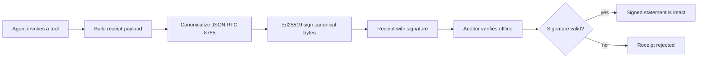
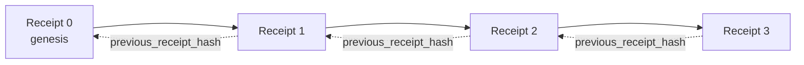

[သင်ခန်းစာဗီဒီယိုကြည့်ရန်: Cryptographic Receipts ဖြင့် AI စွမ်းဆောင်ရည်များကို လုံခြုံစေရန်](https://youtu.be/PLACEHOLDER_VIDEO_ID)

> _(သင်ခန်းစာဗီဒီယိုနှင့် သင်ခန်းစာ ၁၄ / ၁၅ ပုံစံနှင့် ကိုက်ညီစေရန် Microsoft အကြောင်းအရာအဖွဲ့မှ ပေါင်းတင်ပြီး ထည့်သွင်းမည်။)_

# Cryptographic Receipts ဖြင့် AI စွမ်းဆောင်ရည်များကို လုံခြုံစေရန်

## နိဒါန်း

ဤသင်ခန်းစာတွင် ကုသိုလ်ယူမည့်အကြောင်းအရာများမှာ -

- မည်သည့်အကြောင်းက AI စွမ်းဆောင်ရည်များအတွက် audit trail များသည် သတ်မှတ်ချက်လုပ်ငန်းစဉ်၊ ဒဲဘတ်တိုင်းတာခြင်းနှင့် ယုံကြည်မှုအတွက် အရေးကြီးသည်။
- Cryptographic receipt ဆိုတာဘာလဲ၊ ရယူတိုင်းသို့မဟုတ် လက်မှတ်မထိုးထားသော log လိုင်းနှင့် မည်သို့ကွဲပြားသနည်း။
- Python ဖြင့် agent ၏ tool မခေါ်သည့်အချိန် လက်မှတ်ထိုးထားသော receipt တစ်စောင်ကို မည်သို့ထုတ်လုပ်ရမည်နည်း။
- Receipt ကို offline တွင် မည်သို့ စစ်ဆေးပြီး လိမ်လည်မှုတွေက ဘယ်လို တွေ့ရှိရမည်နည်း။
- Receipt များကို ကြိုးစပ်ခြင်းအားဖြင့် တစ်ခုကို ဖယ်ရှားခြင်းသို့မဟုတ် အဆင့်ပြောင်းခြင်းဖြင့် ကြိုးစပ်မှု ဖြစ်ပျက်မှုများကို မည်သို့ ကာကွယ်ရမည်နည်း။
- Receipt များက ဘာများကို သက်သေပြနိုင်ပြီး ဘာများကို မသက်သေပြနိုင်ကြောင်း။

## သင်ယူမှုရည်မှန်းချက်များ

ဤသင်ခန်းစာပြီးမြောက်ပြီးပါက သင်သည်

- Agent ၏ လှုပ်ရှားမှုများအတွက် cryptographic provenance ကို လိုအပ်စေရန် မည်သည့်မမှန်မှုများကို လေ့လာသိရှိပါမည်။
- Canonical JSON payload အပေါ် Ed25519 ဖြင့် လက်မှတ်ထိုးထားသော receipt တစ်စောင် ထုတ်လုပ်နည်း။
- လက်မှတ်ထိုးသူ၏ public key မှသာ Receipt ကို တစ်ကိုယ်တည်း ေစတနာဖြင့် စစ်ဆေးနည်း။
- ပြင်ဆင်ထားသော Receipt တွင် ပြန်စစ်ဆေးခြင်းမှတဆင့် လိမ်လည်မှုတွေ ရှာဖွေရန်။
- Receipt များကို hash-chained မှတဆင့် စီမံ၍ ဂျက်ရိုက်မှု (chain) ဘာကြောင့် အရေးကြီးသလဲ ရှင်းပြနိူင်ခြင်း။
- Receipt များသည် (လက်မှတ်ရေးသူခွဲခြားချက်၊ ထိရောက်မှု၊ အစဉ်အစဉ် သက်သေ) မည်သည့်အရာများကို သက်သေပြပြီး အရာအချို့ (လှုပ်ရှားမှုမှန်ကန်မှု၊ ဥပဒေတရားအကျိုးသက်သေ့မှု) မသက်သေပြနိုင်ကြောင်း သဘောပေါက်သိရှိခြင်း။

## ပြဿနာ: သင်၏ Agent ၏ Audit Trail

Contoso Travel အတွက် AI agent တစ်ခုကို ထုတ်လုပ်ထားသည်ဟု ထင်မြင်ပါ။ Agent သည် ဖောက်သည်၏ တောင်းဆိုမှုများကို ဖတ်ရှု၍၊ သွားလာရေး API ကို ခေါ်ယူကာ ရွေးချယ်မှုများကို သုံးသပ်ပြီး ဖောက်သည်အနေဖြင့် ထိုင်ခုံများ ချိန်းထားသည်။ ကွပ်ကဲထားသောတချက်ကာလ၌ agent သည် ၅၀,၀၀၀ ခုံစာရင်းကို စီမံအုပ်ချုပ်ခဲ့သည်။

ဒီနေ့ auditor တစ်ဦး လာရောက်သည်။ သူတို့သည် ရိုးရှင်းသောမေးခွန်းတစ်ခုမေးသည်။ "သင်၏ agent ဘာလုပ်ခဲ့သလဲ ပြပါ။"

သင်သည် log ဖိုင်များကိုပေးသည်။ Auditor သည် အဲဒီဖိုင်များကိုကြည့်ပြီး အနည္းငယ်ပိုခက်တဲ့မေးခွန်း တစ်ခုမေးသည်။ "ဒီ logs တွေကို ပြုပြင်မဖြစ်ဘူးဘယ်လိုသေချာနိုင်တယ်?"

ဤသည်ဟာ audit-trail ပြဿနာဖြစ်သည်။ အားလုံးသည် ယနေ့မှာ -

- **Application logs**: agent အမြဲရေးသားသော log များဖြစ်ပြီး ဖိုင်စနစ်ခွင့်ပြုချက်ရှိသူမည်သူမဆို ပြုပြင်နိုင်သည်။
- **Cloud logging services**: တပ်ဆင်ထားသော platform တွင် tamper-evident ဖြစ်သော်လည်း auditor သည် platform operator ကို ယုံကြည်ရမည်။
- **Database transaction logs**: database ပြင်ဆင်မှုများအတွက် သင့်တော်သော်လည်း အခြား tool ခေါ်ဆိုရာတွင် မသင့်တော်ပါ။

ရှေ့ဆက်သော မည်သည့် log များမှ auditor ၏ မေးခွန်းကို ဖြေအတည်ပြုရန်အတွက် ယုံကြည်စိတ်ချမှုတစ်ခုလိုအပ်မည်။ သင်၊ cloud provider သို့မဟုတ် database vendor တစ်ဦးကို တက်သည့်ယုံကြည်မှုဖြစ်သည်။ အတွင်းပိုင်းအသုံးပြုမှုများအတွက် ယုံကြည်မှုဖြစ်နိုင်သော်လည်း ကြပ်မတ်ချက်ရှိသောလုပျငန်းများ (ဘဏ္ဍာရေး၊ ကျန်းမာရေးစောင့်ရှောက်မှု၊ EU AI Act ထိန်းညှိမှုများ) အတွက်တော့ မမှန်ပါ။

Cryptographic receipts သည် ဤပြဿနာကို ကန့်သတ်သည်၊ လက်မှတ်ထိုးထားသည့် ထောက်ခံချက်ကို တစ်ကိုယ်တည်း Verification လုပ်နိုင်ပါသည်။
Auditor သည် လက်မှတ်ချုပ်သော key နှင့် ထောက်ခံချက် ထုတ်ပေးသော အစိတ်အပိုင်းကို ယုံကြည်ရန် အပြင်အဆင် အကြောင်းပြချက်လိုအပ်သည်။
ထည့်သွင်းထားသော key သည် ကိုယ်ပိုင်စနစ်တကျဖြစ်မှုကို သက်သေပြပေးသည်၊ ထုတ်ပေးသူရဲ့ အမှတ်တံဆိပ် သို့မဟုတ် အမှုဆောင်နေရာကို မသက်သေပြနိုင်ပါ။


## Cryptographic Receipt ဆိုတာဘာလဲ?

Receipt သည် agent မှလုပ်ဆောင်လိုက်သည့် အရာနှင့် ပတ်သက်သော JSON object တစ်ခုဖြစ်ပြီး ဒစ်ဂျစ်တယ်လက်မှတ်ဖြင့် လက်မှတ်ထိုးထားသည်။



အနည်းဆုံး Receipt စနစ်သည် အောက်ပါအတိုင်းဖြစ်စေသည်။

```json
{
  "type": "agent.tool_call.v1",
  "agent_id": "contoso-travel-bot",
  "tool_name": "lookup_flights",
  "tool_args_hash": "sha256:a3f9c1...",
  "result_hash": "sha256:7b2e1d...",
  "policy_id": "contoso-travel-policy-v3",
  "timestamp": "2026-04-25T14:30:00Z",
  "sequence": 47,
  "previous_receipt_hash": "sha256:9d4e6a...",
  "signature": {
    "alg": "EdDSA",
    "sig": "c5af83...",
    "public_key": "8f3b2c..."
  }
}
```

ပင်ကို တာဝန်ယူလုပ်ဆောင်နေသော အချက်(၃)ခုမှာ -

၁။ **လက်မှတ်** (Signature)။ Receipt သည် agent ၏ gateway မှ Ed25519 ကိုယ်ပိုင် key ဖြင့် လက်မှတ်ထိုးသည်။ လက်မှတ်ထိုးသူ၏ public key ပါဝင်သူ မည်သူမဆို offline တွင် စစ်ဆေးနိုင်သည်။ ယုံကြည်စရာ အဖက်သည် key ကို pin ထားစေသို့မဟုတ် receipt ၏ အပြင် Trusted registry မှ ဖော်ထုတ်ရမည်။ လက်မှတ်ထိုးထားသော ဖောင် field များကို ပြောင်းလဲခြင်းသည် လက်မှတ်သည်မမှန်ကြောင်း ပြသသည်။

၂။ **Canonical encoding**။ လက်မှတ်ထိုးမှုမပြုမီ receipt ကို JSON Canonicalization Scheme (JCS, RFC 8785) နည်းဖြင့် serialize ပြုလုပ်သည်။ ထိုကဲ့သို့စနစ်ဖြင့် တူညီသော Receipt တစ်ခု produce လုပ်သော implementation နှစ်ခုမှာ bytes level တွင်တူညီသော output ဖြစ်စေသည်။ Canonicalization မရှိပါက JSON serializer အမျိုးမျိုးတွင် မတူညီသော signature များ ထွက်ရှိနိုင်ပါသည်။

၃။ **Hash chaining**။ `previous_receipt_hash` ဖောင်သည် ယခင် receipt နှင့် ပတ်သက်၍ ချိတ်ဆက်သည်။ Receipt ကို ဖယ်ရှားခြင်း သို့မဟုတ် အစီအစဉ်ပြောင်းခြင်းသည် sequence စနစ်ပျက်စီးစေသည်။ ဤဇယားကို ထိန်းသိမ်းခြင်းနည်းများတွင် pinned current chain head, independently witnessed checkpoint, သို့မဟုတ် authenticated closed-population commitment လိုအပ်သည်။

အဆိုပါအချက်(၃)ခုတွင် အာမခံချက်(၃) ခု ပေးသည် -

- **Key သို့ ပူးပေါင်းခြင်း**: ဤ key သည် ဤအကြောင်းအရာကို လက်မှတ်ထိုးထားသည်။ အဖွဲ့အစည်း သို့မဟုတ် လူကိုယ်တိုင်၏အညွှန်းသည် trusted key binding လိုအပ်သည်။
- **တိုင်းတာမှု**:  လက်မှတ်ထိုးမှုကတည်း က ဤအကြောင်းအရာ မပြောင်းလဲထားပါ။
- **စနစ်အတွင်း အစီအစဉ်**: ဤ receipt သည် ယခင် receipt နှင့် ဆက်သွယ်ထားသည်။

## Python မှ Receipt ထုတ်လုပ်ခြင်း

Receipt ထုတ်လုပ်ရန် အထူးစာကြည့်တိုက်မလိုအပ်ပါ။ Cryptographic primitives များမှာ စပ်ဆွဲတတ်ပြီး Python ကိုးကြောင်းလေးများဖြင့် လုပ်ဆောင်နိုင်သည်။

`code_samples/18-signed-receipts.ipynb` တွင် လက်တွေ့လုပ်ဆောင်မှုများအပြည့်အစုံမှတ်တမ်းတင်ထားသည်။ မြင့်မားသော အစီအစဉ်ကို စနစ်တကျ မှတ်တမ်းတင်ထားသော `code_samples/18-signed-receipts.execution-receipt.json` သည် notebook ၏ hash, Python နည်းပညာပတ်ဝန်းကျင်, ဆဲလ်အရေအတွက်နှင့် နောက်ဆုံးမြန်ဆန်ပြီးစစ်မှု မှတ်ချက်များကို လုပ်ဆောင်ထားသည်။

```python
import json
import hashlib
import base64
from nacl import signing
from jcs import canonicalize  # RFC 8785 canonical JSON

def b64url_nopad(data: bytes) -> str:
    return base64.urlsafe_b64encode(data).decode("ascii").rstrip("=")

def sha256_canonical(obj) -> str:
    """SHA-256 of a Python object's JCS-canonical JSON form."""
    return f"sha256:{hashlib.sha256(canonicalize(obj)).hexdigest()}"

# Generate or load a signing key (in production, store in a key vault)
signing_key = signing.SigningKey.generate()
verify_key = signing_key.verify_key
TRUSTED_PUBLIC_KEYS = {b64url_nopad(bytes(verify_key))}  # pinned out of band by the verifier

# Build the receipt payload (no signature yet)
tool_args = {"origin": "SYD", "destination": "LAX"}
tool_result = [{"flight": "QF11", "price": 1850, "stops": 0}]

payload = {
    "type": "agent.tool_call.v1",
    "agent_id": "contoso-travel-bot",
    "tool_name": "lookup_flights",
    "tool_args_hash": sha256_canonical(tool_args),
    "result_hash": sha256_canonical(tool_result),
    "policy_id": "contoso-travel-policy-v3",
    "timestamp": "2026-04-25T14:30:00Z",
    "sequence": 0,
    "previous_receipt_hash": None,
}

# Canonicalize and sign the JCS bytes directly. PureEdDSA hashes internally.
canonical_bytes = canonicalize(payload)
signature_bytes = signing_key.sign(canonical_bytes).signature

# Attach a structured signature object.
receipt = {
    **payload,
    "signature": {
        "alg": "EdDSA",
        "sig": b64url_nopad(signature_bytes),
        "public_key": b64url_nopad(bytes(verify_key)),
    },
}
```

၎င်းသည် စာရင်းအင်းလုံးဝဖြစ်သော လက်မှတ်ထိုးခြင်းလုပ်ငန်းစဉ်ဖြစ်သည်။ Notebook တွင် အဆင့်ဆင့် လုပ်နည်းများ ဖြတ်သန်းထားသည်။

## Receipt စစ်ဆေးခြင်းနှင့် လိမ်လည်မှုတွေ ရှာဖွေခြင်း

စစ်ဆေးမှု သည် လက်မှတ်ထိုးခြင်း၏ မူလ ရှေ့နောက် လုပ်ငန်းစဉ်၏ လှည့်ဖို့လုပ်ငန်းဖြစ်သည်။

```python
import base64
import hashlib
from nacl import signing
from nacl.exceptions import CryptoError
from jcs import canonicalize

def b64url_decode(s: str) -> bytes:
    padding = "=" * ((4 - len(s) % 4) % 4)
    return base64.b64decode(s + padding, altchars=b"-_", validate=True)

def verify_receipt(receipt: dict, trusted_public_keys: set[str]) -> bool:
    # The signature is a structured object: {"alg", "sig", "public_key"}.
    if not isinstance(receipt, dict):
        return False
    sig_obj = receipt.get("signature")
    if not isinstance(sig_obj, dict) or sig_obj.get("alg") != "EdDSA":
        return False
    try:
        # An inline key proves only self-consistency. Trust is configured out of band.
        public_key = sig_obj.get("public_key")
        signature = sig_obj.get("sig")
        if not isinstance(public_key, str) or not isinstance(signature, str):
            return False
        if public_key not in trusted_public_keys:
            return False
        payload = {k: v for k, v in receipt.items() if k != "signature"}
        canonical_bytes = canonicalize(payload)
        verify_key = signing.VerifyKey(b64url_decode(public_key))
        verify_key.verify(canonical_bytes, b64url_decode(signature))
        return True
    except (CryptoError, TypeError, ValueError, KeyError, OverflowError):
        return False
```

ဤ function သည် receipt တစ်ခုနှင့် relying party ၏ pinned key set ကို လက်ခံပြီး
`True` ကို Signature မှန်ကန်သည်ဟု သတ်မှတ်ရပါက ပြန်လည်ပေးပို့သည်။ စစ်ဆေးရန် Network ခေါ်ဆိုမှု မလိုအပ်ဘဲ ခွင့်ပြုထားသော key အပေါ်တွင်သာ သက်ဆိုင်ရာဖြစ်ရမည်။ 


လိမ်လည်မှု ရှာဖွေရန်အတွက် notebook တွင် လမ်းညွှန်မှုများ ပါဝင်သည်။

၁။ မှန်ကန်သော ပါဆယ်လက်မှတ် တစ်စောင် ထုတ်လုပ်ခြင်းနှင့် ၎င်းအတည်ပြုခြင်း။
၂။ `tool_args_hash` ကွက်တစ်ခု၏ ဘိုက်တစ်ခုကို ပြင်ဆင်ခြင်း။
၃။ အတည်ပြုမှုကို ထပ်မံ ပြုလုပ်ပြီး မအောင်မြင်မှုကို မြင်တွေ့ခြင်း။

၎င်းသည် ပါဆယ်လက်မှတ်များသည် ပြောင်းလဲမှုအထောက်အထားရှိကြောင်း လက်တွေ့ပြသခြင်းဖြစ်သည်- မည်သည့်ပြင်ဆင်မှုဖြစ်ဖြစ်၊ အသေးဆုံးဖြစ်စေ၊ လက်မှတ်ရေးထိုးချက်ကို ချိုးဖောက်သည်။

## အဆင့်‌စဉ်အက်ဂျင့်များအတွက် ပါဆယ်လက်မှတ်များ ချိတ်ဆက်ခြင်း

တစ်ခုတည်းသော လက်မှတ်ရေးထိုးသော ပါဆယ်လက်မှတ်သည် အရေးယူမှု တစ်ခုကို ကာကွယ်ပေးသည်။ ပါဆယ်လက်မှတ် ချိတ်သင်းမှုသည် ကန့်သတ်မှု အစဉ်တစ်ခုကို ကာကွယ်ပေးသည်။



ပါဆယ်လက်မှတ်တစ်ခုစီသည် မတိုင်မီ ပါဆယ်လက်မှတ်၏ ဟက်ရှ်ကို မှတ်တမ်းတင်ထားသည်။ ပါဆယ်လက်မှတ် ၂ ကို တိတ်ဆိတ်စွာ ဖယ်ရှားလိုပါက တိုက်ခိုက်သူသည် အောက်ပါအရာတစ်ခုခု လုပ်ဆောင်ရန် လိုအပ်သည်။

- ပါဆယ်လက်မှတ် ၃ ၏ `previous_receipt_hash` ကွက်ကို ပြင်ဆင်ခြင်း (ပါဆယ်လက်မှတ် ၃ ၏ လက်မှတ်ရေးထိုးချက် ပြတ်တောက်သည်) သို့မဟုတ်
- ပြင်ဆင်ပြီးသော ပါဆယ်လက်မှတ် ၃ တွင် လက်မှတ်ရေးထိုးချက် အသစ် တည်ဆောက်ခြင်း (အက်ဂျင့်၏ ကိုယ်ပိုင်သော့ချက် လိုအပ်သည်)။

ကိုယ်ပိုင်သော့ချက်ကို ကာကွယ်ထားပြီး အတည်ပြုသူ သီးခြား အသက်သွင်းခံထားသော ချိတ်ဆက်မှု ခေါင်းစဉ်ကို ခိုင်မာစွာ ထားရှိပါက ဤတိုက်ခိုက်မှုများ ကို မှတ်မိနိုင်သည်။
ပါဆယ်လက်မှတ်တစ်ခုစီတွင် သော့ချက် ထုတ်ဝေခြင်းသည် မလုံလောက်ပါဘူး။
လက်မှတ်ရေးထိုးသူ သို့မဟုတ် တိုက်ခိုက်သူသည် အခြားသော သော့ချက်တစ်ခုကို တင်ပြနိုင်ပြီး နောက်ဆုံးအစိတ်အပိုင်းကို ပြန်ရေးနိုင်သည်။
အပြင်အဆင် မရှိတဲ့ ယုံကြည်မှုနှင့် ပြည့်စုံမှုအချက်ပြတစ်ခုမရှိလျှင် လိုက်သည့်ပါတီသည် ချိုင့်ကို ကျဉ်းသွားစေပါ။

ဒါတွင် ဆရာကြီးမှ လမ်းဆောင်ပါသည်။

၁။ လူလုံးသုံးတိုင် စက်လုံးတစ်စု တည်ဆောက်ခြင်း။
၂။ လူလုံးသုံးတိုင်၏ `previous_receipt_hash` သည် ယခင်လူလုံး၏ အမှန်တကယ် hash နှင့် ကိုက်ညီကြောင်း မှတ်မိခြင်း။
၃။ အလယ်တွင် တစ်မျိုးသောလူလုံးတစ်ခု စွဲကြုံပြီး လိုက်သည့် ချိုင့်မှာ တိတိကျကျ ထိုနေရာတွင် ချိုးဖောက်သည့်အခါကို မြင်ရခြင်း။

၎င်းသည် မူရင်း issuer keys နှင့် ချိုင့် စစ်ဆေးချက်များအောက်တွင် ရှိသော အပြင်လောက စစ်ဆေးသူသည် မ mutable log store ကို ယုံကြည်ခြင်းမရှိဘဲ စစ်ထုတ်နိုင်ခြင်းခံ audit trail တစ်ခုကို ထုတ်ပေးပုံဖြစ်သည်။


## လူလုံးများ သက်သေပြသည့်အရာများ (နှင့် မပြုလုပ်သော အရာများ)

ဒီသင်ခန်းစာမှာ အရေးကြီးဆုံးပိုင်းဖြစ်သည်။ လူလုံးများမှာ စွမ်းအားရှိသော်လည်း ၎င်းတို့ရဲ့ စွမ်းအားက သတ်မှတ်ထားသည်။

**လူလုံးများ သက်သေပြသည့်အရာသုံးခု အကြောင်း:**

၁။ **အသိအမှတ်ပြုခြင်း**: သတ်မှတ်ထားသော key တစ်ခုသည် သတ်မှတ် payload ကို လက်မှတ်ရေးထိုးသည်။
၂။ **တရားမျှတမှု**: လက်မှတ်ရေးထိုးမှ စပြီး payload မပြောင်းလဲခဲ့ပါ။
၃။ **တင်ပြသေချာပြီး ဆက်နွယ်မှုစŏကြောင်း အတွင်း အစဉ်အတိုက်**: ဤလူလုံးသည် ရှေ့ဆုံးလူလုံးနှင့် ဆက်သက်ထားပါသည်။

**လူလုံးများ မသက်သေပြနိုင်သော အရာများ:**

၁။ **မှန်ကန်မှု**: ကိုယ်စားလှယ်၏ လုပ်ရပ်သည် မှန်ကန်သော လုပ်ရပ်ဖြစ်ကြောင်း။ လူလုံးတစ်ခုကို မှားသော ဖြေဆိုချက်အတွက်လည်းမှန်ကန်သော ဖြေဆိုချက်အတွက်ဖြစ်သည်ထက် သန့်ရှင်းစွာ လက်မှတ်ရေးထိုးနိုင်သည်။
၂။ **မူဝါဒလိုက်နာမှု**: `policy_id` တွင် ကိုးကားထားသော မူဝါဒကို အကဲဖြတ်ခဲ့သည့်သို့ မဟုတ် ယင်းလုပ်ဆောင်မှုကို စစ်ဆေးခဲ့လျှင် ခွင့်ပြုခဲ့မည်ဟူသော အချက်ပြချက်ကို သက်မှတ်ပေးခြင်းမဟုတ်ပါ။ လူလုံးသည် သက်သေပြသည်မှာ အဆိုပြုထားသည့်အရာနှင့် အကောင်အထည်ဖော်ခဲ့သည့်အရာ မဟုတ်ပါ။
၃။ **key မရှိသော ကိုယ်ပိုင်အသိအမှတ်ပြုမှု**: လူလုံးသည် "ဤ key သည် ဤအကြောင်းအရာကို လက်မှတ်ရေးထိုးခဲ့သည်" ဟုပြောသည်။ "ဤလူသည် ခွင့်ပြုခဲ့သည်" ဟူ၍ မပြောပါ။ key တစ်ခုကို လူတစ်ဦး သို့မဟုတ် အဖွဲ့အစည်းတစ်ရပ်နှင့် ချိတ်ဆက်ရန် အခြားသော ကိုယ်ပိုင်အသိအမှတ်ပြုမှု အခြေခံအား (directory, အများပြည်သူ key မှတ်တမ်း စသည်) တစ်ခု လိုအပ်သည်။
၄။ **ဖြည့်စွက်ချက်၏ မှန်ကန်မှု**: ကိုယ်စားလှယ်သည် ပြင်ဆင်ထားသော ပ႐မ်းပုံတစ်ခုကို လက်ခံပြီး ပြုလုပ်လျှင် လူလုံးသည် ထိုလုပ်ဆောင်မှုကို မှန်ကန်စွာ မှတ်တမ်းတင်သည်။ လူလုံးများသည် အထွေထွေထိုးစစ်ဆေးမှု၏ အောက်ခံ ဖြစ်ပြီး ၎င်းကို အစားထိုး၍ မဖြစ်နိုင်ပါ။
၅။ **အပြုအမူ သို့မဟုတ် လက်တွေ့သက်ရောက်မှု**: ခေါ်ဆိုမှုပြီးနောက် လူလုံးသည် ၎င်း၏ issuer က အဆိုပြုသည့် အရာကို မှတ်တမ်းတင်သည်။ ဝင်ခွင့်သက်သေသို့မဟုတ် အပြင်ခံအသက်သွင်းမှုကို သက်သေပြရန် သက်ဆိုင်သူ သို့မဟုတ် ပေးသွင်းသူ ကန့်သတ်ချက်မှ သက်သေ ရှိရမည်။
၆။ **ပြည့်စုံမှု**: လူလုံးတစ်ခု မရှိခြင်းသည် ကန့်သတ်ထားခြင်း၊ ဖြုတ်ထားခြင်း၊ ပျောက်ဆုံးခြင်း သို့မဟုတ် မှတ်တမ်းမတင်ခြင်း ဖြစ်နိုင်သည်။ မရှိခြင်းသည် သာသနာရှင်များ အတည်ပြုထားသော ပိတ်ပင်ထားသော လူ့အုပ်စုအတွင်းသာ သက်သေဖြစ်လာသည်။
၇။ **ယုံကြည်စိတ်ချရသော အချိန်**: လက်မှတ်ရေးထိုးထားသော အချိန်စကားစုသည် အသားပေးသူက ထိုတန်ဖိုးကို ကိုင်ဆောင်ခဲ့သည်ဟု သက်သေပြသည်၊ တန်ဖိုးသည် မှန်ကန်ကြောင်း မဟုတ်ပါ။ ယုံကြည်စိတ်ချရသော အချိန် သည် သီးခြားသော အချိန် အာဏာပိုင် သို့မဟုတ် သက်သေခံထားသော စစ်ဆေးချက်တစ်ခု လိုအပ်သည်။

၎င်း ကန့်သတ်ချက်သည် လည်းကောင်း နှစ်ချက်ကိစ္စအတွက် အရေးပါသည်။

- ၎င်းသည် လူလုံးများကို ဘာကြောင့် အသုံးဝင်သည်ကို ပြောပြသည်။ ကိုယ်စားလှယ်၏ အပြုအမူကို စစ်ဆေးခြင်းနှင့် ပျက်စီးမှု သိရှိနိုင်စေသည်၊ အဖွဲ့အစည်း နိုင်ငံတော် နယ်မြေများကိုဖြတ်သန်းရာတွင်ပါ။
- ၎င်းသည် သင်ယူရန် နှင့် ချက်တင်ထားရန် မူလအဆင့်များကို ပြောပြသည်။ ဖြည့်စွက်ချက် စစ်ဆေးခြင်း (သင်ခန်းစာ ၆), မူဝါဒ အကောင်အထည်ဖော်ခြင်း (အောက်တွင် အနည်းငယ်ဖော်ပြထားသည်), နှင့် ကိုယ်ပိုင် အသိအမှတ်ပြုမှု အခြေခံပေါ်တွင် တည်ဆောက်ခြင်း (ဤသင်ခန်းစာအတွင်း မပါဝင်)။

လူများမှားယွင်းတတ်သည့်အချက်မှာ "လူလုံးများ ရှိသည်" ဆိုသည်မှာ "ကျွန်တော်တို့ ပေးအပ်ခြင်း ရှိသည်" ဟု ခန့်မှန်းခြေခြင်းဖြစ်သည်။ မဟုတ်ပါ။ လူလုံးသည် အခြေခံဖြစ်သည့်အရာ ဖြစ်သည်။ အုပ်ချုပ်မှုသည် ထိုအခြေခံပေါ်တွင် တည်ဆောက်သည့် စနစ် ဖြစ်သည်။

## ခွင့်ပြုသူ၏ လက်မှတ်ကို တိတိကျကျ လုပ်ဆောင်ချက်နှင့် ဆက်စပ်ခြင်း

အထက်ပါ အချက် ၃ သည် မိမိပိုင် ရုပ်သံဌာနဖြစ်သင့်သည်။ လုပ်ဆောင်ချက်လူလုံးသည် "ဤ key သည် ဤအကြောင်းအရာကို လက်မှတ်ရေးထိုးခဲ့သည်" ဟု ဆိုသည်၊ "လူတစ်ဦး ခွင့်ပြုခဲ့သည်" ဟုလေ့မပြောပါ။ အဆင့်မြင့် အန္တရာယ်ရှိသော လုပ်ဆောင်ချက်များအတွက် (ပြန်အမ်းငွေ, ဖျက်ပစ်ခြင်း, ဝိုင်းလွှဲငွေလွှဲခြင်း), သီးခြား ခွင့်ပြုသူလက်မှတ်သည် အတိအကျ လုပ်ဆောင်ချက်ကို ဆက်လက် ချိတ်ဆက်ပေးနိုင်သည်။ ထို key နှင့် လူကို ချိတ်ဆက်ခြင်းနှင့် လူတစ်ဦး၏ တက်ရှိမှုစစ်ဆေးမှုသည် သီးခြားတာဝန်များ ဖြစ်ပါသည်။

နောက်တစ်ပတ်ကြောင်း `code_samples/human-authorization-receipts.ipynb` မှာ ထပ်မံလူလုံးအမျိုးအစား ဒုတိယအမျိုးအစား `human.approval.v1` ပါရှိပြီး သင်ခန်းစာမှ လူလုံးများအတိုင်း အထုပ်ပုံစံတူပါသည် (Ed25519 မှ Canonical JCS bytes ပေါ်တွင် လက်မှတ်ရေးထိုးထားသော ပုံစံထား payload, `signature` အရာထုပ်ထား bytes အပြင်ဘက်တွင်)။ ခွင့်ပြုသူ key သည် **တိတိကျကျ လုပ်ဆောင်ချက်နှင့် ၎င်း၏ digest အပြည့်အစုံ** ကို လက်မှတ်ရေးထိုးသည်။ ကိုယ်စားလှယ် key သည် **တူညီသော လုပ်ဆောင်ချက် digest** နှင့် `parent_approval_ref` ကို ကမ်းလှမ်းသော်လည်း၊ approval ထဲက `receipt_hash` သည် သင်ပြုလုပ်ထားသော ချိုင့်၏ `previous_receipt_hash` ဖြင့် တူညီသည်။ `verify_chain` တစ်ခုသည် **သီးခြား pin လုပ်ထားသော key မှတ်ပုံတင်များ** (ခွင့်ပြုသူ key နှင့် ကိုယ်စားလှယ် key) အောက်တွင် နှစ်ခုလုံးကို လှမ်းဆွဲသည်၊ ထို့ကြောင့် ကုဒ်လမ်းကြောင်းမျှတမည် သို့သော် အာဏာပိုင်များ မမျှတ။

ဤပိုင်ဆိုင်မှုကို သေချာဖော်ပြသော ၀ါကျ- *pin ထားသော ခွင့်ပြုသူ key သည် ဤတိတိကျကျ လုပ်ဆောင်ချက်ကို လက်မှတ်ရေးထိုးခဲ့ပြီး ကိုယ်စားလှယ် key သည် နောက်ပိုင်းတွင် တူညီသော လုပ်ဆောင်ချက် digest ပါဝင်သော ကြေညာချက်တစ်ခုကို လက်မှတ်ရေးထိုးခဲ့သည်။*
ဤသည် သက်သေအသုံးဝင်သည်၊ သို့သော် ဒီအလိုက် လုပ်ဆောင်ချက်၏ အကောင်အထည်ဖော်ခြင်းကို ကိုယ်တိုင် သက်သေမပြုပါ။ 
ထိန်းချုပ်မှုများအတွက် တိတိကျကျ ခွင့်ပြုချက်ကို လည်းလက်ရှိလုပ်ဆောင်သူ အတိုင်းအတာတွင် သိုလှောင်ထားပြီး တစ်ကြိမ်သာ သုံးစွဲရမည်။ အသိမရှိသော ပေးသွင်းသူ ရလဒ်များကို မသိရသေးသောအခြေအနေကနေ ပေါ်ထွန်းစေပြီး မတရား ပြန်လည်ကြိုးစားမှု မရှိရ။
သင်ခန်းစာ၏ 거절 fixtures များသည် လူလုံးချိုင့်အလွှာကို စမ်းသပ်သည်။


- အတုလုပ်ခြင်း၊ ရုတ်သိမ်းထားသော ဒုတိယသူ၊ နှစ်ဖက်စလုံးတွင် တုန့်ပြန်သော သော့များနှင့် မမှန်ကန်သောအထားရောက်သောအချက်အလက်များ;
- **ဟောင်းသော အာဏာ**: လက်မှတ်တစ်ခုသည် မကြာသေးခင်အထိ စစ်ဆေးနိုင်သော်လည်း၊ စည်းကမ်းဗားရှင်း ပြောင်းလဲသွားသောကြောင့် လက်မခံခြင်း၊ အတည်ပြုသူလက်မှတ်သည် ရပ်တည်ထားသောမှတ်တမ်းစာရင်းမှ လှည့်ပယ်ထုတ်ဖျက်မှုရှိခြင်း၊ သို့မဟုတ် စစ်ဆေးချိန်မှ ရရှိသောအတည်ပြုချိန် မတိုင်ခင် သက်တမ်းကုန်ဆုံးခြင်းတို့ကြောင့် ဤလက္ခဏာကို လက်မခံခြင်း;
- **digest substitution**: တရားဝင်လက်မှတ်ထိုးထားသော လုပ်ဆောင်ချက်လက်ခံစာတစ်ခုသည် *အခြား* canonical လုပ်ဆောင်ချက်ကို ချုပ်ဆိုပြီး *တကယ့်* အတည်ပြုပြုခဲ့သောလုပ်ဆောင်ချက်ကို ရည်ညွှန်းခြင်း။

များစွာသောအမှားများသည် တစ်ခုချင်းစီအတွက် ထူးခြားသော အကြောင်းပြချက်ကြောင့် ငြင်းပယ်မှုဖြစ်ပြီး၊ ဒါကြောင့် စစ်ဆေးသူတစ်ယောက်သည် ငြင်းပယ်ချက်ကိုဖတ်ခြင်းဖြင့် အာဏာဟောင်းနေခဲ့တာပါ သို့မဟုတ် အဆိုပြုထားသောလုပ်ဆောင်ချက်ပြောင်းလဲသွားသည်ကို သိရှိနိုင်သည်။ စစ်ဆေးခြင်းသည် ဖတ်နိုင်ရုံသာဖြစ်ပြီး ထပ်ခါထပ်ခါလုပ်နိုင်ပြီး၊ အတည်ပြုချက်ကို စားသုံးခြင်း သို့မဟုတ် ဖြန့်ဝေပြီး ထုတ်ပေးသူကို ဖိတ်ကြားခြင်း မရှိပါ။ ကွဲပြားသော အကောင်အထည်ဖော်သူသည် အတည်ပြုချက်ပြန်လည်ဖျက်ဆီးခြင်း မဖြစ်အောင် သက်တမ်းရှည်ခံသော atomic ပြန်လည်ကာကွယ်မှုနှင့် မူပိုင်ခွင့်၊ မအောင်မြင်မှုနှင့် မသေချာမှုအကျိုးအာနိသင်များကို တိတိကျကျလိုအပ်ပါသည်။ လူ့အတည်ပြုချက်လက်ခံစာသည် ဤသင်ခန်းစာဖြင့်သတ်မှတ်ထားသည့် ပညာပေးပေါင်းစပ်မှုတစ်ခုဖြစ်ပြီး `draft-farley-acta-signed-receipts` မှ သတ်မှတ်ထားသော လက်ခံစာအမျိုးအစားမဟုတ်ပါ။

## ထုတ်လုပ်မှု အညွှန်းများ

ဤသင်ခန်းစာရှိ Python ကုဒ်သည် သင်ဟာ တစ်ကြောင်းချင်းစီဖတ်ပြီး ဖြစ်ပေါ်နေသောကို အနက်ရှိုင်းစွာ နားလည်နိုင်စေရန် ရည်ရွယ်၍ အနည်းဆုံးအတိုင်းထားသည်။ ထုတ်လုပ်မှုတွင် သင်တွင် ရွေးချယ်စရာ နှစ်ခုရှိသည်။

1. **ရိုးရိုး ကုဒ်သည် ကုဒ်ခွဲခြမ်းစိတ်ဖြာမှု တိုက်ရိုက်တည်ဆောက်ခြင်း။** အပေါ်တွင် မြင်တွေ့သော ၅၀ ကြောင်းသည် အသုံးပြုမှုအများစုအတွက် လုံလောက်သည်။ PyNaCl (Ed25519) နှင့် `jcs` package (canonical JSON) တို့သည် အောင်မြင်စွာထိန်းသိမ်းထားပြီး စစ်ဆေးခံထားသော thư viện များဖြစ်သည်။

2. **ထုတ်လုပ်မှု လက်ခံစာ thư viện အသုံးချခြင်း။** အများကြီးသော ဖွင့်လှစ်ရင်းမြစ် စီမံကိန်းများသည် အောက်ဖော်ပြပါ လက္ခဏာများဖြင့် အတူတကွ ထပ်မံဖော်ထုတ်ထားကြသည် (သော့လှည့်ခြင်း၊ လက်မှတ်စုစစ်ခြင်း၊ JWK စနစ်ဖြန့်ဝေမှု၊ သတ်မှတ်ချက်အင်ဂျင်များနှင့် ပေါင်းစပ်မှု)။
   - လက်မှတ်ထိုးခြင်း သောလမ်းကြောင်းသည် JCS နှင့် လက်မှတ်အကျယ်အဝန်း နိယာမများကို IETF Internet-Draft တစ်ခု ([`draft-farley-acta-signed-receipts`](https://datatracker.ietf.org/doc/draft-farley-acta-signed-receipts/), ပြင်ဆင်မှု 02) တွင် လွတ်လပ်စွာ အသုံးပြုပြီး သတ်မှတ်ထားသည်။ ဤသင်ခန်းစာ၏ သေချက်ထည့်ထားသည့် လက်ခံစာသည် ဤ draft ၏ `{payload, signature}` ဖုံးအုပ်မှုနှင့် မတူကွဲပြားပြီး ကိုက်ညီသော အကောင်အထည်ဖော်မှုအဖြစ် မ ဖော်ပြထားပါ။ draft သည် ၎င်း၏ ကြိုးကြောင်းပုံစံကို ဦးတည်သော အကောင်အထည် ဖော်သူများအတွက် မျှဝေထားသော အကောင်အထည်ဖော်မှုစစ်ဆေးမှု ကိရိယာ ([agent-governance-testvectors](https://github.com/ScopeBlind/agent-governance-testvectors)) ကို ထုတ်ပြန်ထားသည်။
   - Microsoft Agent Governance Toolkit သည် Cedar-based စည်းကမ်းချက်များဖြင့် လက်ခံစာများ ဖွဲ့စည်းထားသည်။ ထို repository တွင် Tutorial 33 ကို တစ်စဉ်တစ်စဉ် အကြောင်းကြည်းပေးရေးသားထားသည်။
   - `protect-mcp` (npm) နှင့် `@veritasacta/verify` (npm) package များသည် Node-based လက်ခံစာ လက်မှတ်ထိုးခြင်းနှင့် အော့ဖ်လိုင်း စစ်ဆေးမှု လုပ်ဆောင်ချက်များကို ပံ့ပိုးပေးပြီး၊ MCP ဆာဗာမည်မျှကိုမဆို အတုမရှိသော စစ်ဆေးမှုလမ်းကြောင်းဖြင့် နွှဲပတ်ရန် ရည်ရွယ်သည်။ ၎င်းသည် ထားရှိ၍ ပူးပေါင်းအတည်ပြုခြင်းစီးရီးတွင် သက်သာစေသော လုပ်ဆောင်ချက်တစ်ခုသည် အတည်ပြုချက်လက်ခံစာကို ထုတ်ပေးသည် (ဒက်စတော့ပ်တွင် WebAuthn ပံ့ပိုးမှုပါဝင်သည်)၊ လူ့အတည်ပြုမှု notebook တွင် ပြထားသည့် approval-receipt pattern နောက်တူဖြစ်သည်။
   - **[nobulex](https://github.com/arian-gogani/nobulex)** Python SDK (`pip install nobulex`) သည် Python တွင် LangChain နှင့် CrewAI ပေါင်းစပ်မှုများဖြင့် Ed25519 + JCS လက်မှတ်ရေးထိုးမှုပုံစံတူပေးပြီး၊ ထုတ်ဝေထားသော cross-validation စမ်းသပ်မှုဗက်တာများနှင့် [OWASP PR #2210](https://github.com/OWASP/CheatSheetSeries/pull/2210) မှ တစ်ဆင့်ပေးသွင်းသော အညီအမံဇယား ပါဝင်သည်။
   - **[EMILIA Protocol](https://github.com/emiliaprotocol/emilia-protocol)** သည် တစ်ခုတည်းသော တိကျမှန်ကန်သော လက်ခံမှုအတည်ပြုခြင်းအလွှာကို ပံ့ပိုးပေးသည်။ offline မှ စစ်ဆေးနိုင်သော အတည်ပြုလက်မှတ်များ၊ pinned WebAuthn သို့မဟုတ် quorum အာဏာပိုင်၊ ဥပမာလုပ်သူနယ်နိမိတ်တွင် တစ်ကြိမ်စားသုံးမှု၊ ဖော်ပြထားသော မသေချာသောအကျိုးအမြတ်လမ်းကြောင်း တို့ ပါဝင်သည်။ ၎င်း၏ ဖရိန်ဝေါ့ခ် အက်ဒပ်တာများသည် လက်မှတ်ကို ပြင်ပသက်ရောက်မှုတစ်ခု ဖြစ်ပေါ်ခဲ့ကြောင်းသက်သေမဟုတ်ဘဲ လိုအပ်သော အထောက်အထားအဖြစ် သတ်မှတ်သည်။

ကိုယ်တိုင်ဖန်တီးခြင်းနှင့် 라이ဘရယ်ကို အသုံးပြုခြင်းအကြား ဆုံးဖြတ်မှုသည် ကိုယ်တိုင် JWT 라이ဘရယ်ရေးသားခြင်းနှင့် စမ်းသပ်ပြီးသား 라이ဘရယ်ကို အသုံးပြုခြင်း၏ ဆုံးဖြတ်မှုနှစ်ခုနှင့်တူညီသည်။ ၂ ဖက်လုံး မှန်ကန်သည်။ 라이ဘရယ်သည် အချိန်တို သွင်းပြီး audit  စစ်ဆေးမှုပိုင်းကို လျော့ပါးစေသည်။ မူလနားလည်မှုလိုအပ်သည့် လမ်းကြောင်းသည် primitive တစ်ခုစီကို နားလည်ရန် အတင်းအကျပ် ဖြစ်စေသည်။ ဤသင်ခန်းစာမှာ မူလက လမ်းကြောင်းကို သင်ကြားပေးသည်၊ သင့်အား မည်သည့်ရွေးချယ်မှုမဆို အခြေခံအဆောက်အအုံ ရရှိစေရန်။

## အသိပညာစစ်ဆေးမှု

လေ့ကျင့်ခန်းများသို့ ပြောင်းရွှေ့ရန်မပြုမီ သင်၏နားလည်မှုကို စမ်းသပ်ပါ။

**1။ လက်မှတ်သည် မူလအေးဂျင့်၏ နှိပ်စက်ထားသော Ed25519 ကိုယ်ပိုင် key ဖြင့် လက်မှတ်ရေးထိုးထားသည်။ စစ်ဆေးသူတွင် ဝေငှသည့် key အားသာရှိသည်။ စစ်ဆေးသူသည် လက်မှတ်ကို offline မှာ စစ်ဆေးနိုင်ပါသလား?**

<details>
<summary>အဖြေ</summary>

ဟုတ်သည်၊ ရုပ်မှန်စစ်ဆေးမှုမှာ ဝေငှသည့် key နှင့် လက်မှတ်ရေးထိုးထားသော bytes ဖိုင်သာ လိုအပ်သည်။ 
စစ်ဆေးသူသည် လက်မှတ်မှ ကွဲထွက်သည့် လက်ခံထားသော ဝေငှသည့် key ကို လွတ်လပ်စွာ ရယူပြီး pin ထားရမည်။ 
ယုံကြည်မှု ပြသနာတည်နေရာထားပြီးနောက် အင်တာနက် ဆက်သွယ်မှု မလိုအပ်တော့ပါ။
</details>

**2။ တိုက်ခိုက်သူသည် `policy_id` ကွက်လပ်တန်းကို ပြင်ဆင်၍ ပိုမိုခွင့်ပြုသော ပေါ်လစီအဖြစ် ပြောဆိုလိုက်သည်။ လက်မှတ်သည် မူလ payload အတွက်သာ ရေးထိုးထားသည်။ စစ်ဆေးမှုအတွင်း ဘာဖြစ်မလဲ?**

<details>
<summary>အဖြေ</summary>

စစ်ဆေးမှု မအောင်မြင်ပါ။ လက်မှတ်သည် မူလ payload ၏ canonical bytes များအပေါ် တွက်ချက်ထားသည်။ ကွက်လပ်တန်းတစ်ခုခုကို ပြောင်းလဲသည်မှာ အဆိုပါ bytes များကို ပြောင်းလဲစေပြီး လက်မှတ် မမှန်ခွင့်ရှိတော့ပါ။ တိုက်ခိုက်သူသည် မူလ key ကို မပိုင်သောကြောင့် ပြန်ရေးမည့် အသစ် valid လက်မှတ် ထုတ်နိုင်ခြင်း မရှိပါ။
</details>

**3။ နောက်ခံအချက်အလက်နှင့် ရလာဒ်များ အစား `tool_args_hash` နှင့် `result_hash` ကို အကြောင်းရင်း ဘာကြောင့် ထည့်သွင်းထားသနည်း?**

<details>
<summary>အဖြေ</summary>

အကြောင်း ၂ ချက်ရှိသည်။ ပထမအကြောင်းအရ လက်မှတ်ကို ဘဏ်စာရင်းသိုလှောင်မှု သို့မဟုတ် ပမာဏပေါ် လွှဲပြောင်းရန်လိုအပ်သောနေရာများတွင် မူရင်းအကြောင်းအရာ (သတင်းအချက်အလက်အကြောင်း, စီးပွားရေးဒေတာ) ထုတ်ဖော်ခြင်းမှာ ပြဿနာဖြစ်နိုင်သည်။ Hashing ဖြင့် လက်မှတ်ကို သေးငယ်စေပြီး အကြောင်းအရာကို ကိုယ်ပိုင်ထားသည်။ စစ်ဆေးသူသည် အဆိုပါ hash သည် နောက်ဆက်တွဲကူးသန်းချက်တစ်ခုနှင့် ကိုက်ညီမှုရှိနေကြောင်းလည်း စစ်ဆေးနိုင်သည်။ ဒုတိယ အကြောင်းအရ hash များမှာ အရွယ်အစားကွန်ကရက်သည်။ hash များပါသော လက်မှတ်သည် လက်ခံထည့်သွင်းချက်များနှင့် ရလဒ်များ ကြီးမားလည်း အရွယ်အစားကို ကန့်သတ်ထားသည်။
</details>

**4။ `previous_receipt_hash` ကွက်လပ်တန်းသည် လက်မှတ်တစ်စင်းစီကို မျှော်မှန်းသော ယခင်လက်မှတ်နှင့်ချိတ်ဆက်ထားသည်။ တိုက်ခိုက်သူက လက်မှတ်တစ်ခုကို အလယ်လမ်းမှ တိတ်ဆိတ် ဖျက်ပစ်ခဲ့လျှင် ဘာသည် မမှန်ကန်တော့မလဲ?**

<details>
<summary>အဖြေ</summary>

လက်မှတ် နောက်တစ်စင်းက မျှော်မှန်းထားသည့် ယခင်လက်မှတ်နှင့် ချိတ်ဆက်မှုမရှိတော့ပါ၊ ထို့ကြောင့် အဆိုပါ လက်မှတ်စီးရီး စစ်ဆေးမှုသည် လမ်းကြောင်းကြားမှစတင်၍ မအောင်မြင်တော့ပါ။ ထိုလက်မှတ်ရေးထိုးသူသည် ကိုယ်ပိုင် key ကို ထိန်းချုပ်ပြီးလျှင် suffix ကို ပြန်ရေးနိုင်၊ ဖြတ်တောက်နိုင်သည်။ ၎င်းအကြောင်းကို ရှာဖွေရန် pinned current head၊ ပြင်ပ checkpoint သို့ authenticated population commitment လိုအပ်သည်။
</details>


**5။ လက်မှတ်သည် သန့်ရှင်းစွာ စစ်ဆေးအောင်ဖြစ်ပါသည်။ သို့ပါက အေးဂျင့်၏ အက်ရှင်မှာ မှန်ကန်၊ သင့်တော် သို့မဟုတ် ပေါ်လစီနှင့် ကိုက်ညီသော ဟူသည်ကို သက်သေပြပါသလား?**

<details>
<summary>အဖြေ</summary>

မဟုတ်ပါ။ pinned key နှင့် စက်ဝိုင်း context အောက်၌ မှန်ကန်သော လက်မှတ်ဟာ လက်မှတ်ရေးသူ မှတ်တမ်း၊ အကြောင်းအရာ လုံခြုံမှုနှင့် တင်သွင်းထားသည့် ယခင်လက်မှတ်နှင့် ချိတ်ဆက်မှု ကို သက်သေပြသည်။ ၎င်းသည် အက်ရှင်မှန်ကန်ခြင်း သို့မဟုတ် တက်ဆင်ခြင်း၊ ပေါ်လစီ ကောက်နုတ်ခြင်း၊ အချိန်ညဏ်ကို သက်သေ မပြုပါ။
အကြောင်းအရာတင်းကြပ်မှု၊ နှင့် ပြသထားသော ယခင်ကူးလှည်းစစ်ချက်ဆီသို့ ချိန်းဆိုချက်တစ်ခု။ ၎င်းသည် အလုပ်ဆောင်မှုမှန်ကန်ခြင်း သို့မဟုတ် လုပ်ဆောင်ခဲ့ခြင်း၊ မူဝါဒကို စစ်ဆေးခဲ့ခြင်း၊ အချိန်တံဆိပ်သည် ဖြစ်မှုကို သက်သေပြသော မဟုတ်ပါ။
action was correct or executed, that the policy was evaluated, that the timestamp is
ယုံကြည်စိတ်ချရခြင်း သို့မဟုတ် မှတ်တမ်းစာရင်း ပြည့်စုံကြောင်း ဖြစ်ကြောင်းသက်သေပြခြင်း များ ဖြစ်သည်။ ဒါဟာ သင်ခန်းစာထဲမှာ အရေးကြီးဆုံး နယ်နိမိတ်ဖြစ်ပါတယ်။
</details>

## လေ့ကျင့်ခန်း အစီအစဉ်

`code_samples/18-signed-receipts.ipynb` ကိုဖွင့်ပြီး အပိုင်းလေးခုအားလုံး ပြီးမြောက်အောင် လုပ်ဆောင်ပါ။

1. **အပိုင်း ၁**: သင်၏ ပထမဆုံး ချက်ပြုတ်စာချုပ်ကို လက်မှတ်ရေးထိုးပြီး အတည်ပြုပါ။
2. **အပိုင်း ၂**: ချက်ပြုတ်စာချုပ်ကို တခြားပြောင်းလဲပြီး အတည်ပြုမှု မအောင်မြင်ကြောင်း ကြည့်ပါ။
3. **အပိုင်း ၃**: ချက်ပြုတ်စာချုပ် သုံးခုတန်းလိုက် ဖန်တီးပြီး ဆက်တိုက်မှန်ကန်မှုကို အတည်ပြုပါ။
4. **အပိုင်း ၄**: Microsoft Agent Framework ဖြင့် တည်ဆောက်ထားသော Agent ကို pattern ထည့်သုံး၍ ဆက်တိုက် ချက်ပြုတ်စာချုပ် လက်မှတ်ရေးထိုးခြင်း ပြုလုပ်ပြီး အတည်ပြုပါ။

**အရှည်သွယ် စိန်ခေါ်မှု ၁:** သင့်ရဲ့ ကိုယ်ပိုင် ရွေးချယ်တဲ့ ဖြည့်စွက် လယ်ရေးကျတဲ့ ကိုယ်ပိုင် အကွက်တစ်ခုဖြင့် ချက်ပြုတ်စာချုပ် schema ကို တိုးချဲ့ပါ (ဥပမာ, ရှာဖွေစစ်ဆေးရန် request ID တစ်ခု), canonical လက်မှတ်ရေးထိုးခြင်း ပြုလုပ်ရာမှာ ထည့်သွင်းပြီး ချက်ပြုတ်စာချုပ်သည် verification မှတဆင့် ပြန်လည်သွားလာနိုင်ကြောင်း အတည်ပြုပါ။ ထို့နောက် လက်မှတ်ရေးထိုးပြီးနောက် အကွက်ကို ပြောင်းလဲပြီး အတည်ပြုမှု မအောင်မြင်ကြောင်း အတည်ပြုပါ။ ဒါက canonical encoding တစ်ခုလုံး၏ ကွိုင်တစ်ခုချင်းစီက ဝေါဟာရကို ဘယ်လို လက်မှတ်တွင် ပါဝင်မယ်ဆိုတာကို နားလည်စေပါသည်။

**အရှည်သွယ် စိန်ခေါ်မှု ၂:** သင့်ရဲ့ ချက်ပြုတ်စာချုပ် နှစ်ခုကို SHA-256 ဖြင့် ပေါင်းစပ်ပြီး (အတိုင်းအတာသတ်မှတ်ထားသော စဉ်လိုက် canonical bytes ကို ချိတ်ဆက်ခြင်း) ထို digest ကို သြဂုတ်သုံးဆောင်ထားသော သုံးခုအပေါ် နယ်ပယ်အသစ်အဖြစ် ထည့်သွင်းပြီး လက်မှတ်ရေးထိုးပါ။ သုံးခုစလုံး သက်တမ်းမပြတ် ပြန်လည်အတည်ပြုနိုင်ကြောင်း မယူချက်ပါ။ သင် တစ်ဆင့်ထဲက ပါဝင်မှု စစ်ဆေးမှုကို ဖန်တီးလိုက်ပြီ ဖြစ်သည်။ သုံးခုမြောက် ချက်ပြုတ်ကို ပိုင်ဆိုင်သူက ပထမနှစ်ခု များ လက်မှတ်ရေးထိုးချိန်တွင် ရှိခဲ့ကြောင်း အကြောင်းဖော်ပြနိုင်သည်၊ အပြည့်အစုံ မဖော်ပြပဲ။ ဒါဟာ selective-disclosure ချက်ပြုတ်စာချုပ်တွင် သုံးသော ပုံစံ ဖြစ်ပါတယ် (Merkle commitments, RFC 6962)။

## နိဂုံးချုပ်

Cryptographic ချက်ပြုတ်စာချုပ်များသည် AI agent များအတွက် audit trail ဖြစ်ပြီး -

- **ယုံကြည်စိတ်ချမှု တည်ငြိမ်မှုကြောင့် လွတ်လပ်စွာ အတည်ပြုနိုင်သည်**: လက်ခံထားသော အများပြည်သူ key များနှင့် လက်မှတ်ရေးထိုးထားသော bytes များဖြင့် service အား မလိုအပ်ဘဲ အတည်ပြုနိုင်သည်။
- **ပြုပြင်မှု အထောက်အထား**: ပြုပြင်/ပြောင်းလဲမှုတစ်ခုခု လက်မှတ်ကို မမှန်ကန်စေပါ။
- **မျှဝေခွင့်ရှိသော JSON ဖိုင်**: ချက်ပြုတ်စာချုပ်ဟာ အတိုချုပ် JSON ဖိုင်ဖြစ်ပြီး စာရွက် နှင့်ပြန်လည်အတည်ပြုနိုင်သည်။
- **စံချိန်စံညွှန်းနှင့် ကိုက်ညီသည်**: Ed25519 (RFC 8032), JCS (RFC 8785), နှင့် SHA-256 အပေါ် ဆောက်ထားပြီး ကျယ်ပြန့်စွာ အသုံးပြုသည်။

၎င်းတို့သည် input အတည်ပြုခြင်း၊ မူဝါဒအကောင်အထည်ဖော်ခြင်း၊ ဆောင်ရွက်သူ ဝင်ခွင့်ထုတ်ပေးခြင်း၊
အကျိုးသက်ရောက်မှု သက်သေပြမှု၊ ပြည့်စုံမှု ထိန်းချုပ်မှု သို့မဟုတ် ကိုယ်စားလှယ် အချက်အလက်အခြေခံအုတ်မြစ် မဟုတ်ပါ။ ၎င်းတို့သည်
ထိုအဆင့်များအတွက် မူကြမ်းခံ ဖြစ်ကြသည်။ စည်းမျဉ်းစည်းကမ်းရှိသော သို့မဟုတ် အဖွဲ့အစည်းအတော်များစွာ ပါဝင်သော လုပ်ငန်းစဉ်များတွင်၊ ချက်ပြုတ်စာချုပ်များသည် အထောက်အထားရှိသော
ထုတ်ပြန်သူ ဖြေရှင်းချက်များကို အော်ဒီတာ၏ ကိုယ်ပိုင် ယုံကြည်ချက် စီမံခန့်ခွဲမှုအောက်တွင် လွတ်လပ်စွာ စစ်ဆေးနိုင်စေသည်။

အရေးပါတဲ့ အဆုံးဖြတ်ချက်မှာ - ချက်ပြုတ်စာချုပ်များသည် သတ်မှတ်ထားသော key တစ်ခုဟာ သတ်မှတ်ထားသော
အချက်အလက်ကို လက်မှတ်ရေးထိုးခဲ့ကြောင်း သက်သေပြသည်။ ဖမ်းဆီးထားသည့် အချိန်မှတ်တမ်းသည် လက်မှတ်ရေးထိုးသူ အတည်ပြုချက် ဖြစ်ပြီး သီးခြား အချိန်အတည်ပြုမှု မရှိပါကဖြစ်သည်။ ချက်ပြုတ်စာချုပ်သည် ၎င်း အကြောင်းအရာသည် မှန်ကန်သည်၊ လုပ်ဆောင်ချက် တစ်ခု ပြီးမြောက်သည်၊ သို့မဟုတ် မှတ်တမ်း စာရင်း အပြည့်အစုံ ဖြစ်သည်ကို သက်သေ ပြုခြင်း မဟုတ်ပါ။ ထိုကွာခြားချက်များကို မကြာခဏ ထိန်းသိမ်းထားပါ။


- [ ] **အတည်ပြုသူ key ယုံကြည်မှု ထူထောင်ပါ။** JWK Set သို့မဟုတ် စာရင်းမှ keys များကို ထုတ်ပြန်ပါ၊ ပြီးမှ လက်မှတ်ပြုသူ identity၊ key set နှင့် rotation policy ကို individual ချက်ပြုတ်စာချုပ်များအပြင် ယုံကြည်သူများ Pin ထားပါ။ သီးသန့် inline key တစ်ခုက ယုံကြည်မှုပင်မ မဟုတ်ပါ။
- [ ] **ချိတ်ဆက်မှု ချိန်းတင်မှုကို ပြင်ပတွင် ထားပါ။** ရုံးချိန်တိုင်း chain head hash များကို transparency log (Sigstore Rekor, RFC 3161 timestamp authority တစ်ခုအဖြစ် သို့မဟုတ် အတွင်းမဲ့ ဒုတိယစနစ်တစ်ခု) မှာရေးသွင်းပါ၊ ပြင်ပက အဖက်က "ဒီချိတ်ဆက်မှု က အချိန်ကာလတစ်ခုမှာ ရှိတယ်" ဆိုတာ အတည်ပြုနိုင်။ 
- [ ] **ချက်ပြုတ်စာချုပ်များကို မပြောင်းလဲနိုင်သော အတိုင်း သိုလှောင်ပါ။** Append-only blob storage (Azure Storage immutability policies, AWS S3 Object Lock) သည် အတွင်းခံမှတ်တမ်း ပြန်ရေးခြင်းမှ ကာကွယ်ပေးသည်။
- [ ] **သိုလှောင်မှု ကာလကို ဆုံးဖြတ်ပါ။** Compliance စနစ်များသည် များသောအားဖြင့် နှစ်ပေါင်းများစွာ သိုလှောင်ရန်လိုအပ်သည်။ ချက်ပြုတ်စာချုပ် တိုးမြှင့်မှုကို စီစဉ်ပါ (ချက်ပြုတ်စာချုပ် တစ်ခု = ~500 bytes; Agent တစ်ခု တစ်နေ့ 10K ခေါ်ဆိုမှုလုပ်ပါက နှစ်စဉ် ~1.8 GB ဖြစ်သည်)။
- [ ] **သိမ်းဆည်းထားမည်ကိုဆုံးဖြတ်ပါ။** ကန့်သတ်ချက်များစနစ်အများစုသည် နှစ်ပေါင်းများစွာ သိမ်းဆည်းထားရန် လိုအပ်သည်။ လက်ခံမှု ပမာဏ မြင့်မားမှုအတွက်အစီအစဉ်ရေးဆွဲပါ (လက်ခံခွင့်တစ်ခုစီမှာ ~၅၀၀ ဘိုင့်; တစ်ရက်ကို ၁၀၀၀၀ ခေါ်ဆိုမှု ပြုလုပ်သော ကိုယ်စားလှယ်သည် တစ်နှစ်ကို ~၁.၈ GB ထုတ်လုပ်သည်)။
- [ ] **ရရှိချက်များက မကာကွယ်ပေးသည့်အချက်များကို မှတ်တမ်းတင်ပါ။** ရရှိချက်များသည် သက်ဆိုင်ရာ အတည်ပြုချက်၊ သန့်ရှင်းမှုနှင့် အဆက်မပြတ် အစီအစဉ်များကို သက်သေပြသည်။ သင့်ရဲ့ ဆောင်ရွက်ချက်စာရွက်မှာ ရရှိချက်များနဲ့တကွ ထည့်သွင်းထားတဲ့ ထိန်းချုပ်မှုများ (ဒေတာထည့်သွင်းမှု စိစစ်ခြင်း၊ မူဝါဒ အကောင်အထည်ဖော်ခြင်း၊ အရေအတွက်ကန့်သတ်ခြင်း၊ ကိုယ်ရေးအချက်အလက် အင်ဖရွ်စထရပ်ချာ) ဘယ်အရာတွေရှိမှုကို ရှင်းလင်းဖော်ပြဖို့ လိုသည်။

### AI အေးဂျင့်များကို လုံခြုံစိတ်ချစွာ ထိန်းသိမ်းရန် ပိုမိုမေးမြန်းလိုသော မေးခွန်းများရှိပါသလား?

အခြားသင်ယူသူများနှင့် တွေ့ဆုံရန်၊ ရုံးချိန်တွေတက်ရောက်ရန် နှင့် သင့် AI အေးဂျင့် မေးခွန်းများကို ဖြေကြားပေးရန် [Microsoft Foundry Discord](https://aka.ms/ai-agents/discord) ကို ဆက်သွယ်ပါ။

## ဒီသင်ခန်းစာထက်ပိုပြီး

ဒီသင်ခန်းစာမှာ တစ်ခုတည်းရရှိချက် လက်မှတ်ရေးထိုးခြင်းနဲ့ ဟက်ရှ်ဆက်တန်းလိုက် အစီအစဉ်များကို ဖော်ပြထားပါသည်။ အတူတကွ ပြုလုပ်နိုင်သည့် များစွာသော မြင့်မြတ်သော ပုံစံများကို သင့်ထိန်းချုပ်မှု နည်းဗျူဟာ တိုးတက်လာသလို တွေ့မြင်ရနိုင်ပါသည်။

- **ရွေးချယ် ဖော်ပြခြင်း။** ရရှိချက်ရဲ့ စာရင်းအချက်အလက်များကို ပုဂ္ဂိုလ်အလိုက် အာဏာပိုင်များအား ဖော်ပြနိုင်ပြီး၊ အခြားအချက်များ မပြောင်းလဲကြောင်း သက်သေပြနိုင်သည် (RFC 6962-ပုံစံ Merkle သစ်ပင်စနစ်)။ တစ်ဆယ်တည်းရရှိချက်ပြုလုပ်ရာတွင် လုံးဝစစ်ဆေးမှုအတွက် လိုအပ်ချက်နှင့် ဒေတာလျော့ချရေး စည်းမျဉ်းများ (ဥပမာ GDPR) အတွက် လိုအပ်သည့် အတိုချွတ်အမြတ်မြတ်တွေ တစ်ပြိုင်နက် ဖြည့်ဆည်းရမည့်အခါ အသုံးဝင်သည်။
- **ရရှိချက် ပယ်ဖျက်ခြင်း။** လက်မှတ်ရေးထိုးသော key တစ်ခု ပျက်စီးသွားပါက အဲဒီ key နဲ့ လက်မှတ်ရေးထိုးထားသော ရရှိချက်အားလုံးကို ယုံကြည်မှုမရှိဖို့ အချိန်တစ်ခုမှစ၍ အမှတ်အသားရဖို့ လိုအပ်သည်။ စံနမူနာများမှာ- အချိန်တိုအတွက်သာ အသုံးပြုလို့ရသော လက်မှတ်ရေးထိုးသူ key များနှင့် ထုတ်ပြန်ထားသော ပယ်ဖျက်ရရှိချက်စာရင်း သို့မဟုတ် ပယ်ဖျက်မှု အချက်အလက်များပါရှိသော မှတ်တမ်းစာရင်း။
- **နှစ်ဖက်ခြား / ခွဲခြားလက်မှတ်ထိုးလက်ခံရရှိမှုများ။** အချို့အကောင်အထည်ဖော်မှုများသည် လက်မှတ်ထိုးပြီးသော payload ကို အကောင်အထည်မပြုမှုမတိုင်မီ (`authorization_*`) နှင့် အကောင်အထည်ပြုပြီးနောက် (`result_*`) အစိတ်အပိုင်းများအဖြစ် ခွဲခြား သွားပြီး လွတ်လပ်သောလက်မှတ်များနှင့်တွဲဖက်သည်၊ ခွင့်ပြုချက်ဆုံးဖြတ်ချက်နှင့် အတွေ့ကြုံရလဒ်သည် သြဇာရှိသူများက မတူညီစွာ သို့မဟုတ် အချိန်ကွာခြားမှုဖြင့် ထုတ်လုပ်သောအခါ၌ အသုံးဝင်သည်။ ၎င်းသည် ဤသင်ခန်းစာ၌ သင်ကြားပေးထားသော လက်ခံရရှိမှု ပုံစံအပေါ် ပေါင်းထည့်ဆက်ခံ လုပ်ဆောင်ချက် ဖြစ်သည်။
- **Payload ဖွဲ့စည်းခြင်း။** လက်ခံရရှိမှုသည် သင် `result_hash` ထဲသို့ ထည့်သွင်းသည့် ဘိုင်များရပ်တိုင်းကို ဆဲလ်ဖြစ်စေသည်။ အမှန်တကယ် အသုံးပြုသော payload များသည် တစ်ခုတည်းသောကိရိယာခေါ်ဆိုမှုရလဒ်ထက် ပိုမိုချဲ့ထွင်သည်- ခြွင်းချက်အခြေပြုစဉ်းစားမှု (မော်ဒယ်ခန့်မှန်းမှု၊ ပြင်ဆင်မှုများ၊ သက်သေကိစ္စနှင့် ၎င်း၏ပြည့်စုံမှု၊ အန္တရာယ်အခြေအနေ၊ တာဝန်ယူမှု စီးပွားမှုစတဲ့စတာတွေ၊ လမ်းကြောင်း ရက်များ၊ ဗဟိုဒေါ်များ) တစ်ခုတည်းသော လက်ခံရရှိမှုက စီမံထားသော payload ထဲမှာ နေထိုင်နိုင်သည်။ ၎င်းသည် လက်ခံရရှိမှု ပုံစံကို အနည်းဆုံးထား၍၊ payload စာရင်းဇယားများကို ဒိုမိန်းအလိုက် တိုးတက်နိုင်စေသည်။
- **အစွန်းရောက် အကောင်အထည်ဖော်မှုအားလုံးနဲ့ ကိုက်ညီမှု။** တူညီသော လက်ခံရရှိမှု ပုံစံကို ပလတ်ဖောင်းအမျိုးမျိုး (Python, TypeScript, Rust, Go) မှ လွတ်လပ်စွာ အကောင်အထည်ဖော်ထားပြီး အသွားအလာစစ်ဆေးမှုများကို ဝေစုကြည့်ခြင်းဖြင့် အတည်ပြုသည်။ သင်သည် ကိုယ်ပိုင် အကောင်အထည်ဖော်မှုကို တည်ဆောက်သည်ဟု ဆိုလျှင်၊ ထုတ်ဝေချက်များနှင့်ဖြတ်သန်းစစ်ဆေးခြင်းက ကြိုးကြပ်မှုကို အတည်ပြုသည်။
- **Post-quantum ပြောင်းရွှေ့မှု။** Ed25519 သည် ယနေ့အချိန်တွင် ကျယ်ကျယ်ပြန့်ပြန့် အသုံးပြုနေသော်လည်း အ Quantum-proof မဟုတ်ပါ။ `alg` စာတမ်းတစ်ခုလုံးသည် ပြောင်းရွှေ့မှုမဟုတ်ပါ- ပရိုဖိုင်သည် ML-DSA key encoding, canonical လက်မှတ်ထိုး ဘိုင်များ, အတည်ပြုခြင်း, လိုအပ်သူ ဒဏ်ခံမူ, နည်းမြှင့်မှုကြောင့် အားပေးခြင်းနှင့် ပြောင်းရွှေ့မှု သဘောတူညီချက်တို့ကို သတ်မှတ်ရမည်ဖြစ်သည်။ ကိုက်ညီမှု ခေါ်ယူမှုမပြုမီ ထိပ်တန်း vectors များ ဖြည့်စွက်၍ နှစ်ဖက်လက်မှတ်ပြောင်းရွှေ့မှုကို စီစဉ်စစ်ဆေးပါ။

## အပိုဆောင်း အရင်းအမြစ်များ

- <a href="https://datatracker.ietf.org/doc/draft-farley-acta-signed-receipts/" target="_blank">IETF Internet-Draft: Signed Decision Receipts for Machine-to-Machine Access Control</a>
- <a href="https://learn.microsoft.com/azure/ai-studio/responsible-use-of-ai-overview" target="_blank">Responsible AI overview (Azure AI)</a>
- <a href="https://datatracker.ietf.org/doc/html/rfc8032" target="_blank">RFC 8032: Edwards-Curve Digital Signature Algorithm (EdDSA)</a>
- <a href="https://datatracker.ietf.org/doc/html/rfc8785" target="_blank">RFC 8785: JSON Canonicalization Scheme (JCS)</a>
- <a href="https://datatracker.ietf.org/doc/html/rfc6962" target="_blank">RFC 6962: Certificate Transparency</a> (Merkle-tree construction used by selective-disclosure receipts)
- <a href="https://github.com/microsoft/agent-governance-toolkit/blob/main/docs/tutorials/33-offline-verifiable-receipts.md" target="_blank">Microsoft Agent Governance Toolkit, Tutorial 33: Offline-Verifiable Decision Receipts</a>
- <a href="https://github.com/ScopeBlind/agent-governance-testvectors" target="_blank">Cross-implementation conformance test vectors</a> for the receipt format used in this lesson (Apache-2.0)
- <a href="https://pynacl.readthedocs.io/" target="_blank">PyNaCl documentation</a> (Ed25519 in Python)

## ယခင် သင်ခန်းစာ

[Creating Local AI Agents](../17-creating-local-ai-agents/README.md)

---

<!-- CO-OP TRANSLATOR DISCLAIMER START -->
**ပြောကြားချက်**
ဤစာတမ်းကို AI ဘာသာပြန်ဝန်ဆောင်မှု [Co-op Translator](https://github.com/Azure/co-op-translator) အသုံးပြု၍ ဘာသာပြန်ထားပါသည်။ ကျွန်ုပ်တို့သည် တိကျမှန်ကန်မှုအတွက် ကြိုးပမ်းနေသော်လည်း၊ စက်ကိရိယာဘာသာပြန်ခြင်းများတွင် အမှားများ သို့မဟုတ် မှားယွင်းချက်များ ပါဝင်နိုင်ကြောင်း သတိပြုပါရန် လိုအပ်ပါသည်။ မူလစာတမ်းကို မူရင်းဘာသာဖြင့်သာ ယုံကြည်စိတ်ချရသော အချက်အလက်အဖြစ် သတ်မှတ်သင့်သည်။ အရေးကြီးသည့် သတင်းအချက်အလက်များအတွက် ပရော်ဖက်ရှင်နယ် လူသားဘာသာပြန်သူဝန်ဆောင်မှုကို အကြံပြုပါသည်။ ဤဘာသာပြန်ချက်ကို အသုံးပြုခြင်းမှ ဖြစ်ပေါ်လာသော နားလည်မှုကွာခြားမှုများ သို့မဟုတ် မမှန်ကန်သော အသုံးပြုမှုများအတွက် ကျွန်ုပ်တို့ တာဝန်မခံပါ။
<!-- CO-OP TRANSLATOR DISCLAIMER END -->