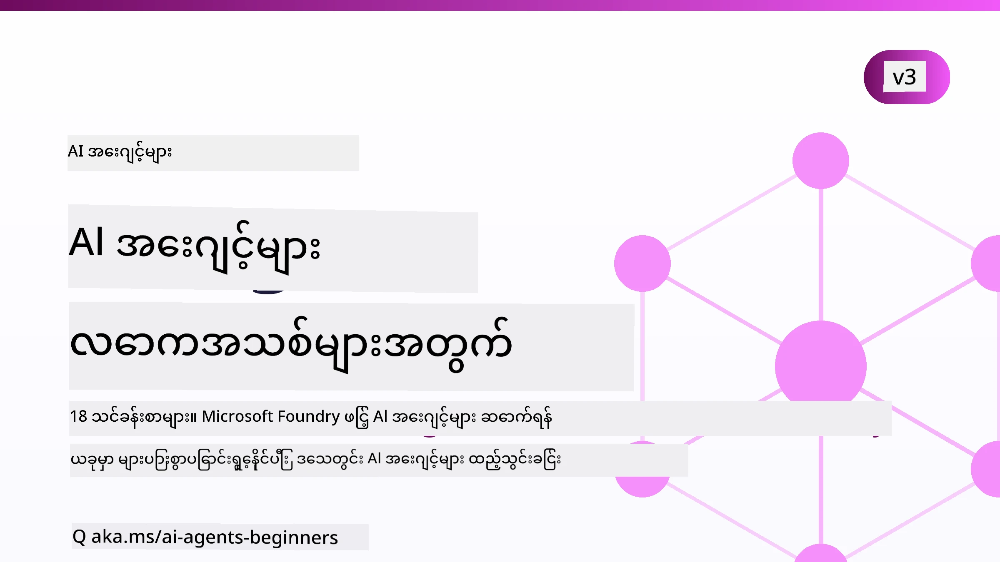

# စတင်သူများအတွက် AI ကိုယ်စားလှယ်များ - သင်တန်းတစ်ခု



## AI ကိုယ်စားလှယ်များတည်ဆောက်ရန် စတင်လိုသူများအတွက် လိုအပ်သည့် အရာအားလုံးကိုသင်ကြားပေးသော သင်တန်း

[](https://github.com/microsoft/ai-agents-for-beginners/blob/master/LICENSE?WT.mc_id=academic-105485-koreyst)
[](https://GitHub.com/microsoft/ai-agents-for-beginners/graphs/contributors/?WT.mc_id=academic-105485-koreyst)
[](https://GitHub.com/microsoft/ai-agents-for-beginners/issues/?WT.mc_id=academic-105485-koreyst)
[](https://GitHub.com/microsoft/ai-agents-for-beginners/pulls/?WT.mc_id=academic-105485-koreyst)
[](http://makeapullrequest.com?WT.mc_id=academic-105485-koreyst)

### 🌐 ဘာသာစကားများစုံကို ထောက်ပံ့ထားခြင်း

#### [Co-op Translator](https://github.com/Azure/co-op-translator) နှင့် အတူ ဘာသာပြန်ထားသည်

<!-- CO-OP TRANSLATOR LANGUAGES TABLE START -->
[Arabic](../ar/README.md) | [Bengali](../bn/README.md) | [Bulgarian](../bg/README.md) | [Burmese (Myanmar)](./README.md) | [Chinese (Simplified)](../zh-CN/README.md) | [Chinese (Traditional, Hong Kong)](../zh-HK/README.md) | [Chinese (Traditional, Macau)](../zh-MO/README.md) | [Chinese (Traditional, Taiwan)](../zh-TW/README.md) | [Croatian](../hr/README.md) | [Czech](../cs/README.md) | [Danish](../da/README.md) | [Dutch](../nl/README.md) | [Estonian](../et/README.md) | [Finnish](../fi/README.md) | [French](../fr/README.md) | [German](../de/README.md) | [Greek](../el/README.md) | [Hebrew](../he/README.md) | [Hindi](../hi/README.md) | [Hungarian](../hu/README.md) | [Indonesian](../id/README.md) | [Italian](../it/README.md) | [Japanese](../ja/README.md) | [Kannada](../kn/README.md) | [Khmer](../km/README.md) | [Korean](../ko/README.md) | [Lithuanian](../lt/README.md) | [Malay](../ms/README.md) | [Malayalam](../ml/README.md) | [Manipuri (Meitei Mayek)](../mni/README.md) | [Marathi](../mr/README.md) | [Nepali](../ne/README.md) | [Nigerian Pidgin](../pcm/README.md) | [Norwegian](../no/README.md) | [Persian (Farsi)](../fa/README.md) | [Polish](../pl/README.md) | [Portuguese (Brazil)](../pt-BR/README.md) | [Portuguese (Portugal)](../pt-PT/README.md) | [Punjabi (Gurmukhi)](../pa/README.md) | [Romanian](../ro/README.md) | [Russian](../ru/README.md) | [Serbian (Cyrillic)](../sr/README.md) | [Slovak](../sk/README.md) | [Slovenian](../sl/README.md) | [Spanish](../es/README.md) | [Swahili](../sw/README.md) | [Swedish](../sv/README.md) | [Tagalog (Filipino)](../tl/README.md) | [Tamil](../ta/README.md) | [Telugu](../te/README.md) | [Thai](../th/README.md) | [Turkish](../tr/README.md) | [Ukrainian](../uk/README.md) | [Urdu](../ur/README.md) | [Vietnamese](../vi/README.md)

> **ဒေသခံတွင်ကလုန်းလုပ်ချင်ပါသလား?**
>
> ဤ repository တွင် ဘာသာပြန်ချက် ၅၀ ကျော်အား ပါဝင်၍ ဒေါင်းလုပ်အရွယ်အစား တော်တော်လေး တိုးမြှင့်စေသည်။ ဘာသာပြန်ချက်များမပါအောင် ကလုန်းလုပ်ရန် sparse checkout ကိုအသုံးပြုပါ။
>
> **Bash / macOS / Linux:**
> ```bash
> git clone --filter=blob:none --sparse https://github.com/microsoft/ai-agents-for-beginners.git
> cd ai-agents-for-beginners
> git sparse-checkout set --no-cone '/*' '!translations' '!translated_images'
> ```
>
> **CMD (Windows):**
> ```cmd
> git clone --filter=blob:none --sparse https://github.com/microsoft/ai-agents-for-beginners.git
> cd ai-agents-for-beginners
> git sparse-checkout set --no-cone "/*" "!translations" "!translated_images"
> ```
>
> သင့်အား သင်တန်းကို အမြန်ဆုံးပြီးမြောက်စေရန် လိုအပ်သမျှ အရာအားလုံးကို ပေးစွမ်းပါသည်။
<!-- CO-OP TRANSLATOR LANGUAGES TABLE END -->

**အခြားဘာသာစကား ရွေးချယ်မှုများအတွက် [Co-op Translator ရဲ့ ထောက်ပံ့သောဘာသာစကားများ](https://github.com/Azure/co-op-translator/blob/main/docs/supported-languages.md) ကို ကြည့်ပါ။**

[](https://GitHub.com/microsoft/ai-agents-for-beginners/watchers/?WT.mc_id=academic-105485-koreyst)
[](https://GitHub.com/microsoft/ai-agents-for-beginners/network/?WT.mc_id=academic-105485-koreyst)
[](https://GitHub.com/microsoft/ai-agents-for-beginners/stargazers/?WT.mc_id=academic-105485-koreyst)

[](https://discord.com/invite/ATgtXmAS5D)


## 🌱 စတင်ခြင်း

ဤသင်တန်းတွင် AI ကိုယ်စားလှယ်များ တည်ဆောက်ခြင်း၏ အခြေခံများကို သင်ကြားပေးသည်။ ဘယ်သင်ခန်းစာကိုမဆို စတင်လေ့လာနိုင်သည်။

ဤသင်တန်းတွင် ဘာသာစကားစုံကို ထောက်ပံ့မှု ရှိသည်။ ကျွန်ုပ်တို့၏ [ရရှိနိုင်သော ဘာသာစကားများကို ဤနေရာတွင်](#-multi-language-support) သွားရောက်ကြည့်ပါ။

မိမိ ပထမဆုံး Generative AI မော်ဒယ်များဖြင့် တည်ဆောက်ခြင်းလုပ်ကိုင်မည့်သူများအတွက် [Generative AI For Beginners](https://aka.ms/genai-beginners) သင်တန်းကို သင်ကြားပေးရာတွင် GenAI ဖြင့် တည်ဆောက်ခြင်းဆိုင်ရာ ၂၁ ခန်းစာပါဝင်သည်။

တုန့်ပြန်မှု (🌟) ပေးရန်နှင့် ကုဒ် တည်ဆောက်ရန်အတွက် ဤ repo ကို [star ပြုလုပ်ပါ](https://docs.github.com/en/get-started/exploring-projects-on-github/saving-repositories-with-stars?WT.mc_id=academic-105485-koreyst) နှင့် [fork ပြုလုပ်ပါ](https://github.com/microsoft/ai-agents-for-beginners/fork) မမေ့ပါနှင့်။

### အခြားသင်ယူသူများနှင့် တွေ့ဆုံခြင်း၊ မေးခွန်းများအား ဖြေကြားမှုရယူခြင်း

AI ကိုယ်စားလှယ်များအကြောင်း မစုံလင်မှုရှိပါက သို့မဟုတ် မေးခွန်းများရှိပါက [Microsoft Foundry Discord](https://aka.ms/ai-agents/discord) တွင် လိုက်လံ ဝင်ရောက်မေးမြန်းနိုင်သည်။

### လိုအပ်သောအရာများ

သင်တန်း နှင့်တွဲဖက်၍ ကုဒ် နမူနာများပါရှိပြီး အဆိုပါကုဒ်များကို code_samples ဖိုလ်ဒါတွင် ရှာဖွေနိုင်သည်။ မိမိကိုယ်ပိုင် မိတ္တူ ဖန်တီးရန် [repo ကို fork လုပ်ပါ](https://github.com/microsoft/ai-agents-for-beginners/fork)။

ထိုကုဒ် နမူနာများတွင် Microsoft Foundry Agent Service V2 ဖြင့် Microsoft Agent Framework ကို အသုံးပြုထားသည်။

- [Microsoft Foundry](https://aka.ms/ai-agents-beginners/ai-foundry) - Azure အကောင့် လိုအပ်သည်

ဤသင်တန်းတွင် Microsoft မှ AI ကိုယ်စားလှယ် frameworks နှင့် ဝန်ဆောင်မှုများ ဖြစ်သည်။

- [Microsoft Agent Framework (MAF)](https://learn.microsoft.com/agent-framework/overview/)
- [Microsoft Foundry Agent Service V2](https://aka.ms/ai-agents-beginners/ai-agent-service)

အချို့ကုဒ် နမူနာများသည် [MiniMax](https://platform.minimaxi.com/) ကဲ့သို့ OpenAI ကိုက်ညီသော အခြားပံ့ပိုးသူများကိုလည်း ထောက်ပံ့သည်။ ၎င်းသည် ကြီးမားသော context မော်ဒယ်များ (အထိ 204K token) ကို ပံ့ပိုးပေးသည်။ ပုံသေပြန့်နဲ့အသုံပြုချက်များအတွက် [Course Setup](./00-course-setup/README.md) ကို ကြည့်ပါ။

ဤသင်တန်း၏ ကုဒ် Run နည်းအချက်အလက်များ အတွက် [Course Setup](./00-course-setup/README.md) သို့ သွားပါ။

## 🙏 ကူညီလိုပါသလား?

အကြံပြုချက်များရှိပါသလား သို့မဟုတ် စာလုံးပေါင်း၊ ကုဒ် အမှားများတွေ့ပါသလား? [ပြဿနာတင်သွင်းပါ](https://github.com/microsoft/ai-agents-for-beginners/issues?WT.mc_id=academic-105485-koreyst) သို့မဟုတ် [pull request တင်ပါ](https://github.com/microsoft/ai-agents-for-beginners/pulls?WT.mc_id=academic-105485-koreyst)


## 📂 သင်ခန်းစာ တစ်ခုချင်းစီတွင် ပါဝင်သည်

- README တွင်ရေးသားထားသော သင်ခန်းစာနှင့် မျှဝေမှုဗီဒီယိုအတို
- Microsoft Agent Framework နှင့် Microsoft Foundry ဖြင့်ရေးသားသော Python ကုဒ်နမူနာများ
- သင်ယူမှုဆက်လက်လုပ်ဆောင်ရန် အရင်းအမြစ်များ သို့ ချိတ်ဆက်ထားခြင်း


## 🗃️ သင်ခန်းစာများ

| **သင်ခန်းစာ**                                  | **စာသားနှင့်ကုဒ်**                                  | **ဗီဒီယို**                                               | **အပိုသင်ယူမှု**                                                                  |
|----------------------------------------------|----------------------------------------------------|------------------------------------------------------------|----------------------------------------------------------------------------------------|
| AI ကိုယ်စားလှယ်များနှင့် ၎င်း၏ အသုံးချမှုတင်ခဲ့ခြင်း | [Link](./01-intro-to-ai-agents/README.md)         | [Video](https://youtu.be/3zgm60bXmQk?si=z8QygFvYQv-9WtO1) | [Link](https://aka.ms/ai-agents-beginners/collection?WT.mc_id=academic-105485-koreyst) |
| AI ကိုယ်စားလှယ်များ Framework များ ရှာဖွေခြင်း | [Link](./02-explore-agentic-frameworks/README.md) | [Video](https://youtu.be/ODwF-EZo_O8?si=Vawth4hzVaHv-u0H) | [Link](https://aka.ms/ai-agents-beginners/collection?WT.mc_id=academic-105485-koreyst) |
| AI ကိုယ်စားလှယ်များ ဒီဇိုင်း စနစ်များ နားလည်ခြင်း | [Link](./03-agentic-design-patterns/README.md) | [Video](https://youtu.be/m9lM8qqoOEA?si=BIzHwzstTPL8o9GF) | [Link](https://aka.ms/ai-agents-beginners/collection?WT.mc_id=academic-105485-koreyst) |
| ကိရိယာ အသုံးပြုခြင်း ဒီဇိုင်းစနစ် | [Link](./04-tool-use/README.md) | [Video](https://youtu.be/vieRiPRx-gI?si=2z6O2Xu2cu_Jz46N) | [Link](https://aka.ms/ai-agents-beginners/collection?WT.mc_id=academic-105485-koreyst) |
| Agentic RAG | [Link](./05-agentic-rag/README.md) | [Video](https://youtu.be/WcjAARvdL7I?si=gKPWsQpKiIlDH9A3) | [Link](https://aka.ms/ai-agents-beginners/collection?WT.mc_id=academic-105485-koreyst) |
| ယုံကြည်စိတ်ချရသော AI ကိုယ်စားလှယ်များ တည်ဆောက်ခြင်း | [Link](./06-building-trustworthy-agents/README.md) | [Video](https://youtu.be/iZKkMEGBCUQ?si=jZjpiMnGFOE9L8OK) | [Link](https://aka.ms/ai-agents-beginners/collection?WT.mc_id=academic-105485-koreyst) |
| စီမံကိန်းဖန်တီးခြင်း ဒီဇိုင်းစနစ် | [Link](./07-planning-design/README.md) | [Video](https://youtu.be/kPfJ2BrBCMY?si=6SC_iv_E5-mzucnC) | [Link](https://aka.ms/ai-agents-beginners/collection?WT.mc_id=academic-105485-koreyst) |
| Multi-Agent ဒီဇိုင်းစနစ် | [Link](./08-multi-agent/README.md) | [Video](https://youtu.be/V6HpE9hZEx0?si=rMgDhEu7wXo2uo6g) | [Link](https://aka.ms/ai-agents-beginners/collection?WT.mc_id=academic-105485-koreyst) |
| Metacognition ဒီဇိုင်းစနစ် | [Link](./09-metacognition/README.md) | [Video](https://youtu.be/His9R6gw6Ec?si=8gck6vvdSNCt6OcF) | [Link](https://aka.ms/ai-agents-beginners/collection?WT.mc_id=academic-105485-koreyst) |
| ပြုပြင်ထုတ်လုပ်မှု AI ကိုယ်စားလှယ်များ | [Link](./10-ai-agents-production/README.md) | [Video](https://youtu.be/l4TP6IyJxmQ?si=31dnhexRo6yLRJDl) | [Link](https://aka.ms/ai-agents-beginners/collection?WT.mc_id=academic-105485-koreyst) |
| Agentic Protocols အသုံးပြုခြင်း (MCP, A2A နှင့် NLWeb) | [Link](./11-agentic-protocols/README.md) | [Video](https://youtu.be/X-Dh9R3Opn8) | [Link](https://aka.ms/ai-agents-beginners/collection?WT.mc_id=academic-105485-koreyst) |
| AI ကိုယ်စားလှယ်များအတွက် Context Engineering | [Link](./12-context-engineering/README.md) | [Video](https://youtu.be/F5zqRV7gEag) | [Link](https://aka.ms/ai-agents-beginners/collection?WT.mc_id=academic-105485-koreyst) |
| Agentic Memory ကို စီမံခန့်ခွဲခြင်း | [Link](./13-agent-memory/README.md) | [Video](https://youtu.be/QrYbHesIxpw?si=vZkVwKrQ4ieCcIPx) |  |
| Microsoft Agent Framework ကို ရှာဖွေခြင်း | [Link](./14-microsoft-agent-framework/README.md) |  |  |
| ကွန်ပျူတာအသုံးပြုရန် Agents (CUA) တည်ဆောက်ခြင်း | [Link](./15-browser-use/README.md) |  | [Link](https://docs.browser-use.com/examples/templates/playwright-integration) |
| တိုးချဲ့နိုင်သော Agents များကို Deploy လုပ်ခြင်း | [Link](./16-deploying-scalable-agents/README.md) |  | [Link](https://learn.microsoft.com/azure/ai-foundry/agents/overview) |
| ဒေသခံ AI ကိုယ်စားလှယ်များဖန်တီးခြင်း | [Link](./17-creating-local-ai-agents/README.md) |  | [Link](https://learn.microsoft.com/azure/ai-foundry/foundry-local/) |
| AI ကိုယ်စားလှယ်များကို လုံခြုံရေးဖြင့် အသုံးပြုခြင်း | [Link](./18-securing-ai-agents/README.md) |  | [Link](https://aka.ms/ai-agents-beginners/collection?WT.mc_id=academic-105485-koreyst) |

## 🎒 အခြားသင်တန်းများ

ကျွန်ုပ်တို့၏ အဖွဲ့သည် အခြားသင်တန်းများကိုထုတ်လုပ်သည်! ကြည့်ပါ-

<!-- CO-OP TRANSLATOR OTHER COURSES START -->
### LangChain
[](https://aka.ms/langchain4j-for-beginners)
[](https://aka.ms/langchainjs-for-beginners?WT.mc_id=m365-94501-dwahlin)
[](https://github.com/microsoft/langchain-for-beginners?WT.mc_id=m365-94501-dwahlin)
---

### Azure / Edge / MCP / Agents
[](https://github.com/microsoft/AZD-for-beginners?WT.mc_id=academic-105485-koreyst)
[](https://github.com/microsoft/edgeai-for-beginners?WT.mc_id=academic-105485-koreyst)
[](https://github.com/microsoft/mcp-for-beginners?WT.mc_id=academic-105485-koreyst)
[](https://github.com/microsoft/ai-agents-for-beginners?WT.mc_id=academic-105485-koreyst)

---
 
### Generative AI စီးရီးများ
[](https://github.com/microsoft/generative-ai-for-beginners?WT.mc_id=academic-105485-koreyst)
[-9333EA?style=for-the-badge&labelColor=E5E7EB&color=9333EA)](https://github.com/microsoft/Generative-AI-for-beginners-dotnet?WT.mc_id=academic-105485-koreyst)
[-C084FC?style=for-the-badge&labelColor=E5E7EB&color=C084FC)](https://github.com/microsoft/generative-ai-for-beginners-java?WT.mc_id=academic-105485-koreyst)
[-E879F9?style=for-the-badge&labelColor=E5E7EB&color=E879F9)](https://github.com/microsoft/generative-ai-with-javascript?WT.mc_id=academic-105485-koreyst)

---
 
### အထွေထွေသင်ယူမှု
[](https://aka.ms/ml-beginners?WT.mc_id=academic-105485-koreyst)
[](https://aka.ms/datascience-beginners?WT.mc_id=academic-105485-koreyst)
[](https://aka.ms/ai-beginners?WT.mc_id=academic-105485-koreyst)
[](https://github.com/microsoft/Security-101?WT.mc_id=academic-96948-sayoung)
[](https://aka.ms/webdev-beginners?WT.mc_id=academic-105485-koreyst)
[](https://aka.ms/iot-beginners?WT.mc_id=academic-105485-koreyst)
[](https://github.com/microsoft/xr-development-for-beginners?WT.mc_id=academic-105485-koreyst)

---
 
### Copilot စီးရီး
[](https://aka.ms/GitHubCopilotAI?WT.mc_id=academic-105485-koreyst)
[](https://github.com/microsoft/mastering-github-copilot-for-dotnet-csharp-developers?WT.mc_id=academic-105485-koreyst)
[](https://github.com/microsoft/CopilotAdventures?WT.mc_id=academic-105485-koreyst)
<!-- CO-OP TRANSLATOR OTHER COURSES END -->

## 🌟 အသိုင်းအဝိုင်း အထူးကျေးဇူးတင်ရှိခြင်း

Agentic RAG ကို ဖော်ပြသည့် အရေးကြီးသော ကုဒ်နမူနာများ ပေးအပ်ပေးသော [Shivam Goyal](https://www.linkedin.com/in/shivam2003/) ကို ကျေးဇူးတင်ရှိပါသည်။

## ပံ့ပိုးဆောင်ရွက်ခြင်း

ဤပရောဂျက်သည် ပံ့ပိုးမှုများနှင့် အကြံပြုချက်များကို ကြိုဆိုပါသည်။ ပံ့ပိုးမှုအများစုသည် သင်၏ပံ့ပိုးမှုကို အသုံးပြုခွင့်ရှိကြောင်းနှင့် သုံးနိုင်ကြောင်း အတည်ပြုသော
Contributor License Agreement (CLA) သဘောတူချက်ကို သဘောတူရမည်ဖြစ်သည်။ အသေးစိတ်အတွက် <https://cla.opensource.microsoft.com> သို့ ဝင်ရောက်ကြည့်ရှုနိုင်ပါသည်။


ဤပရောဂျက်သည် [Microsoft Open Source Code of Conduct](https://opensource.microsoft.com/codeofconduct/) ကို လက်ခံအသုံးပြုထားပါသည်။
အချက်အလက်ပိုများကို [Code of Conduct FAQ](https://opensource.microsoft.com/codeofconduct/faq/) ဘောင်မှကြည့်ရှုနိုင်ပြီး [opencode@microsoft.com](mailto:opencode@microsoft.com) သို့ မေးမြန်းမှု သို့မဟုတ် မှတ်ချက်များ ပေးပို့နိုင်ပါသည်။

## တံဆိပ်အမှတ်တံဆိပ်များ

ဤပရောဂျက်တွင် ပရောဂျက်များ၊ ထုတ်ကုန်များ သို့မဟုတ် ဝန်ဆောင်မှုများအတွက် တံဆိပ်များ သို့မဟုတ် လိုဂိုများ ပါဝင်နိုင်သည်။ Microsoft တံဆိပ်များ သို့မဟုတ် လိုဂိုများကို သေချာပြီး ခွင့်ပြုချက်ဖြင့်သာ အသုံးပြုနိုင်ပြီး

Microsoft တံဆိပ်များ သို့မဟုတ် လိုဂိုများကို ဤပရောဂျက် ထည့်သွင်းပြင်ဆင်ပြီး အသုံးပြုမှုသည် Microsoft အား အားပေးကြောင်း သို့မဟုတ် အတတ်ပညာဌာနကြီးကြပ်မှု ရှိပါသည်ဟု မထင်မှတ်ရပါ။


ကုန်အမှတ်တံဆိပ်များ သို့မဟုတ် လိုဂိုများသည်
[Microsoft ၏ ကုန်အမှတ်တံဆိပ်နှင့် Brand လမ်းညွှန်ချက်များ](https://www.microsoft.com/legal/intellectualproperty/trademarks/usage/general) ကိုလိုက်နာရမည်။
ဤပရောဂျက်၏ပြင်ဆင်ချက်များတွင် Microsoft ကုန်အမှတ်တံဆိပ် သို့မဟုတ် လိုဂိုများကို အသုံးပြုခြင်းက Microsoft ၏ ပံ့ပိုးမှုကို မပုံဖော်စေရန် သို့မဟုတ် မပျက်ပြားစေရန်ဖြစ်ရမည်။
တတိယပါတီ၏ ကုန်အမှတ်တံဆိပ် သို့မဟုတ် လိုဂိုများကို အသုံးပြုမှုသည် ထိုတတိယပါတီများ၏ မူဝါဒများအောက်တွင်သာ ဖြစ်ရမည်။

## ကူညီမှုရယူခြင်း


AI အက်ပ်တွေ ဖန်တီးရာမှာ တားမြစ်မှုများရှိပါက သို့မဟုတ် မေးခွန်းများရှိပါက ပူးပေါင်းပါရန် -

[](https://aka.ms/foundry/discord)

ထုတ်ကုန်တုံ့ပြန်ချက်များ သို့မဟုတ် ဖန်တီးစဉ် ကွဲပြားမှုများရှိပါက သွားရောက်ပါရန် -

[](https://aka.ms/foundry/forum)

---

<!-- CO-OP TRANSLATOR DISCLAIMER START -->
**ပြောကြားချက်**
ဤစာတမ်းကို AI ဘာသာပြန်ဝန်ဆောင်မှု [Co-op Translator](https://github.com/Azure/co-op-translator) အသုံးပြု၍ ဘာသာပြန်ထားပါသည်။ ကျွန်ုပ်တို့သည် တိကျမှန်ကန်မှုအတွက် ကြိုးပမ်းနေသော်လည်း၊ စက်ကိရိယာဘာသာပြန်ခြင်းများတွင် အမှားများ သို့မဟုတ် မှားယွင်းချက်များ ပါဝင်နိုင်ကြောင်း သတိပြုပါရန် လိုအပ်ပါသည်။ မူလစာတမ်းကို မူရင်းဘာသာဖြင့်သာ ယုံကြည်စိတ်ချရသော အချက်အလက်အဖြစ် သတ်မှတ်သင့်သည်။ အရေးကြီးသည့် သတင်းအချက်အလက်များအတွက် ပရော်ဖက်ရှင်နယ် လူသားဘာသာပြန်သူဝန်ဆောင်မှုကို အကြံပြုပါသည်။ ဤဘာသာပြန်ချက်ကို အသုံးပြုခြင်းမှ ဖြစ်ပေါ်လာသော နားလည်မှုကွာခြားမှုများ သို့မဟုတ် မမှန်ကန်သော အသုံးပြုမှုများအတွက် ကျွန်ုပ်တို့ တာဝန်မခံပါ။
<!-- CO-OP TRANSLATOR DISCLAIMER END -->