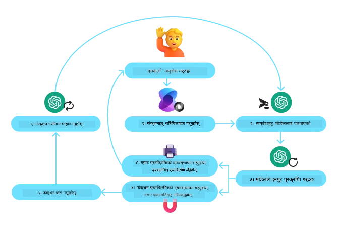
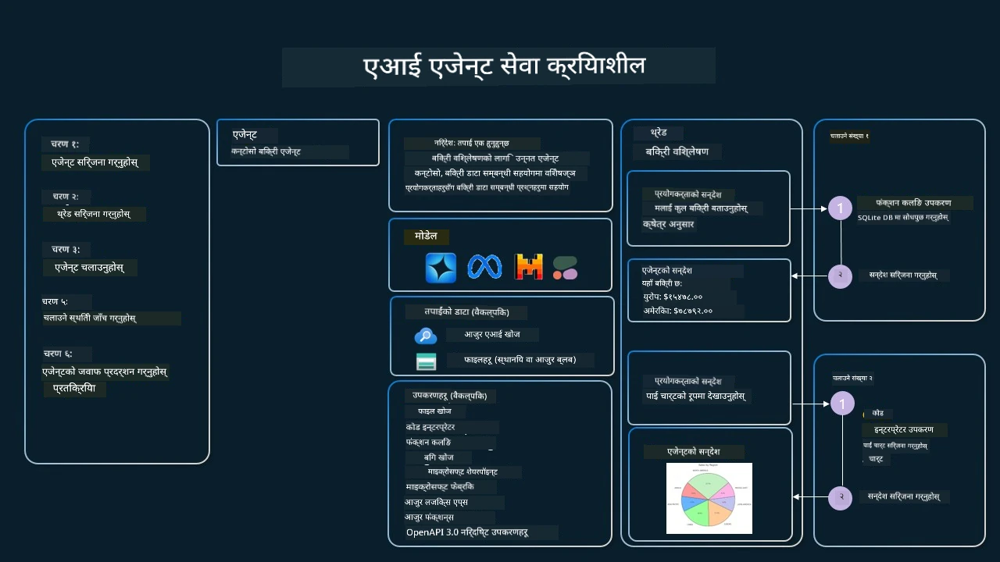

[](https://youtu.be/vieRiPRx-gI?si=cEZ8ApnT6Sus9rhn)

> _(यस पाठको भिडियो हेर्न माथिको तस्वीरमा क्लिक गर्नुहोस्)_

# उपकरण प्रयोग डिजाइन ढाँचा

उपकरणहरू रोचक छन् किनभने तिनीहरूले एआई एजेन्टहरूलाई विस्तृत दायराका कौशलहरू प्रदान गर्दछन्। एजेन्टसँग सीमित कार्यहरूको सेट नभएर उपकरण थपेर, एजेन्टले अब विभिन्न कार्यहरू गर्न सक्छ। यस अध्यायमा, हामी उपकरण प्रयोग डिजाइन ढाँचामा हेरौं, जसले वर्णन गर्दछ कि एआई एजेन्टहरू कसरी विशिष्ट उपकरणहरू प्रयोग गरेर आफ्नो लक्ष्य प्राप्त गर्न सक्छन्।

## परिचय

यस पाठमा, हामी निम्न प्रश्नहरूको उत्तर खोज्दैछौं:

- उपकरण प्रयोग डिजाइन ढाँचा के हो?
- यो कुन-कुन प्रयोग केसहरूमा लागू गर्न सकिन्छ?
- यस डिजाइन ढाँचा लागू गर्न आवश्यक तत्वहरू/निर्माण ब्लकहरू के के हुन्?
- विश्वसनीय एआई एजेन्टहरू निर्माण गर्न उपकरण प्रयोग डिजाइन ढाँचा प्रयोग गर्दा के विशेष विचारहरू हुन्छन्?

## सिक्ने लक्ष्य

यो पाठ पूरा गरेपछि, तपाईं सक्षम हुनुहुनेछ:

- उपकरण प्रयोग डिजाइन ढाँचा र यसको उद्देश्य परिभाषित गर्न।
- उपकरण प्रयोग डिजाइन ढाँचा लागू गर्न सकिने प्रयोग केसहरू चिन्हित गर्न।
- डिजाइन ढाँचा लागू गर्न आवश्यक मुख्य तत्वहरू बुझ्न।
- यस डिजाइन ढाँचा प्रयोग गर्ने एआई एजेन्टहरूमा विश्वसनीयता सुनिश्चित गर्ने बुँदाहरू चिन्हित गर्न।

## उपकरण प्रयोग डिजाइन ढाँचा के हो?

**उपकरण प्रयोग डिजाइन ढाँचा** ले LLMs लाई बाह्य उपकरणहरूसँग अन्तरक्रिया गर्ने क्षमता दिनेमा केन्द्रित छ जसले विशिष्ट लक्ष्यहरू प्राप्त गर्न सक्छन्। उपकरण भनेको एजेन्टले कार्यहरू गर्न प्रयोग गर्न सक्ने कोड हो। एक उपकरण सामान्य कार्य हुन सक्छ जस्तै क्याल्कुलेटर, वा तेस्रो पक्ष सेवा जस्तै स्टक मूल्य हेर्ने वा मौसम पूर्वानुमानको API कल। एआई एजेन्टहरूको सन्दर्भमा, उपकरणहरू एजेन्टहरूले **मोडेल-निर्मित फंक्शन कलहरू** का जवाफमा चलाउन डिजाइन गरिन्छ।

## कुन-कुन प्रयोग केसहरूमा लागू गर्न सकिन्छ?

एआई एजेन्टहरूले जटिल कार्यहरू पूरा गर्न, जानकारी प्राप्त गर्न, वा निर्णय लिन उपकरणहरू प्रयोग गर्न सक्छन्। उपकरण प्रयोग डिजाइन ढाँचालाई प्रायः त्यस्ता परिस्थितिमा प्रयोग गरिन्छ जहाँ बाह्य प्रणालीहरू जस्तै डेटाबेस, वेब सेवा, वा कोड इन्टरप्रेटरहरूसँग गतिशील अन्तरक्रिया आवश्यक हुन्छ। यसले विभिन्न प्रयोग केसहरूको लागि उपयोगी छ, जसमध्ये:

- **गतिशील जानकारी प्राप्ति:** एजेन्टहरूले बाह्य API वा डेटाबेसमा सोधपुछ गरेर अप-टु-डेट डाटा ल्याउन सक्छन् (जस्तै, SQLite डेटाबेसबाट डाटा विश्लेषणका लागि सोधपुछ, स्टक मूल्य वा मौसम जानकारी ल्याउने)।
- **कोड कार्यान्वयन र व्याख्या:** एजेन्टहरूले गणितीय समस्या समाधान गर्न, रिपोर्टहरू बनाउन, वा सिमुलेशन गर्न कोड वा स्क्रिप्टहरू चलाउन सक्छन्।
- **कार्यप्रवाह स्वचालन:** कार्यहरू नियमित गर्नु वा बहु-चरणका प्रक्रिया स्वचालित गर्न जस्तै कार्य तालिका, इमेल सेवा, वा डाटा पाइपलाइनहरू समावेश गरेर।
- **ग्राहक सहायता:** एजेन्टहरूले CRM प्रणाली, टिकटिङ प्लेटफर्म, वा ज्ञान आधारसँग अन्तरक्रिया गरेर प्रयोगकर्ता सोधपुछहरूको समाधान गर्न सक्छन्।
- **सामग्री उत्पादन र सम्पादन:** एजेन्टहरूले व्याकरण जाँच्नेलाई, पाठ संक्षेपकर्तालाई, वा सामग्री सुरक्षा मूल्याङ्कनकर्तालाई जस्ता उपकरणहरू प्रयोग गरेर सामग्री सिर्जना विभिन्न कार्यहरूमा सहयोग पुर्‍याउन सक्छन्।

## उपकरण प्रयोग डिजाइन ढाँचा लागू गर्न आवश्यक तत्वहरू/निर्माण ब्लकहरू के-के हुन्?

यी निर्माण ब्लकहरूले AI एजेन्टलाई विस्तृत कार्यहरू प्रदर्शन गर्न अनुमति दिन्छ। उपकरण प्रयोग डिजाइन ढाँचा लागू गर्न आवश्यक मुख्य तत्वहरू यस प्रकार छन्:

- **कार्य/उपकरण स्किमाहरू** : उपलब्ध उपकरणहरूको विस्तृत विवरणहरू, जसमा कार्य नाम, उद्देश्य, आवश्यक प्यारामीटरहरू, र अपेक्षित परिणामहरू समावेश छन्। यी स्किमाले LLM लाई उपलब्ध उपकरणहरू र कसरी मान्य अनुरोध निर्माण गर्ने बुझ्न सक्षम बनाउँछन्।

- **कार्य कार्यान्वयन तर्क** : प्रयोगकर्ताको आशय र संवाद सन्दर्भको आधारमा उपकरणहरू कहिले र कसरी कल गरिन्छ भनेर नियमन गर्छ। यसमा योजनाकार मोड्युलहरू, रुटिङ मेकानिजम, वा सर्त अनुसार बहावहरू समावेश हुन सक्छ जुन उपकरणको प्रयोग गतिशील रूपमा निर्धारण गर्छ।

- **सन्देश ह्यान्डलिङ प्रणाली** : प्रयोगकर्ता इनपुट, LLM उत्तरहरू, उपकरण कलहरू, र उपकरण आउटपुटहरू बीचको संवाद प्रवाह व्यवस्थापन गर्ने कम्पोनेन्टहरू।

- **उपकरण एकीकरण फ्रेमवर्क** : एजेन्टलाई विभिन्न उपकरणहरूलाई जडान गर्ने पूर्वाधार, कुनै पनि उपकरणहरू सरल कार्य वा जटिल बाह्य सेवाहरू हुन् वा।

- **त्रुटि ह्यान्डलिङ र मान्यता** : उपकरण कार्यान्वयनमा असफलता, प्यारामीटरहरूको मान्यता, र अप्रत्याशित प्रतिक्रिया व्यवस्थापन गर्ने यन्त्रहरू।

- **स्थिति व्यवस्थापन** : संवाद सन्दर्भ, अघिल्लो उपकरण अन्तरक्रियाहरू, र बारम्बार डाटा ट्रयाक गरेर बहु-चरणीय अन्तरक्रियाहरूमा स्थिरता सुनिश्चित गर्दछ।

अब, कार्य/उपकरण कल गर्ने प्रक्रियालाई विस्तारमा हेरौं।
 
### कार्य/उपकरण कल गर्ने प्रक्रिया

कार्य कल गर्ने प्रक्रिया मुख्य तरिका हो जसले ठूलो भाषा मोडेलहरू (LLMs) लाई उपकरणहरूसँग अन्तरक्रिया गर्न सक्षम बनाउँछ। तपाईंले प्रायः 'फंक्शन' र 'उपकरण' एक अर्काको स्थानमा प्रयोग भएको देख्नुहुनेछ किनभने 'फंक्शनहरू' (पुन: प्रयोग गर्न सकिने कोडका खण्डहरू) नै काम पूरा गर्नका लागि 'उपकरण' हुन्। कुनै फंक्शनको कोड चलाउन LLM ले प्रयोगकर्ताको अनुरोधलाई फंक्शनको विवरणसँग तुलना गर्नुपर्छ। यसका लागि, सबै उपलब्ध फंक्शनहरूको विवरण भएको स्किमा LLM लाई पठाइन्छ। LLM त्यसपछि कार्यको लागि सबैभन्दा उपयुक्त फंक्शन छान्छ र यसको नाम र निर्धारित प्यारामीटरहरू फिर्ता गर्छ। चयन गरिएको फंक्शन कल गरिन्छ, यसको प्रतिक्रिया LLM लाई पठाइन्छ र LLM ले त्यसको जानकारी प्रयोग गरी प्रयोगकर्ताको अनुरोधको जवाफ दिन्छ।

फंक्शन कल एजेन्टका लागि कार्यान्वयन गर्नका लागि तपाईंलाई चाहिन्छ:

1. फंक्शन कल समर्थन गर्ने LLM मोडेल
2. फंक्शन विवरण भएको स्किमा
3. प्रत्येक फंक्शनको लागि कोड जुन वर्णन गरिएको छ

शहरमा वर्तमान समय पाउनको उदाहरण लिऔं:

1. **फंक्शन कल समर्थन गर्ने LLM सुरु गर्नुहोस्:**

    सबै मोडेलहरूले फंक्शन कल समर्थन गर्दैनन्, त्यसैले तपाईंले प्रयोग गरिरहेको LLM ले गर्छ कि गर्दैन जाँच्नु महत्त्वपूर्ण छ। <a href="https://learn.microsoft.com/azure/ai-services/openai/how-to/function-calling" target="_blank">Azure OpenAI</a> ले फंक्शन कल समर्थन गर्छ। हामी Azure OpenAI **Responses API** (स्थिर `/openai/v1/` एन्डपोइन्ट — कुनै `api_version` आवश्यक छैन) लाई प्रयोग गरी OpenAI क्लाइंट सुरु गरौँ।

    ```python
    # Initialize the OpenAI client for Azure OpenAI (Responses API, v1 endpoint)
    client = OpenAI(
        base_url=f"{os.environ['AZURE_OPENAI_ENDPOINT'].rstrip('/')}/openai/v1/",
        api_key=os.environ["AZURE_OPENAI_API_KEY"],
    )
    deployment_name = os.environ["AZURE_OPENAI_DEPLOYMENT"]
    ```

1. **फंक्शन स्किमा सिर्जना गर्नुहोस्**:

    अब हामी JSON स्किमा परिभाषित गर्नेछौं जसमा फंक्शन नाम, फंक्शनले गर्ने कामको वर्णन, र फंक्शन प्यारामीटरहरूको नाम र विवरण राखिएका छन्।
    हामीले यो स्किमा पहिले बनाएको क्लाइंटलाई प्रयोगकर्ताको अनुरोध (सां फ्रान्सिस्कोमा समय पत्ता लगाउने) सँग पास गर्नेछौं। महत्वपूर्ण कुरा के हो भने **उपकरण कल** फिर्ता हुन्छ, प्रश्नको अन्तिम उत्तर होइन। जस्तै पहिले भनियो, LLM ले कार्यका लागि चयन गरेको फंक्शनको नाम र प्यारामिटरहरू फर्काउँछ।

    ```python
    # Function description for the model to read (Responses API flat tool format)
    tools = [
        {
            "type": "function",
            "name": "get_current_time",
            "description": "Get the current time in a given location",
            "parameters": {
                "type": "object",
                "properties": {
                    "location": {
                        "type": "string",
                        "description": "The city name, e.g. San Francisco",
                    },
                },
                "required": ["location"],
            },
        }
    ]
    ```
   
    ```python
  
    # Initial user message
    messages = [{"role": "user", "content": "What's the current time in San Francisco"}]

    # First API call: Ask the model to use the function
    response = client.responses.create(
        model=deployment_name,
        input=messages,
        tools=tools,
        tool_choice="auto",
        store=False,
    )

    # The Responses API returns tool calls as function_call items in response.output.
    # Append them to the conversation so the model has full context on the next turn.
    messages += response.output

    print("Model's response:")
    print(response.output)
  
    ```

    ```bash
    Model's response:
    [ResponseFunctionToolCall(arguments='{"location":"San Francisco"}', call_id='call_pOsKdUlqvdyttYB67MOj434b', name='get_current_time', type='function_call')]
    ```
  
1. **कार्य पूरा गर्न आवश्यक फंक्शन कोड:**

    अब LLM ले कुन फंक्शन चलाउनुपर्ने छानिसकेको छ, त्यस कार्यलाई चलाउने कोड लेख्न र कार्यान्वयन गर्नुपर्छ।
    हामी पायथनमा वर्तमान समय प्राप्त गर्ने कोड लेख्छौं। परिणाम पाउन प्रतिक्रिया सन्देशबाट नाम र आर्गुमेन्टहरू निकाल्ने कोड पनि लेख्नु पर्छ।

    ```python
      def get_current_time(location):
        """Get the current time for a given location"""
        print(f"get_current_time called with location: {location}")  
        location_lower = location.lower()
        
        for key, timezone in TIMEZONE_DATA.items():
            if key in location_lower:
                print(f"Timezone found for {key}")  
                current_time = datetime.now(ZoneInfo(timezone)).strftime("%I:%M %p")
                return json.dumps({
                    "location": location,
                    "current_time": current_time
                })
      
        print(f"No timezone data found for {location_lower}")  
        return json.dumps({"location": location, "current_time": "unknown"})
    ```

     ```python
    # Handle function calls
    tool_calls = [item for item in response.output if item.type == "function_call"]
    if tool_calls:
        for tool_call in tool_calls:
            if tool_call.name == "get_current_time":

                function_args = json.loads(tool_call.arguments)

                time_response = get_current_time(
                    location=function_args.get("location")
                )

                # Return the tool result as a function_call_output item
                messages.append({
                    "type": "function_call_output",
                    "call_id": tool_call.call_id,
                    "output": time_response,
                })
    else:
        print("No tool calls were made by the model.")

    # Second API call: Get the final response from the model
    final_response = client.responses.create(
        model=deployment_name,
        input=messages,
        tools=tools,
        store=False,
    )

    return final_response.output_text
     ```

     ```bash
      get_current_time called with location: San Francisco
      Timezone found for san francisco
      The current time in San Francisco is 09:24 AM.
     ```

कार्य कल अधिकांश एजेण्ट उपकरण प्रयोग डिजाइनको मूल आधार हो, तर यसको सिधा कार्यान्वयन कहिलेकाहीं चुनौतीपूर्ण हुन्छ।
हामीले [पाठ २](../../../02-explore-agentic-frameworks) मा सिक्यौं, एजेन्टिक फ्रेमवर्कहरूले उपकरण प्रयोग कार्यान्वयनका लागि पूर्व-निर्मित निर्माण ब्लकहरू उपलब्ध गराउँछन्।
 
## एजेन्टिक फ्रेमवर्कहरूसँग उपकरण प्रयोगका उदाहरणहरू

विभिन्न एजेन्टिक फ्रेमवर्कहरू प्रयोग गरेर उपकरण प्रयोग डिजाइन ढाँचा कसरी कार्यान्वयन गर्न सकिन्छ भन्ने केही उदाहरणहरू यहाँ छन्:

### Microsoft Agent Framework

<a href="https://learn.microsoft.com/azure/ai-services/agents/overview" target="_blank">Microsoft Agent Framework</a> एक खुला स्रोत एआई फ्रेमवर्क हो जसले एआई एजेन्टहरू बनाउन सहयोग गर्छ। यसले फंक्शन कल सरल बनाउँछ, जसमा तपाईं उपकरणहरूलाई Python फंक्शनहरूप्रति `@tool` डेकोरेटरको साथ परिभाषित गर्न सक्नुहुन्छ। फ्रेमवर्कले मोडेल र तपाईंको कोड बीचको संवादलाई व्यवस्थापन गर्छ। यसले File Search र Code Interpreter जस्ता पूर्व-निर्मित उपकरणहरू `FoundryChatClient` बाट पहुँच गराउँछ।

तलको चित्रले Microsoft Agent Framework सँग फंक्शन कल गर्ने प्रक्रियालाई देखाउँछ:



Microsoft Agent Framework मा उपकरणहरू डेकोरेटरसहितका फंक्शनको रूपमा परिभाषित गरिन्छन्। हामीले पहिले देखेको `get_current_time` फंक्शनलाई `@tool` डेकोरेटर प्रयोग गरेर उपकरणमा रूपान्तरण गर्न सक्छौं। फ्रेमवर्कले स्वचालित रूपमा फंक्शन र यसको प्यारामीटरहरूलाई सिरियलाइज गरेर LLM लाई पठाउन स्किमा बनाउँछ।

```python
import os
from agent_framework import tool
from agent_framework.foundry import FoundryChatClient
from azure.identity import AzureCliCredential

@tool(approval_mode="never_require")
def get_current_time(location: str) -> str:
    """Get the current time for a given location"""
    ...

# Create the client
provider = FoundryChatClient(
    project_endpoint=os.environ["AZURE_AI_PROJECT_ENDPOINT"],
    model=os.environ["AZURE_AI_MODEL_DEPLOYMENT_NAME"],
    credential=AzureCliCredential(),
)

# Create an agent and run with the tool
agent = provider.as_agent(name="TimeAgent", instructions="Use available tools to answer questions.", tools=get_current_time)
response = await agent.run("What time is it?")
```

#### MCP सर्भरबाट उपकरणहरू

उपकरणहरू तपाईंको आफ्नै कोडका फंक्शनहरू हुन जरुरी छैन। Model Context Protocol (MCP, [पाठ ११](../11-agentic-protocols/README.md) मा समेटिएको) बोल्ने सर्भरले आफ्नो उपकरणहरू स्किमाहरूका साथ प्रकाशित गर्छ, र फ्रेमवर्कले तिनीहरूलाई डेकोरेटर गरिएको फंक्शनलाई सिरियलाइज गर्ने तरिकाले लोड गर्न सक्छ। `MCPStreamableHTTPTool` HTTP मार्फत यस्ता सर्भरमा जडान गर्छ, उपकरण स्किमाहरू पढ्छ, र स्थानीय उपकरणहरूसँगै मोडेललाई प्रस्ताव गर्दछ।

तलको उदाहरण <a href="https://keenable.ai" target="_blank">Keenable</a> द्वारा होस्ट गरिएको वेब सर्च सर्भर प्रयोग गर्छ। यो खाता वा API कुञ्जी बिना नि:शुल्क प्रयोग गर्न सकिन्छ (अनुरोधहरू प्रति IP सीमित छन्), त्यसैले तपाईंको मोडेलका लागि चाहिने मात्र प्रमाणपत्रहरू हुन्। कुनै पनि रिमोट उपकरण जस्तै, मोडेलले लेखेका प्रश्नहरू त्यो सर्भरमा पठाइन्छ।

```python
from agent_framework import MCPStreamableHTTPTool

web_search = MCPStreamableHTTPTool(
    name="Keenable web search",
    url="https://api.keenable.ai/mcp",
)

# Connecting loads the server's tool schemas; the agent decides when to call them
async with web_search:
    agent = provider.as_agent(
        name="ResearchAgent",
        instructions="Use available tools to answer questions.",
        tools=[web_search],
    )
    response = await agent.run("What is new in the latest Python release?")
    print(response.text)
```

सर्भरले दुई उपकरणहरू प्रकाशित गर्दछ, `search_web_pages` र `fetch_page_content`। जब कुनै प्रश्नमा वर्तमान जानकारी आवश्यक पर्छ, मोडेलले `search_web_pages` कल गर्छ, शीर्षकहरू, URL हरू र टेक्स्ट स्नीपेटहरू फर्काउँछ, र तिनबाट जवाफ लेख्छ, माथिको `get_current_time` उदाहरणजस्तै लूप।
  
### Microsoft Foundry एजेन्ट सेवा

<a href="https://learn.microsoft.com/azure/ai-services/agents/overview" target="_blank">Microsoft Foundry Agent Service</a> नयाँ एजेन्टिक फ्रेमवर्क हो जुन विकासकर्ताहरूलाई सुरक्षित रूपमा उच्च गुणस्तर र विस्तार योग्य AI एजेन्टहरू निर्माण, तैनाथ, र स्केल गर्न सशक्त पार्न डिजाइन गरिएको हो, आधारभूत कम्प्युट र स्टोरेज स्रोत व्यवस्थापन आवश्यक बिना। यो विशेष गरी एंटरप्राइज अनुप्रयोगहरूका लागि उपयोगी छ किनभने यो पूर्ण रूपमा व्यवस्थापन गरिएको सेवा हो र एंटरप्राइज स्तरको सुरक्षा प्रदान गर्दछ।

LLM API सिधै विकास गर्ने सँग तुलना गर्दा, Microsoft Foundry Agent Service ले केहि फाइदाहरू दिन्छ, जस्तै:

- स्वचालित उपकरण कल – उपकरण कल पार्स गर्न, उपकरण चलाउन, र प्रतिक्रिया व्यवस्थापन गर्न आवश्यक पर्दैन; यी सबै अब सर्भर-साइडमा हुन्छन्
- सुरक्षित रूपमा व्यवस्थापन गरिएको डाटा – आफ्नै वार्तालाप अवस्थालाई व्यवस्थापन गर्ने सट्टा, तपाईंले सबै आवश्यक जानकारी भण्डारण गर्न तारहरूमा भर पर्न सक्नुहुन्छ
- पूर्ण रूपमा उपलब्ध उपकरणहरू – तपाईंका डाटा स्रोतहरूसँग अन्तरक्रिया गर्न प्रयोग गर्न सकिने उपकरणहरू, जस्तै Bing, Azure AI Search, र Azure Functions।

Microsoft Foundry Agent Service मा उपलब्ध उपकरणहरू दुई वर्गमा विभाजित गर्न सकिन्छ:

1. ज्ञान उपकरणहरू:
    - <a href="https://learn.microsoft.com/azure/ai-services/agents/how-to/tools/bing-grounding?tabs=python&pivots=overview" target="_blank">Bing सर्चसँग आधार निर्माण</a>
    - <a href="https://learn.microsoft.com/azure/ai-services/agents/how-to/tools/file-search?tabs=python&pivots=overview" target="_blank">फाइल सर्च</a>
    - <a href="https://learn.microsoft.com/azure/ai-services/agents/how-to/tools/azure-ai-search?tabs=azurecli%2Cpython&pivots=overview-azure-ai-search" target="_blank">Azure AI Search</a>

2. क्रिया उपकरणहरू:
    - <a href="https://learn.microsoft.com/azure/ai-services/agents/how-to/tools/function-calling?tabs=python&pivots=overview" target="_blank">फङ्सन कल</a>
    - <a href="https://learn.microsoft.com/azure/ai-services/agents/how-to/tools/code-interpreter?tabs=python&pivots=overview" target="_blank">कोड इन्टरप्रिटर</a>
    - <a href="https://learn.microsoft.com/azure/ai-services/agents/how-to/tools/openapi-spec?tabs=python&pivots=overview" target="_blank">OpenAPI परिभाषित उपकरणहरू</a>
    - <a href="https://learn.microsoft.com/azure/ai-services/agents/how-to/tools/azure-functions?pivots=overview" target="_blank">Azure Functions</a>

एजेन्ट सेवा यी उपकरणहरूलाई `toolset` रूपमा सँगै प्रयोग गर्न सक्षम बनाउँछ। यो पनि `threads` प्रयोग गर्छ जसले कुनै विशेष वार्तालापको सन्देशहरूको इतिहास ट्रयाक गर्छ।

कल्पना गर्नुहोस् तपाईं Contoso नामक कम्पनीका बिक्री एजेन्ट हुनुहुन्छ। तपाईं एक संवादात्मक एजेन्ट विकास गर्न चाहनुहुन्छ जसले तपाईंको बिक्री डेटा सम्बन्धी प्रश्नहरूको जवाफ दिन सकोस्।

तलको छवि Microsoft Foundry Agent Service प्रयोग गरेर कसरी तपाईं आफ्नो बिक्री डेटा विश्लेषण गर्न सक्नुहुन्छ देखाउँछ:



सेवा सँग यी उपकरणहरू मध्ये कुनै पनि प्रयोग गर्न हामी क्लाइन्ट सिर्जना गरी उपकरण वा उपकरण सेट परिभाषित गर्न सक्छौं। व्यावहारिक रूपमा कार्यान्वयन गर्न तलको Python कोड प्रयोग गर्न सकिन्छ। LLM उपकरण सेट हेरेर प्रयोगकर्ता द्वारा सिर्जित फङ्सन, `fetch_sales_data_using_sqlite_query`, वा पूर्वनिर्मित कोड इन्टरप्रिटर प्रयोग गर्ने निर्णय लिनेछ प्रयोगकर्ता अनुरोध अनुसार।

```python 
import os
from azure.ai.projects import AIProjectClient
from azure.identity import DefaultAzureCredential
from fetch_sales_data_functions import fetch_sales_data_using_sqlite_query # fetch_sales_data_using_sqlite_query function which can be found in a fetch_sales_data_functions.py file.
from azure.ai.projects.models import ToolSet, FunctionTool, CodeInterpreterTool

project_client = AIProjectClient.from_connection_string(
    credential=DefaultAzureCredential(),
    conn_str=os.environ["PROJECT_CONNECTION_STRING"],
)

# Initialize toolset
toolset = ToolSet()

# Initialize function calling agent with the fetch_sales_data_using_sqlite_query function and adding it to the toolset
fetch_data_function = FunctionTool(fetch_sales_data_using_sqlite_query)
toolset.add(fetch_data_function)

# Initialize Code Interpreter tool and adding it to the toolset. 
code_interpreter = CodeInterpreterTool()toolset.add(code_interpreter)

agent = project_client.agents.create_agent(
    model="gpt-5-mini", name="my-agent", instructions="You are helpful agent", 
    toolset=toolset
)
```

## विश्वसनीय AI एजेन्टहरू निर्माण गर्न Tool Use Design Pattern प्रयोग गर्दा के विशेष विचारहरू छन्?

LLM द्वारा गतिशील रूपमा उत्पन्न SQL को सामान्य चिन्ता सुरक्षा हो, विशेष गरी SQL इन्जेक्शन वा दुष्ट क्रियाकलापको जोखिम, जस्तै डेटाबेस ड्रप वा आतंक सृजना। यी चिन्ताहरू सही छन्, तर डेटाबेस पहुँच अनुमति उचित रूपमा सेट गरेर प्रभावकारी रूपमा समाधान गर्न सकिन्छ। धेरै डेटाबेसका लागि यो डेटाबेसलाई read-only रूपमा कन्फिगर गर्नु हो। PostgreSQL वा Azure SQL जस्ता डेटाबेस सेवाहरूको लागि, एपलाई read-only (SELECT) भूमिका असाइन गरिनुपर्छ।

एपलाई सुरक्षित वातावरणमा चलाउनु थप सुरक्षा प्रदान गर्छ। एंटरप्राइज परिदृश्यहरूमा, डेटा सामान्यतया अपरेशनल सिस्टमहरूबाट बाहिर निकालेर read-only डेटाबेस वा डेटा गोदाममा रूपान्तरण गरिन्छ जसको प्रयोगकर्ता मैत्री स्किमामा हुन्छ। यसले सुनिश्चित गर्दछ कि डेटा सुरक्षित छ, प्रदर्शन र पहुँचयोग्यताको लागि अनुकूलित छ, र एपलाई सीमित, read-only पहुँच छ।

## नमूना कोडहरू

- Python: [Agent Framework](./code_samples/04-python-agent-framework.ipynb)
- .NET: [Agent Framework](./code_samples/04-dotnet-agent-framework.md)

## Tool Use Design Patterns सम्बन्धी थप प्रश्नहरू छन्?

अरू सिक्नेहरूसँग भेट्न, कार्यालय समयहरूमा भाग लिन र तपाईंका AI एजेन्ट प्रश्नहरूको जवाफ पाउन [Microsoft Foundry Discord](https://discord.com/invite/ATgtXmAS5D) मा सम्मिलित हुनुहोस्।

## थप स्रोतहरू

- <a href="https://microsoft.github.io/build-your-first-agent-with-azure-ai-agent-service-workshop/" target="_blank">Azure AI Agents Service Workshop</a>
- <a href="https://github.com/Azure-Samples/contoso-creative-writer/tree/main/docs/workshop" target="_blank">Contoso Creative Writer Multi-Agent Workshop</a>
- <a href="https://learn.microsoft.com/azure/ai-services/agents/overview" target="_blank">Microsoft Agent Framework Overview</a>

## यो एजेन्टलाई स्मोक-टेस्ट गर्नुहोस् (वैकल्पिक)

[पाठ 16](../16-deploying-scalable-agents/README.md) मा एजेन्टहरू कसरी तैनाथ गर्ने सिकिसकेपछि, तपाईं यस पाठको `TravelToolAgent` (के यसले अझै आफ्ना उपकरणहरू कल गर्छ र जवाफ दिन्छ?) सँग [`tests/lesson-04-smoke-tests.json`](../../../tests/lesson-04-smoke-tests.json) प्रयोग गरेर स्मोक-टेस्ट गर्न सक्नुहुन्छ। यसलाई कसरी चलाउने भनेर हेर्नुहोस् [`tests/README.md`](../tests/README.md)।

## अघिल्लो पाठ

[एजेन्टिक डिजाइन पैटर्नहरू बुझ्दै](../03-agentic-design-patterns/README.md)

## अर्को पाठ

[एजेन्टिक RAG](../05-agentic-rag/README.md)

---

<!-- CO-OP TRANSLATOR DISCLAIMER START -->
**अस्वीकरण**:
यो दस्तावेज़ AI अनुवाद सेवा [Co-op Translator](https://github.com/Azure/co-op-translator) प्रयोग गरेर अनुवाद गरिएको हो। हामी सही हुन प्रयास गर्छौं, तर कृपया जानकार हुनुस् कि स्वचालित अनुवादमा त्रुटिहरू वा अशुद्धताहरू हुन सक्छन्। मूल दस्तावेज़ यसको मूल भाषामा आधिकारिक स्रोत मानिनुपर्छ। महत्वपूर्ण जानकारीका लागि व्यावसायिक मानव अनुवाद सिफारिस गरिन्छ। यस अनुवादको प्रयोगबाट उत्पन्न कुनै पनि गलत बुझाइ वा त्रुटिको लागि हामी जिम्मेवार छैनौं।
<!-- CO-OP TRANSLATOR DISCLAIMER END -->