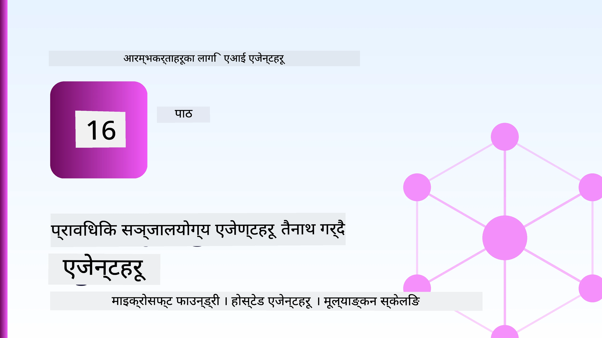
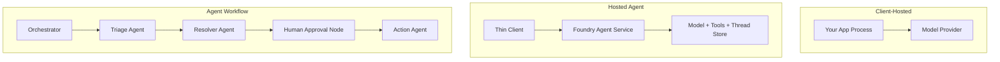
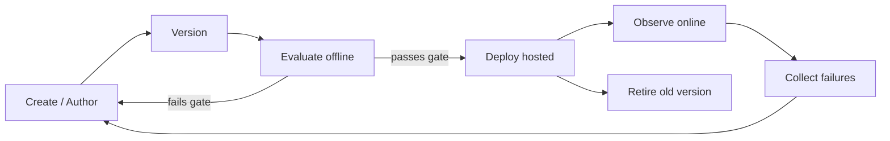
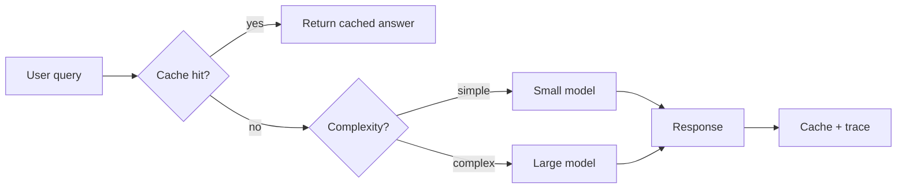
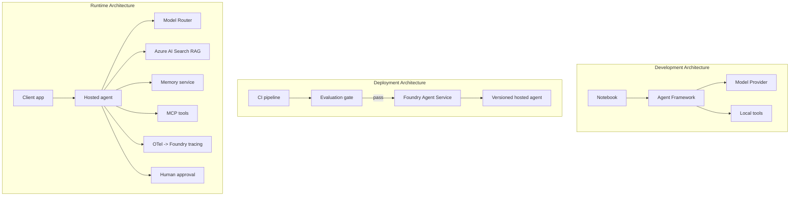

# माइक्रोसफ्ट फाउन्ड्रीसँग स्केलेबल एजेन्टहरू लागू गर्दै



यस पाठ्यक्रमको यस बिन्दुसम्म तपाईंले एजेन्टहरू निर्माण गर्नुभयो जुन तपाईंको ल्यापटपमा, नोटबुक भित्र चल्छन्, `az login` र केही वातावरण चरहरू द्वारा चलाइन्छ। त्यो सिक्नको लागि बिल्कुल ठीक तरिका हो। त्यो हजारौं ग्राहकहरू ३ बजे बिहान भर पर्छन् त्यस्तो एजेन्ट चलाउने तरीकाले ठीक होइन।

यो पाठ "मेरो मेशिनमा चल्छ" र "यो उत्पादनमा भरपर्दो र किफायती रूपमा चल्छ" बीचको अन्तरको बारेमा हो। हामी त्यो अन्तरलाई **माइक्रोसफ्ट फाउन्ड्री** र **माइक्रोसफ्ट फाउन्ड्री एजेन्ट सेवा** प्रयोग गरेर बन्द गर्छौं, र हामी यसलाई वास्तविक ग्राहक समर्थन एजेन्ट बनाएर गर्छौं जसमा उपकरणहरू, पुन:प्राप्ति, स्मृति, मूल्यांकन, र अनुगमन छ।

## परिचय

यस पाठले समावेश गर्नेछ:

- **प्रोटोटाइप एजेन्ट** र **तैनाथ एजेन्ट** बीचको फरक, र किन संक्रमण प्राय: मोडेलको वरिपरि सबथोकको बारेमा हुन्छ।
- एजेन्टहरूको **तैनाथ ढाँचाहरू**: क्लाइन्ट-होस्ट गरिएको, सेवा-होस्ट गरिएको (होस्ट गरिएको एजेन्टहरू), र वर्कफ्लो-अध्यक्षित।
- माइक्रोसफ्ट फाउन्ड्रीमा **एजेन्ट जीवनचक्र** — सिर्जना, संस्करण, तैनाथ, मूल्यांकन, अवलोकन, अवकाश।
- **स्केलिङ रणनीतिहरू**: मोडेल रुटिङ, क्यासिङ, समकालिकता, र स्टेटलेस डिजाइन।
- OpenTelemetry र फाउन्ड्री ट्रेसिङसँग **अवलोकनक्षमता**।
- मोडेल चयन, रुटिङ, र मूल्यांकन गेटहरू मार्फत **लागत अनुकूलन**।
- **उद्यम विचारहरू**: शासन, मानव स्वीकृति, र उत्पादनमा MCP सर्भरहरू सुरक्षित रूपमा चलाउने।

## सिकाइ लक्ष्यहरू

यस पाठ पूरा गरेपछि, तपाईं जान्न सक्नुहुनेछ:

- दिइएको एजेन्ट कार्यभारका लागि सही तैनाथ ढाँचाको चयन गर्न।
- माइक्रोसफ्ट फाउन्ड्री एजेन्ट सेवामा एजेन्ट तैनाथ गर्न जसले संस्करण व्यवस्थापन, शासन, र अवलोकनयोग्य बनाउँछ।
- एजेन्टलाई ट्रेसिङको लागि उपकरणसँग जोड्ने र हरेक रिलिजको पहिल्यै चल्ने मूल्यांकन पाइपलाइन तयार पार्ने।
- मोडेल रुटिङ र क्यासिङ लागू गर्न जसले विलम्बता र लागत नियन्त्रणमा राख्छ।
- उच्च जोखिम कार्यहरूका लागि मानव स्वीकृति गेट जोड्न र उत्पादनमा सुरक्षित तरिकाले MCP सर्भर एकीकरण गर्न।

## पूर्व आवश्यकताहरू

यस पाठ्यले तपाईँलाई पहिलेका पाठहरू पूरा गरेको र यी कुरामा सहज भएको मान्छ:

- [Microsoft Agent Framework](../14-microsoft-agent-framework/README.md) सँग एजेन्टहरू बनाउने (पाठ १४)।
- [साधन प्रयोग](../04-tool-use/README.md) (पाठ ४) र [एजेन्टिक RAG](../05-agentic-rag/README.md) (पाठ ५)।
- [एजेन्ट मेमोरी](../13-agent-memory/README.md) (पाठ १३) र [एजेन्टिक प्रोटोकल / MCP](../11-agentic-protocols/README.md) (पाठ ११)।
- [अवलोकनक्षमता र मूल्यांकन](../10-ai-agents-production/README.md) (पाठ १०) — यो पाठ त्यसमा सिधा आधारित छ।

तपाईंलाई यस्ता कुराहरू पनि चाहिन्छ:

- एउटा **Azure सदस्यता** र कम्तीमा एउटा तैनाथ गरिएको च्याट मोडेल सहितको **Microsoft Foundry परियोजना**।
- प्रमाणित गरिएको **Azure CLI** (`az login`)।
- Python 3.12+ र रिपोजिटरीमा रहेको प्याकेजहरू [`requirements.txt`](../../../requirements.txt)।

## प्रोटोटाइपबाट उत्पादनसम्म: के वास्तवमा परिवर्तन हुन्छ

प्रोटोटाइप एजेन्ट र उत्पादन एजेन्टले उही कोर लूप साझा गर्छन् — तर्क, उपकरणहरू कल गर्न, प्रतिक्रिया दिन। के परिवर्तन हुन्छ भने त्यो लूप वरिपरि सबथोक हो। मोडेल उत्पादन एजेन्टको लगभग २०% मात्र हो; अन्य ८०% अपरेशनल कंकाल हो।

| विषय | प्रोटोटाइप | उत्पादन |
| --- | --- | --- |
| **होस्टिङ** | तपाईंको नोटबुकमा चल्छ | होस्ट गरिएको सेवा रूपमा, संस्करण र रोल आउट भएको |
| **पहिचान** | तपाईंको `az login` टोकन | स्कोप गरिएको RBAC सहित व्यवस्थापित पहिचान |
| **अवस्था** | मेमोरीमा, पुनःसुरुमा हराउँछ | बाह्यीकृत (थ्रेड स्टोर, मेमोरी सेवा) |
| **असफलता** | तपाईंलाई ट्रेसब्याक देखिन्छ | पुन: प्रयासहरू, फेलब्याकहरू, मृत-पत्र, चेतावनीहरू |
| **लागत** | "थोरै सेन्ट" | अनुरोध अनुसार ट्र्याक, रुट, क्यास, बजेट गरिएको |
| **गुणस्तर** | तपाईंले नतिजा परीक्षण गर्नुहुन्छ | हरेक रिलिज अघि स्वचालित रूपमा मूल्यांकन गरिएको |
| **विश्वास** | तपाईं हरेक कार्य अनुमोदन गर्नुहुन्छ | नीति + जोखिमपूर्ण कार्यहरूको लागि मानव अनुगमन |

यो तालिका सम्झनुहोस्। तलको प्रत्येक खण्ड यी पङ्क्तिहरूमध्ये एउटासँग मेल खान्छ।

## एजेन्ट तैनाथ ढाँचाहरू

तपाईंले प्रायः संयोजनमा प्रयोग गर्ने तीन ढाँचाहरू छन्।

### १. क्लाइन्ट-होस्ट गरिएको एजेन्टहरू

एजेन्ट वस्तु *तपाईंको* अनुप्रयोग प्रक्रियामा बस्छ। तपाईंको कोडले मोडेल प्रदायकलाई सिधै कल गर्छ; तर्क लूप तपाईंको सेवामा चल्छ। यो पुराना पाठहरूले गरेको तरिका हो।

- **यो प्रयोग गर्नुहोस्** जब तपाईंलाई लूपमा पूर्ण नियन्त्रण चाहिन्छ, आफ्नै मिडलवेयर चाहिन्छ, वा एजेन्टलाई पहिलेबाट रहेको ब्याकएण्डमा एम्बेड गर्दै हुनुहुन्छ।
- **व्यापार-अफ**: तपाईं आफैंले स्केलिङ, अवस्था, र सहिष्णुता व्यवस्थापन गर्नुहुन्छ।

### २. होस्ट गरिएको एजेन्टहरू (फाउन्ड्री एजेन्ट सेवा)

एजेन्ट माइक्रोसफ्ट फाउन्ड्रीमा *स्रोतको रूपमा दर्ता* हुन्छ। फाउन्ड्रीले तर्क लूप होस्ट गर्छ, थ्रेडहरू भण्डारण गर्छ, सामग्री सुरक्षा र RBAC लागू गर्छ, र फाउन्ड्री पोर्टलमा एजेन्ट देखाउँछ। तपाईंको एप्लिकेसन एक थिन क्लाइन्ट बन्छ जुन थ्रेड सिर्जना गर्छ र प्रतिक्रिया पढ्छ।

- **यो प्रयोग गर्नुहोस्** जब तपाईंलाई टिकाउपन, निर्मित अवलोकनक्षमता, शासन, र कम अपरेशनल सतह क्षेत्र चाहिन्छ।
- **व्यापार-अफ**: प्रबन्धित रनटाइमको लागि कम-स्तरीय नियन्त्रण।

### ३. एजेन्ट वर्कफ्लोहरू

धेरै एजेन्टहरू (र उपकरणहरू) विशिष्ट नियन्त्रण प्रवाहसँग ग्राफमा संयोजित हुन्छन् — अनुक्रमिक चरणहरू, शाखा, मानव स्वीकृति नोडहरू, र टिकाउ चेकपोइन्टहरू जसले रोक्न र पुन: सुरु गर्न सक्छ। यो माइक्रोसफ्ट एजेन्ट फ्रेमवर्क **वर्कफ्लो** क्षमता ठूलो परिमाणमा लागू गरिएको हो।

- **यो प्रयोग गर्नुहोस्** जब एक एकल कार्य धेरै विशेषज्ञ एजेन्टहरूमा फैलिएको हो वा मध्यमा स्वीकृति चरण आवश्यक छ।
- **व्यापार-अफ**: बढी चल्ने भागहरू; मध्यस्थता-स्तर अवलोकनक्षमता आवश्यक।



## माइक्रोसफ्ट फाउन्ड्रीमा एजेन्ट जीवनचक्र

एजेन्ट तैनाथ गर्नु एक पटक मात्रको प्रक्रिया होइन `push`। यो एक लूप हो, र यो सफ्टवेयर रिलिज चक्र जस्तो देखिन्छ किनकि यस्तै हो।



प्रमुख विचार, [पाठ १०](../10-ai-agents-production/README.md) बाट आएको: **अफलाइन मूल्यांकन गेट हो, पछि सोच्ने कुरा होइन।** नयाँ एजेन्ट संस्करण तपाईंको मूल्यांकन सीमा पार नगरेसम्म पठाइँदैन। अनलाइन अवलोकन क्षमता त्यसपछि वास्तविक जगतका असफलताहरूलाई तपाईँको अफलाइन परीक्षण सेटमा फिर्ता फ्याक्छ। त्यो पूरा लूप हो।

## स्केलिङ रणनीतिहरू

एजेन्ट स्केल गर्नु स्टेटलेस वेब API स्केल गर्नु भन्दा फरक छ, किनभने हरेक अनुरोधले धेरै महँगो मोडेल र उपकरण कल ट्रिगर गर्न सक्छ। चार प्रविधिहरूले धेरै भारी भाग वहन गर्छन्।

**स्टेटलेस अनुरोध व्यवस्थापन।** तपाईंको प्रक्रियाको मेमोरीमा प्रति-प्रयोगकर्ता अवस्था नबचाउनुहोस्। संवाद थ्रेडहरू फाउन्ड्री थ्रेड स्टोर वा मेमोरी सेवामा बचत गर्नुहोस् ताकि कुनै पनि उदाहरणले कुनै पनि अनुरोध सम्हाल्न सकोस्। यो हो जसले तपाईंलाई समान्तर स्केल गर्न दिन्छ — उदाहरणहरू थप्नुहोस्, कुनै स्थिर सत्र आवश्यक छैन।

**मोडेल रुटिङ।** सबै अनुरोधहरूले तपाईंको सबैभन्दा सक्षम (र सबैभन्दा महँगो) मोडेल आवश्यक पर्दैन। साधारण अनुरोधहरू — इच्छा वर्गीकरण, छोटो तथ्यात्मक जवाफहरू — एक सानो, छरितो मोडेलमा रुट गर्नुहोस्, र ठूलो मोडेललाई वास्तविक तर्कका लागि राख्नुहोस्। फाउन्ड्रीको **मोडेल राउटर** तपाईंको लागि यो गर्न सक्छ, वा तपाईं आफैं एक हल्का वर्गीकरण प्रणाली बनाउन सक्नुहुन्छ। तपाईले प्रयोगशालामा DIY संस्करण निर्माण गर्नुहुनेछ।

**प्रतिक्रिया क्यासिङ।** धेरै समर्थन प्रश्नहरू नजिकका दोहोरिएका ("मेरो पासवर्ड कसरी रिसेट गर्ने?") हुन्छन्। साझा प्रश्नहरूको उत्तर क्यास गर्नुहोस् र मोडेलमा पहुँच नगरी सेवा गर्नुहोस्। मध्यम क्यास हिट दरले पनि लागत र विलम्बता अर्थपूर्ण रूपमा घटाउँछ।

**समकालिकता र ब्याकप्रेशर।** मोडेल प्रदायकहरूमा दर सिमाना हुन्छ। आफ्नो समकालिकतालाई सीमा लगाउनुहोस्, घातीय ब्याकअफका साथ पुन: प्रयासहरू प्रयोग गर्नुहोस्, र कृपापूर्वक असफल हुनुहोस् (एक कतारबद्ध "हामी यसमा छौं" जवाफ ५०० भन्दा राम्रो हो)।



## उत्पादनमा अवलोकनक्षमता

तपाईंले देख्न नसक्ने कुरा सञ्चालन गर्न सक्नुहुन्न। पाठ १० मा कभर गरिएझैं, माइक्रोसफ्ट एजेन्ट फ्रेमवर्कले **OpenTelemetry** ट्रेस स्वाभाविक रूपमा उत्सर्जन गर्छ — हरेक मोडेल कल, उपकरण कल, र व्यवस्थापन चरण एक स्प्यान बन्छ। उत्पादनमा तपाईं ती स्प्यानहरूलाई माइक्रोसफ्ट फाउन्ड्री (वा कुनै पनि OTel-अनुकूल ब्याकएन्ड) मा निर्यात गर्नुहुन्छ ताकि तपाईं:

- हरेक मोडेल र उपकरण कल मार्फत एउटै ग्राहकको उजूरी अन्त-देखि-अन्त ट्रेस गर्न सक्नुहुन्छ।
- समयसँगै अनुरोध अनुसार p50/p95 विलम्बता र लागत हेर्न सक्नुहुन्छ।
- त्रुटि-दर चोटीहरू र लागत असामान्यताहरूमा चेतावनी दिन सक्नुहुन्छ तपाईंका प्रयोगकर्ताहरू (वा तपाईंको वित्त टोली) भन्दा पहिले।

```python
from agent_framework.observability import get_tracer

tracer = get_tracer()

with tracer.start_as_current_span("support_request") as span:
    span.set_attribute("customer.tier", "enterprise")
    span.set_attribute("routed.model", "gpt-5-nano")
    # agent execution is traced automatically inside this span
```

`customer.tier` र `routed.model` जस्ता गुणहरूले ट्रेसको पर्खाललाई उत्तर योग्य प्रश्नहरूमा परिणत गर्छन् ("के उद्यम ग्राहकहरू सानो मोडेलमा धेरै पटक रुट भइरहेका छन्?")।

## लागत अनुकूलन

उत्पादन एजेन्टहरूमा लागत टोकनले प्रभुत्व जमाएको छ। प्रभावको क्रममा तीन लीभरहरू:

१. **मोडेललाई उपयुक्त आकार दिनुहोस्।** एउटा सानो मोडेल जुन तपाईंको मूल्यांकन गेट पार गर्छ प्राय: ठूलो मोडेल भन्दा सस्तो हुन्छ जुन पनि पार गर्छ। मूल्यांकन प्रयोग गरेर सानो मोडेलले पर्याप्त राम्रो छ प्रमाणित गर्नुहोस्, धेरै ठूलो मोडेल चयन नगर्न सावधानीपूर्वक प्रयोग गर्नुहोस्।
२. **जटिलता अनुसार रुटिङ।** माथिको जस्तै — ठूलो मोडेलको मूल्य मात्र ती अनुरोधहरूका लागि तिर्नुहोस् जसलाई ठूलो मोडेलको तर्क चाहिन्छ।
३. **क्यासिङ आक्रामक रुपमा गर्नुहोस्।** सबैभन्दा सस्तो मोडेल कल त्यो हो जुन तपाईंले कहिल्यै नगर्नुहुन्छ।

मूल्यांकन गेट र लागत नियन्त्रण एउटै अनुशासनका दुई कोणहरू हुन्: मूल्यांकनले तपाईंलाई *गुणस्तरको तह* बताउँछ, र रुटिङ र क्यासिङले तपाईंलाई त्यो तहको *लागत* नजिक राख्छ।

## उद्यम तैनाथ विचारहरू

**शासन।** होस्ट गरिएको एजेन्टहरूले फाउन्ड्रीको RBAC, सामग्री सुरक्षा, र अडिट लगिङ उत्तराधिकारी पाउँछन्। प्रत्येक एजेन्टलाई न्यूनतम आवश्यक विशेषता सहित व्यवस्थापित पहिचान दिनुहोस् — ज्ञान आधार पढ्न मात्र अनुमति, टिकटिङ API को स्कोप गरिएको पहुँच, त्यो भन्दा धेरै होइन।

**मानवअनुगमन।** केही कार्यहरू धेरै महत्त्वपूर्ण छन् जसलाई पूर्ण स्वचालित गर्न सकिन्न — फिर्ता दिने, खाता मेटाउने, कानुनी टोलीमा बढाउने। माइक्रोसफ्ट एजेन्ट फ्रेमवर्कले **अनुमोदन आवश्यक** उपकरणहरूको समर्थन गर्छ: एजेन्टले कार्य प्रस्ताव गर्छ, कार्यान्वयन रोक्छ, मानवले स्वीकृति वा अस्वीकृति दिन्छ, र वर्कफ्लो पुन: सुरु हुन्छ। तपाईंले यो प्रारम्भिक [पाठ ६](../06-building-trustworthy-agents/README.md) मा देख्नुभयो; यहाँ तपाईं यसलाई तैनाथ गर्नुहुन्छ।

**उत्पादनमा MCP।** [MCP](../11-agentic-protocols/README.md) ले तपाईंको एजेन्टलाई बाह्य उपकरणहरू मानक अन्तरफलक मार्फत प्रयोग गर्न दिन्छ। उत्पादनमा, हरेक MCP सर्भरलाई अविश्वास गरिएको सीमा मान्नुहोस्: सर्भर संस्करण पिन गर्नुहोस्, स्कोप गरिएको पहिचानसहित चलाउनुहोस्, यसको आउटपुटहरूको पुष्टि गर्नुहोस्, र कहिल्यै त्यसलाई गोप्य जानकारी देखाउर्नुहोस्। MCP सर्भर निर्भरता हो, र निर्भरताहरूको प्याच, अडिट, र दर-सीमा लाग्छ।



ती तीन चित्रहरू — विकास, तैनाथ, रनटाइम — एउटै एजेन्टको जीवनका तीन चरणहरू हुन्। पछिको प्रयोगशालाले तपाईँलाई यसलाई निर्माण गर्न हेर्छ।

## व्यावहारिक प्रयोगशाला: उत्पादन-तय ग्राहक समर्थन एजेन्ट

[`code_samples/16-python-agent-framework.ipynb`](./code_samples/16-python-agent-framework.ipynb) खोल्नुहोस् र अन्त्यसम्म काम गर्नुहोस्। तपाईं एक **Contoso ग्राहक समर्थन एजेन्ट** तयार गर्नुहुनेछ जुन हरेक उत्पादन विषयसँग जडित छ:

१. **उपकरण कल गर्ने** — अर्डर स्थिति हेर्न र समर्थन टिकटहरू खोल्न।
२. **RAG** — ज्ञान आधारबाट नीति प्रश्नहरूको जवाफ (Azure AI Search, मेमोरी फलब्याक सहित जसले नोटबुकलाई Search स्रोत बिना चलाउन दिन्छ)।
३. **स्मृति** — वार्तालापका टर्नहरूमा ग्राहक सम्झन।
४. **मोडेल रुटिङ** — जटिलता वर्गीकरणले हरेक अनुरोधलाई सानो वा ठूलो मोडेलमा रुट गर्छ।
५. **प्रतिक्रिया क्यासिङ** — दोहोरिएका प्रश्नहरू क्यासबाट सेवा गरिन्छ।
६. **मानव स्वीकृति** — थ्रेसहोल्ड माथिका फिर्ताहरू मानव अनुमोदनका लागि रोकिन्छन्।
७. **मूल्यांकन पाइपलाइन** — सानो अफलाइन परीक्षण सेटले एजेन्टको स्कोर गर्छ र रिलिज गेटको रूपमा काम गर्छ।
८. **अवलोकनक्षमता** — हरेक अनुरोध वरिपरि OpenTelemetry ट्रेसिङ।

### मार्गदर्शन

नोटबुक यसरी संरचित छ कि हरेक उत्पादन विषय एक स्व-समावेशी, चलाउन सकिने खण्ड हो। यसको मुटु रुटिङ-प्लस-क्यासिङ अनुरोध ह्यान्डलर हो:

```python
async def handle_support_request(query: str, customer_id: str) -> str:
    # 1. Serve from cache when we can.
    cached = response_cache.get(normalize(query))
    if cached:
        return cached

    # 2. Route by complexity to control cost.
    model = "gpt-5-nano" if is_simple(query) else "gpt-5-mini"

    # 3. Run the agent inside a trace span for observability.
    with tracer.start_as_current_span("support_request") as span:
        span.set_attribute("routed.model", model)
        span.set_attribute("customer.id", customer_id)
        response = await support_agent.run(query, model=model)

    # 4. Cache and return.
    response_cache.set(normalize(query), response.text)
    return response.text
```

रिलीज सुरक्षा गर्ने मूल्यांकन गेट यस प्रकार देखिन्छ:

```python
async def evaluation_gate(agent, test_cases, threshold: float = 0.8) -> bool:
    passed = 0
    for case in test_cases:
        result = await agent.run(case["input"])
        if score_response(result.text, case["expected"]) >= 0.8:
            passed += 1
    pass_rate = passed / len(test_cases)
    print(f"Evaluation pass rate: {pass_rate:.0%} (gate: {threshold:.0%})")
    return pass_rate >= threshold  # only deploy if the gate passes
```

प्रत्येक लाइन पढ्नुहोस् — नोटबुकले प्रिमिटिभहरू जानजकार सानो राख्छ ताकि केही पनि फ्रेमवर्क कल पछाडि लुकिएको नहोस्।

## तैनाथ एजेन्टलाई स्मोक टेस्टहरूसँग प्रमाणित गर्ने

माथिको मूल्यांकन गेट तपाईंको एजेन्ट वस्तु विरुद्ध *अफलाइन* चल्छ। एकपटक एजेन्ट होस्ट गरिएको एजेन्टको रूपमा तैनाथ भएपछि, तपाईंलाई अझ सस्तो अर्को जाँच चाहिन्छ: **के तैनाथ अन्तबिन्दु साँच्चिकै जवाफ दिइरहेको छ?**

"सफलतापूर्वक" तैनाथ हुनु मात्र नियन्त्रण विमानले परिभाषा स्वीकार गरेको प्रमाणित गर्छ — यसले एजेन्ट जवाफ दिइरहेको प्रमाणित गर्दैन। एक निर्भरता हराएको, नराम्रो मोडेल रुटिङ, वा अवधी समाप्त कनेक्शनले नतिजा नफर्काउने हरियो तैनाथि छोड्न सक्छ। एक **स्मोक टेस्ट** त्यसलाई सेकेन्डमा समात्छ, हरेक तैनाथिमा, पूर्ण मूल्यांकनको लागत बिना।

यो रिपोजिटरीले [AI Smoke Test](https://github.com/marketplace/actions/ai-smoke-test) GitHub Action मा आधारित रेडी-टु-युज स्मोकटेस्ट पाइपलाइन पठाउँछ:

- **सङ्ग्रह** — [`tests/lesson-16-smoke-tests.json`](../../../tests/lesson-16-smoke-tests.json) मा Contoso समर्थन एजेन्टका लागि प्रॉम्प्टहरू र दावीहरू छन् (भूमिकावाल नीति उत्तरहरू, अर्डर खोज, विषयमा रहनु, र बहु-टर्न थ्रेड निरन्तरता)। अन्य पाठका एजेन्टहरूको लागि सङ्ग्रहहरू त्यहीसँगै छन् — हेर्नुहोस् [`tests/README.md`](../tests/README.md)।
- **वर्कफ्लो** — [`.github/workflows/smoke-test.yml`](../../../.github/workflows/smoke-test.yml) Azure OIDC मा लगइन गर्छ र हरेक प्रॉम्प्ट एजेन्टको प्रतिक्रियाको अन्तबिन्दुमा POST गर्छ, कुनै पनि दावी मिस भएमा काम असफल हुन्छ।

```yaml
- name: Smoke-test hosted agent
  uses: JFolberth/ai-smoketest@v1
  with:
    project_endpoint: ${{ inputs.project_endpoint }}
    agent_name: ContosoSupportAgent
    tests_file: tests/lesson-16-smoke-tests.json
```

तपाईँको एजेन्ट परिनियोजित भएपछि **Actions** ट्याबबाट यसलाई चलाउनुहोस्, तपाईँको Foundry परियोजना एन्डपोइन्ट र एजेन्ट नाम प्रदान गर्दै। संघीय पहिचानले Foundry परियोजना दायरामा **Azure AI User** भूमिका आवश्यकता पर्छ। तहहरूलाई पिरामिडको रूपमा सोच्नुहोस्: स्मोक टेस्टहरू (पहुँच योग्य र प्रतिक्रिया दिइरहेको छ?) प्रत्येक परिनियोजनमा चलाइन्छ, अफलाइन मूल्यांकन (जहाँसम्म पठाउन पर्याप्त छ?) प्रर्वतन अघि चलाइन्छ, र अनलाइन मूल्यांकन (जंगलीमा कस्तो गर्दैछ?) निरन्तर चल्दछ।

## ज्ञान जाँच

कार्यमा अघि बढ्नु अघि तपाईँको बुझाइ परीक्षण गर्नुहोस्।

**1. एक उत्पादन एजेन्टमा "मोडेल" लगभग कति हुन्छ, र बाँकी के हुन्छ?**

<details>
<summary>उत्तर</summary>

मोडेल प्रणालीको अल्पसंख्यक हो — प्रायः करिब २०% रूपमा उद्धृत गरिन्छ। बाँकी परिचालन कंकाल हो: होस्टिङ र संस्करण व्यवस्थापन, पहिचान र RBAC, बाहिरीकृत अवस्था, असफलता व्यवस्थापन, लागत ट्र्याकिङ, मूल्यांकन, र मान्छे-इन-द-लूप नियन्त्रणहरू। उत्पादनमा जान मुख्य रूपमा सबै कुरा *तर्क लूपको वरिपरि* निर्माण गर्ने बारे हो।
</details>

**2. तपाईं कहिलेकाहिँ क्लाइन्ट-होस्ट गरिएका एजेन्टको सट्टा होस्ट गरिएका एजेन्ट चयन गर्नुहुन्छ?**

<details>
<summary>उत्तर</summary>

जब तपाईंलाई लामो समय टिक्ने (पुनः शुरु गर्न सकिने थ्रेडहरू सहित) व्यवस्थापित रनटाइम, अवलोकन क्षमता, सामग्री सुरक्षा, र RBAC चाहिन्छ, र तपाईं कम परिचालन क्षेत्रको लागि केही न्यून तह नियन्त्रणको साटो दिन तयार हुनुहुन्छ। क्लाइन्ट-होस्ट गरिएका एजेन्ट तब उपयुक्त हुन्छन् जब तपाईंलाई लूपमा पूर्ण नियन्त्रण चाहिन्छ वा एजेन्टलाई पहिले नै रहेको ब्याकएन्डमा समावेश गर्दै हुनुहुन्छ।
</details>

**3. किन एक स्केलेबल एजेन्ट आफ्नै प्रक्रिया स्मृतिमा बिना अवस्था हुनु पर्छ?**

<details>
<summary>उत्तर</summary>

यसले कुनै पनि उदाहरणले कुनै पनि अनुरोध ह्यान्डल गर्न सक्छ, जुन चिप्लिने सत्रहरू बिना दिक्खल स्केलिङ सम्भव बनाउँछ। प्रति-प्रयोगकर्ता संवाद अवस्था थ्रेड स्टोर वा मेमोरी सेवामा बाहिरीकृत हुन्छ। यदि अवस्था प्रक्रिया स्मृतिमा बसोबास गर्थ्यो भने, तपाईंले पुनः सुरु गर्दा त्यसलाई गुमाउनुहुने थियो र लोड स्वतन्त्र रूपमा वितरण गर्न सक्नुहुन्न।
</details>

**4. मोडेल राउटिङले कस्तो समस्या समाधान गर्दछ र यो मूल्यांकनसँग कसरी सम्बन्धित छ?**

<details>
<summary>उत्तर</summary>

राउटिङले सरल अनुरोधहरूलाई सानो, सस्तो, र छिटो मोडेलमा पठाउँछ र ठूला मोडेललाई साँच्चिकै तर्कका लागि आरक्षित गर्छ, जसले दुवै ढिलाइ र लागत नियन्त्रण गर्छ। यो मूल्यांकनसँग सम्बन्धित छ किनकि मूल्यांकनले देखाउँछ सानो मोडेल एक वर्गका अनुरोधहरूका लागि पर्याप्त छ — मूल्यांकन बिना राउटिङ अनुमान मात्र हो।
</details>

**5. "मूल्यांकन गेट" के हो र यो जीवनचक्रमा कहाँ अवस्थित हुन्छ?**

<details>
<summary>उत्तर</summary>

मूल्यांकन गेटले नयाँ एजेन्ट संस्करण विरुद्ध अफलाइन परीक्षण सेट चलाउँछ र पास दर मानक पूरा नभएको खण्डमा परिनियोजनलाई अवरुद्ध गर्छ। यो जीवनचक्रमा "संस्करण" र "परिनियोजन" बीचमा हुन्छ, जसले गुणस्तरलाई जारी गर्नु अघि पूर्व-शर्त बनाउँछ न कि पठाइसकेपछि जाँच गर्ने कुरा।
</details>

**6. किन उत्पादनमा MCP सर्भरलाई अविश्वसनीय सीमा मानिनु पर्छ?**

<details>
<summary>उत्तर</summary>

किनकि यो तपाईँको एजेन्टले कल गर्ने बाह्य निर्भरता हो। तपाईँले यसको संस्करण पिन गर्नु पर्छ, स्कोप गरिएको पहिचानसँग चलाउनु पर्छ, यसको आउटपुटहरू प्रमाणित गर्नु पर्छ, दर-सीमा लगाउनु पर्छ, र यसको लागि कहिल्यै गोपनीयता नखुलाउनु पर्छ — जुन तेस्रो पार्टी निर्भरतामा तपाईँले लागु गर्ने त्यही अनुशासन हो। यसको आउटपुटले तपाईँको एजेन्टको तर्कमा प्रभाव पार्छ, त्यसैले अविश्वसित भरोसा सुरक्षा जोखिम हो।
</details>

**7. कुन एउटा परिवर्तनले प्रायः उत्पादन एजेन्ट लागतमा सबैभन्दा ठूलो प्रभाव पार्छ, र किन?**

<details>
<summary>उत्तर</summary>

मोडेलको उचित आकार निर्धारण — सबैभन्दा सानो मोडेल प्रयोग गर्ने जुन अझै तपाईंको मूल्यांकन गेट पास गर्छ। लागत प्राथमिक रूपमा टोकनहरूले प्रभुत्व जमाएको हुन्छ, र गुणस्तर मापदण्ड पूरा गर्ने सानो मोडेल ठूलो मोडेल भन्दा प्रायः सस्तो हुन्छ। क्याचिङ र राउटिङले त्यसलाई अझ कम गर्छ, तर सही आधार मोडेल चयनले सबैभन्दा ठूलो पहिलो-क्रम प्रभाव पार्छ।
</details>

**8. `customer.tier` र `routed.model` जस्ता स्प्यान विशेषताहरूले अवलोकनशीलतामा कस्तो भूमिका खेल्छन्?**

<details>
<summary>उत्तर</summary>

यीले कच्चा ट्रेसहरूलाई जवाफ दिने व्यवसायिक प्रश्नहरूमा परिवर्तन गर्छन्। विशेषताहरू बिना तपाईंसँग स्प्यानहरूको पर्खाल हुन्छ; तिनीहरूसँग तपाईँ सोध्न सक्नुहुन्छ "के उद्यम ग्राहकहरूलाई सानो मोडेलमा धेरै पटक राउट गरिएको छ?" वा "कुन मोडेलले हामीलाई सबैभन्दा ढिलो अनुरोधहरू ह्यान्डल गर्छ?" विशेषताहरू त्यो तरिकाले टेलीमेट्रीलाई तपाईंको सञ्चालनका लागि महत्त्वपूर्ण विमाहरू द्वारा टुक्र्याउँछन्।
</details>

## कार्य

ल्याबबाट ग्राहक समर्थन एजेन्ट लिएर यसलाई एउटा विशेष परिदृश्यका लागि कडा बनाउनुहोस्: **SaaS कम्पनीको सदस्यता बिलिङ समर्थन एजेन्ट।**

तपाईँको पेशकशले समावेश गर्नुपर्छ:

1. बिलिङ सम्बन्धित उपकरणहरूमा **उपकरणहरू परिवर्तन गर्नुहोस्**: `get_subscription_status`, `get_invoice`, र `issue_credit` ($५० भन्दा बढी क्रेडिटहरू मानवीय अनुमोदन आवश्यक पर्छ)।
2. कम्पनीको रिफन्ड नीति, बिलिङ चक्र, र रद्द नीति समेट्ने तीन RAG कागजातहरू थप्नुहोस्।
3. मूल्यांकन सेट कम्तीमा आठ केससम्म विस्तार गर्नुहोस्, जसमा कम्तीमा दुईले मानवीय अनुमोदन पथ ट्रिगर गर्नु *चाहिन्छ*, र तपाईँको मूल्यांकन गेटले सहि रूपमा पास वा फेल पुष्टि गरोस्।
4. एक लागत प्रतिवेदन थप्नुहोस्: एजेन्टमार्फत दस मिश्रित प्रश्नहरू चलाएपछि, कति सानो मोडेलमा गएका थिए, कति ठूलो मोडेलमा, र कति क्यासबाट सेवा गरिएका थिए छाप्नुहोस्।

छोटो अनुच्छेद लेख्नुहोस् (मार्कडाउन सेलमा) जुन मॉडल-राउटिङ नियम तपाईँले छान्नुभएको छ र यसलाई वास्तविक ट्राफिकसँग कसरी प्रमाणित गर्नुहुनेछ। कुनै एउटै सही उत्तर छैन — तपाईँलाई उत्पादन सम्बन्धी चिन्ताहरू एकीकृत छन् कि छैनन् भनेर मूल्याङ्कन गरिँदैछ।

## सारांश

यस पाठमा तपाईँले एजेन्टलाई प्रोटोटाइपदेखि उत्पादनसम्म माइक्रोसफ्ट फाउन्ड्रीको साथ सार्नुभयो:

- उत्पादनमा जाने मुख्य कुरा मोडेल वरिपरि **परिचालन कंकाल** हो — होस्टिङ, पहिचान, अवस्था, असफलता व्यवस्थापन, लागत, गुणस्तर, र भरोसा।
- तपाईँले तीन **परिनियोजन ढाँचाहरू** सिक्नुभयो — क्लाइन्ट-होस्ट गरिएका, होस्ट गरिएका एजेन्टहरू, र एजेन्ट फ्लोवर्कहरू — र तिनीहरू कहिले फिट हुन्छन्।
- तपाईँले **एजेन्ट जीवनचक्र** मार्फत हिँड्नुभयो, जहाँ अफलाइन **मूल्यांकन रिलिज गेटको रूपमा कार्य गर्छ** र अनलाइन अवलोकनशीलता असफलताहरूलाई परीक्षण सेटमा फिर्ता पठाउँछ।
- तपाईँले **स्केलिङ रणनीतिहरू** लागू गर्नुभयो — बिना अवस्था डिजाइन, मोडेल राउटिङ, क्याचिङ, र सीमित समानान्तरता — र तिनीहरूलाई **लागत अनुकूलन** सँग जोड्नुभयो।
- तपाईँले **उद्यम नियन्त्रणहरू** जोड्नुभयो: RBAC, मान्छे-इन-द-लूप अनुमोदन, र उत्पादन-सुरक्षित MCP एकीकरण।
- तपाईँले यस्तो **उत्पादन-तयार ग्राहक समर्थन एजेन्ट** बनाउनु भयो जसले यी सबै चिन्ताहरूलाई runnable कोडमा बाँध्छ।

अर्को पाठले विपरीत यात्रा लिन्छ: एजेन्टहरूलाई बादलमा स्केल गर्ने सट्टा, तपाईँ तिनीहरूलाई *ओरालेर* एउटै विकासकर्ता मेशिनमा पूर्णतया स्थानीय रूपमा चलाउनुहुनेछ।

## थप स्रोतहरू

- <a href="https://learn.microsoft.com/azure/ai-foundry/what-is-azure-ai-foundry" target="_blank">Microsoft Foundry दस्तावेज</a>
- <a href="https://learn.microsoft.com/azure/ai-foundry/agents/overview" target="_blank">Microsoft Foundry Agent Service अवलोकन</a>
- <a href="https://learn.microsoft.com/en-us/agent-framework/overview/?wt.mc_id=youtube_26688_organicsocial_reactor&pivots=programming-language-python" target="_blank">Microsoft Agent Framework</a>
- <a href="https://learn.microsoft.com/en-us/azure/ai-foundry/openai/concepts/model-router" target="_blank">Microsoft Foundry मा मोडेल राउटर</a>
- <a href="https://learn.microsoft.com/azure/search/search-what-is-azure-search" target="_blank">Azure AI Search</a>
- <a href="https://opentelemetry.io/" target="_blank">OpenTelemetry</a>
- <a href="https://github.com/marketplace/actions/ai-smoke-test" target="_blank">AI स्मोक टेस्ट GitHub Action</a>
- <a href="https://modelcontextprotocol.io/" target="_blank">मोडेल कन्टेक्स्ट प्रोटोकल (MCP)</a>

## अघिल्लो पाठ

[कम्प्युटर उपयोग एजेन्टहरू (CUA) निर्माण गर्दा](../15-browser-use/README.md)

## अर्को पाठ

[स्थानीय AI एजेन्टहरू सिर्जना गर्दै](../17-creating-local-ai-agents/README.md)

---

<!-- CO-OP TRANSLATOR DISCLAIMER START -->
**अस्वीकरण**:
यो दस्तावेज़ AI अनुवाद सेवा [Co-op Translator](https://github.com/Azure/co-op-translator) प्रयोग गरेर अनुवाद गरिएको हो। हामी सही हुन प्रयास गर्छौं, तर कृपया जानकार हुनुस् कि स्वचालित अनुवादमा त्रुटिहरू वा अशुद्धताहरू हुन सक्छन्। मूल दस्तावेज़ यसको मूल भाषामा आधिकारिक स्रोत मानिनुपर्छ। महत्वपूर्ण जानकारीका लागि व्यावसायिक मानव अनुवाद सिफारिस गरिन्छ। यस अनुवादको प्रयोगबाट उत्पन्न कुनै पनि गलत बुझाइ वा त्रुटिको लागि हामी जिम्मेवार छैनौं।
<!-- CO-OP TRANSLATOR DISCLAIMER END -->