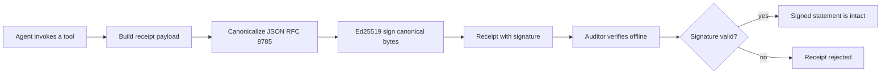
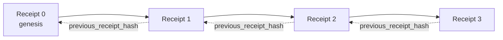

[पाठ भिडियो हेर्नुहोस्: क्रिप्टोग्राफिक रसीदहरूसँग AI एजेन्टहरूलाई सुरक्षित बनाउँदै](https://youtu.be/PLACEHOLDER_VIDEO_ID)

> _(पाठ भिडियो र थम्बनेल Microsoft सामग्री टिमद्वारा मर्ज पछाडि थपिनेछ, पाठ 14 / 15 को नमूनासँग मेल खान्छ।)_

# क्रिप्टोग्राफिक रसीदहरूसँग AI एजेन्टहरूलाई सुरक्षित बनाउँदै

## परिचय

यस पाठमा समेटिने विषयहरू:

- AI एजेन्टका लागि अडिट ट्रेल किन अनुपालन, डिबगिङ, र विश्वासका लागि महत्वपूर्ण हुन्छ।
- क्रिप्टोग्राफिक रसीद के हो र यो असाइन गरिएको लग लाइनसँग कसरि फरक हुन्छ।
- एक एजेन्टको टूल कलको लागि कसरि सर्छिएको रसीद साधारण Python मा उत्पादन गर्ने।
- एक रसीदलाई अफलाइन प्रमाणित गर्ने र छेडछाड पत्ता लगाउने तरिका।
- रसीदहरूलाई कसरी जबर्जस्ती जडान गर्ने जहाँ एक हटाउँदा वा पुनः क्रमबद्ध गर्दा श्रृंखला भत्किन्छ।
- रसीदहरूले के प्रमाणित गर्छन् र स्पष्ट रूपमा के प्रमाणित गर्दैनन्।

## सिक्ने लक्ष्यहरू

यो पाठ पूरा गरेपछि, तपाईं जान्नु हुनेछ कि:

- एजेन्ट क्रियाकलापका लागि क्रिप्टोग्राफिक उत्पत्तिले प्रेरित गर्ने असफलता मोडहरू पहिचान गर्ने।
- क्यानोनिकल JSON पेलोडमा Ed25519-ले हस्ताक्षर गरिएको रसीद उत्पादन गर्ने।
- हस्ताक्षरकर्ताको सार्वजनिक कुञ्जी मात्र प्रयोग गरी स्वतन्त्र रूपमा रसीद प्रमाणित गर्ने।
- संशोधित रसीदमा पुनः प्रमाणिकरण गरेर छेडछाड पत्ता लगाउने।
- रसीदहरूको ह्यास-चेन अनुक्रम निर्माण गर्ने र किन यो श्रृंखला महत्वपूर्ण छ व्याख्या गर्ने।
- के रसीदहरूले प्रमाणित गर्छन् (अट्रिब्युसन, अखण्डता, क्रम) र के प्रमाणित गर्दैनन् (कृयाको शुद्धता, नीतिको ध्वनि) बीच सिमाना चिन्हारी गर्ने।

## समस्या: तपाईंको एजेन्टको अडिट ट्रेल

कल्पना गर्नुहोस् तपाईंले Contoso Travel का लागि AI एजेन्ट तैनत गर्नुभएको छ। एजेन्टले ग्राहक अनुरोधहरू पढ्दछ, उडान API मा खोजी गर्दछ र ग्राहकको तर्फबाट सिट आरक्षण गर्दछ। गत त्रैमासिकमा, एजेन्टले ५०,००० आरक्षणहरू प्रक्रिया गर्‍यो।

आज एक अडिटर आउँछन्। उनीहरूले एक सरल प्रश्न सोध्छन्: “तपाईंको एजेन्टले के गर्यो देखाउनुहोस्।”

तपाईंले लग फाइलहरू दिनुभयो। अडिटरले ती हेर्छन् र त्यो गम्भीर प्रश्न सोध्छन्: “मलाई कसरी थाहा हुन्छ यी लगहरू सम्पादन गरिएको छैन?”

यो नै अडिट ट्रेल समस्याको अर्थ हो। आजका अधिकांश एजेन्ट तैनातीहरूमा भर पर्छ:

- **एप्लिकेसन लगहरू**: एजेन्ट आफैले लेखेको, फाइल प्रणाली पहुँच भएका कसैले सम्पादन गर्न सक्ने।
- **क्लाउड लगिङ सेवाहरू**: प्लेटफर्म स्तरमा छेउछाउ गर्ने तर अडिटरले प्लेटफर्म अपरेटरमा विश्वास गरे मात्र।
- **डेटाबेस ट्रान्जेक्सन लगहरू**: डेटाबेस परिवर्तनका लागि राम्रो तर अनियमित उपकरण कलहरूको लागि होइन।

यी कुनै पनि अडिटरको प्रश्नको जवाफ बिना कुनै विश्वास मागेका जवाफ दिन सक्दैनन् (तपाईंमा, तपाईंको क्लाउड प्रदायकमा, तपाईंको डेटाबेस विक्रेतामा)। आन्तरिक प्रयोगका लागि त्यो विश्वास स्वीकार्य हुन्छ। विनियमित कामका लागि (वित्त, स्वास्थ्य सेवा, EU AI ऐन अन्तर्गत पर्ने काम) त्यो स्वीकार्य हुँदैन।

क्रिप्टोग्राफिक रसीदहरूले यस समस्यालाई संकुचन गर्छन् स्वतन्त्र रूपमा हस्ताक्षर गरिएको कथन सिर्जना गरेर।
अडिटरले अझै हस्ताक्षर कुञ्जीमा र 
बयान उत्पादन गर्ने कम्पोनेन्टमा विश्वास गर्न बाह्य कारण चाहिन्छ। एम्बेडेड कुञ्जीले आत्म-संगति प्रमाणित गर्छ,
जारीकर्ता पहिचान वा लागू गर्ने स्थान होइन।

## क्रिप्टोग्राफिक रसीद के हो?

रसीद एउटा JSON वस्तु हो जसले के एजेन्टले गर्‍यो भनेर रेकर्ड गर्छ, डिजिटल हस्ताक्षरसँग हस्ताक्षर गरिएको।



न्यूनतम रसीद यस प्रकार देखिन्छ:

```json
{
  "type": "agent.tool_call.v1",
  "agent_id": "contoso-travel-bot",
  "tool_name": "lookup_flights",
  "tool_args_hash": "sha256:a3f9c1...",
  "result_hash": "sha256:7b2e1d...",
  "policy_id": "contoso-travel-policy-v3",
  "timestamp": "2026-04-25T14:30:00Z",
  "sequence": 47,
  "previous_receipt_hash": "sha256:9d4e6a...",
  "signature": {
    "alg": "EdDSA",
    "sig": "c5af83...",
    "public_key": "8f3b2c..."
  }
}
```

तीन विशेषताहरूले काम गर्छन्:

1. **हस्ताक्षर**। रसीद एजेन्टको गेटवेले Ed25519 निजी कुञ्जी प्रयोग गरी हस्ताक्षर गरेको हुन्छ। सम्बद्ध सार्वजनिक कुञ्जी भएको कुनै पनि व्यक्ति आफलाइनमा हस्ताक्षर प्रमाणित गर्न सक्छ। भरोसापूर्ण पक्षले त्यो कुञ्जी पिन गर्नुपर्छ वा विश्वासयोग्य रजिष्ट्रीद्वारा निकाल्नुपर्छ। कुनै पनि हस्ताक्षर गरिएको क्षेत्रमा छेडछाडले हस्ताक्षर अमान्य बनाउँछ।

2. **क्यानोनिकल इन्कोडिङ**। हस्ताक्षर अघि, रसीद JSON क्यानोनिकलाइजेशन स्किम (JCS, RFC 8785) प्रयोग गरी सिरियलाइज गरिन्छ। यसले पक्का गर्दछ कि दुई फरक इम्प्लिमेन्टेसनले एउटै तर्कसंगत रसीद उत्पादन गर्दा समान बाइटयुक्त आउटपुट बनाउँछन्। क्यानोनिकलाइजेशन बिना, फरक JSON सिरियलाइजर्सले एउटै सामग्रीका लागि फरक हस्ताक्षरहरू उत्पादन गर्न सक्छन्।

3. **ह्यास चेनिङ**। `previous_receipt_hash` फिल्डले हरेक रसीदलाई त्यस अघि रहेको रसीदसँग जोडी रहन्छ। एउटा रसीद हटाउँदा वा पुन:क्रमबद्ध गर्दा प्रस्तुत श्रृंखला भत्किन्छ। ट्रंकटेसन वा हस्ताक्षरकर्ताले नियन्त्रण गरेको लेखन पुनःलेखन पत्ता लगाउन पिन गरिएको वर्तमान श्रृंखला हेड, स्वतन्त्र दृष्टिगोचरित चेकपोइन्ट वा प्रमाणित बन्द-जनसंख्या प्रतिबद्धता आवश्यक पर्छ।

यी विशेषताहरूले तीन ग्यारेन्टीहरू प्रदान गर्छन्:

- **कुञ्जीसँग अट्रिब्युसन**: यो कुञ्जीले यो सामग्रीमा हस्ताक्षर गरेको छ। संगठनात्मक वा मानवीय पहिचान विश्वसनीय कुञ्जी बाँधन आवश्यक हुन्छ।
- **अखण्डता**: सामग्री हस्ताक्षर पछि परिवर्तन भएको छैन।
- **प्रमाणित अनुक्रम भित्र क्रम**: यो रसीदले त्यो अघिल्लो रसीदलाई लिंक गर्छ।

## Python मा रसीद उत्पादन गर्दै

रसीद उत्पादन गर्न तपाईंलाई विशेष पुस्तकालय चाहिदैन। क्रिप्टोग्राफिक प्रिमिटिभहरू व्यापक रूपमा उपलब्ध छन् र लॉजिक केही दर्जन पंक्तिको Python हो।

`code_samples/18-signed-receipts.ipynb` मा व्यावहारिक अभ्यासहरूले सग्लो प्रक्रिया समेटेका छन्। स्रोत-नियन्त्रित `code_samples/18-signed-receipts.execution-receipt.json` ले ठ्याक्कै नोटबुक ह्यास, Python वातावरण, सेलकाउन्ट, र पछिल्लो सफा कार्यान्वयनबाट पाठको सुरक्षित आउटपुट राख्दछ। संक्षिप्त संस्करण:

```python
import json
import hashlib
import base64
from nacl import signing
from jcs import canonicalize  # RFC 8785 canonical JSON

def b64url_nopad(data: bytes) -> str:
    return base64.urlsafe_b64encode(data).decode("ascii").rstrip("=")

def sha256_canonical(obj) -> str:
    """SHA-256 of a Python object's JCS-canonical JSON form."""
    return f"sha256:{hashlib.sha256(canonicalize(obj)).hexdigest()}"

# Generate or load a signing key (in production, store in a key vault)
signing_key = signing.SigningKey.generate()
verify_key = signing_key.verify_key
TRUSTED_PUBLIC_KEYS = {b64url_nopad(bytes(verify_key))}  # pinned out of band by the verifier

# Build the receipt payload (no signature yet)
tool_args = {"origin": "SYD", "destination": "LAX"}
tool_result = [{"flight": "QF11", "price": 1850, "stops": 0}]

payload = {
    "type": "agent.tool_call.v1",
    "agent_id": "contoso-travel-bot",
    "tool_name": "lookup_flights",
    "tool_args_hash": sha256_canonical(tool_args),
    "result_hash": sha256_canonical(tool_result),
    "policy_id": "contoso-travel-policy-v3",
    "timestamp": "2026-04-25T14:30:00Z",
    "sequence": 0,
    "previous_receipt_hash": None,
}

# Canonicalize and sign the JCS bytes directly. PureEdDSA hashes internally.
canonical_bytes = canonicalize(payload)
signature_bytes = signing_key.sign(canonical_bytes).signature

# Attach a structured signature object.
receipt = {
    **payload,
    "signature": {
        "alg": "EdDSA",
        "sig": b64url_nopad(signature_bytes),
        "public_key": b64url_nopad(bytes(verify_key)),
    },
}
```

त्यो सम्पूर्ण हस्ताक्षर पाइपलाइन हो। नोटबुकका अभ्यासहरूले प्रत्येक चरण विस्तारमा देखाउँछन्।

## रसीद प्रमाणित गर्ने र छेडछाड पत्ता लगाउने

प्रमाणिकरण उल्टो प्रक्रिया हो:

```python
import base64
import hashlib
from nacl import signing
from nacl.exceptions import CryptoError
from jcs import canonicalize

def b64url_decode(s: str) -> bytes:
    padding = "=" * ((4 - len(s) % 4) % 4)
    return base64.b64decode(s + padding, altchars=b"-_", validate=True)

def verify_receipt(receipt: dict, trusted_public_keys: set[str]) -> bool:
    # The signature is a structured object: {"alg", "sig", "public_key"}.
    if not isinstance(receipt, dict):
        return False
    sig_obj = receipt.get("signature")
    if not isinstance(sig_obj, dict) or sig_obj.get("alg") != "EdDSA":
        return False
    try:
        # An inline key proves only self-consistency. Trust is configured out of band.
        public_key = sig_obj.get("public_key")
        signature = sig_obj.get("sig")
        if not isinstance(public_key, str) or not isinstance(signature, str):
            return False
        if public_key not in trusted_public_keys:
            return False
        payload = {k: v for k, v in receipt.items() if k != "signature"}
        canonical_bytes = canonicalize(payload)
        verify_key = signing.VerifyKey(b64url_decode(public_key))
        verify_key.verify(canonical_bytes, b64url_decode(signature))
        return True
    except (CryptoError, TypeError, ValueError, KeyError, OverflowError):
        return False
```

यस कार्यले रसीद र भरोसापूर्ण पक्षको पिन गरिएको कुञ्जी सेट लिएर फिर्ता दिन्छ
`True` केवल तब जब हस्ताक्षर मान्य हुन्छ। प्रमाणिकरणमा कुनै नेटवर्क कल आवश्यक पर्दैन,
तर कुञ्जी विश्वास अझै बाह्य कन्फिगरेसन निर्णय हो।

छेडछाड पत्ता लगाउने प्रमाण देख्नका लागि, नोटबुकले यी प्रक्रिया अपनाउँछ:

1. मान्य रसीद उत्पादन गर्ने र प्रमाणित पुष्टि गर्ने।
2. `tool_args_hash` फिल्डको एक बाइट परिवर्तन गर्ने।
3. पुनः प्रमाणिकरण गराउँदै असफल देख्ने।

यो व्यवहारिक प्रमाण हो कि रसीदहरू छेडछाड प्रतिरोधी हुन्छन्: कुनै पनि सानो परिवर्तनले हस्ताक्षरलाई भत्काउँछ।

## बहु-कदम एजेन्टहरूको लागि रसीदहरू जडान गर्दै

एउटा सर्तकृत रसीदले एउटा क्रिया सुरक्षित गर्छ। विभिन्न रसीदहरूको श्रृंखलाले एक अनुक्रम सुरक्षित गर्छ।



प्रत्येक रसीदले अघिल्लो रसीदको ह्यास रेकर्ड गर्छ। रसीद 2 शान्तिपूर्वक हटाउन आक्रमणकारीले आवश्यक पर्नेछ:

- रसीद 3 को `previous_receipt_hash` फिल्ड परिवर्तन गर्ने (रसीद 3 को हस्ताक्षर भत्कन्छ), वा
- संशोधित रसीद 3 मा नयाँ हस्ताक्षर बनाउने (एजेन्टको निजी कुञ्जी चाहिन्छ)।

यदि निजी कुञ्जी सुरक्षित गरिएको छ र प्रमाणितकर्ताले स्वतन्त्र दृष्टिगोचर श्रृंखला
हेड पिन गरेको छ भने, यी आक्रमणहरू पत्ता लाग्न सक्छन्। प्रत्येक रसीद भित्र कुञ्जी प्रकाशित गर्नु पर्याप्त छैन: हस्ताक्षरकर्ता वा आक्रमणकारीले फरक कुञ्जी देखाउन, उपसर्ग पुनःलेखन गर्न, वा
श्रृंखला छोट्याउन सक्छ जबसम्म भरपर्दो पक्षसँग बाह्य विश्वास र पूर्णता एंकर हुँदैन।


नोटबुकले तलका कुरा देखाउँछ:

१. तीनवटा रसिदहरूको श्रृंखला बनाउनु।
२. प्रत्येक रसिदको `previous_receipt_hash` ले अघिल्लो रसिदको वास्तविक ह्याससँग मेल खान्छ कि खै भनेर जाँच गर्नु।
३. बीचको एक रसिदमा छेड़छाड़ गर्नु र श्रृंखला ठीक त्यहि बिन्दुमा टुटेको देख्नु।

यसरी तपाईंले यस्तो अडिट ट्रेल उत्पादन गर्न सक्नुहुन्छ जुन बाह्य अडिटरले आफ्ना
आफ्नै पिन गरिएको जारीकर्ता कुञ्जीहरू र श्रृंखला checkpoints अन्तर्गत प्रमाणित गर्न सक्छ, तपाईंको परिवर्तनशील लग स्टोरमा विश्वास नगरी।

## रसिदले के प्रमाणित गर्छ (र के गर्दैन)

यो यस पाठको सबैभन्दा महत्त्वपूर्ण भाग हो। रसिदहरू शक्तिशाली हुन्छन् तर तिनीहरूको शक्ति सीमित छ।

**रसिदले तीन कुराहरू प्रमाणित गर्छ:**

१. **अट्रिब्युसन**: एउटा विशेष कुञ्जीले एउटा विशेष पेलोडमा हस्ताक्षर गर्‍यो।
२. **अखण्डता**: हस्ताक्षर गरेकोदेखि पेलोड परिवर्तन भएको छैन।
३. **प्रस्तुत गरिएको, प्रमाणित अनुक्रमभित्र क्रमबद्धता**: यो रसिदले त्यो अघिल्लो रसिदसँग जोडिएको छ।

**रसिदले प्रमाणित गर्दैनन्:**

१. **सहीपन**: एजेन्टको कार्य सहि थियो कि नरहे भनेर। एक रसिद गलत उत्तरको लागि पनि सहजरूपमा हस्ताक्षर गर्न सकिन्छ, सहि उत्तर जस्तै।
२. **नीति अनुपालन**: `policy_id` मा सन्दर्भित नीति साँच्चै मूल्यांकन गरिएको थियो कि थिएन, वा त्यसले यो कार्य अनुमति दिने थियो कि थिएन भनेर। रसिदले दावी गरिएको कुरा रेकर्ड गर्छ, लागू गरिएको कुरो होइन।
३. **कुञ्जी बाहेक पहिचान**: रसिदले भन्छ "यो कुञ्जीले यो सामग्रीमा हस्ताक्षर गर्‍यो।" यो भन्दैन "यो मान्छेले अनुमति दियो।" कुञ्जीलाई व्यक्ति वा संस्थासँग जोड्न पृथक पहिचान संरचनाको आवश्यकता हुन्छ (डायरेक्टरी, सार्वजनिक कुञ्जी रजिष्ट्रि, आदि)।
४. **इनपुटहरूको सत्यता**: यदि एजेन्टले छेड़छाड़ गरिएको संकेत प्राप्त गरेर त्यो अनुसार काम गर्दछ भने रसिदले त्यो कार्यलाई विश्वासपात्र रूपमा रेकर्ड गर्छ। रसिदहरू इनपुट मान्यताको तल हुन्छन्, यसको सट्टा होइनन्।
५. **कार्यान्वयन वा वास्तविक प्रभाव**: एक पोस्ट-कल रसिदले जारीकर्ताले दावी गरेको के भयो भन्ने रेकर्ड गर्छ। प्रवेश प्रमाणित गर्न वा बाह्य प्रभाव मिलाउन वास्तविक कार्यान्वयनकर्ता वा प्रदायक सीमाबाट प्रमाण आवश्यक पर्छ।
६. **पूर्णता**: अनुपस्थित रसिदले अवरुद्ध, छुटाइएको, हराएको वा उपकरण नभएको जनाउन सक्छ। अनुपस्थिति प्रमाणित केवल प्रमाणीकृत बन्द आबादीमा हुन्छ।
७. **विश्वसनीय समय**: हस्ताक्षर गरिएको टाइमस्ट्याम्पले हस्ताक्षरकर्ताले त्यो मान लिए भन्ने प्रमाणित गर्छ, मान सहि थियो भन्दैन। विश्वसनीय समयका लागि पृथक समय अधिकारी वा साक्षी चेकपोइन्ट चाहिन्छ।

यो सीमा दुई कारणले महत्त्वपूर्ण छ:

- यसले तपाईंलाई बताउँछ कि रसिदहरू के का लागि उपयोगी छन्: एजेन्टको व्यवहार अडिट योग्य र छेड़छाड़-स्पष्ट बनाउने, सस्थागत सीमाभन्दा पर समेत।
- यसले तपाईंलाई जान्न दिन्छ अझ के तहहरू चाहिन्छ: इनपुट मान्यता (पाठ ६), नीति कार्यान्वयन (थोरै तल समेटिएको), र पहिचान संरचना (यस पाठको दायरा बाहिर)।

सामान्य गल्ती यो सोच्नु हो कि "हामीसँग रसिदहरू छन्" भनेको "हामी शासित छौं"। होईन। रसिदहरू आधार हुन्। शासन त्यो प्रणाली हो जुन तपाईं माथि बनाउनुहुन्छ।

## अनुमोदकको हस्ताक्षरलाई ठ्याक्कै कार्यसँग बाँध्ने

माथिको बुँदा ३ आफ्नो खण्डको योग्य छ: एक कार्य रसिद भन्छ "यो कुञ्जीले यो सामग्रीमा हस्ताक्षर गर्‍यो," कहिल्यै "एक मान्छेले अनुमति दियो" होइन। उच्च जोखिम कार्यहरू (फिर्ता, मेट्ने, तार हस्तान्तरण) का लागि, अलग अनुमोदक हस्ताक्षरले ठ्याक्कै त्यो कार्यसँग बाँध्न सक्छ। त्यो कुञ्जीलाई मान्छेसँग जोड्नु र मान्छेको उपस्थितिमा जाँच गर्नु छुट्टै जिम्मेवारीहरू हुन्।

पछिल्लो नोटबुक `code_samples/human-authorization-receipts.ipynb` ले दोस्रो रसिद प्रकार थप्छ, `human.approval.v1`, तिनीहरूको साथ एउटै लिफाफा आकारमा जसरी पाठका रसिदहरू (Ed25519 द्वारा हस्ताक्षरित एउटा टाइप गरिएका पेलोड जसलाई यसको कानोनिकल JCS बाइटहरूमा हस्ताक्षर गरिएको छ, जसमा `signature` वस्तु हस्ताक्षर गरिएका बाइटहरूको बाहिर हुन्छ)। एक स्वीकर्ता कुञ्जीले **पूर्ण कानोनिकल क्रिया र यसको डाइजेस्ट** मा हस्ताक्षर गर्छ; एक एजेन्ट कुञ्जीले एक दाबीमा हस्ताक्षर गर्छ जसले **उही क्रिया डाइजेस्ट** बहन गर्दछ र एक `parent_approval_ref`, स्वीकृतिको `receipt_hash`, त्यही परम्परा जसरी `previous_receipt_hash` माथि बनाएको चेनमा छ। एउटा `verify_chain` दुईवटा वस्तुहरूलाई **अलग- अलग पिन गरिएको कुञ्जी रजिस्ट्रीहरू** (स्वीकर्ता कुञ्जीहरू बनाम एजेन्ट कुञ्जीहरू) अन्तर्गत हिडाउँछ, त्यसैले कोड पथ साझा हुन्छ तर अधिकारहरू कहिल्यै साझा हुँदैनन्।

यसले किन दिने सम्पत्ति, सावधानीपूर्वक भनिएको: *पिन गरिएको स्वीकर्ता कुञ्जीले यो ठीक
क्रियामा हस्ताक्षर गरेको छ, र एजेन्ट कुञ्जीले पछि उही क्रिया डाइजेस्ट बोकेको बयानमा हस्ताक्षर गरेको छ।*
त्यो उपयोगी प्रमाण हो, तर यो आफैंमा प्रमाण होइन कि क्रियाले कार्यान्वयन गर्यो। नियन्त्रण गर्नका लागि
क्रियान्वयन, ठीक स्वीकृतिलाई पनि आरक्षित र एक पटक मात्र वास्तविक कार्यकर्ता सिमा मा खपत गर्नुपर्छ; अज्ञात प्रदायक परिणामहरू अज्ञात नै रहनुपर्छ अन्धै पुन: प्रयास नगर्नुहोस्। नोटबुकको अस्वीकृति फिक्स्चरहरूले रसिद-चेन तहको परीक्षण गर्छन्:

- छेड़छाड़, भ्रमित डिपुटी, दुबै पक्षमा नक्कली कुञ्जीहरू, र बिग्रिएको इनपुट;

- **डाइजेस्ट प्रतिस्थापन**: एक वैध रूपमा हस्ताक्षरित क्रिया रसिद जसले *वास्तविक* स्वीकृतिमा सङ्केत गर्छ जुन *भिन्न* कानोनिकल क्रियालाई बाँध्छ।

- **डाइजेस्ट प्रतिस्थापन**: एउटा मान्य रूपमा हस्ताक्षर गरिएको क्रिया रसीद जुन *वास्तविक* अनुमोदन तर्फ संकेत गर्दछ जुन *फरक* कानोनिकल क्रियालाई बाँध्दछ।

प्रत्येक असफलता फरक कारणका साथ अस्विकार गर्दछ, त्यसैले एक अडिटरले अस्विकार पढ्दा थाहा पाउन सक्छ कि अधिकार समाप्त भयो वा दावी गरिएको कार्य परिवर्तन भयो। प्रमाणीकरण मात्र पढ्ने तरिका हो र दोहोरिने योग्य छ: यसले अनुमोदन नखपत गर्छ वा प्रदायकलाई आह्वान गर्दैन। अलग कार्यान्वयनकर्ताले दिर्घकालीन, आणविक पुन:खेल संरक्षण र स्पष्ट सफलता, असफलता, र अनिर्णीत परिणामहरू आवश्यक पर्दछ। मानव-अनुमोदन रसिद यो पाठद्वारा परिभाषित शैक्षिक संरचना हो, `draft-farley-acta-signed-receipts` द्वारा परिभाषित रसिद प्रकार होइन।

## उत्पादन सन्दर्भहरू

यस पाठको Python कोड जान-बुझेर न्यूनतम राखिएको छ ताकि तपाईंले प्रत्येक लाइन पढी के भइरहेको छ ठीकसँग बुझ्न सक्नुहुनेछ। उत्पादनमा, तपाईंका दुई विकल्पहरू छन्:

1. **क्रिप्टोग्राफिक मूख्याधारहरूमा सिधै निर्माण गर्नुहोस्।** माथि देखाइएको ५० लाइन धेरै प्रयोगहरूको लागि पर्याप्त हुन्। PyNaCl (Ed25519) र `jcs` प्याकेज (प्रामाणिक JSON) राम्रोसँग व्यवस्थापन र अडिट गरिएका पुस्तकालयहरू हुन्।

2. **उत्पादन रसिद पुस्तकालय प्रयोग गर्नुहोस्।** धेरै खुला स्रोत परियोजनाहरुले त्यहि ढाँचालाई थप सुविधाहरू (चाबी रोटेशन, ब्याच प्रमाणीकरण, JWK सेट वितरण, नीति इन्जिनसँग एकीकरण) सहित कार्यान्वयन गर्छन्:
   - हस्ताक्षर पाइपलाइनले स्वतन्त्र IETF इन्टरनेट-ड्राफ्ट ([`draft-farley-acta-signed-receipts`](https://datatracker.ietf.org/doc/draft-farley-acta-signed-receipts/), संशोधन ०२) मा JCS र हस्ताक्षर-क्षेत्र परम्पराहरू प्रयोग गर्छ। यस पाठको सादृश्य शैक्षिक रसिद ड्राफ्टको `{payload, signature}` लिफाफाबाट फरक छ र अनुपालन कार्यान्वयनको रूपमा प्रस्तुत गरिएको छैन। ड्राफ्टले आफ्नो तार ढाँचाका लागि लक्षित कार्यान्वयनहरूका लागि साझा अनुपालन सूट ([agent-governance-testvectors](https://github.com/ScopeBlind/agent-governance-testvectors)) प्रकाशन गर्दछ।
   - माइक्रोसफ्ट एजेन्ट गभर्नेन्स टुलकिटले सिडर आधारित नीति निर्णयहरूसँग रसिदहरू सिर्जना गर्छ; पूर्ण उदाहरणका लागि सो सङ्ग्रहको ट्यूटोरियल ३३ हेर्नुहोस्।
   - `protect-mcp` (npm) र `@veritasacta/verify` (npm) प्याकेजहरूले Node आधारित रसिद हस्ताक्षर र अफलाइन प्रमाणीकरण कार्यान्वयन प्रदान गर्छन्, जसले कुनै पनि MCP सर्भरलाई छेउको प्रत्यक्ष प्रमाणित अडिट ट्रेल सहित र्‍याप गर्न डिजाइन गरिएको हो, जसमा एक होल्ड-फर-को-साइन प्रवाह समावेश छ जहाँ रोकिने कार्यले कार्य पाचनसँग बाँधिएको अनुमोदन रसिद निकाल्छ (डेस्कटप प्रवाहमा WebAuthn-समर्थित), माथि मानव-प्राधिकरण नोटबुकको समान अनुमोदन-रसिद ढाँचा।
   - **[nobulex](https://github.com/arian-gogani/nobulex)** Python SDK (`pip install nobulex`) ले LangChain र CrewAI एकीकरणहरूसहित Python मा Ed25519 + JCS हस्ताक्षर गर्ने उस्तै ढाँचा प्रदान गर्दछ, जसमा प्रकाशित क्रस-भ्यालिडेसन परीक्षण भेक्टरहरू र [OWASP PR #2210](https://github.com/OWASP/CheatSheetSeries/pull/2210) मार्फत योगदान गरिएको अनुपालन म्यापिङ समावेश छ।
   - **[EMILIA Protocol](https://github.com/emiliaprotocol/emilia-protocol)** एक पूरक निश्चित-कार्य enforcement तह प्रदान गर्छ: अफलाइन-प्रमाणित अनुमोदन रसिदहरू, पिन गरिएको WebAuthn वा क्वोरम अधिकार, कार्यान्वयनकर्ताको सिमाना मा एक पटकको खपत, र स्पष्ट अनिर्णीत-परिणाम मार्ग। यसको फ्रेमवर्क अडाप्टरहरूले रसिदलाई बाह्य प्रभाव भएको प्रमाण होइन, आवश्यक प्रमाणको रूपमा व्यवहार गर्छन्।

आफैँ बनाउने र पुस्तकालय प्रयोग गर्ने निर्णय JWT पुस्तकालय आफैं लेख्ने र परीक्षण गरिएको पुस्तकालय प्रयोग गर्ने निर्णयसँग मेल खान्छ: दुवै उपयुक्त छन्; पुस्तकालयले समय बचत गर्छ र अडिट सतह घटाउँछ; स्क्र्याचबाट नै बनाउँदा तपाईंले प्रत्येक मूलभूत कुरा बुझ्नुपर्छ। यो पाठले स्क्र्याचबाट सुरु गर्ने बाटो सिकाउँछ ताकि तपाईंसँग दुवै विकल्पका लागि आधार होस्।

## ज्ञान जाँच

अभ्यास अभ्यासमा जानुभन्दा अघि आफ्नो बुझाइ परीक्षण गर्नुहोस्।

**१. रसिद एजेन्टको निजी Ed25519 कुञ्जीसँग हस्ताक्षर गरिएको छ। अडिटरसँग केवल सार्वजनिक कुञ्जी छ। के अडिटरले रसिद अफलाइन प्रमाणित गर्न सक्छ?**

<details>
<summary>उत्तर</summary>

हो, क्रिप्टोग्राफिक प्रमाणिकरणका लागि केवल सार्वजनिक कुञ्जी र हस्ताक्षरित बाइटहरू चाहिन्छ। 
अडिटरले रसिदको अलग्गै रूपमा स्वीकार गरिएको सार्वजनिक कुञ्जी प्राप्त गरी पिन गर्नुपर्छ।
त्यो विश्वास कन्फिगरेसन स्थापना भएपछि कुनै नेटवर्क कल आवश्यक पर्दैन।
</details>

**2. आक्रमणकारीले `policy_id` क्षेत्रलाई परिवर्तन गरेर दावी गर्छ कि यो अधिक अनुमति दिइएको नीतिले शासित छ। हस्ताक्षर मूल पेलोडमाथि गरिएको थियो। प्रमाणीकरणको क्रममा के हुन्छ?**

<details>
<summary>उत्तर</summary>

प्रमाणीकरण असफल हुन्छ। हस्ताक्षर मूल पेलोडका कानोनिकल बाइटहरूमा गणना गरिएको थियो; कुनै पनि क्षेत्रमा परिवर्तनले ती बाइटहरू परिवर्तन गर्छ, जसले हस्ताक्षरलाई अमान्य बनाउँछ। आक्रमणकारीलाई नयाँ मान्य हस्ताक्षर बनाउन प्राइभेट कुञ्जी चाहिन्छ, जुन उनीसँग छैन।
</details>

**3. किन रसिदले कच्चा तर्क र नतिजाको साटो `tool_args_hash` र `result_hash` समावेश गर्छ?**

<details>
<summary>उत्तर</summary>

दुई कारण। पहिलो, रसिदलाई संग्रह गर्न वा ती वातावरणहरूमा पठाउन सकिन्छ जहाँ कच्चा सामग्री (PII, व्यापार डेटा) चुहावट समस्याग्रस्त हुन्छ। ह्याशिंगले रसिदलाई सानो र सामग्रीलाई गोप्य राख्छ; अडिटरले ह्याशले वास्तविक सामग्रीको अलग राखिएको प्रतिलिपिसँग मेल खान्छ भनी प्रमाणित गर्छ। दोस्रो, ह्याशको निश्चित आकार हुन्छ; ह्याश भएका रसिदको आकार दिइएका इनपुट र आउटपुटहरूको साइज कति भए पनि सिमित हुन्छ।
</details>

**4. `previous_receipt_hash` क्षेत्रले हरेक रसिदलाई यसको पूर्ववर्तीसँग जोड्दछ। यदि आक्रमणकारीले श्रृंखलाको बीचबाट एक रसिद चुपचाप मेटाउँछ भने के अमान्य हुन्छ?**

<details>
<summary>उत्तर</summary>

आउँदो प्रस्तुत रसिदले अपेक्षित पूर्ववर्तीसँग लिंक नगर्ने भएकाले त्यो प्रस्तुत गरिएको श्रृंखला प्रमाणीकरण ग्यापबाट असफल हुन्छ। यदि साइनरले प्राइभेट कुञ्जी नियन्त्रण गर्छ भने, त्यो पूरकलाई पुनर्लेखन वा छोट्याउन सक्छ। यसको पत्ता लगाउन हालको पिन गरिएको हेड, बाह्य चेकप्वाइन्ट वा प्रमाणीकरण गरिएको जनसंख्या प्रतिबद्धता आवश्यक पर्छ।


</details>

**५. एउटा रसिद सफा रूपमा प्रमाणित गर्दछ। के त्यसले एजेन्टको कार्य सही, ठोस, वा नीतिसँग अनुसार भएको प्रमाणित गर्छ?**

<details>
<summary>उत्तर</summary>

हुँदैन। पिन गरिएको कुञ्जी र चेन सन्दर्भ अन्तर्गत, एक वैध रसिदले हस्ताक्षर सम्बन्ध प्रमाणित गर्दछ,
सामग्री अखण्डता, र प्रस्तुत गरिएको अघिल्लो लिंक देखाउँछ। यसले प्रमाणित गर्दैन कि
क्रियाकलाप सहि वा कार्यान्वित भयो, कि नीति मूल्यांकन गरिएको थियो, कि टाइमस्ट्याम्प
विश्वासयोग्य छ, या कि रेकर्ड सेट पूर्ण छ। यो पाठमा सबैभन्दा महत्वपूर्ण सीमा हो।
</details>

## अभ्यास अभ्यास

`code_samples/18-signed-receipts.ipynb` खोल्नुहोस् र सबै चार खण्डहरू पूरा गर्नुहोस्:

1. **खण्ड 1**: आफ्नो पहिलो रसिदमा हस्ताक्षर गर्नुहोस् र यसलाई प्रमाणित गर्नुहोस्।
2. **खण्ड 2**: रसिदमा छेउछाउ गर्नुहोस् र प्रमाणिकरण असफल हुने देख्नुहोस्।
3. **खण्ड 3**: तीन रसिदहरूको चेन बनाउनुहोस् र चेन अखण्डता जाँच्नुहोस्।
4. **खण्ड 4**: माइक्रोसफ्ट एजेन्ट फ्रेमवर्कसँग बनेको एजेन्टमा यो ढाँचा लागू गर्नुहोस्: उपकरण कललाई रसिद-हस्ताक्षरमा राख्नुहोस्, त्यसपछि रसिद स्वतन्त्र रूपमा प्रमाणित गर्नुहोस्।

**विस्तारित चुनौती 1:** रसिद स्किमामा आफ्नो रोजाइको थप फिल्ड थप्नुहोस् (जस्तै ट्रेसिंगको लागि अनुरोध ID), क्यानोनिकल हस्ताक्षर तर्क अद्यावधिक गर्नुहोस् र रसिदले अझै प्रमाणिकरणबाट दोहोरिन सक्ने पुष्टि गर्नुहोस्। त्यसपछि हस्ताक्षर पछि फिल्ड परिमार्जन गर्नुहोस् र प्रमाणिकरण असफल हुन्छ भन्ने पुष्टि गर्नुहोस्। यसले तपाईलाई प्रत्येक बाइटले हस्ताक्षरमा कसरी योगदान पुर्याउँछ भन्ने बुझाउन बाध्य तुल्याउँछ।

**विस्तारित चुनौती 2:** तपाईंका दुई रसिदहरूलाई SHA-256-ह्यास गर्नुहोस् (तिनीहरूको क्यानोनिकल बाइटहरू निश्चित क्रममा जोड्नुहोस्) र त्यसबाट प्राप्त पाचन तेस्रो रसिदमा नयाँ फिल्डको रूपमा समावेश गर्नुहोस्, त्यसपछि हस्ताक्षर गर्नुहोस्। सबै तीन रसिदहरूले अझै दुवै दिशा यात्रा गर्न सक्छन् भनेर प्रमाणित गर्नुहोस्। तपाईंले अहिले मात्र एक-चरण समावेशन प्रमाण निर्माण गर्नुभएको छ: तेस्रो रसिद राख्ने कुनै पनि व्यक्तिले पहिलो दुई रसिदहरू हस्ताक्षरको समयमा अस्तित्वमा थिए भनेर प्रमाणित गर्न सक्छ, तिनीहरूको सामग्री खुलासा नगरी। यो नै पैटर्न हो जुन चयनात्मक-प्रकटीकरण रसिदहरूले ठूलो पैमानेमा प्रयोग गर्छन् (मर्कल प्रतिबद्धताहरू, RFC 6962)।

## निष्कर्ष

क्रिप्टोग्राफिक रसिदहरूले एआई एजेन्टहरूलाई एउटा अडिट ट्रेल दिन्छ जुन:

- **पिन गरिएको विश्वास अन्तर्गत स्वतन्त्र रूपमा प्रमाणित गर्न सकिने**: सार्वजनिक कुञ्जीहरू र हस्ताक्षरित बाइटहरू रहेको पक्षले सेवा निर्भरता बिना प्रमाणित गर्न सक्छ।
- **छेउछाउ देखिने**: कुनै पनि परिमार्जनले हस्ताक्षर अमान्य पार्छ।
- **पोर्टेबल**: रसिद एउटा सानो JSON फाइल हो; यसलाई संग्रह गर्न, स्थानान्तरित गर्न र कहाँ पनि प्रमाणित गर्न सकिन्छ।
- **मानकसँग मेल खाने**: Ed25519 (RFC 8032), JCS (RFC 8785), र SHA-256 मा आधारित, सबै व्यापक रूपमा प्रयोग हुने प्रिमिटिभहरू।

यसले इनपुट प्रमाणीकरण, नीति कार्यान्वयन, कार्यकारी स्वीकृति,
परिणाम प्रमाण, पूर्णता नियन्त्रणहरू, वा पहिचान संरचनाको विकल्प होइन। यो ती तहहरूको
लागि आधार हो। नियमन गरिएको वा बहु-संगठन कार्यप्रवाहहरूमा, रसिदहरूले विशिष्ट
जारीकर्ता कथनहरू स्वतन्त्र रूपमा जाँचनीय बनाउँछन् अडिटरसँगको आफ्नै विश्वास कन्फिगरेसनमा।

सबैभन्दा महत्वपूर्ण कुरा: रसिदहरूले प्रमाणित गर्छन् कि कुनै निश्चित कुञ्जीले निश्चित
सामग्रीमा हस्ताक्षर गर्‍यो। एक प्राप्त टाइमस्ट्याम्प एक हस्ताक्षरकर्ता आश्वासन हो जबसम्म अलग समय-प्रमाणित नगरिए सम्म। एक
रसिदले प्रमाणित गर्दैन कि यसको सामग्री सही थियो, कि कुनै क्रिया कार्यान्वित भयो, वा कि
रेकर्ड सेट पूर्ण थियो। ती भिन्नताहरुलाई कडाइका साथ समात्नुहोस्।

## उत्पादन जाँच सूची

जब तपाईं यो पाठबाट ग्राजुएट भएर वास्तविक वातावरणमा रसिद-हस्ताक्षरित एजेन्टहरू परिनियोजन गर्ने तयारीमा हुनुहुन्छ:

- [ ] **हस्ताक्षर कुञ्जी विकासकर्ता ल्यापटपबाट हटाउनुहोस्।** Azure Key Vault, AWS KMS, वा कुनै हार्डवेयर सुरक्षा मोड्युल प्रयोग गर्नुहोस्। तपाईंका रसिदमा हस्ताक्षर गर्ने निजी कुञ्जी कहिल्यै स्रोत नियन्त्रणमा वा एप्लिकेशन मेसिनहरूमा प्लेनटेक्स्टमा हुनु हुँदैन।
- [ ] **प्रमाणक कुञ्जी विश्वास स्थापना गर्नुहोस्।** JWK सेट वा रजिस्ट्री मार्फत कुञ्जीहरू प्रकाशित गर्नुहोस्, त्यसपछि विश्वासी पक्षहरूलाई स्वीकृत जारीकर्ता पहिचान, कुञ्जी सेट, र घुमाउने नीति व्यक्तिगत भाउचरहरूको बाहिर पिन गर्न लगाउनुहोस्। केवल एउटा इनलाइन कुञ्जी विश्वास एंकर होइन।
- [ ] **श्रृङ्खला बाह्य रूपमा एंकर गर्नुहोस्।** समय-समयमा नवीनतम श्रृङ्खला टाउको ह्यास ट्रान्स्परेन्सी लगमा लेख्नुहोस् (Sigstore Rekor, RFC 3161 टाइमस्ट्याम्प प्राधिकरण, वा दोस्रो आन्तरिक प्रणाली) ताकि बाह्य पक्षले "यो श्रृङ्खला यस समयमा अवस्थित थियो" पुष्टि गर्न सकून्।
- [ ] **प्राप्तिहरूलाई अविचलित रूपमा भण्डारण गर्नुहोस्।** केवल थप्ने ब्लब भण्डारण (अज़्योर स्टोरेज संग अविचलनीयता नीति सहित, AWS S3 ऑब्जेक्ट लक) एक भण्डारण तहमा कुनै इनसाइडरले इतिहास पुनर्लेखन गर्नबाट रोक्छ।
- [ ] **धारणाबारे निर्णय गर्नुहोस्।** धेरै अनुपालन नियामकहरूले बहुवर्षीय धारणाको माग गर्दछन्। प्राप्ति वृद्धिका लागि योजना बनाउनुहोस् (प्रत्येक प्राप्ति लगभग ५०० बाइट हुन्छ; दिनमा १० हजार कल गर्ने एजेन्टले वार्षिक लगभग १.८ जीबी उत्पादन गर्दछ)।
- [ ] **के प्राप्तिहरूले कभर्ड गर्दैनन् भनेर दस्तावेज गर्नुहोस्।** प्राप्तिहरूले मालिकाना, अखण्डता, र आदेशलाई प्रमाणित गर्दछन्। तपाईंको रनबुकले स्पष्ट रूपमा सूचीबद्ध गर्नु पर्छ कि अतिरिक्त नियन्त्राणहरू (इनपुट प्रमाणीकरण, नीति लागु गर्ने, दर सीमित गर्ने, पहिचान पूर्वाधार) प्राप्तिहरूको साथमा तपाईंको शासन अवस्थामै के हुन्छ।

### AI एजेन्टहरू सुरक्षाबारे थप प्रश्नहरू छन्?

अन्य सिक्नेहरूलाई भेट्न, अफिस समयमा सहभागि हुन, र तपाईंको AI एजेन्टहरूका प्रश्नहरूको जवाफ पाउन [Microsoft Foundry Discord](https://aka.ms/ai-agents/discord) मा सामेल हुनुहोस्।

## यो पाठभन्दा बाहिर

यो पाठले एउटै प्राप्ति साइनिङ र ह्यास-श्रृङ्खलाबद्ध अनुक्रमहरू समेट्छ। यी नै प्राथमिक कुराहरू धेरै उन्नत ढाँचा बनाउन प्रयोग हुन्छ जुन तपाईंको शासन अवस्था विकसित हुनसाथ सामना हुन सक्छ:

- **चयनात्मक प्रकटीकरण।** जब प्राप्तिका फिल्डहरू स्वतंत्र रूपमा प्रतिबद्ध गरिएको हुन्छन् (RFC 6962-शैलीको मर्कल रूख), तपाईंले विशिष्ट फिल्डहरू विशिष्ट अडिटर्सलाई प्रकट गर्न सक्नुहुन्छ र बाँकी परिवर्तन नभएको प्रमाणित गर्न सक्नुहुन्छ, तिनीहरूलाई खुलासा नगरी। तब उपयोगी हुन्छ जब एउटै प्राप्तिले दुवै एक व्यापक अडिट (जो पूर्णता चाहन्छ) र डेटा-न्यूनिकरण नियमहरू जस्तै GDPR (जो अडिटरले आवश्यकभन्दा बढी नदेखोस् भनी चाहन्छ) सन्तुष्ट पार्नुपर्छ।
- **प्राप्ति रद्दीकरण।** यदि साइनिङ कुञ्जी सङ्क्रमित हुन्छ, तपाईंलाई त्यस समयदेखि अगाडि सबै उक्त कुञ्जीद्वारा साइन गरिएका प्राप्तिहरूलाई अविश्वसनीय मार्क गर्ने तरिका चाहिन्छ। साधारण ढाँचाहरू: छोटो अवधिको साइनिङ कुञ्जीहरू र प्रकाशित रद्दीकरण सूची, वा रद्दीकरण प्रविष्टिहरू सहितको ट्रान्स्परेन्सी लग।
- **द्विपक्षीय / स्प्लिट-हस्ताक्षर प्राप्तिहरू।** केही कार्यान्वयनहरूले साइन गरिएको पेलोडलाई प्रि-कार्य (`authorization_*`) र पोस्ट-कार्य (`result_*`) आधा भागमा स्वतन्त्र हस्ताक्षरबाट विभाजन गर्छन्, उपयोगी जब अधिकार निर्णय र अवलोकित परिणाम फरक अभिनेता वा फरक समयमा उत्पादन हुन्छ। यसले यो पाठमा सिकाइएको प्राप्ति ढाँचामा थप रूपमा जोडिन्छ।
- **पेलोड संरचना।** एउटा प्राप्तिले तपाईंले `result_hash` मा राखेका जुनसुकै बाइटहरूलाई सील गर्छ। वास्तविक विश्वका पेलोडहरू प्रायः एउटै उपकरण कल परिणामभन्दा धनी हुन्छन्: पूर्व-निर्णय तार्किक (मोडेल पूर्वानुमान, विचार गरिएका विकल्पहरू, प्रमाण र यसको पूर्णता, जोखिम स्थिति, जवाफदेहता श्रृङ्खला, ढोका परिणाम) सबै पेलोडमा सुरक्षित हुन सक्छन्, एउटा मात्र प्राप्तिले सील गरिएको। यसले प्राप्ति ढाँचालाई न्यूनतम राख्छ तर पेलोड स्किमाहरूलाई डोमेन-द्वारा-विकसित गर्न सक्षम बनाउँछ।
- **पार-कार्यान्वयन मिलान।** एउटै प्राप्ति ढाँचाका धेरै स्वतन्त्र कार्यान्वयनहरू (पाइथन, टाइपस्क्रिप्ट, रुस्त, गो) साझा परीक्षण भेक्टरहरूको विरुद्ध क्रस-प्रमाणित हुन्छन्। यदि तपाईंले तपाईंको आफ्नै कार्यान्वयन बनाउनु भयो भने, प्रकाशित भेक्टरको विरुद्ध मान्यकरणले तार संगतता सुनिश्चित गर्दछ।
- **पोस्ट-क्वान्टम माइग्रेशन।** Ed25519 आज व्यापक रूपमा लागू छ तर क्वान्टम-प्रतिरोधी होइन। एउटा `alg` लेबल मात्र माइग्रेशन होइन: एउटा प्रोफाइलले ML-DSA कुञ्जी कोडिङ, साझा हस्ताक्षरसहित बाइटहरू, प्रमाणीकरण, विश्वासी-पक्ष नीति, डाउनग्रेड प्रतिरोध, र संक्रमण अर्थहरू परिभाषित गर्नुपर्छ। संगतता दाबी अघि साझा भेक्टर विरुद्ध डुअल-हस्ताक्षर संक्रमण योजना र परीक्षण गर्नुहोस्।

## थप स्रोतहरू

- <a href="https://datatracker.ietf.org/doc/draft-farley-acta-signed-receipts/" target="_blank">IETF इन्टरनेट-ड्राफ्ट: मेशिन-टु-मेशिन पहुँच नियन्त्रणका लागि हस्ताक्षर गरिएको निर्णय प्राप्तिहरू</a>
- <a href="https://learn.microsoft.com/azure/ai-studio/responsible-use-of-ai-overview" target="_blank">जिम्मेवार AI अवलोकन (Azure AI)</a>
- <a href="https://datatracker.ietf.org/doc/html/rfc8032" target="_blank">RFC 8032: एडवार्ड्स-वलय डिजिटल हस्ताक्षर एल्गोरिदम (EdDSA)</a>
- <a href="https://datatracker.ietf.org/doc/html/rfc8785" target="_blank">RFC 8785: JSON कैनोनिकलाइजेसन स्किम (JCS)</a>
- <a href="https://datatracker.ietf.org/doc/html/rfc6962" target="_blank">RFC 6962: प्रमाणपत्र पारदर्शिता</a> (चयनात्मक प्रकटीकरण प्राप्तिहरूमा प्रयोग गरिएको मर्कल-रूख संरचना)
- <a href="https://github.com/microsoft/agent-governance-toolkit/blob/main/docs/tutorials/33-offline-verifiable-receipts.md" target="_blank">माइक्रोसफ्ट एजेन्ट शासन उपकरण, ट्यूटोरियल ३३: अफलाइन-प्रमाणित निर्णय प्राप्तिहरू</a>
- <a href="https://github.com/ScopeBlind/agent-governance-testvectors" target="_blank">क्रस-कार्यान्वयन मिलान परीक्षण भेक्टरहरू</a> यस पाठमा प्रयोग गरिएको प्राप्ति ढाँचाको लागि (Apache-2.0)
- <a href="https://pynacl.readthedocs.io/" target="_blank">PyNaCl दस्तावेजीकरण</a> (पाइथनमा Ed25519)

## अघिल्लो पाठ

[स्थानीय AI एजेन्टहरू सिर्जना गर्दै](../17-creating-local-ai-agents/README.md)

---

<!-- CO-OP TRANSLATOR DISCLAIMER START -->
**अस्वीकरण**:
यो दस्तावेज़ AI अनुवाद सेवा [Co-op Translator](https://github.com/Azure/co-op-translator) प्रयोग गरेर अनुवाद गरिएको हो। हामी सही हुन प्रयास गर्छौं, तर कृपया जानकार हुनुस् कि स्वचालित अनुवादमा त्रुटिहरू वा अशुद्धताहरू हुन सक्छन्। मूल दस्तावेज़ यसको मूल भाषामा आधिकारिक स्रोत मानिनुपर्छ। महत्वपूर्ण जानकारीका लागि व्यावसायिक मानव अनुवाद सिफारिस गरिन्छ। यस अनुवादको प्रयोगबाट उत्पन्न कुनै पनि गलत बुझाइ वा त्रुटिको लागि हामी जिम्मेवार छैनौं।
<!-- CO-OP TRANSLATOR DISCLAIMER END -->