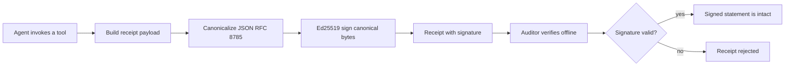
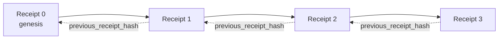

[पाठ भिडियो हेर्नुहोस्: क्रिप्टोग्राफिक रसिदहरूसँग एआई एजेन्टहरू सुरक्षित गर्ने](https://youtu.be/PLACEHOLDER_VIDEO_ID)

> _(पाठ भिडियो र थम्बनेल माइक्रोसफ्ट सामग्री टोलीले मर्ज पछि थप्ने, पाठ १४ / १५ ढाँचासँग मेल खाने।)_

# क्रिप्टोग्राफिक रसिदहरूसँग एआई एजेन्टहरू सुरक्षित गर्ने

## परिचय

यस पाठले कभर गर्नेछ:

- किन AI एजेन्टहरूको लागि अडिट ट्रेलहरू अनुपालन, डिबगिङ, र विश्वासको लागि महत्वपूर्ण छन्।
- क्रिप्टोग्राफिक रसिद के हो र यो असाइन गरिएको लग लाइनबाट कसरी फरक छ।
- कसरी एजेण्टको टुल कलको लागि ठोस Python मा साइन गरिएको रसिद उत्पादन गर्ने।
- कसरी एक रसिदलाई अफलाइन जाँच गर्ने र टेम्परिङ पत्ता लगाउने।
- कसरी रसिदहरूलाई चेन गर्ने ताकि एउटा रसिद हटाउँदा वा पुनःक्रमित गर्नाले चेन टुट्छ।
- रसिदहरूले के प्रमाणित गर्छन् र के स्पष्ट रूपमा प्रमाणित गर्दैनन्।

## सिकाइ लक्ष्यहरू

यो पाठ सकिए पछि, तपाईं जान्नुहुनेछ कसरी:

- एजेन्ट क्रियाकलापहरूका लागि क्रिप्टोग्राफिक प्रवृत्तिको प्रेरणा दिने असफलता मोडहरू पहिचान गर्ने।
- एक canonical JSON payload मा Ed25519 द्वारा साइन गरिएको रसिद उत्पादन गर्ने।
- केवल हस्ताक्षरकर्ता सार्वजनिक कुञ्जी प्रयोग गरेर स्वतन्त्र रूपमा रसिद जाँच्ने।
- संशोधित रसिदमा पुनः जाँच गरेर टेम्परिङ पत्ता लगाउने।
- रसिदहरूको ह्यास-चेन गरिएको अनुक्रम बनाउन र किन यो चेन महत्वपूर्ण छ भन्ने व्याख्या गर्ने।
- रसिदहरूले के प्रमाणित गर्छन् (अट्रिब्युसन, अखण्डता, क्रमबद्धता) र के प्रमाणित गर्दैनन् (कार्यको शुद्धता, नीतिको ध्वनि) बीचको सीमा चिन्ह लगाउने।

## समस्या: तपाईंको एजेन्टको अडिट ट्रेल

कल्पना गर्नुहोस् तपाईंले Contoso Travel को लागि एक AI एजेन्ट तैनाथ गर्नुभएको छ। एजेन्टले ग्राहकका अनुरोधहरू पढ्छ, फ्लाइट API कल गरेर विकल्पहरू खोज्छ, र ग्राहकको तर्फबाट सीट बुक गर्दछ। अघिल्लो चौमासिकमा, एजेन्टले ५०,००० बुकिङहरू प्रक्रिया गर्यो।

आज एक अडिटर आउँछ। उनी सिधा प्रश्न सोध्छन्: "तपाईंको एजेन्टले के गर्‍यो भनेर देखाउनुहोस्।"

तपाईं आफ्ना लग फाइलहरू दिनुहुन्छ। अडिटरले तिनीहरूलाई हेर्छ र कडा प्रश्न सोध्छ: "म कसरी थाहा पाउँ कि यी लगहरू सम्पादन गरिएको छैन?"

यो अडिट-ट्रेल समस्या हो। आजका धेरै एजेन्ट तैनाथीहरूले भर पर्छन्:

- **एप्लिकेसन लगहरू**: एजेन्ट आफैंले लेखेको, फाइल-सिस्टम पहुँच भएको जे कोहीले सम्पादन गर्न सक्ने।
- **क्लाउड लगिङ सेवाहरू**: प्लेटफर्म स्तरमा टेम्पर-प्रमाणित तर मात्र यदि अडिटरले प्लेटफर्म अपरेटरमा विश्वास गर्छ भने।
- **डाटाबेस ट्रान्जेक्शन लगहरू**: डाटाबेस परिवर्तनहरूका लागि उपयुक्त तर मनमौजी टुल कलहरूको लागि होइन।

यी मध्ये कुनैले पनि अडिटरको प्रश्नको जवाफ दिन सक्दैनन् बिना अडिटरले कसैमा (तपाईं, तपाईंको क्लाउड प्रदायक, तपाईंको डाटाबेस विक्रेता) विश्वास गर्नु पर्ने। आन्तरिक प्रयोगको लागि त्यो विश्वास प्रायः स्वीकार्य हुन्छ। नियन्त्रित कार्यभार (वित्त, स्वास्थ्य सेवा, EU AI ऐन को अधीनमा हुने कुनै पनि) को लागि, यो हुँदैन।

क्रिप्टोग्राफिक रसिदहरूले यो समस्या सानो गर्छन् जसले एउटा साइन गरिएको बयान स्वतन्त्र रूपमा
प्रमाणित गर्न मिल्ने बनाउँछ। अडिटरले अझै पनि साइनिङ कुञ्जीमा र
बयान उत्पादन गर्ने कम्पोनेंटमा विश्वास गर्न बाह्य कारण चाहिन्छ। एम्बेड गरिएको कुञ्जीले आत्म-संगति प्रमाणित गर्छ,
जारीकर्ता परिचय वा कार्यान्वयन स्थान होइन।

## क्रिप्टोग्राफिक रसिद के हो?

रसिद एउटा JSON वस्तु हो जसले एजेन्टले के गर्यो रेकर्ड गर्छ, डिजिटल हस्ताक्षर सहित।



एक न्यूनतम रसिद यसरी देखिन्छ:

```json
{
  "type": "agent.tool_call.v1",
  "agent_id": "contoso-travel-bot",
  "tool_name": "lookup_flights",
  "tool_args_hash": "sha256:a3f9c1...",
  "result_hash": "sha256:7b2e1d...",
  "policy_id": "contoso-travel-policy-v3",
  "timestamp": "2026-04-25T14:30:00Z",
  "sequence": 47,
  "previous_receipt_hash": "sha256:9d4e6a...",
  "signature": {
    "alg": "EdDSA",
    "sig": "c5af83...",
    "public_key": "8f3b2c..."
  }
}
```

काम गरिरहेका तीन गुणहरू छन्:

1. **हस्ताक्षर**। रसिद एजेन्टको गेटवे द्वारा Ed25519 निजी कुञ्जीसँग साइन गरिएको छ। मेल खाने सार्वजनिक कुञ्जी भएको कुनै पनि व्यक्तिले हस्ताक्षर अफलाइन जाँच्न सक्छ। कुनै भरोसापूर्ण पक्षले त्यो कुञ्जी पिन गर्नु पर्छ वा रसिद बाहिर भरोसापूर्ण रेजिस्ट्रीबाट समाधान गर्नु पर्छ। कुनै पनि साइन गरिएको फिल्डमा टेम्परिङले हस्ताक्षर अमान्य पार्दछ।

2. **क्यानोनिकल एनकोडिङ**। साइन गर्नु अघि, रसिद JSON Canonicalization Scheme (JCS, RFC 8785) प्रयोग गरी सिरियलाइज गरिएको छ। यसले सुनिश्चित गर्छ कि दुईवटा कार्यान्वयनले समान तार्किक रसिद उत्पादन गर्दा बाइट-समझौता नहुने आउटपुट उत्पादन गर्छन्। क्यानोनिकलाइजेसन बिना, फरक JSON सिरियलाइजर्सले समान सामग्रीको लागि फरक हस्ताक्षर उत्पादन गर्थे।

3. **ह्यास चेनिङ**। `previous_receipt_hash` फिल्ड प्रत्येक रसिदलाई अघिल्लो रसिदसँग जोड्छ। रसिद २ चुपचाप हटाउनको लागि, हमलावरले या त:

यी गुणहरूले सँगै तीन ग्यारेन्टीहरू दिन्छन्:

- **कुञ्जीसँग सम्बन्ध**: यस कुञ्जीले यस सामग्रीमा हस्ताक्षर गरेको छ। संस्थागत वा मानवीय परिचयको लागि भरोसायोग्य कुञ्जी बाइन्डिङ चाहिन्छ।
- **अखण्डता**: सामग्री हस्ताक्षर पछि परिवर्तन भएको छैन।
- **प्रमाणित अनुक्रम भित्र क्रमबद्धता**: यस रसिदले त्यो अघिल्लो रसिदसँग लिंक गर्छ।

## Python मा रसिद उत्पादन गर्ने

रसिद उत्पादन गर्न कुनै विशेष लाइब्रेरी चाहिदैन। क्रिप्टोग्राफिक प्रिमिटिभहरू व्यापक रूपमा उपलब्ध छन् र तर्क केही दर्जन पंक्तिहरूको Python मा छ।

हात-समायोजन अभ्यासहरू `code_samples/18-signed-receipts.ipynb` मा पुरा प्रवाह वर्णन गर्छन्। स्रोत-नियन्त्रित `code_samples/18-signed-receipts.execution-receipt.json` नोटबुक ह्यास, Python वातावरण, सेल गणना, र पछिल्लो सफा निष्पादनबाट जाँचहरू ठीक रेकर्ड गर्छ बिना पाठको सुरक्षित नतिजा परिवर्तन गर्ने। सारांश संस्करण:

```python
import json
import hashlib
import base64
from nacl import signing
from jcs import canonicalize  # RFC 8785 canonical JSON

def b64url_nopad(data: bytes) -> str:
    return base64.urlsafe_b64encode(data).decode("ascii").rstrip("=")

def sha256_canonical(obj) -> str:
    """SHA-256 of a Python object's JCS-canonical JSON form."""
    return f"sha256:{hashlib.sha256(canonicalize(obj)).hexdigest()}"

# Generate or load a signing key (in production, store in a key vault)
signing_key = signing.SigningKey.generate()
verify_key = signing_key.verify_key
TRUSTED_PUBLIC_KEYS = {b64url_nopad(bytes(verify_key))}  # pinned out of band by the verifier

# Build the receipt payload (no signature yet)
tool_args = {"origin": "SYD", "destination": "LAX"}
tool_result = [{"flight": "QF11", "price": 1850, "stops": 0}]

payload = {
    "type": "agent.tool_call.v1",
    "agent_id": "contoso-travel-bot",
    "tool_name": "lookup_flights",
    "tool_args_hash": sha256_canonical(tool_args),
    "result_hash": sha256_canonical(tool_result),
    "policy_id": "contoso-travel-policy-v3",
    "timestamp": "2026-04-25T14:30:00Z",
    "sequence": 0,
    "previous_receipt_hash": None,
}

# Canonicalize and sign the JCS bytes directly. PureEdDSA hashes internally.
canonical_bytes = canonicalize(payload)
signature_bytes = signing_key.sign(canonical_bytes).signature

# Attach a structured signature object.
receipt = {
    **payload,
    "signature": {
        "alg": "EdDSA",
        "sig": b64url_nopad(signature_bytes),
        "public_key": b64url_nopad(bytes(verify_key)),
    },
}
```

यो पूरै साइनिङ पाइपलाइन हो। नोटबुकमा अभ्यासहरूले प्रत्येक चरण चरण व्याख्या गर्छन्।

## रसिद जाँच्ने र टेम्परिङ पत्ता लगाउने

जाँच उल्टो प्रक्रिया हो:

```python
import base64
import hashlib
from nacl import signing
from nacl.exceptions import CryptoError
from jcs import canonicalize

def b64url_decode(s: str) -> bytes:
    # Strict: Python's decoder skips characters outside the alphabet and also
    # accepts padding, the standard +/ alphabet and non-zero spare bits.
    # Re-encoding and comparing accepts only the one unpadded base64url form.
    padding = "=" * ((4 - len(s) % 4) % 4)
    data = base64.urlsafe_b64decode(s + padding)
    if base64.urlsafe_b64encode(data).decode("ascii").rstrip("=") != s:
        raise ValueError("not canonical unpadded base64url")
    return data

def verify_receipt(receipt: dict, trusted_public_key: str) -> bool:
    # trusted_public_key is the issuer's key, obtained from somewhere other
    # than this receipt. Never use receipt["signature"]["public_key"] here:
    # see "What Receipts Prove (and What They Do Not)" below.
    # Fails closed: anything malformed returns False instead of raising.
    if not isinstance(receipt, dict) or not isinstance(trusted_public_key, str):
        return False
    sig_obj = receipt.get("signature")
    if not isinstance(sig_obj, dict) or sig_obj.get("alg") != "EdDSA":
        return False
    sig_b64 = sig_obj.get("sig")
    if not isinstance(sig_b64, str):
        return False

    try:
        # Reconstruct the payload that was actually signed (everything except signature).
        payload = {k: v for k, v in receipt.items() if k != "signature"}
        canonical_bytes = canonicalize(payload)
        verify_key = signing.VerifyKey(b64url_decode(trusted_public_key))
        verify_key.verify(canonical_bytes, b64url_decode(sig_b64))
        return True
    except (CryptoError, TypeError, ValueError, KeyError, OverflowError):
        return False
    except Exception:
        # An undecodable key or signature, or a payload that cannot be
        # canonicalized: fail closed rather than raise.
        return False
```

यो फङ्क्सनले रसिद र जारीकर्ताको सार्वजनिक कुञ्जी लिएर, हस्ताक्षर मान्य भएमा `True` र नभएमा `False` फर्काउँछ, malformed इन्पुटसमेत। कुनै नेटवर्क कल र कुनै जाँच सेवा छैन: एक पटक जारीकर्ताको कुञ्जी हातमा पुग्नेबित्तिकै जाँच पूर्ण रूपमा स्थानीय र अफलाइन हुन्छ। अझै चाहिने कुरा त्यो कुञ्जी हो, जुन रसिदमा नभई कुनै अन्य स्थानबाट प्राप्त हुनु पर्छ।

टेम्परिङ पत्ता लगाउने हेर्न नोटबुकमा:

1. वैध रसिद उत्पादन गर्ने र त्यसलाई सफल रूपमा प्रमाणित गर्ने।
2. `tool_args_hash` फिल्डको एक बाइट परिमार्जन गर्ने।
3. पुन: जाँच गर्ने र असफल भएको देख्ने।
4. फेरि टेम्परिङ गर्ने, तर यस पटक हमलावरले सिर्जना गरेको कुञ्जीसँग पुनः साइन गरी त्यस कुञ्जी रसिदमा एम्बेड गर्ने।

चरण ४ महत्त्वपूर्ण हो। त्यो रसिद आन्तरिक रूपमा सुसंगत छ: यसको हस्ताक्षर यसको सामग्री र यसको साथ राखिएको कुञ्जीका लागि वास्तविक छ, त्यसैले यो भित्रको कुञ्जीसँग जाँच्दा प्रमाणित हुन्छ। यो तभी असफल हुन्छ जब जारीकर्ताको वास्तविक कुञ्जीसँग जाँचिन्छ। चरण २ र ३ले पुनः साइन नगरेको हमलावरलाई पक्रिन्छ; चरण ४ले पुनः साइन गरेको पक्रिन्छ।

यो व्यवहारिक प्रमाण हो कि रसिदहरू टेम्पर-प्रमाणित छन्: साइन गरिएको कुनै पनि फिल्डमा परिवर्तनले हस्ताक्षर तोड्छ, यदि तपाईंले हमलावरले दिएको कुञ्जीबाट नभई अर्कै कुञ्जीबाट जाँच गर्नु भयो भने। `signature` वस्तु आफ्नैमा साइन गरिएको बाइटहरू बाहिर छ, जसकारण जाँच्नुभनेको कुञ्जी रसिदबाट बाहिरबाट आउनु पर्छ।

## बहु-चरण एजेन्टहरूको लागि रसिदहरू चेन गर्ने

एक सिंगल हस्ताक्षर गरिएको रसिदले एउटा क्रियालाई सुरक्षित गर्छ। रसिदहरूको चेनले अनुक्रमलाई सुरक्षित गर्छ।



प्रत्येक रसिदले अघिल्लो रसिदको ह्यास रेकर्ड गर्छ। रसिद २ चुपचाप हटाउन हमलावरले या त:

- रसिद ३ को `previous_receipt_hash` फिल्ड परिमार्जन गर्ने (रसिद ३ को हस्ताक्षर टूट्छ), वा
- संशोधित रसिद ३ मा नयाँ हस्ताक्षर फर्ज गर्ने (एजेन्टको निजी कुञ्जी आवश्यक पर्छ)।

यदि निजी कुञ्जी हार्डवेयर कुञ्जी भण्डारमा छ र प्रमाणीकारकहरूले प्रत्येक रसिदलाई स्वतन्त्र रूपमा प्राप्त गरिएको जारीकर्ताको सार्वजनिक कुञ्जीसँग (प्रकाशित JWK सेट वा पिन गरिएको कन्फिग मान) तुलना गर्छन् भने, कुनै पनि आक्रमण पत्ता नलागी सम्भव हुँदैन। प्रत्येक रसिद भित्र कुञ्जी प्रकाशन गर्नु पर्याप्त छैन: आक्रमणकारी आफ्नो कुञ्जीसँग पुनः हस्ताक्षर गर्न सक्छ र त्यो कुन्जी त्यति बटुमा राख्न सक्छ, जुन fixture `04_resigned_receipt.json` हो।

नोटबुकले तलका विषयहरूमा हिँड्नेछ:

१. तीन रसिदहरूको श्रृंखला निर्माण गर्नु।
२. प्रत्येक रसिदको `previous_receipt_hash` लाई अघि को रसिदको वास्तविक ह्याससँग मिलाउने प्रमाणित गर्नु।
३. बिचको एउटा रसिदमा छेउछाउ गर्दै श्रृंखला ठीक त्यो बिन्दुमा टुटेको देख्नु।

यसरी तपाईं यस्तो अडिट ट्रेल उत्पादन गर्नुहुन्छ जसलाई बाह्य अडिटर यसको
आफ्नै पिन गरिएको जारीकर्ता कुञ्जी र श्रृंखला चेकपोइन्ट अन्तर्गत प्रमाणित गर्न सक्छन्, तपाईंको परिवर्तनशील लग स्टोरमा भरोसा नगरी।

## रसिदहरूले प्रमाणित गर्ने कुरा (र प्रमाणित नगर्ने कुरा)

यस पाठको सबैभन्दा महत्वपूर्ण खण्ड हो। रसिदहरू शक्तिशाली हुन्छन् तर तिनीहरूको शक्ति सीमित हुन्छ।

**रसिदहरूले तीन कुराहरू प्रमाणित गर्छन्:**

१. **अट्रिब्युसन**: एउटा विशिष्ट कुञ्जीले एउटा विशिष्ट प्यालोडमा हस्ताक्षर गर्‍यो।
२. **अखण्डता**: हस्ताक्षर गरिएको पछि प्यालोड परिवर्तन भएको छैन।
३. **प्रस्तुत, प्रमाणित श्रृंखलाभित्र क्रमाङ्कन**: यो रसिद त्यो पहिलेको रसिदसँग जोडिएको छ।

**रसिदहरूले प्रमाणित गर्दैनन्:**

1. **सहीपन**: एजेन्टको क्रियाकलाप सही क्रिया भएको छ। एउटा रसिद गलत उत्तरको लागि पनि ठ्याक्कै सही उत्तरको जस्तै हस्ताक्षर गर्न सकिन्छ।
2. **नीतिपालन**: `policy_id` मा उल्लिखित नीतिलाई साँच्चै मूल्यांकन गरिएको थियो, वा यदि जाँच गरियो भने यसले यो क्रियाकलाप अनुमति दिएको हुन्थ्यो। रसिदले के दाबी गरिएको थियो त्यो रेकर्ड गर्छ, के लागू गरिएको थियो होइन।
3. **साँचो पहिचान कुञ्जीभन्दा पर**: रसिदले भन्छ "यो कुञ्जीले यो सामग्रीमा हस्ताक्षर गर्‍यो।" यो भन्दैन "यो मानिसले अनुमति दियो।" कुञ्जीलाई व्यक्ति वा संस्थासँग जोड्न अलग पहिचान पूर्वाधार आवश्यक पर्छ (डाइरेक्टरी, सार्वजनिक कुञ्जी दर्ता, आदि)।
4. **इनपुटहरूको सत्यता**: यदि एजेन्टले गरिएको मनिपुलेट गरिएको प्रॉम्प्ट प्राप्त गर्छ र त्यसमा क्रिया गर्दछ भने रसिदले त्यो क्रियाकलाप त्यस्तै निष्ठापूर्वक रेकर्ड गर्छ। रसिदहरू इनपुट मान्यकरणको पछि छन्, यसको विकल्प होइनन्।
5. **कार्यान्वयन वा वास्तविक प्रभाव**: पोस्ट-कॉल रसिद यसको जारीकर्ता द्वारा के भएको दाबी गरिएको छ त्यो रेकर्ड गर्छ। प्रवेश प्रमाणित गर्ने वा बाह्य प्रभाव मिलाउने प्रमाण वास्तविक कार्यान्वयकर्ता वा प्रदायक सीमाबाट आवश्यक पर्छ।
6. **पूर्णता**: अनुपस्थित रसिदले अवरुद्ध, छोडिएको, हराएको, वा उपकरणसम्बन्धी नभएको जनाउन सक्छ। अनुपस्थिति प्रमाण बन्छ केवल प्रमाणित बन्द जनसंख्यामा मात्र।
7. **विश्वसनीय समय**: हस्ताक्षरित टाइमस्ट्याम्पले प्रमाणित गर्छ हस्ताक्षरकर्ताले त्यो मान्यो, त्यो मान सही छ भन्ने होइन। विश्वसनीय समयका लागि अलग समय प्राधिकरण वा साक्षी गरिएको चेकपोइन्ट चाहिन्छ।

**रसिदमा रहेको कुञ्जी त्यस कुञ्जीसँग मेल खानु पर्दैन जसले तपाईँले प्रमाणित गर्नु हुन्छ।** यो बुँदा ३ बाट निस्कन्छ, र यो एक मात्र ठाउँ हो जहाँ भिन्नतालाई तपाईँको कोडमा परिवर्तन गर्नुपर्छ, बुझाइमा होइन। माथि को नमुना मा रहेको `public_key` त्यहाँ छ ताकि उदाहरण स्व-निहित होस्। प्रमाणकले यसलाई कहिल्यै भरोसा गर्नु हुँदैन। कोही पनि रसिद लिएर, यसलाई परिवर्तन गरेर, आफ्नो सिर्जना गरेको कुञ्जीसँग हस्ताक्षर गरी त्यो कुञ्जी समावेश गर्न सक्छ; परिणाम आफैंमा पूर्ण रूपमा प्रमाणित हुन्छ। त्यो फिक्स्चर `04_resigned_receipt.json` मा छ `sample_receipts/` मा, र त्यसैले माथि रहेको `verify_receipt` ले रसिदबाट होइन, तर्कको रूपमा कुञ्जी लिन्छ। जारीकर्ताको कुञ्जी स्वतन्त्र रूपमा प्राप्त गर्नुहोस्, तलको प्रोडक्सन चेकलिस्टको JWK सेटबाट वा पहिले पिन गरिएको अन्य कुनै एंकरबाट, र त्यसको विरुद्ध प्रमाणित गर्नुहोस्। एउटै लिफाफामा आएको कुञ्जीसँग जाँच गरिएको हस्ताक्षरले केवल लिफाफा आत्म-संगत छ भन्ने प्रमाणित गर्छ।

यो सीमा दुई कारणले महत्वपूर्ण छ:

- यसले तपाईँलाई के रसिदहरू उपयोगी हुन्छन् भनेर बताउँछ: एजेन्टको व्यवहारले अडिट र छेउछाउ देखिने बनाउन, यहाँसम्म कि संगठनात्मक सीमाहरू पार पनि।
- यसले थप के तहहरू आवश्यक छन् भनेर बताउँछ: इनपुट मान्यकरण (पाठ ६), नीतिको कार्यान्वयन (मुनि छोटकरीमा समेटिएको), र पहिचान पूर्वाधार (यस पाठको दायरामा छैन)।

एउटा सामान्य गल्ती हो "हामीसँग रसिद छ" भन्ने अर्थ "हामी शासित छौं" भन्ने बुझ्नु। त्यस्तो होइन। रसिद आधार हो। शासन त्यो प्रणाली हो जुन तपाईँले माथि निर्माण गर्नु हुन्छ।

## अनुमोदकको हस्ताक्षर ठ्याक्कै क्रियाकलापसँग बाँध्नु

माथिको बुँदा ३ आफैंमा एउटा अध्यायको योग्य छ: एउटा क्रिया रसिदले भन्छ "यो कुञ्जीले यो सामग्रीमा हस्ताक्षर गर्‍यो," कहिल्यै "मानिसले अनुमति दियो" होइन। उच्च जोखिमका क्रियाकलापहरू (फिर्ता, मेट्ने, वायर ट्रान्सफर) का लागि छुट्टै अनुमोदक हस्ताक्षरले ठ्याक्कै क्रियाकलाप बाँध्न सक्छ। त्यो कुञ्जीलाई मान्छेसँग जोड्नु र मान्छेको उपस्थितिलाई जाँच्नु छुट्टै जिम्मेवारीहरू रहन्छन्।

पछि आउने नोटबुक `code_samples/human-authorization-receipts.ipynb` ले अर्को रसिद प्रकार थप्छ, `human.approval.v1`, जसको लिफाफा आकार पाठका रसिद जस्तै हुन्छ (एक टाइप गरिएको पेलोड जसमा Canonical JCS बाइटहरू माथि Ed25519 द्वारा हस्ताक्षर गरिएको, सँगै `signature` वस्तु हस्ताक्षरतर्फ बाहिर हुन्छ)। अनुमोदक कुञ्जीले **पूरा मूल क्रिया र यसको डाइजेस्ट** मा हस्ताक्षर गर्छ; एजेन्ट कुञ्जीले दाबी हस्ताक्षर गर्छ जसले **त्यस्तै क्रिया डाइजेस्ट** र एउटा `parent_approval_ref` लिन्छ, त्यो अनुमोदनको `receipt_hash` हो, माथि निर्माण गरिएको चेनमा `previous_receipt_hash` को जस्तै परम्परा अनुरूप। एउटा `verify_chain` ले दुबै कलाकृतिहरूलाई **विभिन्न पिन गरिएको कुञ्जी दर्तासँग** (अनुमोदक कुञ्जी र एजेन्ट कुञ्जीहरू) संभाल्छ, कोड पथ साझा हुन्छ तर अधिकारहरू कहिल्यै साझा हुँदैनन्।

यसले कफियत दिन्छ, सावधानीपूर्वक भनियो: *पिन गरिएको अनुमोदक कुञ्जीले ठ्याक्कै यो
क्रियामा हस्ताक्षर गर्‍यो, र एजेन्ट कुञ्जीले पछि त्यही क्रिया डाइजेस्ट बोकेको कथन हस्ताक्षर गर्‍यो।*
त्यो उपयोगी प्रमाण हो, तर आफैंमा त्यो क्रिया कार्यान्वित भएको प्रमाण होइन। कार्यान्वयन नियन्त्रण गर्न,
ठ्याक्कै अनुमोदन सुरक्षित गरिनु र वास्तविक कार्यान्वयकर्ता सिमानामा एकपटक मात्र उपभोग गरिनु पर्दछ; अज्ञात प्रदायक नतिजाहरू अज्ञात नै रहनुपर्छ, अज्ञानताका कारण फेरी प्रयास नगर्दै। नोटबुकको अस्वीकृत फिक्स्चरहरूले रसिद-श्रृंखला तहको परीक्षण गर्छन्:

- छेडछाड, भ्रमित प्रतिनिधि, दुबै पट्टि बनावट कुञ्जी, र विकृत इनपुट;

- छेडछाड, भ्रमित उपभोक्ता, दुवै पक्षमा नकली सर्तकहरू, र बिग्रिएको इनपुट;
- **अप्रचलित अधिकार**: एउटा हस्ताक्षर जुन अझै प्रमाणित गर्छ, नीतिको संस्करण सर्न गएको कारण अस्वीकार गरियो, अनुमोदक कुञ्जी पिन गरिएको रजिस्ट्रीबाट घुमाइएको थियो, वा आपूर्ति गरिएको प्रमाणित समयभन्दा पहिले अनुमोदनको अवधिको समाप्ति भयो;
- **डाइजेस्ट प्रतिस्थापन**: एक मान्य रूपमा हस्ताक्षर गरिएको क्रियावली रसिद जुन *वास्तविक* अनुमोदनतर्फ इङ्गित गर्दछ जुन *अर्को* क्यानोनिकल क्रियालाई बाँध्छ।

प्रत्येक असफलता अलग कारणसँग अस्वीकार गर्दछ, त्यसैले अस्वीकृतिलाई पढ्ने अडिटरले थाहा पाउन सक्छ कि प्राधिकरण पुरानो भयो वा दाबी गरिएको क्रिया परिवर्तन भयो। प्रमाणीकरण केवल-पढ्न योग्य र दोहोर्याउन मिल्ने हुन्छ: यसले अनुमोदन खपत गर्दैन वा प्रदायकलाई बोलाउँदैन। अलग कार्यान्वयनकर्ताले दिगो, अणु पुन:प्रसारण संरक्षण र स्पष्ट सफलता, असफलता, र अस्पष्ट परिणामहरू आवश्यक पर्छ। मानवीय-स्वीकृति रसिद यो पाठद्वारा परिभाषित एउटा शैक्षिक संरचना हो, `draft-farley-acta-signed-receipts` द्वारा परिभाषित रसिद प्रकार होइन।

## उत्पादन सन्दर्भहरू

यस पाठमा पाइथन कोड जानाजानी न्यूनतम राखिएको छ ताकि तपाईं प्रत्येक लाइन पढ्न सक्नुहुनेछ र के भइरहेको छ स्पष्ट रूपमा बुझ्न सक्नुहुनेछ। उत्पादनमा, तपाइँसँग दुई विकल्पहरू छन्:

1. **क्रिप्टोग्राफिक प्रिमिटिभहरूमा सिधै निर्माण गर्नुहोस्।** माथि देखिएका ५० लाइनहरू धेरै प्रयोगहरूका लागि पर्याप्त छन्। PyNaCl (Ed25519) र `jcs` प्याकेज (क्यानोनिकल JSON) राम्रोसँग मर्मत गरिएको र अडिट गरिएको पुस्तकालयहरू हुन्।

2. **उत्पादन रसिद पुस्तकालय प्रयोग गर्नुहोस्।** केही खुला स्रोत परियोजनाले उही ढाँचालाई थप सुविधाहरू (कुञ्जी रोटेसन, ब्याच प्रमाणीकरण, JWK सेट वितरण, नीति ईन्जिनसँग एकीकरण) सहित कार्यान्वयन गर्छन्:
   - साइनिङ पाइपलाइनले JCS र हस्ताक्षर-परिधि सम्मेलनहरू स्वतन्त्र IETF इन्टरनेट-ड्राफ्ट ([`draft-farley-acta-signed-receipts`](https://datatracker.ietf.org/doc/draft-farley-acta-signed-receipts/), संशोधन 02) मा प्रयोग गर्दछ। यस पाठको सरल शैक्षिक रसीद ड्राफ्टको `{payload, signature}` लिफाफाको तुलनामा फरक छ र एक अनुरूप कार्यान्वयनको रूपमा प्रस्तुत गरिएको छैन। ड्राफ्टले यसको तार ढाँचालाई लक्षित गर्ने कार्यान्वयनहरूको लागि साझा अनुरूपता सूट ([agent-governance-testvectors](https://github.com/ScopeBlind/agent-governance-testvectors)) प्रकाशित गर्दछ।
   - माइक्रोसफ्ट एजेन्ट गभर्नेन्स टूलकिटले सेडर आधारित नीति निर्णयहरूसँग रसीदहरू तयार गर्दछ; एउटा अन्तदेखि-अन्त उदाहरणका लागि त्यो रिपोजिटोरीमा टुटोरियल 33 हेर्नुहोस्।
   - `protect-mcp` (npm) र `@veritasacta/verify` (npm) प्याकेजहरूले नोड-आधारित कार्यान्वयन प्रदान गर्दछन् रसीद हस्ताक्षर र अफलाइन प्रमाणीकरणको, जुन कुनै पनि MCP सर्भरलाई ट्याम्पर-एविडेन्ट अडिट ट्रेलसहित र्याप गर्नको लागि बनाइएको हो, जसमा एक होल्ड-फर-को-साइन फ्लो पनि समावेश छ जहाँ रोकेको गरिएको क्रियाले क्रिया डाइजेस्टसँग बाँधिएको स्वीकृति रसीद निकाल्दछ (डेस्कटप फ्लोमा WebAuthn समर्थित), माथिको मानव-प्राधिकरण नोटबुकसँग समान स्वीकृति-रसीद ढाँचा।
   - **[nobulex](https://github.com/arian-gogani/nobulex)** पायथन SDK (`pip install nobulex`) ले पायथनमा एउटै Ed25519 + JCS हस्ताक्षर ढाँचा LangChain र CrewAI एकीकरणहरूसँग प्रदान गर्दछ, जसमा प्रकाशित क्रस-मान्यता परीक्षण भेक्टरहरू र [OWASP PR #2210](https://github.com/OWASP/CheatSheetSeries/pull/2210) मार्फत योगदान गरिएको अनुपालन म्यापिङ समावेश छ।
   - **[EMILIA Protocol](https://github.com/emiliaprotocol/emilia-protocol)** ले पूरक सही-कार्य लागू गर्ने तह प्रदान गर्दछ: अफलाइन-सत्यापनयोग्य स्वीकृति रसीदहरू, पिन गरिएको WebAuthn वा क्वोरम अधिकार, कार्यान्वयनकर्ता सीमामा एकपटक उपभोग, र स्पष्ट अनिश्चित-परिणाम मार्ग। यसको फ्रेमवर्क एडाप्टरहरूले रसीदलाई बाह्य प्रभाव भएको प्रमाणको सट्टा आवश्यक प्रमाणको रूपमा व्यवहार गर्छन्।

आफैं सिर्जना गर्ने र पुस्तकालय प्रयोग गर्ने निर्णयले आफ्नै JWT पुस्तकालय लेख्ने र परीक्षण गरिएको एक प्रयोग गर्ने निर्णयलाई प्रतिबिम्बित गर्दछ: दुवै उचित छन्; पुस्तकालयले समय बचत गर्दछ र अडिट सतह घटाउँछ; शुरुदेखि आफैं गर्ने तरिकाले तपाईंलाई प्रत्येक प्रिमिटिभ बुझ्न बाध्य पार्छ। यस पाठले शुरुदेखि गर्ने बाटो सिकाउँछ ताकि तपाईंलाई जुनसुकै छनोटको लागि आधार मिलोस्।

## ज्ञान परीक्षण

अभ्यास व्यायाममा जाने अघि आफ्नो बुझाइ परिक्षण गर्नुहोस्।

**1. रसीद एजेन्टको निजी Ed25519 कुञ्जीले हस्ताक्षर गरिएको छ। अडिटरसँग मात्र सार्वजनिक कुञ्जी छ। के अडिटरले रसीदलाई अफलाइन प्रमाणित गर्न सक्छ?**

<details>
<summary>उत्तर</summary>

हो, क्रिप्टोग्राफिक प्रमाणीकरणका लागि मात्र सार्वजनिक कुञ्जी र हस्ताक्षर गरिएको बाइटहरू आवश्यक हुन्छन्।
अडिटरले अझै पनि प्राप्त सार्वजनिक कुञ्जीलाई रसीदबाट स्वतन्त्र रूपमा प्राप्त गरी पिन गर्नै पर्छ।
त्यो विश्वास कन्फिगरेसन स्थापना भइसकेपछि कुनै नेटवर्क कल आवश्यक पर्दैन।
</details>

**२. आक्रमणकारीले प्राप्तिको `policy_id` क्षेत्रलाई परिमार्जन गरेर दावी गर्छ कि यो बढी अनुमति दिने नीतिले नियन्त्रित थियो। हस्ताक्षर मूल पेलोडमाथि गरिएको थियो। प्रमाणीकरणको क्रममा के हुन्छ?**

<details>
<summary>उत्तर</summary>

प्रमाणीकरण असफल हुन्छ। हस्ताक्षर मूल पेलोडका क्यानेनिकल बाइटहरूमा गणना गरिएको थियो; कुनै पनि पेलोड क्षेत्र परिमार्जन गर्दा ती बाइटहरू परिवर्तन हुन्छन्, जसले हस्ताक्षरलाई अमान्य बनाउँछ। आक्रमणकारीले नयाँ मान्य हस्ताक्षर उत्पादन गर्न निजी कुञ्जी चाहिन्छ, जुन उनीसँग छैन।
</details>

**३. किन प्राप्तिमा कच्चा तर्क र परिणामको सट्टा `tool_args_hash` र `result_hash` समावेश छन्?**

<details>
<summary>उत्तर</summary>

दुई कारणहरू छन्। पहिलो, प्राप्तिलाई संग्रह वा प्रसारण गर्नुपर्ने हुन सक्छ जहाँ कच्चा सामग्री (PII, व्यवसाय डेटा) लिक हुनु समस्या हो। ह्यासिङले प्राप्तिलाई सानो र सामग्रीलाई निजी राख्छ; अडिटरले ह्यास मिल्दोजुल्दो छ कि छैन परीक्षण गर्नेछ अलग्गै संग्रहीत वास्तविक सामग्रीसँग। दोस्रो, ह्यासहरूसँग निश्चित साइज हुन्छ; ह्यास भएका प्राप्ति साइजमा सीमित हुन्छन् चाहे इन्पुट र आउटपुट कति ठूलो होस्।
</details>

**४. `previous_receipt_hash` क्षेत्रले हरेक प्राप्ति आफ्ना पूर्ववर्तीलाई लिंक गर्छ। यदि आक्रमणकारीले चेनको बीचबाट एउटा प्राप्ति चुपचाप मेटाए, के अमान्य हुन्छ?**

<details>
<summary>उत्तर</summary>

मेटाइएको रसीद पछि आएका प्रत्येक रसीद। तिनीहरूको `previous_receipt_hash` क्षेत्रहरू वास्तविक चेनसँग मेल खाँदैनन् (किनभने तिनीहरूले संदर्भित गरेको रसीद अब अवस्थित छैन, वा चेनले अब फरक पूर्ववर्तीलाई सूचित गर्छ)। मेटाइलाई लुकाउन, आक्रमणकारीले हरेक पछि आउने रसीद पुनः हस्ताक्षर गर्नुपर्छ, जसका लागि जारीकर्ताको निजी कुञ्जी आवश्यक हुन्छ। अन्य कुञ्जीसँग पुनः हस्ताक्षर गर्दा जारीकर्ताको कुञ्जीसँग जाँच गर्दा असफल हुन्छ।
</details>

**5. एक रसीदले सफा रूपमा प्रमाणित गर्छ। के यसले एजेन्टको क्रिया सहि, विश्वसनीय, वा नीति अनुरूप भएको प्रमाणित गर्दछ?**

<details>
<summary>उत्तर</summary>

हुँदैन। पिन गरिएको कुञ्जी र चेन सन्दर्भ अन्तर्गत, वैध रसीदले हस्ताक्षरको स्रोत,
सामग्री अखण्डता, र प्रस्तुत गरिएको पूर्ववर्तीसँगको जडान प्रमाणित गर्दछ। यसले
क्रिया सहि वा कार्यान्वयन गरिएको, नीति मूल्यांकन गरिएको, समय मोहर
विश्वासिलो छ, वा अभिलेख सेट पूरा छ भन्ने प्रमाणित गर्दैन। यो पाठको सबैभन्दा महत्वपूर्ण सीमाना हो।
</details>

## अभ्यास अभ्यास

`code_samples/18-signed-receipts.ipynb` खोल्नुहोस् र सबै चार भागहरू पूरा गर्नुहोस्:

1. **भाग 1**: आफ्नो पहिलो रसीदमा हस्ताक्षर गर्नुहोस् र त्यसलाई प्रमाणित गर्नुहोस्।
2. **भाग 2**: रसीदमा छेड़छाड़ गर्नुहोस् र प्रमाणिकरण असफल देख्नुहोस्।
3. **भाग 3**: तीन-रसीद चेन बनाउनुहोस् र चेन अखण्डता प्रमाणित गर्नुहोस्।
4. **भाग 4**: Microsoft Agent Framework प्रयोग गरी बनाएको एजेन्टमा ढाँचा लागू गर्नुहोस्: टूल कललाई रसीद-हस्ताक्षरमा आवृत गर्नुहोस्, त्यसपछि रसीदलाई स्वतन्त्र रूपमा प्रमाणित गर्नुहोस्।

**स्ट्रेस चुनौती १:** रसीद स्किमालाई आफ्नो रोजाईको थप फिल्डले विस्तार गर्नुहोस् (उदाहरणका लागि, ट्रेसिङको लागि रिक्वेस्ट आईडी), क्यानोनिकल साइनिंग लॉजिकलाई यसमा समावेश गर्न अपडेट गर्नुहोस्, र पुष्टि गर्नुहोस् कि रसीद अझै पनि प्रमाणीकरण मार्फत पूर्ण रुपमा फर्कन्छ। त्यसपछि साइनिङ पछाडि फिल्डलाई परिवर्तन गर्नुहोस् र पुष्टि गर्नुहोस् कि प्रमाणीकरण असफल हुन्छ। यसले तपाइँलाई बुझ्न बाध्य पार्छ कि प्रत्येक बाइटले कसरी क्यानोनिकल एन्कोडिङमा हस्ताक्षरलाई योगदान गर्दछ।

**स्ट्रेस चुनौती २:** आफ्नो दुईवटा रसीदहरूको SHA-256 ह्यासिङ गर्नुहोस् (उनीहरूको क्यानोनिकल बाइटहरू निश्चित क्रममा जोड्नुहोस्) र नतिजा भएको डाइजेस्टलाई तेस्रो रसीद माथि नयाँ फिल्डको रूपमा राख्नुहोस्, त्यसपछि यसलाई साइन गर्नुहोस्। पुष्टि गर्नुहोस् कि तीनै रसीदहरू अझै पनि पूर्ण रुपमा फर्कन्छन्। तपाइँले भर्खरै एक-चरण समावेश प्रमाण बनाएर: तेस्रो रसीद सङ्ग राख्ने कुनै पनि व्यक्तिले प्रमाणित गर्न सक्छ कि पहिलो दुई रसीदहरू त्यसको साइन गरिएको समयमा अस्तित्वमा थिए, उनीहरूको सामग्री खुलासा नगरी। यो नै पैटर्न हो जुन चयनात्मक-प्रकटीकरण रसीदहरूले ठूलो आकारमा प्रयोग गर्छन् (मर्कल प्रतिबद्धताहरू, RFC 6962)।

## निष्कर्ष

क्रिप्टोग्राफिक रसीदहरूले AI एजेन्टहरूलाई एक अडिट ट्रेल दिन्छ जुन:

- **पिन गरिएको विश्वास अन्तर्गत स्वतन्त्र रूपले प्रमाणीकरण योग्य**: सार्वजनिक साँचाहरू र साइन गरिएको बाइटहरू स्वीकार गर्ने पक्षले सेवा निर्भरता बिना प्रमाणीकरण गर्न सक्छ।
- **छेडछाड देखिने**: कुनै पनि परिवर्तनले हस्ताक्षरलाई अमान्य बनाउँछ।
- **पोर्टेबल**: रसीद एउटा सानो JSON फाइल हो; यसलाई संग्रह, प्रसारण, र कुनै पनि ठाउँमा प्रमाणीकरण गर्न सकिन्छ।
- **मानक-सम्बन्धित**: Ed25519 (RFC 8032), JCS (RFC 8785), र SHA-256 मा आधारित, सबै व्यापक रूपमा प्रयोग हुने प्रिमिटिभहरू।

यी इनपुट प्रमाणिकरण, नीति कार्यान्वयन, कार्यान्वयनकर्ता स्वीकृति,
नतिजा प्रमाण, पूर्णता नियन्त्रण, वा पहिचान संरचनाको विकल्प होइनन्। यी एक आधार हुन्
ती तहहरूका लागि। नियमन गरिएको वा बहु-संगठन कार्यप्रवाहहरूमा, रसिदहरूले विशिष्ट
जारीकर्ताका वक्तव्यहरू स्वयंक विश्वसनीय प्रमाणीकरण अन्तर्गत स्वतन्त्र रूपमा जाँच गर्न योग्य बनाउँछन्।

सबैभन्दा महत्त्वपूर्ण कुरा: रसिदहरूले प्रमाणित गर्छन् कि एउटा विशेष कुञ्जीले विशेष
सामग्रीमा हस्ताक्षर गरेको थियो। बोकेको समयटिप्पणी हस्ताक्षरकर्ता दाबी हो जबसम्म अलग्गै समय-प्रमाणित गरिएको छैन। एक
रसिदले प्रमाणित गर्दैन कि यसको सामग्री सत्य थियो, कुनै क्रिया सम्पन्न भयो, वा
अभिलेख सेट पूरा छ। ती भिन्नताहरूलाई कडाइका साथ राख्नुहोस्।

## उत्पादन जाँचसूची

जब तपाईं यो पाठबाट वास्तविक वातावरणमा रसिद-हस्ताक्षरित एजेन्टहरू तैनाथ गर्न तयार हुनुहुन्छ:

- [ ] **हस्ताक्षर कुञ्जी विकासकर्ता ल्यापटपबाट हटाउनुहोस्।** Azure Key Vault, AWS KMS, वा हार्डवेयर सुरक्षा मोड्युल प्रयोग गर्नुहोस्। तपाईंका रसिदहरू हस्ताक्षर गर्ने निजी कुञ्जी स्रोत नियन्त्रण वा एप्लिकेशन मेशिनमा प्लेनटेक्स्टमा कहिल्यै हुनु हुँदैन।
- [ ] **प्रमाणक कुञ्जी विश्वसनीयता स्थापना गर्नुहोस्।** JWK सेट वा दर्ता मार्फत कुञ्जी प्रकाशित गर्नुहोस्, त्यसपछि निर्भर पार्टीहरूले व्यक्तिगत रसिदहरूको बाहिर स्वीकार्य जारीकर्ता परिचय, कुञ्जी सेट, र घुमाउने नीति पिन गर्नुपर्छ। एकल इनलाइन कुञ्जी विश्वास आधार पत्थर होइन।
- [ ] **चेनलाई बाह्य रूपमा एंकर गर्नुहोस्।** नयाँ चेन शीर्ष ह्यासलाई पारदर्शिता लक (Sigstore Rekor, RFC 3161 टाइमस्ट्याम्प प्राधिकरण, वा दोश्रो आन्तरिक प्रणाली) मा समय समयमा लेख्नुहोस् ताकि बाह्य पक्षले "यस चेन यो समयमा अस्तित्वमा थियो" पुष्टि गर्न सकोस्।
- [ ] **रसिदहरू अपरिवर्तनीय रूपमा भण्डारण गर्नुहोस्।** अपरिवर्तनीय नीतिहरू भएको Append-only ब्लब स्टोरेज (Azure Storage, AWS S3 Object Lock) भण्डारण तहमा इतिहास पुनर्लेखनबाट एक आन्तरिक व्यक्तिलाई रोक्छ।
- [ ] **धारणाको निर्णय गर्नुहोस्।** धेरै अनुपालन व्यवस्थाहरू बहु-वर्षीय धारणाको आवश्यकता पर्दछ। प्राप्ति वृद्धिको योजना बनाउनुहोस् (प्रत्येक प्राप्ति लगभग ५०० बाइट हो; एक एजेन्टले दैनिक १० हजार कलहरू गर्दा वार्षिक लगभग १.८ जीबी उत्पादन हुन्छ)।
- [ ] **के प्राप्तिहरूले कवर गर्दैनन् त्यसलाई दस्तावेज गर्नुहोस्।** प्राप्तिहरूले योगदान, अखंडता, र क्रमाङ्कन प्रमाणित गर्छन्। तपाईंको रनबुकले स्पष्ट रूपमा सूचीबद्ध गर्नुपर्छ कि कुन अतिरिक्त नियन्त्रणहरू (इनपुट प्रमाणीकरण, नीति कार्यान्वयन, दर सीमांकन, पहिचान पूर्वाधार) तपाईंको शासन अवस्थिति सँगै प्राप्तिमा बस्छन्।

### AI एजेन्टहरूलाई सुरक्षित गर्ने बारे थप प्रश्नहरू छन्?

अन्य सिक्नेहरूसँग भेटघाट गर्न, अफिस घण्टा उपस्थित हुन, र तपाईंका AI एजेन्टहरूका प्रश्नहरूको जवाफ पाउन [Microsoft Foundry Discord](https://aka.ms/ai-agents/discord) मा सामेल हुनुहोस्।

## यस पाठ भन्दा अघि

यस पाठले एकल-प्राप्ति हस्ताक्षर र ह्यास-चेन गरिएको अनुक्रमहरूलाई कभर गर्दछ। समान प्राथमिकताहरू धेरै थप उन्नत ढाँचाहरूमा मिलेर तपाईंको शासन अवस्थिति विकसित हुँदै जाँदा तपाईंले सामना गर्न सक्नेछन्:

- **Selective disclosure।** जब प्राप्तिको क्षेत्रहरू स्वतन्त्र रूपमा प्रतिबद्ध हुन्छन् (RFC 6962-शैलीको मर्कल ट्री), तपाईंले विशिष्ट क्षेत्रहरू विशिष्ट अडिटरसँग मात्र देखाउन र बाँकी क्षेत्रहरू अपरिवर्तित रहेको प्रमाणित गर्न सक्नुहुन्छ बिना तिनीहरूलाई प्रकट नगरी। यो उपयोगी हुन्छ जब एउटै प्राप्तिले पुल्लिंग अडिट (जसले पूर्णतालाई चाहन्छ) र GDPR जस्ता डाटा-न्यूनिकरण नियमहरू (जसले अडिटरसँग सम्भव भन्दापनि कम देखाउन चाहन्छ) दुवै पूरा गर्नु पर्छ।
- **प्राप्ति रद्द गर्ने।** यदि कुनै हस्ताक्षर कुञ्जी कम्प्रोमाइज हुन्छ भने, तपाईंलाई त्यो कुञ्जीले हस्ताक्षर गरेको सबै प्राप्तिहरूलाई कुनै बिन्दुबाट अपरिचितको रूपमा चिन्ह लगाउने तरिका चाहिन्छ। सामान्य ढाँचाहरू: छोटो समयका लागि अस्तित्वमा रहने हस्ताक्षर कुञ्जीहरू र प्रकाशित गरिएको रद्दसूची, वा एक पारदर्शिता लग जसमा रद्द प्रविष्टिहरू हुन्छन्।
- **द्विपक्षीय / विभाजित-हस्ताक्षर रसिदहरू।** केही कार्यान्वयनहरूले हस्ताक्षरित पेलोडलाई पूर्व-कार्य निष्पादन (`authorization_*`) र पश्चात्-कार्य निष्पादन (`result_*`) आधामा स्वतन्त्र हस्ताक्षरसहित विभाजन गर्छन्, जब प्राधिकरण निर्णय र अवलोकित नतिजा फरक कलाकारहरू वा फरक समयमा उत्पादन हुन्छन् तब उपयोगी हुन्छ। यसले यस पाठमा सिकाइएको रसिद ढाँचाको शीर्षमा थप रूपमा जोडिन्छ।
- **पेलोड सङ्गठन।** रसिदले तपाईं `result_hash` मा राखेका जुनसुकै बाइटहरूलाई सटर गर्दछ। वास्तविक विश्वका पेलोडहरू प्रायः एकल उपकरण कल नतिजाभन्दा धनी हुन्छन्: पूर्व-निर्णय तर्क (मोडेल पूर्वानुमान, विचार गरिएका विकल्पहरू, प्रमाण र यसको सम्पूर्णता, जोखिम स्थिति, जिम्मेवारी श्रृंखला, द्वार नतिजा) सबै पेलोडभित्र बस्न सक्छन्, एकल रसिदले सटर गरेको। यसले रसिद ढाँचालाई न्यूनतम राख्छ भने पेलोड स्किमाहरू डोमेन-द्वारा-डोमेन विकासको लागि अनुमति दिन्छ।
- **क्रस-कार्यान्वयन अनुरूपता।** एउटै रसिद ढाँचाका धेरै स्वतन्त्र कार्यान्वयनहरू (Python, TypeScript, Rust, Go) साझा परीक्षण भेक्टरहरूको विरुद्धमा पार-परिक्षण गर्छन्। यदि तपाईं आफ्नो कार्यान्वयन बनाउनुहुन्छ भने, प्रकाशित भेक्टरहरूको विरुद्ध प्रमाणित गर्दा तार संगतता पुष्टि हुन्छ।
- **पोस्ट-क्वांटम स्थानान्तरण।** Ed25519 आज व्यापक रूपमा वितरण गरिएको छ तर क्वान्टम-प्रतिरोधी छैन। एक `alg` लेबल मात्र स्थानान्तरण होइन: एक प्रोफाइलले ML-DSA कुञ्जी कूटलेखन, कानोनिकल हस्ताक्षरित बाइटहरू, प्रमाणीकरण, भरोसा गर्ने पार्टी नीति, डाउनग्रेड प्रतिरोध, र संक्रमण अर्थशास्त्र परिभाषित गर्नुपर्छ। अनुकूलता दाबीहरू गर्नु अघि साझा भेक्टरहरूको विरुद्ध दुई-हस्ताक्षर संक्रमण योजना र परीक्षण गर्नुहोस्।

## थप स्रोतहरू

- <a href="https://datatracker.ietf.org/doc/draft-farley-acta-signed-receipts/" target="_blank">IETF इन्टरनेट-ड्राफ्ट: मेसिन-टू-मेसिन पहुँच नियन्त्रणका लागि हस्ताक्षरित निर्णय रसिदहरू</a>
- <a href="https://learn.microsoft.com/azure/ai-studio/responsible-use-of-ai-overview" target="_blank">जिम्मेवार एआई अवलोकन (Azure AI)</a>
- <a href="https://datatracker.ietf.org/doc/html/rfc8032" target="_blank">RFC 8032: एडवार्ड्स-कर्भ डिजिटल सिग्नेचर एल्गोरिदम (EdDSA)</a>
- <a href="https://datatracker.ietf.org/doc/html/rfc8785" target="_blank">RFC 8785: JSON कैनोनिकलाइजेसन योजना (JCS)</a>
- <a href="https://datatracker.ietf.org/doc/html/rfc6962" target="_blank">RFC 6962: प्रमाणपत्र पारदर्शिता</a> (चयनात्मक-प्रकटीकरण रसीदहरूमा प्रयोग हुने मर्कल-ट्री संरचना)
- <a href="https://github.com/microsoft/agent-governance-toolkit/blob/main/docs/tutorials/33-offline-verifiable-receipts.md" target="_blank">Microsoft एजेन्ट गभर्नन्स टुलकिट, ट्युटोरियल 33: अफलाइन-प्रमाणिक निर्णय रसीदहरू</a>
- <a href="https://github.com/ScopeBlind/agent-governance-testvectors" target="_blank">व्यवहार-अनुरूपता परीक्षण भेक्टरहरू</a> जसले यस पाठमा प्रयोग हुने रसीद ढाँचालाई समर्थन गर्छ (Apache-2.0)
- <a href="https://pynacl.readthedocs.io/" target="_blank">PyNaCl कागजातहरू</a> (Python मा Ed25519)

## अघिल्लो पाठ

[स्थानीय AI एजेन्टहरू सिर्जना गर्दै](../17-creating-local-ai-agents/README.md)

---

<!-- CO-OP TRANSLATOR DISCLAIMER START -->
**अस्वीकरण**:
यो दस्तावेज़ AI अनुवाद सेवा [Co-op Translator](https://github.com/Azure/co-op-translator) प्रयोग गरेर अनुवाद गरिएको हो। हामी सही हुन प्रयास गर्छौं, तर कृपया जानकार हुनुस् कि स्वचालित अनुवादमा त्रुटिहरू वा अशुद्धताहरू हुन सक्छन्। मूल दस्तावेज़ यसको मूल भाषामा आधिकारिक स्रोत मानिनुपर्छ। महत्वपूर्ण जानकारीका लागि व्यावसायिक मानव अनुवाद सिफारिस गरिन्छ। यस अनुवादको प्रयोगबाट उत्पन्न कुनै पनि गलत बुझाइ वा त्रुटिको लागि हामी जिम्मेवार छैनौं।
<!-- CO-OP TRANSLATOR DISCLAIMER END -->