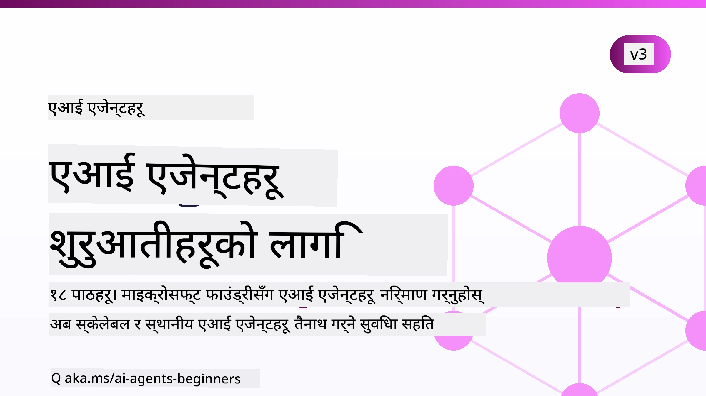

# शुरुवातीहरूका लागि AI एजेन्टहरू - एउटा कोर्स



## AI एजेन्टहरू निर्माण गर्न थाल्न आवश्यक सबै कुरा सिकाउने कोर्स

[](https://github.com/microsoft/ai-agents-for-beginners/blob/master/LICENSE?WT.mc_id=academic-105485-koreyst)
[](https://GitHub.com/microsoft/ai-agents-for-beginners/graphs/contributors/?WT.mc_id=academic-105485-koreyst)
[](https://GitHub.com/microsoft/ai-agents-for-beginners/issues/?WT.mc_id=academic-105485-koreyst)
[](https://GitHub.com/microsoft/ai-agents-for-beginners/pulls/?WT.mc_id=academic-105485-koreyst)
[](http://makeapullrequest.com?WT.mc_id=academic-105485-koreyst)

### 🌐 बहुभाषी समर्थन

#### [Co-op Translator](https://github.com/Azure/co-op-translator) सँग अनुवादहरू संरक्षण गरिन्छ

<!-- CO-OP TRANSLATOR LANGUAGES TABLE START -->
[Arabic](../ar/README.md) | [Bengali](../bn/README.md) | [Bulgarian](../bg/README.md) | [Burmese (Myanmar)](../my/README.md) | [Chinese (Simplified)](../zh-CN/README.md) | [Chinese (Traditional, Hong Kong)](../zh-HK/README.md) | [Chinese (Traditional, Macau)](../zh-MO/README.md) | [Chinese (Traditional, Taiwan)](../zh-TW/README.md) | [Croatian](../hr/README.md) | [Czech](../cs/README.md) | [Danish](../da/README.md) | [Dutch](../nl/README.md) | [Estonian](../et/README.md) | [Finnish](../fi/README.md) | [French](../fr/README.md) | [German](../de/README.md) | [Greek](../el/README.md) | [Hebrew](../he/README.md) | [Hindi](../hi/README.md) | [Hungarian](../hu/README.md) | [Indonesian](../id/README.md) | [Italian](../it/README.md) | [Japanese](../ja/README.md) | [Kannada](../kn/README.md) | [Khmer](../km/README.md) | [Korean](../ko/README.md) | [Lithuanian](../lt/README.md) | [Malay](../ms/README.md) | [Malayalam](../ml/README.md) | [Manipuri (Meitei Mayek)](../mni/README.md) | [Marathi](../mr/README.md) | [Nepali](./README.md) | [Nigerian Pidgin](../pcm/README.md) | [Norwegian](../no/README.md) | [Persian (Farsi)](../fa/README.md) | [Polish](../pl/README.md) | [Portuguese (Brazil)](../pt-BR/README.md) | [Portuguese (Portugal)](../pt-PT/README.md) | [Punjabi (Gurmukhi)](../pa/README.md) | [Romanian](../ro/README.md) | [Russian](../ru/README.md) | [Serbian (Cyrillic)](../sr/README.md) | [Slovak](../sk/README.md) | [Slovenian](../sl/README.md) | [Spanish](../es/README.md) | [Swahili](../sw/README.md) | [Swedish](../sv/README.md) | [Tagalog (Filipino)](../tl/README.md) | [Tamil](../ta/README.md) | [Telugu](../te/README.md) | [Thai](../th/README.md) | [Turkish](../tr/README.md) | [Ukrainian](../uk/README.md) | [Urdu](../ur/README.md) | [Vietnamese](../vi/README.md)

> **स्थानीय रूपमा क्लोन गर्न चाहनुहुन्छ?**
>
> यस रिपोजिटरीमा ५० भन्दा बढी भाषा अनुवादहरू छन् जसले डाउनलोड साइजलाई धेरै बढाउँछ। अनुवादहरू बिना क्लोन गर्न, sparse checkout प्रयोग गर्नुहोस्:
>
> **Bash / macOS / Linux:**
> ```bash
> git clone --filter=blob:none --sparse https://github.com/microsoft/ai-agents-for-beginners.git
> cd ai-agents-for-beginners
> git sparse-checkout set --no-cone '/*' '!translations' '!translated_images'
> ```
>
> **CMD (Windows):**
> ```cmd
> git clone --filter=blob:none --sparse https://github.com/microsoft/ai-agents-for-beginners.git
> cd ai-agents-for-beginners
> git sparse-checkout set --no-cone "/*" "!translations" "!translated_images"
> ```
>
> यसले तपाईंलाई कोर्स पुरा गर्नका लागि आवश्यक सबै कुरा छिटो डाउनलोडको साथ प्रदान गर्दछ।
<!-- CO-OP TRANSLATOR LANGUAGES TABLE END -->

**थप भाषा विकल्पहरूको लागि, [Co-op Translator's supported languages](https://github.com/Azure/co-op-translator/blob/main/docs/supported-languages.md) हेर्नुहोस्।**

[](https://GitHub.com/microsoft/ai-agents-for-beginners/watchers/?WT.mc_id=academic-105485-koreyst)
[](https://GitHub.com/microsoft/ai-agents-for-beginners/network/?WT.mc_id=academic-105485-koreyst)
[](https://GitHub.com/microsoft/ai-agents-for-beginners/stargazers/?WT.mc_id=academic-105485-koreyst)

[](https://discord.com/invite/ATgtXmAS5D)


## 🌱 सुरु गर्ने तरिका

यस कोर्समा AI एजेन्टहरू निर्माण गर्ने आधारभूत कुरा समेटिएको छ। प्रत्येक पाठले आफ्नो विषय समेट्छ, त्यसैले जुनसुकै ठाउँबाट सुरु गर्न सक्नुहुन्छ!

यो कोर्सका लागि बहुभाषी समर्थन छ। हाम्रो [यहाँ उपलब्ध भाषाहरू](#-multi-language-support)मा जानुहोस्।

यदि तपाईं पहिलो पटक Generative AI मोडेलहरू प्रयोग गर्दै हुनुहुन्छ भने, हाम्रोगो [Generative AI For Beginners](https://aka.ms/genai-beginners) कोर्स हेर्नुहोस्, जसमा GenAI प्रयोग गरेर निर्माण गर्ने २१ पाठहरू छन्।

[यो रिपो लाई स्टार (🌟) गर्नुहोस्](https://docs.github.com/en/get-started/exploring-projects-on-github/saving-repositories-with-stars?WT.mc_id=academic-105485-koreyst) र [यो रिपोबाट फोर्क गर्नुहोस्](https://github.com/microsoft/ai-agents-for-beginners/fork) ताकि तपाईंले कोड चलाउन सक्नुहुनेछ।

### अन्य सिक्नेहरूलाई भेट्नुहोस्, आफ्नो प्रश्नहरूको उत्तर पाउनुहोस्

यदि तपाईंलाई कुनै समस्या परे वा AI एजेन्टहरू निर्माण गर्न सम्बन्धि कुनै प्रश्न छ भने, हाम्रो समर्पित डिस्कोर्ड च्यानल [Microsoft Foundry Discord](https://aka.ms/ai-agents/discord) मा सामेल हुनुस्।

### तपाईंलाई के चाहिन्छ 

यस कोर्सका प्रत्येक पाठमा कोड उदाहरणहरू छन्, जुन code_samples फोल्डरमा पाउन सकिन्छ। तपाईं आफ्नो प्रतिलिपि बनाउन यो रिपो [फोर्क गर्न सक्नुहुन्छ](https://github.com/microsoft/ai-agents-for-beginners/fork)।

यी अभ्यासका कोड उदाहरणहरूले Microsoft Agent Framework सँग Microsoft Foundry Agent Service V2 प्रयोग गर्छन्:

- [Microsoft Foundry](https://aka.ms/ai-agents-beginners/ai-foundry) - Azure खाता आवश्यक

यस कोर्सले निम्न Microsoft का AI एजेन्ट फ्रेमवर्कहरू र सेवाहरू प्रयोग गर्छ:

- [Microsoft Agent Framework (MAF)](https://learn.microsoft.com/agent-framework/overview/)
- [Microsoft Foundry Agent Service V2](https://aka.ms/ai-agents-beginners/ai-agent-service)

केही कोड उदाहरणहरूले वैकल्पिक OpenAI-समर्थित प्रदायकहरू जस्तै [MiniMax](https://platform.minimaxi.com/), जसले ठूलो-कन्टेक्स्ट मोडेलहरू (सम्म 204K टोकनहरू) प्रस्ताव गर्छ, समर्थन गर्छ। कन्फिगरेसन विवरणहरूका लागि [Course Setup](./00-course-setup/README.md) हेर्नुहोस्।

यस कोर्सको कोड चलाउन थप जानकारीका लागि [Course Setup](./00-course-setup/README.md) मा जानुहोस्।

## 🙏 सहायता गर्न चाहनुहुन्छ?

तपाईं सल्लाहहरू दिनुहुन्छ वा कुनै स्पेलिङ वा कोड त्रुटिहरू फेला पार्नुभयो? [इशु उठाउनुहोस्](https://github.com/microsoft/ai-agents-for-beginners/issues?WT.mc_id=academic-105485-koreyst) वा [पुल अनुरोध बनाउनुहोस्](https://github.com/microsoft/ai-agents-for-beginners/pulls?WT.mc_id=academic-105485-koreyst)


## 📂 प्रत्येक पाठमा समावेश छ

- README मा लेखिएको पाठ र छोटो भिडियो
- Microsoft Agent Framework सँग Python कोड नमूनाहरू
- तपाईंको सिकाइ जारी राख्न अतिरिक्त स्रोतहरूका लिंकहरू


## 🗃️ पाठहरू

| **पाठ**                                   | **पाठ & कोड**                                    | **भिडियो**                                                  | **अतिरिक्त सिकाइ**                                                                     |
|----------------------------------------------|----------------------------------------------------|------------------------------------------------------------|----------------------------------------------------------------------------------------|
| AI एजेन्टहरू र एजेन्ट उपयोग मामला परिचय       | [Link](./01-intro-to-ai-agents/README.md)          | [Video](https://youtu.be/3zgm60bXmQk?si=z8QygFvYQv-9WtO1)  | [Link](https://aka.ms/ai-agents-beginners/collection?WT.mc_id=academic-105485-koreyst) |
| AI एजेन्टिक फ्रेमवर्कहरूको अन्वेषण              | [Link](./02-explore-agentic-frameworks/README.md)  | [Video](https://youtu.be/ODwF-EZo_O8?si=Vawth4hzVaHv-u0H)  | [Link](https://aka.ms/ai-agents-beginners/collection?WT.mc_id=academic-105485-koreyst) |
| AI एजेन्टिक डिजाइन ढाँचाहरू बुझ्ने     | [Link](./03-agentic-design-patterns/README.md)     | [Video](https://youtu.be/m9lM8qqoOEA?si=BIzHwzstTPL8o9GF)  | [Link](https://aka.ms/ai-agents-beginners/collection?WT.mc_id=academic-105485-koreyst) |
| टूल प्रयोग डिजाइन ढाँचा                      | [Link](./04-tool-use/README.md)                    | [Video](https://youtu.be/vieRiPRx-gI?si=2z6O2Xu2cu_Jz46N)  | [Link](https://aka.ms/ai-agents-beginners/collection?WT.mc_id=academic-105485-koreyst) |
| एजेन्टिक RAG                                  | [Link](./05-agentic-rag/README.md)                 | [Video](https://youtu.be/WcjAARvdL7I?si=gKPWsQpKiIlDH9A3)  | [Link](https://aka.ms/ai-agents-beginners/collection?WT.mc_id=academic-105485-koreyst) |
| विश्वसनीय AI एजेन्टहरू निर्माण गर्ने               | [Link](./06-building-trustworthy-agents/README.md) | [Video](https://youtu.be/iZKkMEGBCUQ?si=jZjpiMnGFOE9L8OK ) | [Link](https://aka.ms/ai-agents-beginners/collection?WT.mc_id=academic-105485-koreyst) |
| योजना डिजाइन ढाँचा                      | [Link](./07-planning-design/README.md)             | [Video](https://youtu.be/kPfJ2BrBCMY?si=6SC_iv_E5-mzucnC)  | [Link](https://aka.ms/ai-agents-beginners/collection?WT.mc_id=academic-105485-koreyst) |
| बहु-एजेन्ट डिजाइन ढाँचा                   | [Link](./08-multi-agent/README.md)                 | [Video](https://youtu.be/V6HpE9hZEx0?si=rMgDhEu7wXo2uo6g)  | [Link](https://aka.ms/ai-agents-beginners/collection?WT.mc_id=academic-105485-koreyst) |
| मेटाकग्निशन डिजाइन ढाँचा                 | [Link](./09-metacognition/README.md)               | [Video](https://youtu.be/His9R6gw6Ec?si=8gck6vvdSNCt6OcF)  | [Link](https://aka.ms/ai-agents-beginners/collection?WT.mc_id=academic-105485-koreyst) |
| उत्पादनमा AI एजेन्टहरू                      | [Link](./10-ai-agents-production/README.md)        | [Video](https://youtu.be/l4TP6IyJxmQ?si=31dnhexRo6yLRJDl)  | [Link](https://aka.ms/ai-agents-beginners/collection?WT.mc_id=academic-105485-koreyst) |
| एजेन्टिक प्रोटोकलहरू प्रयोग गर्ने (MCP, A2A र NLWeb) | [Link](./11-agentic-protocols/README.md)           | [Video](https://youtu.be/X-Dh9R3Opn8)                                 | [Link](https://aka.ms/ai-agents-beginners/collection?WT.mc_id=academic-105485-koreyst) |
| AI एजेन्टहरूको लागि प्रसंग इन्जिनियरिङ            | [Link](./12-context-engineering/README.md)         | [Video](https://youtu.be/F5zqRV7gEag)                                 | [Link](https://aka.ms/ai-agents-beginners/collection?WT.mc_id=academic-105485-koreyst) |
| एजेन्टिक मेमोरी व्यवस्थापन                      | [Link](./13-agent-memory/README.md)     |      [Video](https://youtu.be/QrYbHesIxpw?si=vZkVwKrQ4ieCcIPx)                                                      |                                                                                        |
| माइक्रोसफ्ट एजेन्ट फ्रेमवर्क अन्वेषण                         | [Link](./14-microsoft-agent-framework/README.md)                            |                                                            |                                                                                        |
| कम्प्युटर प्रयोग गर्ने एजेन्टहरू निर्माण (CUA)           | [Link](./15-browser-use/README.md)     |                                                            | [Link](https://docs.browser-use.com/examples/templates/playwright-integration)         |
| स्केलेबल एजेन्टहरू परिनियोजन गर्ने                    | [Link](./16-deploying-scalable-agents/README.md) |                                                    | [Link](https://learn.microsoft.com/azure/ai-foundry/agents/overview)                   |
| स्थानीय AI एजेन्टहरू सिर्जना गर्ने                     | [Link](./17-creating-local-ai-agents/README.md)  |                                                    | [Link](https://learn.microsoft.com/azure/ai-foundry/foundry-local/)                    |
| AI एजेन्टहरू सुरक्षित गर्ने                           | [Link](./18-securing-ai-agents/README.md)  |                                                            | [Link](https://aka.ms/ai-agents-beginners/collection?WT.mc_id=academic-105485-koreyst) |

## 🎒 अन्य कोर्सहरू

हाम्रो टोलीले अन्य कोर्सहरू उत्पादन गर्छ! हेर्नुहोस्:

<!-- CO-OP TRANSLATOR OTHER COURSES START -->
### LangChain
[](https://aka.ms/langchain4j-for-beginners)
[](https://aka.ms/langchainjs-for-beginners?WT.mc_id=m365-94501-dwahlin)
[](https://github.com/microsoft/langchain-for-beginners?WT.mc_id=m365-94501-dwahlin)
---

### Azure / Edge / MCP / एजेन्टहरू
[](https://github.com/microsoft/AZD-for-beginners?WT.mc_id=academic-105485-koreyst)
[](https://github.com/microsoft/edgeai-for-beginners?WT.mc_id=academic-105485-koreyst)
[](https://github.com/microsoft/mcp-for-beginners?WT.mc_id=academic-105485-koreyst)
[](https://github.com/microsoft/ai-agents-for-beginners?WT.mc_id=academic-105485-koreyst)

---
 
### Generative AI श्रृंखला
[](https://github.com/microsoft/generative-ai-for-beginners?WT.mc_id=academic-105485-koreyst)
[-9333EA?style=for-the-badge&labelColor=E5E7EB&color=9333EA)](https://github.com/microsoft/Generative-AI-for-beginners-dotnet?WT.mc_id=academic-105485-koreyst)
[-C084FC?style=for-the-badge&labelColor=E5E7EB&color=C084FC)](https://github.com/microsoft/generative-ai-for-beginners-java?WT.mc_id=academic-105485-koreyst)
[-E879F9?style=for-the-badge&labelColor=E5E7EB&color=E879F9)](https://github.com/microsoft/generative-ai-with-javascript?WT.mc_id=academic-105485-koreyst)

---
 
### मुख्य सिकाइ
[](https://aka.ms/ml-beginners?WT.mc_id=academic-105485-koreyst)
[](https://aka.ms/datascience-beginners?WT.mc_id=academic-105485-koreyst)
[](https://aka.ms/ai-beginners?WT.mc_id=academic-105485-koreyst)
[](https://github.com/microsoft/Security-101?WT.mc_id=academic-96948-sayoung)
[](https://aka.ms/webdev-beginners?WT.mc_id=academic-105485-koreyst)
[](https://aka.ms/iot-beginners?WT.mc_id=academic-105485-koreyst)
[](https://github.com/microsoft/xr-development-for-beginners?WT.mc_id=academic-105485-koreyst)

---
 
### कोपिलट सिरिज
[](https://aka.ms/GitHubCopilotAI?WT.mc_id=academic-105485-koreyst)
[](https://github.com/microsoft/mastering-github-copilot-for-dotnet-csharp-developers?WT.mc_id=academic-105485-koreyst)
[](https://github.com/microsoft/CopilotAdventures?WT.mc_id=academic-105485-koreyst)
<!-- CO-OP TRANSLATOR OTHER COURSES END -->

## 🌟 समुदाय धन्यवाद

महत्त्वपूर्ण कोड नमूनाहरू योगदान गर्नुभएको [शिवम गोयल](https://www.linkedin.com/in/shivam2003/) लाई एजेण्टिक RAG देखाउने लागि धन्यवाद। 

## योगदान

यो परियोजनाले योगदान र सुझाबहरू स्वागत गर्दछ। अधिकांश योगदानहरूका लागि तपाईले सहमत हुन आवश्यक छ
एक Contributor License Agreement (CLA) सँग जसले तपाईंसँग अधिकार छ र वास्तवमै हामीलाई
तपाईको योगदान प्रयोग गर्न अधिकार दिनुहुन्छ भनी घोषणा गर्दछ। विस्तारका लागि, हेर्नुहोस् <https://cla.opensource.microsoft.com>।

जब तपाईले पुल अनुरोध पेश गर्नुहुन्छ, CLA बोटले स्वचालित रूपमा निर्धारण गर्दछ कि तपाईलाई CLA आवश्यक छ वा होइन
र PR लाई उचित रूपमा सजाउँछ (जस्तै, स्थिति जाँच, टिप्पणी)। बोटले प्रदान गरेको निर्देशनहरू पालना गर्नुहोस्।
यो तपाईले हाम्रो CLA प्रयोग गर्ने सबै रिपोजहरूमा एक पटक मात्र गर्नुपर्नेछ।

यस परियोजनाले [माइक्रोसफ्ट ओपन सोर्स कोड अफ कन्डक्ट](https://opensource.microsoft.com/codeofconduct/) अपनाएको छ।
थप जानकारीको लागि हेर्नुहोस् [कोड अफ कन्डक्ट FAQ](https://opensource.microsoft.com/codeofconduct/faq/) वा
थप प्रश्न वा टिप्पणीहरूको लागि [opencode@microsoft.com](mailto:opencode@microsoft.com) मा सम्पर्क गर्नुहोस्।

## ट्रेडमार्कहरू

यस परियोजनामा परियोजना, उत्पादन वा सेवाहरूका लागि ट्रेडमार्क वा लोगो हुन सक्छ। माइक्रोसफ्टका
ट्रेडमार्क वा लोगोहरूको अधिकृत प्रयोगको लागि लागु हुन्छ र पालन गर्नुपर्छ
[माइक्रोसफ्टको ट्रेडमार्क र ब्रान्ड दिशानिर्देशहरू](https://www.microsoft.com/legal/intellectualproperty/trademarks/usage/general)।
यो परियोजनाका संशोधित संस्करणहरूमा माइक्रोसफ्ट ट्रेडमार्क वा लोगोहरूको प्रयोगले भ्रम सिर्जना गर्नु हुँदैन वा माइक्रोसफ्टको प्रायोजन संकेत गर्नु हुँदैन।
तेस्रो पक्षका ट्रेडमार्क वा लोगोको कुनै पनि प्रयोग ति तेस्रो पक्षको नियमहरूअनुसार हुनेछ।

## सहायता प्राप्त गर्नुहोस्


यदि तपाई अड्किनुभयो वा AI एपहरू बनाउने सम्बन्धमा कुनै प्रश्न छ भने, सहभागी हुनुहोस्:

[](https://aka.ms/foundry/discord)

उत्पादन प्रतिक्रिया वा निर्माण गर्दा त्रुटिहरू भएमा भ्रमण गर्नुहोस्:

[](https://aka.ms/foundry/forum)

---

<!-- CO-OP TRANSLATOR DISCLAIMER START -->
**अस्वीकरण**:
यो दस्तावेज़ AI अनुवाद सेवा [Co-op Translator](https://github.com/Azure/co-op-translator) प्रयोग गरेर अनुवाद गरिएको हो। हामी सही हुन प्रयास गर्छौं, तर कृपया जानकार हुनुस् कि स्वचालित अनुवादमा त्रुटिहरू वा अशुद्धताहरू हुन सक्छन्। मूल दस्तावेज़ यसको मूल भाषामा आधिकारिक स्रोत मानिनुपर्छ। महत्वपूर्ण जानकारीका लागि व्यावसायिक मानव अनुवाद सिफारिस गरिन्छ। यस अनुवादको प्रयोगबाट उत्पन्न कुनै पनि गलत बुझाइ वा त्रुटिको लागि हामी जिम्मेवार छैनौं।
<!-- CO-OP TRANSLATOR DISCLAIMER END -->