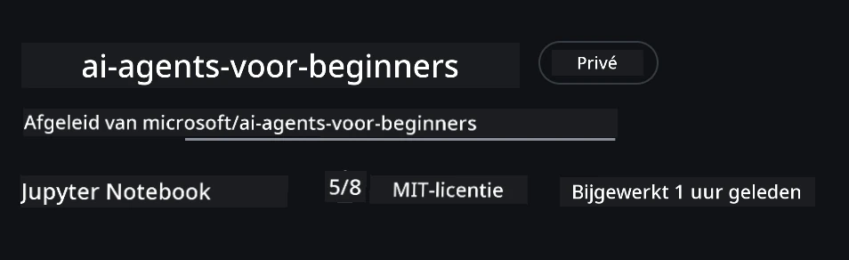
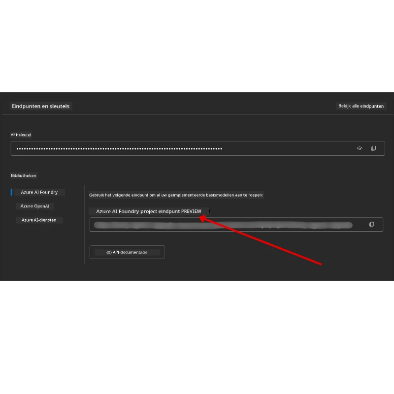

# Cursus Setup

## Inleiding

Deze les behandelt hoe je de codevoorbeelden van deze cursus kunt uitvoeren.

## Sluit je aan bij andere leerlingen en krijg hulp

Voordat je begint met het klonen van je repository, meldt je aan bij het [AI Agents For Beginners Discord-kanaal](https://aka.ms/ai-agents/discord) om hulp te krijgen bij de setup, vragen over de cursus, of om in contact te komen met andere leerlingen.

## Clone of Fork deze Repo

Om te beginnen, clone of fork de GitHub Repository. Dit maakt je eigen versie van het cursusmateriaal zodat je de code kunt uitvoeren, testen en aanpassen!

Dit kan gedaan worden door te klikken op de link om <a href="https://github.com/microsoft/ai-agents-for-beginners/fork" target="_blank">de repo te forken</a>

Je zou nu je eigen geforkte versie van deze cursus moeten hebben op de volgende link:



### Shallow Clone (aanbevolen voor workshop / Codespaces)

  >De volledige repository kan groot zijn (~3 GB) wanneer je de volledige geschiedenis en alle bestanden downloadt. Als je alleen de workshop bijwoont of slechts een paar lesmappen nodig hebt, downloadt een shallow clone (of een sparse clone) veel minder.

#### Snelle shallow clone — minimale geschiedenis, alle bestanden

Vervang `<your-username>` in onderstaande opdrachten met je fork-URL (of de upstream URL als je dat liever hebt).

Om alleen de nieuwste commitgeschiedenis te clonen (kleine download):

```bash
git clone --depth 1 https://github.com/<your-username>/ai-agents-for-beginners.git
```

Om een specifieke branch te clonen:

```bash
git clone --depth 1 --branch <branch-name> https://github.com/<your-username>/ai-agents-for-beginners.git
```

#### Gedeeltelijke (sparse) clone — minimale blobs + alleen geselecteerde mappen

Dit gebruikt gedeeltelijke clone en sparse-checkout (vereist Git 2.25+ en aanbevolen is modern Git met ondersteuning voor gedeeltelijke clone):

```bash
git clone --depth 1 --filter=blob:none --sparse https://github.com/<your-username>/ai-agents-for-beginners.git
```

Navigeer naar de repo map:

```bash
cd ai-agents-for-beginners
```

Geef dan aan welke mappen je wilt (voorbeeld hieronder toont twee mappen):

```bash
git sparse-checkout set 00-course-setup 01-intro-to-ai-agents
```

Na het klonen en verifiëren van de bestanden, als je alleen bestanden nodig hebt en ruimte wilt vrijmaken (geen git geschiedenis), verwijder dan de repository metadata (💀onherroepelijk — je verliest alle Git functionaliteit):

```bash
# zsh/bash
rm -rf .git
```

```powershell
# PowerShell
Remove-Item -Recurse -Force .git
```

#### Gebruik van GitHub Codespaces (aanbevolen om grote lokale downloads te vermijden)

- Maak een nieuwe Codespace voor deze repo via de [GitHub UI](https://github.com/codespaces).  

- Voer in de terminal van de nieuw aangemaakte codespace een van de bovenstaande shallow/sparse clone-commando's uit om alleen de lesmappen die je nodig hebt binnen te halen in de Codespace werkruimte.
- Optioneel: verwijder na het klonen binnen Codespaces de .git map om extra ruimte vrij te maken (zie verwijderingsopdrachten hierboven).
- Opmerking: Als je de repo liever direct in Codespaces opent (zonder extra clone), wees je ervan bewust dat Codespaces de devcontainer omgeving opbouwt en mogelijk nog meer laadt dan je nodig hebt.

#### Tips

- Vervang altijd de clone URL met je fork als je wilt bewerken/committen.
- Als je later meer geschiedenis of bestanden nodig hebt, kun je die ophalen of sparse-checkout aanpassen om extra mappen op te nemen.

## De Code Uitvoeren

Deze cursus biedt een reeks Jupyter Notebooks waarmee je hands-on ervaring opdoet met het bouwen van AI Agents.

De codevoorbeelden gebruiken **Microsoft Agent Framework (MAF)** met de `FoundryChatClient`, die verbinding maakt met **Microsoft Foundry Agent Service V2** (de Responses API) via **Microsoft Foundry**.

Alle Python notebooks zijn gelabeld met `*-python-agent-framework.ipynb`.

## Vereisten

- Python 3.12+
  - **OPMERKING**: Als je Python3.12 niet geïnstalleerd hebt, zorg dan dat je het installeert. Maak daarna je venv aan met python3.12 om te verzekeren dat de juiste versies geïnstalleerd worden vanuit het requirements.txt bestand.
  
    >Voorbeeld

    Maak Python venv map aan:

    ```bash
    python -m venv venv
    ```

    Activeer dan de venv omgeving voor:

    ```bash
    # zsh/bash
    source venv/bin/activate
    ```
  
    ```dos
    # Command Prompt for Windows
    venv\Scripts\activate
    ```

- .NET 10+: Voor sample codes met .NET, zorg dat je [.NET 10 SDK](https://dotnet.microsoft.com/download/dotnet/10.0) of later installeert. Controleer daarna je geïnstalleerde .NET SDK versie:

    ```bash
    dotnet --list-sdks
    ```

- **Azure CLI** — Vereist voor authenticatie. Installeer via [aka.ms/installazurecli](https://aka.ms/installazurecli).
- **Azure Abonnement** — Voor toegang tot Microsoft Foundry en Microsoft Foundry Agent Service.
- **Microsoft Foundry Project** — Een project met een gedeployed model (bijv. `gpt-5-mini`). Zie [Stap 1](#step-1-create-a-microsoft-foundry-project) hieronder.

We hebben een `requirements.txt` bestand opgenomen in de root van deze repository met alle vereiste Python-pakketten om de codevoorbeelden te draaien.

Je kunt ze installeren door het volgende commando uit te voeren in je terminal in de root van de repository:

```bash
pip install -r requirements.txt
```

We raden aan om een Python virtuele omgeving te maken om conflicten en problemen te voorkomen.

## Setup VSCode

Zorg dat je de juiste versie van Python gebruikt in VSCode.


## Microsoft Foundry en Microsoft Foundry Agent Service instellen

### Stap 1: Maak een Microsoft Foundry Project aan

Je hebt een Microsoft Foundry **project** met een gedeployed model nodig om de notebooks uit te voeren. Maak het project direct aan in de huidige Microsoft Foundry ervaring; een hub is niet vereist.

1. Ga naar [ai.azure.com](https://ai.azure.com) en log in met je Azure-account.
2. Selecteer **Project maken** en volg de aanwijzingen om je project aan te maken.
3. Deploy een model binnen het project (bijv. `gpt-5-mini`) via **Models + Endpoints** → **Deploy model**.

### Stap 2: Haal je Project Endpoint en Model Deployment Naam op

Vanuit je project in het Microsoft Foundry portaal:

- **Project Endpoint** — Ga naar de **Overzicht** pagina en kopieer de endpoint URL.



- **Model Deployment Naam** — Ga naar **Models + Endpoints**, selecteer je gedeployed model, en noteer de **Deployment name** (bijv. `gpt-5-mini`).

### Stap 3: Meld je aan bij Azure met `az login`

De meeste notebooks authenticeren via je **Azure CLI aanmelding** — met gebruik van `AzureCliCredential` of `DefaultAzureCredential` (beiden gebruiken je `az login` sessie) uit het `azure-identity` pakket — dus API-sleutels zijn niet nodig. Sommige lessen en optionele integraties gebruiken API-sleutels; kijk voor extra environment variables bij de vereisten van elke les. Dit vereist dat je bent aangemeld via de Azure CLI.

1. **Installeer de Azure CLI** als je dat nog niet hebt: [aka.ms/installazurecli](https://aka.ms/installazurecli)

2. **Meld je aan** door te draaien:

    ```bash
    az login
    ```

    Of als je in een remote/Codespace omgeving zit zonder browser:

    ```bash
    az login --use-device-code
    ```

3. **Selecteer je abonnement** indien gevraagd — kies degene die je Foundry-project bevat.

4. **Controleer** of je bent aangemeld:

    ```bash
    az account show
    ```

> **Waarom `az login`?** De notebooks authenticeren met `AzureCliCredential` (of `DefaultAzureCredential`, dat ook je Azure CLI aanmelding gebruikt) uit het `azure-identity` pakket. Dit betekent dat je Azure CLI sessie de credentials levert — geen API-sleutels of geheimen in je `.env` bestand. Dit is een [beveiligingsbest practice](https://learn.microsoft.com/azure/developer/ai/keyless-connections).

### Stap 4: Maak je `.env` bestand aan

Kopieer het voorbeeldbestand:

```bash
# zsh/bash
cp .env.example .env
```

```powershell
# PowerShell
Copy-Item .env.example .env
```

Open `.env` en vul deze twee waarden in:

```env
AZURE_AI_PROJECT_ENDPOINT=https://<your-project>.services.ai.azure.com/api/projects/<your-project-id>
AZURE_AI_MODEL_DEPLOYMENT_NAME=gpt-5-mini
```

| Variabele | Waar te vinden |
|----------|-----------------|
| `AZURE_AI_PROJECT_ENDPOINT` | Foundry portal → je project → **Overzicht** pagina |
| `AZURE_AI_MODEL_DEPLOYMENT_NAME` | Foundry portal → **Models + Endpoints** → naam van je gedeployed model |

Dat is het voor de meeste lessen! De notebooks authenticeren automatisch via je `az login` sessie.

### Stap 5: Installeer Python Dependencies

```bash
pip install -r requirements.txt
```

We raden aan dit te doen binnen de virtuele omgeving die je eerder hebt gemaakt.

## Optionele Setup: Azure AI Search (Lessen 5 en 16)

De les 5 (Agentic RAG) en les 16 notebooks werken out-of-the-box met een **in-memory kennisbasis** — geen extra Azure resources nodig. Als je ze wilt ondersteunen met een echte **Azure AI Search** index, merk dan op dat het **les 16 notebook momenteel sleutel-gebaseerde authenticatie gebruikt**: het schakelt van in-memory search naar Azure AI Search alleen als **zowel** `AZURE_SEARCH_SERVICE_ENDPOINT` **en** `AZURE_SEARCH_API_KEY` zijn ingesteld, anders blijft het bij in-memory search — dus om het tegen een echte index te laten draaien moet je ook de admin sleutel instellen. Authenticatie zonder sleutel via Microsoft Entra ID (RBAC) is de aanbevolen aanpak voor je eigen productiecode, consistent met de `az login` flow die elders in deze cursus wordt gebruikt.

De RBAC stappen hieronder zijn van toepassing op de setup-gids samples en je eigen code. Ze maken geen sleutel-luwe authenticatie mogelijk in les 16; les 16 vereist nog steeds de endpoint en admin key om Azure AI Search te gebruiken.

1. **Schakel rolgebaseerde toegang in** op je zoekdienst:

    ```bash
    az search service update --name <service-name> --resource-group <resource-group> --auth-options aadOrApiKey
    ```

2. **Wijs jezelf de vereiste rollen toe** (aanmaken/laden van indexen en query's):

    ```bash
    az role assignment create --assignee <your-user-or-principal-id> --role "Search Service Contributor" --scope $(az search service show -g <resource-group> -n <service-name> --query id -o tsv)
    az role assignment create --assignee <your-user-or-principal-id> --role "Search Index Data Contributor" --scope $(az search service show -g <resource-group> -n <service-name> --query id -o tsv)
    ```

3. **Voeg de endpoint toe** aan je `.env` bestand:

| Variabele | Waar te vinden |
|----------|-----------------|
| `AZURE_SEARCH_SERVICE_ENDPOINT` | Azure portal → je **Azure AI Search** resource → **Overzicht** → URL |
| `AZURE_SEARCH_API_KEY` | Vereist (met de endpoint) om Azure AI Search te activeren in les 16 notebook, die sleutel-gebaseerde authenticatie gebruikt. Azure portal → **Instellingen** → **Sleutels** → primaire admin sleutel |

> **Waarom zonder sleutel?** Admin sleutels geven volledige schrijfrechten op je zoekdienst en kunnen uitlekken via `.env` bestanden. Met RBAC wordt je `az login` identiteit gebruikt — hetzelfde sleutel-loze Entra ID patroon dat de cursus notebooks gebruiken (via `AzureCliCredential` / `DefaultAzureCredential`). Zie [Verbind met Azure AI Search met rollen](https://learn.microsoft.com/azure/search/search-security-rbac).

Zie de [Azure AI Search setup gids](./AzureSearch.md) voor volledige index-creatie samples in Python en .NET.

## Extra Setup voor Lessen die Azure OpenAI direct aanroepen (Lessen 6 en 8)

Sommige notebooks in lessen 6 en 8 roepen **Azure OpenAI** direct aan (met de **Responses API**) in plaats van via een Microsoft Foundry project. Deze samples gebruikten eerder GitHub Models, die verouderd zijn en de Responses API niet ondersteunen. Voeg deze variabelen toe aan je `.env` bestand:

| Variabele | Waar te vinden |
|----------|-----------------|
| `AZURE_OPENAI_ENDPOINT` | Azure portal → je **Azure OpenAI** resource → **Sleutels en Endpoint** → Endpoint (bijv. `https://<your-resource>.openai.azure.com`) |
| `AZURE_OPENAI_DEPLOYMENT` | Naam van je gedeployed model (bijv. `gpt-5-mini`) dat de Responses API ondersteunt |
| `AZURE_OPENAI_API_KEY` | Optioneel — alleen als je sleutel-gebaseerde authenticatie gebruikt in plaats van `az login` / Entra ID |

> De Responses API gebruikt de stabiele `/openai/v1/` endpoint, dus geen `api-version` is vereist. Meld je aan met `az login` om sleutel-loze Entra ID authenticatie te gebruiken.

## Alternatieve Provider: MiniMax (OpenAI-Compatibel)

[MiniMax](https://platform.minimaxi.com/) biedt large-context modellen (tot 204K tokens) via een OpenAI-compatibele API. Aangezien het Microsoft Agent Framework's `OpenAIChatClient` werkt met elke OpenAI-compatibele endpoint, kun je MiniMax als vervangende optie gebruiken voor lessen die `OpenAIChatClient` gebruiken.

Voeg deze variabelen toe aan je `.env` bestand:

| Variabele | Waar te vinden |
|----------|-----------------|
| `MINIMAX_API_KEY` | [MiniMax Platform](https://platform.minimaxi.com/) → API Sleutels |
| `MINIMAX_BASE_URL` | Gebruik `https://api.minimax.io/v1` (standaard waarde) |
| `MINIMAX_MODEL_ID` | Naam van het model om te gebruiken (bijv. `MiniMax-M3`) |

**Voorbeeldmodellen**: `MiniMax-M3` (aanbevolen), `MiniMax-M2.7`, `MiniMax-M2.7-highspeed` (snellere reacties). Modellennamen en beschikbaarheid kunnen in de loop der tijd veranderen, en toegang tot een bepaald model kan afhankelijk zijn van je account.

De codevoorbeelden die `OpenAIChatClient` gebruiken (bijv. les 14 hotelreserveringsworkflow) detecteren en gebruiken je MiniMax configuratie automatisch wanneer `MINIMAX_API_KEY` is ingesteld.

## Alternatieve Provider: Novita AI (OpenAI-Compatibel)

[Novita AI](https://novita.ai/llm-api) biedt een OpenAI-compatibele API voor open-source en geavanceerde LLM's (DeepSeek, Llama, Qwen en meer). Aangezien het `OpenAIChatClient` van het Microsoft Agent Framework werkt met elke OpenAI-compatibele endpoint, kun je Novita AI gebruiken als een kant-en-klare vervanging voor Azure OpenAI of OpenAI.

Voeg deze variabelen toe aan je `.env` bestand:

| Variabele | Waar te vinden |
|----------|-----------------|
| `NOVITA_API_KEY` | [Novita AI Dashboard](https://novita.ai/settings/key-management) → API Sleutels |
| `NOVITA_BASE_URL` | Gebruik `https://api.novita.ai/openai/v1` (standaardwaarde) |
| `NOVITA_MODEL_ID` | Naam van het model om te gebruiken (bijv. `moonshotai/kimi-k3`) |

**Voorbeeldmodellen**: `moonshotai/kimi-k3`, `zai-org/glm-5.2`, `deepseek/deepseek-v4-flash-0731`. Novita AI host ook veel andere open-source modelfamilies (Llama, Qwen, GLM en meer) — bekijk de [Novita AI modelbibliotheek](https://novita.ai/llm-api) voor de actuele lijst van beschikbare modellen en hun model-ID's.

De huidige voorbeelden gebruiken niet automatisch `NOVITA_*` variabelen. Om Novita AI te gebruiken, geef deze waarden expliciet door wanneer je `OpenAIChatClient` aanmaakt in het voorbeeld dat je uitvoert.

## Alternatieve provider: Foundry Local (Modellen lokaal draaien)

[Foundry Local](https://foundrylocal.ai) is een lichte runtime die taalmodellen geheel **op je eigen machine** downloadt, beheert en serveert via een OpenAI-compatibele API — zonder cloud.

Omdat het `OpenAIChatClient` van het Microsoft Agent Framework met elke OpenAI-compatibele endpoint werkt, is Foundry Local een kant-en-klare lokale vervanging voor Azure OpenAI.

**1. Installeer Foundry Local**

```bash
# Windows
winget install Microsoft.FoundryLocal

# macOS
brew install foundrylocal
```

**2. Download en draai een model** (dit start ook de lokale service):

```bash
foundry model list          # see available models
foundry model run phi-4-mini
```

**3. Installeer de Python SDK** die gebruikt wordt om de lokale endpoint te ontdekken:

```bash
pip install foundry-local-sdk
```

**4. Stel het Microsoft Agent Framework in op je lokale model:**

```python
from foundry_local import FoundryLocalManager
from agent_framework.openai import OpenAIChatClient

# Downloads (if needed) and serves the model locally, then discovers the endpoint/port.
manager = FoundryLocalManager("phi-4-mini")

chat_client = OpenAIChatClient(
    base_url=manager.endpoint,      # e.g. http://localhost:<port>/v1
    api_key=manager.api_key,        # always "not-required" for Foundry Local
    model_id=manager.get_model_info("phi-4-mini").id,
)

agent = chat_client.as_agent(
    name="LocalAgent",
    instructions="You are a helpful assistant running fully on-device.",
)
```

> **Opmerking:** Foundry Local biedt een OpenAI-compatibele **Chat Completions** endpoint. Gebruik dit voor lokale ontwikkeling en offline scenario’s. Voor de volledige **Responses API** set aan functies (staatvolle gesprekken, enz.) gebruik je Azure OpenAI of een Microsoft Foundry-project.

## Extra instellingen voor les 8 (Bing Grounding Workflow)

Het conditionele workflow notitieboek in les 8 gebruikt **Bing grounding** via Microsoft Foundry. Als je van plan bent dat voorbeeld uit te voeren, voeg dan deze variabele toe aan je `.env` bestand:

| Variabele | Waar te vinden |
|----------|-----------------|
| `BING_CONNECTION_ID` | Microsoft Foundry portal → je project → **Management** → **Connected resources** → je Bing-verbinding → kopieer de connectie-ID |

## Problemen oplossen

### SSL-certificaatverificatiefouten op macOS

Als je macOS gebruikt en een fout krijgt zoals:

```plaintext
ssl.SSLCertVerificationError: [SSL: CERTIFICATE_VERIFY_FAILED] certificate verify failed: self-signed certificate in certificate chain
```

Dit is een bekend probleem met Python op macOS waarbij de systeem SSL-certificaten niet automatisch vertrouwd worden. Probeer de volgende oplossingen achtereenvolgens:

**Optie 1: Voer het Install Certificates script van Python uit (aanbevolen)**

```bash
# Replace 3.XX with your installed Python version (e.g., 3.12 or 3.13):
/Applications/Python\ 3.XX/Install\ Certificates.command
```

**Optie 2: Gebruik `connection_verify=False` in je notitieboek (alleen voor GitHub Models notitieboeken)**

In het Les 6 notitieboek (`06-building-trustworthy-agents/code_samples/06-system-message-framework.ipynb`) is een uitgecommentarieerde oplossing al inbegrepen. Haal de commentaar weg bij `connection_verify=False` als je certificaatfouten krijgt:

```python
client = ChatCompletionsClient(
    endpoint=endpoint,
    credential=AzureKeyCredential(token),
    connection_verify=False,  # Disable SSL verification if you encounter certificate errors
)
```

> **⚠️ Waarschuwing:** Het uitschakelen van SSL-verificatie (`connection_verify=False`) verlaagt de beveiliging door certificaatvalidatie over te slaan. Gebruik dit alleen als tijdelijke oplossing in ontwikkelomgevingen. Nooit in productie.

**Optie 3: Installeer en gebruik `truststore`**

```bash
pip install truststore
```

Voeg dan het volgende toe bovenaan je notitieboek of script voordat je netwerkaanroepen doet:

```python
import truststore
truststore.inject_into_ssl()
```

## Vastgelopen?

Als je problemen ondervindt met deze setup, kom dan naar onze <a href="https://discord.gg/kzRShWzttr" target="_blank">Azure AI Community Discord</a> of <a href="https://github.com/microsoft/ai-agents-for-beginners/issues?WT.mc_id=academic-105485-koreyst" target="_blank">maak een issue aan</a>.

## Volgende les

Je bent nu klaar om de code voor deze cursus uit te voeren. Veel plezier met het leren over de wereld van AI Agents! 

[Introductie tot AI Agents en toepassingen van Agents](../01-intro-to-ai-agents/README.md)

---

<!-- CO-OP TRANSLATOR DISCLAIMER START -->
**Disclaimer**:
Dit document is vertaald met behulp van de AI vertaaldienst [Co-op Translator](https://github.com/Azure/co-op-translator). Hoewel we streven naar nauwkeurigheid, dient u er rekening mee te houden dat geautomatiseerde vertalingen fouten of onnauwkeurigheden kunnen bevatten. Het originele document in de oorspronkelijke taal moet worden beschouwd als de gezaghebbende bron. Voor kritieke informatie wordt professionele menselijke vertaling aanbevolen. Wij zijn niet aansprakelijk voor eventuele misverstanden of verkeerde interpretaties die voortvloeien uit het gebruik van deze vertaling.
<!-- CO-OP TRANSLATOR DISCLAIMER END -->