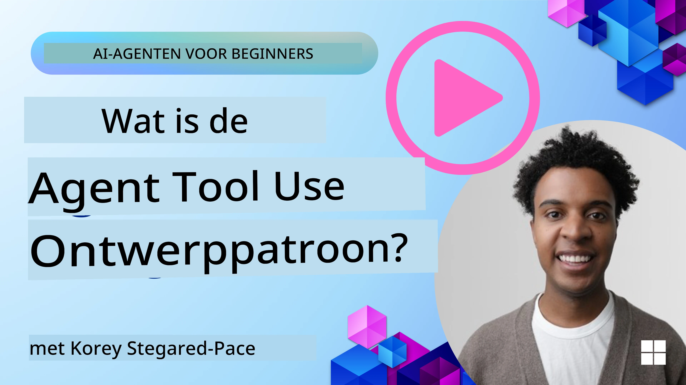
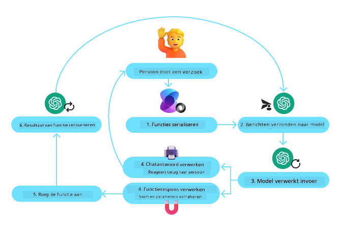
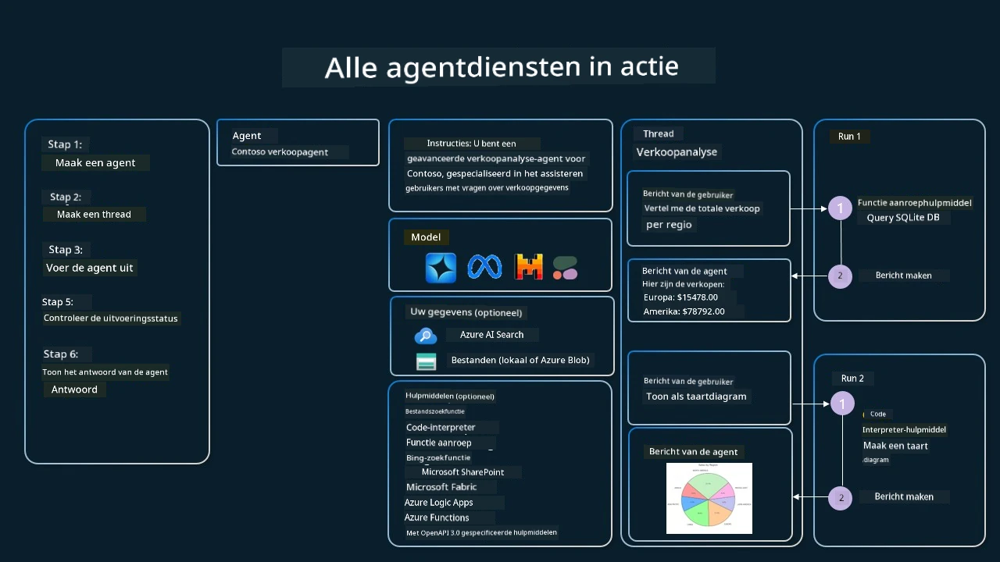

[](https://youtu.be/vieRiPRx-gI?si=cEZ8ApnT6Sus9rhn)

> _(Klik op de afbeelding hierboven om de video van deze les te bekijken)_

# Ontwerppatroon voor het gebruik van tools

Tools zijn interessant omdat ze AI-agenten een breder scala aan mogelijkheden bieden. In plaats van dat de agent een beperkte set acties kan uitvoeren, kan de agent door het toevoegen van een tool nu een breed scala aan acties uitvoeren. In dit hoofdstuk bekijken we het Ontwerppatroon voor het gebruik van tools, dat beschrijft hoe AI-agenten specifieke tools kunnen gebruiken om hun doelen te bereiken.

## Inleiding

In deze les proberen we de volgende vragen te beantwoorden:

- Wat is het ontwerppatroon voor het gebruik van tools?
- Voor welke gebruikssituaties kan het worden toegepast?
- Wat zijn de elementen/bouwstenen die nodig zijn om het ontwerppatroon te implementeren?
- Wat zijn de speciale overwegingen bij het gebruik van het ontwerppatroon voor het bouwen van betrouwbare AI-agenten?

## Leerdoelen

Na het voltooien van deze les kun je:

- Het Ontwerppatroon voor het gebruik van tools definiëren en het doel ervan uitleggen.
- Gebruikssituaties identificeren waar het Ontwerppatroon voor het gebruik van tools toepasbaar is.
- De belangrijkste elementen begrijpen die nodig zijn om het ontwerppatroon te implementeren.
- Overwegingen herkennen om de betrouwbaarheid van AI-agenten die dit ontwerppatroon gebruiken te waarborgen.

## Wat is het Ontwerppatroon voor het gebruik van tools?

Het **Ontwerppatroon voor het gebruik van tools** richt zich op het geven van LLM's de mogelijkheid om met externe tools te interacteren om specifieke doelen te bereiken. Tools zijn code die door een agent kunnen worden uitgevoerd om acties uit te voeren. Een tool kan een eenvoudige functie zijn, zoals een rekenmachine, of een API-aanroep naar een service van een derde partij, zoals het opzoeken van aandelenkoersen of een weersvoorspelling. In de context van AI-agenten zijn tools ontworpen om door agenten te worden uitgevoerd als reactie op **door modellen gegenereerde functieaanroepen**.

## Voor welke gebruikssituaties kan het worden toegepast?

AI-agenten kunnen tools benutten om complexe taken te voltooien, informatie op te halen of beslissingen te nemen. Het ontwerppatroon voor het gebruik van tools wordt vaak gebruikt in scenario's die dynamische interactie met externe systemen vereisen, zoals databases, webservices of code-interpreters. Deze mogelijkheid is nuttig voor verschillende gebruikssituaties, waaronder:

- **Dynamische informatieretrieval:** Agenten kunnen externe API's of databases raadplegen om actuele gegevens op te halen (bijv. een SQLite-database raadplegen voor data-analyse, aandelenkoersen of weersinformatie ophalen).
- **Code-uitvoering en interpretatie:** Agenten kunnen code of scripts uitvoeren om wiskundige problemen op te lossen, rapporten te genereren of simulaties uit te voeren.
- **Workflow-automatisering:** Het automatiseren van repetitieve of meerstaps workflows door tools zoals taakplanners, e-mailservices of datapijplijnen te integreren.
- **Klantenservice:** Agenten kunnen interacteren met CRM-systemen, ticketplatformen of kennisbanken om gebruikersvragen op te lossen.
- **Contentcreatie en bewerking:** Agenten kunnen tools zoals grammaticacontroleurs, tekstsamenvatters of contentveiligheidsbeoordelaars gebruiken om te helpen bij contentcreatie.

## Welke elementen/bouwstenen zijn nodig om het ontwerppatroon voor het gebruik van tools te implementeren?

Deze bouwstenen stellen de AI-agent in staat om een breed scala aan taken uit te voeren. Laten we de belangrijkste elementen bekijken die nodig zijn om het Ontwerppatroon voor het gebruik van tools te implementeren:

- **Functie-/Toolschemas**: Gedetailleerde definities van beschikbare tools, inclusief functienaam, doel, vereiste parameters en verwachte outputs. Deze schemas stellen de LLM in staat om te begrijpen welke tools beschikbaar zijn en hoe valide aanvragen op te bouwen.

- **Logica voor functietoepassing**: Bepaalt hoe en wanneer tools worden aangeroepen op basis van de intentie van de gebruiker en de context van het gesprek. Dit kan plannermodules, routeringsmechanismen of conditionele flows omvatten die het gebruik van tools dynamisch bepalen.

- **Berichtenafhandelingssysteem**: Componenten die de gespreksstroom beheren tussen gebruikersinvoer, LLM-reacties, toolaanroepen en tooloutputs.

- **Framework voor toolintegratie**: Infrastructuur die de agent verbindt met verschillende tools, of het nu eenvoudige functies of complexe externe services zijn.

- **Foutafhandeling & validatie**: Mechanismen om fouten in tooluitvoering te verwerken, parameters te valideren en onverwachte reacties te beheren.

- **Statusbeheer**: Houdt de context van het gesprek, eerdere toolinteracties en persistente gegevens bij om consistentie te waarborgen over meerdere gespreksrondes.

Laten we nu Function/Tool Calling nader bekijken.
 
### Functie-/Tool-aanroep

Functie-aanroep is de primaire manier waarop we Large Language Models (LLM's) in staat stellen om met tools te interacteren. Je zult vaak 'Functie' en 'Tool' door elkaar gebruiken omdat 'functies' (herbruikbare codeblokken) de 'tools' zijn die agenten gebruiken om taken uit te voeren. Om de code van een functie aan te roepen, moet een LLM het verzoek van de gebruiker vergelijken met de beschrijving van de functies. Hiervoor wordt een schema met de beschrijvingen van alle beschikbare functies naar de LLM gestuurd. De LLM selecteert dan de meest geschikte functie voor de taak en retourneert de naam en argumenten ervan. De geselecteerde functie wordt uitgevoerd, het antwoord wordt teruggestuurd naar de LLM, die die informatie gebruikt om op het verzoek van de gebruiker te reageren.

Voor ontwikkelaars die functie-aanroepen voor agenten willen implementeren, zijn de volgende zaken nodig:

1. Een LLM-model dat functie-aanroepen ondersteunt
2. Een schema met functiebeschrijvingen
3. De code voor elke beschreven functie

Laten we het voorbeeld gebruiken van het opvragen van de huidige tijd in een stad om het te illustreren:

1. **Initialiseer een LLM die functie-aanroepen ondersteunt:**

    Niet alle modellen ondersteunen functie-aanroepen, dus het is belangrijk om te controleren of de LLM die je gebruikt dat doet.     <a href="https://learn.microsoft.com/azure/ai-services/openai/how-to/function-calling" target="_blank">Azure OpenAI</a> ondersteunt functie-aanroepen. We kunnen beginnen met het initiëren van de OpenAI-client tegen de Azure OpenAI **Responses API** (de stabiele `/openai/v1/` endpoint — geen `api_version` nodig). 

    ```python
    # Initialize the OpenAI client for Azure OpenAI (Responses API, v1 endpoint)
    client = OpenAI(
        base_url=f"{os.environ['AZURE_OPENAI_ENDPOINT'].rstrip('/')}/openai/v1/",
        api_key=os.environ["AZURE_OPENAI_API_KEY"],
    )
    deployment_name = os.environ["AZURE_OPENAI_DEPLOYMENT"]
    ```

1. **Maak een Functieschema**:

    Vervolgens definiëren we een JSON-schema dat de functienaam bevat, een beschrijving van wat de functie doet, en de namen en beschrijvingen van de functieparameters.
    We geven dit schema vervolgens samen met het verzoek van de gebruiker om de tijd in San Francisco op te zoeken door aan de eerder gemaakte client. Wat belangrijk is om op te merken, is dat een **toolaanroep** wordt geretourneerd, **niet** het uiteindelijke antwoord op de vraag. Zoals eerder vermeld, retourneert de LLM de naam van de functie die het voor de taak heeft geselecteerd en de argumenten die aan die functie worden doorgegeven.

    ```python
    # Function description for the model to read (Responses API flat tool format)
    tools = [
        {
            "type": "function",
            "name": "get_current_time",
            "description": "Get the current time in a given location",
            "parameters": {
                "type": "object",
                "properties": {
                    "location": {
                        "type": "string",
                        "description": "The city name, e.g. San Francisco",
                    },
                },
                "required": ["location"],
            },
        }
    ]
    ```
   
    ```python
  
    # Initial user message
    messages = [{"role": "user", "content": "What's the current time in San Francisco"}]

    # First API call: Ask the model to use the function
    response = client.responses.create(
        model=deployment_name,
        input=messages,
        tools=tools,
        tool_choice="auto",
        store=False,
    )

    # The Responses API returns tool calls as function_call items in response.output.
    # Append them to the conversation so the model has full context on the next turn.
    messages += response.output

    print("Model's response:")
    print(response.output)
  
    ```

    ```bash
    Model's response:
    [ResponseFunctionToolCall(arguments='{"location":"San Francisco"}', call_id='call_pOsKdUlqvdyttYB67MOj434b', name='get_current_time', type='function_call')]
    ```
  
1. **De functiecodedie nodig is om de taak uit te voeren:**

    Nu de LLM heeft gekozen welke functie moet worden uitgevoerd, moet de code die de taak uitvoert worden geïmplementeerd en uitgevoerd.
    We kunnen de code implementeren om de huidige tijd op te vragen in Python. We moeten ook de code schrijven om de naam en argumenten uit het reactiebericht te extraheren om het uiteindelijke resultaat te verkrijgen.

    ```python
      def get_current_time(location):
        """Get the current time for a given location"""
        print(f"get_current_time called with location: {location}")  
        location_lower = location.lower()
        
        for key, timezone in TIMEZONE_DATA.items():
            if key in location_lower:
                print(f"Timezone found for {key}")  
                current_time = datetime.now(ZoneInfo(timezone)).strftime("%I:%M %p")
                return json.dumps({
                    "location": location,
                    "current_time": current_time
                })
      
        print(f"No timezone data found for {location_lower}")  
        return json.dumps({"location": location, "current_time": "unknown"})
    ```

     ```python
    # Handle function calls
    tool_calls = [item for item in response.output if item.type == "function_call"]
    if tool_calls:
        for tool_call in tool_calls:
            if tool_call.name == "get_current_time":

                function_args = json.loads(tool_call.arguments)

                time_response = get_current_time(
                    location=function_args.get("location")
                )

                # Return the tool result as a function_call_output item
                messages.append({
                    "type": "function_call_output",
                    "call_id": tool_call.call_id,
                    "output": time_response,
                })
    else:
        print("No tool calls were made by the model.")

    # Second API call: Get the final response from the model
    final_response = client.responses.create(
        model=deployment_name,
        input=messages,
        tools=tools,
        store=False,
    )

    return final_response.output_text
     ```

     ```bash
      get_current_time called with location: San Francisco
      Timezone found for san francisco
      The current time in San Francisco is 09:24 AM.
     ```

Functie-aanroep ligt ten grondslag aan de meeste, zo niet alle, toolgebruikontwerpen van agenten; echter kan het soms een uitdaging zijn om het vanaf nul te implementeren.
Zoals we hebben geleerd in [Les 2](../../../02-explore-agentic-frameworks) bieden agentische frameworks ons vooraf gebouwde bouwstenen om toolgebruik te implementeren.
 
## Voorbeelden van toolgebruik met agentische frameworks

Hier zijn enkele voorbeelden van hoe je het Ontwerppatroon voor het gebruik van tools kunt implementeren met verschillende agentische frameworks:

### Microsoft Agent Framework

<a href="https://learn.microsoft.com/azure/ai-services/agents/overview" target="_blank">Microsoft Agent Framework</a> is een open-source AI-framework voor het bouwen van AI-agenten. Het vereenvoudigt het proces van functie-aanroepen door je toe te staan tools te definiëren als Python-functies met de `@tool` decorator. Het framework regelt de communicatie tussen het model en jouw code. Het biedt ook toegang tot vooraf gebouwde tools zoals Bestandszoeker en Code-interpreter via `FoundryChatClient`.

Het volgende diagram illustreert het proces van functie-aanroepen met het Microsoft Agent Framework:



In het Microsoft Agent Framework worden tools gedefinieerd als gedecoreerde functies. We kunnen de `get_current_time` functie die we eerder hebben gezien omzetten in een tool door de `@tool` decorator te gebruiken. Het framework serializeert automatisch de functie en de parameters, waardoor het schema wordt gemaakt om naar de LLM te sturen.

```python
import os
from agent_framework import tool
from agent_framework.foundry import FoundryChatClient
from azure.identity import AzureCliCredential

@tool(approval_mode="never_require")
def get_current_time(location: str) -> str:
    """Get the current time for a given location"""
    ...

# Create the client
provider = FoundryChatClient(
    project_endpoint=os.environ["AZURE_AI_PROJECT_ENDPOINT"],
    model=os.environ["AZURE_AI_MODEL_DEPLOYMENT_NAME"],
    credential=AzureCliCredential(),
)

# Create an agent and run with the tool
agent = provider.as_agent(name="TimeAgent", instructions="Use available tools to answer questions.", tools=get_current_time)
response = await agent.run("What time is it?")
```

#### Tools van een MCP-server

Tools hoeven geen functies in je eigen code te zijn. Een server die het Model Context Protocol (MCP, behandeld in [Les 11](../11-agentic-protocols/README.md)) ondersteunt, publiceert zijn tools samen met hun schemas, en het framework kan ze laden op dezelfde manier als het een gedecoreerde functie serialiseert. `MCPStreamableHTTPTool` maakt verbinding met zo'n server over HTTP, leest de toolschemas uit, en biedt ze aan het model aan naast lokale tools.

Het onderstaande voorbeeld gebruikt de webzoekserver gehost door <a href="https://keenable.ai" target="_blank">Keenable</a>. Deze is gratis te gebruiken zonder account of API-sleutel (verzoeken worden per IP gerate-limiteerd), dus de enige inloggegevens die je nodig hebt, zijn die van je model. Zoals bij elke externe tool worden de zoekopdrachten die het model schrijft naar die server gestuurd.

```python
from agent_framework import MCPStreamableHTTPTool

web_search = MCPStreamableHTTPTool(
    name="Keenable web search",
    url="https://api.keenable.ai/mcp",
)

# Connecting loads the server's tool schemas; the agent decides when to call them
async with web_search:
    agent = provider.as_agent(
        name="ResearchAgent",
        instructions="Use available tools to answer questions.",
        tools=[web_search],
    )
    response = await agent.run("What is new in the latest Python release?")
    print(response.text)
```

De server publiceert twee tools, `search_web_pages` en `fetch_page_content`. Wanneer een vraag actuele informatie nodig heeft, roept het model `search_web_pages` aan, ontvangt titels, URL's en tekstfragmenten terug, en schrijft er het antwoord mee, dezelfde cyclus als in het `get_current_time` voorbeeld hierboven.
  
### Microsoft Foundry Agent Service

<a href="https://learn.microsoft.com/azure/ai-services/agents/overview" target="_blank">Microsoft Foundry Agent Service</a> is een nieuwer agentisch framework dat is ontworpen om ontwikkelaars in staat te stellen veilig hoogwaardige en uitbreidbare AI-agenten te bouwen, implementeren en schalen zonder dat zij de onderliggende compute- en opslagbronnen hoeven te beheren. Het is vooral nuttig voor enterprise-toepassingen omdat het een volledig beheerde service is met enterprise-grade beveiliging.

Vergeleken met ontwikkelen rechtstreeks met de LLM API biedt Microsoft Foundry Agent Service enkele voordelen, waaronder:

- Automatische tool-aanroepen – geen noodzaak om toolaanroepen te parseren, de tool aan te roepen en de respons te verwerken; dit wordt nu aan de serverzijde afgehandeld
- Veilig beheerde data – in plaats van je eigen gesprekstoestand te beheren, kun je vertrouwen op threads om alle benodigde informatie op te slaan
- Klaar-voor-gebruik tools – Tools die je kunt gebruiken om met je gegevensbronnen te interacteren, zoals Bing, Azure AI Search en Azure Functions.

De tools die beschikbaar zijn in Microsoft Foundry Agent Service kunnen worden ingedeeld in twee categorieën:

1. Kennis-tools:
    - <a href="https://learn.microsoft.com/azure/ai-services/agents/how-to/tools/bing-grounding?tabs=python&pivots=overview" target="_blank">Grondslag met Bing Search</a>
    - <a href="https://learn.microsoft.com/azure/ai-services/agents/how-to/tools/file-search?tabs=python&pivots=overview" target="_blank">Bestandszoeker</a>
    - <a href="https://learn.microsoft.com/azure/ai-services/agents/how-to/tools/azure-ai-search?tabs=azurecli%2Cpython&pivots=overview-azure-ai-search" target="_blank">Azure AI Search</a>

2. Actietools:
    - <a href="https://learn.microsoft.com/azure/ai-services/agents/how-to/tools/function-calling?tabs=python&pivots=overview" target="_blank">Functie-aanroepen</a>
    - <a href="https://learn.microsoft.com/azure/ai-services/agents/how-to/tools/code-interpreter?tabs=python&pivots=overview" target="_blank">Code-interpreter</a>
    - <a href="https://learn.microsoft.com/azure/ai-services/agents/how-to/tools/openapi-spec?tabs=python&pivots=overview" target="_blank">Tools gedefinieerd via OpenAPI</a>
    - <a href="https://learn.microsoft.com/azure/ai-services/agents/how-to/tools/azure-functions?pivots=overview" target="_blank">Azure Functions</a>

De Agent Service stelt ons in staat deze tools samen te gebruiken als een `toolset`. Het maakt ook gebruik van `threads` die de geschiedenis van berichten van een bepaald gesprek bijhouden.

Stel je voor dat je een verkoopagent bent bij een bedrijf genaamd Contoso. Je wilt een conversatieagent ontwikkelen die vragen over je verkoopgegevens kan beantwoorden.

De volgende afbeelding illustreert hoe je Microsoft Foundry Agent Service zou kunnen gebruiken om je verkoopgegevens te analyseren:



Om een van deze tools met de service te gebruiken kunnen we een client maken en een tool of toolset definiëren. Om dit praktisch te implementeren kunnen we de volgende Python-code gebruiken. De LLM zal in staat zijn naar de toolset te kijken en beslissen of het de door de gebruiker gemaakte functie, `fetch_sales_data_using_sqlite_query`, of de vooraf gebouwde Code Interpreter gebruikt, afhankelijk van het gebruikersverzoek.

```python 
import os
from azure.ai.projects import AIProjectClient
from azure.identity import DefaultAzureCredential
from fetch_sales_data_functions import fetch_sales_data_using_sqlite_query # fetch_sales_data_using_sqlite_query function which can be found in a fetch_sales_data_functions.py file.
from azure.ai.projects.models import ToolSet, FunctionTool, CodeInterpreterTool

project_client = AIProjectClient.from_connection_string(
    credential=DefaultAzureCredential(),
    conn_str=os.environ["PROJECT_CONNECTION_STRING"],
)

# Initialize toolset
toolset = ToolSet()

# Initialize function calling agent with the fetch_sales_data_using_sqlite_query function and adding it to the toolset
fetch_data_function = FunctionTool(fetch_sales_data_using_sqlite_query)
toolset.add(fetch_data_function)

# Initialize Code Interpreter tool and adding it to the toolset. 
code_interpreter = CodeInterpreterTool()toolset.add(code_interpreter)

agent = project_client.agents.create_agent(
    model="gpt-5-mini", name="my-agent", instructions="You are helpful agent", 
    toolset=toolset
)
```

## Wat zijn de speciale overwegingen bij het gebruik van het Ontwerppatroon voor het bouwen van betrouwbare AI-agenten?

Een veel voorkomende zorg bij SQL die dynamisch wordt gegenereerd door LLM's is veiligheid, met name het risico op SQL-injectie of kwaadaardige handelingen, zoals het verwijderen of manipuleren van de database. Hoewel deze zorgen terecht zijn, kunnen ze effectief worden beperkt door de toegangsrechten van de database correct te configureren. Voor de meeste databases betekent dit het configureren van de database als alleen-lezen. Voor databaseservices zoals PostgreSQL of Azure SQL zou de app een alleen-lezen (SELECT) rol moeten krijgen.

Het uitvoeren van de app in een veilige omgeving verbetert de bescherming verder. In enterprise-scenario's worden gegevens gewoonlijk geëxtraheerd en getransformeerd van operationele systemen naar een alleen-lezen database of datawarehouse met een gebruiksvriendelijk schema. Deze aanpak zorgt ervoor dat de data veilig is, geoptimaliseerd voor prestaties en toegankelijkheid, en dat de app beperkte, alleen-lezen toegang heeft.

## Voorbeeldcodes

- Python: [Agent Framework](./code_samples/04-python-agent-framework.ipynb)
- .NET: [Agent Framework](./code_samples/04-dotnet-agent-framework.md)

## Nog meer vragen over het Ontwerppatroon voor het gebruik van tools?

Word lid van de [Microsoft Foundry Discord](https://discord.com/invite/ATgtXmAS5D) om andere leerlingen te ontmoeten, deel te nemen aan spreekuren en je vragen over AI-agenten beantwoord te krijgen.

## Aanvullende bronnen

- <a href="https://microsoft.github.io/build-your-first-agent-with-azure-ai-agent-service-workshop/" target="_blank">Azure AI Agents Service Workshop</a>
- <a href="https://github.com/Azure-Samples/contoso-creative-writer/tree/main/docs/workshop" target="_blank">Contoso Creative Writer Multi-Agent Workshop</a>
- <a href="https://learn.microsoft.com/azure/ai-services/agents/overview" target="_blank">Microsoft Agent Framework Overzicht</a>

## Sneltesten van deze Agent (optioneel)

Nadat je hebt geleerd om agenten te implementeren in [Les 16](../16-deploying-scalable-agents/README.md), kun je deze les' `TravelToolAgent` sneltesten (roept het nog steeds zijn tools en antwoord aan?) met [`tests/lesson-04-smoke-tests.json`](../../../tests/lesson-04-smoke-tests.json). Zie [`tests/README.md`](../tests/README.md) voor hoe je het uitvoert.

## Vorige les

[Begrijpen van Agentische Ontwerppatronen](../03-agentic-design-patterns/README.md)

## Volgende les

[Agentic RAG](../05-agentic-rag/README.md)

---

<!-- CO-OP TRANSLATOR DISCLAIMER START -->
**Disclaimer**:
Dit document is vertaald met behulp van de AI vertaaldienst [Co-op Translator](https://github.com/Azure/co-op-translator). Hoewel we streven naar nauwkeurigheid, dient u er rekening mee te houden dat geautomatiseerde vertalingen fouten of onnauwkeurigheden kunnen bevatten. Het originele document in de oorspronkelijke taal moet worden beschouwd als de gezaghebbende bron. Voor kritieke informatie wordt professionele menselijke vertaling aanbevolen. Wij zijn niet aansprakelijk voor eventuele misverstanden of verkeerde interpretaties die voortvloeien uit het gebruik van deze vertaling.
<!-- CO-OP TRANSLATOR DISCLAIMER END -->