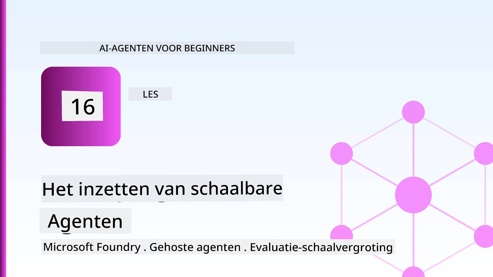
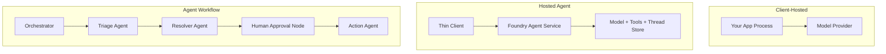
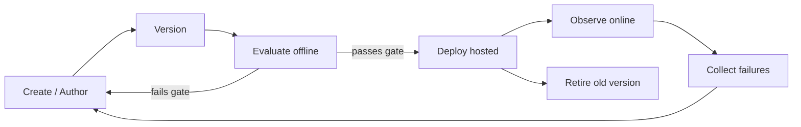
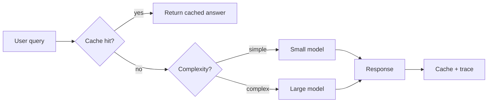
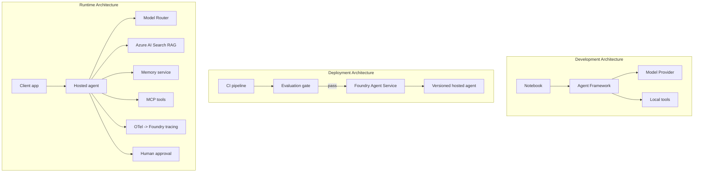

# Schaalbare Agents Implementeren met Microsoft Foundry



Tot nu toe in de cursus heb je agents gebouwd die op je laptop draaien, binnen een notebook, aangestuurd door `az login` en een handvol omgevingsvariabelen. Dat is precies de juiste manier om te leren. Het is niet de juiste manier om een agent te draaien waar duizenden klanten om 3 uur ’s nachts van afhankelijk zijn.

Deze les gaat over de kloof tussen "het werkt op mijn machine" en "het werkt betrouwbaar en betaalbaar in productie." We overbruggen die kloof met **Microsoft Foundry** en de **Microsoft Foundry Agent Service**, door een echte klantenservice-agent te bouwen die beschikt over tools, ophalen, geheugen, evaluatie, en monitoring.

## Introductie

Deze les behandelt:

- Het verschil tussen een **prototype-agent** en een **geïmplementeerde agent**, en waarom de overgang vooral gaat over alles *rondom* het model.
- **Implementatiepatronen** voor agents: client-gehost, service-gehost (Hosted Agents), en workflow-georkestreerd.
- De **levenscyclus van een agent** op Microsoft Foundry — aanmaken, versioneren, implementeren, evalueren, observeren, uitfaseren.
- **Schaalstrategieën**: modelroutering, caching, gelijktijdigheid, en stateless ontwerp.
- **Observeerbaarheid** met OpenTelemetry en Foundry tracing.
- **Kostenoptimalisatie** via modelkeuze, routering, en evaluatiepoorten.
- **Overwegingen voor ondernemingen**: governance, menselijke goedkeuring, en het veilig draaien van MCP-servers in productie.

## Leerdoelen

Na het voltooien van deze les weet je hoe je:

- Het juiste implementatiepatroon kiest voor een gegeven agent workload.
- Een agent implementeert naar de Microsoft Foundry Agent Service zodat deze versioneerd, beheerd, en observeerbaar is.
- Een agent instrumenteert voor tracing en een evaluatiepipeline opzet die voor elke release draait.
- Modelroutering en caching toepast om latentie en kosten op schaal onder controle te houden.
- Een menselijke goedkeuringspoort toevoegt voor risicovolle acties en een MCP-server op een productieveilige manier integreert.

## Vereisten

Deze les gaat ervan uit dat je de eerdere lessen voltooid hebt en vertrouwd bent met:

- Agents bouwen met het [Microsoft Agent Framework](../14-microsoft-agent-framework/README.md) (Les 14).
- [Toolgebruik](../04-tool-use/README.md) (Les 4) en [Agentic RAG](../05-agentic-rag/README.md) (Les 5).
- [Agentgeheugen](../13-agent-memory/README.md) (Les 13) en [Agentic Protocols / MCP](../11-agentic-protocols/README.md) (Les 11).
- [Observeerbaarheid en Evaluatie](../10-ai-agents-production/README.md) (Les 10) — deze les bouwt hier rechtstreeks op voort.

Je hebt ook nodig:

- Een **Azure-abonnement** en een **Microsoft Foundry-project** met ten minste één geïmplementeerd chatmodel.
- De **Azure CLI** ingelogd (`az login`).
- Python 3.12+ en de pakketten in de repository [`requirements.txt`](../../../requirements.txt).

## Van Prototype naar Productie: Wat Verandert Er Eigenlijk

Een prototype-agent en een productie-agent delen dezelfde kernlus — redeneren, tools aanroepen, reageren. Wat verandert is alles wat die lus omringt. Het model is misschien 20% van een productie-agent; de overige 80% is het operationele skelet.

| Aspect | Prototype | Productie |
| --- | --- | --- |
| **Hosting** | Draait in je notebook | Draait als een gehoste service, versioneerd en uitgerold |
| **Identiteit** | Je `az login` token | Beheerde identiteit met gerichte RBAC |
| **Status** | In-memory, verloren bij herstart | Geëxternaliseerd (thread store, geheugenservice) |
| **Falen** | Je ziet de traceback | Retries, fallbacks, dead-letter, alerts |
| **Kosten** | "Het zijn een paar centen" | Per verzoek bijgehouden, gerouteerd, gecached, begroot |
| **Kwaliteit** | Je beoordeelt de output visueel | Automatisch geëvalueerd voor elke release |
| **Vertrouwen** | Jij keurt elke actie goed | Beleid + mens-in-de-lus voor risicovolle acties |

Houd deze tabel in gedachten. Elke sectie hieronder correspondeert met één van deze rijen.

## Agent Implementatiepatronen

Er zijn drie patronen die je zult gebruiken, vaak in combinatie.

### 1. Client-gehoste Agents

Het agentobject leeft binnen *jouw* applicatieproces. Je code roept de modelprovider direct aan; de redeneerlus draait in je service. Dit is wat elke vorige les heeft gedaan.

- **Gebruik het wanneer** je volledige controle over de lus nodig hebt, aangepaste middleware, of je embedt de agent binnen een bestaande backend.
- **Nadeel**: je bent zelf verantwoordelijk voor schaalbaarheid, status, en veerkracht.

### 2. Gehoste Agents (Foundry Agent Service)

De agent is *geregistreerd als een resource* in Microsoft Foundry. Foundry host de redeneerlus, slaat threads op, handhaaft contentveiligheid en RBAC, en maakt de agent zichtbaar in de Foundry-portal. Je app wordt een dunne client die threads aanmaakt en reacties leest.

- **Gebruik het wanneer** je duurzaamheid, ingebouwde observeerbaarheid, governance, en minder operationele oppervlakte wilt.
- **Nadeel**: minder laag-niveau controle in ruil voor een beheerde runtime.

### 3. Agent Workflows

Meerdere agents (en tools) worden samengesteld in een graaf met expliciete controleflow — sequentiële stappen, vertakkingen, menselijke goedkeuringspunten, en duurzame checkpoints die kunnen pauzeren en hervatten. Dit is de Microsoft Agent Framework **Workflows**-functionaliteit toegepast op implementatieschalen.

- **Gebruik het wanneer** een enkele taak meerdere gespecialiseerde agents beslaat of een goedkeuringsstap in het midden vereist.
- **Nadeel**: meer bewegende delen; vereist observeerbaarheid op orkestratieniveau.



## De Levenscyclus van een Agent op Microsoft Foundry

Een agent implementeren is geen eenmalige `push`. Het is een lus, en het lijkt sterk op een software releasecyclus omdat het dat ook is.



Het sleutelidee, overgenomen uit [Les 10](../10-ai-agents-production/README.md): **offline evaluatie is een poort, geen bijzaak.** Een nieuwe agentversie wordt niet vrijgegeven tenzij deze je evaluatiedrempels haalt. Online observeerbaarheid voedt vervolgens echte mislukkingen terug in je offline testset. Dat is de complete lus.

## Schaalstrategieën

Het schalen van een agent verschilt van het schalen van een stateless web-API, omdat elk verzoek meerdere dure model- en toolaanroepen kan triggeren. Vier technieken nemen het grootste deel van de last voor hun rekening.

**Stateless verzoekafhandeling.** Bewaar geen per-gebruiker-status in het processgeheugen. Bewaar conversatiedraden in de Foundry thread store of een geheugenservice, zodat elke instantie elk verzoek kan afhandelen. Dit stelt je in staat horizontaal te schalen — extra instanties toevoegen, geen plakkerige sessies.

**Modelroutering.** Niet elk verzoek vereist je meest capabele (en duurste) model. Routeer eenvoudige verzoeken — intentclassificatie, korte feitelijke antwoorden — naar een klein, snel model, en reserveer het grote model voor echte redenering. Foundry’s **Model Router** kan dit voor je doen, of je implementeert zelf een lichtgewicht classifier. Je bouwt de doe-het-zelf versie in het lab.

**Responscaching.** Veel ondersteuningsvragen lijken sterk op elkaar ("hoe reset ik mijn wachtwoord?"). Cache antwoorden op veelgestelde vragen en serveer ze zonder het model aan te spreken. Zelfs een bescheiden cache-hitpercentage verlaagt de kosten en latentie aanzienlijk.

**Gelijktijdigheid en backpressure.** Modelproviders hanteren snelheidslimieten. Begrens je gelijktijdigheid, gebruik retries met exponentiële backoff, en faal gracieus (een in de wachtrij geplaatste "we zijn ermee bezig" respons is beter dan een 500).



## Observeerbaarheid in Productie

Je kunt niet wat je niet kunt zien draaien. Zoals behandeld in Les 10, genereert het Microsoft Agent Framework native **OpenTelemetry** traces — elke modelaanroep, toolaanroep, en orkestratiestap wordt een span. In productie exporteer je die spans naar Microsoft Foundry (of elke OTel-compatibele backend) zodat je kunt:

- Een enkele klantklacht van begin tot eind volgen over elke model- en toolaanroep.
- De p50/p95 latentie en kosten per verzoek in de tijd volgen.
- Waarschuwingen krijgen bij foutpercentagespieken en kostenafwijkingen voordat je gebruikers (of je financiële team) het merken.

```python
from agent_framework.observability import get_tracer

tracer = get_tracer()

with tracer.start_as_current_span("support_request") as span:
    span.set_attribute("customer.tier", "enterprise")
    span.set_attribute("routed.model", "gpt-5-nano")
    # agent execution is traced automatically inside this span
```

Attributen als `customer.tier` en `routed.model` zijn wat een muur van traces omzet in beantwoordbare vragen ("worden enterpriseklanten te vaak naar het kleine model gerouteerd?").

## Kostenoptimalisatie

Kosten in productieagents worden gedomineerd door tokens. Drie hefbomen, in volgorde van impact:

1. **Kies het juiste modelformaat.** Een klein model dat je evaluatiepoort passeert is bijna altijd goedkoper dan een groot model dat dat ook doet. Gebruik evaluatie om te *bewijzen* dat het kleine model goed genoeg is in plaats van standaard voorzichtig voor het grootste model te kiezen.
2. **Routeer op complexiteit.** Zoals hierboven — betaal grote-modellengelden alleen voor verzoeken die grote-modellenredenering nodig hebben.
3. **Cache agressief.** De goedkoopste modelaanroep is die je nooit hoeft te maken.

Evaluatiepoorten en kostenbeheersing zijn dieselde discipline vanuit twee invalshoeken bekeken: evaluatie vertelt je de *kwaliteitsbodem*, routering en caching houden je zo dicht mogelijk bij de *kost* van die bodem.

## Overwegingen bij Enterprise-Implementaties

**Governance.** Gehoste Agents erven Foundry’s RBAC, contentveiligheid, en auditlogging. Geef elke agent een beheerde identiteit met de minste rechten die nodig zijn — alleen-lezen toegang tot de kennisbank, gerichte toegang tot de ticketing-API, niets meer.

**Mens-in-de-lus.** Sommige acties zijn te ingrijpend om direct te automatiseren — een terugbetaling doen, een account verwijderen, escaleren naar een juridische afdeling. Het Microsoft Agent Framework ondersteunt **goedkeuringsvereiste** tools: de agent stelt de actie voor, uitvoering pauzeert, een mens keurt goed of wijst af, en de workflow gaat verder. Je zag deze primitief al in [Les 6](../06-building-trustworthy-agents/README.md); hier implementeer je het.

**MCP in productie.** [MCP](../11-agentic-protocols/README.md) laat je agent externe tools gebruiken via een standaardsinterface. Behandel elke MCP-server in productie als een onbetrouwbare grens: pin de serverversie, draai met een gerichte identiteit, valideer de output, en geef nooit geheimen prijs. Een MCP-server is een afhankelijkheid, en afhankelijkheden worden gepatcht, gecontroleerd, en gelimiteerd.



Die drie diagrammen — ontwikkeling, implementatie, runtime — zijn dezelfde agent in drie levensfasen. Het volgende lab loodst je door het bouwen ervan.

## Hands-on Lab: Een Productieklaar Klantenservice-Agent

Open [`code_samples/16-python-agent-framework.ipynb`](./code_samples/16-python-agent-framework.ipynb) en werk het volledig door. Je assembleert een **Contoso klantenservice-agent** met elke productiezorg doorgevoerd:

1. **Tools aanroepen** — orderstatus opzoeken en supporttickets openen.
2. **RAG** — beleidsvragen beantwoorden uit een kennisbank (Azure AI Search, met een fallback in het geheugen zodat het notebook draait zonder Search resource).
3. **Geheugen** — de klant onthouden over meerdere conversatierondes.
4. **Modelroutering** — een complexiteitsclassificator routeert elk verzoek naar een klein of groot model.
5. **Responscaching** — herhaalde vragen worden uit de cache bediend.
6. **Menselijke goedkeuring** — terugbetalingen boven een drempel pauzeren voor handtekening.
7. **Evaluatiepipeline** — een kleine offline testset scoort de agent en fungeert als releasepoort.
8. **Observeerbaarheid** — OpenTelemetry tracing rond elk verzoek.

### Walkthrough

Het notebook is zo georganiseerd dat elke productiezorg een zelfstandige, uitvoerbare sectie is. Het hartstuk is de request handler met routering-plus-caching:

```python
async def handle_support_request(query: str, customer_id: str) -> str:
    # 1. Serve from cache when we can.
    cached = response_cache.get(normalize(query))
    if cached:
        return cached

    # 2. Route by complexity to control cost.
    model = "gpt-5-nano" if is_simple(query) else "gpt-5-mini"

    # 3. Run the agent inside a trace span for observability.
    with tracer.start_as_current_span("support_request") as span:
        span.set_attribute("routed.model", model)
        span.set_attribute("customer.id", customer_id)
        response = await support_agent.run(query, model=model)

    # 4. Cache and return.
    response_cache.set(normalize(query), response.text)
    return response.text
```

De evaluatiepoort die een release bewaakt ziet er zo uit:

```python
async def evaluation_gate(agent, test_cases, threshold: float = 0.8) -> bool:
    passed = 0
    for case in test_cases:
        result = await agent.run(case["input"])
        if score_response(result.text, case["expected"]) >= 0.8:
            passed += 1
    pass_rate = passed / len(test_cases)
    print(f"Evaluation pass rate: {pass_rate:.0%} (gate: {threshold:.0%})")
    return pass_rate >= threshold  # only deploy if the gate passes
```

Lees elke regel — het notebook houdt de primitieve functies bewust klein zodat niets verstopt zit achter een framework-aanroep.

## Validatie van een Geïmplementeerde Agent met Smoke Tests

De evaluatiepoort hierboven werkt *offline* tegen jouw agentobject. Zodra de agent geïmplementeerd is als een Hosted Agent, heb je nog een extra, nog goedkopere check nodig: **beantwoordt de geïmplementeerde endpoint ook werkelijk?**

"Succesvol" implementeren bewijst alleen dat de control plane de definitie accepteerde — het bewijst niet dat de agent reageert. Een ontbrekende afhankelijkheid, een slechte modelroutering, of een verlopen verbinding kunnen een groene implementatie achterlaten die niets retourneert. Een **smoke test** vangt dat in seconden, bij elke implementatie, zonder de kosten van een volledige evaluatie.

Deze repository levert een kant-en-klare smoke-test pipeline gebaseerd op de [AI Smoke Test](https://github.com/marketplace/actions/ai-smoke-test) GitHub Action:

- **Catalogus** — [`tests/lesson-16-smoke-tests.json`](../../../tests/lesson-16-smoke-tests.json) bevat prompts en asserties voor de Contoso support agent (gegronde beleidsantwoorden, een orderopzoeking, thematisch relevant blijven, en multi-turn continuïteit in threads). Catalogi voor agents van andere lessen staan erbij — zie [`tests/README.md`](../tests/README.md).
- **Workflow** — [`.github/workflows/smoke-test.yml`](../../../.github/workflows/smoke-test.yml) logt in met Azure OIDC en stuurt elke prompt via POST naar de Responses endpoint van de agent, waarbij de job faalt bij elke gemiste assertie.

```yaml
- name: Smoke-test hosted agent
  uses: JFolberth/ai-smoketest@v1
  with:
    project_endpoint: ${{ inputs.project_endpoint }}
    agent_name: ContosoSupportAgent
    tests_file: tests/lesson-16-smoke-tests.json
```

Voer het uit vanaf het **tabblad Acties** zodra je agent is ingezet, waarbij je je Foundry-projectendpoint en agentnaam opgeeft. De gefedereerde identiteit heeft de rol **Azure AI User** nodig binnen het Foundry-project. Zie de lagen als een piramide: rooktests (bereikbaar en reagerend?) worden bij elke uitrol uitgevoerd, offline evaluatie (goed genoeg om te leveren?) wordt voor promotie uitgevoerd, en online evaluatie (hoe presteert het in de praktijk?) loopt continu.

## Kenniscontrole

Test je begrip voordat je doorgaat naar de opdracht.

**1. Ongeveer hoeveel van een productie-agent is "het model," en wat is de rest?**

<details>
<summary>Antwoord</summary>

Het model is een minderheid van het systeem — vaak genoemd rond 20%. De rest is het operationele skelet: hosting en versiebeheer, identiteit en RBAC, externaliseerde status, foutafhandeling, kostenregistratie, evaluatie en human-in-the-loop controles. Overgaan naar productie gaat vooral over het bouwen van alles *rondom* de redeneerlus.
</details>

**2. Wanneer zou je kiezen voor een Hosted Agent boven een client-hosted agent?**

<details>
<summary>Antwoord</summary>

Wanneer je een beheerde runtime wilt met ingebouwde duurzaamheid (threads die blijven bestaan en kunnen hervatten), observeerbaarheid, inhoudsveiligheid en RBAC, en je bereid bent wat fijnmazige controle over de redeneerlus in te leveren voor minder operationeel oppervlak. Client-hosted is aan te bevelen als je volledige controle over de lus nodig hebt of de agent in een bestaande backend inbouwt.
</details>

**3. Waarom moet een schaalbare agent stateless zijn in zijn eigen process-geheugen?**

<details>
<summary>Antwoord</summary>

Zodat elke instantie elke aanvraag kan afhandelen, wat horizontale schaalbaarheid zonder sticky sessions mogelijk maakt. De gesprekstoestand per gebruiker wordt geëxternaliseerd naar een thread store of geheugenservice. Als status in het process-geheugen zou leven, zou je deze bij herstart kwijtraken en kon je de lading niet vrij verdelen.
</details>

**4. Welk probleem lost modelrouting op, en hoe relateert dat aan evaluatie?**

<details>
<summary>Antwoord</summary>

Routing stuurt eenvoudige verzoeken naar een klein, goedkoop en snel model en reserveert het grote model voor echte redenering, waardoor zowel latentie als kosten worden beheerst. Het is gerelateerd aan evaluatie omdat evaluatie bewijst dat het kleine model goed genoeg is voor een klasse verzoeken — routing zonder evaluatie is gokken.
</details>

**5. Wat is een "evaluatiepoort" en waar zit die in de levenscyclus?**

<details>
<summary>Antwoord</summary>

Een evaluatiepoort voert een offline testset uit tegen een nieuwe agentversie en blokkeert uitrol tenzij het slagingspercentage een drempel overschrijdt. Het zit tussen "versie" en "uitrol" in de levenscyclus, waardoor kwaliteit een voorwaarde voor release wordt in plaats van iets wat je pas na uitbrengen controleert.
</details>

**6. Waarom moet een MCP-server als een niet-vertrouwde grens worden behandeld in productie?**

<details>
<summary>Antwoord</summary>

Omdat het een externe afhankelijkheid is die je agent aanroept. Je moet de versie vastpinnen, deze draaien met een beperkte identiteit, de outputs valideren, rate-limiten en nooit geheimen aan blootstellen — dezelfde discipline als bij elke derde-partij afhankelijkheid. De outputs beïnvloeden de redenering van je agent, dus ongetoetst vertrouwen vormt een beveiligingsrisico.
</details>

**7. Welke enkele wijziging heeft gewoonlijk de grootste impact op de kosten van een productie-agent, en waarom?**

<details>
<summary>Antwoord</summary>

Het juist dimensioneren van het model — het kleinste model gebruiken dat nog door je evaluatiepoort komt. Kosten worden voornamelijk bepaald door tokens, en een kleiner model dat aan de kwaliteitsnorm voldoet is bijna altijd goedkoper dan een groter model. Caching en routing verlagen de kosten verder, maar het kiezen van het juiste basismodel heeft het grootste effect op de eerste orde.
</details>

**8. Welke rol spelen span-attributen zoals `customer.tier` en `routed.model` in observeerbaarheid?**

<details>
<summary>Antwoord</summary>

Ze veranderen ruwe traces in beantwoorde zakelijke vragen. Zonder attributen heb je een muur van spans; met deze kun je vragen stellen als "worden zakelijke klanten te vaak naar het kleine model gestuurd?" of "welk model behandelt onze langzaamste aanvragen?" Attributen zijn hoe je telemetrie snijdt op dimensies die belangrijk zijn voor je operatie.
</details>

## Opdracht

Neem de klantenservice-agent uit het lab en versterk deze voor een specifiek scenario: **een abonnementfactureringsondersteuningsagent voor een SaaS-bedrijf.**

Je inzending moet bevatten:

1. **Vervang de tools** door factureringsgerichte tools: `get_subscription_status`, `get_invoice`, en `issue_credit` (credits boven $50 vereisen menselijke goedkeuring).
2. **Voeg drie RAG-documenten toe** die het restitutiebeleid, de factureringscyclus en het annuleringsbeleid van het bedrijf behandelen.
3. **Breid de evaluatieset uit** tot minimaal acht gevallen, waarvan er ten minste twee de menselijke goedkeuringsroute *moeten* activeren, en bevestig dat je evaluatiepoort correct slaagt of faalt.
4. **Voeg een kostenrapport toe**: na het uitvoeren van tien gemengde queries via de agent, druk af hoeveel er naar het kleine model gingen, hoeveel naar het grote model en hoeveel uit de cache werden bediend.

Schrijf een korte paragraaf (in een markdown-cel) waarin je uitlegt welke model-routingregel je hebt gekozen en hoe je die zou valideren met echt verkeer. Er is geen enkel juist antwoord — je wordt beoordeeld op de coherentie van de koppeling van productieaspecten.

## Samenvatting

In deze les heb je een agent verplaatst van prototype naar productie met Microsoft Foundry:

- De overstap naar productie gaat vooral over het **operationele skelet** rond het model — hosting, identiteit, status, foutafhandeling, kosten, kwaliteit en vertrouwen.
- Je hebt de drie **uitrolpatronen** geleerd — client-hosted, Hosted Agents en Agent Workflows — en wanneer elk past.
- Je liep de **levenscyclus van de agent** door, waar offline **evaluatie fungeert als releasepoort** en online observeerbaarheid fouten terugvoert in de testset.
- Je paste **schaalstrategieën** toe — stateless ontwerp, modelrouting, caching en begrensde gelijktijdigheid — en koppelde ze aan **kostenoptimalisatie**.
- Je implementeerde **enterprise controls**: RBAC, human-in-the-loop goedkeuring en productieveilige MCP-integratie.
- Je bouwde een **productieklaar klantenservice-agent** die al deze aspecten samenbrengt in uitvoerbare code.

De volgende les maakt de tegengestelde reis: in plaats van agenten op te schalen naar de cloud, breng je ze *omlaag* naar een enkele ontwikkelaarsmachine en draai je ze volledig lokaal.

## Aanvullende bronnen

- <a href="https://learn.microsoft.com/azure/ai-foundry/what-is-azure-ai-foundry" target="_blank">Microsoft Foundry-documentatie</a>
- <a href="https://learn.microsoft.com/azure/ai-foundry/agents/overview" target="_blank">Overzicht Microsoft Foundry Agent Service</a>
- <a href="https://learn.microsoft.com/en-us/agent-framework/overview/?wt.mc_id=youtube_26688_organicsocial_reactor&pivots=programming-language-python" target="_blank">Microsoft Agent Framework</a>
- <a href="https://learn.microsoft.com/en-us/azure/ai-foundry/openai/concepts/model-router" target="_blank">Model Router in Microsoft Foundry</a>
- <a href="https://learn.microsoft.com/azure/search/search-what-is-azure-search" target="_blank">Azure AI Search</a>
- <a href="https://opentelemetry.io/" target="_blank">OpenTelemetry</a>
- <a href="https://github.com/marketplace/actions/ai-smoke-test" target="_blank">AI Smoke Test GitHub Action</a>
- <a href="https://modelcontextprotocol.io/" target="_blank">Model Context Protocol (MCP)</a>

## Vorige Les

[Building Computer Use Agents (CUA)](../15-browser-use/README.md)

## Volgende Les

[Creating Local AI Agents](../17-creating-local-ai-agents/README.md)

---

<!-- CO-OP TRANSLATOR DISCLAIMER START -->
**Disclaimer**:
Dit document is vertaald met behulp van de AI vertaaldienst [Co-op Translator](https://github.com/Azure/co-op-translator). Hoewel we streven naar nauwkeurigheid, dient u er rekening mee te houden dat geautomatiseerde vertalingen fouten of onnauwkeurigheden kunnen bevatten. Het originele document in de oorspronkelijke taal moet worden beschouwd als de gezaghebbende bron. Voor kritieke informatie wordt professionele menselijke vertaling aanbevolen. Wij zijn niet aansprakelijk voor eventuele misverstanden of verkeerde interpretaties die voortvloeien uit het gebruik van deze vertaling.
<!-- CO-OP TRANSLATOR DISCLAIMER END -->