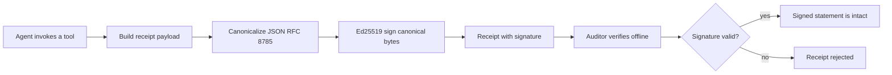
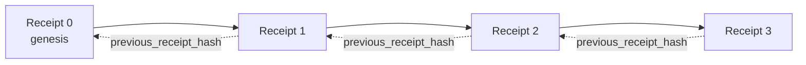

[Bekijk de lesvideo: AI-agenten beveiligen met cryptografische ontvangsten](https://youtu.be/PLACEHOLDER_VIDEO_ID)

> _(Lesvideo en miniatuurafbeelding worden door het Microsoft-contentteam toegevoegd na samenvoeging, passend bij het patroon van les 14 / 15.)_

# AI-agenten beveiligen met cryptografische ontvangsten

## Inleiding

Deze les behandelt:

- Waarom auditsporen voor AI-agenten belangrijk zijn voor naleving, foutopsporing en vertrouwen.
- Wat een cryptografische ontvangst is en hoe deze verschilt van een niet-ondertekende logregel.
- Hoe je een ondertekende ontvangst maakt voor een tool-aanroep van een agent in gewone Python.
- Hoe een ontvangst offline te verifiëren en knoeien te detecteren.
- Hoe ontvangsten aan elkaar te koppelen zodat het verwijderen of herschikken er één keten breekt.
- Wat ontvangsten bewijzen en wat ze expliciet niet bewijzen.

## Leerdoelen

Na het afronden van deze les weet je hoe je:

- faalfrequenties identificeert die cryptografische herkomst voor agentacties motiveren.
- een Ed25519-ondertekende ontvangst maakt over een canonieke JSON-payload.
- een ontvangst onafhankelijk verifieert met alleen de publieke sleutel van de ondertekenaar.
- knoeien detecteert door verificatie opnieuw uit te voeren op een gewijzigde ontvangst.
- een hash-gekoppelde reeks ontvangsten bouwt en uitlegt waarom de keten belangrijk is.
- het onderscheid herkent tussen wat ontvangsten bewijzen (toeschrijving, integriteit, ordening) en wat ze niet bewijzen (correctheid van de actie, degelijkheid van het beleid).

## Het probleem: het auditspoor van jouw agent

Stel je voor dat je een AI-agent hebt ingezet voor Contoso Travel. De agent leest klantverzoeken, roept een vluchten-API aan om opties op te zoeken en boekt stoelen namens de klant. Het afgelopen kwartaal verwerkte de agent 50.000 boekingen.

Vandaag komt een auditor langs. Die stelt een eenvoudige vraag: "Laat me zien wat jouw agent heeft gedaan."

Je levert je logbestanden aan. De auditor kijkt ze na en stelt de lastigere vraag: "Hoe weet ik dat deze logs niet zijn aangepast?"

Dit is het auditspoorprobleem. De meeste agent-implementaties vertrouwen momenteel op:

- **Applicatielogs**: geschreven door de agent zelf, bewerkbaar door iedereen met bestandssysteemtoegang.
- **Cloud-logdiensten**: knoei-bestendig op platformniveau, maar alleen als de auditor de platformbeheerder vertrouwt.
- **Databasetransactielogs**: geschikt voor databasewijzigingen maar niet voor willekeurige tool-aanroepen.

Geen van deze kan de vraag van de auditor beantwoorden zonder dat de auditor iemand moet vertrouwen (jij, jouw cloudprovider, je databasëleverancier). Voor intern gebruik is dat vertrouwen vaak acceptabel. Voor gereguleerde workloads (financiën, gezondheidszorg, alles onder de EU AI-verordening) is dat niet zo.

Cryptografische ontvangsten beperken dit probleem door een ondertekende verklaring onafhankelijk
verifieerbaar te maken. De auditor heeft nog steeds een out-of-band reden nodig om de ondertekeningssleutel en
het component dat de verklaring produceerde te vertrouwen. Een ingesloten sleutel bewijst zelfconsistentie,
geen uitgeversidentiteit of handhavingsplaats.

## Wat is een cryptografische ontvangst?

Een ontvangst is een JSON-object dat registreert wat een agent heeft gedaan, ondertekend met een digitale handtekening.



Een minimale ontvangst ziet er zo uit:

```json
{
  "type": "agent.tool_call.v1",
  "agent_id": "contoso-travel-bot",
  "tool_name": "lookup_flights",
  "tool_args_hash": "sha256:a3f9c1...",
  "result_hash": "sha256:7b2e1d...",
  "policy_id": "contoso-travel-policy-v3",
  "timestamp": "2026-04-25T14:30:00Z",
  "sequence": 47,
  "previous_receipt_hash": "sha256:9d4e6a...",
  "signature": {
    "alg": "EdDSA",
    "sig": "c5af83...",
    "public_key": "8f3b2c..."
  }
}
```

Drie eigenschappen doen het werk:

1. **De handtekening**. De ontvangst is ondertekend door de gateway van de agent met een Ed25519 privésleutel. Iedereen met de corresponderende publieke sleutel kan de handtekening offline verifiëren. Een afhankelijke partij moet die sleutel vastpinnen of ophalen uit een betrouwbare registratie buiten de ontvangst. Knutselen aan enig ondertekend veld maakt de handtekening ongeldig.

2. **Canonieke codering**. Voor het ondertekenen wordt de ontvangst geserialiseerd met de JSON Canonicalization Scheme (JCS, RFC 8785). Dit zorgt ervoor dat twee implementaties die dezelfde logische ontvangst produceren, identieke bytes opleveren. Zonder canonisering zouden verschillende JSON-serializers verschillende handtekeningen voor dezelfde inhoud produceren.

3. **Hash-ketting**. Het `previous_receipt_hash`-veld koppelt elke ontvangst aan de vorige. Het verwijderen of herschikken van een ontvangst breekt de weergegeven reeks. Detectie van inkorting of een door de ondertekenaar gecontroleerde herschrijving vereist ook een vastgepinde actuele kettingkop, onafhankelijk getuige-checkpoint of geverifieerde gesloten populatie-verbintenis.

Samen bieden deze eigenschappen drie garanties:

- **Toeschrijving aan een sleutel**: deze sleutel ondertekende deze inhoud. Organisatorische of menselijke identiteit vereist een vertrouwde sleutelbinding.
- **Integriteit**: de inhoud is niet veranderd sinds ondertekening.
- **Ordening binnen de geverifieerde reeks**: deze ontvangst koppelt aan die voorganger.

## Een ontvangst maken in Python

Je hebt geen speciale bibliotheek nodig om een ontvangst te maken. De cryptografische primitieve functies zijn algemeen beschikbaar en de logica is slechts enkele tientallen regels Python.

De praktische oefeningen in `code_samples/18-signed-receipts.ipynb` leiden je door de volledige workflow. De bron-gecontroleerde `code_samples/18-signed-receipts.execution-receipt.json` registreert de exacte notebook-hash, Python-omgeving, aantal cellen en controles van de laatste schone uitvoering zonder de opgeslagen lesoutput te wijzigen. De samenvattende versie:

```python
import json
import hashlib
import base64
from nacl import signing
from jcs import canonicalize  # RFC 8785 canonical JSON

def b64url_nopad(data: bytes) -> str:
    return base64.urlsafe_b64encode(data).decode("ascii").rstrip("=")

def sha256_canonical(obj) -> str:
    """SHA-256 of a Python object's JCS-canonical JSON form."""
    return f"sha256:{hashlib.sha256(canonicalize(obj)).hexdigest()}"

# Generate or load a signing key (in production, store in a key vault)
signing_key = signing.SigningKey.generate()
verify_key = signing_key.verify_key
TRUSTED_PUBLIC_KEYS = {b64url_nopad(bytes(verify_key))}  # pinned out of band by the verifier

# Build the receipt payload (no signature yet)
tool_args = {"origin": "SYD", "destination": "LAX"}
tool_result = [{"flight": "QF11", "price": 1850, "stops": 0}]

payload = {
    "type": "agent.tool_call.v1",
    "agent_id": "contoso-travel-bot",
    "tool_name": "lookup_flights",
    "tool_args_hash": sha256_canonical(tool_args),
    "result_hash": sha256_canonical(tool_result),
    "policy_id": "contoso-travel-policy-v3",
    "timestamp": "2026-04-25T14:30:00Z",
    "sequence": 0,
    "previous_receipt_hash": None,
}

# Canonicalize and sign the JCS bytes directly. PureEdDSA hashes internally.
canonical_bytes = canonicalize(payload)
signature_bytes = signing_key.sign(canonical_bytes).signature

# Attach a structured signature object.
receipt = {
    **payload,
    "signature": {
        "alg": "EdDSA",
        "sig": b64url_nopad(signature_bytes),
        "public_key": b64url_nopad(bytes(verify_key)),
    },
}
```

Dat is de volledige ondertekeningspijplijn. De oefeningen in de notebook nemen elke stap door.

## Een ontvangst verifiëren en knoeien detecteren

Verificatie is de inverse operatie:

```python
import base64
import hashlib
from nacl import signing
from nacl.exceptions import CryptoError
from jcs import canonicalize

def b64url_decode(s: str) -> bytes:
    # Strict: Python's decoder skips characters outside the alphabet and also
    # accepts padding, the standard +/ alphabet and non-zero spare bits.
    # Re-encoding and comparing accepts only the one unpadded base64url form.
    padding = "=" * ((4 - len(s) % 4) % 4)
    data = base64.urlsafe_b64decode(s + padding)
    if base64.urlsafe_b64encode(data).decode("ascii").rstrip("=") != s:
        raise ValueError("not canonical unpadded base64url")
    return data

def verify_receipt(receipt: dict, trusted_public_key: str) -> bool:
    # trusted_public_key is the issuer's key, obtained from somewhere other
    # than this receipt. Never use receipt["signature"]["public_key"] here:
    # see "What Receipts Prove (and What They Do Not)" below.
    # Fails closed: anything malformed returns False instead of raising.
    if not isinstance(receipt, dict) or not isinstance(trusted_public_key, str):
        return False
    sig_obj = receipt.get("signature")
    if not isinstance(sig_obj, dict) or sig_obj.get("alg") != "EdDSA":
        return False
    sig_b64 = sig_obj.get("sig")
    if not isinstance(sig_b64, str):
        return False

    try:
        # Reconstruct the payload that was actually signed (everything except signature).
        payload = {k: v for k, v in receipt.items() if k != "signature"}
        canonical_bytes = canonicalize(payload)
        verify_key = signing.VerifyKey(b64url_decode(trusted_public_key))
        verify_key.verify(canonical_bytes, b64url_decode(sig_b64))
        return True
    except (CryptoError, TypeError, ValueError, KeyError, OverflowError):
        return False
    except Exception:
        # An undecodable key or signature, or a payload that cannot be
        # canonicalized: fail closed rather than raise.
        return False
```

Deze functie neemt een ontvangst en de publieke sleutel van de uitgevende instantie, en retourneert `True` als de handtekening geldig is en `False` anders, ook als de invoer beschadigd is. Geen netwerkoproep en geen verificatieservice: zodra je de sleutel van de uitgevende partij hebt, is verificatie volledig lokaal en offline. Wat het wel vereist is die sleutel, verkregen uit een andere bron dan de ontvangst zelf.

Om knoei-detectie in actie te zien, leidt de notebook je door:

1. Het maken van een geldige ontvangst en bevestigen dat deze verifieert.
2. Het wijzigen van één byte in het `tool_args_hash`-veld.
3. De verificatie opnieuw uitvoeren en zien dat deze faalt.
4. Nogmaals knoeien, maar nu met opnieuw ondertekenen met een sleutel die de aanvaller heeft gegenereerd en die sleutel in de ontvangst inbedden.

Stap 4 is het belangrijkste om bij stil te staan. Die ontvangst is intern consistent: de handtekening is echt voor de inhoud en de sleutel die hij draagt, dus verifieert deze tegen de sleutel erin. Deze faalt alleen bij verificatie tegen de echte sleutel van de uitgevende instantie. Stappen 2 en 3 vangen een aanvaller die zich geen moeite gaf met opnieuw ondertekenen; stap 4 vangt degene die dat wel deed.

Dit is de praktische demonstratie dat ontvangsten tampering-bestendig zijn: elke wijziging aan een ondertekend veld breekt de handtekening, mits je verifieert met een sleutel die de aanvaller niet heeft geleverd. Het `signature`-object zelf valt buiten de ondertekende bytes, daarom moet de sleutel die je gebruikt voor verificatie van elders komen dan de ontvangst.

## Ontvangsten koppelen voor multi-stap agents

Een enkele ondertekende ontvangst beschermt één actie. Een keten van ontvangsten beschermt een reeks.



Elke ontvangst registreert de hash van de vorige ontvangst. Om ontvangst 2 stil te verwijderen, zou een aanvaller moeten:

- Ontvangen 3's `previous_receipt_hash`-veld wijzigen (breekt ontvangst 3's handtekening), OF
- Een nieuwe handtekening vervalsen op een gewijzigde ontvangst 3 (vereist de privésleutel van de agent).

Als de privésleutel in een hardware key vault zit en verificatie gebruikers elke ontvangst controleren tegen de publieke sleutel van de uitgevende instantie, onafhankelijk verkregen (een gepubliceerde JWK-set of een vastgepind configuratiewaarde), is geen enkele aanval haalbaar zonder detectie. De sleutel publiceren in elke ontvangst is niet genoeg: een aanvaller kan opnieuw ondertekenen met zijn eigen sleutel en die inbedden, wat fixture `04_resigned_receipt.json` is.

De notebook leidt je door:

1. Het bouwen van een keten van drie ontvangsten.
2. Verifiëren dat elk ontvangst's `previous_receipt_hash` overeenkomt met de werkelijke hash van de vorige ontvangst.
3. Knutselen met een ontvangst in het midden en zien dat de keten precies daar breekt.

Zo maak je een auditspoor dat een externe auditor kan verifiëren onder zijn
eigen vastgepinde sleutels van de uitgever en keten-checkpoints, zonder jouw veranderlijke logboekopslag te vertrouwen.

## Wat ontvangsten bewijzen (en wat niet)

Dit is het belangrijkste deel van deze les. Ontvangsten zijn krachtig, maar hun kracht is beperkt.

**Ontvangsten bewijzen drie dingen:**

1. **Toeschrijving**: een specifieke sleutel ondertekende een specifieke payload.
2. **Integriteit**: de payload is niet veranderd sinds ondertekening.
3. **Ordening binnen een gepresenteerde, geverifieerde reeks**: deze ontvangst koppelt aan die voorganger.

**Ontvangsten bewijzen NIET:**

1. **Correctheid**: dat de actie van de agent de juiste actie was. Een ontvangst kan net zo goed voor een fout antwoord ondertekend zijn als voor een correct antwoord.
2. **Beleidsnaleving**: dat het beleid waarnaar in `policy_id` werd verwezen daadwerkelijk werd geëvalueerd, of dat het deze actie zou hebben toegestaan als gecontroleerd. De ontvangst registreert wat werd geclaimd, niet wat werd afgedwongen.
3. **Identiteit voorbij de sleutel**: de ontvangst zegt "deze sleutel ondertekende deze inhoud." Het zegt niet "deze persoon heeft dit gemachtigd." Een sleutel aan een persoon of organisatie koppelen vereist aparte identiteitsinfrastructuur (een directory, een publieke sleutelregister, enz.).
4. **Waarheidsgetrouwheid van invoer**: als de agent een gemanipuleerde prompt ontvangt en daar actie op onderneemt, registreert de ontvangst die actie trouw. Ontvangsten zijn downstream van invoervalidatie, geen vervanging ervan.
5. **Uitvoering of effect in de echte wereld**: een ontvangst na een oproep registreert wat de uitgever beweert dat er gebeurde. Bewijs van toelating of het reconciliëren van een extern effect vereist bewijs van de daadwerkelijke uitvoerder of leverancier.
6. **Volledigheid**: een ontbrekende ontvangst kan betekenen geblokkeerd, weggelaten, verloren of niet geïnstrumenteerd. Afwezigheid wordt alleen bewijs binnen een geverifieerde gesloten populatie.
7. **Vertrouwde tijd**: een getekende tijdstempel bewijst dat de ondertekenaar die waarde droeg, niet dat de waarde juist was. Vertrouwde tijd vereist een aparte tijdsautoriteit of getuige-checkpoint.

**De sleutel in de ontvangst is niet de sleutel waarmee je verifieert.** Dit volgt uit punt 3, en het is de enige plek waar het onderscheid je code moet wijzigen in plaats van alleen je begrip. De `public_key` in het voorbeeld hierboven staat er zodat het voorbeeld zelfvoorzienend is. Een verifier mag deze nooit vertrouwen. Iedereen kan een ontvangst nemen, deze wijzigen, ondertekenen met een zelf gegenereerde sleutel, en die sleutel inbedden; het resultaat verifieert perfect tegen zichzelf. Dat is fixture `04_resigned_receipt.json` in `sample_receipts/`, en de reden waarom `verify_receipt` hierboven de sleutel als argument neemt in plaats van uit de ontvangst te lezen. Verkrijg de sleutel van de uitgever onafhankelijk, uit de JWK-set in de onderstaande Productielijst of een andere verankering die je vooraf vastpinde, en verifieer daarmee. Een handtekening gecontroleerd met een sleutel die in dezelfde envelop aankwam bewijst alleen dat de envelop zelfconsistent is.

Deze grens is belangrijk om twee redenen:

- Het vertelt waarvoor ontvangsten nuttig zijn: het auditeerbaar en knoei-bestendig maken van agentgedrag, ook over organisatorische grenzen heen.
- Het geeft aan welke extra lagen je nog nodig hebt: invoervalidatie (les 6), beleidsafdwinging (kort hieronder behandeld), en identiteitsinfrastructuur (buiten het bereik van deze les).

Een veelgemaakte fout is te denken dat "we hebben ontvangsten" betekent "we zijn gereguleerd." Dat is het niet. Ontvangsten zijn een fundament. Bestuur is het systeem dat je er bovenop bouwt.

## Een ondertekening van een goedkeurder binden aan de exacte actie

Punt 3 hierboven verdient een eigen sectie: een actieontvangst zegt "deze sleutel ondertekende deze inhoud," nooit "een mens keurde dit goed." Voor risicovolle acties (terugbetalingen, verwijderingen, overschrijvingen) kan een aparte goedkeuringshandtekening de exacte actie binden. Het koppelen van die sleutel aan een mens en controleren van menselijke aanwezigheid blijven afzonderlijke verantwoordelijkheden.

De vervolgnotebook `code_samples/human-authorization-receipts.ipynb` voegt een tweede ontvangstsoort toe, `human.approval.v1`, in dezelfde envelopvorm als de ontvangsten in deze les (een getypeerde payload ondertekend door Ed25519 over de canonieke JCS-bytes, met het `signature` object buiten de ondertekende bytes). Een goedkeurderssleutel ondertekent **de volledige canonieke actie en diens digest**; een agent-sleutel ondertekent een bewering met **dezelfde actiedigest** en een `parent_approval_ref`, de `receipt_hash` van de goedkeuring, dezelfde conventie als `previous_receipt_hash` in de keten die je hierboven bouwde. Eén `verify_chain` behandelt beide artefacten onder **afzonderlijke vastgepinde sleutelregisters** (goedkeurderssleutels versus agentsleutels), zodat het codepad gedeeld is maar de autoriteiten nooit.

De eigenschap die dit oplevert, zorgvuldig geformuleerd: *de vastgepinde goedkeurderssleutel ondertekende deze exacte
actie, en de agentsleutel ondertekende later een verklaring met dezelfde actiedigest.*
Dat is bruikbaar bewijs, maar het bewijst op zichzelf niet dat de actie uitgevoerd is. Om
uitvoering te controleren, moet de exacte goedkeuring ook één keer worden gereserveerd en gebruikt aan de
daadwerkelijke uitvoerdersgrens; onbekende provideruitkomsten moeten onbekend blijven, niet
blind opnieuw geprobeerd worden. De weigeringsfixtures in de notebook testen de ontvangst-ketenlaag:

- knoeien, verwarring van vertegenwoordiger, vervalste sleutels aan beide kanten en beschadigde input;
- **verouderde autoriteit**: een handtekening die nog steeds verifieert, toch geweigerd omdat de beleidsversie is gewijzigd, de goedkeurderssleutel uit het vastgepinde register is verwijderd, of de goedkeuring vervallen is vóór de opgegeven verificatietijd;
- **digestvervanging**: een geldig ondertekende actieontvangst verwijzend naar een *echte* goedkeuring die een *andere* canonieke actie bindt.

Elke fout weigert met een aparte reden, zodat een auditor die een weigering leest kan bepalen of de autoriteit verouderde of de geclaimde actie is gewijzigd. Verificatie is alleen-lezen en herhaalbaar: het gebruikt de goedkeuring niet op en roept geen provider aan. Een aparte uitvoerder heeft duurzame, atomische afspeelbescherming en expliciete succes-, faal- en onbepaalde uitkomsten nodig. De goedkeuringsontvangst voor een mens is een educatieve compositie gedefinieerd door deze les, geen ontvangsttype gedefinieerd door `draft-farley-acta-signed-receipts`.

## Productieverwijzingen

De Python-code in deze les is bewust minimaal gehouden zodat je elke regel kunt lezen en precies kunt begrijpen wat er gebeurt. In productie heb je twee opties:

1. **Bouw direct op de cryptografische primitieve elementen.** De 50 regels die je hierboven zag zijn voldoende voor veel gebruikssituaties. PyNaCl (Ed25519) en de `jcs`-package (canonieke JSON) zijn goed onderhouden en gecontroleerde bibliotheken.

2. **Gebruik een productie-receiptbibliotheek.** Verschillende open-source projecten implementeren hetzelfde patroon met extra functionaliteiten (sleutelrotatie, batchverificatie, JWK Set-distributie, integratie met beleidsengines):
   - De ondertekeningspipeline gebruikt de JCS- en handtekening-omvangconventies in een onafhankelijke IETF Internet-Draft ([`draft-farley-acta-signed-receipts`](https://datatracker.ietf.org/doc/draft-farley-acta-signed-receipts/), revisie 02). De eenvoudige educatieve receipt in deze les wijkt af van de `{payload, signature}`-envelop uit de draft en wordt niet gepresenteerd als een conforme implementatie. De draft publiceert een gezamenlijke conformiteitsuite ([agent-governance-testvectors](https://github.com/ScopeBlind/agent-governance-testvectors)) voor implementaties die de wire-structuur gebruiken.
   - De Microsoft Agent Governance Toolkit stelt receipts samen met Cedar-gebaseerde beleidsbeslissingen; zie Tutorial 33 in die repository voor een end-to-end voorbeeld.
   - De `protect-mcp` (npm) en `@veritasacta/verify` (npm) pakketten bieden een Node-gebaseerde implementatie van receipt-ondertekening en offline verificatie, bedoeld om elke MCP-server te omhullen met een bewijsbaar onvervalsbare audittrail, inclusief een gehouden-voor-co-sign flow waarbij een gepauzeerde actie een goedkeuringsreceipt uitzendt die gebonden is aan de actiedigest (WebAuthn-ondersteund in de desktopflow), hetzelfde goedkeuringsreceiptpatroon als de human-authorisatie notebook hierboven.
   - De **[nobulex](https://github.com/arian-gogani/nobulex)** Python SDK (`pip install nobulex`) biedt hetzelfde Ed25519 + JCS ondertekeningspatroon in Python met LangChain en CrewAI-integraties, inclusief gepubliceerde kruisvalidatietestvectoren en een compliance mapping bijgedragen via [OWASP PR #2210](https://github.com/OWASP/CheatSheetSeries/pull/2210).
   - **[EMILIA Protocol](https://github.com/emiliaprotocol/emilia-protocol)** biedt een complementaire laag van exacte actiehandhaving: offline verifieerbare goedkeuringsreceipts, vastgezette WebAuthn of quorum-autoriteit, eenmalig gebruik bij de executorgrens, en een expliciete onzekere-uitkomst route. De framework-adapters behandelen een receipt als noodzakelijk bewijs in plaats van bewijs dat een extern effect plaatsvond.

De beslissing tussen zelf bouwen en het gebruik van een bibliotheek weerspiegelt de keuze tussen je eigen JWT-bibliotheek schrijven en een geteste gebruiken: beide zijn redelijk; de bibliotheek bespaart tijd en reduceert de auditoppervlakte; de from-scratch aanpak dwingt je elke primitieve te begrijpen. Deze les leert de from-scratch aanpak zodat je de basis hebt voor beide keuzes.

## Kenniscontrole

Test je begrip voordat je verdergaat naar de praktijkoefening.

**1. Een receipt wordt ondertekend met de private Ed25519-sleutel van de agent. De auditor heeft alleen de publieke sleutel. Kan de auditor de receipt offline verifiëren?**

<details>
<summary>Antwoord</summary>

Ja, cryptografische verificatie vereist alleen de publieke sleutel en ondertekende bytes. De
auditor moet nog steeds zelfstandig de geaccepteerde publieke sleutel verkrijgen en vastzetten buiten de receipt om.
Er is geen netwerkverzoek nodig nadat die vertrouwensconfiguratie is vastgesteld.
</details>

**2. Een aanvaller wijzigt het `policy_id` veld van een receipt om te beweren dat het werd beheerst door een meer permissief beleid. De handtekening was over de originele payload. Wat gebeurt er tijdens verificatie?**

<details>
<summary>Antwoord</summary>

Verificatie faalt. De handtekening werd berekend over de canonieke bytes van de originele payload; het wijzigen van welk veld dan ook verandert die bytes, waardoor de handtekening ongeldig wordt. De aanvaller zou de private sleutel nodig hebben om een nieuwe geldige handtekening te maken, die heeft hij niet.
</details>

**3. Waarom bevat de receipt een `tool_args_hash` en `result_hash` in plaats van de ruwe argumenten en het resultaat?**

<details>
<summary>Antwoord</summary>

Twee redenen. Ten eerste moet de receipt mogelijk worden gearchiveerd of getransporteerd in omgevingen waar het lekken van ruwe inhoud (PII, bedrijfsdata) problematisch is. Hashing houdt de receipt klein en de inhoud privé; de auditor verifieert dat de hash overeenkomt met een apart opgeslagen kopie van de feitelijke inhoud. Ten tweede hebben hashes een vaste grootte; een receipt met hashes is begrensd in grootte ongeacht hoe groot de inputs en outputs waren.
</details>

**4. Het `previous_receipt_hash` veld koppelt elke receipt aan zijn voorganger. Als een aanvaller stilletjes één receipt uit het midden van een keten verwijdert, wat wordt dan ongeldig?**

<details>
<summary>Antwoord</summary>

Elke receipt die na de verwijderde kwam. Hun `previous_receipt_hash` velden komen niet langer overeen met de feitelijke keten (omdat de gerefereerde receipt niet meer bestaat, of de keten nu naar een andere voorganger wijst). Om de verwijdering te verbergen, zou de aanvaller elke latere receipt opnieuw moeten ondertekenen, wat de private sleutel van de uitgever vereist. Een herondertekening met een andere sleutel faalt bij controle tegen de sleutel van de uitgever.
</details>

**5. Een receipt verifieert schoon. Bewijst dat dat de actie van de agent correct, degelijk, of in overeenstemming met het beleid was?**

<details>
<summary>Antwoord</summary>

Nee. Onder een vastgezette sleutel en ketencontext bewijst een geldige receipt ondertekeningsattributie,
inhoudintegriteit, en een link naar de gepresenteerde voorganger. Het bewijst NIET dat de
actie correct was of uitgevoerd werd, dat het beleid is geëvalueerd, dat de timestamp wordt
vertrouwd, of dat de set van records compleet is. Dit is de belangrijkste grens in de les.
</details>

## Praktijkoefening

Open `code_samples/18-signed-receipts.ipynb` en voltooi alle vier secties:

1. **Sectie 1**: Onderteken je eerste receipt en verifieer die.
2. **Sectie 2**: Manipuleer de receipt en observeer falen van de verificatie.
3. **Sectie 3**: Bouw een keten van drie receipts en verifieer de ketenintegriteit.
4. **Sectie 4**: Pas het patroon toe op een agent gebouwd met het Microsoft Agent Framework: wikkel een tool-aanroep in receipt-ondertekening, en verifieer dan de receipt onafhankelijk.

**Uitdagingsopdracht 1:** breid het receipt-schema uit met een extra veld naar keuze (bijvoorbeeld een request-ID voor tracing), update de canonieke ondertekenlogica om het op te nemen, en bevestig dat de receipt nog steeds kan worden geverifieerd. Wijzig dan het veld na ondertekening en bevestig dat verificatie faalt. Dit dwingt je te begrijpen hoe elke byte van de canonieke codering bijdraagt aan de handtekening.

**Uitdagingsopdracht 2:** Hash volgens SHA-256 twee van je receipts samen (concateneer hun canonieke bytes in een deterministische volgorde) en voeg de resulterende digest als nieuw veld toe aan een derde receipt vóór het ondertekenen. Verifieer dat alle drie de receipts nog steeds kunnen worden geverifieerd. Je hebt zojuist een eenstaps-insluitingsbewijs gebouwd: iedereen die de derde receipt bezit kan bewijzen dat de eerste twee bestonden toen hij werd ondertekend, zonder hun inhoud openbaar te maken. Dit is het patroon dat receipt met selectieve openbaarmaking op schaal gebruikt (Merkle-committments, RFC 6962).

## Conclusie

Cryptografische receipts geven AI-agents een audittrail die:

- **Onafhankelijk verifieerbaar onder vastgezet vertrouwen**: een partij met geaccepteerde publieke sleutels en ondertekende bytes kan verifiëren zonder servicedependantie.
- **Bewijsbaar onvervalsbaar**: elke wijziging maakt de handtekening ongeldig.
- **Draagbaar**: een receipt is een klein JSON-bestand; het kan overal worden gearchiveerd, getransporteerd en geverifieerd.
- **Standaardcomform**: gebouwd op Ed25519 (RFC 8032), JCS (RFC 8785), en SHA-256, allemaal veel gebruikte primitieve elementen.

Ze vervangen geen inputvalidatie, beleidsafdwinging, executor-admissie,
uitkomstbewijzen, volledigheidscontrole of identiteitsinfrastructuur. Ze vormen een fundering
voor die lagen. In gereguleerde of multi-organisatieworkflows maken receipts specifieke
uitgeververklaringen onafhankelijk controleerbaar onder het eigen vertrouwensmodel van de auditor.

De belangrijkste conclusie: receipts bewijzen dat een bepaalde sleutel bepaalde
inhoud heeft ondertekend. Een meegevoerde timestamp is een ondertekenaarsassertie tenzij apart tijdgetuigd.
Een receipt bewijst niet dat de inhoud waar was, dat een actie werd uitgevoerd, of dat de
set records compleet is. Houd die verschillen goed vast.

## Productiechecklist

Wanneer je klaar bent om deze les te verlaten en receipt-ondertekende agents in een echte omgeving te implementeren:

- [ ] **Verplaats de ondertekeningssleutel van de laptop van de ontwikkelaar.** Gebruik Azure Key Vault, AWS KMS, of een hardware security module. De private sleutel die je receipts ondertekent mag nooit in versiebeheer of in platte tekst op toepassingsmachines staan.
- [ ] **Vestig vertrouwen in de sleutel voor de verifier.** Publiceer sleutels via een JWK Set of register, en laat afnemers de geaccepteerde uitgeveridentiteit, sleutelset en rotatiebeleid vastzetten buiten individuele receipts. Een inline sleutel alleen is geen vertrouwensanker.
- [ ] **Veranker de keten extern.** Schrijf periodiek de laatst bekende ketenkop-hash naar een transparantielog (Sigstore Rekor, RFC 3161 timestamp authority, of een tweede intern systeem) zodat een externe partij kan bevestigen "deze keten bestond op dit tijdstip."
- [ ] **Sla receipts onwrikbaar op.** Append-only blobopslag (Azure Storage met onwrikbaarheidspolicies, AWS S3 Object Lock) voorkomt dat een insider geschiedenis herschrijft op opslagniveau.
- [ ] **Bepaal het bewaarbeleid.** Veel complianceregelgeving vereist meerjarige bewaring. Plan de groei van receipts (elke receipt is ~500 bytes; een agent die 10K oproepen per dag doet produceert ~1.8 GB per jaar).
- [ ] **Documenteer wat receipts niet dekken.** Receipts bewijzen toeschrijving, integriteit en volgorde. Je runbook moet expliciet bijkomende controles (inputvalidatie, beleidsafdwinging, snelheidsbeperking, identiteitsinfrastructuur) benoemen die naast receipts meedraaien in je governancehouding.

### Meer vragen over het beveiligen van AI Agents?

Word lid van de [Microsoft Foundry Discord](https://aka.ms/ai-agents/discord) om andere leerlingen te ontmoeten, deel te nemen aan spreekuren, en je AI Agents-vragen beantwoord te krijgen.

## Verder dan deze les

Deze les behandelt enkelvoudige receipt-ondertekening en hash-geketende reeksen. Dezelfde primitieve elementen combineren in meerdere geavanceerde patronen die je kunt tegenkomen naarmate je governance volwassen wordt:

- **Selectieve openbaarmaking.** Wanneer velden van een receipt onafhankelijk gecommitteerd zijn (RFC 6962-stijl Merkle-boom), kun je specifieke velden aan specifieke auditors onthullen en bewijzen dat de rest ongewijzigd is zonder die prijs te geven. Handig als dezelfde receipt zowel een uitgebreide audit moet voldoen (die volledigheid wil) als gegevensminimalisatie-regels als de AVG (die de auditor zo weinig mogelijk willen laten zien).
- **Receipt intrekking.** Als een ondertekeningssleutel gecompromitteerd is, heb je een manier nodig om alle receipts die met die sleutel ondertekend zijn vanaf een bepaald tijdstip als onbetrouwbaar te markeren. Gebruikelijke patronen: kortlevende ondertekeningssleutels plus een gepubliceerde intrekkingslijst, of een transparantielog met intrekkingsvermeldingen.
- **Bilaterale / split-handtekening receipts.** Sommige implementaties splitsen de ondertekende payload in pre-executie (`authorization_*`) en post-executie (`result_*`) helften met onafhankelijke handtekeningen, nuttig wanneer de autorisatiebeslissing en het waargenomen resultaat door verschillende actoren of op verschillende tijden tot stand komen. Dit stapelt additief op het receipt-formaat uit deze les.
- **Payloadcompositie.** Een receipt verzegelt welke bytes je ook in `result_hash` stopt. Payloads uit de praktijk zijn vaak rijker dan het resultaat van een enkele tool-aanroep: pre-beslissingsredenering (modelvoorspelling, overwogen opties, bewijsmateriaal en volledigheid, risicohouding, verantwoordingsketen, poortuitkomst) kunnen allemaal in de payload zitten, verzegeld door één enkele receipt. Zo blijft het receipt-formaat minimaal terwijl payload-schema's domein per domein kunnen evolueren.
- **Cross-implementatie conformiteit.** Meerdere onafhankelijke implementaties van hetzelfde receipt-formaat (Python, TypeScript, Rust, Go) cross-verifiëren aan de hand van gedeelde testvectoren. Als je je eigen implementatie maakt, bevestigt validatie tegen gepubliceerde vectoren de wire-compatibiliteit.
- **Post-quantum migratie.** Ed25519 is nu breed ingezet maar is niet quantum-bestendig. Een `alg` label alleen is geen migratie: een profiel moet ML-DSA sleutelcodering, canonieke ondertekende bytes, verificatie, relying-party-beleid, downgraderesistentie en overgangssemantiek definiëren. Plan en test een dual-signature overgang tegen gedeelde vectoren voordat je compatibiliteitsclaims maakt.

## Extra bronnen

- <a href="https://datatracker.ietf.org/doc/draft-farley-acta-signed-receipts/" target="_blank">IETF Internet-Draft: Signed Decision Receipts for Machine-to-Machine Access Control</a>
- <a href="https://learn.microsoft.com/azure/ai-studio/responsible-use-of-ai-overview" target="_blank">Responsible AI overzicht (Azure AI)</a>
- <a href="https://datatracker.ietf.org/doc/html/rfc8032" target="_blank">RFC 8032: Edwards-Curve Digital Signature Algorithm (EdDSA)</a>
- <a href="https://datatracker.ietf.org/doc/html/rfc8785" target="_blank">RFC 8785: JSON Canonicalization Scheme (JCS)</a>
- <a href="https://datatracker.ietf.org/doc/html/rfc6962" target="_blank">RFC 6962: Certificate Transparency</a> (Merkle-boomconstructie gebruikt door selective-disclosure receipts)
- <a href="https://github.com/microsoft/agent-governance-toolkit/blob/main/docs/tutorials/33-offline-verifiable-receipts.md" target="_blank">Microsoft Agent Governance Toolkit, Tutorial 33: Offline-verifieerbare decision receipts</a>
- <a href="https://github.com/ScopeBlind/agent-governance-testvectors" target="_blank">Cross-implementatie conformiteitstestvectoren</a> voor het receipt-formaat uit deze les (Apache-2.0)
- <a href="https://pynacl.readthedocs.io/" target="_blank">PyNaCl documentatie</a> (Ed25519 in Python)

## Vorige les

[Lokale AI-agenten maken](../17-creating-local-ai-agents/README.md)

---

<!-- CO-OP TRANSLATOR DISCLAIMER START -->
**Disclaimer**:
Dit document is vertaald met behulp van de AI vertaaldienst [Co-op Translator](https://github.com/Azure/co-op-translator). Hoewel we streven naar nauwkeurigheid, dient u er rekening mee te houden dat geautomatiseerde vertalingen fouten of onnauwkeurigheden kunnen bevatten. Het originele document in de oorspronkelijke taal moet worden beschouwd als de gezaghebbende bron. Voor kritieke informatie wordt professionele menselijke vertaling aanbevolen. Wij zijn niet aansprakelijk voor eventuele misverstanden of verkeerde interpretaties die voortvloeien uit het gebruik van deze vertaling.
<!-- CO-OP TRANSLATOR DISCLAIMER END -->