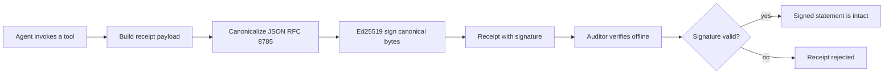
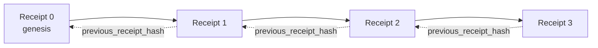

[Bekijk de lesvideo: AI-agenten beveiligen met cryptografische ontvangstbewijzen](https://youtu.be/PLACEHOLDER_VIDEO_ID)

> _(Lesvideo en miniatuur worden na het samenvoegen toegevoegd door het Microsoft contentteam, passend bij het patroon van les 14 / 15.)_

# AI-agenten beveiligen met cryptografische ontvangstbewijzen

## Introductie

Deze les behandelt:

- Waarom audit trails voor AI-agenten belangrijk zijn voor naleving, debugging en vertrouwen.
- Wat een cryptografisch ontvangstbewijs is en hoe het verschilt van een ongetekende logregel.
- Hoe een ondertekend ontvangstbewijs te produceren voor een toolaanroep van een agent in gewoon Python.
- Hoe een ontvangstbewijs offline te verifiëren en manipulatie te detecteren.
- Hoe ontvangstbewijzen aan elkaar te koppelen zodat het verwijderen of herschikken van een ontvangstbewijs de keten breekt.
- Wat ontvangstbewijzen bewijzen en wat ze expliciet niet bewijzen.

## Leerdoelen

Na het voltooien van deze les weet je hoe je:

- Faalkenmerken identificeert die cryptografische herkomst voor agentacties motiveren.
- Een Ed25519-ondertekend ontvangstbewijs produceert over een canonieke JSON-payload.
- Een ontvangstbewijs onafhankelijk verifieert met alleen de publieke sleutel van de ondertekenaar.
- Manipulatie detecteert door verificatie opnieuw uit te voeren op een gewijzigde ontvangstbewijs.
- Een hash-gekoppelde reeks van ontvangstbewijzen opbouwt en uitlegt waarom de keten ertoe doet.
- De grens herkent tussen wat ontvangstbewijzen bewijzen (toeschrijving, integriteit, ordering) en wat ze niet bewijzen (correctheid van de actie, juistheid van het beleid).

## Het probleem: de audit trail van je agent

Stel je voor dat je een AI-agent hebt ingezet voor Contoso Travel. De agent leest klantverzoeken, roept een vluchten-API aan om opties op te zoeken en boekt stoelen namens de klant. Het afgelopen kwartaal verwerkte de agent 50.000 boekingen.

Vandaag komt een auditor langs. Hij stelt een simpele vraag: "Laat me zien wat je agent deed."

Je levert je logbestanden aan. De auditor kijkt en stelt de moeilijkere vraag: "Hoe weet ik dat deze logs niet zijn bewerkt?"

Dit is het audit trail-probleem. De meeste agentimplementaties vertrouwen tegenwoordig op:

- **Applicatielogs**: geschreven door de agent zelf, door iedereen met toegang tot het bestandssysteem te bewerken.
- **Cloud logging services**: manipulatie is slechts op platformniveau zichtbaar, en alleen als de auditor het platformbeheerder vertrouwt.
- **Database transaction logs**: goed geschikt voor databaseveranderingen maar niet voor willekeurige toolaanroepen.

Geen van deze kan de auditor een antwoord geven zonder dat de auditor iemand moet vertrouwen (jou, je cloudprovider, je databaseleverancier). Intern is dat vertrouwen vaak acceptabel. Voor gereguleerde workloads (financiën, gezondheidszorg, alles onder de EU AI-wet) niet.

Cryptografische ontvangstbewijzen beperken dit probleem door een ondertekende verklaring onafhankelijk
verifieerbaar te maken. De auditor heeft nog steeds een redelijke externe reden nodig om de ondertekeningssleutel en
de component die de verklaring produceerde te vertrouwen. Een ingebedde sleutel bewijst zelfconsistentie,
maar niet de identiteit van de uitgever of het toezicht.

## Wat is een cryptografisch ontvangstbewijs?

Een ontvangstbewijs is een JSON-object waarin wordt vastgelegd wat een agent deed, ondertekend met een digitale handtekening.



Een minimaal ontvangstbewijs ziet er zo uit:

```json
{
  "type": "agent.tool_call.v1",
  "agent_id": "contoso-travel-bot",
  "tool_name": "lookup_flights",
  "tool_args_hash": "sha256:a3f9c1...",
  "result_hash": "sha256:7b2e1d...",
  "policy_id": "contoso-travel-policy-v3",
  "timestamp": "2026-04-25T14:30:00Z",
  "sequence": 47,
  "previous_receipt_hash": "sha256:9d4e6a...",
  "signature": {
    "alg": "EdDSA",
    "sig": "c5af83...",
    "public_key": "8f3b2c..."
  }
}
```

Drie eigenschappen zorgen voor de werking:

1. **De handtekening**. Het ontvangstbewijs wordt ondertekend door de gateway van de agent met een Ed25519 privé-sleutel. Iedereen met de bijbehorende publieke sleutel kan de handtekening offline verifiëren. De relying party moet die sleutel pinnen of uit een vertrouwd register buiten het ontvangstbewijs halen. Manipulatie van een ondertekend veld maakt de handtekening ongeldig.

2. **Canonieke codering**. Voor het ondertekenen wordt het ontvangstbewijs geserialiseerd met het JSON Canonicalization Scheme (JCS, RFC 8785). Dit verzekert dat twee implementaties die hetzelfde logische ontvangstbewijs produceren, ook exact dezelfde bytes produceren. Zonder canonicalisatie zouden verschillende JSON-serializers verschillende handtekeningen genereren voor dezelfde inhoud.

3. **Hash chaining**. Het `previous_receipt_hash`-veld koppelt elk ontvangstbewijs aan het vorige. Het verwijderen of herschikken van een ontvangstbewijs verbreekt de gepresenteerde volgorde. Het detecteren van truncatie of een door de ondertekenaar gecontroleerde herschrijving vereist ook een gepind huidige ketenkop, een onafhankelijk waargenomen checkpoint, of een geauthenticeerde closed-population commitment.

Gezamenlijk bieden deze eigenschappen drie garanties:

- **Toeschrijving aan een sleutel**: deze sleutel heeft deze inhoud ondertekend. Organisatorische of menselijke identiteit vereist een vertrouwde sleutelbinding.
- **Integriteit**: de inhoud is sinds ondertekening niet veranderd.
- **Ordering binnen de geverifieerde keten**: dit ontvangstbewijs verwijst naar die voorganger.

## Een ontvangstbewijs produceren in Python

Je hebt geen speciale bibliotheek nodig om een ontvangstbewijs te produceren. De cryptografische primitieve bouwstenen zijn breed beschikbaar en de logica is slechts een paar tientallen regels Python.

De hands-on oefeningen in `code_samples/18-signed-receipts.ipynb` lopen de volledige flow door. De source-controlled `code_samples/18-signed-receipts.execution-receipt.json` legt de exacte notebook-hash, Python-omgeving, cel-aantal en controles vast van de laatst schone uitvoering zonder de opgeslagen outputs van de les te veranderen. Samengevat:

```python
import json
import hashlib
import base64
from nacl import signing
from jcs import canonicalize  # RFC 8785 canonical JSON

def b64url_nopad(data: bytes) -> str:
    return base64.urlsafe_b64encode(data).decode("ascii").rstrip("=")

def sha256_canonical(obj) -> str:
    """SHA-256 of a Python object's JCS-canonical JSON form."""
    return f"sha256:{hashlib.sha256(canonicalize(obj)).hexdigest()}"

# Generate or load a signing key (in production, store in a key vault)
signing_key = signing.SigningKey.generate()
verify_key = signing_key.verify_key
TRUSTED_PUBLIC_KEYS = {b64url_nopad(bytes(verify_key))}  # pinned out of band by the verifier

# Build the receipt payload (no signature yet)
tool_args = {"origin": "SYD", "destination": "LAX"}
tool_result = [{"flight": "QF11", "price": 1850, "stops": 0}]

payload = {
    "type": "agent.tool_call.v1",
    "agent_id": "contoso-travel-bot",
    "tool_name": "lookup_flights",
    "tool_args_hash": sha256_canonical(tool_args),
    "result_hash": sha256_canonical(tool_result),
    "policy_id": "contoso-travel-policy-v3",
    "timestamp": "2026-04-25T14:30:00Z",
    "sequence": 0,
    "previous_receipt_hash": None,
}

# Canonicalize and sign the JCS bytes directly. PureEdDSA hashes internally.
canonical_bytes = canonicalize(payload)
signature_bytes = signing_key.sign(canonical_bytes).signature

# Attach a structured signature object.
receipt = {
    **payload,
    "signature": {
        "alg": "EdDSA",
        "sig": b64url_nopad(signature_bytes),
        "public_key": b64url_nopad(bytes(verify_key)),
    },
}
```

Dat is de hele ondertekeningspijplijn. De oefeningen in de notebook lopen elke stap door.

## Een ontvangstbewijs verifiëren en manipulatie detecteren

Verificatie is de omgekeerde operatie:

```python
import base64
import hashlib
from nacl import signing
from nacl.exceptions import CryptoError
from jcs import canonicalize

def b64url_decode(s: str) -> bytes:
    padding = "=" * ((4 - len(s) % 4) % 4)
    return base64.b64decode(s + padding, altchars=b"-_", validate=True)

def verify_receipt(receipt: dict, trusted_public_keys: set[str]) -> bool:
    # The signature is a structured object: {"alg", "sig", "public_key"}.
    if not isinstance(receipt, dict):
        return False
    sig_obj = receipt.get("signature")
    if not isinstance(sig_obj, dict) or sig_obj.get("alg") != "EdDSA":
        return False
    try:
        # An inline key proves only self-consistency. Trust is configured out of band.
        public_key = sig_obj.get("public_key")
        signature = sig_obj.get("sig")
        if not isinstance(public_key, str) or not isinstance(signature, str):
            return False
        if public_key not in trusted_public_keys:
            return False
        payload = {k: v for k, v in receipt.items() if k != "signature"}
        canonical_bytes = canonicalize(payload)
        verify_key = signing.VerifyKey(b64url_decode(public_key))
        verify_key.verify(canonical_bytes, b64url_decode(signature))
        return True
    except (CryptoError, TypeError, ValueError, KeyError, OverflowError):
        return False
```

Deze functie neemt een ontvangstbewijs en de gepinde sleutelset van de relying party en retourneert
`True` alleen als de handtekening geldig is onder een geaccepteerde sleutel. Verificatie heeft geen
netwerkoproep nodig, maar vertrouwen in de sleutel is nog steeds een externe configuratiekeuze.

Om manipulatie detectie in actie te zien, loopt de notebook door:

1. Het produceren van een geldig ontvangstbewijs en bevestiging dat het verifieert.
2. Het wijzigen van één byte van het `tool_args_hash`-veld.
3. Het opnieuw uitvoeren van de verificatie en zien dat het mislukt.

Dit is de praktische demonstratie dat ontvangstbewijzen manipulatiebestendig zijn: elke wijziging, hoe klein ook, verbreekt de handtekening.

## Ontvangstbewijzen aan elkaar koppelen voor multi-stap agenten

Eén enkel ondertekend ontvangstbewijs beschermt één actie. Een keten van ontvangstbewijzen beschermt een sequentie acties.



Elk ontvangstbewijs noteert de hash van het vorige ontvangstbewijs. Om ontvangstbewijs 2 stilzwijgend te verwijderen, zou een aanvaller moeten:

- Het `previous_receipt_hash`-veld van ontvangstbewijs 3 wijzigen (breekt handtekening van ontvangstbewijs 3), OF
- Een nieuwe handtekening vervalsen op het gewijzigde ontvangstbewijs 3 (vereist de privésleutel van de agent).

Als de privésleutel beschermd is en een verifier een onafhankelijk waargenomen ketenkop pinnen,
zijn deze aanvallen detecteerbaar. Publicatie van de sleutel in elk ontvangstbewijs is niet
voldoende: een ondertekenaar of aanvaller kan een andere sleutel presenteren, een suffix herschrijven, of
de keten inkorten tenzij de relying party een extern vertrouwen en compleetheidsanker heeft.

De notebook loopt door:

1. Het bouwen van een keten van drie ontvangstbewijzen.
2. Verifiëren dat elk ontvangstbewijs zijn `previous_receipt_hash` laat overeenkomen met de werkelijke hash van het voorgaande ontvangstbewijs.
3. Manipuleren van een ontvangstbewijs in het midden en zien dat de keten op precies dat punt breekt.

Zo produceer je een audit trail die een externe auditor kan verifiëren onder zijn
eigen gepinde uitgeverssleutels en ketencheckpoints, zonder je mutabele logstore te vertrouwen.

## Wat ontvangstbewijzen bewijzen (en wat niet)

Dit is de belangrijkste sectie van deze les. Ontvangstbewijzen zijn krachtig maar hun kracht is begrensd.

**Ontvangstbewijzen bewijzen drie dingen:**

1. **Toeschrijving**: een specifieke sleutel heeft een specifieke payload ondertekend.
2. **Integriteit**: de payload is niet veranderd sinds ondertekening.
3. **Ordering binnen een gepresenteerde, geverifieerde keten**: dit ontvangstbewijs verwijst naar die voorganger.

**Ontvangstbewijzen bewijzen NIET:**

1. **Correctheid**: dat de actie van de agent de juiste actie was. Een ontvangstbewijs kan net zo goed worden ondertekend voor een fout antwoord als voor het juiste antwoord.
2. **Beleidsnaleving**: dat het beleid waarnaar wordt verwezen in `policy_id` daadwerkelijk is geëvalueerd, of dat het deze actie zou hebben toegestaan als het gecontroleerd was. Het ontvangstbewijs registreert wat werd beweerd, niet wat werd afgedwongen.
3. **Identiteit buiten de sleutel**: het ontvangstbewijs zegt "deze sleutel ondertekende deze inhoud." Het zegt niet "deze persoon gaf toestemming." Het koppelen van een sleutel aan een persoon of organisatie vereist aparte identiteitsinfrastructuur (een directory, een publieke sleutelregister, enz.).
4. **Waarheidsgetrouwheid van inputs**: als de agent een gemanipuleerde prompt ontvangt en daarop handelt, registreert het ontvangstbewijs de actie trouw. Ontvangstbewijzen komen na inputvalidatie, zijn geen vervanging ervan.
5. **Uitvoering of effect in de echte wereld**: een ontvangstbewijs na de oproep legt vast wat de uitgever beweert dat er gebeurde. Bewijzen van toegang of het reconciliëren van een extern effect vereist bewijs vanuit de daadwerkelijke uitvoerder of de providergrens.
6. **Volledigheid**: een afwezig ontvangstbewijs kan betekenen geblokkeerd, weggelaten, verloren, of niet geïnstrumenteerd. Afwezigheid wordt pas bewijs binnen een geauthenticeerde gesloten populatie.
7. **Vertrouwde tijd**: een ondertekende timestamp bewijst dat de ondertekenaar die waarde droeg, niet dat de waarde juist was. Vertrouwde tijd vereist een aparte tijdauthoriteit of een waargenomen checkpoint.

Deze grens is belangrijk om twee redenen:

- Het vertelt je waar ontvangstbewijzen nuttig voor zijn: maak gedrag van agenten auditbaar en manipulatiebestendig, zelfs over organisatorische grenzen heen.
- Het vertelt je welke extra lagen je nog nodig hebt: inputvalidatie (Les 6), beleidsafdwinging (kort hieronder behandeld), en identiteitsinfrastructuur (buiten scope van deze les).

Een veelgemaakte vergissing is aannemen dat "we hebben ontvangstbewijzen" betekent "we worden bestuurd." Dat is niet zo. Ontvangstbewijzen zijn een fundament. Bestuur is het systeem dat je daarop bouwt.

## Een goedkeurder's handtekening aan de exacte actie binden

Punt 3 hierboven verdient een eigen sectie: een actie-ontvangstbewijs zegt "deze sleutel ondertekende deze inhoud," nooit "een mens gaf toestemming." Voor risicovolle acties (terugbetalingen, verwijderingen, overboekingen) kan een aparte goedkeurdershandtekening de exacte actie binden. Dat die sleutel aan een mens wordt gekoppeld en aanwezigheid van de mens wordt gecontroleerd blijft een aparte verantwoordelijkheid.

De vervolgpnotebook `code_samples/human-authorization-receipts.ipynb` voegt een tweede soort ontvangstbewijs toe, `human.approval.v1`, in dezelfde envelop-structuur als de ontvangstbewijzen van deze les (een getypeerde payload ondertekend met Ed25519 over de canonieke JCS-bytes, met het `signature`-object buiten de ondertekende bytes). Een goedkeurderssleutel ondertekent de **volledige canonieke actie en de digest daarvan**; een agentsleutel ondertekent een claim met dezelfde **actie-digest** en een `parent_approval_ref`, de `receipt_hash` van de goedkeuring, dezelfde conventie als `previous_receipt_hash` in de keten die je hierboven bouwde. Eén `verify_chain` doorloopt beide artefacten onder **afzonderlijke gepinde sleutelregistries** (goedkeurderssleutels versus agentsleutels), zodat het codepad gedeeld is maar de machten nooit.

Het voordeel dat dit oplevert, zorgvuldig geformuleerd: *de gepinde goedkeurderssleutel ondertekende deze precieze
actie, en de agentsleutel ondertekende later een verklaring met dezelfde actiedigest.*
Dat is bruikbaar bewijs, maar het is op zichzelf geen bewijs dat de actie is uitgevoerd. Om
uitvoering te beheersen, moet de exacte goedkeuring ook bewaard en eenmaal geconsumeerd worden op de
feitelijke uitvoerdersgrens; onbekende providerresultaten moeten onbekend blijven en niet
blindelings opnieuw geprobeerd worden. De refusiefixtures van de notebook testen de laag van ontvangstbewijzenketen:

- manipulatie, confused deputy, vervalste sleutels aan beide zijden, en malformed input;
- **verouderde autoriteit**: een handtekening die nog verifieert maar toch wordt geweigerd omdat de beleidsversie veranderde, de goedkeurderssleutel uit het gepinde register werd verwijderd, of de goedkeuring verviel vóór de verstrekte verificatietijd;
- **digest-vervanging**: een geldig ondertekend actie-ontvangstbewijs wijzend naar een *echte* goedkeuring die een *andere* canonieke actie bindt.

Elke fout wordt geweigerd met een apart reden, zodat een auditor bij het lezen van een weigering kan zien of de autoriteit verouderd is of de beweerde actie veranderde. Verificatie is read-only en herhaalbaar: het consumeert de goedkeuring niet en roept geen provider aan. Een aparte uitvoerder heeft duurzame, atomaire replay-bescherming en expliciete success-, failure- en onbepaalde uitkomsten nodig. Het menselijke-goedkeuringsontvangstbewijs is een educatieve compositie gedefinieerd door deze les, geen ontvangstbewijs-type gedefinieerd door `draft-farley-acta-signed-receipts`.

## Productieverwijzingen

De Python-code in deze les is bewust minimaal zodat je elke regel kunt lezen en exact begrijpt wat er gebeurt. In productie heb je twee opties:

1. **Bouw direct op de cryptografische primitieven.** De 50 regels die je hierboven zag zijn voldoende voor veel toepassingen. PyNaCl (Ed25519) en het `jcs`-pakket (canonieke JSON) zijn goed onderhouden en gecertificeerde bibliotheken.

2. **Gebruik een productie-ontvangstbewijzenbibliotheek.** Verschillende open-source projecten implementeren hetzelfde patroon met extra functies (sleutelrotatie, batchverificatie, JWK-setdistributie, integratie met beleidsengines):
   - De ondertekeningspijplijn gebruikt de JCS en handtekening-scope conventies in een onafhankelijk IETF Internet-Draft ([`draft-farley-acta-signed-receipts`](https://datatracker.ietf.org/doc/draft-farley-acta-signed-receipts/), revisie 02). Het vlakke educatieve ontvangstbewijs van deze les verschilt van de envelop van het draft `{payload, signature}` en wordt niet gepresenteerd als een conforme implementatie. Het draft publiceert een gedeelde conformiteitssuite ([agent-governance-testvectors](https://github.com/ScopeBlind/agent-governance-testvectors)) voor implementaties gericht op zijn wire-formaat.
   - De Microsoft Agent Governance Toolkit combineert ontvangstbewijzen met Cedar-beleidsbeslissingen; zie Tutorial 33 in die repository voor een end-to-end voorbeeld.
   - De `protect-mcp` (npm) en `@veritasacta/verify` (npm) pakketten bieden een Node-gebaseerde implementatie van ontvangstbewijsondertekening en offline verificatie, bedoeld om elke MCP-server te omhullen met een manipulatiebestendig audit-trail, inclusief een held-for-co-sign flow waarin een gepauzeerde actie een goedkeuringsontvangstbewijs uitzendt gebonden aan de actie-digest (WebAuthn-ondersteund in de desktop flow), dezelfde goedkeuringsontvangstbewijs-patroon als het menselijke-autorisatie-notebook hierboven.
   - De **[nobulex](https://github.com/arian-gogani/nobulex)** Python SDK (`pip install nobulex`) biedt hetzelfde Ed25519 + JCS ondertekeningspatroon in Python met LangChain- en CrewAI-integraties, inclusief gepubliceerde cross-validatie testvectoren en een compliance mapping bijgedragen via [OWASP PR #2210](https://github.com/OWASP/CheatSheetSeries/pull/2210).
   - **[EMILIA Protocol](https://github.com/emiliaprotocol/emilia-protocol)** biedt een complementaire afdwingingslaag voor exacte acties: offline-verifieerbare goedkeuringsbewijzen, vastgepinde WebAuthn of quorum autoriteit, eenmalig verbruik bij de uitvoerdergrens, en een expliciet pad voor onbepaalde uitkomsten. De framework adapters behandelen een ontvangstbewijs als noodzakelijk bewijs in plaats van bewijs dat een extern effect heeft plaatsgevonden.

De beslissing tussen het zelf ontwikkelen en het gebruiken van een bibliotheek weerspiegelt de beslissing tussen het schrijven van je eigen JWT-bibliotheek en het gebruiken van een geteste: beide zijn redelijk; de bibliotheek bespaart tijd en verkleint het audit oppervlak; de from-scratch aanpak dwingt je om elk primitief te begrijpen. Deze les leert het from-scratch pad zodat je de basis hebt voor welke keuze dan ook.

## Kennischeck

Test je begrip voordat je doorgaat naar de oefening.

**1. Een ontvangstbewijs is ondertekend met de private Ed25519 sleutel van de agent. De auditor heeft alleen de publieke sleutel. Kan de auditor het ontvangstbewijs offline verifiëren?**

<details>
<summary>Antwoord</summary>

Ja, cryptografische verificatie vereist alleen de publieke sleutel en ondertekende bytes. De
auditor moet nog steeds onafhankelijk van het ontvangstbewijs de geaccepteerde publieke sleutel verkrijgen en vastpinnen.
Er is geen netwerkoproep nodig nadat die vertrouwensconfiguratie is vastgesteld.
</details>

**2. Een aanvaller wijzigt het `policy_id` veld van een ontvangstbewijs om te claimen dat het werd beheerst door een meer permissief beleid. De handtekening was over de oorspronkelijke payload. Wat gebeurt er tijdens verificatie?**

<details>
<summary>Antwoord</summary>

Verificatie mislukt. De handtekening werd berekend over de canonieke bytes van de oorspronkelijke payload; het wijzigen van een veld verandert die bytes, waardoor de handtekening ongeldig wordt. De aanvaller zou de privé sleutel nodig hebben om een nieuwe geldige handtekening te produceren, die ze niet hebben.
</details>

**3. Waarom bevat het ontvangstbewijs een `tool_args_hash` en `result_hash` in plaats van de ruwe argumenten en het resultaat?**

<details>
<summary>Antwoord</summary>

Twee redenen. Ten eerste moet het ontvangstbewijs mogelijk worden gearchiveerd of verzonden in omgevingen waar het lekken van de ruwe inhoud (PII, bedrijfsgegevens) een probleem is. Hashing houdt het ontvangstbewijs klein en de inhoud privé; de auditor verifieert dat de hash overeenkomt met een apart opgeslagen kopie van de daadwerkelijke inhoud. Ten tweede hebben hashes een vaste grootte; een ontvangstbewijs met hashes heeft een begrensde grootte ongeacht hoe groot de inputs en outputs waren.
</details>

**4. Het `previous_receipt_hash` veld koppelt elk ontvangstbewijs aan zijn voorganger. Als een aanvaller stilletjes een ontvangstbewijs uit het midden van een keten verwijdert, wat wordt dan ongeldig?**

<details>
<summary>Antwoord</summary>

Het volgende gepresenteerde ontvangstbewijs koppelt niet langer aan zijn verwachte voorganger, dus verificatie
van die gepresenteerde sequentie faalt vanaf dat gat verder. Als de ondertekenaar de privé
sleutel beheert, kan deze een achtervoegsel herschrijven of inkorten. Detectie daarvan vereist een vastgepind huidig hoofd,
extern controlepunt, of geauthenticeerde populatie-commitment.
</details>

**5. Een ontvangstbewijs verifieert schoon. Bewijst dat dat de actie van de agent correct, juist, of conform het beleid was?**

<details>
<summary>Antwoord</summary>

Nee. Onder een vastgepinde sleutel en ketencontext bewijst een geldig ontvangstbewijs toeschrijving van de handtekening,
inhoudintegriteit, en een koppeling aan de gepresenteerde voorganger. Het bewijst NIET dat de
actie correct was of werd uitgevoerd, dat het beleid werd geëvalueerd, dat de timestamp
betrouwbaar is, of dat de set van records compleet is. Dit is de belangrijkste grens in de les.
</details>

## Oefening

Open `code_samples/18-signed-receipts.ipynb` en voltooi alle vier secties:

1. **Sectie 1**: Onderteken je eerste ontvangstbewijs en verifieer het.
2. **Sectie 2**: Manipuleer het ontvangstbewijs en observeer dat verificatie faalt.
3. **Sectie 3**: Bouw een keten van drie ontvangstbewijzen en verifieer de ketenintegriteit.
4. **Sectie 4**: Pas het patroon toe op een agent gebouwd met het Microsoft Agent Framework: wikkel een tool-aanroep in ontvangstbewijs-ondertekening, en verifieer dan het ontvangstbewijs onafhankelijk.

**Uitdagingsuitbreiding 1:** breid het ontvangstbewijs-schema uit met een extra veld naar keuze (bijvoorbeeld een request-ID voor tracing), werk de canonieke ondertekeningslogica bij om het op te nemen, en bevestig dat het ontvangstbewijs nog steeds door verificatie komt. Wijzig dan het veld na ondertekening en bevestig dat verificatie faalt. Dit dwingt je om te begrijpen hoe elke byte van de canonieke codering bijdraagt aan de handtekening.

**Uitdagingsuitbreiding 2:** SHA-256-hash twee van je ontvangstbewijzen samen (conca­teer hun canonieke bytes in een deterministische volgorde) en embed de resulterende digest als een nieuw veld op een derde ontvangstbewijs voordat je dat ondertekent. Verifieer dat alle drie ontvangstbewijzen nog steeds door verificatie komen. Je hebt zojuist een één-staps inklusief bewijs gebouwd: iedereen met het derde ontvangstbewijs kan bewijzen dat de eerste twee bestonden op het moment van ondertekening, zonder hun inhoud te hoeven onthullen. Dit is het patroon dat selective-disclosure ontvangstbewijzen op schaal gebruiken (Merkle-commitments, RFC 6962).

## Conclusie

Cryptografische ontvangstbewijzen geven AI-agents een auditspoor dat:

- **Onafhankelijk verifieerbaar onder vastgepind vertrouwen**: een partij met geaccepteerde publieke sleutels en ondertekende bytes kan verifiëren zonder serviceafhankelijkheid.
- **Manipulatie-waarneembaar**: elke wijziging maakt de handtekening ongeldig.
- **Draagbaar**: een ontvangstbewijs is een klein JSON-bestand; het kan worden gearchiveerd, verzonden en overal worden geverifieerd.
- **Standards-conform**: gebouwd op Ed25519 (RFC 8032), JCS (RFC 8785), en SHA-256, alle breed ingezet primitieven.

Ze zijn geen vervanging voor invoervalidatie, beleidsafdwinging, executor-toelating,
uitkomstbewijs, volledigheidscontroles, of identiteit-infrastructuur. Ze zijn een fundament
voor die lagen. In gereguleerde of multi-organisatie workflows maken ontvangstbewijzen specifieke
uitgevende verklaringen onafhankelijk toetsbaar onder de eigen vertrouwensconfiguratie van de auditor.

De belangrijkste les: ontvangstbewijzen bewijzen dat een bepaalde sleutel een bepaalde
inhoud heeft ondertekend. Een meegevoerde timestamp is een ondertekenaarassertie tenzij apart tijd-geattesteerd. Een
ontvangstbewijs bewijst niet dat de inhoud waar was, dat een actie werd uitgevoerd, of dat de
set van records compleet is. Houd die onderscheidingen scherp.

## Productie Checklist

Wanneer je klaar bent om van deze les over te stappen naar het uitrollen van receipt-ondertekende agents in een echte omgeving:

- [ ] **Verplaats de ondertekeningssleutel van de ontwikkelaarslaptop.** Gebruik Azure Key Vault, AWS KMS, of een hardware security module. De private sleutel die je ontvangstbewijzen ondertekent mag nooit in source control of in platte tekst op applicatiemachines staan.
- [ ] **Stel verificatiesleutelsvertrouwen vast.** Publiceer sleutels via een JWK Set of register, laat vertrouwende partijen de geaccepteerde issuer-identiteit, sleutelset en rotatiebeleid vastpinnen buiten individuele ontvangstbewijzen om. Een inline sleutel alleen is geen vertrouwensanker.
- [ ] **Veranker de keten extern.** Schrijf periodiek de laatste ketenkophash in een transparantielog (Sigstore Rekor, RFC 3161 timestamp authority, of een tweede intern systeem) zodat een externe partij kan bevestigen "deze keten bestond op dit moment."
- [ ] **Sla ontvangstbewijzen onveranderlijk op.** Append-only blob storage (Azure Storage met onveranderbaarheidsbeleid, AWS S3 Object Lock) voorkomt dat een insider de geschiedenis herschrijft op opslagniveau.
- [ ] **Bepaal bewaartermijn.** Veel compliance regimes vereisen meerjarig bewaren. Plan voor groei van ontvangstbewijzen (elk ontvangstbewijs is ~500 bytes; een agent die 10K calls per dag maakt produceert ~1.8 GB per jaar).
- [ ] **Documenteer wat ontvangstbewijzen niet dekken.** Ontvangstbewijzen bewijzen toeschrijving, integriteit en ordening. Je runbook moet expliciet benoemen welke aanvullende controles (invoervalidatie, beleidsafdwinging, tariefbeperking, identiteit-infrastructuur) naast ontvangstbewijzen in je governance posture zitten.

### Meer vragen over het beveiligen van AI-agents?

Word lid van de [Microsoft Foundry Discord](https://aka.ms/ai-agents/discord) om andere lerenden te ontmoeten, kantooruren bij te wonen, en je AI Agents vragen beantwoord te krijgen.

## Verder dan deze les

Deze les behandelt single-receipt ondertekening en hash-gekoppelde reeksen. Dezelfde primitieven vormen samen verschillende meer geavanceerde patronen die je kunt tegenkomen naarmate je governance posture rijpt:

- **Selectieve openbaarmaking.** Wanneer de velden van een ontvangstbewijs onafhankelijk gecommitteerd zijn (RFC 6962-stijl Merkle-boom), kun je specifieke velden aan specifieke auditors onthullen en bewijzen dat de rest ongewijzigd is zonder ze bloot te geven. Nuttig wanneer hetzelfde ontvangstbewijs zowel een uitgebreide audit (die volledigheid wil) als data-minimalisatie regelgeving zoals GDPR moet voldoen (die wil dat de auditor zo min mogelijk ziet).
- **Intrekking van ontvangstbewijzen.** Als een ondertekeningssleutel gecompromitteerd is, heb je een manier nodig om alle door die sleutel ondertekende ontvangstbewijzen als niet-vertrouwd te markeren vanaf een bepaald tijdstip. Standaardpatronen: kortlevende ondertekeningssleutels plus een gepubliceerde intrekkingslijst, of een transparantielog met intrekkingvermeldingen.
- **Bilaterale / gesplitste handtekening ontvangstbewijzen.** Sommige implementaties splitsen de ondertekende payload in pre-uitvoering (`authorization_*`) en post-uitvoering (`result_*`) helften met onafhankelijke handtekeningen, nuttig wanneer de autorisatiebeslissing en het waargenomen resultaat door verschillende actoren of op verschillende tijden worden geproduceerd. Dit bouwt additief voort op het ontvangstbewijsformaat uit deze les.
- **Payloadcompositie.** Een ontvangstbewijs sluit precies af welke bytes je in `result_hash` stopt. Payloads uit de echte wereld zijn vaak rijker dan alleen een tool-aanroepingresultaat: pre-beslissingsredenering (modelvoorspelling, overwogen opties, bewijs en volledigheid, risicostatus, verantwoordingsketen, poortresultaat) kan allemaal binnen de payload leven, afgesloten door één ontvangstbewijs. Dit houdt het ontvangstbewijsformaat minimaal terwijl payloadschema’s per domein kunnen evolueren.
- **Cross-implementatie conformiteit.** Meerdere onafhankelijke implementaties van hetzelfde ontvangstbewijsformaat (Python, TypeScript, Rust, Go) cross-verifiëren tegen gedeelde testvectoren. Als je een eigen implementatie bouwt, bevestigt validatie tegen gepubliceerde vectoren compatibiliteit op het protocolniveau.
- **Post-quantum migratie.** Ed25519 is vandaag bredere ingezet maar niet quantum-bestendig. Een `alg` label alleen is geen migratie: een profiel moet ML-DSA sleutelcodering, canonieke ondertekende bytes, verificatie, relying-party beleid, downgrade-weerstand en overgangssemantiek definiëren. Plan en test een dual-handtekening overgang tegen gedeelde vectoren voordat je compatibiliteitsclaims maakt.

## Aanvullende bronnen

- <a href="https://datatracker.ietf.org/doc/draft-farley-acta-signed-receipts/" target="_blank">IETF Internet-Draft: Signed Decision Receipts for Machine-to-Machine Access Control</a>
- <a href="https://learn.microsoft.com/azure/ai-studio/responsible-use-of-ai-overview" target="_blank">Responsible AI overzicht (Azure AI)</a>
- <a href="https://datatracker.ietf.org/doc/html/rfc8032" target="_blank">RFC 8032: Edwards-Curve Digital Signature Algorithm (EdDSA)</a>
- <a href="https://datatracker.ietf.org/doc/html/rfc8785" target="_blank">RFC 8785: JSON Canonicalization Scheme (JCS)</a>
- <a href="https://datatracker.ietf.org/doc/html/rfc6962" target="_blank">RFC 6962: Certificate Transparency</a> (Merkle-boom constructie gebruikt door selective-disclosure ontvangstbewijzen)
- <a href="https://github.com/microsoft/agent-governance-toolkit/blob/main/docs/tutorials/33-offline-verifiable-receipts.md" target="_blank">Microsoft Agent Governance Toolkit, Tutorial 33: Offline-Verifiable Decision Receipts</a>
- <a href="https://github.com/ScopeBlind/agent-governance-testvectors" target="_blank">Cross-implementatie conformiteit testvectoren</a> voor het ontvangstbewijsformaat gebruikt in deze les (Apache-2.0)
- <a href="https://pynacl.readthedocs.io/" target="_blank">PyNaCl documentatie</a> (Ed25519 in Python)

## Vorige les

[Lokale AI Agents maken](../17-creating-local-ai-agents/README.md)

---

<!-- CO-OP TRANSLATOR DISCLAIMER START -->
**Disclaimer**:
Dit document is vertaald met behulp van de AI vertaaldienst [Co-op Translator](https://github.com/Azure/co-op-translator). Hoewel we streven naar nauwkeurigheid, dient u er rekening mee te houden dat geautomatiseerde vertalingen fouten of onnauwkeurigheden kunnen bevatten. Het originele document in de oorspronkelijke taal moet worden beschouwd als de gezaghebbende bron. Voor kritieke informatie wordt professionele menselijke vertaling aanbevolen. Wij zijn niet aansprakelijk voor eventuele misverstanden of verkeerde interpretaties die voortvloeien uit het gebruik van deze vertaling.
<!-- CO-OP TRANSLATOR DISCLAIMER END -->