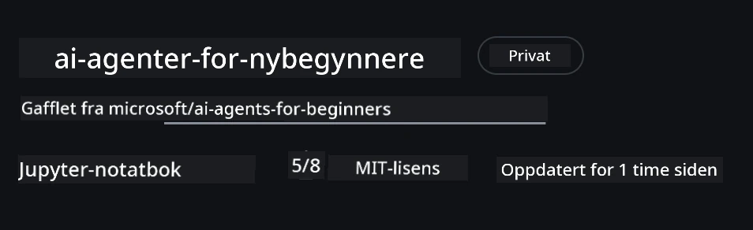
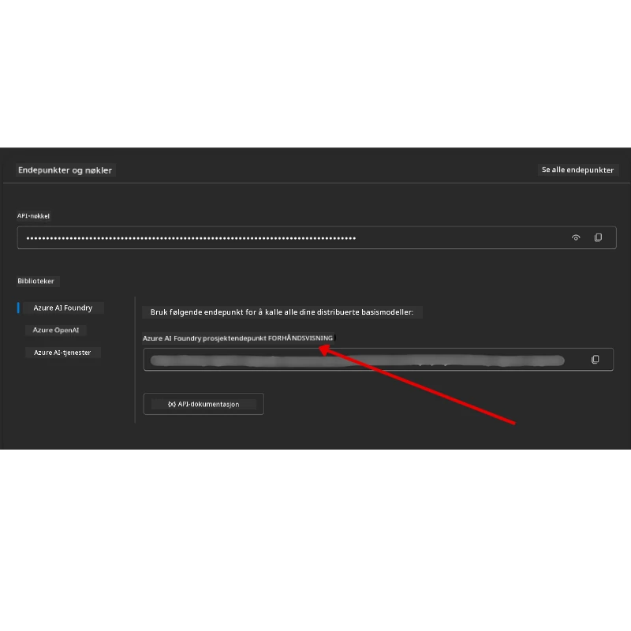

# Kursoppsett

## Introduksjon

Denne leksjonen vil dekke hvordan du kjører kodeeksemplene i denne kurset.

## Bli med andre lærende og få hjelp

Før du begynner å klone ditt repo, bli med i [AI Agents For Beginners Discord-kanal](https://aka.ms/ai-agents/discord) for å få hjelp med oppsett, spørsmål om kurset, eller for å koble til andre lærende.

## Klon eller Fork dette Repo

For å begynne, vennligst klon eller fork GitHub-repositoriet. Dette vil lage din egen versjon av kursmaterialet slik at du kan kjøre, teste og justere koden!

Dette kan gjøres ved å klikke på linken til <a href="https://github.com/microsoft/ai-agents-for-beginners/fork" target="_blank">fork repoet</a>

Du skal nå ha din egen forkede versjon av dette kurset på følgende lenke:



### Grunnleggende kloning (anbefalt for workshop / Codespaces)

  > Hele repository kan være stort (~3 GB) når du laster ned full historikk og alle filer. Om du bare deltar på workshoppen eller trenger bare noen få leksjonsmapper, laster en grunnleggende kloning (eller sparsommelig kloning) ned mye mindre.

#### Rask grunnleggende kloning — minimal historikk, alle filer

Erstatt `<your-username>` i kommandoene nedenfor med URL-en til din fork (eller upstream URL hvis du foretrekker).

For å klone kun den siste commit-historikken (liten nedlasting):

```bash
git clone --depth 1 https://github.com/<your-username>/ai-agents-for-beginners.git
```

For å klone en spesifikk branch:

```bash
git clone --depth 1 --branch <branch-name> https://github.com/<your-username>/ai-agents-for-beginners.git
```

#### Delvis (sparsom) kloning — minimale blobs + kun valgte mapper

Dette bruker delvis kloning og sparse-checkout (krever Git 2.25+ og anbefalt moderne Git med støtte for delvis kloning):

```bash
git clone --depth 1 --filter=blob:none --sparse https://github.com/<your-username>/ai-agents-for-beginners.git
```

Flytt inn i repomappen:

```bash
cd ai-agents-for-beginners
```

Angi deretter hvilke mapper du ønsker (eksempel under viser to mapper):

```bash
git sparse-checkout set 00-course-setup 01-intro-to-ai-agents
```

Etter kloning og verifisering av filer, hvis du kun trenger filene og ønsker å frigjøre plass (ingen git-historikk), slett repositoriets metadata (💀irreversibelt — du vil miste all Git-funksjonalitet):

```bash
# zsh/bash
rm -rf .git
```

```powershell
# PowerShell
Remove-Item -Recurse -Force .git
```

#### Bruke GitHub Codespaces (anbefalt for å unngå store lokale nedlastinger)

- Opprett en ny Codespace for dette repoet via [GitHub UI](https://github.com/codespaces).  

- I terminalen i den nyopprettede codespacen, kjør en av de grunnleggende/sparsom klone kommandoene ovenfor for å hente kun leksjonsmappene du trenger inn i Codespace arbeidsområdet.
- Valgfritt: etter kloning innenfor Codespaces, fjern .git for å frigjøre ekstra plass (se fjerningskommandoene ovenfor).
- Merk: Om du foretrekker å åpne repoet direkte i Codespaces (uten ekstra kloning), vær oppmerksom på at Codespaces vil konstruere devcontainer-miljøet og kan fortsatt provisionere mer enn du trenger.

#### Tips

- Bytt alltid ut klone-URL med din fork om du vil redigere/committe.
- Om du senere trenger mer historikk eller flere filer, kan du hente dem eller justere sparse-checkout til å inkludere flere mapper.

## Kjøre Koden

Dette kurset tilbyr en serie Jupyter Notebooks som du kan kjøre for å få praktisk erfaring med å bygge AI-agenter.

Kodeeksemplene bruker **Microsoft Agent Framework (MAF)** med `FoundryChatClient`, som kobler til **Microsoft Foundry Agent Service V2** (Responses API) gjennom **Microsoft Foundry**.

Alle Python-notebooks er merket `*-python-agent-framework.ipynb`.

## Krav

- Python 3.12+
  - **MERK**: Om du ikke har Python3.12 installert, sørg for å installere det. Opprett deretter ditt virtuelle miljø (venv) med python3.12 for å sikre at korrekte versjoner installeres fra requirements.txt-filen.
  
    >Eksempel

    Opprett Python venv katalog:

    ```bash
    python -m venv venv
    ```

    Aktiver deretter venv-miljø for:

    ```bash
    # zsh/bash
    source venv/bin/activate
    ```
  
    ```dos
    # Command Prompt for Windows
    venv\Scripts\activate
    ```

- .NET 10+: For eksempel-koder som bruker .NET, sørg for å installere [.NET 10 SDK](https://dotnet.microsoft.com/download/dotnet/10.0) eller nyere. Sjekk deretter versjon av installert .NET SDK:

    ```bash
    dotnet --list-sdks
    ```

- **Azure CLI** — Påkrevd for autentisering. Installer fra [aka.ms/installazurecli](https://aka.ms/installazurecli).
- **Azure Subscription** — For tilgang til Microsoft Foundry og Microsoft Foundry Agent Service.
- **Microsoft Foundry Prosjekt** — Et prosjekt med distribuert modell (f.eks., `gpt-5-mini`). Se [Steg 1](#steg-1-opprett-et-microsoft-foundry-prosjekt) under.

Vi har inkludert en `requirements.txt`-fil i roten av dette repositoriet som inneholder alle nødvendige Python-pakker for å kjøre kodeeksemplene.

Du kan installere dem ved å kjøre denne kommandoen i terminalen i repositoriets rot:

```bash
pip install -r requirements.txt
```

Vi anbefaler å opprette et Python virtual environment for å unngå konflikter og problemer.

## Konfigurer VSCode

Sørg for at du bruker riktig versjon av Python i VSCode.


## Sett opp Microsoft Foundry og Microsoft Foundry Agent Service

### Steg 1: Opprett et Microsoft Foundry Prosjekt

Du trenger et Microsoft Foundry **prosjekt** med en distribuert modell for å kjøre notebooksene. Opprett prosjektet direkte i gjeldende Microsoft Foundry opplevelse; et hub er ikke nødvendig.

1. Gå til [ai.azure.com](https://ai.azure.com) og logg inn med Azure-kontoen din.
2. Velg **Create project** og følg instruksjonene for å opprette prosjektet ditt.
3. I prosjektet, distribuer en modell (f.eks `gpt-5-mini`) fra **Models + Endpoints** → **Deploy model**.

### Steg 2: Hent prosjektets endepunkt og modell-distribusjonsnavn

Fra prosjektet ditt i Microsoft Foundry portalen:

- **Project Endpoint** — Gå til **Overview**-siden og kopier endepunkt-URL-en.



- **Model Deployment Name** — Gå til **Models + Endpoints**, velg din distribuerte modell, og noter **Deployment name** (f.eks. `gpt-5-mini`).

### Steg 3: Logg inn til Azure med `az login`

De fleste notebooks autentiserer gjennom din **Azure CLI-pålogging** — med `AzureCliCredential` eller `DefaultAzureCredential` (begge bruker din `az login`-økt) fra `azure-identity`-pakken — så de krever ikke API-nøkler. Noen få leksjoner og valgfrie integrasjoner bruker API-nøkler; sjekk hver leksjons forutsetninger for eventuelle miljøvariabler. Dette krever at du er innlogget via Azure CLI.

1. **Installer Azure CLI** om du ikke allerede har det: [aka.ms/installazurecli](https://aka.ms/installazurecli)

2. **Logg inn** ved å kjøre:

    ```bash
    az login
    ```

    Eller om du er i en fjern/Codespace-omgeving uten nettleser:

    ```bash
    az login --use-device-code
    ```

3. **Velg abonnementet** om du blir spurt — velg det som inneholder Foundry-prosjektet ditt.

4. **Verifier** at du er innlogget:

    ```bash
    az account show
    ```

> **Hvorfor `az login`?** Notebookene autentiserer med `AzureCliCredential` (eller `DefaultAzureCredential`, som også bruker Azure CLI-pålogging) fra `azure-identity`-pakken. Dette betyr at din Azure CLI-økt leverer legitimasjon — ingen API-nøkler eller hemmeligheter i `.env`-filen. Dette er en [beste praksis for sikkerhet](https://learn.microsoft.com/azure/developer/ai/keyless-connections).

### Steg 4: Opprett din `.env` fil

Kopier eksempelfilen:

```bash
# zsh/bash
cp .env.example .env
```

```powershell
# PowerShell
Copy-Item .env.example .env
```

Åpne `.env` og fyll inn disse to verdiene:

```env
AZURE_AI_PROJECT_ENDPOINT=https://<your-project>.services.ai.azure.com/api/projects/<your-project-id>
AZURE_AI_MODEL_DEPLOYMENT_NAME=gpt-5-mini
```

| Variabel | Hvor finner du den |
|----------|-----------------|
| `AZURE_AI_PROJECT_ENDPOINT` | Foundry-portalen → ditt prosjekt → **Overview**-siden |
| `AZURE_AI_MODEL_DEPLOYMENT_NAME` | Foundry-portalen → **Models + Endpoints** → navnet på din distribuerte modell |

Det er alt for de fleste leksjoner! Notebookene autentiserer automatisk gjennom din `az login`-økt.

### Steg 5: Installer Python-avhengigheter

```bash
pip install -r requirements.txt
```

Vi anbefaler å kjøre dette inne i det virtuelle miljøet du opprettet tidligere.

## Valgfritt Oppsett: Azure AI Search (Leksjon 5 og 16)

Leksjon 5 (Agentic RAG) og Leksjon 16 notebooks fungerer ut av boksen med en **in-memory kunnskapsbase** — ingen ekstra Azure ressurser trengs. Om du vil bruke en ekte **Azure AI Search** indeks, merk at **Leksjon 16 notebook for øyeblikket bruker nøkkelbasert autentisering**: den bytter fra in-memory søk til Azure AI Search bare når **både** `AZURE_SEARCH_SERVICE_ENDPOINT` **og** `AZURE_SEARCH_API_KEY` er satt, ellers forblir den på in-memory søk — så for å kjøre mot en ekte indeks må du også sette admin-nøkkelen. Nøkkelfri autentisering med Microsoft Entra ID (RBAC) er anbefalt tilnærming for din egen produksjonskode, i tråd med `az login` flyten brukt ellers i dette kurset.

RBAC-steget nedenfor gjelder for oppsett-guide prøver og din egen kode. De aktiverer ikke nøkkelfri autentisering i Leksjon 16 notebook; Leksjon 16 krever fortsatt både endepunkt og admin-nøkkel for å bruke Azure AI Search.

1. **Aktiver rollebasert tilgang** på din søketjeneste:

    ```bash
    az search service update --name <service-name> --resource-group <resource-group> --auth-options aadOrApiKey
    ```

2. **Tildel deg selv nødvendige roller** (opprett/last indekser og spørr):

    ```bash
    az role assignment create --assignee <your-user-or-principal-id> --role "Search Service Contributor" --scope $(az search service show -g <resource-group> -n <service-name> --query id -o tsv)
    az role assignment create --assignee <your-user-or-principal-id> --role "Search Index Data Contributor" --scope $(az search service show -g <resource-group> -n <service-name> --query id -o tsv)
    ```

3. **Legg til endepunktet** i din `.env` fil:

| Variabel | Hvor finner du den |
|----------|-----------------|
| `AZURE_SEARCH_SERVICE_ENDPOINT` | Azure-portalen → din **Azure AI Search** ressurs → **Overview** → URL |
| `AZURE_SEARCH_API_KEY` | Påkrevd (med endepunkt) for å aktivere Azure AI Search i Leksjon 16 notebook, som bruker nøkkelautentisering. Azure-portalen → **Settings** → **Keys** → Primær adminkey |

> **Hvorfor nøkkelfri?** Admin-nøkler gir full skriveadgang til din søketjeneste og kan lekkes via `.env` filer. Med RBAC brukes din `az login` identitet i stedet — samme nøkkelfrie Entra ID-mønster som kurs-notebookene bruker (via `AzureCliCredential` / `DefaultAzureCredential`). Se [Koble til Azure AI Search med roller](https://learn.microsoft.com/azure/search/search-security-rbac).

Se [Azure AI Search oppsettsguide](./AzureSearch.md) for fullstendige eksempler på indeksopprettelse i Python og .NET.

## Ytterligere oppsett for leksjoner som kaller Azure OpenAI direkte (Leksjon 6 og 8)

Noen notebooks i leksjon 6 og 8 kaller **Azure OpenAI** direkte (bruker **Responses API**) i stedet for gjennom et Microsoft Foundry-prosjekt. Disse eksemplene brukte tidligere GitHub Models, som er utfaset og støtter ikke Responses API. Legg til disse variablene i din `.env` fil:

| Variabel | Hvor finner du den |
|----------|-----------------|
| `AZURE_OPENAI_ENDPOINT` | Azure-portalen → din **Azure OpenAI** ressurs → **Keys and Endpoint** → Endpoint (f.eks `https://<your-resource>.openai.azure.com`) |
| `AZURE_OPENAI_DEPLOYMENT` | Navnet på din distribuerte modell (f.eks `gpt-5-mini`) som støtter Responses API |
| `AZURE_OPENAI_API_KEY` | Valgfritt — kun om du bruker nøkkelbasert autentisering i stedet for `az login` / Entra ID |

> Responses API bruker det stabile `/openai/v1/` endepunktet, så ingen `api-version` er påkrevd. Logg inn med `az login` for nøkkelfri Entra ID-autentisering.

## Alternativ leverandør: MiniMax (OpenAI-kompatibel)

[MiniMax](https://platform.minimaxi.com/) tilbyr store kontekstmodeller (opptil 204K tokens) gjennom en OpenAI-kompatibel API. Siden Microsoft Agent Frameworks `OpenAIChatClient` fungerer med ethvert OpenAI-kompatibelt endepunkt, kan du bruke MiniMax som drop-in alternativ for leksjoner som bruker `OpenAIChatClient`.

Legg til disse variablene i din `.env` fil:

| Variabel | Hvor finner du den |
|----------|-----------------|
| `MINIMAX_API_KEY` | [MiniMax Plattform](https://platform.minimaxi.com/) → API-nøkler |
| `MINIMAX_BASE_URL` | Bruk `https://api.minimax.io/v1` (standardverdi) |
| `MINIMAX_MODEL_ID` | Modellnavn å bruke (f.eks., `MiniMax-M3`) |

**Eksempelmodeller**: `MiniMax-M3` (anbefalt), `MiniMax-M2.7`, `MiniMax-M2.7-highspeed` (raskere responser). Modellnavn og tilgjengelighet kan endres over tid, og tilgang til en gitt modell kan avhenge av din konto.

Kodeeksemplene som bruker `OpenAIChatClient` (f.eks Lesson 14 hotellbookingsarbeidsflyt) vil automatisk oppdage og bruke din MiniMax-konfigurasjon når `MINIMAX_API_KEY` er satt.

## Alternativ leverandør: Novita AI (OpenAI-kompatibel)

[Novita AI](https://novita.ai/llm-api) tilbyr en OpenAI-kompatibel API for open-source og avanserte LLM-er (DeepSeek, Llama, Qwen, og flere). Siden Microsoft Agent Frameworks `OpenAIChatClient` fungerer med hvilken som helst OpenAI-kompatibel endepunkt, kan du bruke Novita AI som et plug-in-alternativ til Azure OpenAI eller OpenAI.

Legg til disse variablene i din `.env` fil:

| Variabel | Hvor du finner den |
|----------|-----------------|
| `NOVITA_API_KEY` | [Novita AI Dashboard](https://novita.ai/settings/key-management) → API Keys |
| `NOVITA_BASE_URL` | Bruk `https://api.novita.ai/openai/v1` (standardverdi) |
| `NOVITA_MODEL_ID` | Modellnavn å bruke (f.eks. `moonshotai/kimi-k3`) |

**Eksempelmodeller**: `moonshotai/kimi-k3`, `zai-org/glm-5.2`, `deepseek/deepseek-v4-flash-0731`. Novita AI hoster også mange andre open-source modellfamilier (Llama, Qwen, GLM, og flere) — sjekk [Novita AI modellbibliotek](https://novita.ai/llm-api) for gjeldende liste over tilgjengelige modeller og deres modell-IDer.

De nåværende eksemplene bruker ikke automatisk `NOVITA_*` variabler. For å bruke Novita AI, send disse verdiene eksplisitt når du konstruerer `OpenAIChatClient` i eksemplet du kjører.

## Alternativ leverandør: Foundry Local (Kjør modeller på enheten)

[Foundry Local](https://foundrylocal.ai) er en lettvekts runtime som laster ned, administrerer og betjener språkmodeller **helt på din egen maskin** gjennom en OpenAI-kompatibel API — ingen sky nødvendig.

Siden Microsoft Agent Frameworks `OpenAIChatClient` fungerer med hvilken som helst OpenAI-kompatibel endepunkt, er Foundry Local et plug-in lokalt alternativ til Azure OpenAI.

**1. Installer Foundry Local**

```bash
# Windows
winget install Microsoft.FoundryLocal

# macOS
brew install foundrylocal
```

**2. Last ned og kjør en modell** (dette starter også den lokale tjenesten):

```bash
foundry model list          # see available models
foundry model run phi-4-mini
```

**3. Installer Python SDK-en** som brukes for å oppdage det lokale endepunktet:

```bash
pip install foundry-local-sdk
```

**4. Pek Microsoft Agent Framework mot din lokale modell:**

```python
from foundry_local import FoundryLocalManager
from agent_framework.openai import OpenAIChatClient

# Downloads (if needed) and serves the model locally, then discovers the endpoint/port.
manager = FoundryLocalManager("phi-4-mini")

chat_client = OpenAIChatClient(
    base_url=manager.endpoint,      # e.g. http://localhost:<port>/v1
    api_key=manager.api_key,        # always "not-required" for Foundry Local
    model_id=manager.get_model_info("phi-4-mini").id,
)

agent = chat_client.as_agent(
    name="LocalAgent",
    instructions="You are a helpful assistant running fully on-device.",
)
```

> **Merk:** Foundry Local eksponerer en OpenAI-kompatibel **Chat Completions** endepunkt. Bruk det for lokal utvikling og frakoblede scenarioer. For hele **Responses API** funksjonssettet (tilstandsbaserte samtaler, osv.), bruk Azure OpenAI eller et Microsoft Foundry-prosjekt.

## Tilleggsoppsett for Lesson 8 (Bing Grounding Workflow)

Den betingede arbeidsflytnotatboken i lesson 8 bruker **Bing grounding** via Microsoft Foundry. Hvis du planlegger å kjøre dette eksempelet, legg til denne variabelen i din `.env` fil:

| Variabel | Hvor du finner den |
|----------|-----------------|
| `BING_CONNECTION_ID` | Microsoft Foundry-portalen → prosjektet ditt → **Management** → **Connected resources** → din Bing-tilkobling → kopier tilkoblings-ID |

## Feilsøking

### SSL-sertifikatverifiseringsfeil på macOS

Hvis du er på macOS og møter en feil som:

```plaintext
ssl.SSLCertVerificationError: [SSL: CERTIFICATE_VERIFY_FAILED] certificate verify failed: self-signed certificate in certificate chain
```

Dette er et kjent problem med Python på macOS hvor systemets SSL-sertifikater ikke automatisk blir stolt på. Prøv følgende løsninger i rekkefølge:

**Alternativ 1: Kjør Pythons Install Certificates-script (anbefalt)**

```bash
# Replace 3.XX with your installed Python version (e.g., 3.12 or 3.13):
/Applications/Python\ 3.XX/Install\ Certificates.command
```

**Alternativ 2: Bruk `connection_verify=False` i din notatbok (kun for GitHub Models-notatbøker)**

I Lesson 6-notatboken (`06-building-trustworthy-agents/code_samples/06-system-message-framework.ipynb`) er det allerede inkludert en kommentert løsning. Fjern kommentaren på `connection_verify=False` når du får sertifikatfeil:

```python
client = ChatCompletionsClient(
    endpoint=endpoint,
    credential=AzureKeyCredential(token),
    connection_verify=False,  # Disable SSL verification if you encounter certificate errors
)
```

> **⚠️ Advarsel:** Å slå av SSL-verifisering (`connection_verify=False`) reduserer sikkerheten ved å hoppe over sertifikatvalidering. Bruk dette kun som en midlertidig løsning i utviklingsmiljøer. Aldri bruk det i produksjon.

**Alternativ 3: Installer og bruk `truststore`**

```bash
pip install truststore
```

Legg deretter til følgende øverst i din notatbok eller skript før du gjør noen nettverkskall:

```python
import truststore
truststore.inject_into_ssl()
```

## Stuck Somewhere?

Hvis du har problemer med å kjøre dette oppsettet, bli med i vår <a href="https://discord.gg/kzRShWzttr" target="_blank">Azure AI Community Discord</a> eller <a href="https://github.com/microsoft/ai-agents-for-beginners/issues?WT.mc_id=academic-105485-koreyst" target="_blank">opprett en sak</a>.

## Neste leksjon

Du er nå klar til å kjøre kode for dette kurset. Lykke til med å lære mer om verden av AI-agenter! 

[Introduksjon til AI-agenter og bruksområder for agenter](../01-intro-to-ai-agents/README.md)

---

<!-- CO-OP TRANSLATOR DISCLAIMER START -->
**Ansvarsfraskrivelse**:
Dette dokumentet er oversatt ved hjelp av AI-oversettelsestjenesten [Co-op Translator](https://github.com/Azure/co-op-translator). Selv om vi streber etter nøyaktighet, vær oppmerksom på at automatiske oversettelser kan inneholde feil eller unøyaktigheter. Det opprinnelige dokumentet på originalspråket skal betraktes som den autoritative kilden. For kritisk informasjon anbefales profesjonell menneskelig oversettelse. Vi er ikke ansvarlige for eventuelle misforståelser eller feiltolkninger som oppstår ved bruk av denne oversettelsen.
<!-- CO-OP TRANSLATOR DISCLAIMER END -->