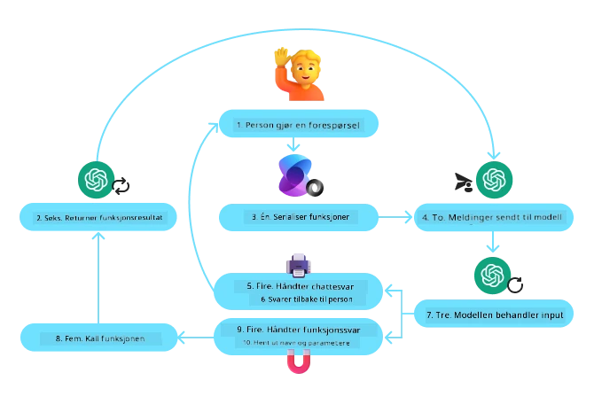
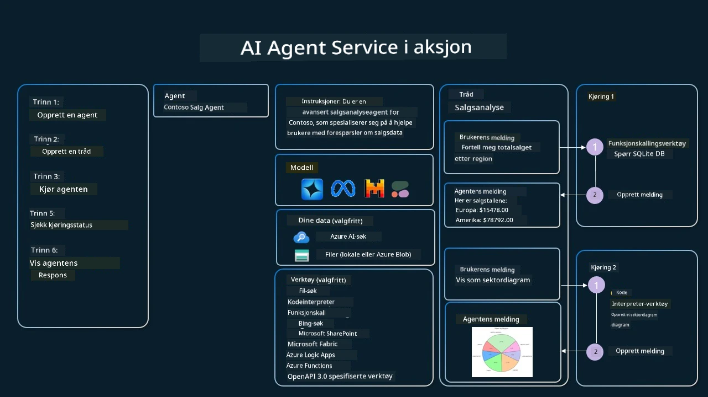

[](https://youtu.be/vieRiPRx-gI?si=cEZ8ApnT6Sus9rhn)

> _(Klikk på bildet over for å se video av denne leksjonen)_

# Designmønster for verktøybruk

Verktøy er interessante fordi de gir AI-agenter et bredere spekter av muligheter. I stedet for at agenten har et begrenset sett med handlinger den kan utføre, kan agenten utføre et bredt utvalg av handlinger ved å legge til et verktøy. I dette kapitlet vil vi se på designmønsteret for verktøybruk, som beskriver hvordan AI-agenter kan bruke spesifikke verktøy for å oppnå sine mål.

## Introduksjon

I denne leksjonen søker vi å besvare følgende spørsmål:

- Hva er designmønsteret for verktøybruk?
- Hvilke bruksområder kan det anvendes på?
- Hva er elementene/byggeklossene som trengs for å implementere designmønsteret?
- Hva er spesielle hensyn ved bruk av designmønsteret for verktøybruk for å bygge pålitelige AI-agenter?

## Læringsmål

Etter å ha fullført denne leksjonen vil du kunne:

- Definere designmønsteret for verktøybruk og dets formål.
- Identifisere bruksområder hvor designmønsteret for verktøybruk er anvendelig.
- Forstå nøkkelkomponentene som trengs for å implementere designmønsteret.
- Gjenkjenne hensyn for å sikre pålitelighet i AI-agenter som bruker dette designmønsteret.

## Hva er designmønsteret for verktøybruk?

**Designmønsteret for verktøybruk** fokuserer på å gi LLM-er mulighet til å samhandle med eksterne verktøy for å oppnå spesifikke mål. Verktøy er kode som kan kjøres av en agent for å utføre handlinger. Et verktøy kan være en enkel funksjon som en kalkulator, eller et API-kall til en tredjepartstjeneste som aksjekursoppslag eller værmelding. I sammenheng med AI-agenter er verktøy designet for å bli kjørt av agenter som svar på **modellgenererte funksjonskall**.

## Hvilke bruksområder kan det anvendes på?

AI-agenter kan bruke verktøy for å fullføre komplekse oppgaver, hente informasjon eller ta beslutninger. Designmønsteret for verktøybruk brukes ofte i scenarier som krever dynamisk interaksjon med eksterne systemer, som databaser, webtjenester eller kodefortolkere. Denne evnen er nyttig for flere ulike bruksområder, inkludert:

- **Dynamisk informasjonsinnhenting:** Agenter kan spørre eksterne API-er eller databaser for å hente oppdatert data (f.eks. spørre en SQLite-database for dataanalyse, hente aksjekurser eller værinformasjon).
- **Kodeutførelse og tolkning:** Agenter kan kjøre kode eller skript for å løse matematiske problemer, generere rapporter eller utføre simuleringer.
- **Automatisering av arbeidsflyt:** Automatisere repetitive eller flertrinns arbeidsflyter ved å integrere verktøy som oppgaveplanleggere, e-posttjenester eller datapipelines.
- **Kundesupport:** Agenter kan samhandle med CRM-systemer, supportsystemer eller kunnskapsbaser for å løse brukerhenvendelser.
- **Innholdsgenerering og redigering:** Agenter kan bruke verktøy som grammatikkkontroll, tekstoppsummering eller innholdssikkerhetsvurdering for å hjelpe med innholdsskaping.

## Hvilke elementer/byggeklosser trengs for å implementere designmønsteret for verktøybruk?

Disse byggeklossene gjør at AI-agenten kan utføre et bredt spekter av oppgaver. La oss se på nøkkelkomponentene som trengs for å implementere designmønsteret for verktøybruk:

- **Funksjons-/verktøyskjemaer**: Detaljerte definisjoner av tilgjengelige verktøy, inkludert funksjonsnavn, formål, nødvendige parametere og forventede utdata. Disse skjemaene gjør det mulig for LLM å forstå hvilke verktøy som er tilgjengelige og hvordan man skal konstruere gyldige forespørsler.

- **Logikk for funksjonsutførelse**: Styrer hvordan og når verktøy blir kalt basert på brukerens intensjon og samtalekontekst. Dette kan inkludere planleggingsmoduler, rutingsmekanismer eller betingede flyter som avgjør verktøybruk dynamisk.

- **Meldingshåndteringssystem**: Komponenter som administrerer samtaleflyten mellom brukerinnspill, LLM-svar, verktøykall og verktøyutdata.

- **Integrasjonsrammeverk for verktøy**: Infrastruktur som kobler agenten til ulike verktøy, enten det er enkle funksjoner eller komplekse eksterne tjenester.

- **Feilhåndtering og validering**: Mekanismer for å håndtere feil i verktøyutførelse, validere parametere og håndtere uventede svar.

- **Tilstandshåndtering**: Sporer samtalekontekst, tidligere verktøyinteraksjoner og vedvarende data for å sikre konsistens over flere interaksjoner.

Neste skal vi se nærmere på funksjons-/verktøyskall.
 
### Funksjons-/verktøyskall

Funksjonskall er hovedmåten vi lar store språkmodeller (LLM-er) samhandle med verktøy på. Du vil ofte se 'Funksjon' og 'Verktøy' brukt om hverandre fordi 'funksjoner' (gjenbrukbare kodesegmenter) er 'verktøyene' agenter bruker for å utføre oppgaver. For at en funksjonskode skal kunne kjøres, må en LLM sammenligne brukerens forespørsel med funksjonens beskrivelse. For å gjøre dette sendes et skjema med beskrivelsene av alle tilgjengelige funksjoner til LLM. LLM velger deretter den mest passende funksjonen for oppgaven og returnerer navnet og argumentene. Den valgte funksjonen kalles, responsen sendes tilbake til LLM, som bruker informasjonen til å svare på brukerens forespørsel.

For utviklere som skal implementere funksjonskall for agenter trenger du:

1. En LLM-modell som støtter funksjonskall
2. Et skjema med funksjonsbeskrivelser
3. Koden for hver funksjon som er beskrevet

La oss illustrere med eksemplet om å hente nåværende tid i en by:

1. **Initialiser en LLM som støtter funksjonskall:**

    Ikke alle modeller støtter funksjonskall, så det er viktig å sjekke at LLM-en du bruker gjør det.     <a href="https://learn.microsoft.com/azure/ai-services/openai/how-to/function-calling" target="_blank">Azure OpenAI</a> støtter funksjonskall. Vi kan starte med å initiere OpenAI-klienten mot Azure OpenAI **Responses API** (det stabile `/openai/v1/` endepunktet — ingen `api_version` nødvendig). 

    ```python
    # Initialize the OpenAI client for Azure OpenAI (Responses API, v1 endpoint)
    client = OpenAI(
        base_url=f"{os.environ['AZURE_OPENAI_ENDPOINT'].rstrip('/')}/openai/v1/",
        api_key=os.environ["AZURE_OPENAI_API_KEY"],
    )
    deployment_name = os.environ["AZURE_OPENAI_DEPLOYMENT"]
    ```

1. **Lag et funksjonsskjema**:

    Deretter definerer vi et JSON-skjema som inneholder funksjonsnavn, beskrivelse av hva funksjonen gjør, og navn og beskrivelser av funksjonsparametere.
    Vi bruker så dette skjemaet og sender det til klienten som ble opprettet tidligere, sammen med brukerens forespørsel om å finne tiden i San Francisco. Viktig å merke seg er at det som returneres er et **verktøyskall**, **ikke** det endelige svaret på spørsmålet. Som nevnt tidligere returnerer LLM navnet på funksjonen den valgte for oppgaven, og argumentene som skal sendes til den.

    ```python
    # Function description for the model to read (Responses API flat tool format)
    tools = [
        {
            "type": "function",
            "name": "get_current_time",
            "description": "Get the current time in a given location",
            "parameters": {
                "type": "object",
                "properties": {
                    "location": {
                        "type": "string",
                        "description": "The city name, e.g. San Francisco",
                    },
                },
                "required": ["location"],
            },
        }
    ]
    ```
   
    ```python
  
    # Initial user message
    messages = [{"role": "user", "content": "What's the current time in San Francisco"}]

    # First API call: Ask the model to use the function
    response = client.responses.create(
        model=deployment_name,
        input=messages,
        tools=tools,
        tool_choice="auto",
        store=False,
    )

    # The Responses API returns tool calls as function_call items in response.output.
    # Append them to the conversation so the model has full context on the next turn.
    messages += response.output

    print("Model's response:")
    print(response.output)
  
    ```

    ```bash
    Model's response:
    [ResponseFunctionToolCall(arguments='{"location":"San Francisco"}', call_id='call_pOsKdUlqvdyttYB67MOj434b', name='get_current_time', type='function_call')]
    ```
  
1. **Funksjonskoden som kreves for å utføre oppgaven:**

    Når LLM har valgt hvilken funksjon som skal kjøres, må koden som utfører oppgaven implementeres og kjøres.
    Vi kan implementere koden for å hente nåværende tid i Python. Vi må også skrive kode for å hente ut navn og argumenter fra response_message for å få det endelige resultatet.

    ```python
      def get_current_time(location):
        """Get the current time for a given location"""
        print(f"get_current_time called with location: {location}")  
        location_lower = location.lower()
        
        for key, timezone in TIMEZONE_DATA.items():
            if key in location_lower:
                print(f"Timezone found for {key}")  
                current_time = datetime.now(ZoneInfo(timezone)).strftime("%I:%M %p")
                return json.dumps({
                    "location": location,
                    "current_time": current_time
                })
      
        print(f"No timezone data found for {location_lower}")  
        return json.dumps({"location": location, "current_time": "unknown"})
    ```

     ```python
    # Handle function calls
    tool_calls = [item for item in response.output if item.type == "function_call"]
    if tool_calls:
        for tool_call in tool_calls:
            if tool_call.name == "get_current_time":

                function_args = json.loads(tool_call.arguments)

                time_response = get_current_time(
                    location=function_args.get("location")
                )

                # Return the tool result as a function_call_output item
                messages.append({
                    "type": "function_call_output",
                    "call_id": tool_call.call_id,
                    "output": time_response,
                })
    else:
        print("No tool calls were made by the model.")

    # Second API call: Get the final response from the model
    final_response = client.responses.create(
        model=deployment_name,
        input=messages,
        tools=tools,
        store=False,
    )

    return final_response.output_text
     ```

     ```bash
      get_current_time called with location: San Francisco
      Timezone found for san francisco
      The current time in San Francisco is 09:24 AM.
     ```

Funksjonskall er kjernen i det meste, om ikke all, design av agentverktøybruk, men det kan av og til være utfordrende å implementere det fra bunnen av.
Som vi lærte i [Leksjon 2](../../../02-explore-agentic-frameworks) tilbyr agentiske rammeverk ferdigbygde byggeklosser for å implementere verktøybruk.
 
## Eksempler på verktøybruk med agentiske rammeverk

Her er noen eksempler på hvordan du kan implementere designmønsteret for verktøybruk med ulike agentiske rammeverk:

### Microsoft Agent Framework

<a href="https://learn.microsoft.com/azure/ai-services/agents/overview" target="_blank">Microsoft Agent Framework</a> er et åpen kildekode AI-rammeverk for å bygge AI-agenter. Det forenkler prosessen med å bruke funksjonskall ved å la deg definere verktøy som Python-funksjoner med `@tool` dekoratøren. Rammeverket håndterer kommunikasjonen frem og tilbake mellom modellen og koden din. Det gir også tilgang til ferdigbygde verktøy som Fil-søk og Kodefortolker gjennom `FoundryChatClient`.

Følgende diagram illustrerer prosessen med funksjonskall i Microsoft Agent Framework:



I Microsoft Agent Framework defineres verktøy som dekorert kode. Vi kan gjøre om funksjonen `get_current_time` vi så tidligere til et verktøy ved å bruke `@tool` dekoratøren. Rammeverket vil automatisk serialisere funksjonen og dens parametere, og lage skjemaet som sendes til LLM.

```python
import os
from agent_framework import tool
from agent_framework.foundry import FoundryChatClient
from azure.identity import AzureCliCredential

@tool(approval_mode="never_require")
def get_current_time(location: str) -> str:
    """Get the current time for a given location"""
    ...

# Create the client
provider = FoundryChatClient(
    project_endpoint=os.environ["AZURE_AI_PROJECT_ENDPOINT"],
    model=os.environ["AZURE_AI_MODEL_DEPLOYMENT_NAME"],
    credential=AzureCliCredential(),
)

# Create an agent and run with the tool
agent = provider.as_agent(name="TimeAgent", instructions="Use available tools to answer questions.", tools=get_current_time)
response = await agent.run("What time is it?")
```

#### Verktøy fra en MCP-server

Verktøy trenger ikke være funksjoner i din egen kode. En server som støtter Model Context Protocol (MCP, omtalt i [Leksjon 11](../11-agentic-protocols/README.md)) publiserer sine verktøy sammen med skjemaer, og rammeverket kan laste dem på samme måte som det serialiserer en dekorert funksjon. `MCPStreamableHTTPTool` kobler til en slik server over HTTP, leser verktøyskjemaene og tilbyr dem til modellen ved siden av lokale verktøy.

Eksemplet nedenfor bruker websøkeserveren hostet av <a href="https://keenable.ai" target="_blank">Keenable</a>. Den er gratis å bruke uten konto eller API-nøkkel (forespørsler er begrenset per IP), så de eneste legitimasjonene du trenger er for din modell. Som med ethvert eksternt verktøy sendes spørringene modellen skriver til denne serveren.

```python
from agent_framework import MCPStreamableHTTPTool

web_search = MCPStreamableHTTPTool(
    name="Keenable web search",
    url="https://api.keenable.ai/mcp",
)

# Connecting loads the server's tool schemas; the agent decides when to call them
async with web_search:
    agent = provider.as_agent(
        name="ResearchAgent",
        instructions="Use available tools to answer questions.",
        tools=[web_search],
    )
    response = await agent.run("What is new in the latest Python release?")
    print(response.text)
```

Serveren publiserer to verktøy, `search_web_pages` og `fetch_page_content`. Når et spørsmål trenger oppdatert informasjon, kaller modellen `search_web_pages`, mottar titler, URL-er og tekstutsnitt, og skriver svaret sitt ut fra disse, samme sløyfe som i `get_current_time`-eksemplet over.
  
### Microsoft Foundry Agent Service

<a href="https://learn.microsoft.com/azure/ai-services/agents/overview" target="_blank">Microsoft Foundry Agent Service</a> er et nyere agentisk rammeverk designet for å gi utviklere mulighet til å sikkert bygge, distribuere og skalere høykvalitets, utvidbare AI-agenter uten å måtte administrere underliggende beregnings- og lagringsressurser. Det er særlig nyttig for bedriftsapplikasjoner siden det er en fullt administrert tjeneste med sikkerhet på bedriftsnivå.

Sammenlignet med utvikling direkte mot LLM API tilbyr Microsoft Foundry Agent Service noen fordeler, inkludert:

- Automatisk funksjonskall – ingen behov for å analysere et verktøyskall, utføre verktøyet og håndtere svaret; alt dette gjøres nå på serversiden
- Sikkert administrerte data – i stedet for å administrere egen samtalestatus kan du stole på threads for å lagre all informasjon du trenger
- Ferdigbygde verktøy – Verktøy som du kan bruke for å samhandle med datakilder, som Bing, Azure AI Search og Azure Functions.

Verktøyene som er tilgjengelige i Microsoft Foundry Agent Service deles inn i to kategorier:

1. Kunnskapsverktøy:
    - <a href="https://learn.microsoft.com/azure/ai-services/agents/how-to/tools/bing-grounding?tabs=python&pivots=overview" target="_blank">Innhenting med Bing Search</a>
    - <a href="https://learn.microsoft.com/azure/ai-services/agents/how-to/tools/file-search?tabs=python&pivots=overview" target="_blank">Fil-søk</a>
    - <a href="https://learn.microsoft.com/azure/ai-services/agents/how-to/tools/azure-ai-search?tabs=azurecli%2Cpython&pivots=overview-azure-ai-search" target="_blank">Azure AI Search</a>

2. Handlingsverktøy:
    - <a href="https://learn.microsoft.com/azure/ai-services/agents/how-to/tools/function-calling?tabs=python&pivots=overview" target="_blank">Funksjonskall</a>
    - <a href="https://learn.microsoft.com/azure/ai-services/agents/how-to/tools/code-interpreter?tabs=python&pivots=overview" target="_blank">Kodefortolker</a>
    - <a href="https://learn.microsoft.com/azure/ai-services/agents/how-to/tools/openapi-spec?tabs=python&pivots=overview" target="_blank">OpenAPI-definerte verktøy</a>
    - <a href="https://learn.microsoft.com/azure/ai-services/agents/how-to/tools/azure-functions?pivots=overview" target="_blank">Azure Functions</a>

Agenttjenesten gjør det mulig å bruke disse verktøyene sammen som en `toolset`. Den bruker også `threads` som holder oversikt over meldingers historikk i en bestemt samtale.

Tenk deg at du er en salgsagent i et selskap som heter Contoso. Du ønsker å utvikle en samtaleagent som kan svare på spørsmål om salgsdataene dine.

Følgende bilde viser hvordan du kan bruke Microsoft Foundry Agent Service til å analysere salgsdataene dine:



For å bruke noen av disse verktøyene med tjenesten kan vi lage en klient og definere et verktøy eller verktøysett. Praktisk implementert kan vi bruke følgende Python-kode. LLM vil kunne se på verktøysettet og avgjøre om den skal bruke den brukerskapte funksjonen, `fetch_sales_data_using_sqlite_query`, eller den ferdigbygde kodefortolkeren basert på brukerens forespørsel.

```python 
import os
from azure.ai.projects import AIProjectClient
from azure.identity import DefaultAzureCredential
from fetch_sales_data_functions import fetch_sales_data_using_sqlite_query # fetch_sales_data_using_sqlite_query function which can be found in a fetch_sales_data_functions.py file.
from azure.ai.projects.models import ToolSet, FunctionTool, CodeInterpreterTool

project_client = AIProjectClient.from_connection_string(
    credential=DefaultAzureCredential(),
    conn_str=os.environ["PROJECT_CONNECTION_STRING"],
)

# Initialize toolset
toolset = ToolSet()

# Initialize function calling agent with the fetch_sales_data_using_sqlite_query function and adding it to the toolset
fetch_data_function = FunctionTool(fetch_sales_data_using_sqlite_query)
toolset.add(fetch_data_function)

# Initialize Code Interpreter tool and adding it to the toolset. 
code_interpreter = CodeInterpreterTool()toolset.add(code_interpreter)

agent = project_client.agents.create_agent(
    model="gpt-5-mini", name="my-agent", instructions="You are helpful agent", 
    toolset=toolset
)
```

## Hva er spesielle hensyn ved bruk av designmønsteret for verktøybruk for å bygge pålitelige AI-agenter?

En vanlig bekymring med SQL som genereres dynamisk av LLM-er er sikkerhet, spesielt risikoen for SQL-injeksjon eller ondsinnede handlinger, som å slette eller tukle med databasen. Selv om disse bekymringene er gyldige, kan de effektivt begrenses ved korrekt konfigurasjon av databases tilgangstillatelser. For de fleste databaser innebærer dette å konfigurere databasen som skrivebeskyttet. For databaseservere som PostgreSQL eller Azure SQL bør appen ha tildelt en skrivebeskyttet (SELECT) rolle.

Å kjøre appen i et sikkert miljø gir ytterligere beskyttelse. I bedriftsmiljøer hentes data vanligvis ut og transformeres fra operative systemer til en skrivebeskyttet database eller datalager med et brukervennlig skjema. Denne tilnærmingen sikrer at dataene er sikre, optimalisert for ytelse og tilgjengelighet, og at appen har begrenset, skrivebeskyttet tilgang.

## Eksempelkoder

- Python: [Agent Framework](./code_samples/04-python-agent-framework.ipynb)
- .NET: [Agent Framework](./code_samples/04-dotnet-agent-framework.md)

## Har du flere spørsmål om designmønstrene for verktøybruk?

Bli med i [Microsoft Foundry Discord](https://discord.com/invite/ATgtXmAS5D) for å møte andre lærende, delta på kontortid og få svar på spørsmål om dine AI-agenter.

## Tilleggsressurser

- <a href="https://microsoft.github.io/build-your-first-agent-with-azure-ai-agent-service-workshop/" target="_blank">Azure AI Agents Service Workshop</a>
- <a href="https://github.com/Azure-Samples/contoso-creative-writer/tree/main/docs/workshop" target="_blank">Contoso Creative Writer Multi-Agent Workshop</a>
- <a href="https://learn.microsoft.com/azure/ai-services/agents/overview" target="_blank">Microsoft Agent Framework Oversikt</a>

## Røyktesting av denne agenten (valgfritt)

Etter at du har lært å distribuere agenter i [Leksjon 16](../16-deploying-scalable-agents/README.md), kan du røykteste `TravelToolAgent` i denne leksjonen (sjekke om den fortsatt kaller verktøyene sine og svarer?) med [`tests/lesson-04-smoke-tests.json`](../../../tests/lesson-04-smoke-tests.json). Se [`tests/README.md`](../tests/README.md) for hvordan du kjører det.

## Forrige leksjon

[Forstå agentiske designmønstre](../03-agentic-design-patterns/README.md)

## Neste leksjon

[Agentisk RAG](../05-agentic-rag/README.md)

---

<!-- CO-OP TRANSLATOR DISCLAIMER START -->
**Ansvarsfraskrivelse**:
Dette dokumentet er oversatt ved hjelp av AI-oversettelsestjenesten [Co-op Translator](https://github.com/Azure/co-op-translator). Selv om vi streber etter nøyaktighet, vær oppmerksom på at automatiske oversettelser kan inneholde feil eller unøyaktigheter. Det opprinnelige dokumentet på originalspråket skal betraktes som den autoritative kilden. For kritisk informasjon anbefales profesjonell menneskelig oversettelse. Vi er ikke ansvarlige for eventuelle misforståelser eller feiltolkninger som oppstår ved bruk av denne oversettelsen.
<!-- CO-OP TRANSLATOR DISCLAIMER END -->