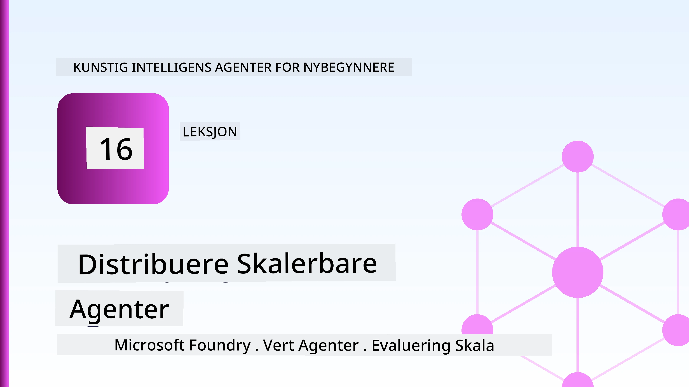
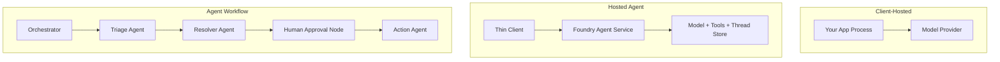
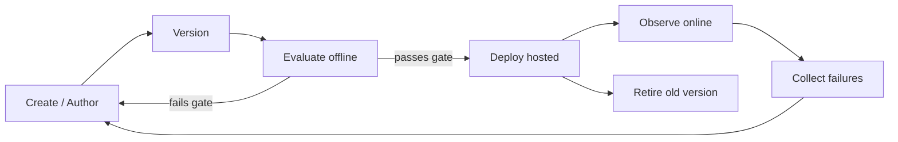
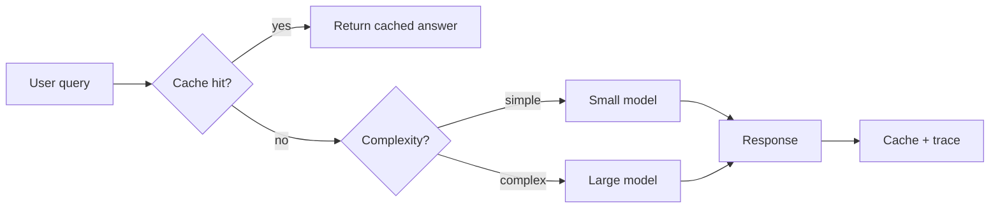
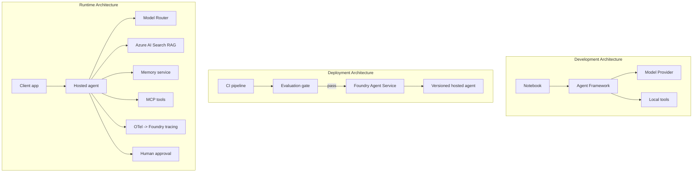

# Distribuere skalerbare agenter med Microsoft Foundry



Inntil nå i kurset har du bygget agenter som kjører på laptopen din, inne i en notatbok, drevet av `az login` og et knippe miljøvariabler. Det er akkurat den rette måten å lære på. Det er ikke den rette måten å kjøre en agent på som tusenvis av kunder er avhengige av klokka 3 om natten.

Denne leksjonen handler om gapet mellom "det fungerer på min maskin" og "det fungerer pålitelig og rimelig i produksjon." Vi lukker det gapet ved hjelp av **Microsoft Foundry** og **Microsoft Foundry Agent Service**, og vi gjør det ved å bygge en ekte kundestøtteagent som har verktøy, henting, hukommelse, evaluering og overvåkning.

## Introduksjon

Denne leksjonen vil dekke:

- Forskjellen mellom en **prototype-agent** og en **distribuert agent**, og hvorfor overgangen mest handler om alt *rundt* modellen.
- **Distribusjonsmønstre** for agenter: klient-hostet, tjeneste-hostet (Hosted Agents), og arbeidsflyt-orchestrert.
- **Agentens livssyklus** på Microsoft Foundry — opprett, versjoner, distribuer, evaluer, observer, avvikle.
- **Skaleringsstrategier**: modellruting, caching, samtidighet og tilstandsløst design.
- **Observerbarhet** med OpenTelemetry og Foundry tracing.
- **Kostnadsoptimalisering** gjennom modellvalg, ruting og evalueringsporter.
- **Virksomhetshensyn**: styring, menneskelig godkjenning, og sikker kjøring av MCP-servere i produksjon.

## Læringsmål

Etter å ha fullført denne leksjonen, vil du kunne:

- Velge riktig distribusjonsmønster for en gitt agentarbeidsmengde.
- Distribuere en agent til Microsoft Foundry Agent Service slik at den er versjonert, styrt og observerbar.
- Instrumentere en agent for tracing og koble opp en evalueringspipeline som kjører før hver utgivelse.
- Bruke modellruting og caching for å holde ventetid og kostnad under kontroll i stor skala.
- Legge til en menneskelig godkjenningsport for handlinger med høy risiko og integrere en MCP-server på en produksjonssikker måte.

## Forutsetninger

Denne leksjonen antar at du har fullført tidligere leksjoner og er komfortabel med:

- Å bygge agenter med [Microsoft Agent Framework](../14-microsoft-agent-framework/README.md) (Leksjon 14).
- [Bruk av verktøy](../04-tool-use/README.md) (Leksjon 4) og [Agentic RAG](../05-agentic-rag/README.md) (Leksjon 5).
- [Agent Memory](../13-agent-memory/README.md) (Leksjon 13) og [Agentic Protocols / MCP](../11-agentic-protocols/README.md) (Leksjon 11).
- [Observerbarhet og evaluering](../10-ai-agents-production/README.md) (Leksjon 10) — denne leksjonen bygger direkte videre på den.

Du vil også trenge:

- Et **Azure-abonnement** og et **Microsoft Foundry-prosjekt** med minst én distribuert chatmodell.
- Den **Azure CLI** autentisert (`az login`).
- Python 3.12+ og pakkene i depotet [`requirements.txt`](../../../requirements.txt).

## Fra prototype til produksjon: Hva som faktisk endres

En prototype-agent og en produksjonsagent deler samme kjerneloop — resonner, kall verktøy, svar. Det som endres er alt som omgir denne loopen. Modellen utgjør kanskje 20 % av en produksjonsagent; de resterende 80 % er den operative skjelettet.

| Bekymring | Prototype | Produksjon |
| --- | --- | --- |
| **Hosting** | Kjører i notatboken din | Kjører som en hostet tjeneste, versjonert og utrullet |
| **Identitet** | Din `az login` token | Administrert identitet med avgrenset RBAC |
| **Tilstand** | I minnet, mistes ved omstart | Eksternalisert (thread store, hukommelsestjeneste) |
| **Feil** | Du ser traceback | Forsøk på nytt, fallback, dead-letter, varsler |
| **Kostnad** | "Det koster noen få cent" | Sporbar per forespørsel, rutet, cached, budsjettert |
| **Kvalitet** | Du vurderer utdataene visuelt | Automatisk evaluert før hver utgivelse |
| **Tillitt** | Du godkjenner hver handling | Policy + menneske-i-løkken for risikable handlinger |

Hold dette tabellen i tankene. Hver seksjon nedenfor svarer til en av disse radene.

## Agent Distribusjonsmønstre

Det finnes tre mønstre du vil bruke, ofte i kombinasjon.

### 1. Klient-hostede agenter

Agentobjektet lever inne i *din* applikasjonsprosess. Koden din kaller modellleverandøren direkte; resonnement-loopen kjører i tjenesten din. Dette er hva hver tidligere leksjon har gjort.

- **Bruk det når** du trenger full kontroll over loopen, egendefinert mellomvare, eller du bygger inn agenten i en eksisterende backend.
- **Avveiing**: du eier selv skalering, tilstand og robusthet.

### 2. Hostede agenter (Foundry Agent Service)

Agenten er *registrert som en ressurs* i Microsoft Foundry. Foundry hoster resonnement-loopen, lagrer tråder, håndhever innholdssikkerhet og RBAC, og gjør agenten synlig i Foundry-portalen. Appen din blir en tynn klient som oppretter tråder og leser responser.

- **Bruk det når** du ønsker holdbarhet, innebygd observerbarhet, styring, og mindre operativt overflateareal.
- **Avveiing**: mindre lavnivåkontroll til gjengjeld for en administrert kjøretid.

### 3. Agentarbeidsflyter

Flere agenter (og verktøy) komponeres til en graf med eksplisitt kontrollflyt — sekvensielle steg, forgrening, menneskelig godkjenningsnoder, og holdbare sjekkpunkter som kan pause og gjenoppta. Dette er Microsoft Agent Frameworks **Workflows**-funksjonalitet anvendt i distribusjonsskala.

- **Bruk det når** en enkelt oppgave spenner over flere spesialiserte agenter eller krever et godkjenningssteg midt i prosessen.
- **Avveiing**: flere bevegelige deler; trenger observasjon på orkestreringsnivå.



## Agentens livssyklus på Microsoft Foundry

Å distribuere en agent er ikke en engangshendelse `push`. Det er en loop, og den ligner mye på en programvareutgivelsessyklus fordi det nettopp er det.



Hovedideen, tatt fra [Leksjon 10](../10-ai-agents-production/README.md): **offline evaluering er en port, ikke en ettertanke.** En ny agentversjon sendes ikke ut med mindre den klarer dine evalueringsgrenser. Online observerbarhet sender så virkelige feil tilbake til din offline testsett. Det er hele loopen.

## Skaleringsstrategier

Skalering av en agent er annerledes enn å skalere en tilstandsløs web-API, fordi hver forespørsel kan utløse flere kostbare modell- og verktøykall. Fire teknikker bærer det meste av belastningen.

**Tilstandsløs forespørselshåndtering.** Hold ingen per-bruker-tilstand i prosessminnet ditt. Persistér samtaletråder i Foundry sin thread store eller en hukommelsestjeneste slik at enhver instans kan håndtere hvilken som helst forespørsel. Dette gjør at du kan skalere horisontalt — legg til instanser, ingen sticky sessions.

**Modellruting.** Ikke alle forespørsler trenger din mest kapable (og dyreste) modell. Ruter enkle forespørsler — intensjonsklassifisering, korte faktuelle svar — til en liten, rask modell, og reserver den store modellen for ekte resonnement. Foundrys **Model Router** kan gjøre dette for deg, eller du kan implementere en lettvektsklassifiserer selv. Du vil bygge DIY-versjonen i labben.

**Cache av responser.** Mange støtteforespørsler er nær-duplikater ("hvordan tilbakestiller jeg passordet mitt?"). Cache svar til vanlige spørsmål og server dem uten å ringe modellen i det hele tatt. Selv en beskjeden cache-hit-rate reduserer kostnad og ventetid betydelig.

**Samtidighet og backpressure.** Modellleverandører har hastighetsgrenser. Begrens samtidighet, bruk forsøk på nytt med eksponentiell backoff, og feile grasiøst (en køet "vi jobber med det"-respons er bedre enn en 500).



## Observerbarhet i produksjon

Du kan ikke drive det du ikke kan se. Som dekket i Leksjon 10, sender Microsoft Agent Framework ut **OpenTelemetry** traces nativt — hvert modellkall, verktøysanrop og orkestreringssteg blir et span. I produksjon eksporterer du disse spanene til Microsoft Foundry (eller hvilken som helst OTel-kompatibel backend) slik at du kan:

- Spore en enkelt kundehenvendelse ende-til-ende over hvert modell- og verktøysanrop.
- Overvåke p50/p95 ventetid og kostnad per forespørsel over tid.
- Varsle om feilrater, topper og kostnadsanomalier før brukerne dine (eller økonomiteamet ditt) oppdager det.

```python
from agent_framework.observability import get_tracer

tracer = get_tracer()

with tracer.start_as_current_span("support_request") as span:
    span.set_attribute("customer.tier", "enterprise")
    span.set_attribute("routed.model", "gpt-5-nano")
    # agent execution is traced automatically inside this span
```

Attributter som `customer.tier` og `routed.model` er det som forvandler en vegg av traces til svarbare spørsmål ("blir bedriftskundene for ofte rutet til den lille modellen?").

## Kostnadsoptimalisering

Kostnader i produksjonsagenter domineres av tokens. Tre spaker, i rekkefølge av innvirkning:

1. **Riktig dimensjonering av modellen.** En liten modell som passerer din evalueringsport er nesten alltid billigere enn en stor som også passerer. Bruk evaluering for å *bevise* at den lille modellen er god nok, i stedet for å som standard velge den største for sikkerhets skyld.
2. **Rute etter kompleksitet.** Som nevnt — betal stor-modell-pris kun for forespørsler som trenger stor-modell-resonnement.
3. **Cache aggressivt.** Det billigste modellkallet er det du aldri utfører.

Evalueringsporter og kostnadskontroll er samme disiplin sett fra to vinkler: evaluering sier deg *kvalitetsgulvet*, ruting og caching holder deg så nær dette gulvets *kostnad* som mulig.

## Virksomhetsdistribusjonsbetraktninger

**Styring.** Hostede agenter arver Foundrys RBAC, innholdssikkerhet og revisjonslogg. Gi hver agent en administrert identitet med minst mulig privilegier den trenger — lesetilgang til kunnskapsbasen, begrenset tilgang til ticketing-API, ikke mer.

**Menneske-i-løkken.** Noen handlinger er for viktige til å automatiseres uten videre — utstede refusjon, slette konto, eskalere til juridisk team. Microsoft Agent Framework støtter **godkjenningspliktige** verktøy: agenten foreslår handlingen, utføringen pause, et menneske godkjenner eller avviser, og arbeidsflyten gjenopptas. Du så premisset i [Leksjon 6](../06-building-trustworthy-agents/README.md); her distribuerer du det.

**MCP i produksjon.** [MCP](../11-agentic-protocols/README.md) lar agenten din konsumere eksterne verktøy gjennom en standardgrensesnitt. I produksjon betrakt hver MCP-server som en uautoristert grense: fest serverversjon, kjør den med en avgrenset identitet, valider utdata, og eksponer aldri hemmeligheter for den. En MCP-server er en avhengighet, og avhengigheter må patches, revideres og rate-begrenses.



De tre diagrammene — utvikling, distribusjon, kjøretid — er samme agent i tre stadier av livet. Labben som følger veileder deg gjennom å bygge det.

## Praktisk lab: En produksjonsklar kundestøtteagent

Åpne [`code_samples/16-python-agent-framework.ipynb`](./code_samples/16-python-agent-framework.ipynb) og arbeid deg gjennom det fra start til slutt. Du vil sette sammen en **Contoso kundestøtteagent** med alle produksjonsbekymringer koblet inn:

1. **Verktøyskall** — slå opp ordrestatus og åpne supportsaker.
2. **RAG** — svar på policyspørsmål fra en kunnskapsbase (Azure AI Search, med en minnebasert fallback så notatboken kjører uten en Search-ressurs).
3. **Hukommelse** — husk kunden gjennom samtalens turer.
4. **Modellruting** — en kompleksitetsklassifiserer ruter hver forespørsel til liten eller stor modell.
5. **Cache av svar** — gjentatte spørsmål serveres fra cache.
6. **Menneskelig godkjenning** — refusjoner over en terskel pause for menneskelig godkjenning.
7. **Evalueringspipeline** — et lite offline testsett scorer agenten og fungerer som en utgivelsesport.
8. **Observerbarhet** — OpenTelemetry tracing rundt hver forespørsel.

### Gjennomgang

Notatboken er organisert slik at hver produksjonsbekymring er en selvstendig, kjørbar seksjon. Kjernen er den ruting- og caching-request handleren:

```python
async def handle_support_request(query: str, customer_id: str) -> str:
    # 1. Serve from cache when we can.
    cached = response_cache.get(normalize(query))
    if cached:
        return cached

    # 2. Route by complexity to control cost.
    model = "gpt-5-nano" if is_simple(query) else "gpt-5-mini"

    # 3. Run the agent inside a trace span for observability.
    with tracer.start_as_current_span("support_request") as span:
        span.set_attribute("routed.model", model)
        span.set_attribute("customer.id", customer_id)
        response = await support_agent.run(query, model=model)

    # 4. Cache and return.
    response_cache.set(normalize(query), response.text)
    return response.text
```

Evalueringsporten som vokter en utgivelse ser slik ut:

```python
async def evaluation_gate(agent, test_cases, threshold: float = 0.8) -> bool:
    passed = 0
    for case in test_cases:
        result = await agent.run(case["input"])
        if score_response(result.text, case["expected"]) >= 0.8:
            passed += 1
    pass_rate = passed / len(test_cases)
    print(f"Evaluation pass rate: {pass_rate:.0%} (gate: {threshold:.0%})")
    return pass_rate >= threshold  # only deploy if the gate passes
```

Les hver linje — notatboken holder primitive bevisst små slik at ingenting skjules bak et rammeverkskall.

## Validere en distribuert agent med røyktester

Evalueringsporten over kjøres *offline* mot agentobjektet ditt. Når agenten er distribuert som Hosted Agent, trenger du en siste, enda rimeligere sjekk: **svarer det distribuerte endepunktet faktisk?**

Å distribuere "suksessfullt" beviser bare at kontrollplanet aksepterte definisjonen — det beviser ikke at agenten svarer. En manglende avhengighet, dårlig modellruting eller utløpt tilkobling kan gi en grønn distribusjon som ikke returnerer noe. En **røyktest** fanger det på sekunder, ved hver distribusjon, uten kostnaden av full evaluering.

Dette depotet leverer en klar-til-bruk røyktest pipeline bygget på [AI Smoke Test](https://github.com/marketplace/actions/ai-smoke-test) GitHub Action:

- **Katalog** — [`tests/lesson-16-smoke-tests.json`](../../../tests/lesson-16-smoke-tests.json) inneholder prompts og påstander for Contoso støtteagent (grunnfestede policy-svar, ordreresultat, holde seg til tema, og multi-turn trådkontinuitet). Kataloger for andre leksjoners agenter ligger ved siden av — se [`tests/README.md`](../tests/README.md).
- **Arbeidsflyt** — [`.github/workflows/smoke-test.yml`](../../../.github/workflows/smoke-test.yml) logger inn med Azure OIDC og sender POST for hver prompt til agentens Responses-endepunkt, og feiler jobben ved noen påstand ikke stemmer.

```yaml
- name: Smoke-test hosted agent
  uses: JFolberth/ai-smoketest@v1
  with:
    project_endpoint: ${{ inputs.project_endpoint }}
    agent_name: ContosoSupportAgent
    tests_file: tests/lesson-16-smoke-tests.json
```

Kjør det fra **Actions**-fanen når agenten din er distribuert, og oppgi endepunktet for Foundry-prosjektet og agentnavnet ditt. Den fødererende identiteten trenger rollen **Azure AI User** på Foundry-prosjektomfanget. Tenk på lagene som en pyramide: røyktester (er det tilgjengelig og svarer?) kjøres ved hver distribusjon, offline evaluering (godt nok til lansering?) kjøres før promotering, og online evaluering (hvordan fungerer det i praksis?) kjøres kontinuerlig.

## Kunnskapstest

Test din forståelse før du går videre til oppgaven.

**1. Omtrent hvor mye av en produksjonsagent er "modellen," og hva er resten?**

<details>
<summary>Svar</summary>

Modellen er en minoritet av systemet — ofte anslått til rundt 20%. Resten er det operative skjelettet: hosting og versjonering, identitet og RBAC, ekstern tilstand, håndtering av feil, kostnadssporing, evaluering og menneskelig kontroll i løkken. Overgangen til produksjon handler mest om å bygge alt *rundt* resonansløkken.
</details>

**2. Når ville du valgt en Hosted Agent fremfor en klient-hostet agent?**

<details>
<summary>Svar</summary>

Når du ønsker et administrert kjøremiljø med innebygd varighet (tråder som vedvarer og kan gjenopptas), observabilitet, innholdssikkerhet og RBAC, og du er villig til å bytte bort noe lavnivåkontroll av resonansløkken for et mindre operasjonelt område. Klient-hostet er å foretrekke når du trenger full kontroll over løkken eller integrerer agenten i en eksisterende backend.
</details>

**3. Hvorfor må en skalerbar agent være stateless i sin egen prosessminne?**

<details>
<summary>Svar</summary>

Slik at enhver instans kan håndtere en hvilken som helst forespørsel, noe som tillater horisontal skalering uten "sticky sessions". Per-bruker samtaletilstand eksternaliseres til en trådlagring eller minnetjeneste. Hvis tilstanden lå i prosessminnet, ville du mistet den ved omstart og ikke kunne fordele belastningen fritt.
</details>

**4. Hvilket problem løser modellrouting, og hvordan relaterer det seg til evaluering?**

<details>
<summary>Svar</summary>

Routing sender enkle forespørsler til en liten, billig og rask modell og reserverer den store modellen til ekte resonnering, noe som kontrollerer både ventetid og kostnad. Det relaterer til evaluering fordi evaluering er det som *beviser* at den lille modellen er god nok for en klasse av forespørsler — routing uten evaluering er gjetting.
</details>

**5. Hva er en "evalueringsport" og hvor i livssyklusen befinner den seg?**

<details>
<summary>Svar</summary>

En evalueringsport kjører en offline testsekvens mot en ny agentversjon og blokkerer distribusjon med mindre passfrekvensen passerer en terskel. Den ligger mellom "versjon" og "distribusjon" i livssyklusen, og gjør kvalitet til en forutsetning for utgivelse snarere enn noe du sjekker etter lansering.
</details>

**6. Hvorfor bør en MCP-server behandles som en ikke-tillitelig grense i produksjon?**

<details>
<summary>Svar</summary>

Fordi det er en ekstern avhengighet agenten din kaller til. Du bør feste versjonen, kjøre den med en avgrenset identitet, validere utdataene, rate-limite den, og aldri eksponere hemmeligheter for den — samme disiplin som for enhver tredjepartsavhengighet. Dens utdata flyter inn i agentens resonnering, så utvalgt tillit uten validering er en sikkerhetsrisiko.
</details>

**7. Hvilken enkelt endring har vanligvis størst innvirkning på kostnaden for produksjonsagenten, og hvorfor?**

<details>
<summary>Svar</summary>

Riktig dimensjonering av modellen — å bruke den minste modellen som fortsatt passerer din evalueringsport. Kostnad domineres av tokens, og en mindre modell som møter kvalitetskravet er nesten alltid billigere enn en større. Caching og routing reduserer deretter kostnadene ytterligere, men valg av riktig basismodell har den største førsteordenseffekten.
</details>

**8. Hvilken rolle spiller spennegenskaper som `customer.tier` og `routed.model` i observabilitet?**

<details>
<summary>Svar</summary>

De gjør rå spor til besvarbare forretningsspørsmål. Uten egenskaper har du en vegg av spenner; med dem kan du spørre "blir bedriftskunder rutet til den lille modellen for ofte?" eller "hvilken modell håndterer våre tregeste forespørsler?" Egenskaper er hvordan du skjærer telemetri etter de dimensjonene som er viktige for driften din.
</details>

## Oppgave

Ta kundestøtteagenten fra laboratoriet og forsterk den for et spesifikt scenario: **en abonnementsfakturerings-støtteagent for et SaaS-selskap.**

Innsendingen din skal:

1. **Erstatte verktøyene** med faktureringsrelevante: `get_subscription_status`, `get_invoice`, og `issue_credit` (kreditter over $50 krever menneskelig godkjenning).
2. **Legge til tre RAG-dokumenter** som dekker selskapets refusjonspolicy, faktureringssyklus og avbestillingspolicy.
3. **Utvide evalueringssettet** til minst åtte saker, inkludert minst to som *bør* utløse menneskelig godkjenningsbane, og bekrefte at evalueringsporten din korrekt godkjenner eller avviser.
4. **Legge til en kostnadsrapport**: etter å ha kjørt ti blandede forespørsler gjennom agenten, skriv ut hvor mange som gikk til den lille modellen, hvor mange til den store modellen, og hvor mange som ble servert fra cache.

Skriv et kort avsnitt (i en markdown-celle) som forklarer hvilken modellroutingregel du valgte og hvordan du ville validere den med ekte trafikk. Det finnes ikke ett riktig svar — du vurderes på om produksjonsbekymringene er sammenkoblet logisk.

## Sammendrag

I denne leksjonen flyttet du en agent fra prototype til produksjon med Microsoft Foundry:

- Overgangen til produksjon handler mest om **det operative skjelettet** rundt modellen — hosting, identitet, tilstand, feilbehandling, kostnad, kvalitet og tillit.
- Du lærte de tre **distribusjonsmønstrene** — klient-hostet, Hosted Agents, og Agent Workflows — og når hvert passer.
- Du gikk gjennom **agentens livssyklus**, der offline **evaluering fungerer som en utgivelsesport** og online observabilitet sender feil tilbake til testsettet.
- Du brukte **skaleringsstrategier** — stateless design, modellrouting, caching og begrenset samtidighet — og koblet dem til **kostnadsoptimalisering**.
- Du koblet inn **virksomhetskontroller**: RBAC, menneskelig godkjenning i løkken, og produksjonssikker MCP-integrasjon.
- Du bygde en **produksjonsklar kundestøtteagent** som knytter sammen alle disse hensynene i kjørbar kode.

Neste leksjon tar den motsatte reisen: i stedet for å skalere agenter opp i skyen, vil du bringe dem *ned* på en enkel utviklermaskin og kjøre dem helt lokalt.

## Ekstra ressurser

- <a href="https://learn.microsoft.com/azure/ai-foundry/what-is-azure-ai-foundry" target="_blank">Microsoft Foundry dokumentasjon</a>
- <a href="https://learn.microsoft.com/azure/ai-foundry/agents/overview" target="_blank">Oversikt over Microsoft Foundry Agent Service</a>
- <a href="https://learn.microsoft.com/en-us/agent-framework/overview/?wt.mc_id=youtube_26688_organicsocial_reactor&pivots=programming-language-python" target="_blank">Microsoft Agent Framework</a>
- <a href="https://learn.microsoft.com/en-us/azure/ai-foundry/openai/concepts/model-router" target="_blank">Model Router i Microsoft Foundry</a>
- <a href="https://learn.microsoft.com/azure/search/search-what-is-azure-search" target="_blank">Azure AI Search</a>
- <a href="https://opentelemetry.io/" target="_blank">OpenTelemetry</a>
- <a href="https://github.com/marketplace/actions/ai-smoke-test" target="_blank">AI Smoke Test GitHub Action</a>
- <a href="https://modelcontextprotocol.io/" target="_blank">Model Context Protocol (MCP)</a>

## Forrige leksjon

[Bygge Computer Use Agents (CUA)](../15-browser-use/README.md)

## Neste leksjon

[Opprette lokale AI-agenter](../17-creating-local-ai-agents/README.md)

---

<!-- CO-OP TRANSLATOR DISCLAIMER START -->
**Ansvarsfraskrivelse**:
Dette dokumentet er oversatt ved hjelp av AI-oversettelsestjenesten [Co-op Translator](https://github.com/Azure/co-op-translator). Selv om vi streber etter nøyaktighet, vær oppmerksom på at automatiske oversettelser kan inneholde feil eller unøyaktigheter. Det opprinnelige dokumentet på originalspråket skal betraktes som den autoritative kilden. For kritisk informasjon anbefales profesjonell menneskelig oversettelse. Vi er ikke ansvarlige for eventuelle misforståelser eller feiltolkninger som oppstår ved bruk av denne oversettelsen.
<!-- CO-OP TRANSLATOR DISCLAIMER END -->