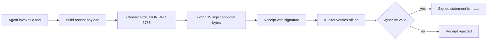
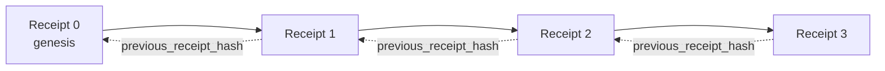

[Se leksjonsvideoen: Sikre AI-agenter med kryptografiske kvitteringer](https://youtu.be/PLACEHOLDER_VIDEO_ID)

> _(Leksjonsvideo og miniatyrbilde vil bli lagt til av Microsofts innholdsteam etter sammenslåing, i samsvar med mønsteret for leksjon 14 / 15.)_

# Sikre AI-agenter med kryptografiske kvitteringer

## Introduksjon

Denne leksjonen vil dekke:

- Hvorfor revisjonsspor for AI-agenter er viktige for samsvar, feilsøking og tillit.
- Hva en kryptografisk kvittering er og hvordan den skiller seg fra en usignert logglinje.
- Hvordan produsere en signert kvittering for et agents verktøysanrop i vanlig Python.
- Hvordan verifisere en kvittering offline og oppdage manipulasjon.
- Hvordan lenke kvitteringer slik at fjerning eller omorganisering av en bryter kjeden.
- Hva kvitteringer beviser og hva de eksplisitt ikke beviser.

## Læringsmål

Etter å ha fullført denne leksjonen vil du kunne:

- Identifisere feiltyper som motiverer kryptografisk provenance for agenthandlinger.
- Produsere en Ed25519-signet kvittering over et kanonisk JSON-payload.
- Verifisere en kvittering uavhengig ved kun å bruke signatarens offentlige nøkkel.
- Oppdage manipulasjon ved å kjøre verifikasjonen på nytt på en modifisert kvittering.
- Bygge en hash-kjedet sekvens av kvitteringer og forklare hvorfor kjeden er viktig.
- Gjenkjenne grensen mellom hva kvitteringer beviser (attribusjon, integritet, rekkefølge) og hva de ikke gjør (korrektheten av handlingen, gyldigheten av policyen).

## Problemet: Agentens revisjonsspor

Tenk deg at du har satt opp en AI-agent for Contoso Travel. Agenten leser kundeforespørsler, kaller en flyreise-API for å finne alternativer, og bestiller seter på vegne av kunden. Forrige kvartal behandlet agenten 50 000 bestillinger.

I dag kommer en revisor. De stiller et enkelt spørsmål: "Vis meg hva agenten din gjorde."

Du gir dem loggfilene dine. Revisoren ser på dem og stiller det vanskeligere spørsmålet: "Hvordan vet jeg at disse loggene ikke er redigert?"

Dette er revisjonsspor-problemet. De fleste agentdistribusjoner i dag baserer seg på:

- **Applikasjonslogger**: skrevet av agenten selv, redigerbare for hvem som helst med filsystemtilgang.
- **Skytjenestens loggtjenester**: manipulasjons-evidente på plattformnivå, men bare hvis revisor stoler på plattformoperatøren.
- **Databasetransaksjonslogger**: godt egnet for databaseendringer, men ikke for vilkårlige verktøysanrop.

Ingen av disse kan svare på revisors spørsmål uten at revisor må stole på noen (deg, skyleverandøren, databaseleverandøren). For intern bruk er denne tilliten ofte akseptabel. For regulerte arbeidsbelastninger (finans, helsevesen, alt som omfattes av EUs AI-lov) er den ikke det.

Kryptografiske kvitteringer snevrer inn dette problemet ved å gjøre en signert uttalelse uavhengig verifiserbar. Revisor trenger fortsatt en ekstern grunn til å stole på signeringsnøkkelen og komponenten som produserte uttalelsen. En innebygd nøkkel beviser selvkonsistens, ikke utstederidentitet eller håndhevingsplassering.


## Hva er en kryptografisk kvittering?

En kvittering er et JSON-objekt som registrerer hva en agent gjorde, signert med en digital signatur.



En minimal kvittering ser slik ut:

```json
{
  "type": "agent.tool_call.v1",
  "agent_id": "contoso-travel-bot",
  "tool_name": "lookup_flights",
  "tool_args_hash": "sha256:a3f9c1...",
  "result_hash": "sha256:7b2e1d...",
  "policy_id": "contoso-travel-policy-v3",
  "timestamp": "2026-04-25T14:30:00Z",
  "sequence": 47,
  "previous_receipt_hash": "sha256:9d4e6a...",
  "signature": {
    "alg": "EdDSA",
    "sig": "c5af83...",
    "public_key": "8f3b2c..."
  }
}
```

Tre egenskaper gjør jobben:

1. **Signaturen**. Kvitteringen signeres av agentens gateway med en Ed25519 privat nøkkel. Alle med tilhørende offentlig nøkkel kan verifisere signaturen offline. En avhengig part må pinne den nøkkelen eller hente den fra et pålitelig register utenfor kvitteringen. Manipulering av noe signert felt ugyldiggjør signaturen.

2. **Kanonisk koding**. Før signering serialiseres kvitteringen med JSON Canonicalization Scheme (JCS, RFC 8785). Dette sikrer at to implementasjoner som produserer samme logiske kvittering også produserer helt identisk byteoutput. Uten kanonisering ville ulike JSON-serializere gi forskjellige signaturer for samme innhold.

3. **Hash-kjededlenke**. `previous_receipt_hash`-feltet kobler hver kvittering til den foregående. Fjerning eller omorganisering bryter sekvensen som vises. Å oppdage avkorting eller en signatarstyrt omskriving krever også en pina nåværende kjedehode, en uavhengig vitnet sjekkpunkt, eller autentisert lukket-populasjonsforpliktelse.

Samlet gir disse egenskapene tre garantier:

- **Attribusjon til en nøkkel**: denne nøkkelen signerte dette innholdet. Organisatorisk eller menneskelig identitet krever en betrodd nøkkelbinding.
- **Integritet**: innholdet har ikke endret seg siden signering.
- **Rekkefølge innenfor den verifiserte sekvensen**: denne kvitteringen lenker til forløperen.

## Produksjon av kvittering i Python

Du trenger ikke et spesielt bibliotek for å produsere en kvittering. De kryptografiske primitive er allment tilgjengelige og logikken er noen dusin linjer med Python.

De praktiske øvelsene i `code_samples/18-signed-receipts.ipynb` går gjennom hele flyten. Kildekontrollerte `code_samples/18-signed-receipts.execution-receipt.json` registrerer nøyaktig notebook-hash, Python-miljø, celleantall og sjekker fra siste rene kjøring uten å endre lagrede leksjonsresultater. Oppsummeringen:

```python
import json
import hashlib
import base64
from nacl import signing
from jcs import canonicalize  # RFC 8785 canonical JSON

def b64url_nopad(data: bytes) -> str:
    return base64.urlsafe_b64encode(data).decode("ascii").rstrip("=")

def sha256_canonical(obj) -> str:
    """SHA-256 of a Python object's JCS-canonical JSON form."""
    return f"sha256:{hashlib.sha256(canonicalize(obj)).hexdigest()}"

# Generate or load a signing key (in production, store in a key vault)
signing_key = signing.SigningKey.generate()
verify_key = signing_key.verify_key
TRUSTED_PUBLIC_KEYS = {b64url_nopad(bytes(verify_key))}  # pinned out of band by the verifier

# Build the receipt payload (no signature yet)
tool_args = {"origin": "SYD", "destination": "LAX"}
tool_result = [{"flight": "QF11", "price": 1850, "stops": 0}]

payload = {
    "type": "agent.tool_call.v1",
    "agent_id": "contoso-travel-bot",
    "tool_name": "lookup_flights",
    "tool_args_hash": sha256_canonical(tool_args),
    "result_hash": sha256_canonical(tool_result),
    "policy_id": "contoso-travel-policy-v3",
    "timestamp": "2026-04-25T14:30:00Z",
    "sequence": 0,
    "previous_receipt_hash": None,
}

# Canonicalize and sign the JCS bytes directly. PureEdDSA hashes internally.
canonical_bytes = canonicalize(payload)
signature_bytes = signing_key.sign(canonical_bytes).signature

# Attach a structured signature object.
receipt = {
    **payload,
    "signature": {
        "alg": "EdDSA",
        "sig": b64url_nopad(signature_bytes),
        "public_key": b64url_nopad(bytes(verify_key)),
    },
}
```

Det er hele signeringspipeline. Øvelsene i notatboken går gjennom hvert trinn.

## Verifisere en kvittering og oppdage manipulasjon

Verifisering er den inverse operasjonen:

```python
import base64
import hashlib
from nacl import signing
from nacl.exceptions import CryptoError
from jcs import canonicalize

def b64url_decode(s: str) -> bytes:
    padding = "=" * ((4 - len(s) % 4) % 4)
    return base64.b64decode(s + padding, altchars=b"-_", validate=True)

def verify_receipt(receipt: dict, trusted_public_keys: set[str]) -> bool:
    # The signature is a structured object: {"alg", "sig", "public_key"}.
    if not isinstance(receipt, dict):
        return False
    sig_obj = receipt.get("signature")
    if not isinstance(sig_obj, dict) or sig_obj.get("alg") != "EdDSA":
        return False
    try:
        # An inline key proves only self-consistency. Trust is configured out of band.
        public_key = sig_obj.get("public_key")
        signature = sig_obj.get("sig")
        if not isinstance(public_key, str) or not isinstance(signature, str):
            return False
        if public_key not in trusted_public_keys:
            return False
        payload = {k: v for k, v in receipt.items() if k != "signature"}
        canonical_bytes = canonicalize(payload)
        verify_key = signing.VerifyKey(b64url_decode(public_key))
        verify_key.verify(canonical_bytes, b64url_decode(signature))
        return True
    except (CryptoError, TypeError, ValueError, KeyError, OverflowError):
        return False
```

Denne funksjonen tar en kvittering pluss den avhengige partens pinned nøkkelsett og returnerer
`True` bare hvis signaturen er gyldig under en akseptert nøkkel. Verifisering krever ingen
nettverkskall, men nøkkeltillit er fortsatt en ekstern konfigurasjonsbeslutning.

For å se manipulasjonsdeteksjon i praksis, går notatboken gjennom:

1. Produksjon av en gyldig kvittering og bekrefte at den verifiseres.
2. Endre én byte i `tool_args_hash`-feltet.
3. Kjør på nytt verifisering og se at den feiler.

Dette er den praktiske demonstrasjonen på at kvitteringer er manipulasjons-evidente: enhver endring, uansett liten, bryter signaturen.

## Kjedede kvitteringer for flerstegs-agenter

En enkelt signert kvittering beskytter én handling. En kjede av kvitteringer beskytter en sekvens.



Hver kvittering oppgir hashen til den forrige kvitteringen. For å fjerne kvittering 2 stille, må en angriper enten:

- Endre kvittering 3 sitt `previous_receipt_hash`-felt (bryter kvittering 3 sin signatur), ELLER
- Falske en ny signatur på en modifisert kvittering 3 (krever agentens private nøkkel).

Hvis den private nøkkelen er beskyttet og en verifikator pinner en uavhengig vitnet kjedehode, er disse angrepene oppdagbare. Å publisere nøkkelen i hver kvittering er ikke nok: en signatar eller angriper kan presentere en annen nøkkel, omskrive en suffiks, eller avkorte kjeden med mindre den avhengige parten har en ekstern tillits- og fullstendighetsanker.


Notatboken går gjennom:

1. Bygge en kjede av tre kvitteringer.
2. Verifisere at hver kvitterings `previous_receipt_hash` samsvarer med faktisk hash av forrige kvittering.
3. Manipulere en kvittering midt i og se kjeden bryte akkurat der.

Slik produserer du et revisjonsspor som en ekstern revisor kan verifisere under sine egne pinned utstedernøkler og kjedesjekkpunkter, uten å stole på din muterbare logg.


## Hva kvitteringer beviser (og hva de ikke gjør)

Dette er den viktigste delen av denne leksjonen. Kvitteringer er kraftige, men deres kraft er begrenset.

**Kvitteringer beviser tre ting:**

1. **Attribusjon**: en spesifikk nøkkel signerte en spesifikk nyttelast.
2. **Integritet**: nyttelasten har ikke endret seg siden signering.
3. **Rekkefølge innen en presentert, verifisert sekvens**: denne kvitteringen lenker til forløperen.

**Kvitteringer beviser IKKE:**

1. **Korrekthet**: at agentens handling var riktig. En kvittering kan signeres for et feil svar like enkelt som for et riktig svar.
2. **Policysamsvar**: at policyen referert i `policy_id` faktisk ble evaluert, eller at den ville ha tillatt denne handlingen hvis sjekket. Kvitteringen registrerer hva som ble påstått, ikke hva som ble håndhevet.
3. **Identitet utover nøkkelen**: kvitteringen sier "denne nøkkelen signerte dette innholdet." Den sier ikke "denne personen autoriserte dette." Å knytte en nøkkel til en person eller organisasjon krever separate identitetsinfrastrukturer (et register, et offentlig nøkkelregister, osv.).
4. **Sannferdigheten til innganger**: hvis agenten mottar en manipulert prompt og handler på den, registrerer kvitteringen handlingen trofast. Kvitteringer ligger nedstrøms fra inputvalidering, ikke en erstatning for den.
5. **Utførelse eller reell effekt**: en kvittering post-anrop registrerer hva utstederen hevder skjedde. Bevis av adgang eller forsoning av ekstern effekt krever bevis fra den faktiske utføreren eller leverandørgrensen.
6. **Fullstendighet**: en manglende kvittering kan bety blokkert, utelatt, tapt, eller ikke instrumentert. Fravær blir først bevis innenfor en autentisert lukket populasjon.
7. **Tillit til tid**: et signert tidsstempel beviser at signatar bar den verdien, ikke at verdien var korrekt. Tillit til tid krever en separat tidsmyndighet eller vitnet sjekkpunkt.

Denne grensen er viktig av to grunner:

- Den forteller deg hva kvitteringer er nyttige for: gjøre agentatferd reviderbar og manipulasjons-evident, selv på tvers av organisatoriske grenser.
- Den forteller deg hvilke ytterligere lag du fortsatt trenger: inputvalidering (Leksjon 6), policyhåndheving (dekket kort nedenfor), og identitetsinfrastruktur (utenfor denne leksjonens omfang).

En vanlig feil er å anta at "vi har kvitteringer" betyr "vi er styrt." Det gjør det ikke. Kvitteringer er et fundament. Styring er systemet du bygger oppå.

## Koble en godkjenner-signatur til den eksakte handlingen

Punkt 3 over er verdt sin egen seksjon: en handlingskvittering sier "denne nøkkelen signerte dette innholdet," aldri "et menneske autoriserte dette." For høy-risiko handlinger (tilbakebetalinger, slettinger, bankoverføringer) kan en separat godkjenner-signatur binde den eksakte handlingen. Å forbinde den nøkkelen med et menneske og sjekke menneskelig tilstedeværelse forblir separate ansvarsområder.

Den påfølgende notatboken `code_samples/human-authorization-receipts.ipynb` legger til en annen kvitteringstype, `human.approval.v1`, i samme konvoluttformat som leksjonens kvitteringer (en typet nyttelast signert av Ed25519 over dens kanoniske JCS-bytes, med `signature`-objektet utenfor de signerte bytes). En godkjenner-nøkkel signerer **hele den kanoniske handlingen og dens digest**; en agentnøkkel signerer et krav som bærer **samme handlingsdigest** og en `parent_approval_ref`, `receipt_hash` for godkjenningen, samme konvensjon som `previous_receipt_hash` i kjeden du bygde ovenfor. Én `verify_chain` håndterer begge artefaktene under **separate pinned nøkkelregistre** (godkjennernøkler vs agentnøkler), så kodeveien deles men myndighetene aldri gjør det.

Egenskapen dette gir, nøye formulert: *den pinte godkjennernøkkelen signerte denne nøyaktige
handlingen, og agentnøkkelen signerte senere en uttalelse som bærer samme handlingsdigest.*
Det er nyttig bevis, men er ikke alene bevis for at handlingen ble utført. For å
kontrollere utførelsen må den eksakte godkjenningen også reserveres og konsumeres én gang ved
den faktiske utførergrensen; ukjente leverandørutfall må forbli ukjente fremfor å bli
blindt forsøkt på nytt. Notatbokens nektingsfiksturer tester kvitteringskjede-laget:

- manipulasjon, forvirret stedfortreder, forfalskede nøkler på begge sider, og feilformatert inngang;
- **utdatert myndighet**: en signatur som fortsatt verifiseres, men uansett nektes fordi policyversjonen har flyttet, godkjennernøkkelen ble rotert ut av pinne-registrene, eller godkjenningen utløp før angitt verifiseringstid;
- **digest-substitusjon**: en gyldig signert handlingskvittering som peker på en *ekte* godkjenning som binder til en *annen* kanonisk handling.

Hver feil nektes med en særskilt årsak, så en revisor som leser en nektelse kan vite om myndighet gikk ut på dato eller om den påståtte handlingen endret seg. Verifiseringen er skrivebeskyttet og gjentakbar: den konsumerer ikke godkjenningen eller kaller en leverandør. En separat utfører trenger holdbar, atomar gjenopp-spillbeskyttelse og eksplisitte utfall for suksess, feil og uavklart. Menneske-godkjenningskvitteringen er en pedagogisk sammensetning definert i denne leksjonen, ikke en kvitteringstype definert av `draft-farley-acta-signed-receipts`.

## Produksjonsreferanser

Python-koden i denne leksjonen er bevisst minimal så du kan lese hver linje og forstå nøyaktig hva som skjer. I produksjon har du to alternativer:

1. **Bygg direkte på de kryptografiske primitive.** De 50 linjene du så over er tilstrekkelige for mange bruksområder. PyNaCl (Ed25519) og `jcs`-pakken (kanonisk JSON) er godt vedlikeholdte og revisjonssikre biblioteker.

2. **Bruk et produksjonsbibliotek for kvitteringer.** Flere åpen kildekode-prosjekter implementerer samme mønster med flere funksjoner (nøkkelrotasjon, gruppeverifikasjon, JWK-sett-distribusjon, integrasjon med policy-motorer):
   - Signeringspipelinebenytter JCS- og signaturskops-konvensjoner i en uavhengig IETF Internet-Draft ([`draft-farley-acta-signed-receipts`](https://datatracker.ietf.org/doc/draft-farley-acta-signed-receipts/), revisjon 02). Denne leksjonens enkle pedagogiske kvittering skiller seg fra draftens `{payload, signature}`-konvolutt og presenteres ikke som en konform implementasjon. Draften publiserer en delt konformitetssuite ([agent-governance-testvectors](https://github.com/ScopeBlind/agent-governance-testvectors)) for implementasjoner som målretter dens tråformat.
   - Microsoft Agent Governance Toolkit komponerer kvitteringer med Cedar-baserte policybeslutninger; se Tutorial 33 i det depotet for et ende-til-ende eksempel.
   - `protect-mcp` (npm) og `@veritasacta/verify` (npm) pakkene tilbyr Node-basert implementering av kvitterings-signering og offline verifikasjon, ment for å pakke enhver MCP-server med et manipulasjonssikkert revisjonsspor, inkludert et holdt-for-med-signaturflyt hvor en pausert handling avgir en godkjenningskvittering bundet til handlingsdigest (WebAuthn-støttet i desktop-flyten), samme godkjenningskvitteringsmønster som menneskeautorisasjons-notatboken ovenfor.
   - **[nobulex](https://github.com/arian-gogani/nobulex)** Python SDK (`pip install nobulex`) gir det samme Ed25519 + JCS signeringsmønsteret i Python med LangChain og CrewAI-integrasjoner, inkludert publiserte kryssvalideringstestvektorer og en samsvarskartlegging bidratt via [OWASP PR #2210](https://github.com/OWASP/CheatSheetSeries/pull/2210).
   - **[EMILIA Protocol](https://github.com/emiliaprotocol/emilia-protocol)** tilbyr et komplementært eksakt-handlingshåndhevingslag: offline-verifiserbare godkjenningskvitteringer, fastlåst WebAuthn eller kvorumautoritet, engangskonsum ved utøverbindingen, og en eksplisitt vei for uavklart utfall. Dens rammeverksadaptere behandler en kvittering som nødvendig bevis i stedet for bevis på at en ekstern effekt inntraff.

Valget mellom å lage din egen og bruke et bibliotek speiler valget mellom å skrive ditt eget JWT-bibliotek og bruke et testet: begge er rimelige; biblioteket sparer tid og reduserer revisjonsoverflaten; fra-grunnlaget-tilnærmingen tvinger deg til å forstå hver primitiv. Denne leksjonen lærer fra-grunnlaget-veien slik at du har grunnlaget for begge valg.

## Kunnskapssjekk

Test din forståelse før du går videre til praksisøvelsen.

**1. En kvittering er signert med agentens private Ed25519-nøkkel. Revisor har bare den offentlige nøkkelen. Kan revisor verifisere kvitteringen offline?**

<details>
<summary>Svar</summary>

Ja, kryptografisk verifisering krever bare den offentlige nøkkelen og signerte byte. 
Revisor må fortsatt skaffe og fastlåse den aksepterte offentlige nøkkelen uavhengig av kvitteringen. 
Ingen nettverkskall kreves etter at denne tillitskonfigurasjonen er etablert.
</details>

**2. En angriper endrer `policy_id`-feltet i en kvittering for å hevde at den ble styrt av en mer tillatende policy. Signaturen var over den opprinnelige nyttelasten. Hva skjer under verifikasjon?**

<details>
<summary>Svar</summary>

Verifikasjonen feiler. Signaturen ble beregnet over de kanoniske bytene til den opprinnelige nyttelasten; endring av noe felt endrer disse bytene, noe som gjør signaturen ugyldig. Angriperen ville trenge den private nøkkelen for å produsere en ny gyldig signatur, noe de ikke har.
</details>

**3. Hvorfor inkluderer kvitteringen en `tool_args_hash` og `result_hash` i stedet for råargumentene og resultatet?**

<details>
<summary>Svar</summary>

To grunner. For det første kan kvitteringen trenge å arkiveres eller overføres i miljøer der lekkasje av råinnhold (PII, forretningsdata) er et problem. Hashing holder kvitteringen liten og innholdet privat; revisor verifiserer at hashen samsvarer med en separat lagret kopi av det faktiske innholdet. For det andre har hasher en fast størrelse; en kvittering med hasher er begrenset i størrelse uansett hvor store innganger og utganger var.
</details>

**4. `previous_receipt_hash`-feltet knytter hver kvittering til sin forgjenger. Hvis en angriper stille sletter en kvittering fra midten av en kjede, hva blir ugyldig?**

<details>
<summary>Svar</summary>

Den neste fremviste kvitteringen lenker ikke lenger til sin forventede forgjenger, så verifisering
av den fremviste sekvensen feiler fra gapet og utover. Hvis signatøren kontrollerer den private
nøkkelen, kan den omskrive eller forkorte en suffiks. Å oppdage det krever en fastlåst nåværende hode,
ekstern sjekkpunkt, eller autentisert populasjonsforpliktelse.
</details>

**5. En kvittering verifiserer rent. Beviser det at agentens handling var korrekt, gyldig eller i samsvar med policy?**

<details>
<summary>Svar</summary>

Nei. Under en fastlåst nøkkel og kjedekontekst beviser en gyldig kvittering signeringsattribusjon,
innholdsintegritet og en lenke til den fremviste forgjengeren. Den beviser IKKE at
handlingen var korrekt eller utført, at policyen ble evaluert, at tidsstempelet er
pålitelig, eller at datasettet er komplett. Dette er den viktigste grensen i leksjonen.
</details>

## Praksisøvelse

Åpne `code_samples/18-signed-receipts.ipynb` og fullfør alle fire seksjonene:

1. **Seksjon 1**: Signer din første kvittering og verifiser den.
2. **Seksjon 2**: Manipuler kvitteringen og observer at verifikasjon feiler.
3. **Seksjon 3**: Bygg en kjede med tre kvitteringer og verifiser kjedeintegriteten.
4. **Seksjon 4**: Bruk mønsteret på en agent bygget med Microsoft Agent Framework: pakk et verktøys kall i kvitteringssignering, og verifiser så kvitteringen uavhengig.

**Utvidelsesutfordring 1:** utvid kvitteringsskjemaet med et ekstra felt etter eget valg (for eksempel et forespørsels-ID for sporing), oppdater den kanoniske signeringslogikken for å inkludere det, og bekreft at kvitteringen fortsatt kan rundreise gjennom verifisering. Endre så feltet etter signering og bekreft at verifikasjon feiler. Dette tvinger deg til å forstå hvordan hver byte i den kanoniske kodingen bidrar til signaturen.

**Utvidelsesutfordring 2:** SHA-256-hash to av kvitteringene dine sammen (konkatener deres kanoniske byte i en deterministisk rekkefølge) og legg inn den resulterende digesten som et nytt felt på en tredje kvittering før signering. Verifiser at alle tre kvitteringer fortsatt rundreiser. Du har nettopp bygd et en-trinn-inklusjonsbevis: hvem som helst som holder den tredje kvitteringen kan bevise at de to første eksisterte på tidspunktet den ble signert, uten å måtte avsløre innholdet. Dette er mønsteret som selektiv-avsløringskvitteringer bruker i stor skala (Merkle-forpliktelser, RFC 6962).

## Konklusjon

Kryptografiske kvitteringer gir AI-agenter et revisjonsspor som er:

- **Uavhengig verifiserbart under fastlåst tillit**: en part med aksepterte offentlige nøkler og signerte byte kan verifisere uten avhengighet av tjeneste.
- **Manipulasjonsbevis**: enhver modifikasjon ugyldiggjør signaturen.
- **Bærbar**: en kvittering er en liten JSON-fil; den kan arkiveres, overføres og verifiseres hvor som helst.
- **Standardjustert**: bygget på Ed25519 (RFC 8032), JCS (RFC 8785) og SHA-256, alle bredt distribuerte primitive.

De er ikke en erstatning for inndata-validering, policyhåndhevelse, utførertillatelse,
utfallsbevis, fullstendighetskontroller eller identitetsinfrastruktur. De er et grunnlag
for disse lagene. I regulerte eller flerorganisasjonsarbeidsflyter gjør kvitteringer spesifikke
utstederutsagn uavhengig kontrollerbare under revisorens egen tillitskonfigurasjon.

Det viktigste å ta med seg: kvitteringer beviser at en bestemt nøkkel signerte bestemt
innhold. Et medfølgende tidsstempel er en påstand fra signatøren med mindre det er separat tidsbekreftet. En
kvittering beviser ikke at innholdet var sant, at en handling ble utført, eller at
datasettet er komplett. Hold disse distinksjonene strengt.

## Produksjonssjekkliste

Når du er klar til å gå videre fra denne leksjonen til å distribuere kvitteringssignerte agenter i et reelt miljø:

- [ ] **Flytt signeringsnøkkelen bort fra utviklerlaptopen.** Bruk Azure Key Vault, AWS KMS eller en maskinvare-sikkerhetsmodul. Den private nøkkelen som signerer kvitteringene dine må aldri ligge i versjonskontroll eller i klartekst på applikasjonsmaskiner.
- [ ] **Etabler verifikasjonsnøkkel-tillit.** Publiser nøkler gjennom et JWK-sett eller register, og la pålitelige parter fastlåse akseptert utstederidentitet, nøkkelsett og rotasjonspolicy utenfor individuelle kvitteringer. En inline-nøkkel alene er ikke et tillitsanker.
- [ ] **Forsikre kjeden eksternt.** Skriv periodisk den nyeste kjedehodets hash til en transparenslogg (Sigstore Rekor, RFC 3161 tidsstempelmotor, eller et sekundært internt system) slik at en ekstern part kan bekrefte "denne kjeden eksisterte på dette tidspunktet."
- [ ] **Lagre kvitteringer uforanderlig.** Append-only blob-lagring (Azure Storage med uforanderlighetspolicyer, AWS S3 Object Lock) forhindrer en insider i å omskrive historikk på lagringslaget.
- [ ] **Bestem lagringstid.** Mange samsvarsregimer krever flerårig lagring. Planlegg for kvitteringsvekst (hver kvittering er ~500 bytes; en agent som lager 10K kall per dag produserer ~1.8 GB per år).
- [ ] **Dokumenter hva kvitteringer ikke dekker.** Kvitteringer beviser attribusjon, integritet og rekkefølge. Din driftshåndbok bør eksplisitt liste hvilke tilleggskontroller (inndata-validering, policyhåndhevelse, hastighetsbegrensning, identitetsinfrastruktur) som sitter sammen med kvitteringer i din styringsposisjon.

### Har du flere spørsmål om sikring av AI-agenter?

Bli med i [Microsoft Foundry Discord](https://aka.ms/ai-agents/discord) for å møte andre elever, delta på kontortimer og få svar på dine AI Agent-spørsmål.

## Utover denne leksjonen

Denne leksjonen dekker enkeltkvitteringssignering og hasjkjedede sekvenser. De samme primitive komponeres til flere mer avanserte mønstre du kan møte etter hvert som din styringsposisjon modnes:

- **Selektiv avsløring.** Når et kvitteringsfelt uavhengig forpliktet (RFC 6962-stil Merkle-tre), kan du avsløre spesifikke felt til bestemte revisorer og bevise at resten er uendret uten å eksponere dem. Nyttig når samme kvittering må tilfredsstille både en omfattende revisjon (som ønsker fullstendighet) og datasparingsforskrifter som GDPR (som vil at revisor skal se så lite som nødvendig).
- **Kvitterings tilbakekall.** Hvis en signeringsnøkkel kompromitteres, trenger du en måte å merke alle kvitteringer signert med den nøkkelen som upålitelige fra et gitt tidspunkt fremover. Standardmønstre: kortlivet signeringsnøkler pluss publisert tilbakekallingsliste, eller en transparenslogg med tilbakekallingsoppføringer.
- **Bilaterale / delt-signatur-kvitteringer.** Noen implementasjoner deler den signerte nyttelasten i pre-eksekvering (`authorization_*`) og post-eksekvering (`result_*`) halvparter med uavhengige signaturer, nyttig når autorisasjonsbeslutningen og det observerte resultatet produseres av forskjellige aktører eller på forskjellige tidspunkter. Dette komponeres additivt oppå kvitteringsformatet lært i denne leksjonen.
- **Payload-sammensetning.** En kvittering forsegler hvilke som helst byte du putter i `result_hash`. Virkelige nyttelaster er ofte rikere enn et enkelt verktøysresultat: forkastningslogikk (modellforutsigelse, vurderte alternativer, bevis og deres fullstendighet, risikoposisjon, ansvarskjede, portutfall) kan alle leve inne i nyttelasten, forseglet av en enkelt kvittering. Dette holder kvitteringsformatet minimalt samtidig som payload-skjemaer kan utvikle seg domene-for-domene.
- **Tverrimplementasjons samsvar.** Flere uavhengige implementasjoner av samme kvitteringsformat (Python, TypeScript, Rust, Go) kryssverifiserer mot delte testvektorer. Hvis du lager din egen implementasjon, bekrefter validering mot publiserte vektorer trådalternativ kompatibilitet.
- **Post-kvantemigrasjon.** Ed25519 er bredt distribuert i dag, men er ikke kvantesikker. En `alg`-etikett alene er ikke migrasjon: en profil må definere ML-DSA nøkkelkoding, kanoniske signerte byte, verifikasjon, policy for avhengig-part, nedgraderingsmotstand og overgangssemantikk. Planlegg og test en dobbelt-signatur overgang mot delte vektorer før du gjør kompatibilitetspåstander.

## Ytterligere ressurser

- <a href="https://datatracker.ietf.org/doc/draft-farley-acta-signed-receipts/" target="_blank">IETF Internet-Draft: Signed Decision Receipts for Machine-to-Machine Access Control</a>
- <a href="https://learn.microsoft.com/azure/ai-studio/responsible-use-of-ai-overview" target="_blank">Responsible AI overview (Azure AI)</a>
- <a href="https://datatracker.ietf.org/doc/html/rfc8032" target="_blank">RFC 8032: Edwards-Curve Digital Signature Algorithm (EdDSA)</a>
- <a href="https://datatracker.ietf.org/doc/html/rfc8785" target="_blank">RFC 8785: JSON Canonicalization Scheme (JCS)</a>
- <a href="https://datatracker.ietf.org/doc/html/rfc6962" target="_blank">RFC 6962: Certificate Transparency</a> (Merkle-trekonstruksjon brukt av selektiv-avsløringskvitteringer)
- <a href="https://github.com/microsoft/agent-governance-toolkit/blob/main/docs/tutorials/33-offline-verifiable-receipts.md" target="_blank">Microsoft Agent Governance Toolkit, Tutorial 33: Offline-Verifiable Decision Receipts</a>
- <a href="https://github.com/ScopeBlind/agent-governance-testvectors" target="_blank">Kryssimplementerings samsvarstestvektorer</a> for kvitteringsformatet brukt i denne leksjonen (Apache-2.0)
- <a href="https://pynacl.readthedocs.io/" target="_blank">PyNaCl-dokumentasjon</a> (Ed25519 i Python)

## Forrige leksjon

[Opprette lokale AI-agenter](../17-creating-local-ai-agents/README.md)

---

<!-- CO-OP TRANSLATOR DISCLAIMER START -->
**Ansvarsfraskrivelse**:
Dette dokumentet er oversatt ved hjelp av AI-oversettelsestjenesten [Co-op Translator](https://github.com/Azure/co-op-translator). Selv om vi streber etter nøyaktighet, vær oppmerksom på at automatiske oversettelser kan inneholde feil eller unøyaktigheter. Det opprinnelige dokumentet på originalspråket skal betraktes som den autoritative kilden. For kritisk informasjon anbefales profesjonell menneskelig oversettelse. Vi er ikke ansvarlige for eventuelle misforståelser eller feiltolkninger som oppstår ved bruk av denne oversettelsen.
<!-- CO-OP TRANSLATOR DISCLAIMER END -->