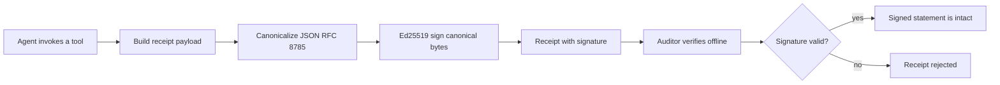
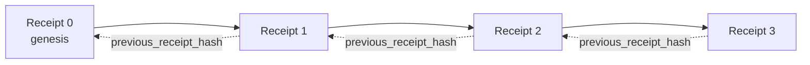

[Se leksjonsvideo: Sikring av AI-agenter med kryptografiske kvitteringer](https://youtu.be/PLACEHOLDER_VIDEO_ID)

> _(Leksjonsvideo og miniatyrbilde vil bli lagt til av Microsoft-innholdsteamet etter sammenslåing, i samsvar med mønsteret for leksjon 14 / 15.)_

# Sikring av AI-agenter med kryptografiske kvitteringer

## Introduksjon

Denne leksjonen vil dekke:

- Hvorfor revisjonsspor for AI-agenter er viktige for samsvar, feilsøking og tillit.
- Hva en kryptografisk kvittering er og hvordan den skiller seg fra en usignert logglinje.
- Hvordan produsere en signert kvittering for et agents verktøysanrop i ren Python.
- Hvordan verifisere en kvittering offline og oppdage manipulasjon.
- Hvordan kjede kvitteringer slik at fjerning eller omorganisering av én bryter kjeden.
- Hva kvitteringer beviser og hva de eksplisitt ikke beviser.

## Læringsmål

Etter å ha fullført denne leksjonen, vil du vite hvordan du:

- Identifisere feilmoduser som motiverer kryptografisk proveniens for agenthandlinger.
- Produsere en Ed25519-signert kvittering over en kanonisk JSON-payload.
- Verifisere en kvittering uavhengig ved å bruke kun signatarens offentlige nøkkel.
- Oppdage manipulasjon ved å kjøre verifikasjonen på nytt på en modifisert kvittering.
- Bygge en hash-kjedet sekvens av kvitteringer og forklare hvorfor kjeden er viktig.
- Gjenkjenne skillet mellom hva kvitteringer beviser (attribusjon, integritet, rekkefølge) og hva de ikke beviser (riktighet av handlingen, holdbarhet av policyen).

## Problemet: Agentens revisjonsspor

Tenk deg at du har distribuert en AI-agent for Contoso Travel. Agenten leser kunders forespørsler, kaller en flyreise-API for å slå opp alternativer, og bestiller seter på vegne av kunden. Forrige kvartal behandlet agenten 50 000 bestillinger.

I dag kommer en revisor. De stiller et enkelt spørsmål: "Vis meg hva agenten din gjorde."

Du overleverer loggfilene dine. Revisoren ser på dem og stiller det vanskeligere spørsmålet: "Hvordan vet jeg at disse loggene ikke ble redigert?"

Dette er revisjonssporproblemet. De fleste agentdistribusjoner i dag stoler på:

- **Applikasjonslogger**: skrevet av selve agenten, kan redigeres av hvem som helst med filsystemtilgang.
- **Skytjenester for logging**: manipulasjons-synlig på plattformnivå, men kun hvis revisoren stoler på plattformoperatøren.
- **Database-transaksjonslogger**: godt egnet for databaseendringer, men ikke for vilkårlige verktøysanrop.

Ingen av disse kan svare på revisors spørsmål uten at revisoren må stole på noen (deg, skyløsningen din, databaseleverandøren). For intern bruk er den tilliten ofte akseptabel. For regulerte arbeidsmengder (finans, helsevesen, alt underlagt EU AI Act), er det ikke.

Kryptografiske kvitteringer smalner inn dette problemet ved å lage en signert erklæring som er uavhengig
verifiserbar. Revisor trenger fortsatt en utenomkanal grunn til å stole på signaturnøkkelen og
komponenten som produserte erklæringen. En innebygd nøkkel beviser selv-konsistens,
ikke utsteders identitet eller plasseringshåndhevelse.

## Hva er en kryptografisk kvittering?

En kvittering er et JSON-objekt som registrerer hva en agent gjorde, signert med en digital signatur.



En minimal kvittering ser slik ut:

```json
{
  "type": "agent.tool_call.v1",
  "agent_id": "contoso-travel-bot",
  "tool_name": "lookup_flights",
  "tool_args_hash": "sha256:a3f9c1...",
  "result_hash": "sha256:7b2e1d...",
  "policy_id": "contoso-travel-policy-v3",
  "timestamp": "2026-04-25T14:30:00Z",
  "sequence": 47,
  "previous_receipt_hash": "sha256:9d4e6a...",
  "signature": {
    "alg": "EdDSA",
    "sig": "c5af83...",
    "public_key": "8f3b2c..."
  }
}
```

Tre egenskaper gjør jobben:

1. **Signaturen**. Kvitteringen signeres av agentens gateway ved bruk av en Ed25519-privatnøkkel. Alle med tilsvarende offentlig nøkkel kan verifisere signaturen offline. En tillitsparti må feste den nøkkelen eller hente den fra et pålitelig register utenfor kvitteringen. Manipulering av et hvilket som helst signert felt ugyldiggjør signaturen.

2. **Kanonisk koding**. Før signering serialiseres kvitteringen med JSON Canonicalization Scheme (JCS, RFC 8785). Dette sikrer at to implementasjoner som produserer samme logiske kvittering produserer byte-identisk output. Uten kanonisering ville ulike JSON-serialisatorer produsere forskjellige signaturer for samme innhold.

3. **Hash-kjedning**. `previous_receipt_hash`-feltet kobler hver kvittering til den forrige. Fjerning eller omorganisering av en kvittering bryter den presenterte sekvensen. Å oppdage forkorting eller en omskrevet versjon kontrollert av signatar krever også en festet aktuell kjedehode, uavhengig vitnet sjekkpunkt eller autentisert lukket-befolkningsforpliktelse.

Sammen gir disse egenskapene tre garantier:

- **Attribusjon til en nøkkel**: denne nøkkelen signerte dette innholdet. Organisatorisk eller menneskelig identitet krever en pålitelig nøkkellbinding.
- **Integritet**: innholdet har ikke endret seg siden signering.
- **Rekkefølge innenfor verifisert sekvens**: denne kvitteringen lenker til den forgjengeren.

## Lage en kvittering i Python

Du trenger ikke et spesielt bibliotek for å lage en kvittering. De kryptografiske primitivene er bredt tilgjengelige, og logikken er noen dusin linjer Python.

De praktiske øvelsene i `code_samples/18-signed-receipts.ipynb` gjennomgår hele flyten. Det versjonskontrollerte `code_samples/18-signed-receipts.execution-receipt.json` registrerer eksakt notatblokkhash, Python-miljø, celletall og sjekk fra siste rene kjøring uten å endre lagrede utdata for leksjonen. Oppsummeringsversjonen:

```python
import json
import hashlib
import base64
from nacl import signing
from jcs import canonicalize  # RFC 8785 canonical JSON

def b64url_nopad(data: bytes) -> str:
    return base64.urlsafe_b64encode(data).decode("ascii").rstrip("=")

def sha256_canonical(obj) -> str:
    """SHA-256 of a Python object's JCS-canonical JSON form."""
    return f"sha256:{hashlib.sha256(canonicalize(obj)).hexdigest()}"

# Generate or load a signing key (in production, store in a key vault)
signing_key = signing.SigningKey.generate()
verify_key = signing_key.verify_key
TRUSTED_PUBLIC_KEYS = {b64url_nopad(bytes(verify_key))}  # pinned out of band by the verifier

# Build the receipt payload (no signature yet)
tool_args = {"origin": "SYD", "destination": "LAX"}
tool_result = [{"flight": "QF11", "price": 1850, "stops": 0}]

payload = {
    "type": "agent.tool_call.v1",
    "agent_id": "contoso-travel-bot",
    "tool_name": "lookup_flights",
    "tool_args_hash": sha256_canonical(tool_args),
    "result_hash": sha256_canonical(tool_result),
    "policy_id": "contoso-travel-policy-v3",
    "timestamp": "2026-04-25T14:30:00Z",
    "sequence": 0,
    "previous_receipt_hash": None,
}

# Canonicalize and sign the JCS bytes directly. PureEdDSA hashes internally.
canonical_bytes = canonicalize(payload)
signature_bytes = signing_key.sign(canonical_bytes).signature

# Attach a structured signature object.
receipt = {
    **payload,
    "signature": {
        "alg": "EdDSA",
        "sig": b64url_nopad(signature_bytes),
        "public_key": b64url_nopad(bytes(verify_key)),
    },
}
```

Det er hele signeringsrørledningen. Øvelsene i notatblokken går gjennom hvert steg.

## Verifisere en kvittering og oppdage manipulasjon

Verifisering er den inverse operasjonen:

```python
import base64
import hashlib
from nacl import signing
from nacl.exceptions import CryptoError
from jcs import canonicalize

def b64url_decode(s: str) -> bytes:
    # Strict: Python's decoder skips characters outside the alphabet and also
    # accepts padding, the standard +/ alphabet and non-zero spare bits.
    # Re-encoding and comparing accepts only the one unpadded base64url form.
    padding = "=" * ((4 - len(s) % 4) % 4)
    data = base64.urlsafe_b64decode(s + padding)
    if base64.urlsafe_b64encode(data).decode("ascii").rstrip("=") != s:
        raise ValueError("not canonical unpadded base64url")
    return data

def verify_receipt(receipt: dict, trusted_public_key: str) -> bool:
    # trusted_public_key is the issuer's key, obtained from somewhere other
    # than this receipt. Never use receipt["signature"]["public_key"] here:
    # see "What Receipts Prove (and What They Do Not)" below.
    # Fails closed: anything malformed returns False instead of raising.
    if not isinstance(receipt, dict) or not isinstance(trusted_public_key, str):
        return False
    sig_obj = receipt.get("signature")
    if not isinstance(sig_obj, dict) or sig_obj.get("alg") != "EdDSA":
        return False
    sig_b64 = sig_obj.get("sig")
    if not isinstance(sig_b64, str):
        return False

    try:
        # Reconstruct the payload that was actually signed (everything except signature).
        payload = {k: v for k, v in receipt.items() if k != "signature"}
        canonical_bytes = canonicalize(payload)
        verify_key = signing.VerifyKey(b64url_decode(trusted_public_key))
        verify_key.verify(canonical_bytes, b64url_decode(sig_b64))
        return True
    except (CryptoError, TypeError, ValueError, KeyError, OverflowError):
        return False
    except Exception:
        # An undecodable key or signature, or a payload that cannot be
        # canonicalized: fail closed rather than raise.
        return False
```

Denne funksjonen tar en kvittering og utstederens offentlige nøkkel, og returnerer `True` hvis signaturen er gyldig og `False` ellers, også når inngangen er feilformatert. Ingen nettverkskall og ingen verifiseringstjeneste: når du har fått tak i utstederens nøkkel, er verifiseringen helt lokal og offline. Det den fortsatt krever er den nøkkelen, hentet et annet sted enn fra kvitteringen selv.

For å se manipulasjonsdeteksjon i praksis, leder notatblokken gjennom:

1. Lage en gyldig kvittering og bekrefte at den verifiseres.
2. Endre én byte i `tool_args_hash`-feltet.
3. Kjøre verifisering på nytt og se at den feiler.
4. Manipulere igjen, men denne gangen signere på nytt med en nøkkel angriperen genererte og legge inn den nøkkelen i kvitteringen.

Steg 4 er det verdt å dvele ved. Den kvitteringen er internt konsistent: signaturen er ekte for innholdet og for nøkkelen den bærer, så den verifiseres mot nøkkelen inni den. Den feiler bare når den sjekkes mot utstederens ekte nøkkel. Steg 2 og 3 fanger opp en angriper som ikke gidder å signere på nytt; steg 4 fanger opp den som gjorde det.

Dette er den praktiske demonstrasjonen på at kvitteringer er manipulasjonssikre: enhver endring i et signert felt bryter signaturen, forutsatt at du verifiserer mot en nøkkel angriperen ikke leverte. `signature`-objektet selv er utenfor de signerte bytene, derfor må nøkkelen du verifiserer mot komme fra et annet sted enn kvitteringen.

## Kjedekvitteringer for flerstegsagenter

En enkelt signert kvittering beskytter én handling. En kjede av kvitteringer beskytter en sekvens.



Hver kvittering lagrer hashen for kvitteringen før den. For å fjerne kvittering 2 lydløst, må en angriper enten:

- Endre kvittering 3 sin `previous_receipt_hash`-felt (bryter kvittering 3 sin signatur), ELLER
- Forfalske en ny signatur på en modifisert kvittering 3 (krever agentens private nøkkel).

Hvis den private nøkkelen er i en hardware-nøkkellager og verifikatorer sjekker hver kvittering mot utstederens offentlige nøkkel, hentet uavhengig (et publisert JWK-sett eller en festet konfigurasjonsverdi), er ingen av angrepene mulige uten å bli oppdaget. Å publisere nøkkelen inne i hver kvittering er ikke nok: en angriper kan signere på nytt med sin egen nøkkel og legge inn den nøkkelen i stedet, som er anker `04_resigned_receipt.json`.

Notatblokken leder gjennom:

1. Lage en kjede av tre kvitteringer.
2. Verifisere at hver kvitterings `previous_receipt_hash` samsvarer med den faktiske hashen av forrige kvittering.
3. Manipulere en kvittering midt i og se kjeden bryte nettopp der.

Slik produserer du et revisjonsspor som en ekstern revisor kan verifisere under sine
egne festede utsteder-nøkler og kjede-sjekkpunkter, uten å stole på din muterbare logglager.

## Hva kvitteringer beviser (og hva de ikke beviser)

Dette er det viktigste avsnittet i denne leksjonen. Kvitteringer er kraftige, men kraften er begrenset.

**Kvitteringer beviser tre ting:**

1. **Attribusjon**: en spesifikk nøkkel signerte en spesifikk payload.
2. **Integritet**: payloaden har ikke endret seg siden signering.
3. **Rekkefølge innenfor en presentert, verifisert sekvens**: denne kvitteringen lenker til den forgjengeren.

**Kvitteringer beviser IKKE:**

1. **Riktighet**: at agentens handling var riktig handling. En kvittering kan signeres for et galt svar like rent som for et riktig svar.
2. **Policy-samsvar**: at policyen referert i `policy_id` faktisk ble evaluert, eller at den ville ha tillatt denne handlingen hvis sjekket. Kvitteringen registrerer hva som ble påstått, ikke hva som ble håndhevet.
3. **Identitet utover nøkkelen**: kvitteringen sier "denne nøkkelen signerte dette innholdet." Den sier ikke "dette mennesket autoriserte dette." Å koble en nøkkel til en person eller organisasjon krever separat identitetsinfrastruktur (en katalog, et offentlig nøkkelregister, osv.).
4. **Sannferdighet av innganger**: hvis agenten mottar en manipulert prompt og handler på den, registrerer kvitteringen handlingen trofast. Kvitteringer er nedstrøms av inputvalidering, ikke en erstatning for det.
5. **Utførelse eller reell effekt**: en kvittering etter anrop registrerer hva utstederen hevder skjedde. Å bevise innrømmelse eller å avstemme en ekstern effekt krever bevis fra faktisk utfører eller leverandørgrense.
6. **Fullstendighet**: en fraværende kvittering kan bety blokkert, utelatt, tapt eller ikke instrumentert. Fravær blir bevis kun innenfor en autentisert lukket populasjon.
7. **Pålitelige tidspunkter**: et signert tidsstempel beviser at signataren hadde den verdien, ikke at verdien var korrekt. Pålitelig tid krever en separat tidsmyndighet eller vitnet sjekkpunkt.

**Nøkkelen i kvitteringen er ikke nøkkelen du verifiserer med.** Dette følger av punkt 3, og det er det ene stedet skillet må endre koden din og ikke bare forståelsen. `public_key` i eksemplet ovenfor er der for at eksemplet skal være selvstendig. En verifikator må aldri stole på den. Alle kan ta en kvittering, endre den, signere på nytt med en nøkkel de har generert, og legge inn den nøkkelen; resultatet verifiserer perfekt mot seg selv. Det er anker `04_resigned_receipt.json` i `sample_receipts/`, og det er derfor `verify_receipt` ovenfor tar nøkkelen som argument i stedet for å lese den ut fra kvitteringen. Skaff utstederens nøkkel uavhengig, fra JWK-settet i Produksjons-sjekklisten nedenfor eller en annen anker du festet på forhånd, og verifiser mot den. En signatur sjekket med en nøkkel som kom i samme konvolutt, beviser bare at konvolutten er selv-konsistent.

Dette skillet betyr noe av to grunner:

- Det forteller deg hva kvitteringer er nyttige til: å gjøre agentens oppførsel reviderbar og manipulasjonssikker, selv på tvers av organisatoriske grenser.
- Det forteller deg hvilke tilleggslag du fortsatt trenger: inputvalidering (Leksjon 6), policyhåndhevelse (kort omtalt nedenfor), og identitetsinfrastruktur (utenfor omfanget av denne leksjonen).

En vanlig feil er å anta at "vi har kvitteringer" betyr "vi er styrt." Det gjør det ikke. Kvitteringer er et fundament. Styring er systemet du bygger oppå.

## Knytte en godkjenners signatur til den eksakte handlingen

Punkt 3 ovenfor er verdt en egen seksjon: en handlingskvittering sier "denne nøkkelen signerte dette innholdet," aldri "et menneske autoriserte dette." For høy-risiko handlinger (refunderinger, slettinger, overføringer), kan en separat godkjenner signatur knytte den eksakte handlingen. Å koble den nøkkelen til et menneske og sjekke menneskelig tilstedeværelse forblir separate ansvar.

Den påfølgende notatblokken `code_samples/human-authorization-receipts.ipynb` legger til en annen type kvittering, `human.approval.v1`, i samme konvoluttform som leksjonens kvitteringer (en typet payload signert med Ed25519 over sine kanoniske JCS-byter, med `signature`-objektet utenfor de signerte bytene). En godkjennernøkkel signerer **fullstendig kanonisk handling og dens digest**; en agentnøkkel signerer et påstandsdokument som bærer **samme handlingsdigest** og en `parent_approval_ref`, `receipt_hash` for godkjenningen, samme konvensjon som `previous_receipt_hash` i kjeden du bygde ovenfor. Én `verify_chain` går gjennom begge dokumenter under **separate festede nøkkelregistre** (godkjennernøkler vs agentnøkler), så kodebanen er delt, men myndighetene aldri.

Egenskapen dette kjøper, nøye formulert: *den festede godkjennernøkkelen signerte denne eksakte
handlingen, og agentnøkkelen signerte senere en erklæring som bærer samme handlingsdigest.*
Det er nyttig bevis, men det er ikke i seg selv bevis på at handlingen ble utført. For å
kontrollere utførelse må den eksakte godkjenningen også reserveres og konsumeres én gang ved den
faktiske utførergrensen; ukjente leverandørutfall må forbli ukjente og ikke
blindt prøves på nytt. Notatblokkens avslag-stubber tester kvitteringskjede-laget:

- manipulasjon, forvirret stedfortreder, forfalskede nøkler på begge sider, og feilformatert input;
- **utgått myndighet**: en signatur som fortsatt verifiseres, men likevel nektes fordi policy-versjon har flyttet, godkjennernøkkelen ble rotert ut fra det festede registeret, eller godkjenningen utløp før den oppgitte verifiseringstiden;
- **digest-substitusjon**: en gyldig signert handlingskvittering som peker til en *ekte* godkjenning som binder en *annen* kanonisk handling.

Hver feil nekter med en distinkt grunn, så en revisor som leser et avslag kan vite om myndigheten gikk ut på dato eller den påståtte handlingen endret seg. Verifisering er kun lesing og repeterbar: den forbruker ikke godkjenningen eller kaller en leverandør. En separat utfører trenger holdbar, atomisk avspillingsbeskyttelse og eksplisitte suksess-, feil- og uavklarte utfall. Menneskelig-godkjenningskvitteringen er en pedagogisk komposisjon definert av denne leksjonen, ikke en kvitteringstype definert av `draft-farley-acta-signed-receipts`.

## Produksjonsreferanser

Python-koden i denne leksjonen er bevisst minimal slik at du kan lese hver linje og forstå nøyaktig hva som skjer. I produksjon har du to alternativer:

1. **Bygge direkte på de kryptografiske primitivene.** De 50 linjene du så ovenfor er tilstrekkelige for mange brukstilfeller. PyNaCl (Ed25519) og `jcs`-pakken (kanonisk JSON) er godt vedlikeholdte og reviderte biblioteker.

2. **Bruke et produksjonsbibliotek for kvitteringer.** Flere open source-prosjekter implementerer samme mønster med tilleggsegenskaper (nøkkelrotasjon, batch-verifisering, distribusjon av JWK-sett, integrasjon med policy-motorer):
   - Signeringsrøret bruker JCS og signaturområde-konvensjonene i et uavhengig IETF Internet-Draft ([`draft-farley-acta-signed-receipts`](https://datatracker.ietf.org/doc/draft-farley-acta-signed-receipts/), revisjon 02). Denne leksjonens enkle utdanningskvittering skiller seg fra utkastets `{payload, signature}` konvolutt og presenteres ikke som en samsvarende implementering. Utkastet publiserer en delt samsvarspakke ([agent-governance-testvectors](https://github.com/ScopeBlind/agent-governance-testvectors)) for implementasjoner som retter seg mot dens wire-format.
   - Microsoft Agent Governance Toolkit komponerer kvitteringer med Cedar-baserte policybeslutninger; se Tutorial 33 i det depotet for et helhetlig eksempel.
   - `protect-mcp` (npm) og `@veritasacta/verify` (npm)-pakkene tilbyr en Node-basert implementering av kvitteringssignering og offline verifisering, ment for å pakke inn enhver MCP-server med et manipulasjonsikkert revisjonsspor, inkludert en holdt-for-med-signatur-flyt der en pausert handling utsteder en godkjenningskvittering bundet til handlingsdigesten (WebAuthn-støttet i skrivebordsflyten), samme godkjenningskvitteringsmønster som menneskelig-autorisering-notatboken ovenfor.
   - **[nobulex](https://github.com/arian-gogani/nobulex)** Python SDK (`pip install nobulex`) leverer samme Ed25519 + JCS signeringsmønster i Python med LangChain- og CrewAI-integrasjoner, inkludert publiserte kryssvalideringstestvektorer og en samsvarskartlegging bidratt via [OWASP PR #2210](https://github.com/OWASP/CheatSheetSeries/pull/2210).
   - **[EMILIA Protocol](https://github.com/emiliaprotocol/emilia-protocol)** tilbyr et komplementært lag for eksakt-handling håndhevelse: offline-verifiserbare godkjenningskvitteringer, innpinnet WebAuthn eller kvorauthoritet, engangsforbruk ved utøverbgrensen, og en eksplisitt sti for ubestemt utfall. Dets rammeverksadaptere behandler en kvittering som nødvendig bevis heller enn bevis for at en ekstern effekt inntraff.

Valget mellom å bygge selv og bruke et bibliotek speiler valget mellom å skrive ditt eget JWT-bibliotek og bruke et testet: begge er rimelige; biblioteket sparer tid og reduserer revisjonsoverflate; tilnærmingen fra bunnen av tvinger deg til å forstå hver primitiv. Denne leksjonen lærer deg fra bunnen av slik at du har grunnlaget for begge valg.

## Kunnskapssjekk

Test din forståelse før du går videre til praksisoppgaven.

**1. En kvittering signeres med agentens private Ed25519-nøkkel. Revisor har bare den offentlige nøkkelen. Kan revisor verifisere kvitteringen offline?**

<details>
<summary>Svar</summary>

Ja, kryptografisk verifisering krever bare den offentlige nøkkelen og signerte bytes. Revisor
må fortsatt skaffe og pinne den aksepterte offentlige nøkkelen uavhengig av kvitteringen.
Ingen nettverkskall er nødvendig etter at denne tillitskonfigurasjonen er etablert.
</details>

**2. En angriper endrer `policy_id`-feltet til en kvittering for å hevde at den var styrt av en mer tillatende policy. Signaturen var over den opprinnelige nyttelasten. Hva skjer under verifisering?**

<details>
<summary>Svar</summary>

Verifisering mislykkes. Signaturen ble beregnet over de kanoniske bytene av den opprinnelige nyttelasten; å endre noe felt i nyttelasten endrer disse bytene, noe som gjør signaturen ugyldig. Angriperen ville trenge den private nøkkelen for å produsere en fersk gyldig signatur, noe de ikke har.
</details>

**3. Hvorfor inkluderer kvitteringen en `tool_args_hash` og `result_hash` i stedet for rå argumenter og resultat?**

<details>
<summary>Svar</summary>

To grunner. Først kan kvitteringen trenge å arkiveres eller overføres i miljøer hvor lekkasje av råinnhold (PII, forretningsdata) er et problem. Hashing holder kvitteringen liten og innholdet privat; revisor verifiserer at hashen samsvarer med en separat lagret kopi av det faktiske innholdet. For det andre har hasher en fast størrelse; en kvittering med hasher er begrenset i størrelse uansett hvor store inndata og utdata var.
</details>

**4. `previous_receipt_hash`-feltet kobler hver kvittering til sin forgjenger. Hvis en angriper stille sletter en kvittering fra midten av en kjede, hva blir ugyldig?**

<details>
<summary>Svar</summary>

Hver kvittering som kom etter den slettede. Deres `previous_receipt_hash`-felt samsvarer ikke lenger med den faktiske kjeden (fordi kvitteringen de refererte til ikke lenger eksisterer, eller kjeden nå peker til en annen forgjenger). For å skjule slettingen må angriperen reinsignere hver senere kvittering, noe som krever utstederens private nøkkel. En reinsignering med en annen nøkkel mislykkes når den sjekkes mot utstederens nøkkel.
</details>

**5. En kvittering verifiseres rent. Beviser det at agentens handling var korrekt, forsvarlig eller i samsvar med policy?**

<details>
<summary>Svar</summary>

Nei. Under en innpinnet nøkkel og kjede-kontext beviser en gyldig kvittering signaturtilskrivning,
innholdsintegritet og en lenke til den presenterte forgjengeren. Den BEVISER IKKE at
handlingen var korrekt eller utført, at policyen ble evaluert, at tidsstemplet er
tillitsfullt, eller at registreringssettet er komplett. Dette er den viktigste grensen i leksjonen.
</details>

## Praksisøvelse

Åpne `code_samples/18-signed-receipts.ipynb` og fullfør alle fire seksjoner:

1. **Seksjon 1**: Signer din første kvittering og verifiser den.
2. **Seksjon 2**: Endre kvitteringen og observer verifisering mislykkes.
3. **Seksjon 3**: Bygg en tre-kvitteringskjede og verifiser kjedens integritet.
4. **Seksjon 4**: Anvend mønsteret på en agent bygget med Microsoft Agent Framework: pakk et verktøys kall inn i kvitteringssignering, og verifiser deretter kvitteringen uavhengig.

**Utfordring 1:** utvid kvitteringsskjemaet med et ekstra felt du selv velger (for eksempel en forespørsels-ID for sporing), oppdater den kanoniske signeringslogikken til å inkludere det, og bekreft at kvitteringen fortsatt fungerer gjennom verifisering. Endre deretter feltet etter signering og bekreft at verifisering mislykkes. Dette tvinger deg til å forstå hvordan hvert byte av den kanoniske kodingen bidrar til signaturen.

**Utfordring 2:** SHA-256-hash to av dine kvitteringer sammen (koble deres kanoniske bytes sammen i en deterministisk rekkefølge) og legg den resulterende digesten som et nytt felt på en tredje kvittering før signering. Verifiser at alle tre kvitteringer fortsatt fungerer. Du har akkurat bygget et ett-trinns inklusjonsbevis: hvem som helst som har tredjekvitteringen kan bevise at de to første eksisterte da den ble signert, uten å måtte avsløre deres innhold. Dette er mønsteret som kvitteringer med selektiv avsløring bruker i stor skala (Merkle-forpliktelser, RFC 6962).

## Konklusjon

Kryptografiske kvitteringer gir AI-agenter et revisjonsspor som er:

- **Uavhengig verifiserbart under innpinnet tillit**: en part med aksepterte offentlige nøkler og signerte bytes kan verifisere uten avhengighet til en tjeneste.
- **Manipulasjonsbevisst**: enhver modifikasjon ugyldiggjør signaturen.
- **Bærbar**: en kvittering er en liten JSON-fil; den kan arkiveres, overføres og verifiseres hvor som helst.
- **Standardtilpasset**: bygget på Ed25519 (RFC 8032), JCS (RFC 8785) og SHA-256, alle vidt utbredte primitiv.

De er ikke en erstatning for input-validering, håndhevelse av policy, eksekutortilgang,
utfallsbevis, fullstendighetskontroller eller identitetsinfrastruktur. De er et fundament
for disse lagene. I regulerte eller flerorganisatoriske arbeidsflyter gjør kvitteringer spesifikke
utstederutsagn uavhengig sjekkbart under revisorens egen tillitskonfigurasjon.

Den viktigste lærdommen: kvitteringer beviser at en bestemt nøkkel signerte et bestemt
innhold. Et medfølgende tidsstempel er en signerattribusjon med mindre det er separat tidsattestert. En
kvittering beviser ikke at innholdet var sant, at en handling ble utført, eller at
registersettet er komplett. Hold disse forskjellene tydelige.

## Produksjonskontrolliste

Når du er klar til å gå videre fra denne leksjonen til å distribuere kvitteringssignerte agenter i et reelt miljø:

- [ ] **Flytt signeringsnøkkelen bort fra utviklerlaptopen.** Bruk Azure Key Vault, AWS KMS eller en hardware sikkerhetsmodul. Den private nøkkelen som signerer kvitteringen din må aldri være i kildekontroll eller i klartekst på applikasjonsmaskiner.
- [ ] **Etabler betroelse av verifisiernøkkel.** Publiser nøkler gjennom et JWK-sett eller register, og la deretter avhengige parter pinne akseptert utstederidentitet, nøkkelsett og rotasjonspolicy utenfor individuelle kvitteringer. En inline-nøkkel alene er ikke et tillitsanker.
- [ ] **Forankre kjeden eksternt.** Skriv periodisk det siste kjedehodets hash til en åpenhetslogg (Sigstore Rekor, RFC 3161 tidsstempleautoritet, eller et internt system) slik at en ekstern part kan bekrefte "denne kjeden eksisterte på dette tidspunktet."
- [ ] **Lagre kvitteringer uforanderlig.** Append-only blob-lagring (Azure Storage med uforanderlighetspolicyer, AWS S3 Object Lock) forhindrer en insider i å omskrive historikk på lagringslaget.
- [ ] **Beslutt om oppbevaring.** Mange reguleringsregimer krever flerårig oppbevaring. Planlegg for kvitteringsvekst (hver kvittering er ~500 bytes; en agent som gjør 10K kall per dag genererer ~1.8 GB per år).
- [ ] **Dokumenter hva kvitteringer ikke dekker.** Kvitteringer beviser tilskrivning, integritet og rekkefølge. Din kjørebok bør eksplisitt liste opp hvilke tilleggskontroller (input-validering, policyhåndhevelse, hastighetsbegrensning, identitetsinfrastruktur) som ligger sammen med kvitteringer i din styringsholdning.

### Har du flere spørsmål om å sikre AI-agenter?

Bli med i [Microsoft Foundry Discord](https://aka.ms/ai-agents/discord) for å møte andre lærende, delta på kontortimer, og få besvart spørsmål om AI-agenter.

## Utover denne leksjonen

Denne leksjonen dekker enkel kvitteringssignering og hash-kjede sekvenser. De samme primitivene komponerer flere mer avanserte mønstre du kan møte når din styringsholdning modnes:

- **Selektiv avsløring.** Når en kvitterings felt er uavhengig forpliktet (RFC 6962-stil Merkle-tre), kan du avsløre spesifikke felter til spesifikke revisorer og bevise at resten ikke er endret uten å eksponere dem. Nyttig når samme kvittering må tilfredsstille både en omfattende revisjon (som ønsker fullstendighet) og dataminimeringsforskrifter som GDPR (som vil at revisor skal se så lite som nødvendig).
- **Tilbakekalling av kvittering.** Hvis en signeringsnøkkel kompromitteres, trenger du en måte å merke alle kvitteringer signert med den nøkkelen som upålitelige fra et gitt tidspunkt fremover. Standardmønstre: kortlevde signeringsnøkler pluss offentlig tilbakekallingsliste, eller en åpenhetslogg med tilbakekallingsoppføringer.
- **Bilaterale / splitt-signatur kvitteringer.** Noen implementasjoner deler den signerte nyttelasten i før-eksekverings- (`authorization_*`) og etter-eksekverings- (`result_*`) halvdeler med uavhengige signaturer, nyttig når autorisasjonsbeslutningen og det observerte resultatet produseres av ulike aktører eller på ulike tidspunkter. Dette komponeres additivt på toppen av kvitteringsformatet som læres i denne leksjonen.
- **Payload-sammensetning.** En kvittering forsegler hvilke bytes du legger inn i `result_hash`. Virkelige nyttelaster er ofte rikere enn et enkelt verktøys kall-resultat: før-beslutningsresonnement (modellprediksjon, vurderte alternativer, bevis og dets fullstendighet, risikopostur, ansvarskjede, utfall av port) kan alle ligge i nyttelasten, forseglet av en enkelt kvittering. Dette holder kvitteringsformatet minimalt samtidig som nyttelast-skjemaer får utvikle seg domene-for-domene.
- **Tverrimlementeringskonformitet.** Flere uavhengige implementasjoner av samme kvitteringsformat (Python, TypeScript, Rust, Go) kryssbekrefter mot delte testvektorer. Hvis du bygger din egen implementasjon, bekrefter validering mot publiserte vektorer kompatibilitet på wire-formatet.
- **Postkvante-migrasjon.** Ed25519 er vidt utbredt i dag, men ikke kvante-resistent. En `alg`-etikett alene er ikke migrasjon: en profil må definere ML-DSA nøkkelkoding, kanoniske signerte bytes, verifisering, avhengig-parts policy, nedgraderingsmotstand og overgangssemantikk. Planlegg og test en dobbel-signatur overgang mot delte vektorer før du gir kompatibilitets-påstander.

## Ytterligere ressurser

- <a href="https://datatracker.ietf.org/doc/draft-farley-acta-signed-receipts/" target="_blank">IETF Internet-Draft: Signed Decision Receipts for Machine-to-Machine Access Control</a>
- <a href="https://learn.microsoft.com/azure/ai-studio/responsible-use-of-ai-overview" target="_blank">Oversikt over Ansvarlig AI (Azure AI)</a>
- <a href="https://datatracker.ietf.org/doc/html/rfc8032" target="_blank">RFC 8032: Edwards-Curve Digital Signature Algorithm (EdDSA)</a>
- <a href="https://datatracker.ietf.org/doc/html/rfc8785" target="_blank">RFC 8785: JSON Canonicalization Scheme (JCS)</a>
- <a href="https://datatracker.ietf.org/doc/html/rfc6962" target="_blank">RFC 6962: Sertifikattransparens</a> (Merkle-tre konstruksjon brukt av kvitteringer med selektiv avsløring)
- <a href="https://github.com/microsoft/agent-governance-toolkit/blob/main/docs/tutorials/33-offline-verifiable-receipts.md" target="_blank">Microsoft Agent Governance Toolkit, Tutorial 33: Offline-Verifiable Decision Receipts</a>
- <a href="https://github.com/ScopeBlind/agent-governance-testvectors" target="_blank">Tverrimlementeringskonformitet testvektorer</a> for kvitteringsformatet brukt i denne leksjonen (Apache-2.0)
- <a href="https://pynacl.readthedocs.io/" target="_blank">PyNaCl dokumentasjon</a> (Ed25519 i Python)

## Forrige leksjon

[Opprette lokale AI-agenter](../17-creating-local-ai-agents/README.md)

---

<!-- CO-OP TRANSLATOR DISCLAIMER START -->
**Ansvarsfraskrivelse**:
Dette dokumentet er oversatt ved hjelp av AI-oversettelsestjenesten [Co-op Translator](https://github.com/Azure/co-op-translator). Selv om vi streber etter nøyaktighet, vær oppmerksom på at automatiske oversettelser kan inneholde feil eller unøyaktigheter. Det opprinnelige dokumentet på originalspråket skal betraktes som den autoritative kilden. For kritisk informasjon anbefales profesjonell menneskelig oversettelse. Vi er ikke ansvarlige for eventuelle misforståelser eller feiltolkninger som oppstår ved bruk av denne oversettelsen.
<!-- CO-OP TRANSLATOR DISCLAIMER END -->