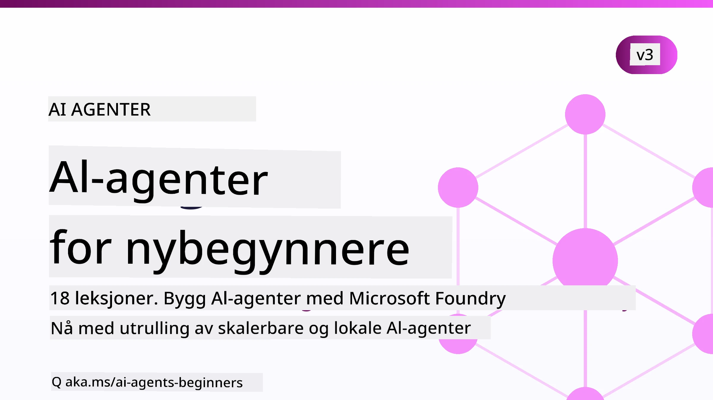

# AI-agenter for nybegynnere - Et kurs



## Et kurs som lærer deg alt du trenger å vite for å begynne å bygge AI-agenter

[](https://github.com/microsoft/ai-agents-for-beginners/blob/master/LICENSE?WT.mc_id=academic-105485-koreyst)
[](https://GitHub.com/microsoft/ai-agents-for-beginners/graphs/contributors/?WT.mc_id=academic-105485-koreyst)
[](https://GitHub.com/microsoft/ai-agents-for-beginners/issues/?WT.mc_id=academic-105485-koreyst)
[](https://GitHub.com/microsoft/ai-agents-for-beginners/pulls/?WT.mc_id=academic-105485-koreyst)
[](http://makeapullrequest.com?WT.mc_id=academic-105485-koreyst)

### 🌐 Flerspråklig støtte

#### Oversettelser vedlikeholdes med [Co-op Translator](https://github.com/Azure/co-op-translator)

<!-- CO-OP TRANSLATOR LANGUAGES TABLE START -->
[Arabisk](../ar/README.md) | [Bengali](../bn/README.md) | [Bulgarsk](../bg/README.md) | [Burmesisk (Myanmar)](../my/README.md) | [Forenklet kinesisk](../zh-CN/README.md) | [Tradisjonell kinesisk (Hong Kong)](../zh-HK/README.md) | [Tradisjonell kinesisk (Macau)](../zh-MO/README.md) | [Tradisjonell kinesisk (Taiwan)](../zh-TW/README.md) | [Kroatisk](../hr/README.md) | [Tsjekkisk](../cs/README.md) | [Dansk](../da/README.md) | [Nederlandsk](../nl/README.md) | [Estisk](../et/README.md) | [Finsk](../fi/README.md) | [Fransk](../fr/README.md) | [Tysk](../de/README.md) | [Gresk](../el/README.md) | [Hebraisk](../he/README.md) | [Hindi](../hi/README.md) | [Ungarsk](../hu/README.md) | [Indonesisk](../id/README.md) | [Italiensk](../it/README.md) | [Japansk](../ja/README.md) | [Kannada](../kn/README.md) | [Khmer](../km/README.md) | [Koreansk](../ko/README.md) | [Litauisk](../lt/README.md) | [Malayisk](../ms/README.md) | [Malayalam](../ml/README.md) | [Manipuri (Meitei Mayek)](../mni/README.md) | [Marathi](../mr/README.md) | [Nepalsk](../ne/README.md) | [Nigeriansk pidgin](../pcm/README.md) | [Norsk](./README.md) | [Persisk (Farsi)](../fa/README.md) | [Polsk](../pl/README.md) | [Portugisisk (Brasil)](../pt-BR/README.md) | [Portugisisk (Portugal)](../pt-PT/README.md) | [Punjabi (Gurmukhi)](../pa/README.md) | [Rumensk](../ro/README.md) | [Russisk](../ru/README.md) | [Serbisk (kyrillisk)](../sr/README.md) | [Slovakisk](../sk/README.md) | [Slovensk](../sl/README.md) | [Spansk](../es/README.md) | [Swahili](../sw/README.md) | [Svensk](../sv/README.md) | [Tagalog (Filippinsk)](../tl/README.md) | [Tamil](../ta/README.md) | [Telugu](../te/README.md) | [Thai](../th/README.md) | [Tyrkisk](../tr/README.md) | [Ukrainsk](../uk/README.md) | [Urdu](../ur/README.md) | [Vietnamesisk](../vi/README.md)

> **Foretrekker du å klone lokalt?**
>
> Dette depotet inkluderer oversettelser til over 50 språk, noe som øker nedlastingsstørrelsen betydelig. For å klone uten oversettelser, bruk sparsjekontroll:
>
> **Bash / macOS / Linux:**
> ```bash
> git clone --filter=blob:none --sparse https://github.com/microsoft/ai-agents-for-beginners.git
> cd ai-agents-for-beginners
> git sparse-checkout set --no-cone '/*' '!translations' '!translated_images'
> ```
>
> **CMD (Windows):**
> ```cmd
> git clone --filter=blob:none --sparse https://github.com/microsoft/ai-agents-for-beginners.git
> cd ai-agents-for-beginners
> git sparse-checkout set --no-cone "/*" "!translations" "!translated_images"
> ```
>
> Dette gir deg alt du trenger for å fullføre kurset med en mye raskere nedlasting.
<!-- CO-OP TRANSLATOR LANGUAGES TABLE END -->

**For flere språkalternativer, se [Co-op Translators støttede språk](https://github.com/Azure/co-op-translator/blob/main/docs/supported-languages.md).**

[](https://GitHub.com/microsoft/ai-agents-for-beginners/watchers/?WT.mc_id=academic-105485-koreyst)
[](https://GitHub.com/microsoft/ai-agents-for-beginners/network/?WT.mc_id=academic-105485-koreyst)
[](https://GitHub.com/microsoft/ai-agents-for-beginners/stargazers/?WT.mc_id=academic-105485-koreyst)

[](https://discord.com/invite/ATgtXmAS5D)


## 🌱 Komme i gang

Dette kurset inneholder leksjoner som dekker det grunnleggende for å bygge AI-agenter. Hver leksjon omhandler sitt eget tema, start der du ønsker!

Dette kurset har flerspråklig støtte. Gå til våre [tilgjengelige språk her](#-multi-language-support). 

Hvis dette er første gang du bygger med generative AI-modeller, sjekk ut vårt kurs [Generative AI for nybegynnere](https://aka.ms/genai-beginners), som inkluderer 21 leksjoner om bygging med GenAI.

Ikke glem å [stjerne (🌟) dette depotet](https://docs.github.com/en/get-started/exploring-projects-on-github/saving-repositories-with-stars?WT.mc_id=academic-105485-koreyst) og [fork dette depotet](https://github.com/microsoft/ai-agents-for-beginners/fork) for å kjøre koden.

### Møt andre elever, få svar på spørsmålene dine

Hvis du står fast eller har noen spørsmål om å bygge AI-agenter, bli med i vår dedikerte Discord-kanal i [Microsoft Foundry Discord](https://aka.ms/ai-agents/discord).

### Hva du trenger

Hver leksjon i dette kurset inkluderer kodeeksempler som finnes i mappen code_samples. Du kan [fork dette depotet](https://github.com/microsoft/ai-agents-for-beginners/fork) for å lage din egen kopi.  

Kodeeksemplene i disse øvelsene bruker Microsoft Agent Framework med Microsoft Foundry Agent Service V2:

- [Microsoft Foundry](https://aka.ms/ai-agents-beginners/ai-foundry) - Azure-konto kreves

Dette kurset bruker følgende AI-agent-rammeverk og -tjenester fra Microsoft:

- [Microsoft Agent Framework (MAF)](https://learn.microsoft.com/agent-framework/overview/)
- [Microsoft Foundry Agent Service V2](https://aka.ms/ai-agents-beginners/ai-agent-service)

Noen kodeeksempler støtter også alternative OpenAI-kompatible tilbydere som [MiniMax](https://platform.minimaxi.com/), som tilbyr store kontekster (opptil 204K tokens). Se [Kursoppsett](./00-course-setup/README.md) for konfigurasjonsdetaljer.

For mer informasjon om hvordan du kjører koden for dette kurset, se [Kursoppsett](./00-course-setup/README.md).

## 🙏 Vil du bidra?

Har du forslag eller funnet stavefeil eller kodefeil? [Opprett en sak](https://github.com/microsoft/ai-agents-for-beginners/issues?WT.mc_id=academic-105485-koreyst) eller [Lag en pull request](https://github.com/microsoft/ai-agents-for-beginners/pulls?WT.mc_id=academic-105485-koreyst)


## 📂 Hver leksjon inkluderer

- En skriftlig leksjon i README og en kort video
- Python-kodeeksempler som bruker Microsoft Agent Framework med Microsoft Foundry
- Lenker til ekstra ressurser for videre læring


## 🗃️ Leksjoner

| **Leksjon**                                   | **Tekst & kode**                                    | **Video**                                                  | **Ekstra læring**                                                                     |
|----------------------------------------------|----------------------------------------------------|------------------------------------------------------------|----------------------------------------------------------------------------------------|
| Introduksjon til AI-agenter og agentbruk     | [Lenke](./01-intro-to-ai-agents/README.md)          | [Video](https://youtu.be/3zgm60bXmQk?si=z8QygFvYQv-9WtO1)  | [Lenke](https://aka.ms/ai-agents-beginners/collection?WT.mc_id=academic-105485-koreyst) |
| Utforske AI-agentrammeverk                   | [Lenke](./02-explore-agentic-frameworks/README.md)  | [Video](https://youtu.be/ODwF-EZo_O8?si=Vawth4hzVaHv-u0H)  | [Lenke](https://aka.ms/ai-agents-beginners/collection?WT.mc_id=academic-105485-koreyst) |
| Forstå AI-agent designmønstre               | [Lenke](./03-agentic-design-patterns/README.md)     | [Video](https://youtu.be/m9lM8qqoOEA?si=BIzHwzstTPL8o9GF)  | [Lenke](https://aka.ms/ai-agents-beginners/collection?WT.mc_id=academic-105485-koreyst) |
| Bruk av verktøy designmønster                | [Lenke](./04-tool-use/README.md)                    | [Video](https://youtu.be/vieRiPRx-gI?si=2z6O2Xu2cu_Jz46N)  | [Lenke](https://aka.ms/ai-agents-beginners/collection?WT.mc_id=academic-105485-koreyst) |
| Agentic RAG                                  | [Lenke](./05-agentic-rag/README.md)                 | [Video](https://youtu.be/WcjAARvdL7I?si=gKPWsQpKiIlDH9A3)  | [Lenke](https://aka.ms/ai-agents-beginners/collection?WT.mc_id=academic-105485-koreyst) |
| Bygge pålitelige AI-agenter                   | [Lenke](./06-building-trustworthy-agents/README.md) | [Video](https://youtu.be/iZKkMEGBCUQ?si=jZjpiMnGFOE9L8OK ) | [Lenke](https://aka.ms/ai-agents-beginners/collection?WT.mc_id=academic-105485-koreyst) |
| Planleggingsdesignmønster                     | [Lenke](./07-planning-design/README.md)             | [Video](https://youtu.be/kPfJ2BrBCMY?si=6SC_iv_E5-mzucnC)  | [Lenke](https://aka.ms/ai-agents-beginners/collection?WT.mc_id=academic-105485-koreyst) |
| Multi-agent designmønster                     | [Lenke](./08-multi-agent/README.md)                 | [Video](https://youtu.be/V6HpE9hZEx0?si=rMgDhEu7wXo2uo6g)  | [Lenke](https://aka.ms/ai-agents-beginners/collection?WT.mc_id=academic-105485-koreyst) |
| Metakognisjon designmønster                   | [Lenke](./09-metacognition/README.md)               | [Video](https://youtu.be/His9R6gw6Ec?si=8gck6vvdSNCt6OcF)  | [Lenke](https://aka.ms/ai-agents-beginners/collection?WT.mc_id=academic-105485-koreyst) |
| AI-agenter i produksjon                        | [Lenke](./10-ai-agents-production/README.md)        | [Video](https://youtu.be/l4TP6IyJxmQ?si=31dnhexRo6yLRJDl)  | [Lenke](https://aka.ms/ai-agents-beginners/collection?WT.mc_id=academic-105485-koreyst) |
| Bruke agentprotokoller (MCP, A2A og NLWeb)    | [Lenke](./11-agentic-protocols/README.md)           | [Video](https://youtu.be/X-Dh9R3Opn8)                                 | [Lenke](https://aka.ms/ai-agents-beginners/collection?WT.mc_id=academic-105485-koreyst) |
| Kontekstutforming for AI-agenter               | [Lenke](./12-context-engineering/README.md)         | [Video](https://youtu.be/F5zqRV7gEag)                                 | [Lenke](https://aka.ms/ai-agents-beginners/collection?WT.mc_id=academic-105485-koreyst) |
| Administrasjon av agentminne                   | [Lenke](./13-agent-memory/README.md)     |      [Video](https://youtu.be/QrYbHesIxpw?si=vZkVwKrQ4ieCcIPx)                                                      |                                                                                        |
| Utforske Microsoft Agent Framework              | [Lenke](./14-microsoft-agent-framework/README.md)                            |                                                            |                                                                                        |
| Bygge databruk-agenter (CUA)                    | [Lenke](./15-browser-use/README.md)     |                                                            | [Lenke](https://docs.browser-use.com/examples/templates/playwright-integration)         |
| Distribuere skalerbare agenter                   | [Lenke](./16-deploying-scalable-agents/README.md) |                                                    | [Lenke](https://learn.microsoft.com/azure/ai-foundry/agents/overview)                   |
| Lage lokale AI-agenter                           | [Lenke](./17-creating-local-ai-agents/README.md)  |                                                    | [Lenke](https://learn.microsoft.com/azure/ai-foundry/foundry-local/)                    |
| Sikre AI-agenter                                 | [Lenke](./18-securing-ai-agents/README.md)  |                                                            | [Lenke](https://aka.ms/ai-agents-beginners/collection?WT.mc_id=academic-105485-koreyst) |

## 🎒 Andre kurs

Vårt team produserer andre kurs! Sjekk ut:

<!-- CO-OP TRANSLATOR OTHER COURSES START -->
### LangChain
[](https://aka.ms/langchain4j-for-beginners)
[](https://aka.ms/langchainjs-for-beginners?WT.mc_id=m365-94501-dwahlin)
[](https://github.com/microsoft/langchain-for-beginners?WT.mc_id=m365-94501-dwahlin)
---

### Azure / Edge / MCP / Agenter
[](https://github.com/microsoft/AZD-for-beginners?WT.mc_id=academic-105485-koreyst)
[](https://github.com/microsoft/edgeai-for-beginners?WT.mc_id=academic-105485-koreyst)
[](https://github.com/microsoft/mcp-for-beginners?WT.mc_id=academic-105485-koreyst)
[](https://github.com/microsoft/ai-agents-for-beginners?WT.mc_id=academic-105485-koreyst)

---
 
### Serie om Generativ AI
[](https://github.com/microsoft/generative-ai-for-beginners?WT.mc_id=academic-105485-koreyst)
[-9333EA?style=for-the-badge&labelColor=E5E7EB&color=9333EA)](https://github.com/microsoft/Generative-AI-for-beginners-dotnet?WT.mc_id=academic-105485-koreyst)
[-C084FC?style=for-the-badge&labelColor=E5E7EB&color=C084FC)](https://github.com/microsoft/generative-ai-for-beginners-java?WT.mc_id=academic-105485-koreyst)
[-E879F9?style=for-the-badge&labelColor=E5E7EB&color=E879F9)](https://github.com/microsoft/generative-ai-with-javascript?WT.mc_id=academic-105485-koreyst)

---
 
### Grunnleggende læring
[](https://aka.ms/ml-beginners?WT.mc_id=academic-105485-koreyst)
[](https://aka.ms/datascience-beginners?WT.mc_id=academic-105485-koreyst)
[](https://aka.ms/ai-beginners?WT.mc_id=academic-105485-koreyst)
[](https://github.com/microsoft/Security-101?WT.mc_id=academic-96948-sayoung)
[](https://aka.ms/webdev-beginners?WT.mc_id=academic-105485-koreyst)
[](https://aka.ms/iot-beginners?WT.mc_id=academic-105485-koreyst)
[](https://github.com/microsoft/xr-development-for-beginners?WT.mc_id=academic-105485-koreyst)

---
 
### Copilot-serien
[](https://aka.ms/GitHubCopilotAI?WT.mc_id=academic-105485-koreyst)
[](https://github.com/microsoft/mastering-github-copilot-for-dotnet-csharp-developers?WT.mc_id=academic-105485-koreyst)
[](https://github.com/microsoft/CopilotAdventures?WT.mc_id=academic-105485-koreyst)
<!-- CO-OP TRANSLATOR OTHER COURSES END -->

## 🌟 Takk til fellesskapet

Takk til [Shivam Goyal](https://www.linkedin.com/in/shivam2003/) for å bidra med viktige kodeeksempler som demonstrerer Agentic RAG. 

## Bidra

Dette prosjektet ønsker bidrag og forslag velkommen. De fleste bidrag krever at du godtar en
Contributor License Agreement (CLA) som erklærer at du har rett til, og faktisk gir oss
rettighetene til å bruke ditt bidrag. For detaljer, besøk <https://cla.opensource.microsoft.com>.

Når du sender inn en pull request, vil en CLA-bot automatisk avgjøre om du må levere
en CLA og merke PR-en riktig (f.eks. statuskontroll, kommentar). Følg bare instruksjonene
gitt av boten. Du trenger bare gjøre dette en gang på tvers av alle repoer som bruker vår CLA.

Dette prosjektet har adoptert [Microsofts åpen kildekode-oppførselskodeks](https://opensource.microsoft.com/codeofconduct/).
For mer informasjon se [FAQ om oppførselskodeks](https://opensource.microsoft.com/codeofconduct/faq/) eller
kontakt [opencode@microsoft.com](mailto:opencode@microsoft.com) med eventuelle ytterligere spørsmål eller kommentarer.

## Varemerker

Dette prosjektet kan inneholde varemerker eller logoer for prosjekter, produkter eller tjenester. Autorisert bruk av Microsofts
varemerker eller logoer er underlagt og må følge
[Microsofts retningslinjer for varemerker og merker](https://www.microsoft.com/legal/intellectualproperty/trademarks/usage/general).
Bruk av Microsoft-varemerker eller logoer i endrede versjoner av dette prosjektet må ikke skape forvirring eller antyde Microsoft-sponsorat.
Enhver bruk av tredjepartsvaremerker eller logoer er underlagt disse tredjepartenes retningslinjer.

## Få hjelp


Hvis du står fast eller har spørsmål om å utvikle AI-apper, bli med i:

[](https://aka.ms/foundry/discord)

Hvis du har produktinnspill eller finner feil mens du utvikler, besøk:

[](https://aka.ms/foundry/forum)

---

<!-- CO-OP TRANSLATOR DISCLAIMER START -->
**Ansvarsfraskrivelse**:
Dette dokumentet er oversatt ved hjelp av AI-oversettelsestjenesten [Co-op Translator](https://github.com/Azure/co-op-translator). Selv om vi streber etter nøyaktighet, vær oppmerksom på at automatiske oversettelser kan inneholde feil eller unøyaktigheter. Det opprinnelige dokumentet på originalspråket skal betraktes som den autoritative kilden. For kritisk informasjon anbefales profesjonell menneskelig oversettelse. Vi er ikke ansvarlige for eventuelle misforståelser eller feiltolkninger som oppstår ved bruk av denne oversettelsen.
<!-- CO-OP TRANSLATOR DISCLAIMER END -->