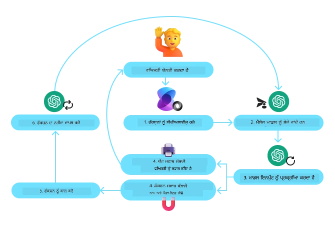
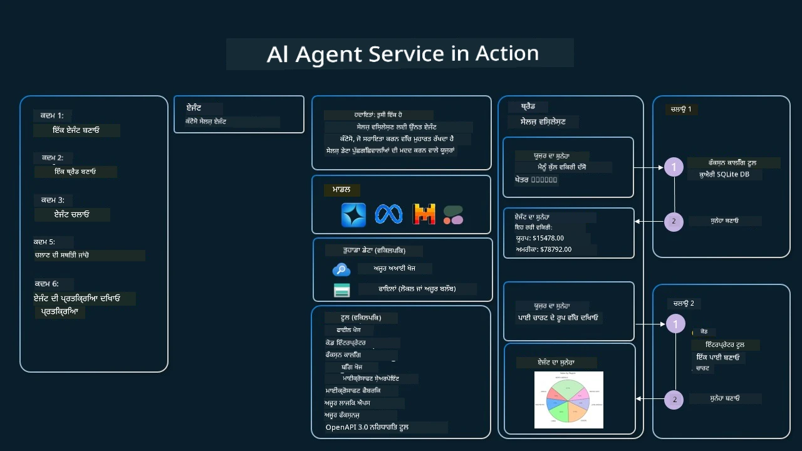

[](https://youtu.be/vieRiPRx-gI?si=cEZ8ApnT6Sus9rhn)

> _(ਉੱਪਰ ਦਿੱਤੀ ਤਸਵੀਰ 'ਤੇ ਕਲਿੱਕ ਕਰਕੇ ਇਸ ਪਾਠ ਦਾ ਵੀਡੀਓ ਦੇਖੋ)_

# ਟੂਲ ਯੂਜ਼ ਡਿਜ਼ਾਈਨ ਪੈਟਰਨ

ਟੂਲ ਮਨੋਹਰ ਹਨ ਕਿਉਂਕਿ ਇਹ AI ਏਜੰਟਾਂ ਨੂੰ ਵੱਧ ਤਰ੍ਹਾਂ ਦੀ ਸਮਰਥਾ ਪ੍ਰਦਾਨ ਕਰਦੇ ਹਨ। ਇੱਕ ਏਜੰਟ ਵੱਲੋਂ ਕਰ ਸਕਣ ਵਾਲੀਆਂ ਸੀਮਤ ਕ੍ਰਿਆਵਾਂ ਦੇ ਬਜਾਏ, ਇੱਕ ਟੂਲ ਜੋੜਕੇ, ਏਜੰਟ ਹੁਣ ਵੱਖ-ਵੱਖ ਕਾਰਜ ਕਰ ਸਕਦਾ ਹੈ। ਇਸ ਅਧਿਆਇ ਵਿੱਚ, ਅਸੀਂ ਟੂਲ ਯੂਜ਼ ਡਿਜ਼ਾਈਨ ਪੈਟਰਨ ਨੂੰ ਵੇਖਾਂਗੇ, ਜੋ ਦਰਸਾਉਂਦਾ ਹੈ ਕਿ AI ਏਜੰਟ ਆਪਣੇ ਲਕੜਾਂ ਨੂੰ ਪ੍ਰਾਪਤ ਕਰਨ ਲਈ ਕਿਵੇਂ ਨਿਰਧਾਰਤ ਟੂਲਾਂ ਦਾ ਉਪਯੋਗ ਕਰ ਸਕਦੇ ਹਨ।

## ਪਰਿਚਯ

ਇਸ ਪਾਠ ਵਿੱਚ ਅਸੀਂ ਹੇਠ ਲਿਖੇ ਪ੍ਰਸ਼ਨਾਂ ਦੇ ਜਵਾਬ ਲੱਭਣ ਦੀ ਕੋਸ਼ਿਸ਼ ਕਰ ਰਹੇ ਹਾਂ:

- ਟੂਲ ਯੂਜ਼ ਡਿਜ਼ਾਈਨ ਪੈਟਰਨ ਕੀ ਹੈ?
- ਇਹ ਕਿਹੜੇ ਕੇਸਾਂ 'ਚ ਲਾਗੂ ਕੀਤਾ ਜਾ ਸਕਦਾ ਹੈ?
- ਡਿਜ਼ਾਈਨ ਪੈਟਰਨ ਨੂੰ ਲਾਗੂ ਕਰਨ ਲਈ ਕਿਹੜੇ ਤੱਤ/ਬਿਲਡਿੰਗ ਬਲਾਕ ਲੋੜੀਂਦੇ ਹਨ?
- ਭਰੋਸੇਯੋਗ AI ਏਜੰਟ ਬਣਾਉਣ ਲਈ ਟੂਲ ਯੂਜ਼ ਡਿਜ਼ਾਈਨ ਪੈਟਰਨ ਦੀ ਵਰਤੋਂ ਦੇ ਵਿਸ਼ੇਸ਼ ਧਿਆਨਾਂ ਕੀ ਹਨ?

## ਸਿੱਖਣ ਦੇ ਲਕੜੇ

ਇਸ ਪਾਠ ਨੂੰ ਪੂਰਾ ਕਰਨ ਤੋਂ ਬਾਅਦ, ਤੁਸੀਂ ਸਮਰੱਥ ਹੋਵੋਗੇ:

- ਟੂਲ ਯੂਜ਼ ਡਿਜ਼ਾਈਨ ਪੈਟਰਨ ਅਤੇ ਇਸ ਦੇ ਉਦੇਸ਼ ਨੂੰ ਪਰਿਭਾਸ਼ਿਤ ਕਰੋ।
- ਉਹ ਕੇਸਾਂ ਪਛਾਣੋ ਜਿੱਥੇ ਟੂਲ ਯੂਜ਼ ਡਿਜ਼ਾਈਨ ਪੈਟਰਨ ਲਾਗੂ ਕੀਤਾ ਜਾ ਸਕਦਾ ਹੈ।
- ਡਿਜ਼ਾਈਨ ਪੈਟਰਨ ਨੂੰ ਲਾਗੂ ਕਰਨ ਲਈ ਲੋੜੀਂਦੇ ਮੁੱਖ ਤੱਤਾਂ ਨੂੰ ਸਮਝੋ।
- ਇਸ ਡਿਜ਼ਾਈਨ ਪੈਟਰਨ ਦੀ ਵਰਤੋਂ ਕਰਦੇ ਹੋਏ ਭਰੋਸੇਯੋਗਤਾ ਯਕੀਨੀ ਬਣਾਉਣ ਲਈ ਵਿਚਾਰ ਕਰਨ ਯੋਗ ਗੱਲਾਂ ਨੂੰ ਪਛਾਣੋ।

## ਟੂਲ ਯੂਜ਼ ਡਿਜ਼ਾਈਨ ਪੈਟਰਨ ਕੀ ਹੈ?

**ਟੂਲ ਯੂਜ਼ ਡਿਜ਼ਾਈਨ ਪੈਟਰਨ** LLMs ਨੂੰ ਵਿਦੇਸ਼ੀ ਟੂਲਾਂ ਨਾਲ ਮੁਲਾਕਾਤ ਕਰਨ ਦੀ ਸਮਰੱਥਾ ਦਿੰਦਾ ਹੈ ਤਾਂ ਜੋ ਵਿਸ਼ੇਸ਼ ਲਕੜਾਂ ਹਾਸਲ ਕੀਤੇ ਜਾ ਸਕਣ। ਟੂਲ ਐਜੰਟ ਵੱਲੋਂ ਕਿਰਿਆਵਾਂ ਕਰਨ ਲਈ ਚਲਾਈ ਜਾਣ ਵਾਲੀ ਕੋਡ ਹੁੰਦੀ ਹੈ। ਇੱਕ ਟੂਲ ਇੱਕ ਸਾਦਾ ਫ਼ੰਕਸ਼ਨ ਹੋ ਸਕਦਾ ਹੈ ਜਿਵੇਂ ਕਿ ਕੈਲਕੂਲੇਟਰ, ਜਾਂ ਤੀਸਰੇ ਧਿਰ ਦੀ ਸੇਵਾ ਲਈ API ਕਾਲ ਜਿਵੇਂ ਕਿ ਸਟਾਕ ਕੀਮਤਾਂ ਦੀ ਖੋਜ ਜਾਂ ਮੌਸਮ ਦੀ ਭਵਿੱਖਵਾਣੀ। AI ਏਜੰਟਾਂ ਦੇ ਸੰਦਰਭ ਵਿੱਚ, ਟੂਲਾਂ ਨੂੰ **ਮਾਡਲ-ਪੈਦਾ ਕੀਤੇ ਫੰਕਸ਼ਨ ਕਾਲਾਂ** ਦੇ ਜਵਾਬ ਵਿੱਚ ਚਲਾਉਣ ਲਈ ਬਣਾਇਆ ਗਿਆ ਹੈ।

## ਇਹ ਕਿਹੜੇ ਕੇਸਾਂ 'ਚ ਲਾਗੂ ਕੀਤਾ ਜਾ ਸਕਦਾ ਹੈ?

AI ਏਜੰਟ ਜਟਿਲ ਕੰਮ ਪੂਰੇ ਕਰਨ, ਜਾਣਕਾਰੀ ਪ੍ਰਾਪਤ ਕਰਨ ਜਾਂ ਫੈਸਲੇ ਕਰਨ ਲਈ ਟੂਲਾਂ ਦੀ ਵਰਤੋਂ ਕਰ ਸਕਦੇ ਹਨ। ਟੂਲ ਯੂਜ਼ ਡਿਜ਼ਾਈਨ ਪੈਟਰਨ ਇਨ੍ਹਾਂ ਦਿਓਰਾਂ ਵਿੱਚ ਵਰਤੀ ਜਾਂਦੀ ਹੈ ਜਿੱਥੇ ਵਿਦੇਸ਼ੀ ਪ੍ਰਣਾਲੀਆਂ ਨਾਲ ਡਾਇਨਾਮਿਕ ਇੰਟਰਐਕਸ਼ਨ di ਲੋੜ ਹੋਵੇ, ਜਿਵੇਂ ਕਿ ਡੇਟਾਬੇਸ, ਵੈੱਬ ਸੇਵਾਵਾਂ ਜਾਂ ਕੋਡ ਇੰਟਰਪਰੀਟਰ। ਇਹ ਸਮਰੱਥਾ ਕਈ ਵੱਖ-ਵੱਖ ਵਰਤੋਂ ਦੇ ਮਾਮਲਿਆਂ ਲਈ ਲਾਭਦਾਇਕ ਹੈ ਪ੍ਰਮੁੱਖ:

- **ਡਾਇਨਾਮਿਕ ਜਾਣਕਾਰੀ ਪ੍ਰਾਪਤੀ:** ਏਜੰਟ ਬਾਹਰੀ API ਜਾਂ ਡੇਟਾਬੇਸ ਦਾ ਪ੍ਰਸ਼ਨ ਕਰ ਸਕਦੇ ਹਨ ਤਾਜ਼ਾ ਡਾਟਾ ਪ੍ਰਾਪਤ ਕਰਨ ਲਈ (ਉਦਾਹਰਨ ਵਜੋਂ, ਡੇਟਾ ਵਿਸ਼ਲੇਸ਼ਣ ਲਈ SQLite ਡੇਟਾਬੇਸ ਪੁੱਛਤਾਛ, ਸਟਾਕ ਕੀਮਤਾਂ ਜਾਂ ਮੌਸਮ ਜਾਣਕਾਰੀ ਪ੍ਰਾਪਤ ਕਰਨਾ)।
- **ਕੋਡ ਚਲਾਉਣਾ ਅਤੇ ਵਿਆਖਿਆ ਕਰਨਾ:** ਏਜੰਟ ਗਣਿਤ ਸਮੱਸਿਆਵਾਂ ਹੱਲ ਕਰਨ, ਰਿਪੋਰਟਾਂ ਤਿਆਰ ਕਰਨ ਜਾਂ ਨਕਲਾਂ ਕਰਨ ਲਈ ਕੋਡ ਜਾਂ ਸਕ੍ਰਿਪਟ ਚਲਾ ਸਕਦੇ ਹਨ।
- **ਵਰਕਫਲੋ ਆਟੋਮੇਸ਼ਨ:** ਟਾਸਕ ਸ਼ੈਡ੍ਯੂਲਰ, ਈਮੇਲ ਸੇਵਾਵਾਂ ਜਾਂ ਡਾਟਾ ਪਾਈਪਲਾਈਨਾਂ ਵਰਗੇ ਟੂਲਾਂ ਨੂੰ ਜੋੜ ਕੇ ਬਾਰੰਬਾਰ ਜਾਂ ਬਹੁ-ਕਦਮੀ ਕਾਰਜ ਸੁਚਾਰੂ ਬਣਾਉਣਾ।
- **ਗਾਹਕ ਸਹਾਇਤਾ:** ਏਜੰਟ ਸੀ ਆਰ ਐਮ ਪ੍ਰਣਾਲੀ, ਟਿਕਟ ਪਲੇਟਫਾਰਮ ਜਾਂ ਗਿਆਨ ਅਧਾਰ ਨਾਲ ਮੁਲਾਕਾਤ ਕਰਕੇ ਉਪਭੋਗਤਾ ਪ੍ਰਸ਼ਨਾਂ ਦਾ ਹੱਲ ਕਰ ਸਕਦੇ ਹਨ।
- **ਸਮੱਗਰੀ ਤਿਆਰ ਅਤੇ ਸੋਧਣ:** ਪ੍ਰਮੁੱਖ, ਟੈਕਸਟ ਸਾਰਾਂਸ਼ਕਾਕਰ ਜਾਂ ਸਮੱਗਰੀ ਸੁਰੱਖਿਆ ਮੁਲਿਆਕਕਰ ਵਰਗੇ ਟੂਲਾਂ ਦੀ ਵਰਤੋਂ ਕਰਨ ਵਾਲੇ ਟੂਲਾਂ ਨਾਲ ਸਹਾਇਤਾ ਲੈ ਸਕਦੇ ਹਨ।

## ਡਿਜ਼ਾਈਨ ਪੈਟਰਨ ਨੂੰ ਲਾਗੂ ਕਰਨ ਲਈ ਲੋੜੀਂਦੇ ਤੱਤ/ਬਿਲਡਿੰਗ ਬਲਾਕ ਕੀ ਹਨ?

ਇਹ ਬਿਲਡਿੰਗ ਬਲਾਕ AI ਏਜੰਟ ਨੂੰ ਵਿਸ਼ਾਲ ਪੈਮਾਨੇ ਦੇ ਕੰਮ ਕਰਨ ਦਿੰਦੇ ਹਨ। ਆਓ ਟੂਲ ਯੂਜ਼ ਡਿਜ਼ਾਈਨ ਪੈਟਰਨ ਨੂੰ ਲਾਗੂ ਕਰਨ ਲਈ ਲੋੜੀਂਦੇ ਮੁੱਖ ਤੱਤਾਂ ਨੂੰ ਵੇਖੀਏ:

- **ਫੰਕਸ਼ਨ/ਟੂਲ ਸਕੀਮਾਜ਼**: ਉਪਲਬਧ ਟੂਲਾਂ ਦੀ ਵਿਸਥਾਰਿਤ ਪਰਿਭਾਸ਼ਾ, ਜਿਸ ਵਿੱਚ ਫੰਕਸ਼ਨ ਦਾ ਨਾਮ, ਉਦੇਸ਼, ਲੋੜੀਂਦੇ ਪੈਰਮੀਟਰਾ ਅਤੇ ਉਮੀਦ ਕੀਤੀ ਗਈ ਆਉਟਪੁੱਟ ਸ਼ਾਮਿਲ ਹਨ। ਇਹ ਸਕੀਮਾਂ LLM ਨੂੰ ਸਮਝਣ ਵਿੱਚ ਮਦਦ ਕਰਦੀਆਂ ਹਨ ਕਿ ਕਿਹੜੇ ਟੂਲ ਉਪਲਬਧ ਹਨ ਅਤੇ ਕਿਵੇਂ ਵੈਧ ਬੇਨਤੀ ਬਣਾਈ ਜਾ ਸਕਦੀ ਹੈ।

- **ਫੰਕਸ਼ਨ ਚਲਾਉਣ ਦੀ ਲਾਜਿਕ**: ਇਸ ਨੂੰ ਨਿਯੰਤਰਿਤ ਕੀਤਾ ਜਾਂਦਾ ਹੈ ਕਿ ਟੂਲ ਕਦੋਂ ਅਤੇ ਕਿਵੇਂ ਵਰਤੇ ਜਾਣ, ਉਪਭੋਗਤਾ ਦੇ ਇਰਾਦੇ ਅਤੇ ਗੱਲਬਾਤ ਦੇ ਸੰਦਰਭ ਦੇ ਅਧਾਰ 'ਤੇ। ਇਸ ਵਿੱਚ ਯੋਜਕ ਮੋਡੀਊਲ, ਰੂਟਿੰਗ ਮਕੈਨਿਜ਼ਮ ਜਾਂ ਸ਼ਰਤੀ प्रवाह ਸ਼ਾਮਿਲ ਹੋ ਸਕਦੇ ਹਨ ਜੋ ਟੂਲ ਦੀ ਵਰਤੋਂ ਨੂੰ ਡਾਇਨਾਮਿਕ ਤਰੀਕੇ ਨਾਲ ਨਿਰਧਾਰਤ ਕਰਦੇ ਹਨ।

- **ਸੰਦੇਸ਼ ਸੰਭਾਲਣ ਪ੍ਰਣਾਲੀ**: ਤੱਤ ਜੋ ਉਪਭੋਗਤਾ ਇਨਪੁੱਟਾਂ, LLM ਜਵਾਬਾਂ, ਟੂਲ ਕਾਲਾਂ ਅਤੇ ਟੂਲ ਆਉਟਪੁੱਟਾਂ ਵਿਚਕਾਰ ਗੱਲਬਾਤ ਚੱਲਵਾਉਂਦੇ ਹਨ।

- **ਟੂਲ ਇੰਟੀਗਰੇਸ਼ਨ ਫਰੇਮਵਰਕ**: ਢਾਂਚਾ ਜੋ ਏਜੰਟ ਨੂੰ ਵੱਖ-ਵੱਖ ਟੂਲਾਂ ਨਾਲ ਜੋੜਦਾ ਹੈ, ਚਾਹੇ ਉਹ ਸਧਾਰਣ ਫੰਕਸ਼ਨ ਹੋਣ ਜਾਂ ਜਟਿਲ ਵਿਦੇਸ਼ੀ ਸੇਵਾਵਾਂ।

- **ਗ਼ਲਤੀ ਸੰਭਾਲਣ ਅਤੇ ਪ੍ਰਮਾਣੀਕਰਨ**: ਟੂਲ ਚਲਾਉਣ ਵਿੱਚ ਵਿੱਫਲਤਾ ਨੂੰ ਸੰਭਾਲਣ, ਪੈਰਮੀਟਰਾ ਦੀ ਜਾਂਚ ਕਰਨ ਅਤੇ ਅਚਾਨਕ ਜਵਾਬਾਂ ਨੂੰ ਸਾਂਭਣ ਲਈ ਮਕੈਨਿਜ਼ਮ।

- **ਸਥਿਤੀ ਪ੍ਰਬੰਧਨ**: ਗੱਲਬਾਤ ਦੇ ਸੰਦਰਭ, ਪਿਛਲੇ ਟੂਲ ਇੰਟਰੈਕਸ਼ਨ ਅਤੇ ਲੰਬੇ ਸਮੇਂ ਲਈ ਡੇਟਾ ਦਾ ਟ੍ਰੈਕ ਰੱਖਣਾ, ਤਾਂ ਜੋ ਬਹੁ-ਦੌਰੀ ਇੰਟਰੈਕਸ਼ਨਾਂ ਵਿੱਚ ਸਥਿਰਤਾ ਯਕੀਨੀ ਬਣਾਈ ਜਾ ਸਕੇ।

ਅਗਲੀ ਵਾਰੀ, ਆਓ ਫੰਕਸ਼ਨ/ਟੂਲ ਕਾਲਿੰਗ ਬਾਰੇ ਹੋਰ ਵਿਸਥਾਰ ਵਿੱਚ ਜਾਣਦੇ ਹਾਂ।
 
### ਫੰਕਸ਼ਨ/ਟੂਲ ਕਾਲਿੰਗ

ਫੰਕਸ਼ਨ ਕਾਲਿੰਗ ਮੁੱਖ ਤਰੀਕਾ ਹੈ ਜਿਸ ਨਾਲ ਅਸੀਂ ਵੱਡੇ ਭਾਸ਼ਾ ਮਾਡਲਾਂ (LLMs) ਨੂੰ ਟੂਲਾਂ ਨਾਲ ਇੰਟਰੈਕਟ ਕਰਨ ਯੋਗ ਬਣਾਉਂਦੇ ਹਾਂ। ਤੁਸੀਂ ਅਕਸਰ 'ਫੰਕਸ਼ਨ' ਅਤੇ 'ਟੂਲ' ਨੂੰ ਪਰਸਪਰ ਤਬਦੀਲੀ ਵਿੱਚ ਵਰਤਦੇ ਹੋਵੋਗੇ ਕਿਉਂਕਿ 'ਫੰਕਸ਼ਨ' (ਦੋਹਰਾਏ ਜਾਣ ਵਾਲੇ ਕੋਡ ਬਲਾਕ) ਹੀ 'ਟੂਲ' ਹਨ ਜਿਨ੍ਹਾਂ ਦੀ ਵਰਤੋਂ ਏਜੰਟ ਕਰਦੇ ਹਨ। ਕਿਸੇ ਫੰਕਸ਼ਨ ਦੇ ਕੋਡ ਨੂੰ ਚਲਾਉਣ ਲਈ, LLM ਨੂੰ ਫੰਕਸ਼ਨਾਂ ਦੇ ਵੇਰਵੇ ਨਾਲ ਉਪਭੋਗਤਾ ਦੀ ਬੇਨਤੀ ਦੀ ਤੁਲਨਾ ਕਰਨੀ ਪੈਂਦੀ ਹੈ। ਇਸ ਲਈ, ਇੱਕ ਸਕੀਮਾ ਜਿਸ ਵਿਚ ਸਭ ਉਪਲੱਬਧ ਫੰਕਸ਼ਨਾਂ ਦੇ ਵੇਰਵੇ ਹੁੰਦੇ ਹਨ, LLM ਨੂੰ ਭੇਜਿਆ ਜਾਂਦਾ ਹੈ। LLM ਫਿਰ ਕੰਮ ਲਈ ਸਭ ਤੋਂ ਉਚਿਤ ਫੰਕਸ਼ਨ ਚੁਣਦਾ ਹੈ ਤੇ ਉਸਦਾ ਨਾਮ ਅਤੇ ਦਲੀਲਾਂ ਵਾਪਸ ਕਰਦਾ ਹੈ। ਚੁਣਿਆ ਗਿਆ ਫੰਕਸ਼ਨ ਚਲਾਇਆ ਜਾਂਦਾ ਹੈ, ਇਸ ਦਾ ਜਵਾਬ LLM ਨੂੰ ਭੇਜਿਆ ਜਾਂਦਾ ਹੈ, ਜੋ ਇਸ ਜਾਣਕਾਰੀ ਦੀ ਵਰਤੋਂ ਕਰਕੇ ਉਪਭੋਗਤਾ ਦੀ ਬੇਨਤੀ ਦਾ ਜਵਾਬ ਦਿੰਦਾ ਹੈ।

ਵਿਕਾਸਕਾਰਾਂ ਲਈ ਫੰਕਸ਼ਨ ਕਾਲਿੰਗ ਲਾਗੂ ਕਰਨ ਲਈ ਤੁਹਾਨੂੰ ਲੋੜੀਂਦਾ ਹੈ:

1. ਉਹ LLM ਮਾਡਲ ਜੋ ਫੰਕਸ਼ਨ ਕਾਲਿੰਗ ਦਾ ਸਹਿਯੋਗ ਕਰਦਾ ਹੋਵੇ
2. ਫੰਕਸ਼ਨ ਵੇਰਵਿਆਂ ਵਾਲਾ ਸਕੀਮਾ
3. ਹਰ ਵਰਣਿਤ ਫੰਕਸ਼ਨ ਦਾ ਕੋਡ

ਆਓ ਇੱਕ ਸ਼ਹਿਰ ਵਿੱਚ ਮੌਜੂਦਾ ਸਮਾਂ ਪ੍ਰਾਪਤ ਕਰਨ ਦਾ ਉਦਾਹਰਨ ਲੈਂਦੇ ਹਾਂ:

1. **ਓਹ LLM ਸ਼ੁਰੂ ਕਰੋ ਜੋ ਫੰਕਸ਼ਨ ਕਾਲਿੰਗ ਦਾ ਸਮਰਥਨ ਕਰਦਾ ਹੈ:**

    ਸਭ ਮਾਡਲ ਫੰਕਸ਼ਨ ਕਾਲਿੰਗ ਦਾ ਸਮਰਥਨ ਨਹੀਂ ਕਰਦੇ, ਇਸ ਲਈ ਇਹ ਸਭ ਤੋਂ ਜ਼ਰੂਰੀ ਹੈ ਕਿ ਤੁਸੀਂ ਯਕੀਨੀ ਬਣਾਓ ਕਿ ਤੁਸੀਂ ਵਰਤ ਰਹੇ LLM ਦਾ ਇਹ ਸਮਰਥਨ ਹੈ।     <a href="https://learn.microsoft.com/azure/ai-services/openai/how-to/function-calling" target="_blank">Azure OpenAI</a> ਫੰਕਸ਼ਨ ਕਾਲਿੰਗ ਦਾ ਸਮਰਥਨ ਕਰਦਾ ਹੈ। ਅਸੀਂ Azure OpenAI **Responses API** (ਜੇਹੜਾ ਕਿ `/openai/v1/` ਐਂਡਪੌਇੰਟ ਹੈ — ਕੋਈ `api_version` ਦੀ ਲੋੜ ਨਹੀਂ) ਦੁਆਰਾ OpenAI ਕਲਾਇੰਟ ਸ਼ੁਰੂ ਕਰ ਕੇ ਸ਼ੁਰੂ ਕਰ ਸਕਦੇ ਹਾਂ।

    ```python
    # Initialize the OpenAI client for Azure OpenAI (Responses API, v1 endpoint)
    client = OpenAI(
        base_url=f"{os.environ['AZURE_OPENAI_ENDPOINT'].rstrip('/')}/openai/v1/",
        api_key=os.environ["AZURE_OPENAI_API_KEY"],
    )
    deployment_name = os.environ["AZURE_OPENAI_DEPLOYMENT"]
    ```

1. **ਫੰਕਸ਼ਨ ਸਕੀਮਾ ਬਣਾਓ**:

    ਅਗਲੇ, ਅਸੀਂ ਇੱਕ JSON ਸਕੀਮਾ ਪਰਿਭਾਸ਼ਿਤ ਕਰਾਂਗੇ ਜਿਸ ਵਿੱਚ ਫੰਕਸ਼ਨ ਦਾ ਨਾਮ, ਫੰਕਸ਼ਨ ਕੀਤਾ ਕੀ ਕੰਮ ਕਰਦਾ ਹੈ ਦਾ ਵੇਰਵਾ, ਅਤੇ ਫੰਕਸ਼ਨ ਪੈਰਮੀਟਰਾਂ ਦੇ ਨਾਮ ਅਤੇ ਵੇਰਵੇ ਹੋਣਗੇ।
    ਫਿਰ ਅਸੀਂ ਇਹ ਸਕੀਮਾ ਇਸ ਕਲਾਇੰਟ ਨੂੰ ਭੇਜਾਂਗੇ ਜੋ ਉਪਭੋਗਤਾ ਦੀ ਬੇਨਤੀ ਦੇ ਨਾਲ ਹੈ ਕਿ ਉਹ ਸੈਨ ਫਰਾਂਸਿਸਕੋ ਦਾ ਸਮਾਂ ਲੱਭੇ। ਇਹ ਧਿਆਨਯੋਗ ਹੈ ਕਿ **ਟੂਲ ਕਾਲ** ਵਾਪਸ ਅਾਉਂਦਾ ਹੈ, ਸਵਾਲ ਦਾ ਅੰਤਿਮ ਜਵਾਬ ਨਹੀਂ। ਪਹਿਲਾਂ ਵੀ ਦੱਸਿਆ ਗਿਆ ਹੈ ਕਿ LLM ਨੇ ਕੰਮ ਲਈ ਚੁਣਿਆ ਫੰਕਸ਼ਨ ਅਤੇ ਇਸ ਦੇ ਦਲੀਲਾਂ ਦੇ ਨਾਮ ਨੂੰ ਵਾਪਸ ਭੇਜਦਾ ਹੈ।

    ```python
    # Function description for the model to read (Responses API flat tool format)
    tools = [
        {
            "type": "function",
            "name": "get_current_time",
            "description": "Get the current time in a given location",
            "parameters": {
                "type": "object",
                "properties": {
                    "location": {
                        "type": "string",
                        "description": "The city name, e.g. San Francisco",
                    },
                },
                "required": ["location"],
            },
        }
    ]
    ```
   
    ```python
  
    # Initial user message
    messages = [{"role": "user", "content": "What's the current time in San Francisco"}]

    # First API call: Ask the model to use the function
    response = client.responses.create(
        model=deployment_name,
        input=messages,
        tools=tools,
        tool_choice="auto",
        store=False,
    )

    # The Responses API returns tool calls as function_call items in response.output.
    # Append them to the conversation so the model has full context on the next turn.
    messages += response.output

    print("Model's response:")
    print(response.output)
  
    ```

    ```bash
    Model's response:
    [ResponseFunctionToolCall(arguments='{"location":"San Francisco"}', call_id='call_pOsKdUlqvdyttYB67MOj434b', name='get_current_time', type='function_call')]
    ```
  
1. **ਕੰਮ ਕਰਨ ਲਈ ਫੰਕਸ਼ਨ ਕੋਡ:**

    ਹੁਣ ਜਦੋਂ ਕਿ LLM ਨੇ ਧਿਆਨ ਦਿੱਤਾ ਕਿ ਕਿਹੜਾ ਫੰਕਸ਼ਨ ਚਲਾਉਣਾ ਹੈ, ਕੰਮ ਕਰਨ ਵਾਲਾ ਕੋਡ ਲਿਖਣਾ ਅਤੇ ਚਲਾਉਣਾ ਜ਼ਰੂਰੀ ਹੈ।
    ਅਸੀਂ ਪਾਈਥਨ ਵਿੱਚ ਮੌਜੂਦਾ ਸਮਾਂ ਪ੍ਰਾਪਤ ਕਰਨ ਲਈ ਕੋਡ ਲਿਖ سکتے ਹਾਂ। ਸਾਡੇ ਨੂੰ ਇਸ ਕੋਡ ਵਿੱਚ ਹੇਠਾਂ ਦਿੱਤੇ ਜਵਾਬ ਤੋਂ ਨਾਮ ਅਤੇ ਦਲੀਲਾਂ ਨੂੰ ਕੱਢਣ ਦਾ ਵੀ ਕੋਡ ਲਿਖਣਾ ਪਵੇਗਾ ਤਾਂ ਜੋ ਅੰਤਿਮ ਨਤੀਜਾ ਮਿਲ ਸਕੇ।

    ```python
      def get_current_time(location):
        """Get the current time for a given location"""
        print(f"get_current_time called with location: {location}")  
        location_lower = location.lower()
        
        for key, timezone in TIMEZONE_DATA.items():
            if key in location_lower:
                print(f"Timezone found for {key}")  
                current_time = datetime.now(ZoneInfo(timezone)).strftime("%I:%M %p")
                return json.dumps({
                    "location": location,
                    "current_time": current_time
                })
      
        print(f"No timezone data found for {location_lower}")  
        return json.dumps({"location": location, "current_time": "unknown"})
    ```

     ```python
    # Handle function calls
    tool_calls = [item for item in response.output if item.type == "function_call"]
    if tool_calls:
        for tool_call in tool_calls:
            if tool_call.name == "get_current_time":

                function_args = json.loads(tool_call.arguments)

                time_response = get_current_time(
                    location=function_args.get("location")
                )

                # Return the tool result as a function_call_output item
                messages.append({
                    "type": "function_call_output",
                    "call_id": tool_call.call_id,
                    "output": time_response,
                })
    else:
        print("No tool calls were made by the model.")

    # Second API call: Get the final response from the model
    final_response = client.responses.create(
        model=deployment_name,
        input=messages,
        tools=tools,
        store=False,
    )

    return final_response.output_text
     ```

     ```bash
      get_current_time called with location: San Francisco
      Timezone found for san francisco
      The current time in San Francisco is 09:24 AM.
     ```

ਫੰਕਸ਼ਨ ਕਾਲਿੰਗ बहੁਤ ਸਾਰੀਆਂ, ਜੇ ਨਹੀਂ ਤਾਂ ਸਾਰੀਆਂ ਏਜੰਟ ਟੂਲ ਯੂਜ਼ ਡਿਜ਼ਾਈਨ ਦਾ ਮੁੱਖ ਅੰਗ ਹੈ, ਪਰ ਇਸ ਨੂੰ ਸੁਆਦ ਤੋਂ ਲਾਗੂ ਕਰਨਾ ਕਈ ਵਾਰੀ ਮੁਸ਼ਕਲ ਹੋ ਸਕਦਾ ਹੈ।
ਜਿਵੇਂ ਕਿ ਅਸੀਂ ਸਿੱਖਿਆ [ਪਾਠ 2](../../../02-explore-agentic-frameworks) ਵਿੱਚ, ਏਜੰਟਿਕ ਫਰੇਮਵਰਕ ਸਾਡੇ ਲਈ ਪਹਿਲਾਂ ਤੋਂ ਤਿਆਰ ਬਿਲਡਿੰਗ ਬਲਾਕ ਪ੍ਰਦਾਨ ਕਰਦੇ ਹਨ ਜੋ ਟੂਲ ਵਰਤੋਂ ਨੂੰ ਅਮਲ 'ਚ ਲਿਆਉਂਦੇ ਹਨ।
 
## ਏਜੰਟਿਕ ਫਰੇਮਵਰਕਸ ਨਾਲ ਟੂਲ ਯੂਜ਼ ਉਦਾਹਰਨਾਂ

ਹੇਠਾਂ ਕੁਝ ਉਦਾਹਰਨ ਦਿੱਤੀਆਂ ਗਈਆਂ ਹਨ ਕਿ ਕਿਸ ਤਰ੍ਹਾਂ ਤੁਸੀਂ ਵੱਖ-ਵੱਖ ਏਜੰਟਿਕ ਫਰੇਮਵਰਕ ਵਰਤ ਕੇ ਟੂਲ ਯੂਜ਼ ਡਿਜ਼ਾਈਨ ਪੈਟਰਨ ਨੂੰ ਲਾਗੂ ਕਰ ਸਕਦੇ ਹੋ:

### ਮਾਇਕ੍ਰੋਸਾਫਟ ਏਜੰਟ ਫਰੇਮਵਰਕ

<a href="https://learn.microsoft.com/azure/ai-services/agents/overview" target="_blank">ਮਾਇਕ੍ਰੋਸਾਫਟ ਏਜੰਟ ਫਰੇਮਵਰਕ</a> ਇੱਕ ਖੁੱਲਾ ਸਰੋਤ AI ਫਰੇਮਵਰਕ ਹੈ ਜੋ AI ਏਜੰਟ ਬਣਾਉਣ ਲਈ ਹੈ। ਇਹ ਫੰਕਸ਼ਨ ਕਾਲਿੰਗ ਦੇ ਪ੍ਰਕਿਰਿਆ ਨੂੰ ਸੌਖਾ ਬਣਾਉਂਦਾ ਹੈ ਕਿਉਂਕਿ ਤੁਸੀਂ Python ਫੰਕਸ਼ਨਾਂ ਦੇ ਤੌਰ 'ਤੇ ਟੂਲਾਂ ਨੂੰ `@tool` ਡੇਕੋਰੇਟਰ ਨਾਲ ਪਰਿਭਾਸ਼ਿਤ ਕਰ ਸਕਦੇ ਹੋ। ਫਰੇਮਵਰਕ ਮਾਡਲ ਅਤੇ ਤੁਹਾਡੇ ਕੋਡ ਵਿਚਕਾਰ ਬੈਕ-ਅਤੇ-ਫੋਰਥ ਸੰਚਾਰ ਸੰਭਾਲਦਾ ਹੈ। ਇਹ ਪਹਿਲਾਂ ਤੋਂ ਤਿਆਰ ਟੂਲਾਂ ਜਿਵੇਂ ਕਿ ਫਾਈਲ ਖੋਜ ਅਤੇ ਕੋਡ ਇੰਟਰਪਰੀਟਰ ਨੂੰ `FoundryChatClient` ਰਾਹੀਂ ਪਹੁੰਚ ਪ੍ਰਦਾਨ ਕਰਦਾ ਹੈ।

ਹੇਠਾਂ ਦਿੱਤਾ ਚਿੱਤਰ ਮਾਇਕ੍ਰੋਸਾਫਟ ਏਜੰਟ ਫਰੇਮਵਰਕ ਨਾਲ ਫੰਕਸ਼ਨ ਕਾਲਿੰਗ ਪ੍ਰਕਿਰਿਆ ਨੂੰ ਦਰਸਾਉਂਦਾ ਹੈ:



ਮਾਇਕ੍ਰੋਸਾਫਟ ਏਜੰਟ ਫਰੇਮਵਰਕ ਵਿੱਚ, ਟੂਲਾਂ ਨੂੰ ਡੇਕੋਰੇਟ ਕੀਤੇ ਗਏ ਫੰਕਸ਼ਨਾਂ ਵਾਂਗ ਪਰਿਭਾਸ਼ਿਤ ਕੀਤਾ ਜਾਂਦਾ ਹੈ। ਅਸੀਂ ਪਹਿਲਾਂ ਵੇਖੇ ਗਏ `get_current_time` ਫੰਕਸ਼ਨ ਨੂੰ `@tool` ਡੇਕੋਰੇਟਰ ਨਾਲ ਇੱਕ ਟੂਲ ਵਿੱਚ ਬਦਲ ਸਕਦੇ ਹਾਂ। ਫਰੇਮਵਰਕ ਆਪਮਾਤਰ ਫੰਕਸ਼ਨ ਅਤੇ ਇਸ ਦੇ ਪੈਰਮੀਟਰਾ ਨੂੰ ਸੀਰੀਅਲਾਈਜ਼ ਕਰੇਗਾ, ਸਕੀਮਾ ਬਣਾਉਂਦਾ ਹੈ ਅਤੇ LLM ਨੂੰ ਭੇਜੇਗਾ।

```python
import os
from agent_framework import tool
from agent_framework.foundry import FoundryChatClient
from azure.identity import AzureCliCredential

@tool(approval_mode="never_require")
def get_current_time(location: str) -> str:
    """Get the current time for a given location"""
    ...

# Create the client
provider = FoundryChatClient(
    project_endpoint=os.environ["AZURE_AI_PROJECT_ENDPOINT"],
    model=os.environ["AZURE_AI_MODEL_DEPLOYMENT_NAME"],
    credential=AzureCliCredential(),
)

# Create an agent and run with the tool
agent = provider.as_agent(name="TimeAgent", instructions="Use available tools to answer questions.", tools=get_current_time)
response = await agent.run("What time is it?")
```

#### MCP ਸਰਵਰ ਤੋਂ ਟੂਲ

ਟੂਲ ਤੁਹਾਡੇ ਆਪਣੇ ਕੋਡ ਦੇ ਫੰਕਸ਼ਨ ਹੋਣ ਲਾਜ਼ਮੀ ਨਹੀਂ। ਇੱਕ ਸਰਵਰ ਜੋ ਮਾਡਲ ਕਾਨਟੈਕਸਟ ਪ੍ਰੋਟੋਕੋਲ (MCP, ਜਿਸ ਨੂੰ ਅਸੀਂ [ਪਾਠ 11](../11-agentic-protocols/README.md) ਵਿੱਚ ਦੇਖਿਆ) ਬੋਲਦਾ ਹੈ, ਆਪਣੇ ਟੂਲਾਂ ਨੂੰ ਸਕੀਮੇਲਾਂ ਨਾਲ ਪ੍ਰਕਾਸ਼ਤ ਕਰਦਾ ਹੈ, ਅਤੇ ਫਰੇਮਵਰਕ ਉਨ੍ਹਾਂ ਨੂੰ ਉਸੇ ਤਰੀਕੇ ਨਾਲ ਲੋਡ ਕਰ ਸਕਦਾ ਹੈ ਜਿਵੇਂ ਕਿ ਉਹ ਇੱਕ ਡੇਕੋਰੇਟਿਡ ਫੰਕਸ਼ਨ ਨੂੰ ਸੀਰੀਅਲਾਈਜ਼ ਕਰਦਾ ਹੈ। `MCPStreamableHTTPTool` HTTP ਰਾਹੀਂ ਇਸ ਤਰ੍ਹਾਂ ਦੇ ਸਰਵਰ ਨਾਲ ਜੁੜਦਾ ਹੈ, ਟੂਲ ਸਕੀਮੇਲਾਂ ਪੜ੍ਹਦਾ ਹੈ ਅਤੇ ਮਾਡਲ ਨੂੰ ਕਾਫੀ ਹੋਰ ਟੂਲਾਂ ਦੇ ਨਾਲ ਪ੍ਰਦਾਨ ਕਰਦਾ ਹੈ।

ਹੇਠਾਂ ਦਿੱਤੇ ਉਦਾਹਰਨ ਵਿੱਚੋਂ ਇੱਕ ਵੈੱਬ ਖੋਜ ਸਰਵਰ ਹੈ ਜੋ <a href="https://keenable.ai" target="_blank">Keenable</a> ਵੱਲੋਂ ਹੋਸਟ ਕੀਤਾ ਗਿਆ ਹੈ। ਇਹ ਬਿਨਾਂ ਖਾਤੇ ਜਾਂ API ਕੁੰਜੀ ਦੇ ਮਫ਼ਤ ਵਰਤੋਂ ਲਈ ਹੈ (ਬੇਨਤੀਆਂ ਹਰ IP ਲਈ ਸੀਮਿਤ ਹੁੰਦੀਆਂ ਹਨ), ਇਸ ਲਈ ਤੁਹਾਡੇ ਮਾਡਲ ਲਈ ਹੀ ਕ੍ਰੈਡੇਂਸ਼ਿਅਲ ਲੋੜੀਂਦੇ ਹਨ। ਜਿਵੇਂ ਕਿਸੇ ਵੀ ਰਿਮੋਟ ਟੂਲ ਨਾਲ ਹੁੰਦਾ ਹੈ, ਮਾਡਲ ਦੇ ਦੁਆਰਾ ਲਿਖੀਆਂ ਗਈਆਂ ਖੋਜਾਂ ਉਸ ਸਰਵਰ ਨੂੰ ਭੇਜੀਆਂ ਜਾਂਦੀਆਂ ਹਨ।

```python
from agent_framework import MCPStreamableHTTPTool

web_search = MCPStreamableHTTPTool(
    name="Keenable web search",
    url="https://api.keenable.ai/mcp",
)

# Connecting loads the server's tool schemas; the agent decides when to call them
async with web_search:
    agent = provider.as_agent(
        name="ResearchAgent",
        instructions="Use available tools to answer questions.",
        tools=[web_search],
    )
    response = await agent.run("What is new in the latest Python release?")
    print(response.text)
```

ਸਰਵਰ ਦੋ ਟੂਲ ਪ੍ਰਕਾਸ਼ਤ ਕਰਦਾ ਹੈ, `search_web_pages` ਅਤੇ `fetch_page_content`। ਜਦੋਂ ਪ੍ਰਸ਼ਨ ਨੂੰ ਤਾਜ਼ਾ ਜਾਣਕਾਰੀ ਦੀ ਲੋੜ ਹੁੰਦੀ ਹੈ, ਤਾਂ ਮਾਡਲ `search_web_pages` ਨੂੰ ਕਾਲ ਕਰਦਾ ਹੈ, ਸਿਰਲੇਖ, URL ਅਤੇ ਟੈਕਸਟ ਟੁਕੜੇ ਫਿਰ ਦੌੜਦਾ ਹੈ ਅਤੇ ਉਨ੍ਹਾਂ ਤੋਂ ਆਪਣਾ ਜਵਾਬ ਲਿਖਦਾ ਹੈ, ਉੱਪਰ ਦਿੱਤੇ `get_current_time` ਉਦਾਹਰਨ ਵਾਲੇ ਹੀ ਲੂਪ ਵਿੱਚ।
  
### ਮਾਇਕ੍ਰੋਸਾਫਟ ਫਾਉਂਡਰੀ ਏਜੰਟ ਸਰਵਿਸ

<a href="https://learn.microsoft.com/azure/ai-services/agents/overview" target="_blank">ਮਾਇਕ੍ਰੋਸਾਫਟ ਫਾਉਂਡਰੀ ਏਜੰਟ ਸਰਵਿਸ</a> ਇੱਕ ਨਵਾਂ ਏਜੰਟਿਕ ਫਰੇਮਵਰਕ ਹੈ ਜੋ ਵਿਕਾਸਕਾਰਾਂ ਨੂੰ ਬਿਨਾਂ ਨਿਮਨਲਿਖਤ ਗਣਨ ਅਤੇ ਸੰਗ੍ਰਹਿ ਸਰੋਤਾਂ ਦੇ ਪ੍ਰਬੰਧ ਦੇ, ਸੁਰੱਖਿਅਤ, ਪੈਮਾਨੇਯੋਗ ਅਤੇ ਵਿਸ਼ਤਰੀਤ AI ਏਜੰਟ ਬਣਾਉਣ, ਤੈਨਾਤ ਕਰਨ ਅਤੇ ਵੱਡੇ ਪੱਧਰ ’ਤੇ ਚਲਾਉਣ ਯੋਗ ਬਣਾਉਂਦਾ ਹੈ। ਇਹ ਖਾਸ ਤੌਰ 'ਤੇ ਉਦਯੋਗਿਕ ਐਪਲੀਕੇਸ਼ਨਾਂ ਲਈ ਬਹੁਤ ਉਪਯੋਗੀ ਹੈ ਕਿਉਂਕਿ ਇਹ ਪੂਰੀ ਤਰ੍ਹਾਂ ਪ੍ਰਬੰਧਿਤ ਸੇਵਾ ਹੈ ਜਿਸ ਵਿੱਚ ਉਦਯੋਗਿਕ ਗਰੇਡ ਸੁਰੱਖਿਆ ਹੁੰਦੀ ਹੈ।

ਯੋਜਨਾ ਦੇ ਸਿੱਧੇ LLM API ਨਾਲ ਵਿਕਾਸ ਦੇ ਮੁਕਾਬਲੇ, ਮਾਇਕ੍ਰੋਸਾਫਟ ਫਾਉਂਡਰੀ ਏਜੰਟ ਸਰਵਿਸ ਕੁਝ ਲਾਭ ਦਿੰਦਾ ਹੈ, ਜੋ ਇਸ ਤਰ੍ਹਾਂ ਹਨ:

- ਆਟੋਮੈਟਿਕ ਟੂਲ ਕਾਲਿੰਗ – ਹੁਣ ਸਰਵਰ ਪਾਸੇ ਸਾਰੇ ਕੰਮ, ਜਿਸ ਵਿੱਚ ਟੂਲ ਕਾਲ ਦਾ ਪਾਰਸ ਕਰਨਾ, ਟੂਲ ਨੂੰ ਚਲਾਉਣਾ ਅਤੇ ਜਵਾਬ ਦਾ ਸੰਭਾਲ, ਆਪਣੇ ਆਪ ਹੁੰਦਾ ਹੈ
- ਸੁਰੱਖਿਅਤ ਡੇਟਾ ਪ੍ਰਬੰਧਨ – ਆਪਣੀ ਗੱਲਬਾਤ ਸਥਿਤੀ ਸੰਭਾਲਣ ਦੀ ਬਜਾਏ, ਤੁਸੀਂ ਥ੍ਰੇਡਾਂ 'ਤੇ ਭਰੋਸਾ ਕਰ ਸਕਦੇ ਹੋ ਜੋ ਸਾਰੀ ਲੋੜੀਂਦੀ ਜਾਣਕਾਰੀ ਸਟੋਰ ਕਰਦੇ ਹਨ
- ਬਾਕਸ ਤੋਂ ਬਾਹਰ ਟੂਲਾਂ – ਉਹ ਟੂਲ ਜਿਨ੍ਹਾਂ ਨਾਲ ਤੁਸੀਂ ਆਪਣੇ ਡਾਟਾ ਸਰੋਤਾਂ ਨਾਲ ਸੰਪਰਕ ਕਰ ਸਕਦੇ ਹੋ, ਜਿਵੇਂ ਕਿ ਬਿੰਗ, ਏਜ਼ਿਊਰ AI ਖੋਜ ਅਤੇ ਏਜ਼ਿਊਰ ਫੰਕਸ਼ਨ।

ਮਾਇਕ੍ਰੋਸਾਫਟ ਫਾਉਂਡਰੀ ਏਜੰਟ ਸਰਵਿਸ ਵਿੱਚ ਉਪਲੱਬਧ ਟੂਲਾਂ ਨੂੰ ਦੋ ਸ਼੍ਰੇਣੀਆਂ ਵਿੱਚ ਵੰਡਿਆ ਜਾ ਸਕਦਾ ਹੈ:

1. ਗਿਆਨ ਸਮੱਗਰੀ ਵਾਲੇ ਟੂਲ:
    - <a href="https://learn.microsoft.com/azure/ai-services/agents/how-to/tools/bing-grounding?tabs=python&pivots=overview" target="_blank">ਬਿੰਗ ਖੋਜ ਨਾਲ ਗਰਾਊਂਡਿੰਗ</a>
    - <a href="https://learn.microsoft.com/azure/ai-services/agents/how-to/tools/file-search?tabs=python&pivots=overview" target="_blank">ਫਾਈਲ ਖੋਜ</a>
    - <a href="https://learn.microsoft.com/azure/ai-services/agents/how-to/tools/azure-ai-search?tabs=azurecli%2Cpython&pivots=overview-azure-ai-search" target="_blank">ਏਜ਼ਿਊਰ AI ਖੋਜ</a>

2. ਕਾਰਜ ਟੂਲ:
    - <a href="https://learn.microsoft.com/azure/ai-services/agents/how-to/tools/function-calling?tabs=python&pivots=overview" target="_blank">ਫੰਕਸ਼ਨ ਕਾਲਿੰਗ</a>
    - <a href="https://learn.microsoft.com/azure/ai-services/agents/how-to/tools/code-interpreter?tabs=python&pivots=overview" target="_blank">ਕੋਡ ਇੰਟਰਪਰੀਟਰ</a>
    - <a href="https://learn.microsoft.com/azure/ai-services/agents/how-to/tools/openapi-spec?tabs=python&pivots=overview" target="_blank">ਓਪਨAPI ਪਰਿਭਾਸ਼ਿਤ ਟੂਲਾਂ</a>
    - <a href="https://learn.microsoft.com/azure/ai-services/agents/how-to/tools/azure-functions?pivots=overview" target="_blank">ਏਜ਼ਿਊਰ ਫੰਕਸ਼ਨ</a>

ਏਜੰਟ ਸਰਵਿਸ ਸਾਨੂੰ ਇਨ੍ਹਾਂ ਟੂਲਾਂ ਨੂੰ ਇੱਕ `toolset` ਵਜੋਂ ਵਰਤਣ ਦੀ ਆਗਿਆ ਦਿੰਦਾ ਹੈ। ਇਹ ਵੀ `threads` ਦੀ ਵਰਤੋਂ ਕਰਦਾ ਹੈ ਜੋ ਵਿਸ਼ੇਸ਼ ਗੱਲਬਾਤ ਦੇ ਸ 메시ਜਾਂ ਦੇ ਇਤਿਹਾਸ ਨੂੰ ਟਰੈਕ ਕਰਦਾ ਹੈ।

ਸੋਚੋ ਤੁਸੀਂ Contoso ਨਾਮਕ ਕੰਪਨੀ ਵਿੱਚ ਸੇਲਜ਼ ਏਜੰਟ ਹੋ। ਤੁਸੀਂ ਐਸਾ ਗੱਲਬਾਤੀ ਏਜੰਟ ਬਣਾਉਣਾ ਚਾਹੁੰਦੇ ਹੋ ਜੋ ਤੁਹਾਡੇ ਸੇਲਜ਼ ਡੇਟਾ ਬਾਰੇ ਸਵਾਲਾਂ ਦਾ ਜਵਾਬ ਦੇ ਸਕੇ।

ਹੇਠਾਂ ਦਿੱਤੀ ਤਸਵੀਰ ਦਰਸਾਉਂਦੀ ਹੈ ਕਿ ਤੁਸੀਂ ਮਾਇਕ੍ਰੋਸਾਫਟ ਫਾਉਂਡਰੀ ਏਜੰਟ ਸਰਵਿਸ ਨਾਲ ਕਿਸ ਤਰ੍ਹਾਂ ਆਪਣੇ ਸੇਲਜ਼ ਡੇਟਾ ਦਾ ਵਿਸ਼ਲੇਸ਼ਣ ਕਰ ਸਕਦੇ ਹੋ:



ਸਰਵਿਸ ਨਾਲ ਕਿਸੇ ਵੀ ਟੂਲ ਦੀ ਵਰਤੋਂ ਕਰਨ ਲਈ ਅਸੀਂ ਕਲਾਇੰਟ ਬਣਾਉਂਦੇ ਹਾਂ ਅਤੇ ਟੂਲ ਜਾਂ ਟੂਲਸੈਟ ਪਰਿਭਾਸ਼ਿਤ ਕਰਦੇ ਹਾਂ। ਇਹ ਵਰਤੋਂਕਾਰੀ ਤੌਰ 'ਤੇ ਅਸੀਂ ਹੇਠਾਂ ਦਿੱਤਾ Python ਕੋਡ ਦਿੱਤਾ ਹੈ। LLM ਟੂਲ ਸੈਟ ਨੂੰ ਦੇਖਕੇ ਫੈਸਲਾ ਕਰੇਗਾ ਕਿ ਉਪਭੋਗਤਾ ਬਣਾਇਆ ਫੰਕਸ਼ਨ, `fetch_sales_data_using_sqlite_query` ਜਾਂ ਪਹਿਲਾਂ ਬਣਾਇਆ ਹੋਇਆ ਕੋਡ ਇੰਟਰਪਰੀਟਰ ਵਰਤਨਾ ਹੈ ਭਾਵੇਂ ਉਪਭੋਗਤਾ ਦੀ ਬੇਨਤੀ ਕੀ ਹੈ।

```python 
import os
from azure.ai.projects import AIProjectClient
from azure.identity import DefaultAzureCredential
from fetch_sales_data_functions import fetch_sales_data_using_sqlite_query # fetch_sales_data_using_sqlite_query function which can be found in a fetch_sales_data_functions.py file.
from azure.ai.projects.models import ToolSet, FunctionTool, CodeInterpreterTool

project_client = AIProjectClient.from_connection_string(
    credential=DefaultAzureCredential(),
    conn_str=os.environ["PROJECT_CONNECTION_STRING"],
)

# Initialize toolset
toolset = ToolSet()

# Initialize function calling agent with the fetch_sales_data_using_sqlite_query function and adding it to the toolset
fetch_data_function = FunctionTool(fetch_sales_data_using_sqlite_query)
toolset.add(fetch_data_function)

# Initialize Code Interpreter tool and adding it to the toolset. 
code_interpreter = CodeInterpreterTool()toolset.add(code_interpreter)

agent = project_client.agents.create_agent(
    model="gpt-5-mini", name="my-agent", instructions="You are helpful agent", 
    toolset=toolset
)
```

## ਭਰੋਸੇਯੋਗ AI ਏਜੰਟ ਬਣਾਉਣ ਲਈ ਟੂਲ ਯੂਜ਼ ਡਿਜ਼ਾਈਨ ਪੈਟਰਨ ਵਰਤਦੇ ਸਮੇਂ ਵਿਸ਼ੇਸ਼ ਧਿਆਨ

LLMs ਦੁਆਰਾ ਡਾਇਨਾਮਿਕ ਤਰੀਕੇ ਨਾਲ ਬਣਾਈ ਗਈ SQL ਦੇ ਨਾਲ ਇੱਕ ਆਮ ਚਿੰਤਾ ਸੁਰੱਖਿਆ ਹੈ, ਖ਼ਾਸਤੌਰ 'ਤੇ SQL ਇੰਜੈਕਸ਼ਨ ਜਾਂ ਖ਼ਤਰਨਾਕ ਕਾਰਜਾਂ ਦਾ ਖ਼ਤਰਾ, ਜਿਵੇਂ ਡੇਟਾਬੇਸ ਡ੍ਰਾਪ ਕਰਨਾ ਜਾਂ ਛੇੜਛਾੜ ਕਰਨਾ। ਜਦੋਂ ਕਿ ਇਹ ਚਿੰਤਾਵਾਂ ਸਹੀ ਹਨ, ਇਹਨਾਂ ਨੂੰ ਡੇਟਾਬੇਸ ਐਕਸੈਸ ਅਨੁਮਤੀਆਂ ਨੂੰ ਠੀਕ ਤਰੀਕੇ ਨਾਲ ਸੈੱਟ ਕਰਕੇ ਪ੍ਰਭਾਵਸ਼ਾਲੀ ਤਰੀਕੇ ਨਾਲ ਰੋਕਿਆ ਜਾ ਸਕਦਾ ਹੈ। ਜ਼ਿਆਦਾਤਰ ਡੇਟਾਬੇਸਾਂ ਲਈ ਇਹ ਰੀਡ-ਓਨਲੀ ਲਈ ਕਨਫਿਗਰ ਕਰਨ ਵਿੱਚ ਸ਼ਾਮਿਲ ਹੈ। ਪੋਸਟਗਰੇਐਸਕਿਊਐਲ ਜਾਂ ਏਜ਼ਿਊਰ SQL ਵਰਗੀਆਂ ਡੇਟਾਬੇਸ ਸੇਵਾਵਾਂ ਲਈ, ਐਪ ਨੂੰ ਰੀਡ-ਓਨਲੀ (SELECT) ਰੋਲ ਦਿੱਤਾ ਜਾਣਾ ਚਾਹੀਦਾ ਹੈ।

ਐਪ ਨੂੰ ਇੱਕ ਸੁਰੱਖਿਅਤ ਮਾਹੌਲ ਵਿੱਚ ਚਲਾਉਣਾ ਵੀ ਸੁਰੱਖਿਆ ਵਿੱਚ ਸੁਧਾਰ ਕਰਦਾ ਹੈ। ਉਦਯੋਗਿਕ ਸੰਦਰਭਾਂ ਵਿੱਚ, ਡੇਟਾ ਆਮ ਤੌਰ 'ਤੇ ਕਾਰਜਕਾਰੀ ਪ੍ਰਣਾਲੀਆਂ ਤੋਂ ਖ਼ਿੱਚ ਕੇ ਇੱਕ ਰੀਡ-ਓਨਲੀ ਡੇਟਾਬੇਸ ਜਾਂ ਡੇਟਾ ਵੇਅਰਹਾ^{ਸ} ਵਿੱਚ ਪਰਿਵਰਤਿਤ ਕੀਤਾ ਜਾਂਦਾ ਹੈ ਜਿਸ ਦੀ ਵਰਤੋਂ ਕਰਨ ਵਾਲੇ ਲਾਈਕschema ਹੁੰਦੀ ਹੈ। ਇਹ ਢੰਗ ਜਾਂਚਦਾ ਹੈ ਕਿ ਡੇਟਾ ਸੁਰੱਖਿਅਤ ਹੈ, ਪ੍ਰਦਰਸ਼ਨ ਅਤੇ ਪਹੁੰਚ ਲਈ ਅਨੁਕੂਲਿਤ ਹੈ, ਅਤੇ ਐਪ ਕੋਲ ਸੀਮਤ, ਰੀਡ-ਓਨਲੀ ਐਕਸੈਸ ਹੈ।

## ਨਮੂਨਾ ਕੋਡ

- Python: [ਏਜੰਟ ਫਰੇਮਵਰਕ](./code_samples/04-python-agent-framework.ipynb)
- .NET: [ਏਜੰਟ ਫਰੇਮਵਰਕ](./code_samples/04-dotnet-agent-framework.md)

## ਟੂਲ ਯੂਜ਼ ਡਿਜ਼ਾਈਨ ਪੈਟਰਨ ਬਾਰੇ ਹੋਰ ਸਵਾਲ ਹਨ?

[Microsoft Foundry Discord](https://discord.com/invite/ATgtXmAS5D) ਵਿੱਚ ਸ਼ਾਮਲ ਹੋਵੋ, ਹੋਰ ਸਿੱਖਣ ਵਾਲਿਆਂ ਨਾਲ ਮਿਲੋ, ਦਫ਼ਤਰ ਦੇ ਘੰਟੇ ਵਿੱਚ ਹਾਜ਼ਰੀ ਦਿਓ ਅਤੇ ਆਪਣੇ AI ਏਜੰਟ ਸਵਾਲਾਂ ਦੇ ਜਵਾਬ ਪ੍ਰਾਪਤ ਕਰੋ।

## ਵਾਧੂ ਸਰੋਤ

- <a href="https://microsoft.github.io/build-your-first-agent-with-azure-ai-agent-service-workshop/" target="_blank">Azure AI ਏਜੰਟ ਸਰਵਿਸ ਵਰਕਸ਼ਾਪ</a>
- <a href="https://github.com/Azure-Samples/contoso-creative-writer/tree/main/docs/workshop" target="_blank">ਕੋਨਟੋਸੋ ਕ੍ਰੀਏਟਿਵ ਰਾਈਟਰ ਮਲਟੀ-ਏਜੰਟ ਵਰਕਸ਼ਾਪ</a>
- <a href="https://learn.microsoft.com/azure/ai-services/agents/overview" target="_blank">ਮਾਈਕਰੋਸੌਫਟ ਏਜੰਟ ਫਰੇਮਵਰਕ ਓਵਰਵਿਊ</a>

## ਇਸ ਏਜੰਟ ਦੀ ਸ੍ਮੋਕ-ਟੈਸਟਿੰਗ (ਵਿਕਲਪਿਕ)

[ਪਾਠ 16](../16-deploying-scalable-agents/README.md) ਵਿੱਚ ਏਜੰਟਸ ਨੂੰ ਡਿਪਲੋਇ ਕਰਨ ਸਿੱਖਣ ਤੋਂ ਬਾਦ, ਤੁਸੀਂ ਇਸ ਪਾਠ ਦਾ `TravelToolAgent` (ਕੀ ਇਹ ਹੁਣ ਵੀ ਆਪਣੇ ਟੂਲਜ਼ ਨੂੰ ਕਾਲ ਕਰਦਾ ਹੈ ਅਤੇ ਜਵਾਬ ਦਿੰਦਾ ਹੈ?) ਨੂੰ [`tests/lesson-04-smoke-tests.json`](../../../tests/lesson-04-smoke-tests.json) ਨਾਲ ਸ੍ਮੋਕ-ਟੈਸਟ ਕਰ ਸਕਦੇ ਹੋ। ਇਸ ਨੂੰ ਚਲਾਉਣ ਲਈ ਵੇਖੋ [`tests/README.md`](../tests/README.md)।

## ਪਿਛਲਾ ਪਾਠ

[ਏਜੰਟਿਕ ਡਿਜ਼ਾਈਨ ਪੈਟਰਨਸ ਨੂੰ ਸਮਝਣਾ](../03-agentic-design-patterns/README.md)

## ਅਗਲਾ ਪਾਠ

[ਏਜੰਟਿਕ RAG](../05-agentic-rag/README.md)

---

<!-- CO-OP TRANSLATOR DISCLAIMER START -->
**ਅਸਵੀਕਾਰੋਪਣ**:
ਇਸ ਦਸਤਾਵੇਜ਼ ਦਾ ਅਨੁਵਾਦ ਏਆਈ ਅਨੁਵਾਦ ਸੇਵਾ [Co-op Translator](https://github.com/Azure/co-op-translator) ਦੀ ਵਰਤੋਂ ਕਰਕੇ ਕੀਤਾ ਗਿਆ ਹੈ। ਜਦੋਂ ਕਿ ਅਸੀਂ ਸਹੀਤਾਵਾਂ ਲਈ ਯਤਨਸ਼ੀਲ ਹਾਂ, ਕਿਰਪਾ ਕਰਕੇ ਧਿਆਨ ਰੱਖੋ ਕਿ ਸਵੈਚਾਲਿਤ ਅਨੁਵਾਦਾਂ ਵਿੱਚ ਗਲਤੀਆਂ ਜਾਂ ਅਸਮੱਤਿਆਵਾਂ ਹੋ ਸਕਦੀਆਂ ਹਨ। ਮੂਲ ਦਸਤਾਵੇਜ਼ ਆਪਣੀ ਮੂਲ ਭਾਸ਼ਾ ਵਿੱਚ ਅਧਿਕਾਰਕ ਸਰੋਤ ਮੰਨਿਆ ਜਾਣਾ ਚਾਹੀਦਾ ਹੈ। ਜਰੂਰੀ ਜਾਣਕਾਰੀ ਲਈ, ਪੇਸ਼ੇਵਰ ਮਨੁੱਖੀ ਅਨੁਵਾਦ ਦੀ ਸਿਫ਼ਾਰਸ਼ ਕੀਤੀ ਜਾਂਦੀ ਹੈ। ਅਸੀਂ ਇਸ ਅਨੁਵਾਦ ਦੇ ਉਪਯੋਗ ਤੋਂ ਪੈਦਾ ਹੋਣ ਵਾਲੀਆਂ ਕਿਸੇ ਵੀ ਗਲਤਫਹਿਮੀਆਂ ਜਾਂ ਗਲਤ ਵਿਆਖਿਆਵਾਂ ਲਈ ਜਵਾਬਦੇਹ ਨਹੀਂ ਹਾਂ।
<!-- CO-OP TRANSLATOR DISCLAIMER END -->