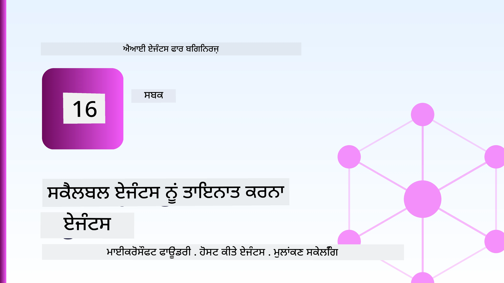
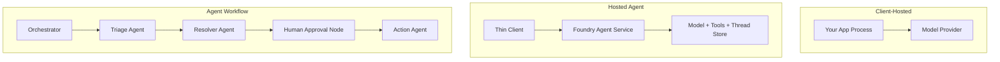
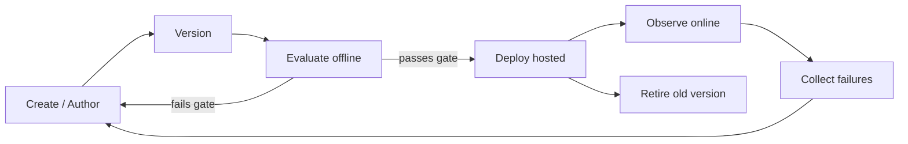
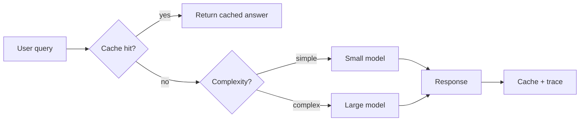
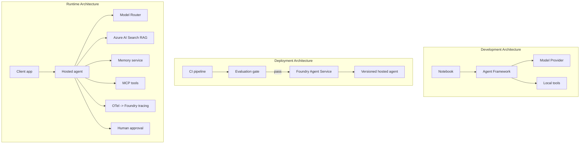

# ਮਾਇਕ੍ਰੋਸਾਫਟ ਫਾਊਂਡਰੀ ਨਾਲ ਸਕੇਲ ਕਰਨ ਯੋਗ ਏਜੰਟ ਨਿਯੁਕਤ ਕਰਨਾ



ਇਸ ਕੋਰਸ ਤੱਕ ਤੁਸੀਂ ਐਜੰਟ ਬਣਾਏ ਹਨ ਜੋ ਤੁਹਾਡੇ ਲੈਪਟਾਪ 'ਤੇ ਚੱਲਦੇ ਹਨ, ਨੋਟਬੁੱਕ ਵਿੱਚ, `az login` ਅਤੇ ਕੁਝ ਵਾਤਾਵਰਣ ਵਾਲੇ ਵੈਰੀਏਬਲਾਂ ਨਾਲ চালਿਤ। ਇਹ ਸਿੱਖਣ ਦਾ ਬਿਲਕੁਲ ਸਹੀ ਤਰੀਕਾ ਹੈ। ਇਹ ਉਹ ਸਹੀ ਤਰੀਕਾ ਨਹੀਂ ਹੈ ਜਦੋਂ ਹਜ਼ਾਰਾਂ ਗਾਹਕ 3 ਵਜੇ ਰਾਤ ਨੂੰ ਇਸ ਤੇ ਨਿਰਭਰ ਕਰਦੇ ਹਨ।

ਇਹ ਪਾਠ 'ਇਹ ਮੇਰੇ ਮਸ਼ੀਨ ਤੇ ਕੰਮ ਕਰਦਾ ਹੈ' ਅਤੇ 'ਇਹ ਉਤਪਾਦਨ ਵਿੱਚ ਭਰੋਸੇਯੋਗ ਅਤੇ ਸੁਲਭ ਤਰੀਕੇ ਨਾਲ ਕੰਮ ਕਰਦਾ ਹੈ' ਦੇ ਵਿਚਕਾਰ ਖਾਈ ਬਾਰੇ ਹੈ। ਅਸੀਂ ਇਸ ਖਾਈ ਨੂੰ **ਮਾਇਕ੍ਰੋਸਾਫਟ ਫਾਊਂਡਰੀ** ਅਤੇ **ਮਾਇਕ੍ਰੋਸਾਫਟ ਫਾਊਂਡਰੀ ਏਜੰਟ ਸੇਵਾ** ਦੀ ਵਰਤੋਂ ਕਰਕੇ ਬੰਦ ਕਰਦੇ ਹਾਂ, ਅਤੇ ਅਸੀਂ ਇੱਕ ਅਸਲੀ ਗਾਹਕ ਸਹਾਇਤਾ ਏਜੰਟ ਬਣਾਉਂਦੇ ਹਾਂ ਜਿਸ ਵਿੱਚ ਟੂਲ, ਰਿਟਰੀਵਲ, ਯਾਦ, ਮੁਲਾਂਕਣ ਅਤੇ ਨਿਗਰਾਨੀ ਸ਼ਾਮਿਲ ਹੁੰਦੀ ਹੈ।

## ਜਾਣ-ਪਛਾਣ

ਇਹ ਪਾਠ ਕਵਰ ਕਰੇਗਾ:

- ਇੱਕ **ਪ੍ਰੋਟੋਟਾਈਪ ਏਜੰਟ** ਅਤੇ ਇੱਕ **ਨਿਯੁਕਤ ਏਜੰਟ** ਵਿੱਚ ਫਰਕ, ਅਤੇ ਕਿਉਂਕਿ ਬਦਲਾਅ ਜਿਆਦਾਤਰ ਮਾਡਲ ਦੇ *ਆਲੇ-ਦੁਆਲੇ* ਹੋਰ ਹਰ ਚੀਜ਼ ਬਾਰੇ ਹੁੰਦਾ ਹੈ।
- ਏਜੰਟਾਂ ਲਈ **ਡਿਪਲੌਇਮੈਂਟ ਪੈਟਰਨ**: ਕਲਾਇੰਟ-ਹੋਸਟਡ, ਸੇਵਾ-ਹੋਸਟਡ (ਹੋਸਟਡ ਏਜੰਟ), ਅਤੇ ਵਰਕਫਲੋ-ਅਦਿਆਸਿਤ।
- ਮਾਇਕ੍ਰੋਸਾਫਟ ਫਾਊਂਡਰੀ 'ਤੇ **ਏਜੰਟ ਜੀਵਨ ਚੱਕਰ** — ਬਣਾਉ, ਵਰਜਨ, ਤੈਨਾਤ ਕਰੋ, ਮੁਲਾਂਕਣ ਕਰੋ, ਨਿਗਰਾਨੀ ਕਰੋ, ਰਿਟਾਇਰ ਕਰੋ।
- **ਸਕੇਲਿੰਗ ਤਰਕੀਬਾਂ**: ਮਾਡਲ ਰਾਹਦਾਰੀ, ਕੈਸ਼ਿੰਗ, ਇਕੱਠੇ ਕੰਮ ਕਰਨਾ, ਅਤੇ ਬੇ-ਰਾਜ਼ੀ ਡਿਜ਼ਾਈਨ।
- OpenTelemetry ਅਤੇ ਫਾਊਂਡਰੀ ਟਰੇਸਿੰਗ ਨਾਲ **ਨਿਗਰਾਨੀਯੋਗਤਾ**।
- ਮਾਡਲ ਚੋਣ, ਰਾਹਦਾਰੀ, ਅਤੇ ਮੁਲਾਂਕਣ ਗੇਟਾਂ ਰਾਹੀਂ **ਲਾਗਤ ਦੀ ਬਚਤ**।
- **ਇੰਟਰਪ੍ਰਾਈਜ਼ ਵਿਚਾਰਧਾਰਾ**: ਸ਼ਾਸਨ, ਮਨੁੱਖੀ ਮਨਜ਼ੂਰੀ, ਅਤੇ ਉਤਪਾਦਨ ਵਿੱਚ MCP ਸਰਵਰ ਨੂੰ ਸੁਰੱਖਿਅਤ ਰੱਖਣਾ।

## ਸਿੱਖਣ ਦੇ ਲਕੜੀ

ਇਸ ਪਾਠ ਨੂੰ ਪੂਰਾ ਕਰਨ ਤੋਂ ਬਾਅਦ, ਤੁਸੀਂ ਜਾਣੋਂਗੇ ਕਿ ਕਿਵੇਂ:

- ਕਿਸੇ ਦਿੱਤੇ ਏਜੰਟ ਵਰਕਲੋਡ ਲਈ ਸਹੀ ਡਿਪਲੌਇਮੈਂਟ ਪੈਟਰਨ ਚੁਣਨਾ।
- ਮਾਇਕ੍ਰੋਸਾਫਟ ਫਾਊਂਡਰੀ ਏਜੰਟ ਸੇਵਾ 'ਤੇ ਇੱਕ ਏਜੰਟ ਤੈਨਾਤ ਕਰਨਾ ਤਾਂ ਕਿ ਇਹ ਵਰਜਨਯੁਕਤ, ਸ਼ਾਸਤਰੀ, ਅਤੇ ਦ੍ਰਿਸ਼ਮਾਨ ਹੋਵੇ।
- ਟਰੇਸਿੰਗ ਲਈ ਇੱਕ ਏਜੰਟ ਨੂੰ ਇੰਸਟ੍ਰੂਮੈਂਟ ਕਰਨਾ ਅਤੇ ਹਰ ਰਿਲੀਜ਼ ਤੋਂ ਪਹਿਲਾਂ ਚਲਣ ਵਾਲੀ ਮੁਲਾਂਕਣ ਪਾਈਪਲਾਈਨ ਨਾਲ ਜ਼ੁੜਨਾ।
- ਮਾਡਲ ਰਾਹਦਾਰੀ ਅਤੇ ਕੈਸ਼ਿੰਗ ਲਾਗੂ ਕਰਕੇ ਧੀਰਜ ਅਤੇ ਲਾਗਤ ਨੂੰ ਵੱਡੀ ਪੱਧਰ 'ਤੇ ਕਾਬੂ ਵਿੱਚ ਰੱਖਣਾ।
- ਉੱਚ-ਖਤਰਾ ਵਾਲੇ ਕਾਰਵਾਈਆਂ ਲਈ ਮਨੁੱਖੀ ਮਨਜ਼ੂਰੀ ਦਾ ਗੇਟ ਸ਼ਾਮਿਲ ਕਰਨਾ ਅਤੇ MCP ਸਰਵਰ ਨੂੰ ਉਤਪਾਦਨ-ਸੁਰੱਖਿਅਤ ਤਰੀਕੇ ਨਾਲ ਜੋੜਨਾ।

## ਪੂਰਵ-ਆਵਸ਼ਕਤਾ

ਇਹ ਪਾਠ فرض ਕਰਦਾ ਹੈ ਕਿ ਤੁਸੀਂ ਪਹਿਲੇ ਪਾਠਪੁਸਤਕ ਪੂਰੇ ਕਰ ਚੁੱਕੇ ਹੋ ਅਤੇ ਤੁਹਾਨੂੰ ਆਮ ਤੌਰ 'ਤੇ ਆਗਾਹੀ ਹੈ:

- [ਮਾਇਕ੍ਰੋਸਾਫਟ ਏਜੰਟ ਫ੍ਰੇਮਵਰਕ](../14-microsoft-agent-framework/README.md) ਨਾਲ ਏਜੰਟ ਬਣਾਉਣਾ (ਪਾਠ 14)।
- [ਟੂਲ ਵਰਤੋਂ](../04-tool-use/README.md) (ਪਾਠ 4) ਅਤੇ [ਏਜੈਂਟਿਕ RAG](../05-agentic-rag/README.md) (ਪਾਠ 5)।
- [ਏਜੰਟ ਮੈਮੋਰੀ](../13-agent-memory/README.md) (ਪਾਠ 13) ਅਤੇ [ਏਜੈਂਟਿਕ ਪ੍ਰੋਟੋਕੋਲ / MCP](../11-agentic-protocols/README.md) (ਪਾਠ 11)।
- [ਨਿਗਰਾਨੀਯੋਗਤਾ ਅਤੇ ਮੁਲਾਂਕਣ](../10-ai-agents-production/README.md) (ਪਾਠ 10) — ਇਹ ਪਾਠ ਅਮਲ ਵਿਚ ਇਸ 'ਤੇ ਨਿਰਭਰ ਹੈ।

ਤੁਹਾਨੂੰ ਨੀਵੇਂ ਵੀ ਲੋੜੀਂਦਾ ਹੈ:

- ਇੱਕ **ਅਜ਼ੂਰੇ ਸਬਸਕ੍ਰਿਪਸ਼ਨ** ਅਤੇ ਇੱਕ **ਮਾਇਕ੍ਰੋਸਾਫਟ ਫਾਊਂਡਰੀ ਪ੍ਰਾਜੈਕਟ** ਜਿਸ ਵਿੱਚ ਘੱਟੋ ਘੱਟ ਇੱਕ ਨਿਯੁਕਤ ਗੱਲਬਾਤ ਮਾਡਲ ਹੋਵੇ।
- **ਅਜ਼ੂਰੇ CLI** ਪਰਮਾਣਿਤ (`az login`)।
- ਪਾਈਥਨ 3.12+ ਅਤੇ ਰੇਪੋ ਵਿੱਚ ਮੌਜੂਦ ਪੈਕੇਜ [`requirements.txt`](../../../requirements.txt)।

## ਪ੍ਰੋਟੋਟਾਈਪ ਤੋਂ ਉਤਪਾਦਨ ਤੱਕ: ਅਸਲ ਵਿੱਚ ਕੀ ਬਦਲਦਾ ਹੈ

ਇੱਕ ਪ੍ਰੋਟੋਟਾਈਪ ਏਜੰਟ ਅਤੇ ਇਕ ਉਤਪਾਦਨ ਏਜੰਟ ਇੱਕੋ ਕੋਰ ਲੂਪ ਸਾਂਝਾ ਕਰਦੇ ਹਨ — ਤਰਕ, ਟੂਲ ਕਾਲ ਕਰੋ, ਜਵਾਬ ਦਿਓ। ਬਦਲਾਅ ਉਹ ਹਰ ਚੀਜ਼ ਹੁੰਦੀ ਹੈ ਜੋ ਉਸ ਲੂਪ ਦੇ ਆਲੇ-ਦੁਆਲੇ ਹੁੰਦੀ ਹੈ। ਮਾਡਲ ਇੱਕ ਉਤਪਾਦਨ ਏਜੰਟ ਦਾ ਸ਼ਾਇਦ 20% ਹਿੱਸਾ ਹੈ; ਬਾਕੀ 80% ਸੰਚਾਲਕੀ ਢਾਂਚਾ ਹੈ।

| ਚਿੰਤਾ | ਪ੍ਰੋਟੋਟਾਈਪ | ਉਤਪਾਦਨ |
| --- | --- | --- |
| **ਹੋਸਟਿੰਗ** | ਤੁਹਾਡੇ ਨੋਟਬੁੱਕ ਵਿੱਚ ਚੱਲਦਾ ਹੈ | ਇੱਕ ਹੋਸਟਡ ਸੇਵਾ ਵਜੋਂ ਚੱਲਦਾ ਹੈ, ਵਰਜਨਯੁਕਤ ਅਤੇ ਛੁਟਕਾਰਾ ਮਿਲਦਾ ਹੈ |
| **ਪਛਾਣ** | ਤੁਹਾਡਾ `az login` ਟੋਕਨ | ਪਰਬੰਧਿਤ ਪਛਾਣ ਸਹਿਤ ਸੀਮਿਤ RBAC |
| **ਸਟੇਟ** | ਇਨ-ਮੇਮੋਰੀ, ਰੀਸਟਾਰਟ ਤੇ ਖਤਮ | ਬਾਹਰੀਕ੍ਰਿਤ (ਥਰੇਡ ਸਟੋਰ, ਮੈਮੋਰੀ ਸੇਵਾ) |
| **ਨਾਕਾਮੀ** | ਤੁਸੀਂ ਟਰੇਸਬੈਕ ਵੇਖਦੇ ਹੋ | ਮੁੜ ਕੋਸ਼ਿਸ਼ਾਂ,Fallback, ਡੈਡ-ਲੇਟਰ, ਚેતਾਵਨੀ |
| **ਲਾਗਤ** | "ਇਹ ਕੁਝ ਸੈਂਟ ਹੈ" | ਪ੍ਰਤੀ ਬੇਨਤੀ ਟਰੈਕ ਕੀਤਾ ਗਿਆ, ਰਾਹਦਾਰੀ, ਕੈਸ਼ ਕੀਤਾ, ਬਜਟ ਕੀਤਾ |
| **ਗੁਣਵੱਤਾ** | ਤੁਸੀਂ ਨਤੀਜਾ ਦੇਖਦੇ ਹੋ | ਹਰ ਰਿਲੀਜ਼ ਤੋਂ ਪਹਿਲਾਂ ਆਟੋਮੈਟਿਕ ਮੁਲਾਂਕਣ ਕੀਤਾ |
| **ਭਰੋਸਾ** | ਤੁਸੀਂ ਹਰ ਕਾਰਵਾਈ ਮਨਜ਼ੂਰ ਕਰਦੇ ਹੋ | ਨੀਤੀ + ਮਨੁੱਖੀ-ਇਨ-ਲੂਪ ਖਤਰਨਾਕ ਕਾਰਵਾਈਆਂ ਲਈ |

ਇਸ ਤਾਲਿਕਾ ਨੂੰ ਦਿਮਾਗ ਵਿੱਚ ਰੱਖੋ। ਹੇਠਾਂ ਹਰ ਭਾਗ ਇਨ੍ਹਾਂ ਕਤਾਰਾਂ ਵਿੱਚੋਂ ਇੱਕ ਨਾਲ ਮੈਚ ਕਰਦਾ ਹੈ।

## ਏਜੰਟ ਡਿਪਲੌਇਮੈਂਟ ਪੈਟਰਨ

ਤੁਸੀਂ ਤਿੰਨ ਪੈਟਰਨ ਬਰਤੋਂਗੇ, ਅਕਸਰ ਮਿਲਾ ਕੇ।

### 1. ਕਲਾਇੰਟ-ਹੋਸਟਡ ਏਜੰਟ

ਏਜੰਟ ਵਸਤੂ *ਤੁਹਾਡੇ* ਐਪਲਿਕੇਸ਼ਨ ਪ੍ਰਕਿਰਿਆ ਵਿੱਚ ਵੱਸਦਾ ਹੈ। ਤੁਹਾਡਾ ਕੋਡ ਮਾਡਲ ਪ੍ਰਦਾਤਾ ਨੂੰ ਸਿੱਧਾ ਕਾਲ ਕਰਦਾ ਹੈ; ਤਰਕ ਲੂਪ ਤੁਹਾਡੇ ਸੇਵਾ ਵਿੱਚ ਚੱਲਦਾ ਹੈ। ਇਹ ਉਹੀ ਹੈ ਜੋ ਹਰ ਪਿਛਲਾ ਪਾਠ ਕੀਤਾ ਹੈ।

- **ਜਦੋਂ ਵਰਤਣਾ ਹੈ** ਜਦੋਂ ਤੁਹਾਨੂੰ ਲੂਪ ਉੱਤੇ ਪੂਰਾ ਨਿਯੰਤ੍ਰਣ ਚਾਹੀਦਾ ਹੈ, ਕਸਟਮ ਮਿਡਲਵੇਅਰ, ਜਾਂ ਤੁਸੀਂ ਮੌਜੂਦਾ ਬੈਕਐਂਡ ਵਿੱਚ ਏਜੰਟ ਨੂੰ ਐम्बੈਡ ਕਰ ਰਹੇ ਹੋ।
- **ਵਪਾਰ-ਕਾਰੋਬਾਰ**: ਤੁਸੀਂ ਆਪਣੇ ਆਪ ਸਕੇਲਿੰਗ, ਸਟੇਟ, ਅਤੇ ਅਡਾਲਤ ਦਾ ਮਾਲਕ ਹੋ।

### 2. ਹੋਸਟਡ ਏਜੰਟ (ਫਾਊਂਡਰੀ ਏਜੰਟ ਸੇਵਾ)

ਏਜੰਟ ਮਾਇਕ੍ਰੋਸਾਫਟ ਫਾਊਂਡਰੀ ਵਿੱਚ *ਸੰਸਾਧਨ ਵਜੋਂ ਰਜਿਸਟਰ* ਹੁੰਦਾ ਹੈ। ਫਾਊਂਡਰੀ ਤਰਕ ਲੂਪ ਨੂੰ ਹੋਸਟ ਕਰਦਾ ਹੈ, ਥਰੇਡ ਸਟੋਰ ਕਰਦਾ ਹੈ, ਸਮੱਗਰੀ ਸੁਰੱਖਿਆ ਅਤੇ RBAC ਨੂੰ ਬਰਕਰਾਰ ਰੱਖਦਾ ਹੈ, ਅਤੇ ਏਜੰਟ ਨੂੰ ਫਾਊਂਡਰੀ ਪੋਰਟਲ ਵਿੱਚ ਦ੍ਰਿਸ਼ਮਾਨ ਕਰਦਾ ਹੈ। ਤੁਹਾਡੀ ਐਪ ਇਕ ਪਤਲਾ ਕਲਾਇੰਟ ਬਣ ਜਾਂਦੀ ਹੈ ਜੋ ਧਾਗੇ ਬਣਾਉਂਦਾ ਅਤੇ ਜਵਾਬ ਪੜ੍ਹਦਾ ਹੈ।

- **ਜਦੋਂ ਵਰਤਣਾ ਹੈ** ਜਦੋਂ ਤੁਸੀਂ ਟਿਕਾਊਪਣ, ਅੰਦਰੂਨੀ ਨਿਗਰਾਨੀ, ਸ਼ਾਸਨ, ਅਤੇ ਘੱਟ ਸੰਚਾਲਕੀ ਖੇਤਰ ਚਾਹੁੰਦੇ ਹੋ।
- **ਵਪਾਰ-ਕਾਰੋਬਾਰ**: ਇੱਕ ਪ੍ਰਬੰਧਿਤ ਰਨਟਾਈਮ ਲਈ ਘੱਟ ਹਨੀਰ-ਸਤਹ ਨਿਯੰਤ੍ਰਣ।

### 3. ਏਜੰਟ ਵਰਕਫਲੋਜ਼

ਕਈ ਏਜੰਟ (ਅਤੇ ਟੂਲ) ਇੱਕ ਗ੍ਰਾਫ ਵਿੱਚ ਜੋੜੇ ਜਾਂਦੇ ਹਨ ਜਿਸ ਵਿੱਚ ਸਪੱਸ਼ਟ ਨਿਯੰਤ੍ਰਣ ਪ੍ਰਵਾਹ ਹੁੰਦਾ ਹੈ—ਤਰਤੀਬਵਾਰ ਕਦਮ, ਸ਼ਾਖਾ ਕਰਨੀ, ਮਨੁੱਖੀ ਮਨਜ਼ੂਰੀ ਨੋਡ, ਅਤੇ ਟਿਕਾਊ ਚੈਕਪੌਇੰਟ ਜੋ ਰੋਕੇ ਜਾ ਸਕਦੇ ਹਨ ਅਤੇ ਮੁੜ ਮੁੜ ਚੱਲਾਏ ਜਾ ਸਕਦੇ ਹਨ। ਇਹ ਮਾਇਕ੍ਰੋਸਾਫਟ ਏਜੰਟ ਫ੍ਰੇਮਵਰਕ ਦੀ **ਵਰਕਫਲੋਜ਼** ਖੂबी ਹੈ ਜੋ ਤੈਨਾਤ ਪੱਧਰ 'ਤੇ ਲਾਗੂ ਹੁੰਦੀ ਹੈ।

- **ਜਦੋਂ ਵਰਤਣਾ ਹੈ** ਜਦੋਂ ਇੱਕ ਕੰਮ ਕਈ ਵਿਸ਼ੇਸ਼ ਏਜੰਟਾਂ ਵਿੱਚ ਫੈਲਦਾ ਹੈ ਜਾਂ ਮੱਧ ਵਿੱਚ ਇੱਕ ਮਨਜ਼ੂਰੀ ਕਦਮ ਲੋੜੀਂਦਾ ਹੈ।
- **ਵਪਾਰ-ਕਾਰੋਬਾਰ**: ਜ਼ਿਆਦਾ ਹਿਲਦੀ-ਡੁੱਲਦੀ ਹਿੱਸੇ; ਅਦਿਆਸ ਸਤਰ ਦੀ ਨਿਗਰਾਨੀ ਦੀ ਲੋੜ।



## ਮਾਇਕ੍ਰੋਸਾਫਟ ਫਾਊਂਡਰੀ 'ਤੇ ਏਜੰਟ ਜੀਵਨ ਚੱਕਰ

ਏਜੰਟ ਨੂੰ ਤੈਨਾਤ ਕਰਨਾ ਇੱਕ ਵਾਰੀ ਦਾ ਕੰਮ ਨਹੀਂ ਹੈ `push`। ਇਹ ਇਕ ਲੂਪ ਹੈ, ਅਤੇ ਇਹ ਪ੍ਰੋਗਰਾਮ ਸੁਰਵੇਖਣ ਚੱਕਰ ਵਾਂਗ ਦਿੱਸਦਾ ਹੈ ਕਿਉਂਕਿ ਇਹ ਸਹੀ ਵਿੱਚ ਉਹੀ ਹੈ।



ਮੁੱਖ ਵਿਚਾਰ, [ਪਾਠ 10](../10-ai-agents-production/README.md) ਤੋਂ ਲਿਆ ਗਿਆ: **ਆਫਲਾਈਨ ਮੁਲਾਂਕਣ ਇੱਕ ਗੇਟ ਹੈ, ਬਾਅਦ ਵਾਲੀ ਸੋਚ ਨਹੀਂ।** ਇੱਕ ਨਵਾਂ ਏਜੰਟ ਵਰਜਨ ਤਬ ਤੱਕ ਨਹੀਂ ਨਿੱਕਲਦਾ ਜਦ ਤੱਕ ਇਹ ਤੁਹਾਡੇ ਮੁਲਾਂਕਣ ਮਿਆਰਾਂ 'ਤੇ ਖਰਾ ਨਹੀਂ ਉਤਰਦਾ। ਫਿਰ ਆਨਲਾਈਨ ਨਿਗਰਾਨੀ ਹਕੀਕਤੀ ਨਾਕਾਮੀਆਂ ਨੂੰ ਤੁਹਾਡੇ ਆਫਲਾਈਨ ਟੈਸਟ ਸੈੱਟ ਵਿੱਚ ਫਿਰੋਂ ਕਰ ਦਿੰਦੀ ਹੈ। ਇਹੀ ਸਾਰਾ ਲੂਪ ਹੈ।

## ਸਕੇਲਿੰਗ ਤਰਕੀਬਾਂ

ਇੱਕ ਏਜੰਟ ਨੂੰ ਸਕੇਲ ਕਰਨਾ ਇੱਕ ਬੇਰਾਜ਼ੀ ਵੈੱਬ API ਨੂੰ ਸਕੇਲ ਕਰਨ ਨਾਲ ਵੱਖਰਾ ਹੈ, ਕਿਉਂਕਿ ਹਰ ਬੇਨਤੀ ਕਈ ਮਹਿੰਗੇ ਮਾਡਲ ਅਤੇ ਟੂਲ ਕਾਲ ਚਲਾ ਸਕਦੀ ਹੈ। ਚਾਰ ਤਕਨੀਕਾਂ ਜ਼ਿਆਦਾ ਭਾਰ ਸੰਭਾਲਦੀਆਂ ਹਨ।

**ਬੇ-ਰਾਜ਼ੀ ਬੇਨਤੀ ਸੰਭਾਲ।** ਤੁਹਾਡੇ ਪ੍ਰਕਿਰਿਆ ਮੈਮੋਰੀ ਵਿੱਚ ਕੋਈ ਪ੍ਰਤੀ-ਉਪਭੋਗਤਾ ਸਟੇਟ ਨਾ ਰੱਖੋ। ਗੱਲਬਾਤ ਦੇ ਧਾਗੇ ਫਾਊਂਡਰੀ ਧਾਗਾ ਸਟੋਰ ਜਾਂ ਮੈਮੋਰੀ ਸੇਵਾ ਵਿੱਚ ਸੰਭਾਲੋ ਤਾਂ ਜੋ ਕੋਈ ਵੀ ਪ੍ਰਤੀਕ ਅਦਾਨ-ਪ੍ਰਦਾਨ ਕਰ ਸਕੇ। ਇਹ ਤੁਹਾਨੂੰ ਸਮਤਲ ਤੌਰ 'ਤੇ ਸਕੇਲ ਕਰਨ ਦੀ ਆਗਿਆ ਦਿੰਦਾ ਹੈ — ਉਦਾਹਰਨਾਂ ਵਧਾਓ, ਕੋਈ ਲੱਗਪੱਗ ਸੈਸ਼ਨ ਨਹੀਂ।

**ਮਾਡਲ ਰਾਹਦਾਰੀ।** ਹਰ ਬੇਨਤੀ ਲਈ ਤੁਹਾਡੇ ਸਭ ਤੋਂ ਯੋਗ ਮਾਡਲ (ਅਤੇ ਸਭ ਤੋਂ ਮਹਿੰਗਾ) ਦੀ ਲੋੜ ਨਹੀਂ। ਸਧਾਰਨ ਬੇਨਤੀਆਂ — ਮਕਸਦ ਸ਼੍ਰੇਣੀਕਰਨ, ਛੋਟੇ ਤੱਥੀ ਜਵਾਬ — ਨੂੰ ਇੱਕ ਛੋਟੇ, ਤੇਜ ਮਾਡਲ ਨੂੰ ਰਾਹਦਾਰ ਕਰੋ, ਅਤੇ ਵੱਡੇ ਮਾਡਲ ਨੂੰ ਅਸਲੀ ਤਰਕ ਲਈ ਰੱਖੋ। ਫਾਊਂਡਰੀ ਦਾ **ਮਾਡਲ ਰਾਊਟਰ** ਤੁਹਾਡੇ ਲਈ ਇਹ ਕਰ ਸਕਦਾ ਹੈ, ਜਾਂ ਤੁਸੀਂ ਖੁਦ ਇੱਕ ਹਲਕਾ ਫਟਕਿਰ ਕਲਾਸੀਫਾਇਰ ਲਾਗੂ ਕਰ ਸਕਦੇ ਹੋ। ਤੁਸੀਂ ਲੈਬ ਵਿੱਚ DIY ਸੰਸਕਰਣ ਬਣਾਵੋਗੇ।

**ਜਵਾਬ ਕੈਸ਼ਿੰਗ।** ਕਈ ਸਹਾਇਤਾ ਸਵਾਲ ਬਹੁਤ ਮਿਲਦੇ ਹਨ ("ਮੈਂ ਆਪਣਾ ਪਾਸਵਰਡ ਕਿਵੇਂ ਦੁਬਾਰਾ ਸੈੱਟ ਕਰਾਂ?")। ਆਮ ਸਵਾਲਾਂ ਦੇ ਜਵਾਬ ਕੈਸ਼ ਕਰੋ ਅਤੇ ਮਾਡਲ ਨੂੰ ਸੁਚਾਰੂ ਤੌਰ ਉੱਤੇ ਨਾ ਛੂ ਜਾਵੇ। ਇੱਕ ਥੋੜ੍ਹੀ ਕੈਸ਼ ਹਿੱਟ ਦਰ ਹੀ ਲਾਗਤ ਅਤੇ ਧੀਰਜ ਨੂੰ ਮਤਲਬਪੂਰਨ ਤੌਰ ਤੇ ਘਟਾਉਂਦੀ ਹੈ।

**ਸਮਾਂਤਰਤਾ ਅਤੇ ਬੈਕਪ੍ਰੈਸ਼ਰ।** ਮਾਡਲ ਪ੍ਰਦਾਤାਵਾਂ ਕੋਲ ਦਰ ਸੀਮਾਵਾਂ ਹੁੰਦੀਆਂ ਹਨ। ਆਪਣੀ ਸਮਾਂਤਰਤਾ ਸੀਮਤ ਕਰੋ, ਰੀਟ੍ਰਾਈਜ਼ ਨੂੰ ਵਰਤੋਂ ਕਰੋ ਜੋ ਪ੍ਰਣਾਲੀ ਅਨੁਪਾਤੀ ਵਧੇ, ਅਤੇ ਸੁੰਦਰ ਤਰੀਕੇ ਨਾਲ ਅਸਫਲ ਹੋਵੋ (ਕਤਾਰਬੱਧ "ਅਸੀਂ ਇਸ 'ਤੇ ਕੰਮ ਕਰ ਰਹੇ ਹਾਂ" ਜਵਾਬ 500 ਨਾਲੋਂ ਵਧੀਆ)।



## ਉਤਪਾਦਨ ਵਿੱਚ ਨਿਗਰਾਨੀਯੋਗਤਾ

ਤੁਸੀਂ ਉਸ ਚੀਜ਼ ਨੂੰ ਚਲਾ ਨਹੀਂ ਸਕਦੇ ਜੋ ਤੁਸੀਂ ਦੇਖ ਨਹੀਂ ਸਕਦੇ। ਜਿਵੇਂ ਕਿ ਪਾਠ 10 ਵਿੱਚ ਕਵਰ ਕੀਤਾ, ਮਾਇਕ੍ਰੋਸਾਫਟ ਏਜੰਟ ਫ੍ਰੇਮਵਰਕ ਨੇਟਿਵ ਤੌਰ ਤੇ **OpenTelemetry** ਟਰੇਸ ਨਿਕਾਲਦਾ ਹੈ — ਹਰ ਮਾਡਲ ਕਾਲ, ਟੂਲ ਆਮੰਤਰਨ, ਅਤੇ ਅਦਿਆਸ ਕਦਮ ਇੱਕ ਸਪੈਨ ਬਣ ਜਾਂਦਾ ਹੈ। ਉਤਪਾਦਨ ਵਿੱਚ ਤੁਸੀਂ ਉਹਨਾਂ ਸਪੈਨਾਂ ਨੂੰ ਮਾਇਕ੍ਰੋਸਾਫਟ ਫਾਊਂਡਰੀ (ਜਾਂ ਕਿਸੇ OTel-ਸਮਰੱਥ ਬੈਕਐਂਡ) ਵਿੱਚ ਐਕਸਪੋਰਟ ਕਰਦੇ ਹੋ ਤਾਂ ਜੋ ਤੁਸੀਂ:

- ਇੱਕ ਗਾਹਕ ਦੀ ਸ਼ਿਕਾਇਤ ਨੂੰ ਪ੍ਰਤੀਕ ਹਰ ਮਾਡਲ ਅਤੇ ਟੂਲ ਕਾਲ ਵਿੱਚ ਪੂਰੇ ਤੌਰ ਤੇ ਟਰੇਸ ਕਰੋ।
- ਸਮੇਂ ਦੇ ਨਾਲ ਪ੍ਰਤੀ ਬੇਨਤੀ p50/p95 ਧੀਰਜ ਅਤੇ ਲਾਗਤ ਦੇਖੋ।
- ਗਲਤੀ ਦਰ ਵਿੱਚ ਵਧੋਤਰੀ ਅਤੇ ਲਾਗਤ ਅਸાધਾਰਣਤਾਵਾਂ 'ਤੇ ਚੇਤਾਵਨੀ ਦਿਓ ਇਸ ਤੋਂ ਪਹਿਲਾਂ ਕਿ ਤੁਹਾਡੇ ਉਪਭੋਗਤਾ (ਜਾਂ ਤੁਹਾਡੀ ਮਾਲੀ ਟੀਮ) ਨੂੰ ਪਤਾ ਲੱਗੇ।

```python
from agent_framework.observability import get_tracer

tracer = get_tracer()

with tracer.start_as_current_span("support_request") as span:
    span.set_attribute("customer.tier", "enterprise")
    span.set_attribute("routed.model", "gpt-5-nano")
    # agent execution is traced automatically inside this span
```

`customer.tier` ਅਤੇ `routed.model` ਵਰਗੀਆਂ ਗੁਣਵੱਤਾ ਉਹ ਹਨ ਜੋ ਟਰੇਸ ਦੀ ਇੱਕ ਦੀਵਾਰ ਨੂੰ ਸਵਾਲਾਂ ਲਾਇਕ ਬਣਾ ਦਿੰਦੇ ਹਨ ("ਕੀ ਕਾਰੋਬਾਰੀ ਗਾਹਕ ਛੋਟੇ ਮਾਡਲ ਨੂੰ ਬਹੁਤ ਜ਼ਿਆਦਾ ਰਾਹਦਾਰ ਹੋ ਰਹੇ ਹਨ?")।

## ਲਾਗਤ ਦੀ ਬਚਤ

ਉਤਪਾਦਨ ਏਜੰਟਾਂ ਵਿੱਚ ਲਾਗਤ ਟੋਕਨਾਂ ਦੁਆਰਾ ਪ੍ਰਭਾਵਿਤ ਹੁੰਦੀ ਹੈ। ਤਿੰਨ ਲੀਵਰ, ਪ੍ਰਭਾਵ ਦੇ ਅਨੁਕੂਲ:

1. **ਮਾਡਲ ਦਾ ਸਹੀ ਅਕਾਰ।** ਇੱਕ ਛੋਟਾ ਮਾਡਲ ਜੋ ਤੁਹਾਡੇ ਮੁਲਾਂਕਣ ਗੇਟ ਨੂੰ ਪਾਰ ਕਰਦਾ ਹੈ, ਲਗਭਗ ਹਮੇਸ਼ਾ ਵੱਡੇ ਮਾਡਲ ਨਾਲੋਂ ਸਸਤਾ ਹੈ ਜੋ ਉਹ ਵੀ ਪਾਰ ਕਰਦਾ ਹੈ। ਮੁਲਾਂਕਣ ਦਾ ਇਸਤੇਮਾਲ ਕਰੋ ਇਹ ਸਾਬਤ ਕਰਨ ਲਈ ਕਿ ਛੋਟਾ ਮਾਡਲ ਕਾਫੀ ਵਧੀਆਂ ਹੈ ਨਾ ਕਿ ਸੋਚ ਸਮਝ ਕੇ ਸਭ ਤੋਂ ਵੱਡਾ ਮਾਡਲ ਲੈਣਾ।
2. **ਜਟਿਲਤਾ ਮੁਤਾਬਕ ਰਾਹਦਾਰੀ।** ਉੱਪਰ ਦੱਸਿਆ — ਵੱਡੇ ਮਾਡਲ ਦੀ ਕੀਮਤ ਸਿਰਫ ਉਹਨਾਂ ਬੇਨਤੀਆਂ ਲਈ ਭਰੋ ਜੋ ਵੱਡੇ ਮਾਡਲ ਦੀ ਤਰਕ ਲੋੜੀਂਦੇ ਹਨ।
3. **ਜੋਰਦਾਰ ਕੈਸ਼ਿੰਗ।** ਸਭ ਤੋਂ ਸਸਤੀ ਮਾਡਲ ਕਾਲ ਉਹ ਹੈ ਜੋ ਤੁਸੀਂ ਕਦੇ ਨਹੀਂ ਕਰਦੇ।

ਮੁਲਾਂਕਣ ਗੇਟ ਅਤੇ ਲਾਗਤ ਕੰਟਰੋਲ ਇੱਕੋ ਅਨੁਸ਼ਾਸਨ ਹਨ ਜਿਨ੍ਹਾਂ ਨੂੰ ਦੋ ਢੰਗਾਂ ਤੋਂ ਵੇਖਿਆ ਜਾਂਦਾ ਹੈ: ਮੁਲਾਂਕਣ ਤੁਹਾਨੂੰ *ਗੁਣਵੱਤਾ ਦਾ ਤਹ* ਦੱਸਦਾ ਹੈ, ਰਾਹਦਾਰੀ ਅਤੇ ਕੈਸ਼ਿੰਗ ਤੁਹਾਨੂੰ ਉਸ ਤਹ ਦੀ *ਲਾਗਤ* ਦੇ ਨੇੜੇ ਰੱਖਦੇ ਹਨ।

## ਇੰਟਰਪ੍ਰਾਈਜ਼ ਡਿਪਲੌਇਮੈਂਟ ਵਿਚਾਰ

**ਸ਼ਾਸਨ।** ਹੋਸਟਡ ਏਜੰਟ ਫਾਊਂਡਰੀ ਦੇ RBAC, ਸਮੱਗਰੀ ਸੁਰੱਖਿਆ, ਅਤੇ ਆਡੀਟ ਲੌਗਿੰਗ ਨੂੰ ਵਿਰਸਾ ਵਿੱਚ ਲੈਂਦੇ ਹਨ। ਹਰ ਏਜੰਟ ਨੂੰ ਇੱਕ ਪਰਬੰਧਿਤ ਪਛਾਣ ਦਿਓ ਜਿਸ ਵਿੱਚ ਉਸਨੂੰ ਘੱਟੋ-ਘੱਟ ਅਧਿਕਾਰ ਮਿਲੇ — ਗਿਆਨ ਅਧਾਰ ਨੂੰ ਸਿਰਫ ਪੜ੍ਹਨ ਦੀ ਆਗਿਆ, ਟਿਕਟਿੰਗ API ਨੂੰ ਸੀਮਿਤ ਪਹੁੰਚ, ਹੋਰ ਕੁਝ ਨਹੀਂ।

**ਮਨੁੱਖੀ-ਇਨ-ਦ-ਲੂਪ।** ਕੁਝ ਕਾਰਵਾਈਆਂ ਬਹੁਤ ਨਤੀਜਾ ਦਾਇਕ ਹਨ ਜਿਨ੍ਹਾਂ ਨੂੰ ਸਿੱਧਾ ਆਟੋਮੇਟ ਕਰਨਾ ਠੀਕ ਨਹੀਂ — ਰੀਫੰਡ ਜਾਰੀ ਕਰਨਾ, ਖਾਤਾ ਮਿਟਾਉਣਾ, ਕਾਨੂੰਨੀ ਟੀਮ ਨੂੰ ਭੇਜਣਾ। ਮਾਇਕ੍ਰੋਸਾਫਟ ਏਜੰਟ ਫ੍ਰੇਮਵਰਕ **ਮਨਜ਼ੂਰੀ ਲੋੜੀਂਦੇ** ਟੂਲਾਂ ਨੂੰ ਸਮਰਥਨ ਦਿੰਦਾ ਹੈ: ਏਜੰਟ ਕਾਰਵਾਈ ਸੁਝਾਉਂਦਾ ਹੈ, ਕਾਰਜ ਰੁਕ ਜਾਂਦਾ ਹੈ, ਮਨੁੱਖ ਮਨਜ਼ੂਰ ਕਰਦਾ ਹੈ ਜਾਂ ਰੱਦ ਕਰਦਾ ਹੈ, ਅਤੇ ਵਰਕਫਲੋ ਮੁੜ ਤੋਂ ਚੱਲਦਾ ਹੈ। ਤੁਸੀਂ ਇਹ ਪ੍ਰਿਮਿਟਿਵ [ਪਾਠ 6](../06-building-trustworthy-agents/README.md) ਵਿੱਚ ਵੇਖਿਆ ਸੀ; ਇੱਥੇ ਤੁਸੀਂ ਇਸ ਨੂੰ ਤੈਨਾਤ ਕਰਦੇ ਹੋ।

**ਉਤਪਾਦਨ ਵਿੱਚ MCP।** [MCP](../11-agentic-protocols/README.md) ਤੁਹਾਡੇ ਏਜੰਟ ਨੂੰ ਬਾਹਰੀ ਟੂਲਾਂ ਨੂੰ ਇੱਕ ਮਿਆਰੀ ਇੰਟਰਫੇਸ ਰਾਹੀਂ ਖਪਤ ਕਰਨ ਦਿੰਦਾ ਹੈ। ਉਤਪਾਦਨ ਵਿੱਚ, ਹਰ MCP ਸਰਵਰ ਨੂੰ ਇੱਕ ਅਣ-ਭਰੋਸੇਯੋਗ ਸੀਮਾ ਵਜੋਂ ਟ੍ਰੀਟ ਕਰੋ: ਸਰਵਰ ਵਰਜਨ ਨੂੰ ਪੱਕਾ ਕਰੋ, ਇਸ ਨੂੰ ਸੀਮਿਤ ਪਛਾਣ ਨਾਲ ਚਲਾਓ, ਇਸਦੇ ਨਤੀਜੇ ਸੱਚੇ ਕਰੋ, ਅਤੇ ਕਦੇ ਵੀ ਇਸਨੂੰ ਸੀਕ੍ਰੇਟ ਨਾ ਦਿਖਾਓ। MCP ਸਰਵਰ ਇਕ ਨਿਰਭਰਤਾ ਹੈ, ਅਤੇ ਨਿਰਭਰਤਾਵਾਂ ਨੂੰ ਪੈਚ ਕੀਤਾ ਜਾਂਦਾ ਹੈ, ਆਡੀਟ ਕੀਤਾ ਜਾਂਦਾ ਹੈ, ਅਤੇ ਦਰਮਿਆਨੀ ਸੀਮਾਵਾਂ ਵਿੱਚ ਰੱਖਿਆ ਜਾਂਦਾ ਹੈ।



ਇਹ ਤਿੰਨ ਚਿੱਤਰ — ਵਿਕਾਸ, ਤੈਨਾਤ, ਰਨਟਾਈਮ — ਉਹੀ ਏਜੰਟ ਹਨ ਜੋ ਆਪਣੀ ਜ਼ਿੰਦਗੀ ਦੇ ਤਿੰਨ ਮਰਹਲਿਆਂ ਵਿੱਚ ਹਨ। ਹੇਠਾਂ ਦਿੱਤਾ ਗਿਆ ਲੈਬ ਤੁਹਾਨੂੰ ਇਸ ਨੂੰ ਬਣਾਉਣ ਵਿੱਚ ਮਦਦ ਕਰੇਗਾ।

## ਹੱਥ-ਅਤੇ-ਲੈਬ: ਉਤਪਾਦਨ-ਤਈਆਰ ਗਾਹਕ ਸਹਾਇਤਾ ਏਜੰਟ

[`code_samples/16-python-agent-framework.ipynb`](./code_samples/16-python-agent-framework.ipynb) ਖੋਲੋ ਅਤੇ ਪੂਰੇ ਤਰੀਕੇ ਨਾਲ ਕਰਮਾਣੁਸਾਰ ਜਾਓ। ਤੁਸੀਂ ਇੱਕ **ਕੰਟੋਸੋ ਗਾਹਕ ਸਹਾਇਤਾ ਏਜੰਟ** ਬਣਾਵੋਗੇ ਜਿਸ ਵਿੱਚ ਹਰ ਉਤਪਾਦਨ ਸੰਬੰਧੀ ਚਿੰਤਾ ਸ਼ਾਮਿਲ ਹੈ:

1. **ਟੂਲ ਕਾਲਿੰਗ** — ਆਰਡਰ ਸਥਿਤੀ ਵੇਖੋ ਅਤੇ ਸਹਾਇਤਾ ਟਿੱਕਟ ਖੋਲੋ।
2. **RAG** — ਗਿਆਨ ਅਧਾਰ ਤੋਂ ਨੀਤੀ ਸਵਾਲਾਂ ਦਾ ਜਵਾਬ (ਅਜ਼ੂਰੇ AI ਸੇਰਚ, ਇੱਕ ਇਨ-ਮੇਮੋਰੀ ਬੈਕਅੱਪ ਸਾਥ ਜੋ ਨੋਟਬੁੱਕ ਨੂੰ ਬਿਨਾਂ ਸੇਰਚ ਸੰਸਾਧਨ ਦੇ ਚਲਾਉਂਦਾ ਹੈ)।
3. **ਮੈਮੋਰੀ** — ਗੱਲਬਾਤ ਦੇ ਮੁੜ ਮੁੜ ਮੋੜਾਂ ਵਿੱਚ ਗਾਹਕ ਨੂੰ ਯਾਦ ਰੱਖੋ।
4. **ਮਾਡਲ ਰਾਹਦਾਰੀ** — ਇੱਕ ਜਟਿਲਤਾ ਕਲਾਸੀਫਾਇਰ ਹਰ ਬੇਨਤੀ ਨੂੰ ਛੋਟੇ ਜਾਂ ਵੱਡੇ ਮਾਡਲ ਨੂੰ ਰਾਹਦਾਰ ਕਰਦਾ ਹੈ।
5. **ਜਵਾਬ ਕੈਸ਼ਿੰਗ** — ਆਮ ਸਵਾਲਾਂ ਨੂੰ ਕੈਸ਼ ਤੋ ਜਵਾਬ ਦਿੱਤਾ ਜਾਂਦਾ ਹੈ।
6. **ਮਨੁੱਖੀ ਮਨਜ਼ੂਰੀ** — ਕੀਮਤ ਤੋਂ ਉੱਪਰ ਰੀਫੰਡ ਮਨੁੱਖੀ ਮਨਜ਼ੂਰੀ ਲਈ ਰੁਕਦਾ ਹੈ।
7. **ਮੁਲਾਂਕਣ ਪਾਈਪਲਾਈਨ** — ਇੱਕ ਛੋਟਾ ਆਫਲਾਈਨ ਟੈਸਟ ਸੈੱਟ ਏਜੰਟ ਨੂੰ ਸਕੋਰ ਕਰਦਾ ਹੈ ਅਤੇ ਇੱਕ ਰਿਲੀਜ਼ ਗੇਟ ਵਜੋਂ ਕੰਮ ਕਰਦਾ ਹੈ।
8. **ਨਿਗਰਾਨੀਯੋਗਤਾ** — ਹਰ ਬੇਨਤੀ ਚਾਰੋਂ ਪਾਸੇ OpenTelemetry ਟਰੇਸਿੰਗ।

### ਚਲਦੇ ਫਿਰਦੇ ਕਦਮ

ਨੋਟਬੁੱਕ ਇਸ ਤਰ੍ਹਾਂ ਸਜਾਇਆ ਗਿਆ ਹੈ ਕਿ ਹਰ ਉਤਪਾਦਨ ਚਿੰਤਾ ਇੱਕ ਖੁਦ-ਨਿਰਭਰ, ਚਲਾਉਣ ਯੋਗ ਭਾਗ ਹੈ। ਇਸਦਾ ਦਿਲ ਰਾਊਟਿੰਗ-ਪਲੱਸ-ਕੈਸ਼ਿੰਗ ਬੇਨਤੀ ਹੈਂਡਲਰ ਹੈ:

```python
async def handle_support_request(query: str, customer_id: str) -> str:
    # 1. Serve from cache when we can.
    cached = response_cache.get(normalize(query))
    if cached:
        return cached

    # 2. Route by complexity to control cost.
    model = "gpt-5-nano" if is_simple(query) else "gpt-5-mini"

    # 3. Run the agent inside a trace span for observability.
    with tracer.start_as_current_span("support_request") as span:
        span.set_attribute("routed.model", model)
        span.set_attribute("customer.id", customer_id)
        response = await support_agent.run(query, model=model)

    # 4. Cache and return.
    response_cache.set(normalize(query), response.text)
    return response.text
```

ਉਹ ਮੁਲਾਂਕਣ ਗੇਟ ਜੋ ਰਿਲੀਜ਼ ਦੀ ਰਖਿਆ ਕਰਦਾ ਹੈ ਇੰਝ ਦਿਖਦਾ ਹੈ:

```python
async def evaluation_gate(agent, test_cases, threshold: float = 0.8) -> bool:
    passed = 0
    for case in test_cases:
        result = await agent.run(case["input"])
        if score_response(result.text, case["expected"]) >= 0.8:
            passed += 1
    pass_rate = passed / len(test_cases)
    print(f"Evaluation pass rate: {pass_rate:.0%} (gate: {threshold:.0%})")
    return pass_rate >= threshold  # only deploy if the gate passes
```

ਹਰ ਪੰक्ति ਪੜ੍ਹੋ — ਨੋਟਬੁੱਕ ਪ੍ਰਿਮਿਟਿਵਜ਼ ਨੂੰ ਜਾਣ-ਬੁਝ ਕੇ ਛੋਟਾ ਰੱਖਦਾ ਹੈ ਤਾਂ ਜੋ ਕੁਝ ਵੀ ਫ੍ਰੇਮਵਰਕ ਕਾਲ ਪਿੱਛੇ ਨਾ ਲੁਕਿਆ ਹੋਵੇ।

## ਸSmoke ਟੈਸਟ ਨਾਲ ਤੈਨਾਤ ਏਜੰਟ ਦੀ ਪੁਸ਼ਟੀ ਕਰਨਾ

ਉੱਪਰ ਦਿੱਤਾ ਮੁਲਾਂਕਣ ਗੇਟ ਤੁਹਾਡੇ ਏਜੰਟ ਵਸਤੂ ਦੇ ਖਿਲਾਫ *ਆਫਲਾਈਨ* ਚਲਦਾ ਹੈ। ਜਦੋਂ ਏਜੰਟ ਇੱਕ ਹੋਸਟਡ ਏਜੰਟ ਵਜੋਂ ਤੈਨਾਤ ਹੁੰਦਾ ਹੈ, ਤੁਹਾਨੂੰ ਇੱਕ ਹੋਰ, ਇਨਸਾਨੀ ਬਹੁਤ ਹੀ ਸਸਤੀ ਜਾਂਚ ਦੀ ਲੋੜ ਹੈ: **ਕੀ ਤੈਨਾਤ ਕੀਤਾ ਗਿਆ ਐਂਡਪੌਇੰਟ ਹਕੀਕਤ ਵਿੱਚ ਜਵਾਬ ਦੇ ਰਿਹਾ ਹੈ?**

"ਸਫਲ" ਤੈਨਾਤ ਸਿਰਫ਼ ਸਾਬਤ ਕਰਦਾ ਹੈ ਕਿ ਕੰਟਰੋਲ ਪਲੇਨ ਨੇ ਪਰਿਭਾਸ਼ਾ ਸਵੀਕਾਰ ਕੀਤੀ — ਇਹ ਪ੍ਰਮਾਣਿਤ ਨਹੀਂ ਕਰਦਾ ਕਿ ਏਜੰਟ ਜਵਾਬ ਦਿੰਦਾ ਹੈ। ਇੱਕ ਗੁੰਮ ਹੋਈ ਨਿਰਭਰਤਾ, ਗਲਤ ਮਾਡਲ ਰਾਹਦਾਰੀ, ਜਾਂ ਸਮਾਪਤ ਹੋਈ ਕਨੈਕਸ਼ਨ ਇੱਕ ਅਜਿਹੇ ਹਰੇ ਤੈਨਾਤ ਨੂੰ ਤਿਆਰ ਕਰ ਸਕਦੀ ਹੈ ਜੋ ਕੁਝ ਵੀ ਨਹੀਂ ਵਾਪਸ ਕਰਦਾ। ਇੱਕ **ਸSmoke ਟੈਸਟ** ਇਸ ਨੂੰ ਸਕਿੰਟਾਂ ਵਿੱਚ ਫੜ ਲੈਂਦਾ ਹੈ, ਹਰ ਤੈਨਾਤ 'ਤੇ, ਪੂਰੇ ਮੁਲਾਂਕਣ ਦੀ ਲਾਗਤ ਤੋਂ ਬਿਨਾਂ।

ਇਹ ਰੇਪੋ ਇੱਕ ਤਿਆਰ-ਲਈ-ਵਰਤੋਂ ਵਾਲਾ ਸSmoke-ਟੈਸਟ ਪਾਈਪਲਾਈਨ ਭੇਜਦਾ ਹੈ ਜੋ [AI Smoke Test](https://github.com/marketplace/actions/ai-smoke-test) GitHub ਐਕਸ਼ਨ 'ਤੇ ਤਿਆਰ ਕੀਤਾ ਗਿਆ ਹੈ:

- **ਕੈਟਾਲੋਗ** — [`tests/lesson-16-smoke-tests.json`](../../../tests/lesson-16-smoke-tests.json) ਵਿੱਚ ਕੰਟੋਸੋ ਸਹਾਇਤਾ ਏਜੰਟ ਲਈ ਪ੍ਰੌਂਪਟਸ ਅਤੇ ਦਾਅਵੇ ਹਨ (ਜ਼ਮੀਨੀ ਨੀਤੀ ਜਵਾਬ, ਆਰਡਰ ਲੁੱਕਅਪ, ਟਾਪਿਕ 'ਤੇ ਰਹਿਣਾ, ਅਤੇ ਬਹੁ-ਸਟੇਪ ਧਾਗੇ ਦੀ ਲਗਾਤਾਰਤਾ)। ਹੋਰ ਪਾਠਾਂ ਦੇ ਏਜੰਟਾਂ ਲਈ ਕੈਟਾਲੋਗ ਇਸਦੇ ਨਾਲ ਰਹਿੰਦੇ ਹਨ — ਦੇਖੋ [`tests/README.md`](../tests/README.md)।
- **ਵਰਕਫਲੋ** — [`.github/workflows/smoke-test.yml`](../../../.github/workflows/smoke-test.yml) ਅਜ਼ੂਰੇ OIDC ਨਾਲ ਲਾਗਇਨ ਕਰਦਾ ਹੈ ਅਤੇ ਹਰ ਪ੍ਰੌਂਪਟ ਨੂੰ ਏਜੰਟ ਦੇ Responses ਐਂਡਪੌਇੰਟ 'ਤੇ POST ਕਰਦਾ ਹੈ, ਕਿਸੇ ਵੀ ਦਾਅਵੇ ਦੀ ਨਾਕਾਮੀ ਤੇ ਕੰਮ ਅਸਫਲ ਕਰਦਾ ਹੈ।

```yaml
- name: Smoke-test hosted agent
  uses: JFolberth/ai-smoketest@v1
  with:
    project_endpoint: ${{ inputs.project_endpoint }}
    agent_name: ContosoSupportAgent
    tests_file: tests/lesson-16-smoke-tests.json
```

ਆਪਣੇ ਏਜੰਟ ਨੂੰ ਤਾਇਨਾਤ ਕਰਨ ਤੋਂ ਬਾਅਦ **Actions** ਟੈਬ ਤੋਂ ਇਸਨੂੰ ਚਲਾਓ, ਆਪਣੇ Foundry ਪ੍ਰਾਜੈਕਟ ਐਂਡਪੌਇੰਟ ਅਤੇ ਏਜੰਟ ਨਾਮ ਦੀ ਸਪਲਾਈ ਕਰਦੇ ਹੋਏ। ਫੈਡਰੇਟਿਡ ਪਛਾਣ ਨੂੰ Foundry ਪ੍ਰਾਜੈਕਟ ਸਕੋਪ 'ਤੇ **Azure AI User** ਰੋਲ ਦੀ ਲੋੜ ਹੁੰਦੀ ਹੈ। ਲੇਅਰਾਂ ਨੂੰ ਇੱਕ ਪਿਰਾਮਿਡ ਵਾਂਗ ਸੋਚੋ: ਸਮੋਕ ਟੈਸਟ (ਪਹੁੰਚਯੋਗ ਅਤੇ ਜਵਾਬ ਦੇ ਰਹੇ ਹਨ?) ਹਰ ਤਾਇਨਾਤ 'ਤੇ ਚਲਦੇ ਹਨ, ਆਫਲਾਈਨ ਮੁਲਾਂਕਣ (ਪ੍ਰਚਾਰ ਲਈ ਕਾਫੀ ਚੰਗਾ ਹੈ?) ਪ੍ਰਮੋਸ਼ਨ ਤੋਂ ਪਹਿਲਾਂ ਚਲਦਾ ਹੈ, ਅਤੇ ਆਨਲਾਈਨ ਮੁਲਾਂਕਣ (ਇਹ ਜੰਗਲ ਵਿੱਚ ਕਿਵੇਂ ਕਰ ਰਿਹਾ ਹੈ?) ਲਗਾਤਾਰ ਚਲਦਾ ਰਹਿੰਦਾ ਹੈ।

## ਗਿਆਨ ਦੀ ਜਾਂਚ

ਅਸਾਈਨਮੈਂਟ ਵੱਲ ਜਾਂਦੇ ਸਮੇਂ ਆਪਣੀ ਸਮਝ ਦੀ ਪਰਖ ਕਰੋ।

**1. ਲਗਭਗ ਉਤਪਾਦਨ ਏਜੰਟ ਦਾ ਕਿੰਨਾ ਹਿੱਸਾ "ਮਾਡਲ" ਹੈ, ਅਤੇ ਬਾਕੀ ਕੀ ਹੈ?**

<details>
<summary>ਜਵਾਬ</summary>

ਮਾਡਲ ਸਿਸਟਮ ਦਾ ਇੱਕ ਅਲਪਸੰਖਿਆਕ ਹਿੱਸਾ ਹੈ — ਅਕਸਰ ਲਗਭਗ 20% ਦੇ ਤੌਰ 'ਤੇ ਦੱਸਿਆ ਜਾਂਦਾ ਹੈ। ਬਾਕੀ ਓਪਰੇਸ਼ਨਲ ਖੁੰਕੀ ਹੁੰਦੀ ਹੈ: ਹੋਸਟਿੰਗ ਅਤੇ ਵਰਜ਼ਨਿੰਗ, ਪਛਾਣ ਅਤੇ RBAC, ਬਾਹਰੀ ਰਾਜ, ਫੇਲਚੁੱਕ ਹਾਲਤ, ਖਰਚਾ ਟ੍ਰੈਕਿੰਗ, ਮੁਲਾਂਕਣ, ਅਤੇ ਮਨੁੱਖ-ਇਨ-ਦ-ਲੂਪ ਕੰਟਰੋਲ। ਉਤਪਾਦਨ ਵਿੱਚ ਜਾਣਾ ਅਮੂਮਨ ਤਰਕ ਲੂਪ ਦੇ ਆਲੇ-ਦੁਆਲੇ ਹਰ ਚੀਜ਼ ਬਣਾਉਣ ਬਾਰੇ ਹੁੰਦਾ ਹੈ।
</details>

**2. ਤੁਸੀਂ ਕਦੋਂ ਇੱਕ Hosted Agent ਨੂੰ client-hosted ਏਜੰਟ ਉੱਤੇ ਚੁਣੋਗੇ?**

<details>
<summary>ਜਵਾਬ</summary>

ਜਦੋਂ ਤੁਸੀਂ ਇੱਕ ਪ੍ਰਬੰਧਿਤ ਰਨਟਾਈਮ ਚਾਹੁੰਦੇ ਹੋ ਜਿਸ ਵਿੱਚ ਬਣੇ ਹੋਏ ਦਿਰਘਕਾਲੀਨਤਾ (ਥ੍ਰੇਡ ਜੋ ਠਹਿਰਦੇ ਹਨ ਅਤੇ ਮੁੜ ਸ਼ੁਰੂ ਹੋ ਸਕਦੇ ਹਨ), ਪੜਤਾਲਯੋਗਤਾ, ਸਮੱਗਰੀ ਸੁਰੱਖਿਆ, ਅਤੇ RBAC ਹਨ, ਅਤੇ ਤੁਸੀਂ reasoning ਲੂਪ ਦੇ ਕੁਝ ਨੀਚਲੇ ਲੇਵਲ ਕਨਟਰੋਲ ਲਈ ਥੋੜਾ ਕਰਕੇ ਘੱਟ ਓਪਰੇਸ਼ਨਲ ਸਤਹਂ ਦੀ ਵਪਾਰ ਕਰ ਸਕਦੇ ਹੋ। client-hosted ਅਗਰ ਤੁਹਾਨੂੰ ਲੂਪ ਉੱਤੇ ਪੂਰਾ ਕਬਜ਼ਾ ਚਾਹੀਦਾ ਹੈ ਜਾਂ ਤੁਸੀਂ ਏਜੰਟ ਨੂੰ ਮੌਜੂਦਾ ਬੈਕਐਂਡ ਵਿੱਚ ਜੋੜ ਰਹੇ ਹੋ ਤਾਂ ਇੱਛਾ ਜ਼ਿਆਦਾ ਹੈ।
</details>

**3. ਇੱਕ ਸਕੇਲਬਲ ਏਜੰਟ ਆਪਣੇ ਪ੍ਰੋਸੈਸ ਮੈਮੋਰੀ ਵਿੱਚ Stateless ਕਿਉਂ ਹੋਣਾ ਚਾਹੀਦਾ ਹੈ?**

<details>
<summary>ਜਵਾਬ</summary>

ਤਾਂ ਜੋ ਕੋਈ ਵੀ ਇੰਸਟੈਂਸ ਕੋਈ ਵੀ ਬੇਨਤੀ ਸਾਂਭ ਸਕੇ, ਜੋ ਕਿ ਹਾਰਿਜ਼ਾਂਟਲ ਸਕੇਲਿੰਗ ਦੀ ਇਜਾਜ਼ਤ ਦਿੰਦਾ ਹੈ ਬਿਨਾਂ ਸਟੀਕੀ ਸੈਸ਼ਨਸ ਦੇ। ਪ੍ਰਤੀ-ਯੂਜ਼ਰ ਗੱਲਬਾਤ ਦੀ ਹਾਲਤ ਨੂੰ ਥ੍ਰੇਡ ਸਟੋਰ ਜਾਂ ਮੈਮੋਰੀ ਸਰਵਿਸ ਵੱਲ ਬਾਹਰੀ ਕਰ ਦਿੱਤਾ ਜਾਂਦਾ ਹੈ। ਜੇ ਹਾਲਤ ਪ੍ਰੋਸੈਸ ਮੈਮੋਰੀ ਵਿੱਚ ਰਹਿੰਦੀ, ਤਾਂ ਰੀਸਟਾਰਟ ਤੇ ਤੁਸੀਂ ਉਹ ਖੋ ਬੈਠਦੇ ਅਤੇ ਲੋਡ ਫ੍ਰੀਲੀ ਵੰਡ ਨਹੀਂ ਸਕਦੇ।
</details>

**4. ਮਾਡਲ ਰਾਊਟਿੰਗ ਕਿਹੜਾ ਸਮੱਸਿਆ ਹੱਲ ਕਰਦੀ ਹੈ, ਅਤੇ ਇਹ ਮੁਲਾਂਕਣ ਨਾਲ ਕਿਵੇਂ ਜੁੜੀ ਹੈ?**

<details>
<summary>ਜਵਾਬ</summary>

ਰਾਊਟਿੰਗ ਸਧਾਰਨ ਬੇਨਤੀਆਂ ਨੂੰ ਇੱਕ ਛੋਟੇ, ਸਸਤੇ ਅਤੇ ਤੇਜ਼ ਮਾਡਲ ਵੱਲ ਭੇਜਦੀ ਹੈ ਅਤੇ ਵੱਡੇ ਮਾਡਲ ਨੂੰ ਅਸਲੀ ਤਰਕ ਲਈ ਰੱਖਦੀ ਹੈ, ਜਿਸ ਨਾਲ ਲੇਟੰਸੀ ਅਤੇ ਲਾਗਤ ਦੋਹਾਂ ਨਿਯੰਤਰਿਤ ਹੁੰਦੇ ਹਨ। ਇਹ ਮੁਲਾਂਕਣ ਨਾਲ ਸੰਬੰਧਤ ਹੈ ਕਿਉਂਕਿ ਮੁਲਾਂਕਣ ਇਹ ਸਾਬਤ ਕਰਦਾ ਹੈ ਕਿ ਛੋਟਾ ਮਾਡਲ ਕਿਸੇ ਵਿਸ਼ੇਸ਼ ਬੇਨਤੀ ਜੋੜੀ ਲਈ ਕਾਫੀ ਚੰਗਾ ਹੈ — ਮੁਲਾਂਕਣ ਬਿਨਾਂ ਰਾਊਟਿੰਗ ਅਨੁਮਾਨ ਲਗਾਉਣਾ ਹੁੰਦਾ ਹੈ।
</details>

**5. "ਮੁਲਾਂਕਣ ਗੇਟ" ਕੀ ਹੈ ਅਤੇ ਇਹ lifecycle ਵਿੱਚ ਕਿੱਥੇ ਬੈਠਦਾ ਹੈ?**

<details>
<summary>ਜਵਾਬ</summary>

ਇੱਕ ਮੁਲਾਂਕਣ ਗੇਟ ਨਵੇਂ ਏਜੰਟ ਵਰਜ਼ਨ ਉੱਤੇ ਇੱਕ ਆਫਲਾਈਨ ਟੈਸਟ ਸੈੱਟ ਚਲਾਉਂਦਾ ਹੈ ਅਤੇ ਤਾਇਨਾਤੀ ਨੂੰ ਰੋਕਦਾ ਹੈ ਜਦ ਤੱਕ ਪਾਸ ਦਰ ਇੱਕ ਥਰੇਸ਼ਹੋਲਡ ਤੋਂ ਉਪਰ ਨਹੀਂ ਹੋ ਜਾਂਦੀ। ਇਹ "ਵਰਜ਼ਨ" ਅਤੇ "ਡਿਪਲੋਯ" ਦੇ ਵਿਚਕਾਰ ਬੈਠਦਾ ਹੈ, ਕੁਆਲਿਟੀ ਨੂੰ ਰਿਲੀਜ਼ ਲਈ ਪ੍ਰੀਕੰਡਿਸ਼ਨ ਬਣਾਉਂਦਾ ਹੈ ਨਾ ਕਿ ਉਹ ਕੁਝ ਹੈ ਜੋ ਤੁਸੀਂ ਭੇਜਣ ਤੋਂ ਬਾਅਦ ਜਾਂਚਦੇ ਹੋ।
</details>

**6. MCP ਸਰਵਰ ਨੂੰ ਉਤਪਾਦਨ ਵਿੱਚ ਇੱਕ ਅਣਯਕੀਨੀ ਸੀਮਾ ਕਿਉਂ ਮੰਨਿਆ ਜਾਣਾ ਚਾਹੀਦਾ ਹੈ?**

<details>
<summary>ਜਵਾਬ</summary>

ਕਿਉਂਕਿ ਇਹ ਤੁਹਾਡੇ ਏਜੰਟ ਵੱਲੋਂ ਕਾਲ ਕੀਤੀ ਜਾਣ ਵਾਲੀ ਇੱਕ ਬਾਹਰੀ ਨਿਰਭਰਤਾ ਹੈ। ਤੁਹਾਨੂੰ ਇਸਦਾ ਵਰਜ਼ਨ ਪਿੰਨ ਕਰਨਾ ਚਾਹੀਦਾ ਹੈ, ਇਸਨੂੰ ਇੱਕ ਸਕੂਪਡ ਪਛਾਣ ਨਾਲ ਚਲਾਉਣਾ ਚਾਹੀਦਾ ਹੈ, ਇਸਦੇ ਆਉਟਪੁੱਟ ਨੂੰ ਵੈਧ ਕਰਨਾ ਚਾਹੀਦਾ ਹੈ, ਇਸਦੀ ਦਰ-ਸੀਮਾ ਲਗਾਉਣੀ ਚਾਹੀਦੀ ਹੈ, ਅਤੇ ਕਦੇ ਵੀ ਇਸਨੂੰ ਰਾਜ਼ ਨਾਹ ਦਿਖਾਓ — ਜਿਸ ਤਰ੍ਹਾਂ ਤੁਸੀਂ ਕਿਸੇ ਤੀਸਰੇ-ਪੱਖ ਨਿਰਭਰਤਾ ਲਈ ਅਨੁਸ਼ਾਸਨ ਲਾਉਂਦੇ ਹੋ। ਇਸਦੇ ਆਉਟਪੁੱਟ ਤੁਹਾਡੇ ਏਜੰਟ ਦੇ ਤਰਕ ਵਿੱਚ ਵਹਿਂਦਾ ਹੈ, ਇਸ ਲਈ ਅਵੈਧਿਤ ਭਰੋਸਾ ਸੁਰੱਖਿਆ ਖ਼ਤਰਾ ਹੈ।
</details>

**7. ਕਿਸ ਇੱਕ ਬਦਲਾਵ ਦਾ ਆਮ ਤੌਰ 'ਤੇ ਉਤਪਾਦਨ ਏਜੰਟ ਦੀ ਲਾਗਤ ਉੱਤੇ ਸਭ ਤੋਂ ਵੱਡਾ ਅਸਰ ਹੁੰਦਾ ਹੈ, ਅਤੇ ਕਿਉਂ?**

<details>
<summary>ਜਵਾਬ</summary>

ਮਾਡਲ ਦਾ ਸਹੀ ਆਕਾਰ ਨਿਰਧਾਰਤ ਕਰਨਾ — ਸਭ ਤੋਂ ਛੋਟਾ ਮਾਡਲ ਵਰਤਣਾ ਜੋ ਤੁਹਾਡੇ ਮੁਲਾਂਕਣ ਗੇਟ ਵਿਚ ਪਾਸ ਹੁੰਦਾ ਹੈ। ਲਾਗਤ ਟੋਕਨ ਦੁਆਰਾ ਪ੍ਰਭਾਵਿਤ ਹੁੰਦੀ ਹੈ, ਅਤੇ ਇੱਕ ਛੋਟਾ ਮਾਡਲ ਜੋ ਗੁਣਵੱਤਾ ਮਾਪਦੰਡ ਨੂੰ ਪੂਰਾ ਕਰਦਾ ਹੈ, ਹਮੇਸ਼ਾ ਇੱਕ ਵੱਡੇ ਮਾਡਲ ਨਾਲੋਂ ਸਸਤਾ ਹੁੰਦਾ ਹੈ। ਕੈਸ਼ਿੰਗ ਅਤੇ ਰਾਊਟਿੰਗ ਫਿਰ ਲਾਗਤ ਨੂੰ ਹੋਰ ਘਟਾਉਂਦੇ ਹਨ, ਪਰ ਸਹੀ ਮੂਲ ਮਾਡਲ ਦੀ ਚੋਣ ਦਾ ਸਭ ਤੋਂ ਵੱਡਾ ਪਹਿਲਾ-ਕ੍ਰਮ ਪ੍ਰਭਾਵ ਹੁੰਦਾ ਹੈ।
</details>

**8. `customer.tier` ਅਤੇ `routed.model` ਵਰਗੇ ਸਪੈਨ ਐਟ੍ਰਿਬਿਊਟ ਆਬਜ਼ਰਵੇਬਿਲਿਟੀ ਵਿੱਚ ਕਿਹੜਾ ਕਿਰਦਾਰ ਨਿਭਾਉਂਦੇ ਹਨ?**

<details>
<summary>ਜਵਾਬ</summary>

ਇਹ ਕੁੱਚੇ ਟਰੇਸز ਨੂੰ ਜਵਾਬ ਦੇਣ ਵਾਲੇ ਵਪਾਰਕ ਪ੍ਰਸ਼ਨਾਂ ਵਿੱਚ ਬਦਲ ਦਿੰਦੇ ਹਨ। ਐਟ੍ਰਿਬਿਊਟਾਂ ਦੇ ਬਿਨਾਂ ਤੁਹਾਡੇ ਕੋਲ ਸਪੈਨ ਦੀ ਇੱਕ ਦੀਵਾਰ ਹੁੰਦੀ ਹੈ; ਐਟ੍ਰਿਬਿਊਟਾਂ ਨਾਲ ਤੁਸੀਂ ਪੁੱਛ ਸਕਦੇ ਹੋ "ਕੀ ਐੰਟਰਪ੍ਰਾਈਜ਼ ਕਸਟਮਰਾਂ ਨੂੰ ਛੋਟੇ ਮਾਡਲ ਵੱਲ ਬਹੁਤ ਵਾਰੀ ਭੇਜਿਆ ਜਾ ਰਿਹਾ ਹੈ?" ਜਾਂ "ਕਿਹੜਾ ਮਾਡਲ ਸਾਡੇ ਸਭ ਤੋਂ ਧੀਰੇ ਬੇਨਤੀਆਂ ਨੂੰ ਸਾਂਭਦਾ ਹੈ?" ਐਟ੍ਰਿਬਿਊਟ ਉਹ ਹਨ ਜਿਨ੍ਹਾਂ ਨਾਲ ਤੁਸੀਂ ਆਪਣੀ ਟੈਲੀਮੇਟਰੀ ਨੂੰ ਉਹਨਾਂ ਡਾਈਮੇੰਸ਼ਨਾਂ ਅਨੁਸਾਰ ਕੱਟਦੇ ਹੋ ਜੋ ਤੁਹਾਡੇ ਅਭਿਆਸ ਲਈ ਮੈਟਰ ਕਰਦੀਆਂ ਹਨ।
</details>

## ਅਸਾਈਨਮੈਂਟ

ਲੈਬ ਤੋਂ ਗ੍ਰਾਹਕ ਸਹਾਇਤਾ ਏਜੰਟ ਲਓ ਅਤੇ ਉਸਨੂੰ ਇੱਕ ਵਿਸ਼ੇਸ਼ ਘਟਨਾ ਲਈ ਮਜ਼ਬੂਤ ਬਣਾਓ: **ਇੱਕ SaaS ਕੰਪਨੀ ਲਈ ਸਬਸਕ੍ਰਿਪਸ਼ਨ ਬਿੱਲਿੰਗ ਸਹਾਇਤਾ ਏਜੰਟ।**

ਤੁਹਾਡੀ ਸਬਮਿਸ਼ਨ ਵਿੱਚ ਇਹ ਹੋਣਾ ਚਾਹੀਦਾ ਹੈ:

1. **ਹਥਿਆਰਾਂ ਦੀ ਬਦਲੀ** ਬਿੱਲਿੰਗ-ਸੰਬੰਧਿਤ ਹਥਿਆਰਾਂ ਨਾਲ: `get_subscription_status`, `get_invoice`, ਅਤੇ `issue_credit` (50 ਡਾਲਰ ਤੋਂ ਵੱਧ ਦੇ ਕ੍ਰੇਡਿਟ ਲਈ ਮਨੁੱਖੀ ਮਨਜ਼ੂਰੀ ਲਾਜ਼ਮੀ ਹੈ)।
2. **ਤਿੰਨ RAG ਦਸਤਾਵੇਜ਼ ਸ਼ਾਮਲ ਕਰੋ** ਜੋ ਕੰਪਨੀ ਦੀ ਵਾਪਸੀ ਨੀਤੀ, ਬਿੱਲਿੰਗ ਚੱਕਰ, ਅਤੇ ਕੈਂਸਲੇਸ਼ਨ ਨੀਤੀ ਨੂੰ ਕਵਰ ਕਰਦੇ ਹਨ।
3. **ਮੁਲਾਂਕਣ ਸੈੱਟ ਨੂੰ ਵਧਾਓ** ਘੱਟੋ-ਘੱਟ ਅੱਠ ਕੇਸਾਂ ਤੱਕ, ਜਿਨ੍ਹਾਂ ਵਿੱਚ ਘੱਟੋ-ਘੱਟ ਦੋ ਐਸੇ ਵੀ ਹੋਣ ਜੋ ਮਨੁੱਖੀ ਮਨਜ਼ੂਰੀ ਰਾਹ ਨੂੰ ਸ਼ੁਰੂ ਕਰਨੇ ਚਾਹੀਦੇ ਹਨ ਅਤੇ ਯਕੀਨੀ ਬਣਾਓ ਕਿ ਤੁਹਾਡਾ ਮੁਲਾਂਕਣ ਗੇਟ ਸਹੀ ਤਰ੍ਹਾਂ ਪਾਸ ਜਾਂ ਫੇਲ ਹੁੰਦਾ ਹੈ।
4. **ਇਕ ਖਰਚਾ ਰਿਪੋਰਟ ਸ਼ਾਮਲ ਕਰੋ**: ਏਜੰਟ ਦੇ ਜ਼ਰੀਏ ਦਸ ਮਿਲੇ-ਝੁਲੇ ਪੁੱਛਤਾਛਾਂ ਚਲਾਉਣ ਤੋਂ ਬਾਅਦ, ਛੋਟੇ ਮਾਡਲ ਨੂੰ ਕਿੰਨੀਆਂ ਗਈਆਂ, ਵੱਡੇ ਮਾਡਲ ਨੂੰ ਕਿੰਨੀਆਂ ਅਤੇ ਕੈਸ਼ ਤੋਂ ਕਿੰਨੀਆਂ ਸਰਵ ਕੀਤੀਆਂ ਗਈਆਂ।

ਇੱਕ ਛੋਟਾ ਪੈਰਾ (ਇੱਕ markdown ਸੈੱਲ ਵਿੱਚ) ਲਿਖੋ ਜਿਸ ਵਿੱਚ ਤੁਸੀਂ ਦਰਸਾਓ ਕਿ ਕਿਸ ਮਾਡਲ-ਰਾਊਟਿੰਗ ਨਿਯਮ ਨੂੰ ਤੁਸੀਂ ਚੁਣਿਆ ਅਤੇ ਤੁਸੀਂ ਇਸ ਨੂੰ ਅਸਲੀ ਟ੍ਰੈਫਿਕ ਨਾਲ ਕਿਵੇਂ ਪ੍ਰਮਾਣਿਤ ਕਰੋਗੇ। ਕੋਈ ਇੱਕ ਸਹੀ ਜਵਾਬ ਨਹੀਂ ਹੈ — ਤੁਹਾਡੀ ਮੂਲਾਂਕਣ ਉੱਤੇ ਇਹ ਨਿਰਭਰ ਕਰਦਾ ਹੈ ਕਿ ਉਤਪਾਦਨ ਸੰਬੰਧੀ ਚਿੰਤਾਵਾਂ ਕਿਵੇਂ ਸਮਜਦਾਰੀ ਨਾਲ ਜੁੜੀਆਂ ਹਨ।

## ਸੰਖੇਪ

ਇਸ ਪਾਠ ਵਿੱਚ ਤੁਸੀਂ Microsoft Foundry ਨਾਲ ਇੱਕ ਏਜੰਟ ਨੂੰ ਪ੍ਰੋਟੋਟਾਈਪ ਤੋਂ ਉਤਪਾਦਨ ਤੱਕ ਲੈ ਗਏ:

- ਪ੍ਰੋਡਕਸ਼ਨ ਉੱਤੇ ਜਾਣਾ ਮੁਖ਼ਤਲਿਫ਼ ਤਰ੍ਹਾਂ **ਮਾਡਲ ਦੇ ਆਲੇ-ਦੁਆਲੇ ਓਪਰੇਸ਼ਨਲ ਖੁੰਕੀ** ਬਾਰੇ ਹੈ — ਹੋਸਟਿੰਗ, ਪਛਾਣ, ਹਾਲਤ, ਅਸਫਲਤਾ ਸੰਭਾਲ, ਲਾਗਤ, ਗੁਣਵੱਤਾ ਅਤੇ ਭਰੋਸਾ।
- ਤੁਸੀਂ ਤਿੰਨ **ਤਾਇਨਾਤੀ ਪੈਟਰਨਸ** ਨੂੰ ਸਿੱਖਿਆ — client-hosted, Hosted Agents, ਅਤੇ Agent Workflows — ਅਤੇ ਕਦੋਂ ਇਹਨਾਂ ਵਿੱਚੋਂ ਕਿਹੜਾ ਫਿੱਟ ਹੁੰਦਾ ਹੈ।
- ਤੁਸੀਂ **ਏਜੰਟ ਜੀਵਨਚੱਕਰ** 'ਤੇ ਚਲਿਆ, ਜਿੱਥੇ ਆਫਲਾਈਨ **ਮੁਲਾਂਕਣ ਇੱਕ ਰਿਲੀਜ਼ ਗੇਟ ਵਜੋਂ ਕੰਮ ਕਰਦਾ ਹੈ** ਅਤੇ ਆਨਲਾਈਨ ਦਰਸ਼ਣ ਅਸਫਲਤਾਵਾਂ ਨੂੰ ਵਾਪਸ ਟੈਸਟ ਸੈੱਟ ਵਿੱਚ ਭੇਜਦਾ ਹੈ।
- ਤੁਸੀਂ **ਸਕੇਲਿੰਗ ਰਹੀਤੀਆਂ** ਲਾਗੂ ਕੀਤੀਆਂ — Stateless ਡਿਜ਼ਾਇਨ, ਮਾਡਲ ਰਾਊਟਿੰਗ, ਕੈਸ਼ਿੰਗ, ਅਤੇ ਸੀਮਿਤ ਸਮਕਾਲੀਤਾ — ਅਤੇ ਉਨ੍ਹਾਂ ਨੂੰ **ਲਾਗਤ ਸਰਵੋਤਮ ਕੀਤਾ**।
- ਤੁਸੀਂ **ਉਦਯੋਗ ਕਾਬੂ** ਜੋੜੇ: RBAC, ਮਨੁੱਖ-ਇਨ-ਦ-ਲੂਪ ਮਨਜ਼ੂਰੀ, ਅਤੇ ਉਤਪਾਦਨ-ਸੁਰੱਖਿਅਤ MCP ਏਕਤਾ।
- ਤੁਸੀਂ ਇੱਕ **ਉਤਪਾਦਨ-ਤਿਆਰ ਗਾਹਕ ਸਹਾਇਤਾ ਏਜੰਟ** ਬਣਾਇਆ ਜੋ ਇਹ ਸਾਰੀਆਂ ਚਿੰਤਾਵਾਂ ਚਲਣਯੋਗ ਕੋਡ ਵਿੱਚ ਜੋੜਦਾ ਹੈ।

ਅਗਲਾ ਪਾਠ ਵਿਰੋਧੀ ਯਾਤਰਾ ਲੈਂਦਾ ਹੈ: ਕਲਾਉਡ ਵਿੱਚ ਏਜੰਟਾਂ ਨੂੰ ਵਧਾਉਣ ਦੀ ਬਜਾਏ, ਤੁਸੀਂ ਉਹਨਾਂ ਨੂੰ*ਨੀਂਵੇਂ* ਇੱਕ ਸਿੰਗਲ ਡੈਵਲਪਰ ਮਸ਼ੀਨ 'ਤੇ ਲਿਆਕੇ ਸਾਰਿਆਂ ਨੂੰ ਸਥਾਨਕ ਤੌਰ ਤੇ ਚਲਾਓਗੇ।

## ਵਾਧੂ ਸਰੋਤ

- <a href="https://learn.microsoft.com/azure/ai-foundry/what-is-azure-ai-foundry" target="_blank">Microsoft Foundry ਦਸਤਾਵੇਜ਼</a>
- <a href="https://learn.microsoft.com/azure/ai-foundry/agents/overview" target="_blank">Microsoft Foundry Agent Service ਦਾ ਵੇਰਵਾ</a>
- <a href="https://learn.microsoft.com/en-us/agent-framework/overview/?wt.mc_id=youtube_26688_organicsocial_reactor&pivots=programming-language-python" target="_blank">Microsoft Agent Framework</a>
- <a href="https://learn.microsoft.com/en-us/azure/ai-foundry/openai/concepts/model-router" target="_blank">Microsoft Foundry ਵਿਚ ਮਾਡਲ ਰਾਊਟਰ</a>
- <a href="https://learn.microsoft.com/azure/search/search-what-is-azure-search" target="_blank">Azure AI Search</a>
- <a href="https://opentelemetry.io/" target="_blank">OpenTelemetry</a>
- <a href="https://github.com/marketplace/actions/ai-smoke-test" target="_blank">AI Smoke Test GitHub Action</a>
- <a href="https://modelcontextprotocol.io/" target="_blank">Model Context Protocol (MCP)</a>

## ਪਿਛਲਾ ਪਾਠ

[ਕੰਪਿਊਟਰ ਯੂਜ਼ ਏਜੰਟ ਬਣਾਉਣਾ (CUA)](../15-browser-use/README.md)

## ਅਗਲਾ ਪਾਠ

[ਸਥਾਨਕ AI ਏਜੰਟ ਬਣਾਉਣਾ](../17-creating-local-ai-agents/README.md)

---

<!-- CO-OP TRANSLATOR DISCLAIMER START -->
**ਅਸਵੀਕਾਰੋਪਣ**:
ਇਸ ਦਸਤਾਵੇਜ਼ ਦਾ ਅਨੁਵਾਦ ਏਆਈ ਅਨੁਵਾਦ ਸੇਵਾ [Co-op Translator](https://github.com/Azure/co-op-translator) ਦੀ ਵਰਤੋਂ ਕਰਕੇ ਕੀਤਾ ਗਿਆ ਹੈ। ਜਦੋਂ ਕਿ ਅਸੀਂ ਸਹੀਤਾਵਾਂ ਲਈ ਯਤਨਸ਼ੀਲ ਹਾਂ, ਕਿਰਪਾ ਕਰਕੇ ਧਿਆਨ ਰੱਖੋ ਕਿ ਸਵੈਚਾਲਿਤ ਅਨੁਵਾਦਾਂ ਵਿੱਚ ਗਲਤੀਆਂ ਜਾਂ ਅਸਮੱਤਿਆਵਾਂ ਹੋ ਸਕਦੀਆਂ ਹਨ। ਮੂਲ ਦਸਤਾਵੇਜ਼ ਆਪਣੀ ਮੂਲ ਭਾਸ਼ਾ ਵਿੱਚ ਅਧਿਕਾਰਕ ਸਰੋਤ ਮੰਨਿਆ ਜਾਣਾ ਚਾਹੀਦਾ ਹੈ। ਜਰੂਰੀ ਜਾਣਕਾਰੀ ਲਈ, ਪੇਸ਼ੇਵਰ ਮਨੁੱਖੀ ਅਨੁਵਾਦ ਦੀ ਸਿਫ਼ਾਰਸ਼ ਕੀਤੀ ਜਾਂਦੀ ਹੈ। ਅਸੀਂ ਇਸ ਅਨੁਵਾਦ ਦੇ ਉਪਯੋਗ ਤੋਂ ਪੈਦਾ ਹੋਣ ਵਾਲੀਆਂ ਕਿਸੇ ਵੀ ਗਲਤਫਹਿਮੀਆਂ ਜਾਂ ਗਲਤ ਵਿਆਖਿਆਵਾਂ ਲਈ ਜਵਾਬਦੇਹ ਨਹੀਂ ਹਾਂ।
<!-- CO-OP TRANSLATOR DISCLAIMER END -->