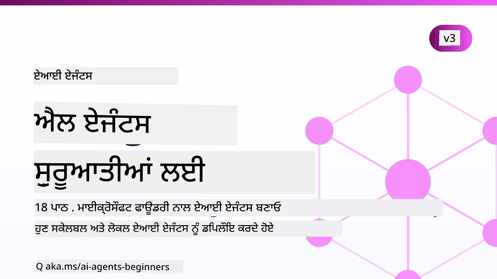

# ਸ਼ੁਰੂਆਤੀ ਲਈ AI ਏਜੰਟ - ਇੱਕ ਕੋਰਸ



## ਇੱਕ ਕੋਰਸ ਜੋ ਤੁਹਾਨੂੰ AI ਏਜੰਟ ਬਣਾਉਣਾ ਸਿੱਖਾਉਂਦਾ ਹੈ

[](https://github.com/microsoft/ai-agents-for-beginners/blob/master/LICENSE?WT.mc_id=academic-105485-koreyst)
[](https://GitHub.com/microsoft/ai-agents-for-beginners/graphs/contributors/?WT.mc_id=academic-105485-koreyst)
[](https://GitHub.com/microsoft/ai-agents-for-beginners/issues/?WT.mc_id=academic-105485-koreyst)
[](https://GitHub.com/microsoft/ai-agents-for-beginners/pulls/?WT.mc_id=academic-105485-koreyst)
[](http://makeapullrequest.com?WT.mc_id=academic-105485-koreyst)

### 🌐 ਬਹੁਭਾਸ਼ੀ ਸਹਿਯੋਗ

#### ਅਨੂਵਾਦ [Co-op Translator](https://github.com/Azure/co-op-translator) ਨਾਲ ਬਣਾਏ ਗਏ ਹਨ

<!-- CO-OP TRANSLATOR LANGUAGES TABLE START -->
[Arabic](../ar/README.md) | [Bengali](../bn/README.md) | [Bulgarian](../bg/README.md) | [Burmese (Myanmar)](../my/README.md) | [Chinese (Simplified)](../zh-CN/README.md) | [Chinese (Traditional, Hong Kong)](../zh-HK/README.md) | [Chinese (Traditional, Macau)](../zh-MO/README.md) | [Chinese (Traditional, Taiwan)](../zh-TW/README.md) | [Croatian](../hr/README.md) | [Czech](../cs/README.md) | [Danish](../da/README.md) | [Dutch](../nl/README.md) | [Estonian](../et/README.md) | [Finnish](../fi/README.md) | [French](../fr/README.md) | [German](../de/README.md) | [Greek](../el/README.md) | [Hebrew](../he/README.md) | [Hindi](../hi/README.md) | [Hungarian](../hu/README.md) | [Indonesian](../id/README.md) | [Italian](../it/README.md) | [Japanese](../ja/README.md) | [Kannada](../kn/README.md) | [Khmer](../km/README.md) | [Korean](../ko/README.md) | [Lithuanian](../lt/README.md) | [Malay](../ms/README.md) | [Malayalam](../ml/README.md) | [Manipuri (Meitei Mayek)](../mni/README.md) | [Marathi](../mr/README.md) | [Nepali](../ne/README.md) | [Nigerian Pidgin](../pcm/README.md) | [Norwegian](../no/README.md) | [Persian (Farsi)](../fa/README.md) | [Polish](../pl/README.md) | [Portuguese (Brazil)](../pt-BR/README.md) | [Portuguese (Portugal)](../pt-PT/README.md) | [Punjabi (Gurmukhi)](./README.md) | [Romanian](../ro/README.md) | [Russian](../ru/README.md) | [Serbian (Cyrillic)](../sr/README.md) | [Slovak](../sk/README.md) | [Slovenian](../sl/README.md) | [Spanish](../es/README.md) | [Swahili](../sw/README.md) | [Swedish](../sv/README.md) | [Tagalog (Filipino)](../tl/README.md) | [Tamil](../ta/README.md) | [Telugu](../te/README.md) | [Thai](../th/README.md) | [Turkish](../tr/README.md) | [Ukrainian](../uk/README.md) | [Urdu](../ur/README.md) | [Vietnamese](../vi/README.md)

> **ਕੀ ਤੁਸੀਂ ਲੋਕਲ ਤੌਰ 'ਤੇ ਕਲੋਨ ਕਰਨਾ ਪਸੰਦ ਕਰਦੇ ਹੋ?**
>
> ਇਸ ਰਿਪੋਜੀਟਰੀ ਵਿੱਚ 50+ ਭਾਸ਼ਾਈ ਅਨੁਵਾਦ ਹਨ ਜੋ ਡਾਊਨਲੋਡ ਸਾਈਜ਼ ਨੂੰ ਕਾਫੀ ਵੱਧਾ ਦਿੰਦੇ ਹਨ। ਬਿਨਾਂ ਅਨੁਵਾਦਾਂ ਦੇ ਕਲੋਨ ਕਰਨ ਲਈ, ਸਪਰਸ ਚੈਕਆਊਟ ਦੀ ਵਰਤੋਂ ਕਰੋ:
>
> **ਬੈਸ਼ / macOS / Linux:**
> ```bash
> git clone --filter=blob:none --sparse https://github.com/microsoft/ai-agents-for-beginners.git
> cd ai-agents-for-beginners
> git sparse-checkout set --no-cone '/*' '!translations' '!translated_images'
> ```
>
> **CMD (Windows):**
> ```cmd
> git clone --filter=blob:none --sparse https://github.com/microsoft/ai-agents-for-beginners.git
> cd ai-agents-for-beginners
> git sparse-checkout set --no-cone "/*" "!translations" "!translated_images"
> ```
>
> ਇਸ ਨਾਲ ਤੁਹਾਨੂੰ ਕੋਰਸ ਪੂਰਾ ਕਰਨ ਲਈ ਸਾਰਾ ਕੁਝ ਮਿਲਦਾ ਹੈ ਅਤੇ ਡਾਊਨਲੋਡ ਵੀ ਤੇਜ਼ ਹੁੰਦਾ ਹੈ।
<!-- CO-OP TRANSLATOR LANGUAGES TABLE END -->

**ਹੋਰ ਭਾਸ਼ਾਈ ਵਿਕਲਪਾਂ ਲਈ, ਦੇਖੋ [Co-op Translator ਦੇ ਸਮਰਥਿਤ ਭਾਸ਼ਾਵਾਂ](https://github.com/Azure/co-op-translator/blob/main/docs/supported-languages.md)।**

[](https://GitHub.com/microsoft/ai-agents-for-beginners/watchers/?WT.mc_id=academic-105485-koreyst)
[](https://GitHub.com/microsoft/ai-agents-for-beginners/network/?WT.mc_id=academic-105485-koreyst)
[](https://GitHub.com/microsoft/ai-agents-for-beginners/stargazers/?WT.mc_id=academic-105485-koreyst)

[](https://discord.com/invite/ATgtXmAS5D)


## 🌱 ਸ਼ੁਰੂਆਤ ਕਰਨਾ

ਇਸ ਕੋਰਸ ਵਿੱਚ AI ਏਜੰਟ ਬਣਾਉਣ ਦੇ ਮੁਢਲੇ ਸੁਤਰ ਸਿੱਖਾਇਆ ਜਾਂਦਾ ਹੈ। ਹਰੇਕ ਪਾਠ ਵਿੱਚ ਅਪਣਾ ਵਿਸ਼ਾ ਹੁੰਦਾ ਹੈ, ਇਸ ਲਈ ਜਿੱਥੇ ਚਾਹੋ ਸ਼ੁਰੂ ਕਰੋ!

ਇਸ ਕੋਰਸ ਲਈ ਬਹੁਭਾਸ਼ੀ ਸਹਾਇਤਾ ਉਪਲਬਧ ਹੈ। ਸਾਡੇ [ਉਪਲਬਧ ਭਾਸ਼ਾਵਾਂ ਇਥੇ](#-multi-language-support) ਵੇਖੋ।

ਜੇ ਤੁਸੀਂ ਜਨਰੇਟਿਵ AI ਮਾਡਲਾਂ ਨਾਲ ਪਹਿਲਾ ਵਾਰ ਕੰਮ ਕਰ ਰਹੇ ਹੋ, ਤਾਂ ਸਾਡੇ [ਸ਼ੁਰੂਆਤੀ ਲਈ ਜਨਰੇਟਿਵ AI](https://aka.ms/genai-beginners) ਕੋਰਸ ਨੂੰ ਦੇਖੋ, ਜਿਸ ਵਿੱਚ GenAI ਨਾਲ ਬਣਾਉਣ ਦੇ 21 ਪਾਠ ਹਨ।

ਇਹ repo [ਸਟਾਰ (🌟)](https://docs.github.com/en/get-started/exploring-projects-on-github/saving-repositories-with-stars?WT.mc_id=academic-105485-koreyst) ਅਤੇ [ਫੋਰਕ](https://github.com/microsoft/ai-agents-for-beginners/fork) ਕਰਨਾ ਨਾ ਭੁੱਲੋ ਤਾਂ ਜੋ ਤੁਸੀਂ ਕੋਡ ਚਲਾ ਸਕੋ।

### ਹੋਰ ਸਿੱਖਣ ਵਾਲਿਆਂ ਨਾਲ ਮਿਲੋ, ਆਪਣੇ ਸਵਾਲਾਂ ਦੇ ਜਵਾਬ ਲਵੋ

ਜੇ ਤੁਸੀਂ ਫਸ ਜਾਂਦੇ ਹੋ ਜਾਂ AI ਏਜੰਟ ਬਣਾਉਣ ਬਾਰੇ ਕੋਈ ਸਵਾਲ ਹੈ, ਸਾਡੀ ਮੁਕ਼ਰਰ ਡਿਸਕੋਰਡ ਚੈਨਲ ਵਿੱਚ ਸ਼ਾਮਲ ਹੋਵੋ [Microsoft Foundry Discord](https://aka.ms/ai-agents/discord)।

### ਤੁਹਾਨੂੰ ਕੀ ਚਾਹੀਦਾ ਹੈ

ਇਸ ਕੋਰਸ ਵਿੱਚ ਹਰ ਪਾਠ ਕੋਡ ਉਦਾਹਰਣਾਂ ਸਮੇਤ ਹੈ, ਜੋ code_samples ਫੋਲਡਰ ਵਿੱਚ ਮਿਲ ਸਕਦੇ ਹਨ। ਤੁਸੀਂ ਇਸ repo ਨੂੰ [ਫੋਰਕ](https://github.com/microsoft/ai-agents-for-beginners/fork) ਕਰਕੇ ਆਪਣੀ ਕਾਪੀ ਬਣਾ ਸਕਦੇ ਹੋ।

ਇਹ ਉਦੇਹਾਂਸ਼ ਵਿੱਚ ਕੋਡ ਉਦਾਹਰਣਾਂ Microsoft Agent Framework ਅਤੇ Microsoft Foundry Agent Service V2 ਦੀ ਵਰਤੋਂ ਕਰਦੀਆਂ ਹਨ:

- [Microsoft Foundry](https://aka.ms/ai-agents-beginners/ai-foundry) - Azure ਖਾਤਾ ਲੋੜੀਂਦਾ ਹੈ

ਇਸ ਕੋਰਸ ਵਿੱਚ Microsoft ਵੱਲੋਂ ਹੇਠਾਂ ਦਿੱਤੇ AI ਏਜੰਟ ਫਰੇਮਵਰਕਾਂ ਅਤੇ ਸੇਵਾਵਾਂ ਦੀ ਵਰਤੋਂ ਕੀਤੀ ਗਈ ਹੈ:

- [Microsoft Agent Framework (MAF)](https://learn.microsoft.com/agent-framework/overview/)
- [Microsoft Foundry Agent Service V2](https://aka.ms/ai-agents-beginners/ai-agent-service)

ਕੁਝ ਕੋਡ ਉਦਾਹਰਣਾਂ OpenAI-ਸਪੋਰਟ ਪਾਏ ਜਾਂਦੇ ਹੋਰ ਪ੍ਰਦਾਤਾਵਾਂ ਜਿਵੇਂ [MiniMax](https://platform.minimaxi.com/) ਜੋ ਵੱਡੇ ਸੰਦਰਭ ਮਾਡਲ (204K ਟੋਕਨ ਤੱਕ) ਪ੍ਰਦਾਨ ਕਰਦਾ ਹੈ, ਨੂੰ ਵੀ ਸਮਰਥਨ ਕਰਦੀਆਂ ਹਨ। ਵਿਸਥਾਰਾਂ ਲਈ [ਕੋਰਸ ਸੈਟਅੱਪ](./00-course-setup/README.md) ਵੇਖੋ।

ਇਸ ਕੋਰਸ ਲਈ ਕੋਡ ਚਲਾਉਣ ਬਾਰੇ ਹੋਰ ਜਾਣਕਾਰੀ ਲਈ, [ਕੋਰਸ ਸੈਟਅੱਪ](./00-course-setup/README.md) ਤੇ ਜਾਓ।

## 🙏 ਮਦਦ ਕਰਨਾ ਚਾਹੁੰਦੇ ਹੋ?

ਕੀ ਤੁਹਾਡੇ ਕੋਲ ਸੁਝਾਵ ਹਨ ਜਾਂ ਤੁਸੀਂ ਸਪੈਲਿੰਗ ਜਾਂ ਕੋਡ ਤਰੁੱਟੀਆਂ ਵੇਖੀਆਂ ਹਨ? [ਇੱਸ਼ੂ ਰਾਈਜ਼ ਕਰੋ](https://github.com/microsoft/ai-agents-for-beginners/issues?WT.mc_id=academic-105485-koreyst) ਜਾਂ [ਪੁਲ-ਰਿਕਵੇਸਟ ਬਣਾਓ](https://github.com/microsoft/ai-agents-for-beginners/pulls?WT.mc_id=academic-105485-koreyst)


## 📂 ਹਰ ਪਾਠ ਵਿੱਚ ਸ਼ਾਮਲ ਹੈ

- README ਵਿੱਚ ਲਿਖਤੀ ਪਾਠ ਅਤੇ ਇੱਕ ਛੋਟੀ ਵੀਡੀਓ
- Microsoft Agent Framework ਅਤੇ Microsoft Foundry ਨਾਲ Python ਕੋਡ ਉਦਾਹਰਣਾਂ
- ਤੁਹਾਡੇ ਸਿੱਖਣ ਨੂੰ ਜਾਰੀ ਰੱਖਣ ਲਈ ਵਾਧੂ ਸਾਧਨਾਂ ਵਾਲੇ ਲਿੰਕ


## 🗃️ ਪਾਠ

| **ਪਾਠ**                                    | **ਟੈਕਸਟ ਅਤੇ ਕੋਡ**                               | **ਵੀਡੀਓ**                                                  | **ਵਾਧੂ ਸਿੱਖਿਆ**                                                                         |
|----------------------------------------------|----------------------------------------------------|------------------------------------------------------------|---------------------------------------------------------------------------------------|
| AI ਏਜੰਟ ਅਤੇ ਉਹਨਾਂ ਦੇ ਉਪਯੋਗਤਾ ਨਾਲ ਜਾਣੂ ਕਰੋ | [ਲਿੰਕ](./01-intro-to-ai-agents/README.md)          | [ਵੀਡੀਓ](https://youtu.be/3zgm60bXmQk?si=z8QygFvYQv-9WtO1)  | [ਲਿੰਕ](https://aka.ms/ai-agents-beginners/collection?WT.mc_id=academic-105485-koreyst) |
| AI ਏਜੰਟਿਕ ਫਰੇਮਵਰਕਾਂ ਦੀ ਖੋਜ                     | [ਲਿੰਕ](./02-explore-agentic-frameworks/README.md)  | [ਵੀਡੀਓ](https://youtu.be/ODwF-EZo_O8?si=Vawth4hzVaHv-u0H)  | [ਲਿੰਕ](https://aka.ms/ai-agents-beginners/collection?WT.mc_id=academic-105485-koreyst) |
| AI ਏਜੰਟਿਕ ਡਿਜ਼ਾਈਨ ਪੈਟਰਨਾਂ ਨੂੰ ਸਮਝਣਾ            | [ਲਿੰਕ](./03-agentic-design-patterns/README.md)     | [ਵੀਡੀਓ](https://youtu.be/m9lM8qqoOEA?si=BIzHwzstTPL8o9GF)  | [ਲਿੰਕ](https://aka.ms/ai-agents-beginners/collection?WT.mc_id=academic-105485-koreyst) |
| ਟੂਲ ਵਰਤਣ ਵਾਲਾ ਡਿਜ਼ਾਈਨ ਪੈਟਰਨ                    | [ਲਿੰਕ](./04-tool-use/README.md)                    | [ਵੀਡੀਓ](https://youtu.be/vieRiPRx-gI?si=2z6O2Xu2cu_Jz46N)  | [ਲਿੰਕ](https://aka.ms/ai-agents-beginners/collection?WT.mc_id=academic-105485-koreyst) |
| ਏਜੰਟਿਕ RAG                                  | [ਲਿੰਕ](./05-agentic-rag/README.md)                 | [ਵੀਡੀਓ](https://youtu.be/WcjAARvdL7I?si=gKPWsQpKiIlDH9A3)  | [ਲਿੰਕ](https://aka.ms/ai-agents-beginners/collection?WT.mc_id=academic-105485-koreyst) |
| ਭਰੋਸੇਯੋਗ AI ਏਜੰਟ ਬਣਾਉਣਾ                      | [ਲਿੰਕ](./06-building-trustworthy-agents/README.md) | [ਵੀਡੀਓ](https://youtu.be/iZKkMEGBCUQ?si=jZjpiMnGFOE9L8OK ) | [ਲਿੰਕ](https://aka.ms/ai-agents-beginners/collection?WT.mc_id=academic-105485-koreyst) |
| ਯੋਜਨਾ ਬਣਾਉਣ ਵਾਲਾ ਡਿਜ਼ਾਈਨ ਪੈਟਰਨ                 | [ਲਿੰਕ](./07-planning-design/README.md)             | [ਵੀਡੀਓ](https://youtu.be/kPfJ2BrBCMY?si=6SC_iv_E5-mzucnC)  | [ਲਿੰਕ](https://aka.ms/ai-agents-beginners/collection?WT.mc_id=academic-105485-koreyst) |
| ਬਹੁ-ਏਜੰਟ ਡਿਜ਼ਾਈਨ ਪੈਟਰਨ                       | [ਲਿੰਕ](./08-multi-agent/README.md)                 | [ਵੀਡੀਓ](https://youtu.be/V6HpE9hZEx0?si=rMgDhEu7wXo2uo6g)  | [ਲਿੰਕ](https://aka.ms/ai-agents-beginners/collection?WT.mc_id=academic-105485-koreyst) |
| ਮੈਟਾਕੋਗਨੇਸ਼ਨ ਡਿਜ਼ਾਈਨ ਪੈਟਰਨ                     | [ਲਿੰਕ](./09-metacognition/README.md)               | [ਵੀਡੀਓ](https://youtu.be/His9R6gw6Ec?si=8gck6vvdSNCt6OcF)  | [ਲਿੰਕ](https://aka.ms/ai-agents-beginners/collection?WT.mc_id=academic-105485-koreyst) |
| ਉਤਪਾਦਨ ਵਿੱਚ AI ਏਜੰਟ                           | [ਲਿੰਕ](./10-ai-agents-production/README.md)        | [ਵੀਡੀਓ](https://youtu.be/l4TP6IyJxmQ?si=31dnhexRo6yLRJDl)  | [ਲਿੰਕ](https://aka.ms/ai-agents-beginners/collection?WT.mc_id=academic-105485-koreyst) |
| ਏਜੰਟਿਕ ਪ੍ਰੋਟੋਕੋਲਾਂ ਦੀ ਵਰਤੋਂ (MCP, A2A ਅਤੇ NLWeb) | [ਲਿੰਕ](./11-agentic-protocols/README.md)           | [ਵੀਡੀਓ](https://youtu.be/X-Dh9R3Opn8)                                 | [ਲਿੰਕ](https://aka.ms/ai-agents-beginners/collection?WT.mc_id=academic-105485-koreyst) |
| AI ਏਜੰਟ ਲਈ ਪਰਿਭਾਸ਼ਾ ਇੰਜੀਨੀਅਰਿੰਗ                  | [ਲਿੰਕ](./12-context-engineering/README.md)         | [ਵੀਡੀਓ](https://youtu.be/F5zqRV7gEag)                                 | [ਲਿੰਕ](https://aka.ms/ai-agents-beginners/collection?WT.mc_id=academic-105485-koreyst) |
| ਏਜੰਟਿਕ ਮੇਮੋਰੀ ਨੂੰ ਸੰਭਾਲਣਾ                      | [ਲਿੰਕ](./13-agent-memory/README.md)     |      [ਵੀਡੀਓ](https://youtu.be/QrYbHesIxpw?si=vZkVwKrQ4ieCcIPx)                                                      |                                                                                        |
| Microsoft Agent Framework ਦੀ ਖੋਜ               | [ਲਿੰਕ](./14-microsoft-agent-framework/README.md)                            |                                                            |                                                                                        |
| ਕੰਪਿਊਟਰ ਵਰਤਣ ਵਾਲੇ ਏਜੰਟ ਬਣਾਉਣਾ (CUA)              | [ਲਿੰਕ](./15-browser-use/README.md)     |                                                            | [ਲਿੰਕ](https://docs.browser-use.com/examples/templates/playwright-integration)         |
| ਸਕੇਲਬਲ ਏਜੰਟ ਤੈਨਾਤ ਕਰਨਾ                       | [ਲਿੰਕ](./16-deploying-scalable-agents/README.md) |                                                    | [ਲਿੰਕ](https://learn.microsoft.com/azure/ai-foundry/agents/overview)                   |
| ਸਥਾਨਕ AI ਏਜੰਟ ਬਣਾਉਣਾ                         | [ਲਿੰਕ](./17-creating-local-ai-agents/README.md)  |                                                    | [ਲਿੰਕ](https://learn.microsoft.com/azure/ai-foundry/foundry-local/)                    |
| AI ਏਜੰਟ ਸੁਰੱਖਿਅਤ ਕਰਨਾ                          | [ਲਿੰਕ](./18-securing-ai-agents/README.md)  |                                                            | [ਲਿੰਕ](https://aka.ms/ai-agents-beginners/collection?WT.mc_id=academic-105485-koreyst) |

## 🎒 ਹੋਰ ਕੋਰਸ

ਸਾਡੀ ਟੀਮ ਹੋਰ ਕੋਰਸ ਤਿਆਰ ਕਰਦੀ ਹੈ! ਦੇਖੋ:

<!-- CO-OP TRANSLATOR OTHER COURSES START -->
### LangChain
[](https://aka.ms/langchain4j-for-beginners)
[](https://aka.ms/langchainjs-for-beginners?WT.mc_id=m365-94501-dwahlin)
[](https://github.com/microsoft/langchain-for-beginners?WT.mc_id=m365-94501-dwahlin)
---

### Azure / Edge / MCP / ਏਜੰਟ
[](https://github.com/microsoft/AZD-for-beginners?WT.mc_id=academic-105485-koreyst)
[](https://github.com/microsoft/edgeai-for-beginners?WT.mc_id=academic-105485-koreyst)
[](https://github.com/microsoft/mcp-for-beginners?WT.mc_id=academic-105485-koreyst)
[](https://github.com/microsoft/ai-agents-for-beginners?WT.mc_id=academic-105485-koreyst)

---
 
### ਜਨਰੇਟਿਵ AI ਸੀਰੀਜ਼
[](https://github.com/microsoft/generative-ai-for-beginners?WT.mc_id=academic-105485-koreyst)
[-9333EA?style=for-the-badge&labelColor=E5E7EB&color=9333EA)](https://github.com/microsoft/Generative-AI-for-beginners-dotnet?WT.mc_id=academic-105485-koreyst)
[-C084FC?style=for-the-badge&labelColor=E5E7EB&color=C084FC)](https://github.com/microsoft/generative-ai-for-beginners-java?WT.mc_id=academic-105485-koreyst)
[-E879F9?style=for-the-badge&labelColor=E5E7EB&color=E879F9)](https://github.com/microsoft/generative-ai-with-javascript?WT.mc_id=academic-105485-koreyst)

---
 
### ਮੁੱਖ ਸਿੱਖਿਆ
[](https://aka.ms/ml-beginners?WT.mc_id=academic-105485-koreyst)
[](https://aka.ms/datascience-beginners?WT.mc_id=academic-105485-koreyst)
[](https://aka.ms/ai-beginners?WT.mc_id=academic-105485-koreyst)
[](https://github.com/microsoft/Security-101?WT.mc_id=academic-96948-sayoung)
[](https://aka.ms/webdev-beginners?WT.mc_id=academic-105485-koreyst)
[](https://aka.ms/iot-beginners?WT.mc_id=academic-105485-koreyst)
[](https://github.com/microsoft/xr-development-for-beginners?WT.mc_id=academic-105485-koreyst)

---
 
### ਕੋਪਾਇਲਟ ਸੀਰੀਜ਼
[](https://aka.ms/GitHubCopilotAI?WT.mc_id=academic-105485-koreyst)
[](https://github.com/microsoft/mastering-github-copilot-for-dotnet-csharp-developers?WT.mc_id=academic-105485-koreyst)
[](https://github.com/microsoft/CopilotAdventures?WT.mc_id=academic-105485-koreyst)
<!-- CO-OP TRANSLATOR OTHER COURSES END -->

## 🌟 ਕਮਿਊਨਿਟੀ ਧੰਨਵਾਦ

ਏਜੈਂਟਿਕ RAG ਨੂੰ ਦਰਸਾਉਣ ਵਾਲੇ ਮਹੱਤਵਪੂਰਨ ਕੋਡ ਸੈਂਪਲਾਂ ਲਈ [ਸ਼ਿਵਮ ਗੋਇਲ](https://www.linkedin.com/in/shivam2003/) ਦਾ ਧੰਨਵਾਦ.

## ਯੋਗਦਾਨ ਦੇਣਾ

ਇਹ ਪ੍ਰੋਜੈਕਟ ਯੋਗਦਾਨ ਅਤੇ ਸੁਝਾਅ ਦਾ ਸਵਾਗਤ ਕਰਦਾ ਹੈ। ਜ਼ਿਆਦਾਤਰ ਯੋਗਦਾਨ ਲਈ ਤੁਹਾਨੂੰ ਇੱਕ
Contributor License Agreement (CLA) ਤੇ ਸਹਿਮਤ ਹੋਣਾ ਲਾਜ਼ਮੀ ਹੈ ਜੋ ਇਹ ਦੱਸਦਾ ਹੈ ਕਿ ਤੁਹਾਡੇ ਕੋਲ ਅਧਿਕਾਰ ਹਨ,
ਅਤੇ ਤੁਸੀਂ ਸੱਚਮੁੱਚ ਸਾਡੇ ਨਾਲ ਆਪਣੇ ਯੋਗਦਾਨ ਦੇ ਉਪਯੋਗ ਦਾ ਅਧਿਕਾਰ ਸੌਂਪਦੇ ਹੋ। ਵਿਸਥਾਰ ਲਈ, ਵੇਖੋ <https://cla.opensource.microsoft.com>.

ਜਦੋਂ ਤੁਸੀਂ ਇੱਕ ਪੁਲ ਰਿਕਵੇਸਟ ਸਬਮਿਟ ਕਰਦੇ ਹੋ, ਤਾਂ ਇੱਕ CLA ਬੌਟ ਆਪਣੇ ਆਪ ਨਿਧਾਰਤ ਕਰੇਗਾ ਕਿ ਕੀ ਤੁਹਾਨੂੰ
CLA ਦੇਣ ਦੀ ਲੋੜ ਹੈ ਅਤੇ PR ਨੂੰ ਸਹੀ ਢੰਗ ਨਾਲ ਸਜਾਵੇਗਾ (ਜਿਵੇਂ ਕਿ ਸਥਿਤੀ ਜਾਂਚ, ਟਿੱਪਣੀ)। ਸਿਰਫ ਬੌਟ ਦੇ ਦੱਸੇ ਹੁਕੇਮਾਂ ਦੀ ਪਾਲਣਾ ਕਰੋ।
ਇਹ ਸਾਰੇ ਰੇਪੋਜ਼ ਵਿੱਚ ਸਿਰਫ ਇੱਕ ਵਾਰੀ ਕਰਨਾ ਪਏਗਾ ਜਿੱਥੇ ਸਾਡਾ CLA ਵਰਤਿਆ ਜਾਂਦਾ ਹੈ।

ਇਸ ਪ੍ਰੋਜੈਕਟ ਨੇ [ਮਾਈਕ੍ਰੋਸੌਫਟ ਓਪਨ ਸੋర్స్ ਕੋਡ ਅਚਰਨ](https://opensource.microsoft.com/codeofconduct/) ਨੂੰ ਅਪਣਾਇਆ ਹੈ।
ਹੋਰ ਜਾਣਕਾਰੀ ਲਈ ਵੇਖੋ [ਕੋਡ ਅਚਰਨ FAQ](https://opensource.microsoft.com/codeofconduct/faq/) ਜਾਂ
ਕੋਈ ਵੀ ਵਾਧੂ ਸਵਾਲ ਜਾਂ ਟਿੱਪਣੀ ਲਈ [opencode@microsoft.com](mailto:opencode@microsoft.com) ਨਾਲ ਸੰਪਰਕ ਕਰੋ।

## ਟ੍ਰੇਡਮਾਰਕ

ਇਸ ਪ੍ਰੋਜੈਕਟ ਵਿੱਚ ਪ੍ਰੋਜੈਕਟਾਂ, ਉਤਪਾਦਾਂ ਜਾਂ ਸੇਵਾਵਾਂ ਲਈ ਟ੍ਰੇਡਮਾਰਕ ਜਾਂ ਲੋਗੋ ਹੋ ਸਕਦੇ ਹਨ। ਮਾਈਕ੍ਰੋਸੌਫਟ ਦੇ ਟ੍ਰੇਡਮਾਰਕ
ਜਾਂ ਲੋਗੋ ਦੇ ਪ੍ਰਮਾਣਿਤ ਉਪਯੋਗ ਉਹਨਾਂ ਦੀਆਂ
[ਮਾਈਕ੍ਰੋਸੌਫਟ ਟ੍ਰੇਡਮਾਰਕ ਅਤੇ ਬਰਾਂਡ ਗਾਈਡਲਾਈਨਾਂ](https://www.microsoft.com/legal/intellectualproperty/trademarks/usage/general) ਦਾ ਪਾਲਣ ਕਰਨਾ ਲਾਜ਼ਮੀ ਹੈ।
ਇਸ ਪ੍ਰੋਜੈਕਟ ਦੇ ਪਰਿਵਰਤਿਤ ਸੰਸਕਰਣਾਂ ਵਿੱਚ ਮਾਈਕ੍ਰੋਸੌਫਟ ਟ੍ਰੇਡਮਾਰਕ ਜਾਂ ਲੋਗੋ ਦੇ ਬੇਹਦ ਸਹੀ ਉਪਯੋਗ ਨਾਲ ਗਲਤ ਫਹਿਮੀ ਜਾਂ ਪ੍ਰਾਇਤੀ ਸਪਾਂਸਰਸ਼ਿਪ ਨਹੀ ਹੋਣੀ ਚਾਹੀਦੀ।
ਤੀਸਰੇ ਪੱਖ ਦੇ ਟ੍ਰੇਡਮਾਰਕ ਜਾਂ ਲੋਗੋ ਦੀ ਕੋਈ ਵੀ ਵਰਤੋਂ ਉਹਨਾਂ ਦੀਆਂ ਨੀਤੀਆਂ ਦੇ ਅਧੀਨ ਹੈ।

## ਮਦਦ ਪ੍ਰਾਪਤ ਕਰਨਾ


ਜੇ ਤੁਸੀਂ ਅਟਕ ਜਾਂਦੇ ਹੋ ਜਾਂ AI ਐਪ ਬਣਾਉਣ ਬਾਰੇ ਕੋਈ ਵੀ ਸਵਾਲ ਹੋਵੇ, ਤਾਂ ਸਾਡੇ ਨਾਲ ਜੁੜੋ:

[](https://aka.ms/foundry/discord)

ਜੇ ਤੁਹਾਡੇ ਕੋਲ ਉਤਪਾਦ ਫੀਡਬੈਕ ਹੈ ਜਾਂ ਬਣਾਉਂਦੇ ਸਮੇਂ ਕੋਈ ਗਲਤੀ ਆਉਂਦੀ ਹੈ ਤਾਂ ਵੇਖੋ:

[](https://aka.ms/foundry/forum)

---

<!-- CO-OP TRANSLATOR DISCLAIMER START -->
**ਅਸਵੀਕਾਰੋਪਣ**:
ਇਸ ਦਸਤਾਵੇਜ਼ ਦਾ ਅਨੁਵਾਦ ਏਆਈ ਅਨੁਵਾਦ ਸੇਵਾ [Co-op Translator](https://github.com/Azure/co-op-translator) ਦੀ ਵਰਤੋਂ ਕਰਕੇ ਕੀਤਾ ਗਿਆ ਹੈ। ਜਦੋਂ ਕਿ ਅਸੀਂ ਸਹੀਤਾਵਾਂ ਲਈ ਯਤਨਸ਼ੀਲ ਹਾਂ, ਕਿਰਪਾ ਕਰਕੇ ਧਿਆਨ ਰੱਖੋ ਕਿ ਸਵੈਚਾਲਿਤ ਅਨੁਵਾਦਾਂ ਵਿੱਚ ਗਲਤੀਆਂ ਜਾਂ ਅਸਮੱਤਿਆਵਾਂ ਹੋ ਸਕਦੀਆਂ ਹਨ। ਮੂਲ ਦਸਤਾਵੇਜ਼ ਆਪਣੀ ਮੂਲ ਭਾਸ਼ਾ ਵਿੱਚ ਅਧਿਕਾਰਕ ਸਰੋਤ ਮੰਨਿਆ ਜਾਣਾ ਚਾਹੀਦਾ ਹੈ। ਜਰੂਰੀ ਜਾਣਕਾਰੀ ਲਈ, ਪੇਸ਼ੇਵਰ ਮਨੁੱਖੀ ਅਨੁਵਾਦ ਦੀ ਸਿਫ਼ਾਰਸ਼ ਕੀਤੀ ਜਾਂਦੀ ਹੈ। ਅਸੀਂ ਇਸ ਅਨੁਵਾਦ ਦੇ ਉਪਯੋਗ ਤੋਂ ਪੈਦਾ ਹੋਣ ਵਾਲੀਆਂ ਕਿਸੇ ਵੀ ਗਲਤਫਹਿਮੀਆਂ ਜਾਂ ਗਲਤ ਵਿਆਖਿਆਵਾਂ ਲਈ ਜਵਾਬਦੇਹ ਨਹੀਂ ਹਾਂ।
<!-- CO-OP TRANSLATOR DISCLAIMER END -->