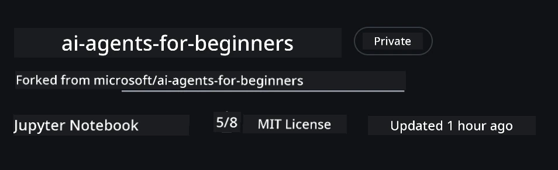
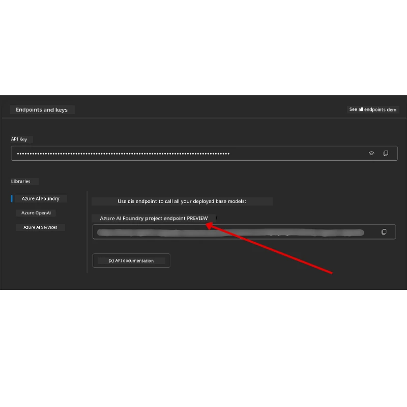

# Setup Course

## Introduction

Dis lesson go show how to run the code samples for dis course.

## Join Other Learners and Get Help

Before you begin to clone ur repo, join the [AI Agents For Beginners Discord channel](https://aka.ms/ai-agents/discord) to get any help with setup, any question about the course, or to connect wit other learners.

## Clone or Fork dis Repo

To start, pls clone or fork di GitHub Repository. Dis one go make ur own version of the course material so you fit run, test, and adjust the code!

You fit do dis by clicking di link to <a href="https://github.com/microsoft/ai-agents-for-beginners/fork" target="_blank">fork di repo</a>

Now you suppose get your own forked version of dis course for dis link:



### Shallow Clone (we recommend for workshop / Codespaces)

  >Di full repository fit big (~3 GB) if you download full history plus all files. If you dey only attend di workshop or you only need few lesson folders, shallow clone (or sparse clone) go download less.

#### Quick shallow clone — minimal history, all files

Change `<your-username>` for di commands below with your fork URL (or upstream URL if you prefer).

To clone only di latest commit history (small download):

```bash
git clone --depth 1 https://github.com/<your-username>/ai-agents-for-beginners.git
```

To clone specific branch:

```bash
git clone --depth 1 --branch <branch-name> https://github.com/<your-username>/ai-agents-for-beginners.git
```

#### Partial (sparse) clone — minimal blobs + only selected folders

Dis one dey use partial clone and sparse-checkout (need Git 2.25+ and we recommend modern Git with partial clone support):

```bash
git clone --depth 1 --filter=blob:none --sparse https://github.com/<your-username>/ai-agents-for-beginners.git
```

Enter the repo folder:

```bash
cd ai-agents-for-beginners
```

Then say which folders you want (example below show two folders):

```bash
git sparse-checkout set 00-course-setup 01-intro-to-ai-agents
```

After cloning and checking di files, if you only need files and want to free space (no git history), pls delete di repository metadata (💀no fit reverse — you go lose all Git functionality):

```bash
# zsh/bash
rm -rf .git
```

```powershell
# PowerShell
Remove-Item -Recurse -Force .git
```

#### Using GitHub Codespaces (we recommend to avoid local big downloads)

- Create new Codespace for dis repo via di [GitHub UI](https://github.com/codespaces).  

- For terminal of new codespace, run one of the shallow/sparse clone commands wey dey above to bring only di lesson folders you want inside di Codespace workspace.
- Optional: after cloning inside Codespaces, remove .git to get extra space back (see removal commands wey dey above).
- Note: If you prefer to open the repo direct in Codespaces (without extra clone), know say Codespaces go build the devcontainer environment and fit still provision more than you need.

#### Tips

- Always change di clone URL to your fork if you want edit/commit.
- If you later need more history or files, you fit fetch them or adjust sparse-checkout make e include more folders.

## Running the Code

Dis course get series of Jupyter Notebooks wey you fit run to get hand-on experience to build AI Agents.

Di code samples dey use **Microsoft Agent Framework (MAF)** with di `FoundryChatClient`, wey connect to **Microsoft Foundry Agent Service V2** (di Responses API) through **Microsoft Foundry**.

All Python notebooks get label `*-python-agent-framework.ipynb`.

## Requirements

- Python 3.12+
  - **NOTE**: If you never install Python3.12, make sure say you install am. Then create your venv by using python3.12 so that correct versions go install from requirements.txt file.
  
    >Example

    Create Python venv directory:

    ```bash
    python -m venv venv
    ```

    Then activate venv environment for:

    ```bash
    # zsh/bash
    source venv/bin/activate
    ```
  
    ```dos
    # Command Prompt for Windows
    venv\Scripts\activate
    ```

- .NET 10+: For sample codes wey dey use .NET, make sure say you install [.NET 10 SDK](https://dotnet.microsoft.com/download/dotnet/10.0) or later. Then, check your installed .NET SDK version:

    ```bash
    dotnet --list-sdks
    ```

- **Azure CLI** — Needed for authentication. Install from [aka.ms/installazurecli](https://aka.ms/installazurecli).
- **Azure Subscription** — For access to Microsoft Foundry and Microsoft Foundry Agent Service.
- **Microsoft Foundry Project** — Project wey get deployed model (e.g., `gpt-5-mini`). See [Step 1](#step-1-create-microsoft-foundry-project) below.

We don include `requirements.txt` file for root of dis repository wey get all di needed Python packages to run di code samples.

You fit install dem by running dis command for your terminal for root of di repository:

```bash
pip install -r requirements.txt
```

We recommend make you create Python virtual environment to avoid any wahala and issues.

## Setup VSCode

Make sure say you dey use the correct Python version for VSCode.


## Set Up Microsoft Foundry and Microsoft Foundry Agent Service

### Step 1: Create Microsoft Foundry Project

You need Microsoft Foundry **project** wey get deployed model to run the notebooks. Create di project direct for current Microsoft Foundry experience; hub no dey mandatory.

1. Go to [ai.azure.com](https://ai.azure.com) and sign in wit your Azure account.
2. Select **Create project** and follow the instructions to create your project.
3. For project, deploy model (e.g., `gpt-5-mini`) from **Models + Endpoints** → **Deploy model**.

### Step 2: Get Your Project Endpoint and Model Deployment Name

From your project for Microsoft Foundry portal:

- **Project Endpoint** — Go to **Overview** page and copy endpoint URL.



- **Model Deployment Name** — Go to **Models + Endpoints**, select your deployed model, and note **Deployment name** (e.g., `gpt-5-mini`).

### Step 3: Sign in to Azure wit `az login`

Most notebooks dey authenticate through your **Azure CLI sign-in** — using `AzureCliCredential` or `DefaultAzureCredential` (both go carry your `az login` session) from `azure-identity` package — so no need API keys. Some lessons and optional integrations dey use API keys; check every lesson prerequisites for any other environment variables. Dis one mean say you must sign in via Azure CLI.

1. **Install Azure CLI** if you never install: [aka.ms/installazurecli](https://aka.ms/installazurecli)

2. **Sign in** by running:

    ```bash
    az login
    ```

    Or if you dey remote/Codespace environment wey no get browser:

    ```bash
    az login --use-device-code
    ```

3. **Select your subscription** if e ask you — choose di one wey get your Foundry project.

4. **Confirm** you don sign in:

    ```bash
    az account show
    ```

> **Why `az login`?** Di notebooks dey authenticate using `AzureCliCredential` (or `DefaultAzureCredential`, wey also carry your Azure CLI sign-in) from `azure-identity` package. Wen you do dis, your Azure CLI session dey give credentials — no API keys or secrets for your `.env` file. Dis na [security best practice](https://learn.microsoft.com/azure/developer/ai/keyless-connections).

### Step 4: Create Your `.env` File

Copy the example file:

```bash
# zsh/bash
cp .env.example .env
```

```powershell
# PowerShell
Copy-Item .env.example .env
```

Open `.env` and put these two values:

```env
AZURE_AI_PROJECT_ENDPOINT=https://<your-project>.services.ai.azure.com/api/projects/<your-project-id>
AZURE_AI_MODEL_DEPLOYMENT_NAME=gpt-5-mini
```

| Variable | Where to find am |
|----------|-----------------|
| `AZURE_AI_PROJECT_ENDPOINT` | Foundry portal → your project → **Overview** page |
| `AZURE_AI_MODEL_DEPLOYMENT_NAME` | Foundry portal → **Models + Endpoints** → your deployed model name |

That na everything for most lessons! Di notebooks go authenticate automatically through your `az login` session.

### Step 5: Install Python Dependencies

```bash
pip install -r requirements.txt
```

We recommend say you run dis inside di virtual environment wey you create before.

## Optional Setup: Azure AI Search (Lessons 5 and 16)

Di Lesson 5 (Agentic RAG) and Lesson 16 notebooks dey run out of di box wit **in-memory knowledge base** — no extra Azure resources needed. If you want back them wit real **Azure AI Search** index, note say **Lesson 16 notebook currently dey use key-based authentication**: e dey switch from in-memory search to Azure AI Search only wen **both** `AZURE_SEARCH_SERVICE_ENDPOINT` **and** `AZURE_SEARCH_API_KEY` dey set, else e go stay for in-memory search — so to run am for real index you must set admin key too. Keyless authentication with Microsoft Entra ID (RBAC) na di recommended way for your own production code, wey fit the `az login` flow wey dey everywhere for dis course.

Di RBAC steps below dey for di setup-guide samples and your own code. Dem no enable keyless authentication for Lesson 16 notebook; Lesson 16 still need both endpoint and admin key to use Azure AI Search.

1. **Enable role-based access** on your search service:

    ```bash
    az search service update --name <service-name> --resource-group <resource-group> --auth-options aadOrApiKey
    ```

2. **Assign yourself di required roles** (create/load indexes and query):

    ```bash
    az role assignment create --assignee <your-user-or-principal-id> --role "Search Service Contributor" --scope $(az search service show -g <resource-group> -n <service-name> --query id -o tsv)
    az role assignment create --assignee <your-user-or-principal-id> --role "Search Index Data Contributor" --scope $(az search service show -g <resource-group> -n <service-name> --query id -o tsv)
    ```

3. **Add di endpoint** to your `.env` file:

| Variable | Where to find am |
|----------|-----------------|
| `AZURE_SEARCH_SERVICE_ENDPOINT` | Azure portal → your **Azure AI Search** resource → **Overview** → URL |
| `AZURE_SEARCH_API_KEY` | Needed (wit di endpoint) to enable Azure AI Search for Lesson 16 notebook wey use key-based auth. Azure portal → **Settings** → **Keys** → primary admin key |

> **Why keyless?** Admin keys dey give full write access to your search service and fit leak with `.env` files. Wif RBAC, your `az login` identity go dey used instead — di same keyless Entra ID pattern di course notebooks dey use (through `AzureCliCredential` / `DefaultAzureCredential`). See [Connect to Azure AI Search using roles](https://learn.microsoft.com/azure/search/search-security-rbac).

See [Azure AI Search setup guide](./AzureSearch.md) for full index-creation samples for Python and .NET.

## Extra Setup for Lessons wey Call Azure OpenAI Directly (Lessons 6 and 8)

Some notebooks for lessons 6 and 8 dem dey call **Azure OpenAI** direct (using **Responses API**) instead of using Microsoft Foundry project. Dis samples before dem dey use GitHub Models, wey dey deprecated and no support Responses API. Add these variables for your `.env` file:

| Variable | Where to find am |
|----------|-----------------|
| `AZURE_OPENAI_ENDPOINT` | Azure portal → your **Azure OpenAI** resource → **Keys and Endpoint** → Endpoint (e.g. `https://<your-resource>.openai.azure.com`) |
| `AZURE_OPENAI_DEPLOYMENT` | Name of your deployed model (e.g. `gpt-5-mini`) wea support Responses API |
| `AZURE_OPENAI_API_KEY` | Optional — only if you dey use key-based auth instead of `az login` / Entra ID |

> Responses API dey use stable `/openai/v1/` endpoint, so no `api-version` needed. Sign in with `az login` to use keyless Entra ID authentication.

## Alternative Provider: MiniMax (OpenAI-Compatible)

[MiniMax](https://platform.minimaxi.com/) dey provide large-context models (up to 204K tokens) through OpenAI-compatible API. Since Microsoft Agent Framework's `OpenAIChatClient` fit work wit any OpenAI-compatible endpoint, you fit use MiniMax as drop-in alternative for lessons wey dey use `OpenAIChatClient`.

Add these variables to your `.env` file:

| Variable | Where to find am |
|----------|-----------------|
| `MINIMAX_API_KEY` | [MiniMax Platform](https://platform.minimaxi.com/) → API Keys |
| `MINIMAX_BASE_URL` | Use `https://api.minimax.io/v1` (default value) |
| `MINIMAX_MODEL_ID` | Model name wey you wan use (e.g., `MiniMax-M3`) |

**Example models**: `MiniMax-M3` (we recommend), `MiniMax-M2.7`, `MiniMax-M2.7-highspeed` (faster responses). Model names and availability fit change over time, and access to model fit depend on your account.

Di code samples wey dey use `OpenAIChatClient` (e.g., Lesson 14 hotel booking workflow) go fit detect and use your MiniMax configuration automatically wen `MINIMAX_API_KEY` dey set.

## Alternative Provider: Novita AI (OpenAI-Compatible)

[Novita AI](https://novita.ai/llm-api) dey provide OpenAI-compatible API for open-source and frontier LLMs (DeepSeek, Llama, Qwen, and more). Since Microsoft Agent Framework's `OpenAIChatClient` fit work wit any OpenAI-compatible endpoint, you fit use Novita AI as drop-in alternative to Azure OpenAI or OpenAI.

Add these variables for your `.env` file:

| Variable | Weh you go fit am |
|----------|-----------------|
| `NOVITA_API_KEY` | [Novita AI Dashboard](https://novita.ai/settings/key-management) → API Keys |
| `NOVITA_BASE_URL` | Use `https://api.novita.ai/openai/v1` (default value) |
| `NOVITA_MODEL_ID` | Model name to use (e.g., `moonshotai/kimi-k3`) |

**Example models**: `moonshotai/kimi-k3`, `zai-org/glm-5.2`, `deepseek/deepseek-v4-flash-0731`. Novita AI still get plenti other open-source model families (Llama, Qwen, GLM, and more) — check the [Novita AI model library](https://novita.ai/llm-api) to see the list of available models and their model IDs.

The current samples no dey automatically use `NOVITA_*` variables. To use Novita AI, carry these values explicitly when you dey construct `OpenAIChatClient` for the sample wey you dey run.

## Alternative Provider: Foundry Local (Run Models On-Device)

[Foundry Local](https://foundrylocal.ai) na lightweight runtime wey dey download, manage, and serve language models **all entirely for your own machine** through OpenAI-compatible API — no cloud needed.

Because Microsoft Agent Framework's `OpenAIChatClient` fit work wit any OpenAI-compatible endpoint, Foundry Local na drop-in local alternative to Azure OpenAI.

**1. Install Foundry Local**

```bash
# Windows
winget install Microsoft.FoundryLocal

# macOS
brew install foundrylocal
```

**2. Download and run model** (this one go start the local service too):

```bash
foundry model list          # see available models
foundry model run phi-4-mini
```

**3. Install Python SDK** wey go help you find the local endpoint:

```bash
pip install foundry-local-sdk
```

**4. Point Microsoft Agent Framework to your local model:**

```python
from foundry_local import FoundryLocalManager
from agent_framework.openai import OpenAIChatClient

# Downloads (if needed) and serves the model locally, then discovers the endpoint/port.
manager = FoundryLocalManager("phi-4-mini")

chat_client = OpenAIChatClient(
    base_url=manager.endpoint,      # e.g. http://localhost:<port>/v1
    api_key=manager.api_key,        # always "not-required" for Foundry Local
    model_id=manager.get_model_info("phi-4-mini").id,
)

agent = chat_client.as_agent(
    name="LocalAgent",
    instructions="You are a helpful assistant running fully on-device.",
)
```

> **Note:** Foundry Local dey expose OpenAI-compatible **Chat Completions** endpoint. Use am for local development and offline situations. For full **Responses API** feature set (stateful conversations, etc.), use Azure OpenAI or Microsoft Foundry project.

## Additional Setup for Lesson 8 (Bing Grounding Workflow)

The conditional workflow notebook for lesson 8 dey use **Bing grounding** through Microsoft Foundry. If you want run that sample, add this variable to your `.env` file:

| Variable | Weh you go fit am |
|----------|-----------------|
| `BING_CONNECTION_ID` | Microsoft Foundry portal → your project → **Management** → **Connected resources** → your Bing connection → copy the connection ID |

## Troubleshooting

### SSL Certificate Verification Errors on macOS

If you dey use macOS and you see error like:

```plaintext
ssl.SSLCertVerificationError: [SSL: CERTIFICATE_VERIFY_FAILED] certificate verify failed: self-signed certificate in certificate chain
```

Dis na known issue for Python on macOS wey system SSL certificates no dey automatically trusted. Try these solutions for order:

**Option 1: Run Python Install Certificates script (we recommend am)**

```bash
# Replace 3.XX with your installed Python version (e.g., 3.12 or 3.13):
/Applications/Python\ 3.XX/Install\ Certificates.command
```

**Option 2: Use `connection_verify=False` for your notebook (GitHub Models notebooks only)**

For Lesson 6 notebook (`06-building-trustworthy-agents/code_samples/06-system-message-framework.ipynb`), dem don already add commented-out workaround. Uncomment `connection_verify=False` as soon as certificate errors show:

```python
client = ChatCompletionsClient(
    endpoint=endpoint,
    credential=AzureKeyCredential(token),
    connection_verify=False,  # Disable SSL verification if you encounter certificate errors
)
```

> **⚠️ Warning:** If you disable SSL verification (`connection_verify=False`), e dey reduce security because it no go check certificate validation. Use am only as temporary fix for development environment. No ever use for production.

**Option 3: Install and use `truststore`**

```bash
pip install truststore
```

Then, put this one for top of your notebook or script before network calls start:

```python
import truststore
truststore.inject_into_ssl()
```

## You Jam for Where?

If you get any wahala to run this setup, join our <a href="https://discord.gg/kzRShWzttr" target="_blank">Azure AI Community Discord</a> or <a href="https://github.com/microsoft/ai-agents-for-beginners/issues?WT.mc_id=academic-105485-koreyst" target="_blank">create an issue</a>.

## Next Lesson

You don ready to run code for this course now. Happy to learn more about world of AI Agents! 

[Introduction to AI Agents and Agent Use Cases](../01-intro-to-ai-agents/README.md)

---

<!-- CO-OP TRANSLATOR DISCLAIMER START -->
**Disclaimer**:
Dis document don translate wit AI translation service [Co-op Translator](https://github.com/Azure/co-op-translator). Even tho we dey try make am correct, abeg make you know say automated translation fit get errors or mistakes. Di original document for dia own language na im be di correct source. For important info, make person wey sabi human translation do am. We no go responsible for any misunderstanding or wrong understanding wey fit happen because of dis translation.
<!-- CO-OP TRANSLATOR DISCLAIMER END -->