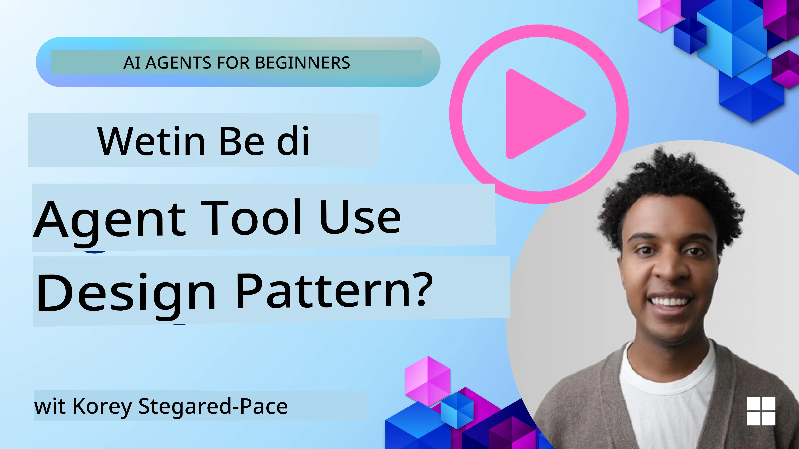
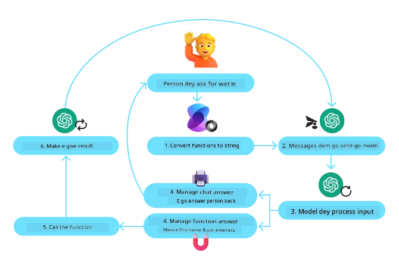
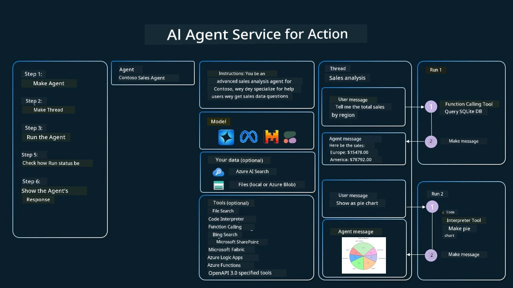

[](https://youtu.be/vieRiPRx-gI?si=cEZ8ApnT6Sus9rhn)

> _(Click di image wey dey top to watch video of dis lesson)_

# Tool Use Design Pattern

Tools dey interesting becos e dey allow AI agents get wider range of capabilities. Instead make di agent get small set of actions e fit do, if you add tool, di agent fit now do plenty different actions. For dis chapter, we go look Tool Use Design Pattern, wey go show how AI agents fit use certain tools to reach dia goals.

## Introduction

For dis lesson, we wan answer dis kain questions:

- Wetin be tool use design pattern?
- Which kain cases e fit dey used for?
- Which blocks or elements you need to build am?
- Which special tins to consider when you dey use Tool Use Design Pattern to build AI agents wey people fit trust?

## Learning Goals

After you finish dis lesson, you go fit:

- Talk am say Wetin be Tool Use Design Pattern and why e dey important.
- Know which cases Tool Use Design Pattern fit work well for.
- Understand the main parts wey you need to build the design pattern.
- Know wetin to consider to make AI agents trustworthy when you dey use dis design pattern.

## Wetin be Tool Use Design Pattern?

**Tool Use Design Pattern** na how we fit give LLMs power to connect and use outside tools to reach specific goals. Tools na code wey agent fit run to do things. Tool fit just be simple function like calculator, or e fit be API call to other service like to check stock price or weather forecast. For AI agents, tools dey designed to be run when agents see **model-generated function calls**.

## Which kain cases fit use am?

AI Agents fit take tools finish complicated work, find information, or make decisions. Tool use design pattern dey used for situations wey need to interact well well with outside systems, like databases, web services, or code interpreters. E help for plenty different cases like:

- **Dynamic Information Retrieval:** Agents fit ask outside APIs or databases for fresh data (like asking SQLite database for analysis, checking stock prices or weather).
- **Code Execution and Interpretation:** Agents fit run code or scripts to solve math problems, create reports, or do simulations.
- **Workflow Automation:** You fit take tools like task schedulers, email services, or data pipelines to automatic repeat work or multi-step work.
- **Customer Support:** Agents fit connect to CRM systems, ticketing platforms, or knowledge bases to answer user questions.
- **Content Generation and Editing:** Agents fit use tools like grammar checkers, text summarizers, or content safety checkers to help make content.

## Elements or building blocks wey you need to build the tool use design pattern

These blocks go make AI agent fit do plenty jobs. Make we see the main parts wey you need to build Tool Use Design Pattern:

- **Function/Tool Schemas**: Detailed explanation of tools wey dey available, like function name, purpose, parameters wey e need, and expected output. These schemas go help LLM sabi which tools dey and how to make correct requests.

- **Function Execution Logic**: This one dey control how and when tools go dey called depending on user intent and conversation context. E fit include planner modules, routing, or conditional flows wey decide tool usage for the matter.

- **Message Handling System**: Parts wey manage conversation flow between user input, LLM answers, tool calls, and tool output.

- **Tool Integration Framework**: System wey connect the agent to different tools, whether na simple function or complex outside service.

- **Error Handling & Validation**: Ways wey you fit handle tool run failure, check parameters, and manage unexpected responses.

- **State Management**: Dey track conversation context, previous tool use, and keep steady data for multistep conversation.

Next, make we look Function/Tool Calling more detailed.
 
### Function/Tool Calling

Function calling na main way we take make Large Language Models (LLMs) fit take tools work. You go see 'Function' and 'Tool' dey use like say na di same tin because 'functions' (reusable code blocks) na 'tools' wey agents use to do work. To call function code, LLM must compare user request with function description. For do dis, JSON schema with all function descriptions go sent to LLM. Then LLM go pick best function for the work and give its name and arguments. That function go run, response go return to LLM, wey go use am reply user request.

For developers to implement function calling for agents, you need:

1. LLM model wey fit do function calling
2. Schema wey carry function descriptions
3. Code to do every function wey schema talk about

Make we use example wey be to get current time for one city to show the way:

1. **Start LLM wey fit call functions:**

    No be all models fit do function calling, so make sure say LLM wey you dey use fit am. <a href="https://learn.microsoft.com/azure/ai-services/openai/how-to/function-calling" target="_blank">Azure OpenAI</a> fit do function calling. We fit start by begin OpenAI client for Azure OpenAI **Responses API** (di `/openai/v1/` endpoint — you no need `api_version`).

    ```python
    # Initialize the OpenAI client for Azure OpenAI (Responses API, v1 endpoint)
    client = OpenAI(
        base_url=f"{os.environ['AZURE_OPENAI_ENDPOINT'].rstrip('/')}/openai/v1/",
        api_key=os.environ["AZURE_OPENAI_API_KEY"],
    )
    deployment_name = os.environ["AZURE_OPENAI_DEPLOYMENT"]
    ```

1. **Create Function Schema**:

    Next, we go define JSON schema wey get function name, description of wetin function go do, plus all parameters names and their descriptions.
    Then we go pass dis schema plus user request make client find time for San Francisco. Wetin make sense know be say dem return **tool call**, no be final answer to question. Like e talk before, LLM go return function name wey e pick for task and arguments for am.

    ```python
    # Function description for the model to read (Responses API flat tool format)
    tools = [
        {
            "type": "function",
            "name": "get_current_time",
            "description": "Get the current time in a given location",
            "parameters": {
                "type": "object",
                "properties": {
                    "location": {
                        "type": "string",
                        "description": "The city name, e.g. San Francisco",
                    },
                },
                "required": ["location"],
            },
        }
    ]
    ```
   
    ```python
  
    # Initial user message
    messages = [{"role": "user", "content": "What's the current time in San Francisco"}]

    # First API call: Ask the model to use the function
    response = client.responses.create(
        model=deployment_name,
        input=messages,
        tools=tools,
        tool_choice="auto",
        store=False,
    )

    # The Responses API returns tool calls as function_call items in response.output.
    # Append them to the conversation so the model has full context on the next turn.
    messages += response.output

    print("Model's response:")
    print(response.output)
  
    ```

    ```bash
    Model's response:
    [ResponseFunctionToolCall(arguments='{"location":"San Francisco"}', call_id='call_pOsKdUlqvdyttYB67MOj434b', name='get_current_time', type='function_call')]
    ```
  
1. **Code wey dey run the function:**

    Now we don know which function to run, we need to write code wey go do the work and run am.
    We fit write code for Python to get current time. We go also write code to take name and arguments from response_message to get final result.

    ```python
      def get_current_time(location):
        """Get the current time for a given location"""
        print(f"get_current_time called with location: {location}")  
        location_lower = location.lower()
        
        for key, timezone in TIMEZONE_DATA.items():
            if key in location_lower:
                print(f"Timezone found for {key}")  
                current_time = datetime.now(ZoneInfo(timezone)).strftime("%I:%M %p")
                return json.dumps({
                    "location": location,
                    "current_time": current_time
                })
      
        print(f"No timezone data found for {location_lower}")  
        return json.dumps({"location": location, "current_time": "unknown"})
    ```

     ```python
    # Handle function calls
    tool_calls = [item for item in response.output if item.type == "function_call"]
    if tool_calls:
        for tool_call in tool_calls:
            if tool_call.name == "get_current_time":

                function_args = json.loads(tool_call.arguments)

                time_response = get_current_time(
                    location=function_args.get("location")
                )

                # Return the tool result as a function_call_output item
                messages.append({
                    "type": "function_call_output",
                    "call_id": tool_call.call_id,
                    "output": time_response,
                })
    else:
        print("No tool calls were made by the model.")

    # Second API call: Get the final response from the model
    final_response = client.responses.create(
        model=deployment_name,
        input=messages,
        tools=tools,
        store=False,
    )

    return final_response.output_text
     ```

     ```bash
      get_current_time called with location: San Francisco
      Timezone found for san francisco
      The current time in San Francisco is 09:24 AM.
     ```

Function Calling na heart of most agent tool use design, but to build am from scratch fit hard sometimes.
Like we learn for [Lesson 2](../../../02-explore-agentic-frameworks), agentic frameworks dey give pre-built blocks to make tool use easy.
 
## Tool Use Examples with Agentic Frameworks

Here be some examples how you fit build Tool Use Design Pattern with different agentic frameworks:

### Microsoft Agent Framework

<a href="https://learn.microsoft.com/azure/ai-services/agents/overview" target="_blank">Microsoft Agent Framework</a> na open-source AI framework to build AI agents. E simplify function calling by making you define tools as Python functions with `@tool` decorator. Framework dey handle talk-tok between model and your code. E get pre-built tools like File Search and Code Interpreter through `FoundryChatClient`.

Dis diagram dey show how function calling dey happen with Microsoft Agent Framework:



For Microsoft Agent Framework, tools na decorated functions. We fit change `get_current_time` function we see before to tool by using `@tool` decorator. Framework go automatically serialize function and parameters, create schema to send LLM.

```python
import os
from agent_framework import tool
from agent_framework.foundry import FoundryChatClient
from azure.identity import AzureCliCredential

@tool(approval_mode="never_require")
def get_current_time(location: str) -> str:
    """Get the current time for a given location"""
    ...

# Create the client
provider = FoundryChatClient(
    project_endpoint=os.environ["AZURE_AI_PROJECT_ENDPOINT"],
    model=os.environ["AZURE_AI_MODEL_DEPLOYMENT_NAME"],
    credential=AzureCliCredential(),
)

# Create an agent and run with the tool
agent = provider.as_agent(name="TimeAgent", instructions="Use available tools to answer questions.", tools=get_current_time)
response = await agent.run("What time is it?")
```

#### Tools from an MCP server

Tools no need to be functions wey dey your code only. Server wey speak Model Context Protocol (MCP, we cover am for [Lesson 11](../11-agentic-protocols/README.md)) dey publish tools with schemas, and framework fit load dem same way e serialize decorated function. `MCPStreamableHTTPTool` connect to such server via HTTP, read tool schemas, and offer am to model alongside local tools.

Example below use web search server wey <a href="https://keenable.ai" target="_blank">Keenable</a> host. E free to use without account or API key (requests dey limited per IP), so the only credentials you need na your model ones. Like any remote tool, queries wey model write na dem go send to dat server.

```python
from agent_framework import MCPStreamableHTTPTool

web_search = MCPStreamableHTTPTool(
    name="Keenable web search",
    url="https://api.keenable.ai/mcp",
)

# Connecting loads the server's tool schemas; the agent decides when to call them
async with web_search:
    agent = provider.as_agent(
        name="ResearchAgent",
        instructions="Use available tools to answer questions.",
        tools=[web_search],
    )
    response = await agent.run("What is new in the latest Python release?")
    print(response.text)
```

The server dey publish two tools, `search_web_pages` and `fetch_page_content`. When question need current info, model go call `search_web_pages`, get titles, URLs and text snippets, then write answer from dem, same way as `get_current_time` example above.
  
### Microsoft Foundry Agent Service

<a href="https://learn.microsoft.com/azure/ai-services/agents/overview" target="_blank">Microsoft Foundry Agent Service</a> na newer agentic framework wey fit make developers build, deploy, and scale secure, high-quality, extensible AI agents without stress about underlying compute and storage. E good for enterprise apps cos e fully managed and get enterprise-level security.

Compared to using LLM API directly, Microsoft Foundry Agent Service get these benefits:

- Automatic tool calling – no need to parse tool call, run tool, or handle response; server dey do all these
- Secure data management – no need to manage own conversation state, threads go store all info wey you need
- Ready tools – tools to connect with data like Bing, Azure AI Search, and Azure Functions.

Tools for Microsoft Foundry Agent Service fall into two groups:

1. Knowledge Tools:
    - <a href="https://learn.microsoft.com/azure/ai-services/agents/how-to/tools/bing-grounding?tabs=python&pivots=overview" target="_blank">Grounding with Bing Search</a>
    - <a href="https://learn.microsoft.com/azure/ai-services/agents/how-to/tools/file-search?tabs=python&pivots=overview" target="_blank">File Search</a>
    - <a href="https://learn.microsoft.com/azure/ai-services/agents/how-to/tools/azure-ai-search?tabs=azurecli%2Cpython&pivots=overview-azure-ai-search" target="_blank">Azure AI Search</a>

2. Action Tools:
    - <a href="https://learn.microsoft.com/azure/ai-services/agents/how-to/tools/function-calling?tabs=python&pivots=overview" target="_blank">Function Calling</a>
    - <a href="https://learn.microsoft.com/azure/ai-services/agents/how-to/tools/code-interpreter?tabs=python&pivots=overview" target="_blank">Code Interpreter</a>
    - <a href="https://learn.microsoft.com/azure/ai-services/agents/how-to/tools/openapi-spec?tabs=python&pivots=overview" target="_blank">OpenAPI defined tools</a>
    - <a href="https://learn.microsoft.com/azure/ai-services/agents/how-to/tools/azure-functions?pivots=overview" target="_blank">Azure Functions</a>

Agent Service allow us use all these tools as group (`toolset`). E also use `threads` wey dey keep history of messages from one conversation.

Imagine say you be sales agent for company wey name na Contoso. You want build chat agent wey fit answer questions about sales data.

Dis picture show how you fit use Microsoft Foundry Agent Service to analyze sales data:



To use any of these tools with service, we fit create client and define tool or toolset. To do am for real, we fit use dis Python code. LLM fit look toolset and decide if e go use user created function, `fetch_sales_data_using_sqlite_query`, or pre-built Code Interpreter based on user request.

```python 
import os
from azure.ai.projects import AIProjectClient
from azure.identity import DefaultAzureCredential
from fetch_sales_data_functions import fetch_sales_data_using_sqlite_query # fetch_sales_data_using_sqlite_query function which can be found in a fetch_sales_data_functions.py file.
from azure.ai.projects.models import ToolSet, FunctionTool, CodeInterpreterTool

project_client = AIProjectClient.from_connection_string(
    credential=DefaultAzureCredential(),
    conn_str=os.environ["PROJECT_CONNECTION_STRING"],
)

# Initialize toolset
toolset = ToolSet()

# Initialize function calling agent with the fetch_sales_data_using_sqlite_query function and adding it to the toolset
fetch_data_function = FunctionTool(fetch_sales_data_using_sqlite_query)
toolset.add(fetch_data_function)

# Initialize Code Interpreter tool and adding it to the toolset. 
code_interpreter = CodeInterpreterTool()toolset.add(code_interpreter)

agent = project_client.agents.create_agent(
    model="gpt-5-mini", name="my-agent", instructions="You are helpful agent", 
    toolset=toolset
)
```

## Wetin special to consider when you dey use Tool Use Design Pattern to build AI agents wey people fit trust?

One worry wey dey common with SQL wey LLMs generate dynamically na security, especially risk of SQL injection or bad things like to drop or damage database. Even though dis worries get meaning, you fit stop am well if you set database permissions correctly. For most databases, you fit set am as read-only. For PostgreSQL or Azure SQL, app suppose get read-only (SELECT) role.

To run app for secure environment fit add more protection. For enterprize, data dey usually extracted and changed from operational systems to read-only database or warehouse with user-friendly schema. Dis way, data dey safe, optimized for speed and access, and app get limited read-only access.

## Sample Codes

- Python: [Agent Framework](./code_samples/04-python-agent-framework.ipynb)
- .NET: [Agent Framework](./code_samples/04-dotnet-agent-framework.md)

## You get more questions about Tool Use Design Patterns?

Join [Microsoft Foundry Discord](https://discord.com/invite/ATgtXmAS5D) to meet other learners, attend office hours and get your AI Agents questions answer.

## Additional Resources

- <a href="https://microsoft.github.io/build-your-first-agent-with-azure-ai-agent-service-workshop/" target="_blank">Azure AI Agents Service Workshop</a>
- <a href="https://github.com/Azure-Samples/contoso-creative-writer/tree/main/docs/workshop" target="_blank">Contoso Creative Writer Multi-Agent Workshop</a>
- <a href="https://learn.microsoft.com/azure/ai-services/agents/overview" target="_blank">Microsoft Agent Framework Overview</a>

## Smoke-Testing Dis Agent (Optional)

After you don learn how to deploy agents for [Lesson 16](../16-deploying-scalable-agents/README.md), you fit smoke-test dis lesson `TravelToolAgent` (e still dey call im tools and answer?) with [`tests/lesson-04-smoke-tests.json`](../../../tests/lesson-04-smoke-tests.json). See [`tests/README.md`](../tests/README.md) to know how to run am.

## Previous Lesson

[Understanding Agentic Design Patterns](../03-agentic-design-patterns/README.md)

## Next Lesson

[Agentic RAG](../05-agentic-rag/README.md)

---

<!-- CO-OP TRANSLATOR DISCLAIMER START -->
**Disclaimer**:
Dis document don translate wit AI translation service [Co-op Translator](https://github.com/Azure/co-op-translator). Even tho we dey try make am correct, abeg make you know say automated translation fit get errors or mistakes. Di original document for dia own language na im be di correct source. For important info, make person wey sabi human translation do am. We no go responsible for any misunderstanding or wrong understanding wey fit happen because of dis translation.
<!-- CO-OP TRANSLATOR DISCLAIMER END -->