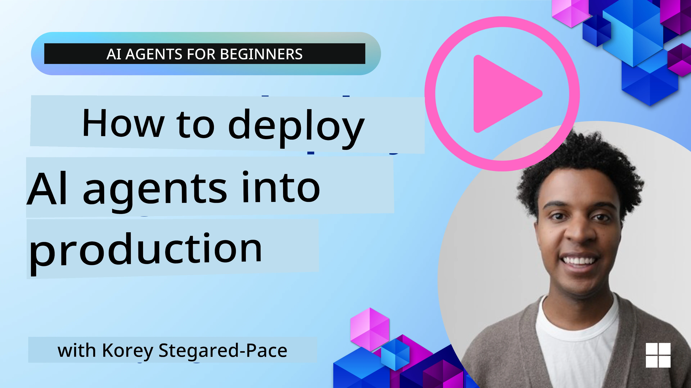

# AI Agents for Production: How to See and Check Dem Work Well

[](https://youtu.be/l4TP6IyJxmQ?si=reGOyeqjxFevyDq9)

As AI agents dey comot from experimental prototyp dem go do real work for world, e dey important to sabi how dem dey behave, dey watch how dem dey perform, and dey check how dem dey do work well well.

## Wetin You Go Learn

After you finish this lesson, you go sabi how to/understand:
- Main tori about how to see and check AI agents
- Ways to make agents perform better, reduce cost, and dey effective
- How and wetin to check for your AI agents on top their work
- How to control cost when you dey run AI agents for production
- How to add instruments to agents wey you build with Microsoft Agent Framework

The koko be to make you get better knowledge to turn your "black box" agents to clear, easy to manage, and reliable systems.

_**Note:** E important to put AI Agents wey safe and people fit trust. Make sure say you check the [Building Trustworthy AI Agents](../06-building-trustworthy-agents/README.md) lesson too._

## Traces and Spans

Tools wey dem use watch how things dey go like [Langfuse](https://langfuse.com/) or [Microsoft Foundry](https://learn.microsoft.com/en-us/azure/ai-foundry/what-is-azure-ai-foundry) dey usually show agent runs as traces and spans.

- **Trace** na the full work wey agent do from beginning to end (like answering user question).
- **Spans** na the small steps inside the trace (like calling language model or get data).


<!-- Image URL retained for illustration purposes -->

If no observational tools dey, AI agent fit be like "black box" - you no dey see inside how e dey think or run, so e hard to find wahala or make am better. But if you get observational tools, agents go be like "glass box," wey clear and transparent, and dis one dey important for trust and to make sure dem dey do wetin dem supposed do.

## Why E Dey Important to Observe for Production Places

When AI agents shift go production, e bring new wahala and wetin you go need. Observability no be luxury again but na important power:

*   **Debugging and Root-Cause Analysis**: When agent fail or give wahala output, observation tools go give you traces to find where error dey come from. Dis one important especially if agent get plenty LLM calls, tool work, and logic issues.
*   **Latency and Cost Management**: AI agents use LLMs and other API wey dem dey charge every time dem call or every token. Observability dey help track all these calls so you fit find any wey slow or too costly. E fit help team optimize prompts, choose better models, or change workflow to reduce cost and give better user experience.
*   **Trust, Safety, and Compliance**: For many work, e important make sure say agents dey behave safely and morally. Observability get audit trail for wetin agent dey do and decide. E fit help find problem like prompt injection, bad content generation, or bad handling of personal info (PII). For example, you fit check traces to know why agent give particular answer or why e use particular tool.
*   **Continuous Improvement Loops**: Observability data na the base for continuous improvement. If you dey watch how agents perform for real world, team fit find areas to fix, gather data to improve models, and check if changes make better difference. Dis one dey form feedback loop where production info from online evaluation go inform offline tests and improvement, to make agent perform better and better.

## Important Metrics to Track

To watch and understand agent behavior, you must track different metrics and signals. Some metrics fit change based on agent purpose, but some dey important for everybody.

Here be some common metrics wey observation tools dey watch:

**Latency:** How fast agent dey answer? If e dey take long, user experience go bad. You suppose measure latency for tasks and for each step by tracing agent runs. For example, if agent dey take 20 seconds to finish all model calls, you fit speed am up by using faster model or run model calls for same time.

**Costs:** How much e cost per run? AI agents use LLM calls wey charge per token or outside APIs. If tools dey use plenty or many prompts, cost go jump. For example, if agent dey call LLM five times for small improvement, you fit check if e worth or if you fit reduce calls or use cheaper model. Real-time monitoring fit also find surprise cost spikes (e.g., bugs wey dey cause too many API calls).

**Request Errors:** How many requests agent no succeed? E fit include API wahala or tool calls wey fail. To make agent strong for production, you fit set fallback or retry plans. Like if LLM provider A no dey, you switch go LLM provider B as backup.

**User Feedback:** Make direct user reviews dey give better info. This fit be clear ratings (👍thumbs up/👎down, ⭐1-5 stars) or written comments. Plenty bad feedback suppose warn you say agent no dey work as e suppose.

**Implicit User Feedback:** User behavior fit give indirect feedback even if no clear rating. Dis fit be quick rephrasing of question, repeating questions or pressing retry button. For example, if you see say users dey ask same question many times, na sign say agent no dey work as e suppose.

**Accuracy:** How often agent dey produce correct or good outputs? Accuracy mean different things (like correctness for problem-solving, info accuracy, or user satisfaction). The first step be to define wetin success mean for your agent. You fit track accuracy with automated checks, scores, or task completion label. For example, mark traces like "succeeded" or "failed".

**Automated Evaluation Metrics:** You fit also set automated evals. For example, use LLM to score agent output like if e helpful, correct, or no. Plenty open source libraries dey to help score different parts of agent. For example, [RAGAS](https://docs.ragas.io/) for RAG agents or [LLM Guard](https://github.com/protectai/llm-guard) to find harmful language or prompt injection.

For real work, combination of these metrics go give best check of AI agent health. For this chapter [example notebook](./code_samples/10-expense_claim-demo.ipynb), we go show you how these metrics dey look for real examples but first, we go learn how typical evaluation process dey.

## Add Instrument for Your Agent

To collect tracing data, you need to add instrument for your code. The aim na to make agent code send traces and metrics wey observability platform fit catch, process, and show.

**OpenTelemetry (OTel):** [OpenTelemetry](https://opentelemetry.io/) don become industry standard for LLM observability. E get APIs, SDKs, and tools wey help make, collect, and export telemetry data.

Many instrumentation libraries dey wey fit wrap existing agent frameworks and make am easy to export OpenTelemetry spans to observability tools. Microsoft Agent Framework dey integrate with OpenTelemetry naturally. Below na example how to instrument MAF agent:

```python
from agent_framework.observability import get_tracer, get_meter

tracer = get_tracer()
meter = get_meter()

with tracer.start_as_current_span("agent_run"):
    # Agent execution is traced automatically
    pass
```

The [example notebook](./code_samples/10-expense_claim-demo.ipynb) for this chapter go show how to instrument your MAF agent.

**Manual Span Creation:** Even though instrumentation libraries dey good, sometimes you need more detailed or custom info. You fit create spans manually to add your own app logic. More important, you fit add custom attributes (tags or metadata) to spans wey automatic or manual created. These attributes fit include business info, middle calculations, or any context useful for debugging or analysis, like `user_id`, `session_id`, or `model_version`.

Example how to create traces and spans manually with [Langfuse Python SDK](https://langfuse.com/docs/sdk/python/sdk-v3): 

```python
from langfuse import get_client
 
langfuse = get_client()
 
span = langfuse.start_span(name="my-span")
 
span.end()
```

## Agent Evaluation

Observability give us metrics, but evaluation na to analyze the data (and do tests) to know how well AI agent dey perform and how to improve am. In other words, after you get those traces and metrics, how you go take judge agent and take decisions?

Regular evaluation important because AI agents no dey always act same way and fit change (update or model behavior drift) – without evaluation, you no go sabi if your “smart agent” dey do im work well or if e don worsen.

Two kinds evaluation dey for AI agents: **online evaluation** and **offline evaluation**. Both dey important and dem dey support each other. We usually start with offline evaluation, e be the minimum step before you deploy any agent.

### Offline Evaluation


Na to evaluate agent for controlled place, usually using test datasets, not live user questions. You use special datasets wey you sabi wetin correct output or proper behavior be, and run your agent on top them.

Like if you build math word-problem agent, you fit get [test dataset](https://huggingface.co/datasets/openai/gsm8k) of 100 problems wey answer dey known. Offline evaluation dey usually done for development (fit dey part of CI/CD pipelines) to check improvement or avoid going back. Benefit be say e **repeatable and you go get clear accuracy because you get ground truth**. You fit still simulate user questions and check agent answers with best answers or use automated metrics as we talk before.

Main wahala for offline eval na to make sure test dataset complete and dey fresh – agent fit do well for fixed test set but face different questions for production. So, you suppose dey update test sets with new edge cases and examples wey show real-world. Mixing small “smoke test” cases and bigger evaluation sets dey useful: small ones for quick check, large ones for wide performance check.

### Online Evaluation 


Na to evaluate agent for live, real-world environment, during real use for production. Online evaluation mean dey watch agent performance for actual user interactions and dey analyze results all the time.

For example, you fit track success rates, user satisfaction scores, or other metrics on live traffic. Advantage of online evaluation be say e **catch things wey you no fit guess for lab** – you fit see model drift over time (if agent effectiveness reduce as input style change) and find surprise questions or situations wey no dey test data. E dey show true picture of how agent dey behave for real life.

Online evaluation dey collect implicit and explicit user feedback as we talk before, and fit run shadow tests or A/B tests (where new agent version dey run alongside old one to compare). Problem be say e fit hard to get reliable labels or scores for live interaction – you fit depend on user feedback or downstream metrics (like if user click result).

### Combine the two

Online and offline evaluations no be to oppose; dem dey support each other well. Insight from online monitoring (like new kind of user questions where agent no perform well) fit help add and improve offline test datasets. Agents wey perform well for offline test fit then deploy confidently and monitor for online.

Many teams dey follow this loop: 

_evaluate offline -> deploy -> monitor online -> collect new failure cases -> add to offline dataset -> fix agent -> repeat_.

## Common Wahala

As you deploy AI agents to production, you fit meet different wahala. Here be some common issues and how to fix dem:

| **Issue**    | **Possible Fix**   |
| ------------- | ------------------ |
| AI Agent no dey do tasks steady | - Improve the prompt wey you dey give AI Agent; make objectives clear.<br>- Find where to divide tasks into small parts and use many agents handle dem. |
| AI Agent dey do continuous loops  | - Make sure say you get clear conditions to stop process so Agent go know when to stop.<br>- For complex tasks where reasoning and planning dey, use bigger model wey sabi do reasoning better. |
| AI Agent tool calls no dey perform well   | - Test and check tool output outside agent system.<br>- Improve parameters, prompts, and tool names.  |
| Multi-Agent system no dey steady | - Improve prompts wey each agent get to make them clear and different from each other.<br>- Build hierarchical system with "routing" or controller agent to decide which agent suppose work. |

Plenty of these wahala fit show well if you get observability. Traces and metrics wey we talk before go help you find exactly where for agent workflow the problem occur, making debugging and fix easy and fast.

## How to Manage Cost

Here be some ways to manage cost of deploying AI agents for production:

**Using Smaller Models:** Small Language Models (SLMs) fit well for some agentic use-cases and dem go reduce cost well-well. Like we talk before, to build evaluation system to check performance and compare am with bigger models na the best way to sabi how SLM go perform for your use case. Think say SLMs dey good for easy tasks like intent classification or parameter extraction, make you save bigger models for the wahala reasoning ones.  

**Using a Router Model:** Another way na to use different models wey get different sizes. You fit use LLM/SLM or serverless function to direct requests based on how e complex reach the correct model. This one go reduce cost and still make sure say performance dey on point for correct tasks. For example, send small small questions go smaller, fast models, and use big expensive ones only for complex reasoning tasks.  

**Caching Responses:** To sabi common requests and tasks before dem enter your agentic system na good way to reduce the number of same kind requests. You fit even put flow to check how request take match your cached requests using simple AI models. Dis strategy fit reduce cost gidigba for questions wey dey asked often or common workflows.  

## Make we see how dis work for real life  

For the [example notebook of this section](./code_samples/10-expense_claim-demo.ipynb), we go see examples of how we fit use observability tools take monitor and evaluate our agent.  


### You Get More Questions About AI Agents for Production?  

Join the [Microsoft Foundry Discord](https://discord.com/invite/ATgtXmAS5D) make you meet other learners, join office hours and get your AI Agents questions answer.  

## Previous Lesson  

[Metacognition Design Pattern](../09-metacognition/README.md)  

## Next Lesson  

[Agentic Protocols](../11-agentic-protocols/README.md)  

---

<!-- CO-OP TRANSLATOR DISCLAIMER START -->
**Disclaimer**:
Dis document don translate wit AI translation service [Co-op Translator](https://github.com/Azure/co-op-translator). Even tho we dey try make am correct, abeg make you know say automated translation fit get errors or mistakes. Di original document for dia own language na im be di correct source. For important info, make person wey sabi human translation do am. We no go responsible for any misunderstanding or wrong understanding wey fit happen because of dis translation.
<!-- CO-OP TRANSLATOR DISCLAIMER END -->