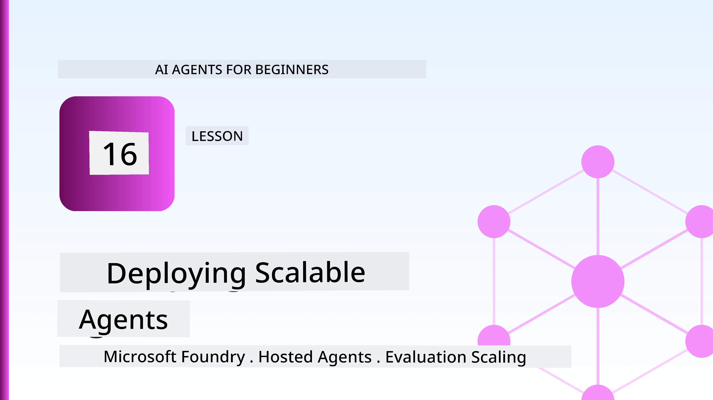
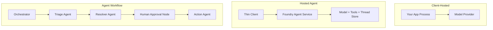
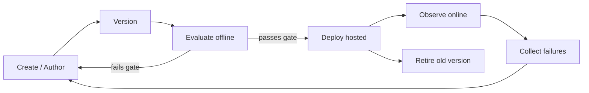
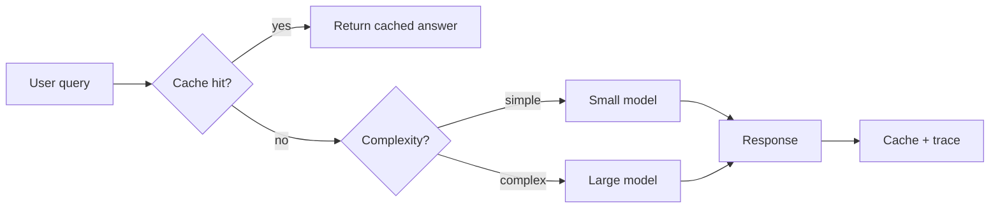
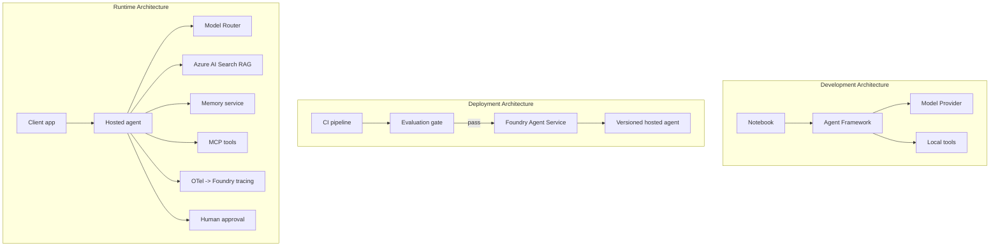

# Deploying Scalable Agents wit Microsoft Foundry



Up to dis point for dis course, you don build agents wey dey run for your laptop, inside notebook, driven by `az login` and some environment variables. Na dis kain way correct for learning. But e no be di correct way to run agent wey thousands customers dey depend on for 3 a.m.

Dis lesson na about the gap between "e dey work for my machine" and "e dey work, correct and cheap, for production." We go close dat gap using **Microsoft Foundry** and **Microsoft Foundry Agent Service**, and we go do am by building real customer support agent wey get tools, retrieval, memory, evaluation, and monitoring.

## Introduction

Dis lesson go cover:

- Di difference between **prototype agent** and **deployed agent**, and why na mostly about everything wey *around* di model di transition be.
- **Deployment patterns** for agents: client-hosted, service-hosted (Hosted Agents), and workflow-orchestrated.
- Di **agent lifecycle** for Microsoft Foundry — create, version, deploy, evaluate, observe, retire.
- **Scaling strategies**: model routing, caching, concurrency, and stateless design.
- **Observability** wit OpenTelemetry and Foundry tracing.
- **Cost optimisation** through model selection, routing, and evaluation gates.
- **Enterprise considerations**: governance, human approval, and running MCP servers safely for production.

## Learning Goals

After you finish dis lesson, you go sabi how to:

- Choose di correct deployment pattern for agent workload.
- Deploy agent go Microsoft Foundry Agent Service so e go versioned, governed, and observable.
- Instrument agent for tracing and connect evaluation pipeline wey dey run before every release.
- Apply model routing and caching to keep latency and cost under control for scale.
- Add human approval gate for high-risk actions and integrate MCP server in production-safe way.

## Prerequisites

Dis lesson suppose you don complete earlier lessons and you dey comfortable with:

- Building agents wit [Microsoft Agent Framework](../14-microsoft-agent-framework/README.md) (Lesson 14).
- [Tool Use](../04-tool-use/README.md) (Lesson 4) and [Agentic RAG](../05-agentic-rag/README.md) (Lesson 5).
- [Agent Memory](../13-agent-memory/README.md) (Lesson 13) and [Agentic Protocols / MCP](../11-agentic-protocols/README.md) (Lesson 11).
- [Observability and Evaluation](../10-ai-agents-production/README.md) (Lesson 10) — dis lesson dey build directly on top am.

You go still need:

- **Azure subscription** and **Microsoft Foundry project** wey get at least one deployed chat model.
- The **Azure CLI** wey authenticate (`az login`).
- Python 3.12+ and packages for inside di repository [`requirements.txt`](../../../requirements.txt).

## From Prototype to Production: Wetin Actually Change

Prototype agent and production agent get the same core loop — reason, call tools, respond. But wetin change na everything wey dey wrapped around dat loop. Di model be like 20% of production agent; di oda 80% na di operational skeleton.

| Concern | Prototype | Production |
| --- | --- | --- |
| **Hosting** | Dey run for your notebook | Dey run as hosted service, versioned and rolled out |
| **Identity** | Your `az login` token | Managed identity wit scoped RBAC |
| **State** | In-memory, lost if you restart | Externalized (thread store, memory service) |
| **Failure** | You go see di traceback | Retries, fallbacks, dead-letter, alerts |
| **Cost** | "Na small cents" | Tracked per request, routed, cached, budgeted |
| **Quality** | You just eyeball di output | Evaluated automatically before every release |
| **Trust** | You approve every action | Policy + human-in-the-loop for risky actions |

Make you still remember dis table well well. Every section below dey follow one of dis rows.

## Agent Deployment Patterns

Three patterns dey wey you go use, sometimes together.

### 1. Client-Hosted Agents

Di agent object dey inside *your* application process. Your code dey call the model provider directly; di reasoning loop dey run inside your service. Na dis every previous lesson don do.

- **Use am when** you wan full control over di loop, custom middleware, or you dey embed di agent inside existing backend.
- **Trade-off**: you go handle scaling, state, and resilience yourself.

### 2. Hosted Agents (Foundry Agent Service)

Di agent *register as resource* for Microsoft Foundry. Foundry dey host di reasoning loop, save threads, enforce content safety and RBAC, and e show di agent for Foundry portal. Your app go be thin client wey dey create threads and dey read responses.

- **Use am when** you want durability, built-in observability, governance, and less operational surface area.
- **Trade-off**: less low-level control but you get managed runtime.

### 3. Agent Workflows

Many agents (and tools) dey join together into graph wit clear control flow — sequential steps, branching, human approval nodes, durable checkpoints wey fit pause and resume. Na Microsoft Agent Framework **Workflows** capability wey dey apply for deployment scale.

- **Use am when** one task need several specialised agents or need approval step for middle.
- **Trade-off**: more moving parts; need orchestration-level observability.



## Di Agent Lifecycle for Microsoft Foundry

Deploying agent no be only once `push`. Na loop, and e resemble software release cycle well, because na wetin e be.



Di main idea carry from [Lesson 10](../10-ai-agents-production/README.md): **offline evaluation na gate, no be afterthought.** New agent version no go ship if e no clear your evaluation thresholds. Online observability go feed real-world failures back to your offline test set. Na all dis loop be dat.

## Scaling Strategies

Scaling agent no be like scaling stateless web API, because each request fit trigger many expensive model and tool calls. Four techniques dey carry most load.

**Stateless request handling.** No keep per-user state for your process memory. Save conversation threads for Foundry thread store or memory service so any instance fit handle any request. Na dis one let you scale horizontally — add instances, no sticky sessions.

**Model routing.** No every request need your most powerful (and most expensive) model. Route simple requests—like intent classification, short factual answers—to small, fast model, and keep big model for real reasoning. Foundry **Model Router** fit do dis for you, or you fit build light classifier yourself. You go build di DIY version for lab.

**Response caching.** Plenty support queries dey near duplicate ("how do I reset my password?"). Cache answers to common questions and serve dem without hitting di model at all. Even small cache hit rate go cut cost and latency.

**Concurrency and backpressure.** Model providers get rate limits. Limit your concurrency, use retries wit exponential backoff, and fail gracefully (queued "we dey on am" beats 500 error).



## Observability for Production

You no fit operate wetin you no fit see. As we talk for Lesson 10, Microsoft Agent Framework dey emit **OpenTelemetry** traces naturally – every model call, tool invoke, and orchestration step na span. For production, you export dis spans go Microsoft Foundry (or any OTel-compatible backend) so you fit:

- Trace one customer complaint from start to end across every model and tool call.
- Watch p50/p95 latency and cost per request over time.
- Alert on error-rate spikes and cost anomalies before your users (or your finance people) notice.

```python
from agent_framework.observability import get_tracer

tracer = get_tracer()

with tracer.start_as_current_span("support_request") as span:
    span.set_attribute("customer.tier", "enterprise")
    span.set_attribute("routed.model", "gpt-5-nano")
    # agent execution is traced automatically inside this span
```

Attributes like `customer.tier` and `routed.model` na wetin dey turn wall of traces to answerable questions ("dem enterprise customers dey route go small model too often?").

## Cost Optimisation

Cost for production agents na tokens dey dominate. Three levers, order of impact:

1. **Right-size di model.** Small model wey pass your evaluation gate almost always cheaper than big one wey still pass. Use evaluation to *prove* small model good enough rather than just choose biggest model to be safe.
2. **Route by complexity.** Like above — pay big-model price only for requests wey need big-model reasoning.
3. **Cache well well.** Cheapest model call na di one you no make at all.

Evaluation gates and cost control na same discipline look from two sides: evaluation show you *quality floor*, routing and caching keep cost near that floor.

## Enterprise Deployment Considerations

**Governance.** Hosted Agents inherit Foundry's RBAC, content safety, and audit logging. Give each agent managed identity wey get lowest privilege e need—read-only for knowledge base, scoped ticketing API access, nothing pass dat.

**Human-in-the-loop.** Some actions too serious to automate — like refund, delete account, escalate to legal team. Microsoft Agent Framework support **approval-required** tools: agent propose action, execution pause, human approve or reject, workflow continue. You see primitive for [Lesson 6](../06-building-trustworthy-agents/README.md); now you deploy am.

**MCP for production.** [MCP](../11-agentic-protocols/README.md) let your agent take external tools through standard interface. For production, treat every MCP server like untrusted boundary: pin server version, run with scoped identity, validate outputs, no expose secrets. MCP server na dependency, dependencies dey patched, audited, rate-limited.



Dem three diagrams — development, deployment, runtime — na same agent for three stages of life. Di lab wey follow go show you how to build am.

## Hands-On Lab: Production-Ready Customer Support Agent

Open [`code_samples/16-python-agent-framework.ipynb`](./code_samples/16-python-agent-framework.ipynb) and work am end to end. You go build **Contoso customer support agent** with every production issue wire in:

1. **Tool calling** — check order status and open support tickets.
2. **RAG** — answer policy questions from knowledge base (Azure AI Search, with in-memory fallback so notebook fit run without Search resource).
3. **Memory** — remember customer through conversation turns.
4. **Model routing** — complexity classifier dey route each request to small or big model.
5. **Response caching** — repeat questions dey served from cache.
6. **Human approval** — refunds pass threshold go pause for human sign-off.
7. **Evaluation pipeline** — small offline test set dey score agent and act like release gate.
8. **Observability** — OpenTelemetry tracing for every request.

### Walkthrough

Di notebook organize so each production worry na one self-contained, runnable section. Di main one na routing-plus-caching request handler:

```python
async def handle_support_request(query: str, customer_id: str) -> str:
    # 1. Serve from cache when we can.
    cached = response_cache.get(normalize(query))
    if cached:
        return cached

    # 2. Route by complexity to control cost.
    model = "gpt-5-nano" if is_simple(query) else "gpt-5-mini"

    # 3. Run the agent inside a trace span for observability.
    with tracer.start_as_current_span("support_request") as span:
        span.set_attribute("routed.model", model)
        span.set_attribute("customer.id", customer_id)
        response = await support_agent.run(query, model=model)

    # 4. Cache and return.
    response_cache.set(normalize(query), response.text)
    return response.text
```

Di evaluation gate wey guard release dey like dis:

```python
async def evaluation_gate(agent, test_cases, threshold: float = 0.8) -> bool:
    passed = 0
    for case in test_cases:
        result = await agent.run(case["input"])
        if score_response(result.text, case["expected"]) >= 0.8:
            passed += 1
    pass_rate = passed / len(test_cases)
    print(f"Evaluation pass rate: {pass_rate:.0%} (gate: {threshold:.0%})")
    return pass_rate >= threshold  # only deploy if the gate passes
```

Read every line—di notebook keep primitives small so nothing hide behind framework call.

## Validating Deployed Agent wit Smoke Tests

Di evaluation gate wey pass run *offline* against your agent object. Once agent deploy as Hosted Agent, you need one more, even cheaper check: **di deployed endpoint really dey answer?**

Deploying "successfully" only show control plane accept definition—e no mean agent dey respond. Missing dependency, bad model routing, expired connection fit leave green deployment wey no return anything. **Smoke test** go catch dis within seconds, for every deploy, and no cost like full evaluation.

Dis repository get ready-to-use smoke-test pipeline wey build on top [AI Smoke Test](https://github.com/marketplace/actions/ai-smoke-test) GitHub Action:

- **Catalog** — [`tests/lesson-16-smoke-tests.json`](../../../tests/lesson-16-smoke-tests.json) get prompts and assertions for Contoso support agent (grounded policy answers, order lookup, on-topic, multi-turn thread continuity). Catalogs for other lessons agents dey alongside — see [`tests/README.md`](../tests/README.md).
- **Workflow** — [`.github/workflows/smoke-test.yml`](../../../.github/workflows/smoke-test.yml) login with Azure OIDC and POST each prompt go agent's Responses endpoint, fail job if any assertion miss.

```yaml
- name: Smoke-test hosted agent
  uses: JFolberth/ai-smoketest@v1
  with:
    project_endpoint: ${{ inputs.project_endpoint }}
    agent_name: ContosoSupportAgent
    tests_file: tests/lesson-16-smoke-tests.json
```

Run am from the **Actions** tab as soon as your agent don deploy, supply your Foundry project endpoint and agent name. The federated identity need the **Azure AI User** role for inside Foundry project scope. Make you think of the layers as pyramid: smoke tests (fit reach and e dey answer?) dey run every time dem deploy, offline evaluation (e good reach to ship?) dey run before promotion, and online evaluation (how e dey perform for field?) dey run non-stop.

## Knowledge Check

Test your understanding before you move go the assignment.

**1. About how much of production agent na "the model," and wetin be the rest?**

<details>
<summary>Answer</summary>

The model na only small part of the system — usually e dey about 20%. The rest na the operational skeleton: hosting and versioning, identity and RBAC, externalised state, failure handling, cost tracking, evaluation, plus human-in-the-loop controls. To move go production na mainly to build everything *around* the reasoning loop.
</details>

**2. When you go choose Hosted Agent pass client-hosted agent?**

<details>
<summary>Answer</summary>

If you want managed runtime wey get durability inside (threads wey fit last and fit resume), observability, content safety, and RBAC, plus you ready to lose small control for the reasoning loop so that you make operational work easy small. Client-hosted dey better if you want full control for the loop or if you dey put the agent inside your existing backend.
</details>

**3. Why scalable agent suppose be stateless for im own process memory?**

<details>
<summary>Answer</summary>

So every instance fit handle any request, this na wetin allow horizontal scaling without sticky sessions. Per-person conversation state na external thread store or memory service. If state dey inside process memory, e go lost on restart and no go fit distribute load free.
</details>

**4. Which problem model routing dey solve, and how e relate to evaluation?**

<details>
<summary>Answer</summary>

Routing dey send simple requests go small, cheap, fast model and reserve the big model for real reasoning, this one control latency and cost. E relate to evaluation because evaluation na wetin *prove* say the small model good reach for some kind requests — routing without evaluation na just guessing.
</details>

**5. Wetin be "evaluation gate" and where e dey for lifecycle?**

<details>
<summary>Answer</summary>

Evaluation gate dey run offline test set against new agent version and e block deployment if the pass rate no reach threshold. E dey between "version" and "deploy" for lifecycle, e make quality be precondition for release instead of wetin you check after shipment.
</details>

**6. Why you suppose treat MCP server as untrusted boundary for production?**

<details>
<summary>Answer</summary>

Because na external dependency your agent dey call. You suppose pin the version, run am with scoped identity, validate the outputs, rate-limit am, and no ever expose secrets to am — na the same discipline you go use for any third-party dependency. E outputs go inside your agent reasoning, so if you no validate am, e fit be security risk.
</details>

**7. Which single change dey usually get biggest impact for production agent cost, and why?**

<details>
<summary>Answer</summary>

Right-size the model — use the smallest model wey still pass your evaluation gate. Tokens na wetin dey dominate cost, plus smaller model wey fit meet quality na almost always cheaper pass big one. Caching and routing fit reduce cost well well, but to choose the correct base model get the biggest first-order effect.
</details>

**8. Wetin span attributes like `customer.tier` and `routed.model` dey do for observability?**

<details>
<summary>Answer</summary>

Dem dey turn raw traces to business questions wey you fit answer. If no get attributes, you go just see wall of spans; but with them you fit ask "dem dey route enterprise customers to small model too much time?" or "which model dey handle our slowest requests?" Attributes na how you take slice telemetry with dimensions wey matter to your operation.
</details>

## Assignment

Take the customer support agent wey dey the lab and make am strong for one particular situation: **subscription billing support agent for one SaaS company.**

Your submission suppose:

1. **Change the tools** to billing ones: `get_subscription_status`, `get_invoice`, and `issue_credit` (credits pass $50 need human approval).
2. **Add three RAG documents** wey cover the company refund policy, billing cycle, and cancellation policy.
3. **Extend the evaluation set** to at least eight cases, and at least two must trigger human-approval path, plus confirm your evaluation gate dey pass or fail well well.
4. **Add one cost report**: after you run ten mixed queries through the agent, show how many go the small model, how many go the big model, and how many dem serve from cache.

Write short paragraph (for one markdown cell) wey explain which model-routing rule you choose and how you go validate am with real traffic. No get one correct answer — dem dey assess if your production concerns arrange well well.

## Summary

For this lesson you move agent from prototype go production with Microsoft Foundry:

- The jump go production na mainly about **operational skeleton** wey dey around the model — hosting, identity, state, failure handling, cost, quality, and trust.
- You learn the three **deployment patterns** — client-hosted, Hosted Agents, and Agent Workflows — plus when to use each one.
- You waka through **agent lifecycle**, where offline **evaluation act as release gate** and online observability dey feed failures back inside the test set.
- You apply **scaling strategies** — stateless design, model routing, caching, plus bounded concurrency — and connect dem to **cost optimisation**.
- You wire in **enterprise controls**: RBAC, human-in-the-loop approval, and production-safe MCP integration.
- You build **production-ready customer support agent** wey join all these concerns together for runnable code.

Next lesson na opposite journey: instead of to scale agents go cloud, you go bring them *down* to single developer machine and run dem completely local.

## Additional Resources

- <a href="https://learn.microsoft.com/azure/ai-foundry/what-is-azure-ai-foundry" target="_blank">Microsoft Foundry documentation</a>
- <a href="https://learn.microsoft.com/azure/ai-foundry/agents/overview" target="_blank">Microsoft Foundry Agent Service overview</a>
- <a href="https://learn.microsoft.com/en-us/agent-framework/overview/?wt.mc_id=youtube_26688_organicsocial_reactor&pivots=programming-language-python" target="_blank">Microsoft Agent Framework</a>
- <a href="https://learn.microsoft.com/en-us/azure/ai-foundry/openai/concepts/model-router" target="_blank">Model Router in Microsoft Foundry</a>
- <a href="https://learn.microsoft.com/azure/search/search-what-is-azure-search" target="_blank">Azure AI Search</a>
- <a href="https://opentelemetry.io/" target="_blank">OpenTelemetry</a>
- <a href="https://github.com/marketplace/actions/ai-smoke-test" target="_blank">AI Smoke Test GitHub Action</a>
- <a href="https://modelcontextprotocol.io/" target="_blank">Model Context Protocol (MCP)</a>

## Previous Lesson

[Building Computer Use Agents (CUA)](../15-browser-use/README.md)

## Next Lesson

[Creating Local AI Agents](../17-creating-local-ai-agents/README.md)

---

<!-- CO-OP TRANSLATOR DISCLAIMER START -->
**Disclaimer**:
Dis document don translate wit AI translation service [Co-op Translator](https://github.com/Azure/co-op-translator). Even tho we dey try make am correct, abeg make you know say automated translation fit get errors or mistakes. Di original document for dia own language na im be di correct source. For important info, make person wey sabi human translation do am. We no go responsible for any misunderstanding or wrong understanding wey fit happen because of dis translation.
<!-- CO-OP TRANSLATOR DISCLAIMER END -->