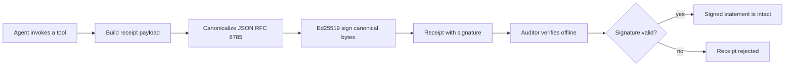
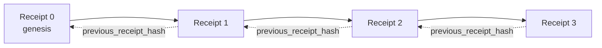

[Watch di lesson video: Securing AI Agents with Cryptographic Receipts](https://youtu.be/PLACEHOLDER_VIDEO_ID)

> _(Lesson video an thumbnail go add by di Microsoft content team after merge, e go follow di lesson 14 / 15 format.)_

# Securing AI Agents with Cryptographic Receipts

## Introduction

Dis lesson go cover:

- Why audit trails for AI agents matter for compliance, debugging, an trust.
- Wetin cryptographic receipt be an how e different from unsigned log line.
- How to produce signed receipt for agent tool call inside plain Python.
- How to verify receipt offline an sabi if anybody tamper am.
- How to chain receipts so that if person remove or reorder one, e go break di chain.
- Wetin receipts prove an wetin dem no prove at all.

## Learning Goals

After you don finish dis lesson, you go sabi how to:

- Identify di failure ways wey make cryptographic provenance important for agent actions.
- Produce Ed25519-signed receipt over correct JSON payload.
- Verify receipt by yourself with only di signer public key.
- See tampering by doing verification again on modified receipt.
- Build hash-chained receipts sequence an talk why chain matter.
- Know di border between wetin receipts prove (attribution, integrity, correct order) an wetin dem no prove (if action correct, or policy make sense).

## Di Problem: Your Agent's Audit Trail

Imagine say you don deploy AI agent for Contoso Travel. Di agent dey read customer request dem, e dey call flights API to find options, an e dey book seat for customer side. Last quarter, di agent processed 50,000 bookings.

Today auditor show. Dem ask simple question: "Show me wetin your agent do."

You give dem all your log files. Di auditor see dem an ask harder question: "How I go know say nobody edit dis logs?"

Dis na di audit-trail problem. Most agent deployment now depend on:

- **Application logs**: na di agent write am, anybody wey get access for file-system fit edit am.
- **Cloud logging services**: dem get tamper-evident on platform level but only if auditor trust platform operator.
- **Database transaction logs**: good for database changes but no too good for tool calls.

None of dem fit answer auditor question without say auditor trust somebody (you, your cloud provider, your database vendor). For inside company work, dis trust dey okay. For regulated work (finance, healthcare, or anything wey EU AI Act cover), e no dey okay.

Cryptographic receipts reduce dis problem by making signed statement wey fit verify by yourself.
Auditor still need extra reason to trust di signing key an di component wey produce di statement. Embedded key show self-consistency,
no be issuer identity or enforcement place.


## Wetin be Cryptographic Receipt?

Receipt na JSON object wey record wetin agent do, an e get digital signature for am.



Minimal receipt go look like dis:

```json
{
  "type": "agent.tool_call.v1",
  "agent_id": "contoso-travel-bot",
  "tool_name": "lookup_flights",
  "tool_args_hash": "sha256:a3f9c1...",
  "result_hash": "sha256:7b2e1d...",
  "policy_id": "contoso-travel-policy-v3",
  "timestamp": "2026-04-25T14:30:00Z",
  "sequence": 47,
  "previous_receipt_hash": "sha256:9d4e6a...",
  "signature": {
    "alg": "EdDSA",
    "sig": "c5af83...",
    "public_key": "8f3b2c..."
  }
}
```

Three properties dey do di work:

1. **Di signature**. Di receipt signed by agent gateway with Ed25519 private key. Anybody weh get di public key fit verify di signature offline. Party wey depend on am suppose pin di key or find am for trusted registry outside di receipt. If dem tamper with any signed field, di signature no go valid.

2. **Canonical encoding**. Before signing, di receipt serialized with JSON Canonicalization Scheme (JCS, RFC 8785). Dis one make sure say two implementations wey produce di same logical receipt go produce byte-identical output. Without canonicalization, different JSON serializers go give different signatures for di same content.

3. **Hash chaining**. Di `previous_receipt_hash` field dey link each receipt to di one wey come before am. If person remove or reorder receipt, e go break di sequence. To sabi truncation or if signer rewrite am, you still need pinned current chain head, independent witnessed checkpoint, or authenticated closed-population commitment.

Together, dis properties give three guarantees:

- **Attribution to a key**: dis key sign dis content. To get organizational or human identity, you need trusted key binding.
- **Integrity**: di content no change since signing.
- **Ordering within di verified sequence**: dis receipt link to di one before am.

## How to Produce Receipt for Python

You no need special library to produce receipt. Cryptographic primitives dey everywhere an di logic na few dozen lines for Python.

Hands-on exercises for `code_samples/18-signed-receipts.ipynb` go guide you through whole process. Di source-controlled `code_samples/18-signed-receipts.execution-receipt.json` dey record exact notebook hash, Python environment, cell count, an checks from latest clean run without changing lesson saved output. The summary na:

```python
import json
import hashlib
import base64
from nacl import signing
from jcs import canonicalize  # RFC 8785 canonical JSON

def b64url_nopad(data: bytes) -> str:
    return base64.urlsafe_b64encode(data).decode("ascii").rstrip("=")

def sha256_canonical(obj) -> str:
    """SHA-256 of a Python object's JCS-canonical JSON form."""
    return f"sha256:{hashlib.sha256(canonicalize(obj)).hexdigest()}"

# Generate or load a signing key (in production, store in a key vault)
signing_key = signing.SigningKey.generate()
verify_key = signing_key.verify_key
TRUSTED_PUBLIC_KEYS = {b64url_nopad(bytes(verify_key))}  # pinned out of band by the verifier

# Build the receipt payload (no signature yet)
tool_args = {"origin": "SYD", "destination": "LAX"}
tool_result = [{"flight": "QF11", "price": 1850, "stops": 0}]

payload = {
    "type": "agent.tool_call.v1",
    "agent_id": "contoso-travel-bot",
    "tool_name": "lookup_flights",
    "tool_args_hash": sha256_canonical(tool_args),
    "result_hash": sha256_canonical(tool_result),
    "policy_id": "contoso-travel-policy-v3",
    "timestamp": "2026-04-25T14:30:00Z",
    "sequence": 0,
    "previous_receipt_hash": None,
}

# Canonicalize and sign the JCS bytes directly. PureEdDSA hashes internally.
canonical_bytes = canonicalize(payload)
signature_bytes = signing_key.sign(canonical_bytes).signature

# Attach a structured signature object.
receipt = {
    **payload,
    "signature": {
        "alg": "EdDSA",
        "sig": b64url_nopad(signature_bytes),
        "public_key": b64url_nopad(bytes(verify_key)),
    },
}
```

Dis na di whole signing process. Exercises for di notebook go show every step.

## How to Verify Receipt an Detect Tampering

Verification na opposite process:

```python
import base64
import hashlib
from nacl import signing
from nacl.exceptions import CryptoError
from jcs import canonicalize

def b64url_decode(s: str) -> bytes:
    padding = "=" * ((4 - len(s) % 4) % 4)
    return base64.b64decode(s + padding, altchars=b"-_", validate=True)

def verify_receipt(receipt: dict, trusted_public_keys: set[str]) -> bool:
    # The signature is a structured object: {"alg", "sig", "public_key"}.
    if not isinstance(receipt, dict):
        return False
    sig_obj = receipt.get("signature")
    if not isinstance(sig_obj, dict) or sig_obj.get("alg") != "EdDSA":
        return False
    try:
        # An inline key proves only self-consistency. Trust is configured out of band.
        public_key = sig_obj.get("public_key")
        signature = sig_obj.get("sig")
        if not isinstance(public_key, str) or not isinstance(signature, str):
            return False
        if public_key not in trusted_public_keys:
            return False
        payload = {k: v for k, v in receipt.items() if k != "signature"}
        canonical_bytes = canonicalize(payload)
        verify_key = signing.VerifyKey(b64url_decode(public_key))
        verify_key.verify(canonical_bytes, b64url_decode(signature))
        return True
    except (CryptoError, TypeError, ValueError, KeyError, OverflowError):
        return False
```

Dis function go take receipt plus relying party pinned key set an return
`True` only if signature valid with accepted key. Verification no need network call,
but key trust still na external config decision.

To see tampering detection, di notebook go show you:

1. Makim beta receipt wey correct an confirm say e true.
2. Change one byte for the `tool_args_hash` field.
3. Run verification again an see say e fail.

Dis na di practical demonstration say receipts dey show if dem tamper dem: any small change, e go spoil di signature.

## Chaining Receipts for Multi-Step Agents

One signed receipt dey protect one action. One chain of receipts dey protect sequence.



Every receipt dey record di hash of di receipt before am. To comot receipt 2 without anybody sabi, attacker go need either:

- Change receipt 3 `previous_receipt_hash` field (dis go spoil receipt 3 signature), OR
- Make new signature for changed receipt 3 (e need di agent private key).

If private key dey safe and verifier pin independently witnessed chain
head, dis kain attack go fit show. To put key for inside each receipt no
enough: signer or attacker fit bring different key, change suffix, or
cut chain unless party wey dey rely on am get external trust plus completeness anchor.

Notebook go show:

1. How to build chain of three receipts.
2. How to verify say each receipt's `previous_receipt_hash` match real hash of before receipt.
3. How to tamper one receipt for middle and see chain break for exactly dat place.

Na so you go fit make audit trail wey external auditor fit verify with
their own pinned issuer keys and chain checkpoints, without trusting your store wey fit change.

## Wetin Receipts Prove (and Wetin Dem No Prove)

Dis one na di most important part for dis lesson. Receipts get strong power but dem get limit.

**Receipts prove three tins:**

1. **Attribution**: one particular key sign one particular payload.
2. **Integrity**: di payload no change since dem sign am.
3. **Ordering inside one presented, verified sequence**: dis receipt connect to di one before am.

**Receipts no prove:**

1. **Correctness**: say the agent action na correct action. You fit sign receipt for wrong answer just like you go fit sign am for right answer.
2. **Policy compliance**: say the policy wey dem talk for `policy_id` really get checked, or say e for allow dis action if dem check am. The receipt dey record wetin dem claim, no be wetin dem enforce.
3. **Identity beyond the key**: the receipt talk say "dis key sign dis content." E no talk say "dis human approve dis." To connect key to person or organization, you need different identity system (like directory, public key registry, etc.).
4. **Truthfulness of inputs**: if agent get manipulated prompt and e act on am, the receipt go record the action correct. Receipt na for after input validation, no be to replace am.
5. **Execution or real-world effect**: post-call receipt go record wetin the person wey issue am claim happen. To prove say e really happen or to reason external effect, you need proof from real executor or provider boundary.
6. **Completeness**: if receipt no dey, fit mean say e block, omit, lost, or no instrument. Receipt absence na evidence only if e happen inside authenticated closed group.
7. **Trusted time**: signed timestamp show say the signer get dat value, no mean say the value correct. Trusted time need separate time authority or witnessed checkpoint.

Dis boundary dey important for two reasons:

- E show you wetin receipt fit do: make agent behavior dey auditable and tamper-evident, even if e cross organizational boundary dem.
- E show you wetin other layer you still need: input validation (Lesson 6), policy enforcement (small one below), and identity system (no dey for dis lesson).

One common mistake be say people dey think say "we get receipt" mean "we dey governed." E no mean so. Receipt na foundation. Governance na system wey you build on top.

## Binding an Approver's Signature to the Exact Action

Item 3 wey dey up top deserve im own section: action receipt talk say "dis key sign dis content," no be "human approve dis." For actions wey serious (refunds, deletions, wire transfers), separate approver signature fit bind exact action. To connect dat key to human and check human presence still remain different work.

The follow-up notebook `code_samples/human-authorization-receipts.ipynb` add second receipt kind, `human.approval.v1`, inside the same envelope shape like the lesson receipts (typed payload sign by Ed25519 over im canonical JCS bytes, with `signature` object outside signed bytes). Approver key go sign **full canonical action and im digest**; agent key go sign claim wey carry **same action digest** and `parent_approval_ref`, the `receipt_hash` of approval, same convention like `previous_receipt_hash` for chain wey you build up. One `verify_chain` go check both artifact inside **different pinned key registries** (approver keys vs agent keys), so code path dey shared but authorities no dey same.

The kain property dis dey buy, e talk well: *the pinned approver key sign dis exact
action, and the agent key later sign statement wey carry same action digest.*
Dis na good evidence, but by itself e no mean proof say action really happen. To
control execution, exact approval must still dey banked and use once for
actual executor side; unknown provider result suppose remain unknown, no suppose
try am blindly again. Notebook refusal test the receipt-chain layer:

- tampering, confused deputy, forged keys for either side, and bad input;
- **stale authority**: signature still dey valid but refuse am because policy version don change, approver key don comot for pinned registry, or approval don expire before time wey dem verify;
- **digest substitution**: valid signed action receipt wey point to *real* approval wey bind *different* canonical action.

Every failure dey yan why e refuse separately, so anybody weh dey audit fit sabi if authority don spoil or if the claimed action don change after e read the refusal. Verification na read-only and e fit happen many times: e no dey use up the approval or dey call provider. Separate executor need strong, atomic replay protection plus clear success, failure, and no sure outcome. The human-approval receipt na one kind educational composition wey this lesson define, e no be receipt type wey `draft-farley-acta-signed-receipts` define.

## Production References

The Python code wey dey this lesson na small small so you fit read every line well well and understand wetin dey happen. For production, you get two options:

1. **Build straight from the cryptographic primitives.** The 50 lines wen you see up there dey enough for plenty use cases. PyNaCl (Ed25519) and the `jcs` package (canonical JSON) na good and audited libraries wey dem dey maintain well.

2. **Use production receipt library.** Some open-source projects dey do the same pattern plus extra wahala (key rotation, batch verification, JWK Set distribution, policy engines integration):
   - The signing pipeline dey use JCS and signature-scope rules wey dey independent IETF Internet-Draft ([`draft-farley-acta-signed-receipts`](https://datatracker.ietf.org/doc/draft-farley-acta-signed-receipts/), revision 02). This lesson flat educational receipt different from the draft’s `{payload, signature}` envelope and e no be conformant implementation. The draft publish one shared conformance suite ([agent-governance-testvectors](https://github.com/ScopeBlind/agent-governance-testvectors)) for implementations wey wan target the wire format.
   - The Microsoft Agent Governance Toolkit dey compose receipts with Cedar-based policy decisions; check Tutorial 33 inside that repository for example wey show end-to-end.
   - The `protect-mcp` (npm) and `@veritasacta/verify` (npm) packages provide Node-based implementation to sign receipt and verify offline, e dey meant to wrap any MCP server with tamper-evident audit trail, plus hold-for-co-sign flow where paused action go produce approval receipt wey dey bound to the action digest (WebAuthn-backed for desktop flow), e be the same approval-receipt pattern like the human-authorization notebook wey dey above.
   - The **[nobulex](https://github.com/arian-gogani/nobulex)** Python SDK (`pip install nobulex`) dey provide di same Ed25519 + JCS signin pattern for Python wit LangChain and CrewAI integrations, includin published cross-validation test vectors and compliance mapping wey dem contribute via [OWASP PR #2210](https://github.com/OWASP/CheatSheetSeries/pull/2210).
   - **[EMILIA Protocol](https://github.com/emiliaprotocol/emilia-protocol)** dey provide complementary exact-action enforcement layer: offline-verifiable approval receipts, pinned WebAuthn or quorum authority, one-time consumption at di executor boundary, and explicit indeterminate-outcome path. Di framework adapters treat receipt as necessary evidence instead of proof say external effect happen.

Di decision between to build your own and use library dey similar to di decision between to write your own JWT library and use tested one: both na reasonable; di library save time and reduce audit surface; di from-scratch approach go force you to understand every primitive. Dis lesson dey teach di from-scratch path so you get di foundation for either choice.

## Knowledge Check

Test your understanding before you move go di practice exercise.

**1. Receipt sign with agent private Ed25519 key. Auditor get only di public key. Auditor fit verify di receipt offline?**

<details>
<summary>Answer</summary>

Yes, cryptographic verification need only di public key and signed bytes. Di
auditor still must obtain and pin di accepted public key independent of di receipt.
No network call need after dem establish dat trust configuration.
</details>

**2. Attacker modify di `policy_id` field for receipt to claim say e govern by more permissive policy. Signature de over original payload. Wetin happen during verification?**

<details>
<summary>Answer</summary>

Verification fail. Signature compute over di canonical bytes of original payload; if person modify any field e go change dem bytes, wey go make di signature invalid. Attacker go need di private key to produce fresh valid signature, but dem no get am.
</details>

**3. Why receipt get `tool_args_hash` and `result_hash` instead of raw arguments and result?**

<details>
<summary>Answer</summary>

Two reasons. First, receipt fit need to archive or transmit for environment wey leaking raw content (PII, business data) dey problem. Hashing dey keep receipt small and content private; auditor go verify say hash match separately-stored copy of actual content. Second, hashes get fixed size; receipt wey get hashes get bounded size no matter how large di inputs and outputs be.
</details>

**4. `previous_receipt_hash` field dey link each receipt to im predecessor. If attacker silently delete one receipt from di middle of chain, wetin go become invalid?**

<details>
<summary>Answer</summary>

Di next receipt wey dem present no longer link to im expected predecessor, so verification
of dat sequence wey dem present fail from di gap and onward. If di signer control di private
key, im fit rewrite or cut short suffix. Detecting dat go need pinned current head,
external checkpoint, or authenticated population commitment.
</details>

**5. Receipt verify cleanly. E mean say di agent action correct, sound, or compliant with policy?**

<details>
<summary>Answer</summary>

No. Under pinned key and chain context, valid receipt prove signature attribution,
content integrity, and link to di presented predecessor. E NO prove say di
action correct or execute, say policy evaluate, say timestamp dey
trusted, or say record set dey complete. Dis na di most important boundary for di lesson.
</details>

## Practice Exercise

Open `code_samples/18-signed-receipts.ipynb` and complete all four sections:

1. **Section 1**: Sign your first receipt and verify am.
2. **Section 2**: Tamper wit di receipt and see verification fail.
3. **Section 3**: Build three-receipt chain and verify di chain integrity.
4. **Section 4**: Apply di pattern to agent wey you build wit Microsoft Agent Framework: wrap tool call for receipt-signing, den verify di receipt independently.

**Stretch challenge 1:** extend di receipt schema wit extra field wey you choose (like request ID for tracing), update di canonical signing logic to include am, and confirm say di receipt still dey pass verification. Then change di field after signing and confirm say verification go fail. Dis one go make you sabi how every byte for di canonical encoding dey contribute to di signature.

**Stretch challenge 2:** SHA-256-hash two receipts together (join their canonical bytes in deterministic order) and put di resulting digest as new field for third receipt before you sign am. Verify say all three receipts still dey pass. You just build one-step inclusion proof: anybody wey get di third receipt fit show di first two dey when e sign, without needing to reveal their content. Na di pattern wey selective-disclosure receipts dey use for big scale (Merkle commitments, RFC 6962).

## Conclusion

Cryptographic receipts dey give AI agents audit trail wey:

- **Fit verify independently under pinned trust**: party wey get accepted public keys and signed bytes fit verify without need service.
- **Tamper-evident**: any change go spoil di signature.
- **Portable**: receipt na small JSON file; e fit archive, send, and verify anywhere.
- **Standards-aligned**: built on top Ed25519 (RFC 8032), JCS (RFC 8785), and SHA-256, all na popular primitives.

Dem no be substitute for input validation, policy enforcement, executor admission,
outcome evidence, completeness controls, or identity infrastructure. Dem na foundation
for those layers. For regulated or multi-organization workflows, receipts dey make issuer statements
checkable independently under auditor own trust configuration.

Di most important takeaway be say: receipts prove say one particular key sign one particular
content. Di timestamp wey carry na signer assertion unless e get separate time-attestation.
Receipt no prove say di content true, say action happen, or say record set complete.
Make you hold those sabi well-well.

## Production Checklist

When you don ready graduate from dis lesson go dey deploy receipt-signed agents for real environment:

- [ ] **Shift signing key comot for developer laptop.** Use Azure Key Vault, AWS KMS, or hardware security module. Private key wey you dey use sign your receipts no suppose ever live for source control or for plaintext for app machines.
- [ ] **Set up verifier key trust.** Publish keys through JWK Set or registry, den make relying parties pin di accepted issuer identity, key set, and rotation policy outside individual receipts. Only inline key no be trust anchor.
- [ ] **Anchor di chain outside.** Sometimes write di latest chain head hash to transparency log (Sigstore Rekor, RFC 3161 timestamp authority, or second internal system) so external party fit confirm "dis chain exist for dis time."
- [ ] **Store receipts so data no fit change.** Append-only blob storage (Azure Storage with immutability policies, AWS S3 Object Lock) dey prevent person inside from to change history for storage level.
- [ ] **Decide how long to keep am.** Plenty compliance regimes dey require to keep am for many years. Plan for receipt growth (each receipt na about 500 bytes; agent wey dey make 10K calls per day dey produce about 1.8 GB per year).
- [ ] **Write down wetin receipts no cover.** Receipts dey prove attribution, integrity, and ordering. Your runbook suppose list clearly wetin other controls (input validation, policy enforcement, rate limiting, identity infrastructure) dey alongside receipts for your governance post.

### Get More Questions about Securing AI Agents?

Join di [Microsoft Foundry Discord](https://aka.ms/ai-agents/discord) to meet other learners, join office hours, and get your AI Agents questions answer.

## After This Lesson

Dis lesson cover single-receipt signing and hash-chained sequences. Di same primitives dey form many advanced patterns wey you fit meet as your governance matures:

- **Selective disclosure.** When receipt fields dey committed independently (RFC 6962-style Merkle tree), you fit show specific fields to certain auditors and prove di rest no change without showing dem. E good when the same receipt have to satisfy both full audit (wey need everything) and data-minimization rules like GDPR (wey want auditor see small).
- **Receipt revocation.** If signing key don spoil, you need way to mark all receipts signed by that key as no trust from certain time. Common ways: short-lived signing keys plus published revocation list, or transparency log with revocation entries.
- **Bilateral / split-signature receipts.** Some times dem divide di signed payload into pre-execution (`authorization_*`) and post-execution (`result_*`) halves with independent signatures, e good when authorization decision and observed result come from different actors or different times. E dey add on top of di receipt format wey dis lesson teach.
- **Payload composition.** Receipt seal wetin you put inside `result_hash`. Real-world payloads dey often pass single tool call result: pre-decision reasoning (model prediction, options considered, evidence and completeness, risk posture, accountability chain, gate outcome) fit reside inside payload, sealed by single receipt. Dis make receipt format small but payload schemas fit grow domain-by-domain.
- **Cross-implementation conformance.** Many independent implementations of di same receipt format (Python, TypeScript, Rust, Go) dey cross-check against shared test vectors. If you build your own, validating against published vectors go confirm wire compatibility.
- **Post-quantum migration.** Ed25519 dey common today but no be quantum-resistant. Only `alg` label no mean migration: profile must define ML-DSA key encoding, canonical signed bytes, verification, relying-party policy, downgrade resistance, and transition semantics. Plan and test dual-signature transition against shared vectors before talk compatibility.

## Extra Resources

- <a href="https://datatracker.ietf.org/doc/draft-farley-acta-signed-receipts/" target="_blank">IETF Internet-Draft: Signed Decision Receipts for Machine-to-Machine Access Control</a>
- <a href="https://learn.microsoft.com/azure/ai-studio/responsible-use-of-ai-overview" target="_blank">Responsible AI overview (Azure AI)</a>
- <a href="https://datatracker.ietf.org/doc/html/rfc8032" target="_blank">RFC 8032: Edwards-Curve Digital Signature Algorithm (EdDSA)</a>
- <a href="https://datatracker.ietf.org/doc/html/rfc8785" target="_blank">RFC 8785: JSON Canonicalization Scheme (JCS)</a>
- <a href="https://datatracker.ietf.org/doc/html/rfc6962" target="_blank">RFC 6962: Certificate Transparency</a> (Merkle-tree construction used by selective-disclosure receipts)
- <a href="https://github.com/microsoft/agent-governance-toolkit/blob/main/docs/tutorials/33-offline-verifiable-receipts.md" target="_blank">Microsoft Agent Governance Toolkit, Tutorial 33: Offline-Verifiable Decision Receipts</a>
- <a href="https://github.com/ScopeBlind/agent-governance-testvectors" target="_blank">Cross-implementation conformance test vectors</a> for di receipt format wey dis lesson use (Apache-2.0)
- <a href="https://pynacl.readthedocs.io/" target="_blank">PyNaCl documentation</a> (Ed25519 inside Python)

## Previous Lesson

[Creating Local AI Agents](../17-creating-local-ai-agents/README.md)

---

<!-- CO-OP TRANSLATOR DISCLAIMER START -->
**Disclaimer**:
Dis document don translate wit AI translation service [Co-op Translator](https://github.com/Azure/co-op-translator). Even tho we dey try make am correct, abeg make you know say automated translation fit get errors or mistakes. Di original document for dia own language na im be di correct source. For important info, make person wey sabi human translation do am. We no go responsible for any misunderstanding or wrong understanding wey fit happen because of dis translation.
<!-- CO-OP TRANSLATOR DISCLAIMER END -->