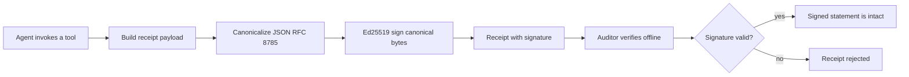
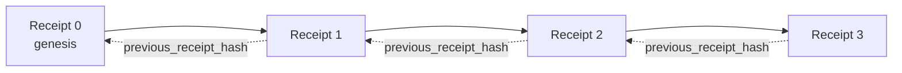

[Watch di lesson video: Securing AI Agents with Cryptographic Receipts](https://youtu.be/PLACEHOLDER_VIDEO_ID)

> _(Lesson video and thumbnail go add by di Microsoft content team after merge, e go follow di lesson 14 / 15 pattern.)_

# Securing AI Agents with Cryptographic Receipts

## Introduction

Dis lesson go cover:

- Why audit trails for AI agents dey important for compliance, debugging, and trust.
- Wetin cryptographic receipt be and how e different from unsigned log line.
- How to make signed receipt for agent tool call with plain Python.
- How to verify receipt offline and detect tampering.
- How to chain receipts so if you remove or reorder one, e go spoil di chain.
- Wetin receipts fit prove and wetin dem no fit prove explicitly.

## Learning Goals

After you finish dis lesson, you go sabi how to:

- Identify di failure modes wey dey make cryptographic provenance necessary for agent actions.
- Produce Ed25519-signed receipt over canonical JSON payload.
- Verify receipt by yourself using only di signer public key.
- Detect tampering by rerun verification on modified receipt.
- Build hash-chained sequence of receipts and explain why that chain important.
- Understand di boundary between wetin receipts prove (attribution, integrity, ordering) and wetin dem no prove (correctness of action, soundness of policy).

## The Problem: Your Agent's Audit Trail

Imagine say you deploy AI agent for Contoso Travel. Di agent dey read customer request, call flights API check options, and book seats for customer side. For last quarter, di agent process 50,000 bookings.

Today auditor don show. Dem ask simple question: "Show me wetin your agent do."

You give dem your log files. Auditor check dem and ask harder question: "How I go sabi say these logs no get edit?"

Dis na di audit-trail wahala. Most agent deployment today dey use:

- **Application logs**: wey agent write by itself, anybody with file-system access fit edit am.
- **Cloud logging services**: tamper-evident for platform level but only if auditor trust di platform operator.
- **Database transaction logs**: good for database changes but no too fit use am for arbitrary tool calls.

None of these fit answer auditor question without forcing auditor to trust person (you, your cloud provider, your database vendor). For internal work, that trust dey okay. For regulated workload (finance, healthcare, anytin under EU AI Act), no fit work.

Cryptographic receipts reduce dis wahala by making signed statement independently
verifiable. Auditor still need reason outside this matter to trust the signing key and
di component wey make di statement. Embedded key show self-consistency,
no issuer identity or enforcement location.

## Wetin be Cryptographic Receipt?

Receipt na JSON object wey record wetin agent do, sign with digital signature.



Minimal receipt look like dis:

```json
{
  "type": "agent.tool_call.v1",
  "agent_id": "contoso-travel-bot",
  "tool_name": "lookup_flights",
  "tool_args_hash": "sha256:a3f9c1...",
  "result_hash": "sha256:7b2e1d...",
  "policy_id": "contoso-travel-policy-v3",
  "timestamp": "2026-04-25T14:30:00Z",
  "sequence": 47,
  "previous_receipt_hash": "sha256:9d4e6a...",
  "signature": {
    "alg": "EdDSA",
    "sig": "c5af83...",
    "public_key": "8f3b2c..."
  }
}
```

Three properties dey do di work:

1. **Signature**. Receipt signed by agent gateway using Ed25519 private key. Anybody with di right public key fit verify di signature offline. Relying party must pin dat key or resolve am from trusted registry outside di receipt. If anybody tamper with any signed field, signature go spoil.

2. **Canonical encoding**. Before signing, receipt serialized using JSON Canonicalization Scheme (JCS, RFC 8785). E make sure two implementations wey produce same logical receipt go produce byte-identical output. Without canonicalization, different JSON serializers go produce different signature for same content.

3. **Hash chaining**. The `previous_receipt_hash` field connect each receipt to di one before am. If person remove or reorder receipt, e go break di sequence. To detect truncation or signer-controlled rewrite, you need pinned current chain head, independently witnessed checkpoint, or authenticated closed-population commitment.

Together these properties give three guarantees:

- **Attribution to a key**: dis key sign dis content. To get organizational or human identity, you need trusted key binding.
- **Integrity**: content never change since signing.
- **Ordering for verified sequence**: dis receipt connect to dat predecessor.

## How to Produce Receipt for Python

You no need special library to produce receipt. Cryptographic primitives dey widely available and di logic na small Python lines.

Hands-on exercises for `code_samples/18-signed-receipts.ipynb` go show di full flow. Source-controlled `code_samples/18-signed-receipts.execution-receipt.json` record exact notebook hash, Python environment, cell count, and checks from latest clean run without changing lesson outputs. Summary version:

```python
import json
import hashlib
import base64
from nacl import signing
from jcs import canonicalize  # RFC 8785 canonical JSON

def b64url_nopad(data: bytes) -> str:
    return base64.urlsafe_b64encode(data).decode("ascii").rstrip("=")

def sha256_canonical(obj) -> str:
    """SHA-256 of a Python object's JCS-canonical JSON form."""
    return f"sha256:{hashlib.sha256(canonicalize(obj)).hexdigest()}"

# Generate or load a signing key (in production, store in a key vault)
signing_key = signing.SigningKey.generate()
verify_key = signing_key.verify_key
TRUSTED_PUBLIC_KEYS = {b64url_nopad(bytes(verify_key))}  # pinned out of band by the verifier

# Build the receipt payload (no signature yet)
tool_args = {"origin": "SYD", "destination": "LAX"}
tool_result = [{"flight": "QF11", "price": 1850, "stops": 0}]

payload = {
    "type": "agent.tool_call.v1",
    "agent_id": "contoso-travel-bot",
    "tool_name": "lookup_flights",
    "tool_args_hash": sha256_canonical(tool_args),
    "result_hash": sha256_canonical(tool_result),
    "policy_id": "contoso-travel-policy-v3",
    "timestamp": "2026-04-25T14:30:00Z",
    "sequence": 0,
    "previous_receipt_hash": None,
}

# Canonicalize and sign the JCS bytes directly. PureEdDSA hashes internally.
canonical_bytes = canonicalize(payload)
signature_bytes = signing_key.sign(canonical_bytes).signature

# Attach a structured signature object.
receipt = {
    **payload,
    "signature": {
        "alg": "EdDSA",
        "sig": b64url_nopad(signature_bytes),
        "public_key": b64url_nopad(bytes(verify_key)),
    },
}
```

Dis na di whole signing pipeline. Exercises for notebook go show each step.

## How to Verify Receipt and Detect Tampering

Verification na di opposite operation:

```python
import base64
import hashlib
from nacl import signing
from nacl.exceptions import CryptoError
from jcs import canonicalize

def b64url_decode(s: str) -> bytes:
    # Strict: Python's decoder skips characters outside the alphabet and also
    # accepts padding, the standard +/ alphabet and non-zero spare bits.
    # Re-encoding and comparing accepts only the one unpadded base64url form.
    padding = "=" * ((4 - len(s) % 4) % 4)
    data = base64.urlsafe_b64decode(s + padding)
    if base64.urlsafe_b64encode(data).decode("ascii").rstrip("=") != s:
        raise ValueError("not canonical unpadded base64url")
    return data

def verify_receipt(receipt: dict, trusted_public_key: str) -> bool:
    # trusted_public_key is the issuer's key, obtained from somewhere other
    # than this receipt. Never use receipt["signature"]["public_key"] here:
    # see "What Receipts Prove (and What They Do Not)" below.
    # Fails closed: anything malformed returns False instead of raising.
    if not isinstance(receipt, dict) or not isinstance(trusted_public_key, str):
        return False
    sig_obj = receipt.get("signature")
    if not isinstance(sig_obj, dict) or sig_obj.get("alg") != "EdDSA":
        return False
    sig_b64 = sig_obj.get("sig")
    if not isinstance(sig_b64, str):
        return False

    try:
        # Reconstruct the payload that was actually signed (everything except signature).
        payload = {k: v for k, v in receipt.items() if k != "signature"}
        canonical_bytes = canonicalize(payload)
        verify_key = signing.VerifyKey(b64url_decode(trusted_public_key))
        verify_key.verify(canonical_bytes, b64url_decode(sig_b64))
        return True
    except (CryptoError, TypeError, ValueError, KeyError, OverflowError):
        return False
    except Exception:
        # An undecodable key or signature, or a payload that cannot be
        # canonicalized: fail closed rather than raise.
        return False
```

Dis function dey take receipt and issuer public key, return `True` if signature valid and `False` if no valid, including if input malformed. No network call and no verification service: once you get issuer key, verification dey local and offline. Wetin e still need na dat key, wey you gats get from somewhere outside di receipt.

To see tampering detection for action, notebook go show:

1. Produce valid receipt and confirm e verify.
2. Modify one byte for `tool_args_hash` field.
3. Rerun verification and see e fail.
4. Tamper again, but now re-sign with key wey attacker generate and embed dat key for receipt.

Step 4 na wetin worth consider well. That receipt internally consistent: im signature real for im content and for di key e carry, so e verify against dis key inside am. E go fail only when you check am against issuer real key. Step 2 and 3 catch attacker wey no sign am again; step 4 catch di one wey sign again.

Dis na practical demonstration say receipts dey tamper-evident: any change to signed field go break di signature, if you verify with key wey attacker no supply. The `signature` object dey outside signed bytes, na why di key you verify with gats come from place outside receipt.

## Chain Receipts for Multi-Step Agents

One signed receipt protect one action. Chain of receipts protect sequence.



Each receipt record hash of receipt before am. To remove receipt 2 quietly, attacker must either:

- Modify receipt 3's `previous_receipt_hash` field (go break receipt 3 signature), OR
- Forge new signature on modified receipt 3 (need agent private key).

If private key dey hardware key vault and verifiers check every receipt with issuer public key, obtained independently (published JWK Set or pinned config value), neither attack dey possible without detection. Publishing key inside receipt no enough: attacker fit re-sign with their own key and embed dat one instead, na dat be fixture `04_resigned_receipt.json`.

Notebook go show:

1. Build chain of three receipts.
2. Verify each receipt's `previous_receipt_hash` match actual hash of prior receipt.
3. Tamper with one receipt for middle and see chain break for dat exact point.

Dis na how you go produce audit trail wey external auditor fit verify with
their own pinned issuer keys and chain checkpoints, no need to trust your mutable log store.

## Wetin Receipts Prove (and wetin Dem No Prove)

Dis na di most important part for dis lesson. Receipts powerful but dem get limit.

**Receipts prove three things:**

1. **Attribution**: specific key sign specific payload.
2. **Integrity**: payload never change since signing.
3. **Ordering for verified sequence**: receipt link to dat predecessor.

**Receipts no prove:**

1. **Correctness**: say agent action be correct action. Receipt fit sign wrong answer just as clean as correct one.
2. **Policy compliance**: say policy inside `policy_id` actually evaluate, or say e go allow dis action if dem check. Receipt record wetin dem claim, no wetin dem enforce.
3. **Identity beyond key**: receipt talk "dis key sign dis content." No talk "dis human authorize dis." To connect key to person or organization, you need separate identity system (directory, public key registry, etc.).
4. **Truthfulness of inputs**: if agent receive manipulated prompt and act on am, receipt still record action as e be. Receipts come after input validation, no be substitute for am.
5. **Execution or real-world effect**: post-call receipt record wetin issuer claim happen. To prove admission or external effect need evidence from executor or provider boundary.
6. **Completeness**: absence of receipt fit mean blocked, omitted, lost, or no instrumented. Absence fit turn to evidence only for authenticated closed population.
7. **Trusted time**: signed timestamp prove signer carry dat value, no say value correct. Trusted time need separate time authority or witnessed checkpoint.

**Key inside receipt no be di key you verify with.** Dis one come from point 3, and na di only place wey dis difference suppose change your code, no be your understanding. The `public_key` inside di sample na to make example self-contained. Verifier must no trust am. Anybody fit take receipt, change am, sign with key wey dem generate, embed dat key; e go verify perfectly against itself. Na fixture `04_resigned_receipt.json` for `sample_receipts/` be dis, and na why `verify_receipt` above take key as argument instead of read am from receipt. Make sure you get issuer key independently, from JWK Set for Production Checklist below or other anchor you pin before, then verify against dat. Signature checked with key wey come with di same envelope prove only say envelope self-consistent.

Dis boundary important for two reasons:

- E tell you wetin receipts use for: to make agent behavior auditable and tamper-evident, even across organizations.
- E tell you wetin other layers you still need: input validation (Lesson 6), policy enforcement (small talk below), identity infrastructure (no cover for dis lesson).

Common mistake na to assume say "we get receipts" mean "we dey governed." E no mean so. Receipts na foundation. Governance na system wey you build on top.

## Binding Approver Signature to Exact Action

Number 3 for above deserve im own section: action receipt talk "dis key sign dis content," no be "human authorize dis." For high-risk actions (refunds, deletions, wire transfers), separate approver signature fit lock exact action. To connect dat key to human and confirm human presence still separate work.

Follow-up notebook `code_samples/human-authorization-receipts.ipynb` add second receipt type, `human.approval.v1`, inside same envelope shape as lesson receipts (typed payload sign by Ed25519 over canonical JCS bytes, with `signature` object outside signed bytes). Approver key sign **full canonical action and im digest**; agent key sign claim wey carry **same action digest** plus `parent_approval_ref`, di `receipt_hash` of approval, same convention as `previous_receipt_hash` for chain you build above. One `verify_chain` check both artifacts under **separate pinned key registries** (approver keys vs agent keys), so code path shared but authorities never.

Property wey dis get, say am clear clear: *pinned approver key sign dis exact
action, and agent key sign statement wey carry same action digest later.*
E good evidence, but e no prove say action happen for sure. To
control execution, exact approval must reserve and use once for
actual executor boundary; unknown provider result must remain unknown, no blind retry. Notebook refusal fixtures test receipt-chain layer:


- **stale authority**: signature wey still verify, refuse anyway because policy version change, approver key rotat out of pinned registry, or approval expire before verification time;
- **digest substitution**: validly signed action receipt pointing to a *real* approval wey bind *different* canonical action.


Each failure dey reject wit one correct reason, so auditor wey dey read refusal fit sabi whether authority don kpom, or the action wey dem claim don change. Verification na only to read and fit do am again: e no dey use the approval or call provider. One different executor need to get strong, atomic replay protection plus clear success, failure, and we no fit talk wetin happen outcomes. The human-approval receipt na one kind educational composition wey dis lesson define, no be receipt type wey `draft-farley-acta-signed-receipts` define.

## Production References

Di Python code wey dey dis lesson minimal on purpose so you fit read every line and understand exactly wetin dey happen. For production, you get two options:

1. **Build direktly on top di cryptographic primitives.** Di 50 lines wey you see for top dey enough for plenty use cases. PyNaCl (Ed25519) and di `jcs` package (canonical JSON) na well-maintained and audited libraries.

2. **Use production receipt library.** Some open-source projects dey implement di same pattern with added features dem (key rotation, batch verification, JWK Set distribution, integration with policy engines):
   - Di signing pipeline dey use JCS and signature-scope conventions for independent IETF Internet-Draft ([`draft-farley-acta-signed-receipts`](https://datatracker.ietf.org/doc/draft-farley-acta-signed-receipts/), revision 02). Dis lesson flat educational receipt no be like di draft `{payload, signature}` envelope and dem no present am as conformant implementation. Di draft publish shared conformance suite ([agent-governance-testvectors](https://github.com/ScopeBlind/agent-governance-testvectors)) for implementations wey dey target im wire format.
   - Di Microsoft Agent Governance Toolkit dey compose receipts with Cedar-based policy decisions; check Tutorial 33 inside dat repository for end-to-end example.
   - Di `protect-mcp` (npm) and `@veritasacta/verify` (npm) packages dey provide Node-based implementation of receipt signing and offline verification, to wrap any MCP server with tamper-evident audit trail, including held-for-co-sign flow wey pause action dey emit approval receipt wey bind to action digest (WebAuthn-backed for desktop flow), di same approval-receipt pattern as di human-authorization notebook wey dey top.
   - Di **[nobulex](https://github.com/arian-gogani/nobulex)** Python SDK (`pip install nobulex`) provide di same Ed25519 + JCS signing pattern for Python with LangChain and CrewAI integrations, including published cross-validation test vectors and compliance mapping wey dem contribute via [OWASP PR #2210](https://github.com/OWASP/CheatSheetSeries/pull/2210).
   - **[EMILIA Protocol](https://github.com/emiliaprotocol/emilia-protocol)** provide complementary exact-action enforcement layer: offline-verifiable approval receipts, pinned WebAuthn or quorum authority, one-time consumption at executor boundary, and explicit indeterminate-outcome path. Im framework adapters treat receipt as necessary evidence no be proof say external effect happen.

Di decision between rolling your own and using library na like di choice between writing your own JWT library and using tested one: both dey reasonable; di library save time and reduce audit surface; di from-scratch approach go force you understand every primitive. Dis lesson dey teach di from-scratch path so you get foundation for either choice.

## Knowledge Check

Test your understanding before you move to di practice exercise.

**1. Receipt dey sign with agent private Ed25519 key. Auditor only get public key. Auditor fit verify receipt offline?**

<details>
<summary>Answer</summary>

Yes, cryptographic verification na only public key and signed bytes e need. Di
auditor must still get and pin di accepted public key independently of di receipt.
No network call required after trust configuration don set.
</details>

**2. Attacker change `policy_id` field of receipt to claim say dem govern am with more permissive policy. Signature dey over original payload. Wetin happen during verification?**

<details>
<summary>Answer</summary>

Verification go fail. Signature dey computed over canonical bytes of original payload; if attacker change any payload field, e go change those bytes, and signature go become invalid. Attacker need private key to produce fresh valid signature, and dem no get am.
</details>

**3. Why receipt get `tool_args_hash` and `result_hash` instead of raw arguments and result?**

<details>
<summary>Answer</summary>

Two reasons. First, receipt fit need archive or transmit for places where leaking raw content (PII, business data) be problem. Hashing dey keep receipt small and content private; auditor verify say hash match separately-stored copy of actual content. Second, hashes get fixed size; receipt with hashes get size limit no matter how big input and output be.
</details>

**4. `previous_receipt_hash` field dey link each receipt to e predecessor. If attacker silently delete one receipt for middle of chain, wetin go invalid?**

<details>
<summary>Answer</summary>

Every receipt wey come after di one wey delete. Their `previous_receipt_hash` fields no dey match actual chain again (because di receipt wey dem reference no dey again, or chain now point to different predecessor). To hide di deletion, attacker go need re-sign every later receipt, and dat need issuer's private key. Re-signature with any other key go fail when dem check am with issuer key.
</details>

**5. Receipt verify cleanly. E mean say agent action correct, sound, or policy compliant?**

<details>
<summary>Answer</summary>

No. Under pinned key and chain context, valid receipt dey prove signature attribution,
content integrity, and link to presented predecessor. E NO prove say di
action correct or execute, say policy evaluate, say timestamp trustworthy,
or say record set complete. Dis na di most important matter for dis lesson.
</details>

## Practice Exercise

Open `code_samples/18-signed-receipts.ipynb` and complete all four sections:

1. **Section 1**: Sign your first receipt and verify am.
2. **Section 2**: Tamper with di receipt and see verification fail.
3. **Section 3**: Build three-receipt chain and verify chain integrity.
4. **Section 4**: Apply di pattern to agent wey build with Microsoft Agent Framework: wrap tool call inside receipt-signing, then verify receipt independently.

**Stretch challenge 1:** add one extra field wey you choose for receipt schema (like request ID for tracing), update canonical signing logic to include am, and confirm say receipt still fit round-trip through verification. Then change di field after signing and confirm verification fail. Dis one go force you understand how every byte of canonical encoding dey contribute to signature.

**Stretch challenge 2:** SHA-256-hash two receipts together (concatenate their canonical bytes for deterministic order) and put di resulting digest as new field on third receipt before signing am. Verify say all three receipts still fit round-trip. You don build one step inclusion proof: anybody wey hold di third receipt fit prove say first two exist at signing time without revealing their content. This na di pattern wey selective-disclosure receipts dey use for scale (Merkle commitments, RFC 6962).

## Conclusion

Cryptographic receipts dey give AI agents audit trail wey:

- **Fit verify independently under pinned trust**: party wey get accepted public keys and signed bytes fit verify without service dependency.
- **Tamper-evident**: any change mean say signature no valid again.
- **Portable**: receipt na small JSON file; you fit archive am, send am, and verify anywhere.
- **Standards-aligned**: built on Ed25519 (RFC 8032), JCS (RFC 8785), and SHA-256, all na widely deployed primitives.

Dem no be substitute for input validation, policy enforcement, executor admission,
outcome evidence, completeness controls, or identity infrastructure. Dem be foundation
for those layers. For regulated or multi-organization workflows, receipts dey make specific
issuer statements independently checkable under auditor own trust configuration.

Di most important takeaway: Receipts show say particular key sign particular
content. Timestamp wey carry na signer assertion unless separately time-attested. Receipt no prove say content dey true, or say action happen, or say all record set complete. Hold dis ones tight.


## Production Checklist

When you ready to move from dis lesson to deploying receipt-signed agents for real environment:

- [ ] **Move signing key comot from developer laptop.** Use Azure Key Vault, AWS KMS, or hardware security module. Private key wey sign your receipts no suppose dey for source control or plaintext for application machines.
- [ ] **Set verifier key trust.** Publish keys through JWK Set or registry, then make relying parties pin accepted issuer identity, key set, and rotation policy outside individual receipts. Inline key alone no be trust anchor.
- [ ] **Anchor chain externally.** Every now and then write latest chain head hash to transparency log (Sigstore Rekor, RFC 3161 timestamp authority, or second internal system) so external party fit confirm "chain dey this time."
- [ ] **Store receipts immutably.** Append-only blob storage (Azure Storage with immutability policies, AWS S3 Object Lock) prevent insider from rewriting history for storage layer.
- [ ] **Decide retention plan.** Plenty compliance rules require multi-year retention. Plan for receipt growth (receipt na ~500 bytes; agent wey dey make 10K calls per day go produce ~1.8 GB per year).
- [ ] **Document wetin receipts no cover.** Receipts prove attribution, integrity, and ordering. Your runbook suppose clear list what additional controls (input validation, policy enforcement, rate limiting, identity infrastructure) dey alongside receipts for your governance.

### You still get questions about securing AI agents?

Join di [Microsoft Foundry Discord](https://aka.ms/ai-agents/discord) make you fit meet oda learners dem, attend office hours, an get your AI Agents question dem answer.

## Beyond Dis Lekshan

Dis lekshan cover single-receipt signing an hash-chained sequences. Di same primitives fit join to form plenty advanced patterns wey you fit see as your governance posture dey grow:

- **Selective disclosure.** Wen receipt fields dem dey committed one-by-one (RFC 6962-style Merkle tree), you fit show specific fields to specific auditors an show say di rest never change without showing dem. E useful wen di same receipt gots satisfy big audit (wey wan make e complete) plus data-minimization law like GDPR (wey wan auditors make dem see as little as e suppose).
- **Receipt revocation.** If signing key don gree, you need way to mark all di receipts wey dat key sign as no good from one time wey you pick forward. Normal pattern: short-time signing keys plus revocation list wey dem don publish, or transparency log wey get revocation entries.
- **Bilateral / split-signature receipts.** Some times dem split di signed payload into pre-execution (`authorization_*`) an post-execution (`result_*`) parts wey get independent signatures, e dey useful wen di permission decision and di result wey dem see dem come from different pesin or different time dem. Dis one still join together with di receipt format wey dis lekshan teach.
- **Payload composition.** Receipt dey seal di bytes wey you put for inside `result_hash`. Real world payload dem dey more than just one tool call result: pre-decision reasoning (model prediction, options dem consider, evidence an if e full, risk posture, accountability chain, gate outcome) fit dey inside di payload, sealed by one receipt. Dis one keep di receipt format simple but still let payload form change by domain.
- **Cross-implementation conformance.** Many different implementation of di same receipt format (Python, TypeScript, Rust, Go) dey cross-check demself with shared test vectors. If you build your own implementation, validating with di published vectors go confirm say e fit work well.
- **Post-quantum migration.** Ed25519 dey widely used today but e no strong against quantum computer. Just get `alg` label no mean say you don migrate: profile gots define ML-DSA key encoding, canonical signed bytes, verification, relying-party policy, resistance to downgrade, an transition ways. Plan an test dual-signature transition with shared vectors before you talk say e fit work well.

## Additional Resources

- <a href="https://datatracker.ietf.org/doc/draft-farley-acta-signed-receipts/" target="_blank">IETF Internet-Draft: Signed Decision Receipts for Machine-to-Machine Access Control</a>
- <a href="https://learn.microsoft.com/azure/ai-studio/responsible-use-of-ai-overview" target="_blank">Responsible AI overview (Azure AI)</a>
- <a href="https://datatracker.ietf.org/doc/html/rfc8032" target="_blank">RFC 8032: Edwards-Curve Digital Signature Algorithm (EdDSA)</a>
- <a href="https://datatracker.ietf.org/doc/html/rfc8785" target="_blank">RFC 8785: JSON Canonicalization Scheme (JCS)</a>
- <a href="https://datatracker.ietf.org/doc/html/rfc6962" target="_blank">RFC 6962: Certificate Transparency</a> (Merkle-tree construction wey dem use for selective-disclosure receipts)
- <a href="https://github.com/microsoft/agent-governance-toolkit/blob/main/docs/tutorials/33-offline-verifiable-receipts.md" target="_blank">Microsoft Agent Governance Toolkit, Tutorial 33: Offline-Verifiable Decision Receipts</a>
- <a href="https://github.com/ScopeBlind/agent-governance-testvectors" target="_blank">Cross-implementation conformance test vectors</a> for di receipt format wey dem use for dis lekshan (Apache-2.0)
- <a href="https://pynacl.readthedocs.io/" target="_blank">PyNaCl documentation</a> (Ed25519 for Python)

## Lekshan Wey Don Pass

[Dey Create Local AI Agents](../17-creating-local-ai-agents/README.md)

---

<!-- CO-OP TRANSLATOR DISCLAIMER START -->
**Disclaimer**:
Dis document don translate wit AI translation service [Co-op Translator](https://github.com/Azure/co-op-translator). Even tho we dey try make am correct, abeg make you know say automated translation fit get errors or mistakes. Di original document for dia own language na im be di correct source. For important info, make person wey sabi human translation do am. We no go responsible for any misunderstanding or wrong understanding wey fit happen because of dis translation.
<!-- CO-OP TRANSLATOR DISCLAIMER END -->