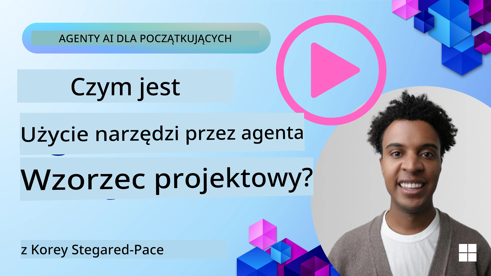
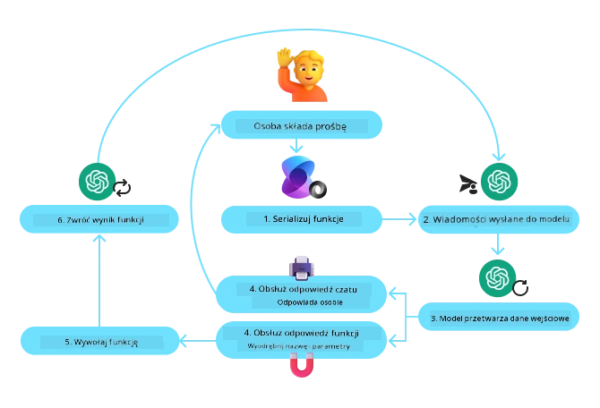
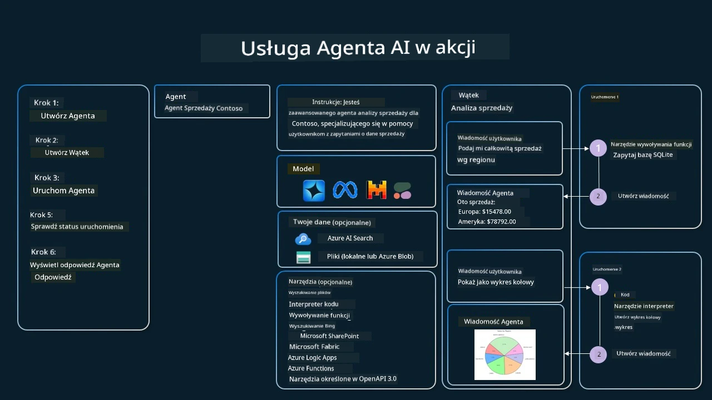

[](https://youtu.be/vieRiPRx-gI?si=cEZ8ApnT6Sus9rhn)

> _(Kliknij powyższy obraz, aby obejrzeć wideo z tej lekcji)_

# Wzorzec projektowy korzystania z narzędzi

Narzędzia są interesujące, ponieważ pozwalają AI agentom mieć szerszy zakres możliwości. Zamiast ograniczonego zestawu akcji, które agent może wykonywać, dodanie narzędzia umożliwia wykonywanie szerokiego wachlarza działań. W tym rozdziale przyjrzymy się Wzorcowi projektowemu korzystania z narzędzi, który opisuje, jak AI agenci mogą korzystać ze specyficznych narzędzi, aby osiągnąć swoje cele.

## Wprowadzenie

W tej lekcji chcemy odpowiedzieć na następujące pytania:

- Czym jest wzorzec projektowy korzystania z narzędzi?
- W jakich przypadkach można go stosować?
- Jakie elementy/bloki budulcowe są potrzebne do zaimplementowania wzorca?
- Jakie są specjalne kwestie do rozważenia przy używaniu wzorca w celu budowy wiarygodnych AI agentów?

## Cele nauki

Po ukończeniu tej lekcji będziesz w stanie:

- Zdefiniować wzorzec projektowy korzystania z narzędzi i jego cel.
- Zidentyfikować przypadki użycia, gdzie wzorzec jest zastosowalny.
- Zrozumieć kluczowe elementy potrzebne do implementacji wzorca.
- Rozpoznać kwestie zapewnienia wiarygodności AI agentów korzystających z tego wzorca.

## Czym jest wzorzec projektowy korzystania z narzędzi?

**Wzorzec projektowy korzystania z narzędzi** koncentruje się na nadaniu modelom językowym (LLM) możliwości interakcji z narzędziami zewnętrznymi, aby osiągać konkretne cele. Narzędzia to kod, który może zostać wykonany przez agenta, by realizować działania. Narzędzie może być prostą funkcją, jak kalkulator, lub wywołaniem API do usługi zewnętrznej, np. wyszukiwania cen akcji czy prognozy pogody. W kontekście AI agentów narzędzia są projektowane do wykonania przez agentów w odpowiedzi na **wywołania funkcji generowane przez model**.

## Do jakich zastosowań można je stosować?

AI Agenci mogą wykorzystać narzędzia do realizacji złożonych zadań, pozyskiwania informacji lub podejmowania decyzji. Wzorzec korzystania z narzędzi jest często używany w scenariuszach wymagających dynamicznej interakcji z systemami zewnętrznymi, takimi jak bazy danych, serwisy internetowe czy interpretery kodu. Ta zdolność jest przydatna w wielu różnych zastosowaniach, w tym:

- **Dynamiczne pobieranie informacji:** Agenci mogą zapytywać zewnętrzne API lub bazy danych, aby pobrać aktualne dane (np. zapytania do bazy SQLite w analizie danych, pobieranie cen akcji lub informacji o pogodzie).
- **Wykonywanie i interpretacja kodu:** Agenci mogą uruchamiać kod lub skrypty do rozwiązywania problemów matematycznych, generowania raportów lub przeprowadzania symulacji.
- **Automatyzacja przepływów pracy:** Automatyzacja powtarzalnych lub wieloetapowych procesów poprzez integrację narzędzi takich jak planery zadań, usługi e-mailowe czy potoki danych.
- **Wsparcie klienta:** Agenci mogą współdziałać z systemami CRM, platformami zgłoszeń lub bazami wiedzy, aby rozwiązywać zapytania użytkowników.
- **Generowanie i edycja treści:** Agenci mogą korzystać z narzędzi takich jak korektory gramatyczne, streszczacze tekstów lub oceniające bezpieczeństwo treści, pomagając przy tworzeniu materiałów.

## Jakie elementy/bloki budulcowe są potrzebne do implementacji wzorca korzystania z narzędzi?

Te bloki budulcowe pozwalają agentowi AI wykonywać szeroki zakres zadań. Spójrzmy na kluczowe elementy potrzebne do implementacji Wzorca korzystania z narzędzi:

- **Schematy funkcji/narzędzi**: Szczegółowe definicje dostępnych narzędzi, w tym nazwa funkcji, cel, wymagane parametry i oczekiwane wyniki. Schematy te umożliwiają LLM zrozumienie, jakie narzędzia są dostępne i jak tworzyć poprawne zapytania.

- **Logika wykonywania funkcji**: Reguluje kiedy i jak narzędzia są wywoływane na podstawie intencji użytkownika i kontekstu rozmowy. Może obejmować moduły planujące, mechanizmy routingu lub warunkowe przepływy, które dynamicznie decydują o użyciu narzędzia.

- **System obsługi komunikatów**: Komponenty zarządzające przebiegiem konwersacji między wejściami użytkownika, odpowiedziami LLM, wywołaniami narzędzi i ich wynikami.

- **Ramowa integracja narzędzi**: Infrastruktura łącząca agenta z różnymi narzędziami, zarówno prostymi funkcjami jak i złożonymi usługami zewnętrznymi.

- **Obsługa błędów i walidacja**: Mechanizmy radzenia sobie z niepowodzeniami podczas wykonania narzędzi, weryfikacji parametrów oraz zarządzania nieoczekiwanymi odpowiedziami.

- **Zarządzanie stanem**: Śledzi kontekst rozmowy, poprzednie interakcje z narzędziami oraz dane trwałe, aby zapewnić spójność podczas wieloetapowych wymian.

Następnie przyjrzyjmy się dokładniej wywoływaniu funkcji/narzędzi.
 
### Wywoływanie funkcji/narzędzi

Wywoływanie funkcji jest podstawowym sposobem umożliwiającym dużym modelom językowym (LLM) interakcję z narzędziami. Często 'Funkcja' i 'Narzędzie' są używane zamiennie, ponieważ 'funkcje' (fragmenty wielokrotnie wykorzystywalnego kodu) to 'narzędzia', z których agenci korzystają, aby wykonywać zadania. Aby wywołać kod funkcji, LLM musi porównać zapytanie użytkownika z opisem funkcji. W tym celu do LLM przesyłany jest schemat zawierający opisy wszystkich dostępnych funkcji. LLM następnie wybiera najbardziej odpowiednią funkcję do zadania i zwraca jej nazwę oraz argumenty. Wybrana funkcja jest wywoływana, jej odpowiedź jest przesyłana z powrotem do LLM, który używa tych informacji, by odpowiedzieć na zapytanie użytkownika.

Aby programiści mogli zaimplementować wywoływanie funkcji dla agentów, będą potrzebowali:

1. Modelu LLM obsługującego wywoływanie funkcji
2. Schemat zawierający opisy funkcji
3. Kod dla każdej opisanej funkcji

Użyjmy przykładu uzyskania aktualnego czasu w mieście, aby to zilustrować:

1. **Zainicjuj LLM obsługujący wywoływanie funkcji:**

    Nie wszystkie modele obsługują wywoływanie funkcji, dlatego ważne jest, aby sprawdzić czy używany LLM ma tę funkcję.     <a href="https://learn.microsoft.com/azure/ai-services/openai/how-to/function-calling" target="_blank">Azure OpenAI</a> obsługuje wywoływanie funkcji. Możemy zacząć od inicjacji klienta OpenAI wykorzystującego Azure OpenAI **Responses API** (stabilny endpoint `/openai/v1/` — nie jest potrzebne `api_version`). 

    ```python
    # Initialize the OpenAI client for Azure OpenAI (Responses API, v1 endpoint)
    client = OpenAI(
        base_url=f"{os.environ['AZURE_OPENAI_ENDPOINT'].rstrip('/')}/openai/v1/",
        api_key=os.environ["AZURE_OPENAI_API_KEY"],
    )
    deployment_name = os.environ["AZURE_OPENAI_DEPLOYMENT"]
    ```

1. **Stwórz schemat funkcji**:

    Następnie zdefiniujemy schemat JSON zawierający nazwę funkcji, opis jej działania oraz nazwy i opisy parametrów funkcji.
    Przekażemy ten schemat klientowi utworzonemu wcześniej, wraz z zapytaniem użytkownika o czas w San Francisco. Ważne jest, aby zauważyć, że **wywołanie narzędzia** jest tym, co jest zwracane, **a nie** ostateczna odpowiedź na pytanie. Jak wspomniano wcześniej, LLM zwraca nazwę funkcji wybranej do zadania oraz argumenty, które zostaną do niej przekazane.

    ```python
    # Function description for the model to read (Responses API flat tool format)
    tools = [
        {
            "type": "function",
            "name": "get_current_time",
            "description": "Get the current time in a given location",
            "parameters": {
                "type": "object",
                "properties": {
                    "location": {
                        "type": "string",
                        "description": "The city name, e.g. San Francisco",
                    },
                },
                "required": ["location"],
            },
        }
    ]
    ```
   
    ```python
  
    # Initial user message
    messages = [{"role": "user", "content": "What's the current time in San Francisco"}]

    # First API call: Ask the model to use the function
    response = client.responses.create(
        model=deployment_name,
        input=messages,
        tools=tools,
        tool_choice="auto",
        store=False,
    )

    # The Responses API returns tool calls as function_call items in response.output.
    # Append them to the conversation so the model has full context on the next turn.
    messages += response.output

    print("Model's response:")
    print(response.output)
  
    ```

    ```bash
    Model's response:
    [ResponseFunctionToolCall(arguments='{"location":"San Francisco"}', call_id='call_pOsKdUlqvdyttYB67MOj434b', name='get_current_time', type='function_call')]
    ```
  
1. **Kod funkcji potrzebny do wykonania zadania:**

    Po wybraniu funkcji przez LLM, kod realizujący zadanie musi zostać zaimplementowany i wykonany.
    Możemy zaimplementować kod pobierający aktualny czas w Pythonie. Będziemy również musieli napisać kod do wyciągnięcia nazwy i argumentów z response_message, aby uzyskać ostateczny wynik.

    ```python
      def get_current_time(location):
        """Get the current time for a given location"""
        print(f"get_current_time called with location: {location}")  
        location_lower = location.lower()
        
        for key, timezone in TIMEZONE_DATA.items():
            if key in location_lower:
                print(f"Timezone found for {key}")  
                current_time = datetime.now(ZoneInfo(timezone)).strftime("%I:%M %p")
                return json.dumps({
                    "location": location,
                    "current_time": current_time
                })
      
        print(f"No timezone data found for {location_lower}")  
        return json.dumps({"location": location, "current_time": "unknown"})
    ```

     ```python
    # Handle function calls
    tool_calls = [item for item in response.output if item.type == "function_call"]
    if tool_calls:
        for tool_call in tool_calls:
            if tool_call.name == "get_current_time":

                function_args = json.loads(tool_call.arguments)

                time_response = get_current_time(
                    location=function_args.get("location")
                )

                # Return the tool result as a function_call_output item
                messages.append({
                    "type": "function_call_output",
                    "call_id": tool_call.call_id,
                    "output": time_response,
                })
    else:
        print("No tool calls were made by the model.")

    # Second API call: Get the final response from the model
    final_response = client.responses.create(
        model=deployment_name,
        input=messages,
        tools=tools,
        store=False,
    )

    return final_response.output_text
     ```

     ```bash
      get_current_time called with location: San Francisco
      Timezone found for san francisco
      The current time in San Francisco is 09:24 AM.
     ```

Wywoływanie funkcji jest sercem większości, jeśli nie wszystkich, projektów wykorzystania narzędzi przez agentów, jednak implementacja od podstaw czasami bywa wyzwaniem.
Jak dowiedzieliśmy się w [Lekcji 2](../../../02-explore-agentic-frameworks), frameworki agentowe dostarczają nam gotowe bloki budulcowe do implementacji korzystania z narzędzi.
 
## Przykłady korzystania z narzędzi z frameworkami agentowymi

Oto kilka przykładów, jak można zaimplementować Wzorzec korzystania z narzędzi za pomocą różnych frameworków agentowych:

### Microsoft Agent Framework

<a href="https://learn.microsoft.com/azure/ai-services/agents/overview" target="_blank">Microsoft Agent Framework</a> to open-source'owy framework AI do budowania agentów AI. Upraszcza proces korzystania z wywoływania funkcji, pozwalając definiować narzędzia jako funkcje Pythona dekorowane `@tool`. Framework obsługuje komunikację między modelem a twoim kodem. Udostępnia także gotowe narzędzia, takie jak Wyszukiwanie plików i Interpreter kodu za pomocą `FoundryChatClient`.

Poniższy diagram ilustruje proces wywoływania funkcji w Microsoft Agent Framework:



W Microsoft Agent Framework narzędzia definiuje się jako dekorowane funkcje. Możemy przekształcić funkcję `get_current_time`, którą widzieliśmy wcześniej, w narzędzie za pomocą dekoratora `@tool`. Framework automatycznie serializuje funkcję i jej parametry, tworząc schemat do wysłania do LLM.

```python
import os
from agent_framework import tool
from agent_framework.foundry import FoundryChatClient
from azure.identity import AzureCliCredential

@tool(approval_mode="never_require")
def get_current_time(location: str) -> str:
    """Get the current time for a given location"""
    ...

# Create the client
provider = FoundryChatClient(
    project_endpoint=os.environ["AZURE_AI_PROJECT_ENDPOINT"],
    model=os.environ["AZURE_AI_MODEL_DEPLOYMENT_NAME"],
    credential=AzureCliCredential(),
)

# Create an agent and run with the tool
agent = provider.as_agent(name="TimeAgent", instructions="Use available tools to answer questions.", tools=get_current_time)
response = await agent.run("What time is it?")
```

#### Narzędzia z serwera MCP

Narzędzia nie muszą być funkcjami w twoim własnym kodzie. Serwer zgodny z Modelem Protokołu Kontekstowego (MCP, omówionym w [Lekcji 11](../11-agentic-protocols/README.md)) publikuje swoje narzędzia wraz ze schematami, a framework może je załadować tak, jak serializuje dekorowaną funkcję. `MCPStreamableHTTPTool` łączy się z takim serwerem przez HTTP, pobiera schematy narzędzi i oferuje je modelowi obok lokalnych narzędzi.

Poniższy przykład wykorzystuje serwer wyszukiwania internetowego hostowany przez <a href="https://keenable.ai" target="_blank">Keenable</a>. Jest on dostępny bezpłatnie bez konta czy klucza API (zapytania są limitowane według adresu IP), więc jedyne dane uwierzytelniające to te dla twojego modelu. Tak jak w przypadku każdego zdalnego narzędzia, zapytania generowane przez model są wysyłane do tego serwera.

```python
from agent_framework import MCPStreamableHTTPTool

web_search = MCPStreamableHTTPTool(
    name="Keenable web search",
    url="https://api.keenable.ai/mcp",
)

# Connecting loads the server's tool schemas; the agent decides when to call them
async with web_search:
    agent = provider.as_agent(
        name="ResearchAgent",
        instructions="Use available tools to answer questions.",
        tools=[web_search],
    )
    response = await agent.run("What is new in the latest Python release?")
    print(response.text)
```

Serwer udostępnia dwa narzędzia, `search_web_pages` i `fetch_page_content`. Gdy pytanie wymaga aktualnych informacji, model wywołuje `search_web_pages`, otrzymuje tytuły, adresy URL i fragmenty tekstu, a następnie na ich podstawie tworzy odpowiedź, tak jak w powyższym przykładzie `get_current_time`.
  
### Microsoft Foundry Agent Service

<a href="https://learn.microsoft.com/azure/ai-services/agents/overview" target="_blank">Microsoft Foundry Agent Service</a> to nowszy framework agentowy zaprojektowany, by umożliwić deweloperom bezpieczne budowanie, wdrażanie i skalowanie wysokiej jakości, rozszerzalnych AI agentów bez konieczności zarządzania zasobami obliczeniowymi i pamięcią. Szczególnie przydatny w zastosowaniach korporacyjnych, ponieważ jest to w pełni zarządzana usługa z zabezpieczeniami na poziomie korporacyjnym.

W porównaniu do bezpośredniego rozwoju z API LLM, Microsoft Foundry Agent Service oferuje kilka zalet, w tym:

- Automatyczne wywoływanie narzędzi – nie trzeba parsować wywołania, uruchamiać narzędzia ani obsługiwać odpowiedzi; wszystko odbywa się po stronie serwera
- Bezpieczne zarządzanie danymi – zamiast zarządzać własnym stanem rozmowy, można polegać na wątkach przechowujących potrzebne dane
- Narzędzia gotowe do użycia – narzędzia pozwalające na współpracę z Twoimi źródłami danych, takie jak Bing, Azure AI Search oraz Azure Functions.

Dostępne narzędzia w Microsoft Foundry Agent Service można podzielić na dwie kategorie:

1. Narzędzia wiedzy:
    - <a href="https://learn.microsoft.com/azure/ai-services/agents/how-to/tools/bing-grounding?tabs=python&pivots=overview" target="_blank">Grounding z Bing Search</a>
    - <a href="https://learn.microsoft.com/azure/ai-services/agents/how-to/tools/file-search?tabs=python&pivots=overview" target="_blank">Wyszukiwanie plików</a>
    - <a href="https://learn.microsoft.com/azure/ai-services/agents/how-to/tools/azure-ai-search?tabs=azurecli%2Cpython&pivots=overview-azure-ai-search" target="_blank">Azure AI Search</a>

2. Narzędzia akcji:
    - <a href="https://learn.microsoft.com/azure/ai-services/agents/how-to/tools/function-calling?tabs=python&pivots=overview" target="_blank">Wywoływanie funkcji</a>
    - <a href="https://learn.microsoft.com/azure/ai-services/agents/how-to/tools/code-interpreter?tabs=python&pivots=overview" target="_blank">Interpreter kodu</a>
    - <a href="https://learn.microsoft.com/azure/ai-services/agents/how-to/tools/openapi-spec?tabs=python&pivots=overview" target="_blank">Narzędzia zdefiniowane w OpenAPI</a>
    - <a href="https://learn.microsoft.com/azure/ai-services/agents/how-to/tools/azure-functions?pivots=overview" target="_blank">Azure Functions</a>

Agent Service pozwala nam używać tych narzędzi razem jako `toolset`. Wykorzystuje także `threads`, które śledzą historię wiadomości z danej rozmowy.

Wyobraź sobie, że jesteś agentem sprzedaży w firmie Contoso. Chcesz stworzyć agenta konwersacyjnego, który potrafi odpowiadać na pytania dotyczące danych sprzedażowych.

Poniższy obraz ilustruje, jak można wykorzystać Microsoft Foundry Agent Service do analizy danych sprzedażowych:



Aby korzystać z tych narzędzi wraz z usługą, możemy utworzyć klienta i zdefiniować narzędzie lub zestaw narzędzi. W praktyce możemy użyć poniższego kodu Pythona. LLM będzie mógł spojrzeć na zestaw narzędzi i zdecydować, czy użyć funkcji stworzonej przez użytkownika, `fetch_sales_data_using_sqlite_query`, czy wbudowanego interpretera kodu, w zależności od zapytania użytkownika.

```python 
import os
from azure.ai.projects import AIProjectClient
from azure.identity import DefaultAzureCredential
from fetch_sales_data_functions import fetch_sales_data_using_sqlite_query # fetch_sales_data_using_sqlite_query function which can be found in a fetch_sales_data_functions.py file.
from azure.ai.projects.models import ToolSet, FunctionTool, CodeInterpreterTool

project_client = AIProjectClient.from_connection_string(
    credential=DefaultAzureCredential(),
    conn_str=os.environ["PROJECT_CONNECTION_STRING"],
)

# Initialize toolset
toolset = ToolSet()

# Initialize function calling agent with the fetch_sales_data_using_sqlite_query function and adding it to the toolset
fetch_data_function = FunctionTool(fetch_sales_data_using_sqlite_query)
toolset.add(fetch_data_function)

# Initialize Code Interpreter tool and adding it to the toolset. 
code_interpreter = CodeInterpreterTool()toolset.add(code_interpreter)

agent = project_client.agents.create_agent(
    model="gpt-5-mini", name="my-agent", instructions="You are helpful agent", 
    toolset=toolset
)
```

## Jakie są specjalne kwestie przy zastosowaniu wzorca korzystania z narzędzi do budowy wiarygodnych AI agentów?

Powszechną obawą dotyczącą dynamicznie generowanego przez LLM SQL jest bezpieczeństwo, szczególnie ryzyko wstrzyknięcia SQL lub działań złośliwych, takich jak usunięcie lub manipulacja bazą danych. Choć te obawy są uzasadnione, można je skutecznie złagodzić przez właściwą konfigurację uprawnień dostępu do bazy danych. W większości baz dotyczy to ustawienia dostępu w trybie tylko do odczytu. W usługach bazodanowych, takich jak PostgreSQL czy Azure SQL, aplikacji powinno się przypisać rolę odczytu (SELECT).

Uruchomienie aplikacji w bezpiecznym środowisku dodatkowo zwiększa ochronę. W scenariuszach korporacyjnych dane zwykle są wyciągane i transformowane z systemów operacyjnych do bazy tylko do odczytu lub hurtowni danych z przyjaznym schematem. Takie podejście zapewnia bezpieczeństwo danych, optymalizuje wydajność i dostępność oraz ogranicza dostęp aplikacji do odczytu.

## Przykładowe kody

- Python: [Agent Framework](./code_samples/04-python-agent-framework.ipynb)
- .NET: [Agent Framework](./code_samples/04-dotnet-agent-framework.md)

## Masz więcej pytań dotyczących wzorców korzystania z narzędzi?

Dołącz do [Microsoft Foundry Discord](https://discord.com/invite/ATgtXmAS5D), aby spotkać innych uczących się, uczestniczyć w godzinach konsultacji i uzyskać odpowiedzi na pytania dotyczące AI Agentów.

## Dodatkowe zasoby

- <a href="https://microsoft.github.io/build-your-first-agent-with-azure-ai-agent-service-workshop/" target="_blank">Warsztaty Azure AI Agents Service</a>
- <a href="https://github.com/Azure-Samples/contoso-creative-writer/tree/main/docs/workshop" target="_blank">Contoso Creative Writer Multi-Agent Workshop</a>
- <a href="https://learn.microsoft.com/azure/ai-services/agents/overview" target="_blank">Przegląd Microsoft Agent Framework</a>

## Testowanie Dymne Tego Agenta (Opcjonalnie)

Po nauczeniu się wdrażania agentów w [Lekcja 16](../16-deploying-scalable-agents/README.md), możesz przeprowadzić test dymny `TravelToolAgent` z tej lekcji (czy nadal wywołuje swoje narzędzia i odpowiada?) za pomocą [`tests/lesson-04-smoke-tests.json`](../../../tests/lesson-04-smoke-tests.json). Zobacz [`tests/README.md`](../tests/README.md) jak go uruchomić.

## Poprzednia Lekcja

[Zrozumienie Agentowych Wzorów Projektowych](../03-agentic-design-patterns/README.md)

## Następna Lekcja

[Agentic RAG](../05-agentic-rag/README.md)

---

<!-- CO-OP TRANSLATOR DISCLAIMER START -->
**Zastrzeżenie**:
Niniejszy dokument został przetłumaczony za pomocą usługi tłumaczenia AI [Co-op Translator](https://github.com/Azure/co-op-translator). Choć dążymy do dokładności, prosimy pamiętać, że automatyczne tłumaczenia mogą zawierać błędy lub niedokładności. Oryginalny dokument w jego języku źródłowym należy uznawać za autorytatywne źródło. W przypadku informacji krytycznych zalecane jest skorzystanie z profesjonalnego tłumaczenia wykonanego przez człowieka. Nie ponosimy odpowiedzialności za jakiekolwiek nieporozumienia lub błędne interpretacje wynikające z użycia tego tłumaczenia.
<!-- CO-OP TRANSLATOR DISCLAIMER END -->