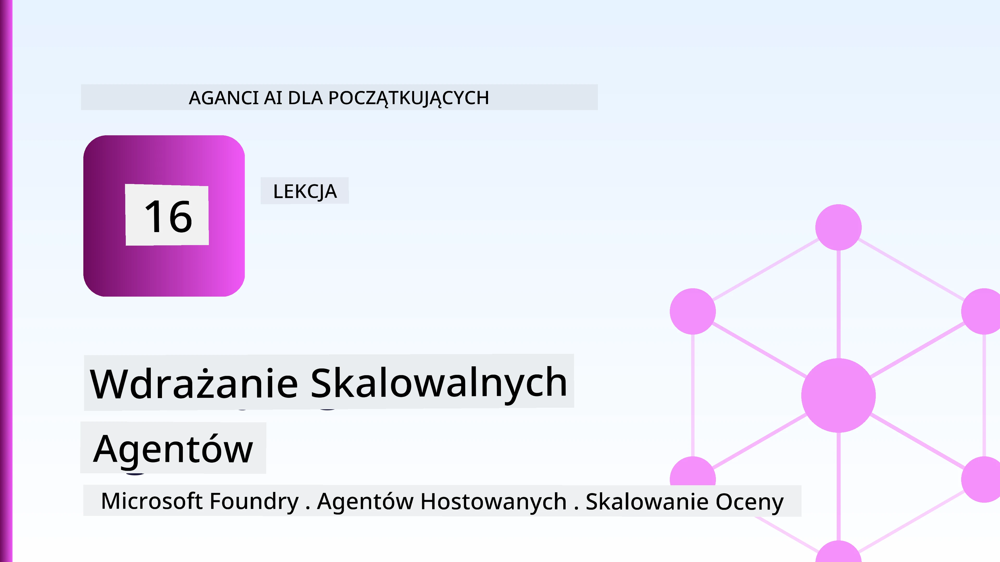
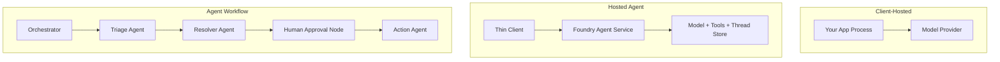
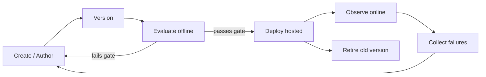
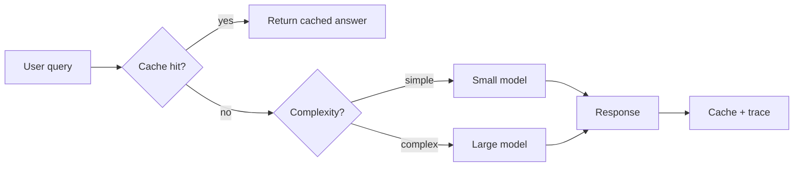
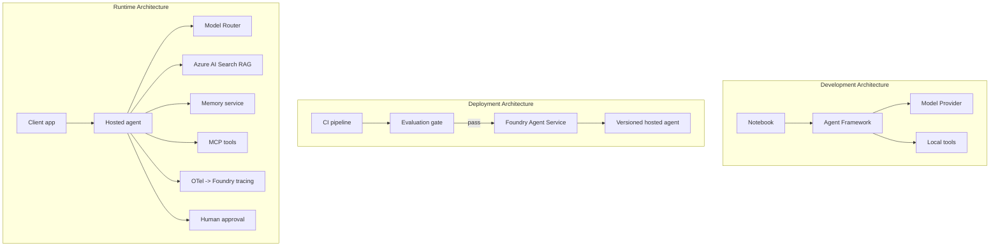

# Wdrażanie skalowalnych agentów z Microsoft Foundry



Do tego momentu w kursie budowałeś agentów działających na Twoim laptopie, wewnątrz notatnika, napędzanych przez `az login` i kilka zmiennych środowiskowych. To jest dokładnie właściwy sposób nauki. To nie jest właściwy sposób na uruchomienie agenta, od którego tysięcy klientów zależy o 3 nad ranem.

Ta lekcja dotyczy przepaści między „działa na moim komputerze” a „działa niezawodnie i przystępnie cenowo w produkcji”. Zamykamy tę przepaść, używając **Microsoft Foundry** i **Microsoft Foundry Agent Service**, budując rzeczywistego agenta wsparcia klienta, który ma narzędzia, wyszukiwanie, pamięć, ocenę i monitorowanie.

## Wprowadzenie

Ta lekcja obejmie:

- Różnicę między **agentem prototypowym** i **wdrożonym agentem**, oraz dlaczego przejście dotyczy głównie wszystkiego *około* modelu.
- **Wzorce wdrażania** agentów: hostowane przez klienta, hostowane jako usługa (Hosted Agents) oraz orkiestracja przepływu pracy.
- **Cykl życia agenta** w Microsoft Foundry — tworzenie, wersjonowanie, wdrażanie, ocena, obserwacja, wycofanie.
- **Strategie skalowania**: trasowanie modeli, buforowanie, współbieżność i projektowanie bezstanowe.
- **Obserwowalność** z OpenTelemetry i śledzeniem w Foundry.
- **Optymalizacja kosztów** poprzez dobór modelu, trasowanie i bramki oceny.
- **Rozważania korporacyjne**: zarządzanie, zatwierdzenia człowieka oraz bezpieczne uruchamianie serwerów MCP w produkcji.

## Cele nauki

Po ukończeniu tej lekcji będziesz potrafił:

- Wybrać właściwy wzorzec wdrożenia dla określonego obciążenia agenta.
- Wdrożyć agenta w Microsoft Foundry Agent Service, aby był wersjonowany, zarządzany i obserwowalny.
- Ustawić instrumentację agenta dla śledzenia i podłączyć potok oceny, który działa przed każdym wydaniem.
- Stosować trasowanie modeli i buforowanie, aby utrzymać opóźnienia i koszty pod kontrolą przy skali.
- Dodać bramkę zatwierdzenia ludzkiego dla działań wysokiego ryzyka i zintegrować serwer MCP w sposób bezpieczny produkcyjnie.

## Wymagania wstępne

Ta lekcja zakłada ukończenie wcześniejszych lekcji i swobodę w:

- Budowaniu agentów z użyciem [Microsoft Agent Framework](../14-microsoft-agent-framework/README.md) (Lekcja 14).
- [Używaniu narzędzi](../04-tool-use/README.md) (Lekcja 4) oraz [Agentic RAG](../05-agentic-rag/README.md) (Lekcja 5).
- [Pamięci agenta](../13-agent-memory/README.md) (Lekcja 13) oraz [Protokół Agentic / MCP](../11-agentic-protocols/README.md) (Lekcja 11).
- [Obserwowalności i ocenie](../10-ai-agents-production/README.md) (Lekcja 10) — ta lekcja opiera się bezpośrednio na niej.

Będziesz również potrzebować:

- **Subskrypcji Azure** i **projektu Microsoft Foundry** z co najmniej jednym wdrożonym modelem czatu.
- **Uwierzytelnionego Azure CLI** (`az login`).
- Python 3.12+ oraz pakiety z repozytorium [`requirements.txt`](../../../requirements.txt).

## Od prototypu do produkcji: co faktycznie się zmienia

Agent prototypowy i agent produkcyjny dzielą tę samą podstawową pętlę — analizuj, wywołuj narzędzia, odpowiadaj. To, co się zmienia, to wszystko otaczające tę pętlę. Model stanowi może 20% agenta produkcyjnego; pozostałe 80% to operacyjny szkielet.

| Obszar | Prototyp | Produkcja |
| --- | --- | --- |
| **Hosting** | Działa w twoim notatniku | Działa jako usługa hostowana, wersjonowana i wdrażana |
| **Tożsamość** | Twój token `az login` | Zarządzana tożsamość ze scoped RBAC |
| **Stan** | W pamięci, tracone po restarcie | Zewnętrzny (sklep wątków, usługa pamięci) |
| **Awaria** | Widzisz ślad stosu | Próby ponowne, awaryjne, dead-letter, alerty |
| **Koszt** | „To kilka centów” | Śledzone na żądanie, trasowane, buforowane, budżetowane |
| **Jakość** | Oceniasz wizualnie | Automatycznie oceniane przed każdym wydaniem |
| **Zaufanie** | Zatwierdzasz każdą akcję | Polityka + człowiek w pętli dla ryzykownych działań |

Miej tę tabelę na uwadze. Każda poniższa sekcja odpowiada jednemu z tych wierszy.

## Wzorce wdrażania agentów

Istnieją trzy wzorce, które będziesz często używać, często w kombinacji.

### 1. Agenci hostowani po stronie klienta

Obiekt agenta żyje wewnątrz *twojego* procesu aplikacji. Twój kod wywołuje dostawcę modelu bezpośrednio; pętla rozumowania działa w twojej usłudze. To jest to, co robi każda wcześniejsza lekcja.

- **Używaj, gdy** potrzebujesz pełnej kontroli pętli, własnego middleware lub osadzasz agenta wewnątrz istniejącego backendu.
- **Wadą**: sam odpowiadasz za skalowanie, stan i odporność.

### 2. Agenci hostowani (Foundry Agent Service)

Agent jest *zarejestrowany jako zasób* w Microsoft Foundry. Foundry hostuje pętlę rozumowania, przechowuje wątki, wymusza bezpieczeństwo zawartości i RBAC oraz udostępnia agenta w portalu Foundry. Twoja aplikacja staje się cienkim klientem, który tworzy wątki i odczytuje odpowiedzi.

- **Używaj, gdy** chcesz trwałości, wbudowanej obserwowalności, zarządzania i mniejszej powierzchni operacyjnej.
- **Wadą**: mniejsza kontrola niskiego poziomu w zamian za zarządzane środowisko uruchomieniowe.

### 3. Przepływy pracy agenta

Wielu agentów (i narzędzi) komponuje się w graf z wyraźnym przepływem kontroli — kroki sekwencyjne, rozgałęzienia, węzły zatwierdzenia przez człowieka oraz trwałe punkty kontrolne, które mogą wstrzymać i wznowić. To jest funkcjonalność **Workflows** Microsoft Agent Framework stosowana na skalę wdrożeniową.

- **Używaj, gdy** pojedyncze zadanie obejmuje kilku wyspecjalizowanych agentów lub wymaga kroku zatwierdzenia pośrodku.
- **Wadą**: więcej ruchomych części; wymaga obserwowalności na poziomie orkiestracji.



## Cykl życia agenta w Microsoft Foundry

Wdrażanie agenta to nie jednorazowy `push`. To pętla, która bardzo przypomina cykl wydawniczy oprogramowania, bo właśnie to ona jest.



Kluczowa idea, przejęta z [Lekcji 10](../10-ai-agents-production/README.md): **ocena offline to bramka, a nie dodatek**. Nowa wersja agenta nie jest publikowana, jeśli nie przejdzie twoich progów oceny. Obserwowalność online następnie dostarcza prawdziwych awarii ze świata zewnętrznego do twojego zestawu testowego offline. To jest cała pętla.

## Strategie skalowania

Skalowanie agenta różni się od skalowania bezstanowego API webowego, ponieważ każde żądanie może wywołać wiele kosztownych modeli i narzędzi. Cztery techniki niosą największe obciążenie.

**Obsługa żądań bezstanowych.** Nie przechowuj stanu na użytkownika w pamięci procesu. Przechowuj wątki konwersacji w sklepie wątków Foundry lub usłudze pamięci, aby dowolna instancja mogła obsłużyć dowolne żądanie. To pozwala na skalowanie horyzontalne — dodaj instancje, brak „sticky sessions”.

**Trasowanie modeli.** Nie każde żądanie wymaga twojego najbardziej zaawansowanego (i najdroższego) modelu. Kieruj proste żądania — klasyfikację intencji, krótkie odpowiedzi faktograficzne — do małego, szybkiego modelu, a duży model rezerwuj dla prawdziwego rozumowania. Foundry ma narzędzie **Model Router**, które zrobi to za ciebie, lub możesz samodzielnie zaimplementować lekki klasyfikator. Zbudujesz wersję DIY w laboratorium.

**Buforowanie odpowiedzi.** Wiele zapytań wsparcia to prawie duplikaty („jak zresetować hasło?”). Buforuj odpowiedzi na powszechne pytania i serwuj je bez wywoływania modelu. Nawet umiarkowany współczynnik trafień w buforze znacząco obniża koszty i opóźnienia.

**Współbieżność i backpressure.** Dostawcy modeli mają limity szybkości. Ograniczaj współbieżność, używaj ponawiania z wykładniczym opóźnieniem i obsługuj błędy łagodnie (odpowiedź w kolejce „pracujemy nad tym” jest lepsza niż błąd 500).



## Obserwowalność w produkcji

Nie możesz zarządzać tym, czego nie widzisz. Jak omówiono w Lekcji 10, Microsoft Agent Framework natywnie emituje ślady **OpenTelemetry** — każde wywołanie modelu, narzędzia i krok orkiestracji staje się zakresem (span). W produkcji eksportujesz te zakresy do Microsoft Foundry (lub dowolnego backendu kompatybilnego z OTel), aby móc:

- Śledzić pojedynczą skargę klienta end-to-end przez wszystkie wywołania modeli i narzędzi.
- Obserwować p50/p95 opóźnienia i koszty na żądanie w czasie.
- Generować alerty o nagłych wzrostach błędów i anomaliach kosztów zanim zauważą je twoi użytkownicy (lub zespół finansowy).

```python
from agent_framework.observability import get_tracer

tracer = get_tracer()

with tracer.start_as_current_span("support_request") as span:
    span.set_attribute("customer.tier", "enterprise")
    span.set_attribute("routed.model", "gpt-5-nano")
    # agent execution is traced automatically inside this span
```

Atrybuty takie jak `customer.tier` i `routed.model` zamieniają ścianę śladów w pytania, na które można odpowiedzieć („czy klienci korporacyjni są zbyt często kierowani do małego modelu?”).

## Optymalizacja kosztów

Koszty w agentach produkcyjnych dominują tokeny. Trzy dźwignie, w kolejności wpływu:

1. **Dobierz odpowiedni rozmiar modelu.** Mały model, który przejdzie bramkę oceny, jest prawie zawsze tańszy niż duży, który też przechodzi. Użyj oceny, aby *udowodnić*, że mały model jest wystarczający, zamiast domyślnie wybierać największy z ostrożności.
2. **Trasuj wg złożoności.** Jak powyżej — płać cenę dużego modelu tylko za żądania wymagające rozumowania dużym modelem.
3. **Buforuj agresywnie.** Najtańsze wywołanie modelu to takie, którego nigdy nie wykonasz.

Bramki oceny i kontrola kosztów to ta sama dyscyplina widziana z dwóch stron: ocena mówi o *podłodze jakości*, trasowanie i buforowanie trzymają się możliwie blisko *kosztu* tej podłogi.

## Rozważania korporacyjne przy wdrożeniu

**Zarządzanie.** Hosted Agents dziedziczą RBAC, bezpieczeństwo zawartości i logowanie audytowe Foundry. Każdemu agentowi przypisz zarządzaną tożsamość z najmniejszym potrzebnym przywilejem — dostęp tylko do odczytu bazy wiedzy, ograniczony dostęp do API systemu ticketowego, nic więcej.

**Człowiek w pętli.** Niektóre działania są zbyt istotne, by je automatyzować — wystawianie zwrotu pieniędzy, usuwanie konta, eskalacja do zespołu prawnego. Microsoft Agent Framework wspiera narzędzia wymagające zatwierdzenia: agent proponuje działanie, wykonanie jest wstrzymane, człowiek zatwierdza lub odrzuca, a przepływ pracy wznawia się. Primitiv widziałeś w [Lekcji 6](../06-building-trustworthy-agents/README.md); tutaj go wdrażasz.

**MCP w produkcji.** [MCP](../11-agentic-protocols/README.md) pozwala agentowi korzystać z zewnętrznych narzędzi przez standardowy interfejs. W produkcji traktuj każdy serwer MCP jako nieufną granicę: przypnij wersję serwera, uruchamiaj go z ograniczoną tożsamością, waliduj jego wyniki i nigdy nie ujawniaj mu sekretów. Serwer MCP to zależność, a zależności są łatane, audytowane i ograniczane pod względem szybkości.



Te trzy diagramy — rozwój, wdrożenie, środowisko uruchomieniowe — to ten sam agent na trzech etapach życia. Następujące laboratorium poprowadzi cię przez jego budowę.

## Praktyczne laboratorium: agent wsparcia klienta gotowy do produkcji

Otwórz [`code_samples/16-python-agent-framework.ipynb`](./code_samples/16-python-agent-framework.ipynb) i przejdź przez niego od początku do końca. Złożysz **agenta wsparcia klienta Contoso** ze wszystkimi produkcyjnymi aspektami podłączonymi:

1. **Wywoływanie narzędzi** — sprawdzanie statusu zamówienia i otwieranie zgłoszeń wsparcia.
2. **RAG** — odpowiadanie na pytania dotyczące polityki z bazy wiedzy (Azure AI Search, z pamięcią podręczną w pamięci, aby notatnik działał bez zasobu Search).
3. **Pamięć** — pamiętanie klienta podczas kolejnych rund rozmowy.
4. **Trasowanie modeli** — klasyfikator złożoności kieruje każde żądanie do małego lub dużego modelu.
5. **Buforowanie odpowiedzi** — powtarzane pytania są obsługiwane z pamięci podręcznej.
6. **Zatwierdzenie przez człowieka** — zwroty powyżej progu są wstrzymane do zatwierdzenia człowieka.
7. **Potok oceny** — mały zestaw testowy offline ocenia agenta i działa jako bramka przed wydaniem.
8. **Obserwowalność** — śledzenie OpenTelemetry wokół każdego żądania.

### Przejście krok po kroku

Notatnik jest zorganizowany tak, by każdy aspekt produkcyjny stanowił samodzielną, wykonywalną sekcję. Jego sercem jest obsługa żądań z trasowaniem i buforowaniem:

```python
async def handle_support_request(query: str, customer_id: str) -> str:
    # 1. Serve from cache when we can.
    cached = response_cache.get(normalize(query))
    if cached:
        return cached

    # 2. Route by complexity to control cost.
    model = "gpt-5-nano" if is_simple(query) else "gpt-5-mini"

    # 3. Run the agent inside a trace span for observability.
    with tracer.start_as_current_span("support_request") as span:
        span.set_attribute("routed.model", model)
        span.set_attribute("customer.id", customer_id)
        response = await support_agent.run(query, model=model)

    # 4. Cache and return.
    response_cache.set(normalize(query), response.text)
    return response.text
```

Bramką oceny, która chroni wydanie, wygląda tak:

```python
async def evaluation_gate(agent, test_cases, threshold: float = 0.8) -> bool:
    passed = 0
    for case in test_cases:
        result = await agent.run(case["input"])
        if score_response(result.text, case["expected"]) >= 0.8:
            passed += 1
    pass_rate = passed / len(test_cases)
    print(f"Evaluation pass rate: {pass_rate:.0%} (gate: {threshold:.0%})")
    return pass_rate >= threshold  # only deploy if the gate passes
```

Czytaj każdy wiersz — notatnik utrzymuje prymitywy świadomie małe, aby nic nie było ukryte za wywołaniem frameworku.

## Walidacja wdrożonego agenta testami dymnymi

Powyższa bramka oceny działa *offline* na obiekcie agenta. Po wdrożeniu agenta jako Hosted Agent potrzebujesz jeszcze jednej, jeszcze tańszej kontroli: **czy wdrożony endpoint faktycznie odpowiada?**

Wdrożenie „z sukcesem” tylko dowodzi, że płaszczyzna sterowania zaakceptowała definicję — nie dowodzi, że agent odpowiada. Brak zależności, złe trasowanie modeli lub wygasłe połączenie może pozostawić zielone wdrożenie, które nic nie zwraca. **Test dymny** wykrywa to w kilka sekund, przy każdym wdrożeniu, bez kosztów pełnej oceny.

To repozytorium dostarcza gotowy do użycia potok testów dymnych oparty na GitHub Action [AI Smoke Test](https://github.com/marketplace/actions/ai-smoke-test):

- **Katalog** — [`tests/lesson-16-smoke-tests.json`](../../../tests/lesson-16-smoke-tests.json) zawiera wywołania i asercje dla agenta wsparcia Contoso (odpowiedzi oparte na polityce, wyszukiwanie zamówień, pozostawanie na temat i ciągłość wątków wieloetapowych). Katalogi dla agentów innych lekcji są z nim obok — patrz [`tests/README.md`](../tests/README.md).
- **Przepływ pracy** — [`.github/workflows/smoke-test.yml`](../../../.github/workflows/smoke-test.yml) loguje się z użyciem Azure OIDC i wykonuje POST każdego zapytania do punktu Responses agenta, przerywając zadanie przy każdym błędzie asercji.

```yaml
- name: Smoke-test hosted agent
  uses: JFolberth/ai-smoketest@v1
  with:
    project_endpoint: ${{ inputs.project_endpoint }}
    agent_name: ContosoSupportAgent
    tests_file: tests/lesson-16-smoke-tests.json
```

Uruchom to z zakładki **Actions** po wdrożeniu swojego agenta, podając punkt końcowy projektu Foundry oraz nazwę agenta. Tożsamość federowana musi mieć rolę **Azure AI User** w zakresie projektu Foundry. Pomyśl o warstwach jako o piramidzie: testy dymne (czy agent jest osiągalny i odpowiada?) uruchamiane przy każdym wdrożeniu, ocena offline (czy jest na tyle dobra, by ją wypuścić?) uruchamiana przed promocją oraz ocena online (jak radzi sobie w działaniu?) uruchamiana ciągle.

## Sprawdzenie wiedzy

Przetestuj swoją wiedzę zanim przejdziesz do zadania.

**1. Około jak dużą część produkcyjnego agenta stanowi "model", a czym jest reszta?**

<details>
<summary>Odpowiedź</summary>

Model to mniejszość systemu — często podawana jako około 20%. Reszta to szkielet operacyjny: hosting i wersjonowanie, tożsamość i RBAC, stan zewnętrzny, obsługa błędów, śledzenie kosztów, ocena i kontrola z udziałem człowieka. Przejście do produkcji to głównie budowanie wszystkiego *wokół* pętli rozumowania.
</details>

**2. Kiedy wybrałbyś Hosted Agent zamiast agenta hostowanego po stronie klienta?**

<details>
<summary>Odpowiedź</summary>

Gdy chcesz zarządzane środowisko uruchomieniowe z wbudowaną trwałością (wątki, które utrzymują się i mogą wznowić działanie), obserwowalnością, bezpieczeństwem treści i RBAC, i jesteś gotów poświęcić trochę kontroli na niskim poziomie pętli rozumowania na rzecz mniejszej powierzchni operacyjnej. Hosting po stronie klienta jest lepszy, gdy potrzebujesz pełnej kontroli nad pętlą lub osadzasz agenta w istniejącym backendzie.
</details>

**3. Dlaczego skalowalny agent musi być bezstanowy w pamięci własnego procesu?**

<details>
<summary>Odpowiedź</summary>

Aby każda instancja mogła obsłużyć dowolne żądanie, co pozwala na skalowanie poziome bez sesji stałych (sticky sessions). Stan konwersacji per użytkownik jest zewnętrzny wobec wątku lub serwisu pamięciowego. Gdyby stan przechowywany był w pamięci procesu, tracilibyśmy go przy restarcie i nie można byłoby swobodnie rozdzielać obciążenia.
</details>

**4. Jaki problem rozwiązuje routing modeli i jak łączy się z oceną?**

<details>
<summary>Odpowiedź</summary>

Routing kieruje proste żądania do małego, taniego i szybkiego modelu, a duży model rezerwuje dla rzeczywistego rozumowania, kontrolując zarówno opóźnienia, jak i koszty. Łączy się to z oceną, ponieważ to ocena *dowodzi*, że mały model jest wystarczająco dobry dla danej klasy żądań — routing bez oceny to zgadywanie.
</details>

**5. Czym jest "brama oceny" i gdzie występuje w cyklu życia?**

<details>
<summary>Odpowiedź</summary>

Brama oceny uruchamia zestaw testów offline na nowej wersji agenta i blokuje wdrożenie, jeśli współczynnik zaliczeń nie przekroczy progu. Znajduje się pomiędzy „wersją” a „wdrożeniem” w cyklu życia, czyniąc jakość warunkiem wydania, a nie czymś, co sprawdzasz po wysłaniu do produkcji.
</details>

**6. Dlaczego serwer MCP powinien być traktowany jako nieufna granica w produkcji?**

<details>
<summary>Odpowiedź</summary>

Ponieważ jest zewnętrznym zależnym serwisem, do którego agent się odwołuje. Powinieneś przypiąć jego wersję, uruchamiać go z ograniczoną tożsamością, weryfikować jego wyjścia, limitować częstotliwość wywołań i nigdy nie ujawniać mu sekretów — taką samą dyscyplinę stosujesz do wszelkich zależności stron trzecich. Jego wyniki wpływają na rozumowanie agenta, więc nieweryfikowane zaufanie jest ryzykiem bezpieczeństwa.
</details>

**7. Która pojedyncza zmiana zwykle ma największy wpływ na koszt agenta produkcyjnego i dlaczego?**

<details>
<summary>Odpowiedź</summary>

Dobór odpowiedniego rozmiaru modelu — użycie najmniejszego modelu, który nadal przechodzi bramę oceny. Koszty dominują tokeny, a mniejszy model spełniający wymogi jakościowe jest niemal zawsze tańszy od większego. Buforowanie i routing następnie jeszcze obniżają koszty, ale wybór odpowiedniego modelu bazowego ma największy efekt pierwszego rzędu.
</details>

**8. Jaką rolę pełnią atrybuty spanów takie jak `customer.tier` i `routed.model` w obserwowalności?**

<details>
<summary>Odpowiedź</summary>

Zamieniają surowe ślady na możliwe do zadania pytania biznesowe. Bez atrybutów masz ścianę spanów; z nimi możesz pytać „czy klienci korporacyjni są zbyt często kierowani do małego modelu?” lub „który model obsługuje nasze najwolniejsze żądania?”. Atrybuty to sposób wycinania danych telemetrycznych według wymiarów ważnych dla Twojej operacji.
</details>

## Zadanie

Weź agenta wsparcia klienta z laboratorium i wzmocnij go dla konkretnego scenariusza: **agenta wsparcia subskrypcji rozliczeniowej dla firmy SaaS.**

Twoje zgłoszenie powinno:

1. **Zastąpić narzędzia** narzędziami związanymi z rozliczeniami: `get_subscription_status`, `get_invoice` i `issue_credit` (kredyty powyżej 50 $ wymagają zatwierdzenia człowieka).
2. **Dodać trzy dokumenty RAG** obejmujące politykę zwrotów firmy, cykl rozliczeniowy oraz politykę anulowania.
3. **Rozszerzyć zestaw oceny** do co najmniej ośmiu przypadków, w tym co najmniej dwa, które *powinny* uruchomić ścieżkę zatwierdzania przez człowieka i potwierdzić, że brama oceny odpowiednio przepuszcza lub blokuje.
4. **Dodać jeden raport kosztów**: po wykonaniu dziesięciu mieszanych zapytań przez agenta, wydrukować ile poszło do małego modelu, ile do dużego, a ile zostało obsłużone z bufora.

Napisz krótki akapit (w komórce markdown) wyjaśniający którą regułę routingu modelu wybrałeś i jak zweryfikowałbyś ją z prawdziwym ruchem. Nie ma jednej poprawnej odpowiedzi — oceniana jest spójność powiązania kwestii produkcyjnych.

## Podsumowanie

W tej lekcji przeniosłeś agenta z prototypu do produkcji z Microsoft Foundry:

- Skok do produkcji to głównie **szkielet operacyjny** wokół modelu — hosting, tożsamość, stan, obsługa błędów, koszt, jakość i zaufanie.
- Poznałeś trzy **wzorce wdrożenia** — klient-hostowany, Hosted Agents oraz Agent Workflows — i kiedy są odpowiednie.
- Przeszedłeś przez **cykl życia agenta**, gdzie offline **ocena pełni funkcję bramy wydania**, a obserwowalność online odsyła błędy z powrotem do zestawu testowego.
- Zastosowałeś **strategie skalowania** — bezstanowość, routing modeli, buforowanie i ograniczoną współbieżność — i połączyłeś je z **optymalizacją kosztów**.
- Włączyłeś **kontrole korporacyjne**: RBAC, zatwierdzanie z udziałem człowieka oraz integrację MCP bezpieczną dla produkcji.
- Zbudowałeś **produkcjnie gotowego agenta wsparcia klienta**, który łączy wszystkie te aspekty w działający kod.

Następna lekcja przeprowadzi odwrotną podróż: zamiast skalować agentów w chmurze, sprowadzisz ich *w dół* na pojedynczą maszynę programisty i uruchomisz całkowicie lokalnie.

## Dodatkowe zasoby

- <a href="https://learn.microsoft.com/azure/ai-foundry/what-is-azure-ai-foundry" target="_blank">Dokumentacja Microsoft Foundry</a>
- <a href="https://learn.microsoft.com/azure/ai-foundry/agents/overview" target="_blank">Przegląd usługi Microsoft Foundry Agent Service</a>
- <a href="https://learn.microsoft.com/en-us/agent-framework/overview/?wt.mc_id=youtube_26688_organicsocial_reactor&pivots=programming-language-python" target="_blank">Microsoft Agent Framework</a>
- <a href="https://learn.microsoft.com/en-us/azure/ai-foundry/openai/concepts/model-router" target="_blank">Router modeli w Microsoft Foundry</a>
- <a href="https://learn.microsoft.com/azure/search/search-what-is-azure-search" target="_blank">Azure AI Search</a>
- <a href="https://opentelemetry.io/" target="_blank">OpenTelemetry</a>
- <a href="https://github.com/marketplace/actions/ai-smoke-test" target="_blank">AI Smoke Test GitHub Action</a>
- <a href="https://modelcontextprotocol.io/" target="_blank">Model Context Protocol (MCP)</a>

## Poprzednia lekcja

[Budowanie agentów do komputera (CUA)](../15-browser-use/README.md)

## Następna lekcja

[Tworzenie lokalnych agentów AI](../17-creating-local-ai-agents/README.md)

---

<!-- CO-OP TRANSLATOR DISCLAIMER START -->
**Zastrzeżenie**:
Niniejszy dokument został przetłumaczony za pomocą usługi tłumaczenia AI [Co-op Translator](https://github.com/Azure/co-op-translator). Choć dążymy do dokładności, prosimy pamiętać, że automatyczne tłumaczenia mogą zawierać błędy lub niedokładności. Oryginalny dokument w jego języku źródłowym należy uznawać za autorytatywne źródło. W przypadku informacji krytycznych zalecane jest skorzystanie z profesjonalnego tłumaczenia wykonanego przez człowieka. Nie ponosimy odpowiedzialności za jakiekolwiek nieporozumienia lub błędne interpretacje wynikające z użycia tego tłumaczenia.
<!-- CO-OP TRANSLATOR DISCLAIMER END -->