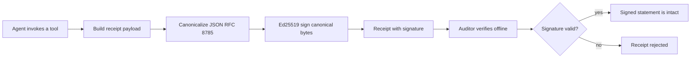
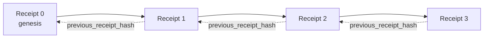

[Obejrzyj film z lekcją: Zabezpieczanie agentów AI za pomocą kryptograficznych potwierdzeń](https://youtu.be/PLACEHOLDER_VIDEO_ID)

> _(Film z lekcją i miniaturka zostaną dodane przez zespół Microsoft ds. treści po scaleniu, zgodnie ze wzorem lekcji 14 / 15.)_

# Zabezpieczanie agentów AI za pomocą kryptograficznych potwierdzeń

## Wprowadzenie

W tej lekcji omówimy:

- Dlaczego ścieżki audytu dla agentów AI są ważne dla zgodności, debugowania i zaufania.
- Czym jest kryptograficzne potwierdzenie i jak różni się od niepodpisanej linii logu.
- Jak wygenerować podpisane potwierdzenie dla wywołania narzędzia agenta w czystym Pythonie.
- Jak zweryfikować potwierdzenie offline i wykryć manipulacje.
- Jak łączyć potwierdzenia w łańcuch, tak że usunięcie lub zmiana kolejności jednego z nich łamie łańcuch.
- Co potwierdzenia dowodzą, a czego wyraźnie nie dowodzą.

## Cele nauki

Po ukończeniu tej lekcji nauczysz się:

- Identyfikować tryby awarii motywujące kryptograficzne pochodzenie działań agenta.
- Generować potwierdzenie podpisane Ed25519 nad kanonicznym ładunkiem JSON.
- Niezależnie weryfikować potwierdzenie używając tylko klucza publicznego podpisującego.
- Wykrywać manipulacje przez ponowne uruchomienie weryfikacji zmodyfikowanego potwierdzenia.
- Budować łańcuch potwierdzeń oparty na wartości skrótu i wyjaśniać, dlaczego łańcuch jest ważny.
- Rozróżniać, co potwierdzenia dowodzą (przypisanie, integralność, kolejność), a co nie (poprawność działania, prawidłowość polityki).

## Problem: Ścieżka audytu Twojego agenta

Wyobraź sobie, że wdrożyłeś agenta AI dla Contoso Travel. Agent odczytuje zapytania klientów, wywołuje API lotów, aby znaleźć opcje, i rezerwuje miejsca w imieniu klienta. W ostatnim kwartale agent przetworzył 50 000 rezerwacji.

Dziś przychodzi audytor. Zadaje proste pytanie: „Pokaż, co zrobił twój agent.”

Przekazujesz mu swoje pliki logów. Audytor je przegląda i zadaje trudniejsze pytanie: „Skąd mam wiedzieć, że te logi nie były edytowane?”

To jest problem ścieżki audytu. Większość dzisiejszych wdrożeń agentów opiera się na:

- **Logach aplikacji**: tworzonych przez samego agenta, edytowalnych przez każdego z dostępem do systemu plików.
- **Usługach logowania w chmurze**: odpornych na manipulacje na poziomie platformy, ale tylko jeśli audytor ufa operatorowi platformy.
- **Logach transakcji bazy danych**: odpowiednich dla zmian w bazie danych, ale nie dla dowolnych wywołań narzędzi.

Żaden z tych sposobów nie odpowie audytorowi bez konieczności zaufania komuś (tobie, dostawcy chmury, sprzedawcy bazy danych). Dla użytku wewnętrznego to zaufanie jest często akceptowalne. Dla obciążeń regulowanych (finanse, opieka zdrowotna, wszystko podlegające EU AI Act) nie jest.

Kryptograficzne potwierdzenia zawężają ten problem, czyniąc podpisane oświadczenie niezależnie
weryfikowalnym. Audytor nadal potrzebuje poza-bandowego powodu do zaufania kluczowi podpisującemu i
komponentowi, który wygenerował oświadczenie. Osadzony klucz dowodzi spójności samej treści,
a nie tożsamości wydawcy czy miejsca egzekwowania.

## Czym jest kryptograficzne potwierdzenie?

Potwierdzenie to obiekt JSON, który rejestruje, co zrobił agent, podpisany cyfrowym podpisem.



Minimalne potwierdzenie wygląda tak:

```json
{
  "type": "agent.tool_call.v1",
  "agent_id": "contoso-travel-bot",
  "tool_name": "lookup_flights",
  "tool_args_hash": "sha256:a3f9c1...",
  "result_hash": "sha256:7b2e1d...",
  "policy_id": "contoso-travel-policy-v3",
  "timestamp": "2026-04-25T14:30:00Z",
  "sequence": 47,
  "previous_receipt_hash": "sha256:9d4e6a...",
  "signature": {
    "alg": "EdDSA",
    "sig": "c5af83...",
    "public_key": "8f3b2c..."
  }
}
```

Trzy właściwości odpowiadają za działanie:

1. **Podpis**. Potwierdzenie jest podpisane przez bramę agenta używając prywatnego klucza Ed25519. Każdy z odpowiadającym kluczem publicznym może zweryfikować podpis offline. Strona polegająca na tym potwierdzeniu musi przypiąć ten klucz lub uzyskać go z zaufanego rejestru poza potwierdzeniem. Manipulacja którymkolwiek podpisanym polem unieważnia podpis.

2. **Kodowanie kanoniczne**. Przed podpisaniem potwierdzenie jest serializowane według schematu kanonicznego JSON (JCS, RFC 8785). Zapewnia to, że dwa różne implementacje dające ten sam logiczny wynik potwierdzenia generują identyczny bajtowo wynik. Bez kodowania kanonicznego różni serializatorzy JSON generowaliby różne podpisy dla tej samej treści.

3. **Łańcuchowanie skrótów**. Pole `previous_receipt_hash` łączy każde potwierdzenie z poprzednim. Usunięcie lub zmiana kolejności potwierdzenia łamie prezentowaną sekwencję. Wykrycie skrócenia lub przeinaczenia kontrolowanego przez podpisującego wymaga też przypiętego bieżącego nagłówka łańcucha, niezależnie świadczonego punktu kontrolnego lub uwierzytelnionego zobowiązania w zamkniętej populacji.

Razem te właściwości dają trzy gwarancje:

- **Przypisanie do klucza**: ten klucz podpisał tę zawartość. Tożsamość organizacyjna lub ludzka wymaga zaufanego powiązania klucza.
- **Integralność**: zawartość nie zmieniła się od czasu podpisania.
- **Kolejność w zweryfikowanym łańcuchu**: to potwierdzenie łączy się z poprzednikiem.

## Generowanie potwierdzenia w Pythonie

Nie potrzebujesz specjalnej biblioteki, by wygenerować potwierdzenie. Prymitywy kryptograficzne są powszechnie dostępne, a logika to kilkadziesiąt linii kodu w Pythonie.

Ćwiczenia praktyczne w `code_samples/18-signed-receipts.ipynb` przechodzą przez cały przebieg. Kontrolowana źródłem `code_samples/18-signed-receipts.execution-receipt.json` rejestruje dokładny hash notatnika, środowisko Pythona, liczbę komórek i kontrole z ostatniego przejścia bez zmieniania zapisanych wyników lekcji. Streszczenie:

```python
import json
import hashlib
import base64
from nacl import signing
from jcs import canonicalize  # RFC 8785 canonical JSON

def b64url_nopad(data: bytes) -> str:
    return base64.urlsafe_b64encode(data).decode("ascii").rstrip("=")

def sha256_canonical(obj) -> str:
    """SHA-256 of a Python object's JCS-canonical JSON form."""
    return f"sha256:{hashlib.sha256(canonicalize(obj)).hexdigest()}"

# Generate or load a signing key (in production, store in a key vault)
signing_key = signing.SigningKey.generate()
verify_key = signing_key.verify_key
TRUSTED_PUBLIC_KEYS = {b64url_nopad(bytes(verify_key))}  # pinned out of band by the verifier

# Build the receipt payload (no signature yet)
tool_args = {"origin": "SYD", "destination": "LAX"}
tool_result = [{"flight": "QF11", "price": 1850, "stops": 0}]

payload = {
    "type": "agent.tool_call.v1",
    "agent_id": "contoso-travel-bot",
    "tool_name": "lookup_flights",
    "tool_args_hash": sha256_canonical(tool_args),
    "result_hash": sha256_canonical(tool_result),
    "policy_id": "contoso-travel-policy-v3",
    "timestamp": "2026-04-25T14:30:00Z",
    "sequence": 0,
    "previous_receipt_hash": None,
}

# Canonicalize and sign the JCS bytes directly. PureEdDSA hashes internally.
canonical_bytes = canonicalize(payload)
signature_bytes = signing_key.sign(canonical_bytes).signature

# Attach a structured signature object.
receipt = {
    **payload,
    "signature": {
        "alg": "EdDSA",
        "sig": b64url_nopad(signature_bytes),
        "public_key": b64url_nopad(bytes(verify_key)),
    },
}
```

To cały proces podpisywania. Ćwiczenia w notatniku wyjaśniają każdy krok.

## Weryfikacja potwierdzenia i wykrywanie manipulacji

Weryfikacja to operacja odwrotna:

```python
import base64
import hashlib
from nacl import signing
from nacl.exceptions import CryptoError
from jcs import canonicalize

def b64url_decode(s: str) -> bytes:
    # Strict: Python's decoder skips characters outside the alphabet and also
    # accepts padding, the standard +/ alphabet and non-zero spare bits.
    # Re-encoding and comparing accepts only the one unpadded base64url form.
    padding = "=" * ((4 - len(s) % 4) % 4)
    data = base64.urlsafe_b64decode(s + padding)
    if base64.urlsafe_b64encode(data).decode("ascii").rstrip("=") != s:
        raise ValueError("not canonical unpadded base64url")
    return data

def verify_receipt(receipt: dict, trusted_public_key: str) -> bool:
    # trusted_public_key is the issuer's key, obtained from somewhere other
    # than this receipt. Never use receipt["signature"]["public_key"] here:
    # see "What Receipts Prove (and What They Do Not)" below.
    # Fails closed: anything malformed returns False instead of raising.
    if not isinstance(receipt, dict) or not isinstance(trusted_public_key, str):
        return False
    sig_obj = receipt.get("signature")
    if not isinstance(sig_obj, dict) or sig_obj.get("alg") != "EdDSA":
        return False
    sig_b64 = sig_obj.get("sig")
    if not isinstance(sig_b64, str):
        return False

    try:
        # Reconstruct the payload that was actually signed (everything except signature).
        payload = {k: v for k, v in receipt.items() if k != "signature"}
        canonical_bytes = canonicalize(payload)
        verify_key = signing.VerifyKey(b64url_decode(trusted_public_key))
        verify_key.verify(canonical_bytes, b64url_decode(sig_b64))
        return True
    except (CryptoError, TypeError, ValueError, KeyError, OverflowError):
        return False
    except Exception:
        # An undecodable key or signature, or a payload that cannot be
        # canonicalized: fail closed rather than raise.
        return False
```

Ta funkcja przyjmuje potwierdzenie i klucz publiczny wydawcy, zwracając `True` jeśli podpis jest ważny i `False` w przeciwnym razie, także gdy dane wejściowe są niepoprawne. Nie ma wywołania sieciowego ani usługi weryfikacyjnej: gdy masz klucz wydawcy, weryfikacja jest całkowicie lokalna i offline. Wymagane jest tylko posiadanie tego klucza, uzyskanego z miejsca innego niż samo potwierdzenie.

Aby zobaczyć wykrywanie manipulacji w akcji, notatnik prezentuje:

1. Wygenerowanie ważnego potwierdzenia i potwierdzenie, że weryfikuje się poprawnie.
2. Zmianę jednego bajtu w polu `tool_args_hash`.
3. Ponowne uruchomienie weryfikacji i stwierdzenie niepowodzenia.
4. Ponowną manipulację, ale tym razem podpisanie kluczem wygenerowanym przez atakującego i osadzenie tego klucza w potwierdzeniu.

Krok 4 jest warty uwagi. To potwierdzenie jest wewnętrznie spójne: jego podpis jest prawdziwy dla jego treści i klucza, który nosi, więc zweryfikuje się względem klucza w nim zawartego. Nie powiodło się tylko przy weryfikacji względem prawdziwego klucza wydawcy. Kroki 2 i 3 wykrywają atakującego, który nie podpisał na nowo; krok 4 wykrywa tego, który to zrobił.

To jest praktyczny dowód na to, że potwierdzenia są odporne na manipulacje: każda zmiana podpisanego pola łamie podpis, pod warunkiem, że weryfikujesz względem klucza, którego atakujący nie dostarczył. Obiekt `signature` sam jest poza podpisanymi bajtami, dlatego klucz do weryfikacji musi pochodzić z innego miejsca niż potwierdzenie.

## Łańcuchowanie potwierdzeń dla agentów wieloetapowych

Pojedyncze podpisane potwierdzenie zabezpiecza jedną akcję. Łańcuch potwierdzeń zabezpiecza sekwencję.



Każde potwierdzenie rejestruje hash poprzedniego potwierdzenia. Aby usunąć potwierdzenie nr 2 bez śladu, atakujący musiałby:

- Zmodyfikować pole `previous_receipt_hash` potwierdzenia nr 3 (łamie podpis potwierdzenia nr 3) LUB
- Sfałszować nowy podpis na zmodyfikowanym potwierdzeniu nr 3 (wymaga prywatnego klucza agenta).

Jeśli prywatny klucz jest w sprzętowym sejfie kluczy, a weryfikatorzy sprawdzają każde potwierdzenie względem klucza publicznego wydawcy, uzyskanego niezależnie (opublikowany zestaw JWK lub przypięta wartość konfiguracyjna), żaden z tych ataków nie jest możliwy bez wykrycia. Publikowanie klucza wewnątrz potwierdzenia nie wystarczy: atakujący może podpisać ponownie swoim kluczem i osadzić ten klucz zamiast, co jest scenariuszem fixture `04_resigned_receipt.json`.

Notatnik przedstawia:

1. Budowanie łańcucha trzech potwierdzeń.
2. Weryfikację, że pole `previous_receipt_hash` każdego potwierdzenia zgadza się z faktycznym hashem poprzedniego potwierdzenia.
3. Manipulację jednym potwierdzeniem w środku łańcucha i zaobserwowanie złamania łańcucha dokładnie w tym punkcie.

Tak zabezpieczasz ścieżkę audytu, którą zewnętrzny audytor może zweryfikować za pomocą
własnych przypiętych kluczy wydawcy i punktów kontrolnych łańcucha, bez konieczności zaufania Twojemu mutowalnemu magazynowi logów.

## Co potwierdzenia dowodzą (a czego nie)

To jest najważniejsza część tej lekcji. Potwierdzenia są potężne, ale ich moc jest ograniczona.

**Potwierdzenia dowodzą trzech rzeczy:**

1. **Przypisanie**: konkretny klucz podpisał konkretny ładunek.
2. **Integralność**: ładunek nie zmienił się od czasu podpisania.
3. **Kolejność w przedstawionej, zweryfikowanej sekwencji**: to potwierdzenie łączy się z poprzednikiem.

**Potwierdzenia NIE dowodzą:**

1. **Poprawności**: że działanie agenta było słuszne. Potwierdzenie może być podpisane zarówno dla złej, jak i dobrej odpowiedzi.
2. **Zgodności z polityką**: że polityka zreferowana w `policy_id` została faktycznie oceniona lub że zezwoliłaby na tę akcję, gdyby była sprawdzona. Potwierdzenie rejestruje, co zostało zadeklarowane, a nie co było egzekwowane.
3. **Tożsamości poza kluczem**: potwierdzenie mówi „ten klucz podpisał tę zawartość.” Nie mówi „ten człowiek autoryzował to.” Powiązanie klucza z osobą lub organizacją wymaga odrębnej infrastruktury tożsamości (katalog, rejestr kluczy publicznych itp.).
4. **Prawdziwości danych wejściowych**: jeśli agent otrzyma zmanipulowaną prośbę i na niej działa, potwierdzenie wiernie rejestruje dokonane działanie. Potwierdzenia są poniżej walidacji wejścia, a nie jej substytutem.
5. **Wykonania lub skutku w świecie rzeczywistym**: potwierdzenie po wywołaniu rejestruje, co jego wydawca twierdzi, że się wydarzyło. Udowodnienie przyjęcia lub uzgodnienie zewnętrznego efektu wymaga dowodu od rzeczywistego wykonawcy lub granicy dostawcy.
6. **Kompletności**: brak potwierdzenia może znaczyć: zablokowany, pominięty, utracony lub nieinstrumentowany. Brak staje się dowodem tylko w zamkniętej, uwierzytelnionej populacji.
7. **Zaufanego czasu**: podpisany znacznik czasu dowodzi, że podpisujący posiadał tę wartość, a nie że była ona poprawna. Zaufany czas wymaga odrębnego urzędu czasu lub świadczonego punktu kontrolnego.

**Klucz w potwierdzeniu nie jest kluczem, którym weryfikujesz.** Wynika to z punktu 3, i jest to jedyne miejsce, gdzie rozróżnienie musi zmienić Twój kod, a nie tylko rozumienie. `public_key` w powyższym przykładzie jest tam, aby przykład był samodzielny. Weryfikator nigdy nie powinien mu ufać. Każdy może wziąć potwierdzenie, zmienić je, podpisać kluczem, który sam wygenerował, i osadzić ten klucz; wynik weryfikuje się idealnie względem samego siebie. To fixture `04_resigned_receipt.json` w `sample_receipts/`, dlatego `verify_receipt` powyżej przyjmuje klucz jako argument, a nie odczytuje go z potwierdzenia. Uzyskaj klucz wydawcy niezależnie, z zestawu JWK w Checklistcie Produkcyjnym poniżej lub innego wcześniej przypiętego punktu, i weryfikuj względem niego. Podpis sprawdzony kluczem, który przyszedł w tej samej kopercie, dowodzi tylko, że koperta jest wewnętrznie spójna.

Ta granica ma znaczenie z dwóch powodów:

- Mówi, do czego potwierdzenia są użyteczne: czynią zachowanie agenta audytowalnym i odpornym na manipulacje, także poza granicami organizacyjnymi.
- Wskazuje, jakie dodatkowe warstwy są nadal potrzebne: walidacja wejścia (Lekcja 6), egzekwowanie polityki (omówione krótko poniżej) oraz infrastruktura tożsamości (poza zakresem tej lekcji).

Powszechny błąd to założenie, że „mamy potwierdzenia” oznacza „jesteśmy nadzorowani.” Tak nie jest. Potwierdzenia to fundament. Nadzór to system, który budujesz na nim.

## Powiązanie podpisu zatwierdzającego z dokładnym działaniem

Punkt 3 powyżej zasługuje na własną sekcję: potwierdzenie działania mówi „ten klucz podpisał tę zawartość,” nigdy „człowiek to zatwierdził.” Dla działań wysokiego ryzyka (zwroty, usunięcia, przelewy bankowe) osobny podpis zatwierdzającego może powiązać dokładne działanie. Powiązanie tego klucza z człowiekiem i sprawdzenie obecności człowieka pozostają osobnymi obowiązkami.

Kolejny notatnik `code_samples/human-authorization-receipts.ipynb` dodaje drugi typ potwierdzenia, `human.approval.v1`, o tym samym kształcie koperty co potwierdzenia w lekcji (typowany ładunek podpisany Ed25519 nad jego kanonicznymi bajtami JCS, z obiektem `signature` poza podpisanymi bajtami). Klucz zatwierdzającego podpisuje **pełne kanoniczne działanie i jego skrót**; klucz agenta podpisuje oświadczenie niosące **ten sam skrót działania** oraz `parent_approval_ref`, `receipt_hash` zatwierdzenia, tę samą konwencję co `previous_receipt_hash` w łańcuchu, który zbudowałeś powyżej. Jeden `verify_chain` weryfikuje oba artefakty pod **osobnymi przypiętymi rejestrami kluczy** (klucze zatwierdzających vs klucze agentów), więc ścieżka kodu jest wspólna, ale władze nigdy nie są.

Właściwość, którą to daje, wyrażona ostrożnie: *przypięty klucz zatwierdzającego podpisał to dokładne 
działanie, a klucz agenta później podpisał oświadczenie zawierające ten sam skrót działania.*
To przydatny dowód, ale sam w sobie nie dowodzi wykonania działania. 
Aby kontrolować wykonanie, dokładne zatwierdzenie musi być też zarezerwowane i zużyte tylko raz na
rzeczywistej granicy wykonawcy; nieznane wyniki dostawcy muszą pozostać nieznane zamiast
być bezmyślnie ponawiane. Testy odmowy w notatniku sprawdzają warstwę łańcucha potwierdzeń:

- manipulacje, błąd zastępcy, sfałszowane klucze po obu stronach i niepoprawne dane wejściowe;
- **przeterminowana władza**: podpis, który dalej weryfikuje się, ale odrzucony, bo wersja polityki się zmieniła, klucz zatwierdzającego został usunięty z przypiętego rejestru lub zatwierdzenie wygasło przed podanym czasem weryfikacji;
- **podmiana skrótu**: prawidłowo podpisane potwierdzenie działania wskazujące na *prawdziwe* zatwierdzenie, które powiązuje *inne* kanoniczne działanie.

Każda awaria odrzuca z odmiennym powodem, więc audytor czytający odmowę może stwierdzić, czy władza się przeterminowała, czy twierdzone działanie się zmieniło. Weryfikacja jest tylko do odczytu i powtarzalna: nie zużywa zatwierdzenia ani nie wywołuje dostawcy. Osobny wykonawca potrzebuje trwałej, atomowej ochrony powtórzeń oraz świadomego sukcesu, porażki i nieokreślonych rezultatów. Potwierdzenie zatwierdzenia człowieka to edukacyjna kompozycja zdefiniowana w tej lekcji, a nie typ potwierdzenia zdefiniowany przez `draft-farley-acta-signed-receipts`.

## Odniesienia produkcyjne

Kod Pythona w tej lekcji jest celowo napisany minimalistycznie, abyś mógł przeczytać każdą linię i dokładnie zrozumieć, co się dzieje. W produkcji masz dwie opcje:

1. **Buduj bezpośrednio na prymitywach kryptograficznych.** 50 linii, które widziałeś powyżej, jest wystarczające dla wielu przypadków użycia. PyNaCl (Ed25519) oraz pakiet `jcs` (kanoniczny JSON) to dobrze utrzymane i audytowane biblioteki.

2. **Użyj produkcyjnej biblioteki do potwierdzeń (receipt).** Kilka projektów open source implementuje ten sam wzorzec z dodatkowymi funkcjami (rotacja kluczy, weryfikacja wsadowa, dystrybucja zestawu JWK, integracja z silnikami polityk):
   - Pipeline podpisywania używa konwencji JCS oraz zakresu podpisu w niezależnym projekcie IETF Internet-Draft ([`draft-farley-acta-signed-receipts`](https://datatracker.ietf.org/doc/draft-farley-acta-signed-receipts/), rewizja 02). Edukacyjne, płaskie potwierdzenie w tej lekcji różni się od draftowej koperty `{payload, signature}` i nie jest prezentowane jako zgodna implementacja. Draft publikuje wspólny zestaw testów zgodności ([agent-governance-testvectors](https://github.com/ScopeBlind/agent-governance-testvectors)) dla implementacji celujących w jego format transmisji.
   - Microsoft Agent Governance Toolkit tworzy potwierdzenia łącznie z decyzjami polityki opartymi na Cedar; zobacz Tutorial 33 w tym repozytorium, aby zobaczyć kompletny przykład end-to-end.
   - Pakiety `protect-mcp` (npm) i `@veritasacta/verify` (npm) zapewniają implementację podpisywania potwierdzeń i weryfikacji offline opartą na Node, przeznaczoną do opakowania dowolnego serwera MCP z audytem odpornym na manipulacje, w tym przepływ zatrzymywania do współpodpisu, gdzie wstrzymana akcja generuje potwierdzenie zatwierdzenia powiązane z digestem akcji (poparte WebAuthn w trybie desktopowym), ten sam wzorzec potwierdzenia zatwierdzenia jak w powyższym notatniku autoryzacji ludzkiej.
   - **[nobulex](https://github.com/arian-gogani/nobulex)** Python SDK (`pip install nobulex`) zapewnia ten sam wzorzec podpisywania Ed25519 + JCS w Pythonie z integracjami LangChain i CrewAI, w tym opublikowane wektory testowe do walidacji krzyżowej oraz mapowanie zgodności zgłoszone przez [OWASP PR #2210](https://github.com/OWASP/CheatSheetSeries/pull/2210).
   - **[EMILIA Protocol](https://github.com/emiliaprotocol/emilia-protocol)** oferuje uzupełniającą warstwę egzekwowania dokładnych działań: offline weryfikowalne potwierdzenia zatwierdzenia, przypięte WebAuthn lub organ kworum, jednorazowe zużycie na granicy wykonawcy oraz wyraźną ścieżkę o nieokreślonym wyniku. Jego adaptery frameworkowe traktują potwierdzenie jako konieczny dowód, a nie dowód, że zaistniał efekt zewnętrzny.

Decyzja pomiędzy samodzielnym tworzeniem a używaniem biblioteki odpowiada decyzji między stworzeniem własnej biblioteki JWT a korzystaniem z przetestowanej: obie są rozsądne; biblioteka oszczędza czas i zmniejsza powierzchnię audytu; podejście od zera zmusza do zrozumienia każdego prymitywu. Ta lekcja naucza ścieżki od zera, abyś miał fundament pod oba wybory.

## Sprawdzenie wiedzy

Sprawdź swoją wiedzę przed przejściem do ćwiczenia praktycznego.

**1. Potwierdzenie jest podpisane prywatnym kluczem Ed25519 agenta. Audytor ma tylko klucz publiczny. Czy audytor może zweryfikować potwierdzenie offline?**

<details>
<summary>Odpowiedź</summary>

Tak, weryfikacja kryptograficzna wymaga tylko klucza publicznego i podpisanych bajtów. 
Audytor musi jednak niezależnie pozyskać i przypiąć zaakceptowany klucz publiczny niezależnie od potwierdzenia.
Po ustaleniu tej konfiguracji zaufania nie jest potrzebne żadne wywołanie sieciowe.
</details>

**2. Atakujący modyfikuje pole `policy_id` w potwierdzeniu, twierdząc, że było rządzone bardziej liberalną polityką. Podpis był nad oryginalnym ładunkiem. Co się dzieje podczas weryfikacji?**

<details>
<summary>Odpowiedź</summary>

Weryfikacja kończy się niepowodzeniem. Podpis był wyliczany nad kanonicznymi bajtami oryginalnego ładunku; modyfikacja jakiegokolwiek pola ładunku zmienia te bajty, co unieważnia podpis. Atakujący musiałby posiadać klucz prywatny, aby wygenerować nowy ważny podpis, którego nie posiada.
</details>

**3. Dlaczego potwierdzenie zawiera `tool_args_hash` oraz `result_hash` zamiast surowych argumentów i wyniku?**

<details>
<summary>Odpowiedź</summary>

Dwa powody. Po pierwsze, potwierdzenie może być archiwizowane lub przesyłane w środowiskach, gdzie wyciek surowej zawartości (dane osobowe, dane biznesowe) stanowi problem. Haszowanie utrzymuje potwierdzenie małe i prywatne; audytor weryfikuje, że hasz odpowiada osobno przechowywanej kopii faktycznej zawartości. Po drugie, hasze mają stały rozmiar; potwierdzenie z haszami ma ograniczony rozmiar niezależnie od rozmiaru wejść i wyjść.
</details>

**4. Pole `previous_receipt_hash` łączy każde potwierdzenie z poprzednikiem. Jeśli atakujący cicho usunie jedno potwierdzenie ze środka łańcucha, co stanie się nieprawidłowe?**

<details>
<summary>Odpowiedź</summary>

Każde potwierdzenie następujące po usuniętym. Ich pola `previous_receipt_hash` już nie zgadzają się z faktycznym łańcuchem (ponieważ potwierdzenie, do którego się odnosiły, nie istnieje lub łańcuch wskazuje teraz na innego poprzednika). Aby ukryć usunięcie, atakujący musiałby ponownie podpisać każde późniejsze potwierdzenie, co wymaga prywatnego klucza wystawcy. Ponowne podpisanie z innym kluczem nie przejdzie weryfikacji względem klucza wystawcy.
</details>

**5. Potwierdzenie przechodzi czystą weryfikację. Czy to dowodzi, że działanie agenta było poprawne, racjonalne lub zgodne z polityką?**

<details>
<summary>Odpowiedź</summary>

Nie. Pod przypiętym kluczem i kontekstem łańcucha ważne potwierdzenie dowodzi przypisania podpisu,
integralności treści i powiązania z przedstawionym poprzednikiem. NIE dowodzi, że
działanie było prawidłowe lub wykonane, że polityka została oceniona, że znacznik czasu jest
zaufany, lub że zestaw rekordów jest kompletny. To jest najważniejsza granica w lekcji.
</details>

## Ćwiczenie praktyczne

Otwórz `code_samples/18-signed-receipts.ipynb` i uzupełnij wszystkie cztery sekcje:

1. **Sekcja 1**: Podpisz swoje pierwsze potwierdzenie i zweryfikuj je.
2. **Sekcja 2**: Dokonaj manipulacji potwierdzeniem i zaobserwuj niepowodzenie weryfikacji.
3. **Sekcja 3**: Zbuduj łańcuch z trzech potwierdzeń i zweryfikuj integralność łańcucha.
4. **Sekcja 4**: Zastosuj wzorzec do agenta zbudowanego za pomocą Microsoft Agent Framework: opakuj wywołanie narzędzia w podpisanie potwierdzenia, następnie zweryfikuj potwierdzenie niezależnie.

**Wyzwanie rozszerzające 1:** rozszerz schemat potwierdzenia o dodatkowe pole według własnego wyboru (np. identyfikator żądania do śledzenia), zaktualizuj logikę kanonicznego podpisywania, aby je uwzględnić i potwierdź, że potwierdzenie nadal przechodzi weryfikację. Następnie zmodyfikuj pole po podpisaniu i potwierdź, że weryfikacja nie powiodła się. To zmusza cię do zrozumienia, jak każdy bajt kanonicznego kodowania wpływa na podpis.

**Wyzwanie rozszerzające 2:** Połącz dwie swoje potwierdzenia za pomocą hasza SHA-256 (skonkatenowane ich kanoniczne bajty w deterministycznym porządku) i osadź uzyskany digest jako nowe pole w trzecim potwierdzeniu przed podpisaniem. Zweryfikuj, że wszystkie trzy potwierdzenia nadal przechodzą pełny cykl weryfikacji. Właśnie zbudowałeś dowód inkluzji w jednym kroku: każdy posiadający trzecie potwierdzenie może udowodnić, że dwa pierwsze istniały w czasie jego podpisu, bez potrzeby ujawniania ich zawartości. To jest wzorzec używany przez potwierdzenia selektywnego ujawniania na dużą skalę (zob. zobowiązania Merkle’a, RFC 6962).

## Podsumowanie

Kryptograficzne potwierdzenia dają agentom AI ślad audytu, który jest:

- **Niezależnie weryfikowalny pod przypiętym zaufaniem**: strona dysponująca zaakceptowanymi kluczami publicznymi i podpisanymi bajtami może weryfikować bez zależności od usługi.
- **Odporny na manipulacje**: każda modyfikacja unieważnia podpis.
- **Przenośny**: potwierdzenie to mały plik JSON; można go archiwizować, przesyłać i weryfikować wszędzie.
- **Zgodny ze standardami**: oparty na Ed25519 (RFC 8032), JCS (RFC 8785) oraz SHA-256, wszystkie szeroko stosowane prymitywy.

Nie są one substytutem dla walidacji wejścia, egzekwowania polityk, dopuszczenia wykonawcy,
dowodu wyniku, kontroli kompletności lub infrastruktury tożsamości. Stanowią fundament
tych warstw. W regulowanych lub wieloorganizacyjnych przepływach pracy potwierdzenia czynią określone
oświadczenia wystawcy niezależnie sprawdzalnymi pod własną konfiguracją zaufania audytora.

Najważniejsza zasada: potwierdzenia dowodzą, że określony klucz podpisał określoną
zawartość. Przenoszony znacznik czasu jest asercją podpisującego, chyba że jest indywidualnie potwierdzony czasowo.
Potwierdzenie nie dowodzi, że jego zawartość była prawdziwa, że działania zostały wykonane, lub że
zestaw rekordów jest kompletny. Trzymaj te rozgraniczenia ściśle.

## Lista kontrolna produkcji

Gdy będziesz gotowy, aby przejść od tej lekcji do wdrożenia agentów podpisujących potwierdzenia w środowisku produkcyjnym:

- [ ] **Przenieś klucz podpisujący z laptopa dewelopera.** Użyj Azure Key Vault, AWS KMS lub modułu bezpieczeństwa sprzętowego. Prywatny klucz podpisujący potwierdzenia nigdy nie może znajdować się w kontroli wersji lub w postaci niezaszyfrowanej na maszynach aplikacji.
- [ ] **Ustanów zaufanie klucza weryfikatora.** Publikuj klucze przez zestaw JWK lub rejestr, a następnie pozwól stronom zaufania przypiąć zaakceptowaną tożsamość wystawcy, zestaw kluczy i politykę rotacji poza pojedynczymi potwierdzeniami. Sam klucz osadzony w potwierdzeniu nie jest kotwicą zaufania.
- [ ] **Kotwicz łańcuch zewnętrznie.** Okresowo zapisz skrót najnowszego nagłówka łańcucha do dziennika transparentności (Sigstore Rekor, autorytet znaczników czasu RFC 3161 lub drugi system wewnętrzny), aby strona zewnętrzna mogła potwierdzić „ten łańcuch istniał w tym czasie.”
- [ ] **Przechowuj potwierdzenia niezmiennie.** Magazyn plików tylko do dopisywania (Azure Storage z politykami niezmienności, AWS S3 Object Lock) zapobiega wewnętrznemu nadpisywaniu historii na poziomie magazynu.
- [ ] **Zdecyduj o retencji.** Wiele reżimów zgodności wymaga wieloletniego przechowywania. Planuj wzrost potwierdzeń (każde potwierdzenie ma ~500 bajtów; agent wykonujący 10 tys. wywołań dziennie generuje ~1,8 GB rocznie).
- [ ] **Udokumentuj, czego potwierdzenia nie obejmują.** Potwierdzenia dowodzą przypisania, integralności i kolejności. Twój runbook powinien wyraźnie wymieniać dodatkowe kontrole (walidacja wejścia, egzekwowanie polityk, limitowanie tempa, infrastruktura tożsamości) współistniejące z potwierdzeniami w twojej postawie zarządczej.

### Masz więcej pytań dotyczących zabezpieczania agentów AI?

Dołącz do [Microsoft Foundry Discord](https://aka.ms/ai-agents/discord), aby spotkać innych uczących się, uczestniczyć w godzinach konsultacji i uzyskać odpowiedzi na pytania dotyczące agentów AI.

## Poza tą lekcją

Ta lekcja obejmuje pojedynczy podpis potwierdzenia i sekwencje połączone łańcuchem haszowym. Te same prymitywy składają się na kilka bardziej zaawansowanych wzorców, które możesz napotkać, gdy twoja postawa zarządcza dojrzeje:

- **Selektywne ujawnianie.** Gdy pola potwierdzenia są niezależnie zobowiązane (drzewo Merkle’a w stylu RFC 6962), możesz ujawnić określone pola konkretnym audytorom i udowodnić, że pozostałe nie zostały zmienione, bez ich ujawniania. Przydatne, gdy to samo potwierdzenie musi spełniać zarówno kompleksowy audyt (wymagający kompletności), jak i przepisy dotyczące minimalizacji danych jak RODO (chcące, by audytor widział jak najmniej).
- **Unieważnianie potwierdzeń.** Jeśli klucz podpisujący zostanie skompromitowany, potrzebujesz sposobu, by oznaczyć wszystkie potwierdzenia podpisane tym kluczem jako niegodne zaufania od określonego momentu. Standardowe wzorce: krótkoterminowe klucze podpisujące plus opublikowana lista unieważnień lub dziennik transparentności z wpisami unieważnień.
- **Dwustronne / podzielone potwierdzenia podpisu.** Niektóre implementacje dzielą podpisywany ładunek na pre-wykonanie (`authorization_*`) i post-wykonanie (`result_*`) z niezależnymi podpisami, przydatne, gdy decyzja o autoryzacji i obserwowany rezultat są produkowane przez różnych wykonawców lub w różnych momentach. Dodaje to się kompozycyjnie na format potwierdzenia nauczany w tej lekcji.
- **Kompozycja ładunku.** Potwierdzenie uszczelnia dowolne bajty, które umieścisz w `result_hash`. Rzeczywiste ładunki często są bogatsze niż pojedynczy wynik wywołania narzędzia: rozumowanie przed decyzją (predykcja modelu, rozważane opcje, dowody i ich kompletność, postura ryzyka, łańcuch odpowiedzialności, wynik bramki) mogą mieszkać wewnątrz ładunku, uszczelnionego przez jedno potwierdzenie. Pozwala to utrzymać format potwierdzenia minimalny, a jednocześnie pozwala ewoluować schematom ładunku per domena.
- **Weryfikacja krzyżowej implementacji.** Kilka niezależnych implementacji tego samego formatu potwierdzeń (Python, TypeScript, Rust, Go) weryfikuje się krzyżowo względem wspólnych wektorów testowych. Jeśli zbudujesz własną implementację, walidacja wobec opublikowanych wektorów potwierdza kompatybilność transmisji.
- **Migracja post-kwantowa.** Ed25519 jest dziś szeroko stosowany, lecz nie jest odporny na kwanty. Sama etykieta `alg` to nie migracja: profil musi zdefiniować kodowanie klucza ML-DSA, kanoniczne bajty podpisu, weryfikację, politykę strony zaufania, odporność na degradację i semantykę przejścia. Zaplanuj i przetestuj przejście z podwójnym podpisem na podstawie wspólnych wektorów, zanim zgłosisz kompatybilność.

## Dodatkowe zasoby

- <a href="https://datatracker.ietf.org/doc/draft-farley-acta-signed-receipts/" target="_blank">IETF Internet-Draft: Signed Decision Receipts for Machine-to-Machine Access Control</a>
- <a href="https://learn.microsoft.com/azure/ai-studio/responsible-use-of-ai-overview" target="_blank">Przegląd odpowiedzialnej AI (Azure AI)</a>
- <a href="https://datatracker.ietf.org/doc/html/rfc8032" target="_blank">RFC 8032: Algorytm podpisu cyfrowego krzywej Edwardsa (EdDSA)</a>
- <a href="https://datatracker.ietf.org/doc/html/rfc8785" target="_blank">RFC 8785: Schemat kanonicznego JSON (JCS)</a>
- <a href="https://datatracker.ietf.org/doc/html/rfc6962" target="_blank">RFC 6962: Transparentność certyfikatów</a> (konstrukcja drzewa Merkle używana przez potwierdzenia selektywnego ujawniania)
- <a href="https://github.com/microsoft/agent-governance-toolkit/blob/main/docs/tutorials/33-offline-verifiable-receipts.md" target="_blank">Microsoft Agent Governance Toolkit, Tutorial 33: Offline-weryfikowalne potwierdzenia decyzji</a>
- <a href="https://github.com/ScopeBlind/agent-governance-testvectors" target="_blank">Wektory testów zgodności międzyimplementacyjnej</a> dla formatu potwierdzeń z tej lekcji (Apache-2.0)
- <a href="https://pynacl.readthedocs.io/" target="_blank">Dokumentacja PyNaCl</a> (Ed25519 w Pythonie)

## Poprzednia lekcja

[Tworzenie lokalnych agentów AI](../17-creating-local-ai-agents/README.md)

---

<!-- CO-OP TRANSLATOR DISCLAIMER START -->
**Zastrzeżenie**:
Niniejszy dokument został przetłumaczony za pomocą usługi tłumaczenia AI [Co-op Translator](https://github.com/Azure/co-op-translator). Choć dążymy do dokładności, prosimy pamiętać, że automatyczne tłumaczenia mogą zawierać błędy lub niedokładności. Oryginalny dokument w jego języku źródłowym należy uznawać za autorytatywne źródło. W przypadku informacji krytycznych zalecane jest skorzystanie z profesjonalnego tłumaczenia wykonanego przez człowieka. Nie ponosimy odpowiedzialności za jakiekolwiek nieporozumienia lub błędne interpretacje wynikające z użycia tego tłumaczenia.
<!-- CO-OP TRANSLATOR DISCLAIMER END -->