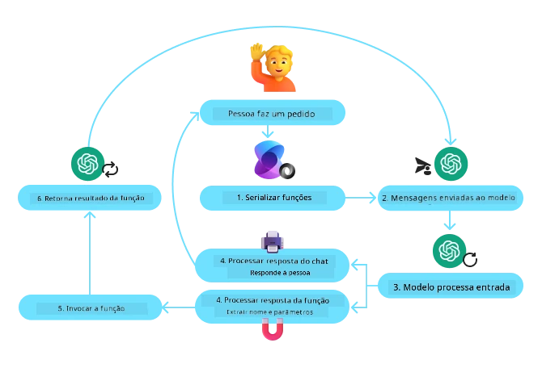
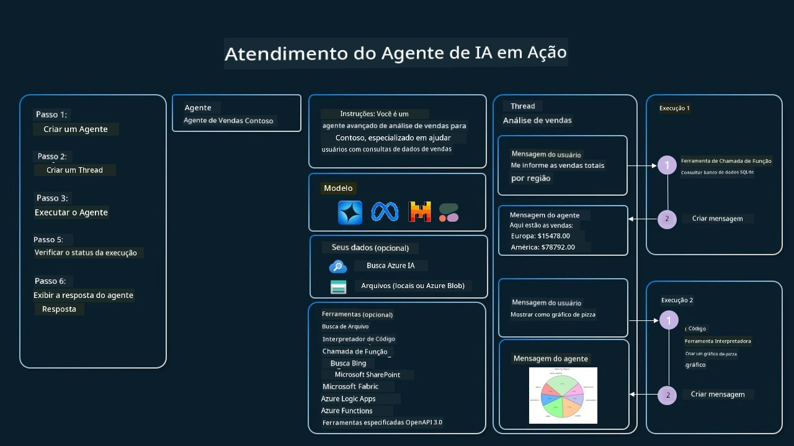

[](https://youtu.be/vieRiPRx-gI?si=cEZ8ApnT6Sus9rhn)

> _(Clique na imagem acima para assistir ao vídeo desta lição)_

# Padrão de Design de Uso de Ferramentas

Ferramentas são interessantes porque permitem que agentes de IA tenham um conjunto mais amplo de capacidades. Em vez do agente ter um conjunto limitado de ações que pode executar, ao adicionar uma ferramenta, o agente pode agora realizar uma ampla variedade de ações. Neste capítulo, veremos o Padrão de Design de Uso de Ferramentas, que descreve como agentes de IA podem usar ferramentas específicas para alcançar seus objetivos.

## Introdução

Nesta lição, buscamos responder às seguintes perguntas:

- O que é o padrão de design de uso de ferramentas?
- Quais são os casos de uso em que ele pode ser aplicado?
- Quais são os elementos/blocos de construção necessários para implementar o padrão de design?
- Quais são as considerações especiais para usar o Padrão de Design de Uso de Ferramentas para construir agentes de IA confiáveis?

## Objetivos de Aprendizagem

Após completar esta lição, você será capaz de:

- Definir o Padrão de Design de Uso de Ferramentas e seu propósito.
- Identificar casos de uso em que o Padrão de Design de Uso de Ferramentas é aplicável.
- Compreender os elementos-chave necessários para implementar o padrão de design.
- Reconhecer considerações para garantir a confiabilidade em agentes de IA que usam esse padrão de design.

## O que é o Padrão de Design de Uso de Ferramentas?

O **Padrão de Design de Uso de Ferramentas** foca em dar aos LLMs a capacidade de interagir com ferramentas externas para alcançar objetivos específicos. Ferramentas são códigos que podem ser executados por um agente para realizar ações. Uma ferramenta pode ser uma função simples como uma calculadora, ou uma chamada de API para um serviço terceirizado como consulta de preço de ações ou previsão do tempo. No contexto de agentes de IA, as ferramentas são projetadas para serem executadas por agentes em resposta a **chamadas de função geradas pelo modelo**.

## Quais são os casos de uso em que ele pode ser aplicado?

Agentes de IA podem aproveitar ferramentas para completar tarefas complexas, recuperar informações ou tomar decisões. O padrão de design de uso de ferramentas é frequentemente usado em cenários que exigem interação dinâmica com sistemas externos, como bancos de dados, serviços web ou interpretadores de código. Essa habilidade é útil para diversos casos de uso, incluindo:

- **Recuperação Dinâmica de Informação:** Agentes podem consultar APIs externas ou bancos de dados para obter dados atualizados (por exemplo, consultando um banco de dados SQLite para análise de dados, obtendo preços de ações ou informações meteorológicas).
- **Execução e Interpretação de Código:** Agentes podem executar códigos ou scripts para resolver problemas matemáticos, gerar relatórios ou realizar simulações.
- **Automação de Fluxos de Trabalho:** Automatizando workflows repetitivos ou de múltiplas etapas, integrando ferramentas como agendadores de tarefas, serviços de email ou pipelines de dados.
- **Suporte ao Cliente:** Agentes podem interagir com sistemas CRM, plataformas de tickets ou bases de conhecimento para resolver consultas dos usuários.
- **Geração e Edição de Conteúdo:** Agentes podem usar ferramentas como verificadores gramaticais, resumidores de texto ou avaliadores de segurança de conteúdo para auxiliar em tarefas de criação de conteúdo.

## Quais são os elementos/blocos de construção necessários para implementar o padrão de design de uso de ferramentas?

Esses blocos de construção permitem que o agente de IA execute uma ampla gama de tarefas. Vamos analisar os elementos-chave necessários para implementar o Padrão de Design de Uso de Ferramentas:

- **Esquemas de Função/Ferramenta**: Definições detalhadas das ferramentas disponíveis, incluindo nome da função, propósito, parâmetros necessários e saídas esperadas. Esses esquemas permitem que o LLM entenda quais ferramentas estão disponíveis e como construir requisições válidas.

- **Lógica de Execução da Função**: Regula como e quando as ferramentas são invocadas com base na intenção do usuário e contexto da conversa. Isso pode incluir módulos planejadores, mecanismos de encaminhamento ou fluxos condicionais que determinam o uso da ferramenta dinamicamente.

- **Sistema de Gerenciamento de Mensagens**: Componentes que gerenciam o fluxo conversacional entre entradas do usuário, respostas do LLM, chamadas de ferramenta e saídas das ferramentas.

- **Framework de Integração de Ferramentas**: Infraestrutura que conecta o agente a diversas ferramentas, sejam elas funções simples ou serviços externos complexos.

- **Tratamento de Erros e Validação**: Mecanismos para lidar com falhas na execução da ferramenta, validar parâmetros e gerenciar respostas inesperadas.

- **Gerenciamento de Estado**: Acompanha o contexto da conversa, interações anteriores com ferramentas e dados persistentes para garantir consistência em interações de múltiplas etapas.

A seguir, vamos examinar o Chamar Função/Ferramenta com mais detalhes.
 
### Chamada de Função/Ferramenta

A chamada de função é a principal forma que habilitamos os Modelos de Linguagem de Grande Escala (LLMs) a interagir com ferramentas. Você verá frequentemente 'Função' e 'Ferramenta' usados de forma intercambiável porque 'funções' (blocos de código reutilizáveis) são as 'ferramentas' que agentes usam para realizar tarefas. Para que o código de uma função seja invocado, um LLM deve comparar a solicitação do usuário com a descrição das funções. Para isso, um esquema contendo as descrições de todas as funções disponíveis é enviado ao LLM. O LLM então seleciona a função mais apropriada para a tarefa e retorna seu nome e argumentos. A função selecionada é invocada, sua resposta é enviada de volta ao LLM, que usa essa informação para responder à solicitação do usuário.

Para desenvolvedores implementarem a chamada de função para agentes, será necessário:

1. Um modelo LLM que suporte chamada de função
2. Um esquema contendo descrições das funções
3. O código para cada função descrita

Vamos usar o exemplo de obter a hora atual em uma cidade para ilustrar:

1. **Inicializar um LLM que suporte chamada de função:**

    Nem todos os modelos suportam chamada de função, então é importante verificar se o LLM que você está usando suporta. <a href="https://learn.microsoft.com/azure/ai-services/openai/how-to/function-calling" target="_blank">Azure OpenAI</a> suporta chamada de função. Podemos começar iniciando o cliente OpenAI contra a **API de Respostas** do Azure OpenAI (o endpoint estável `/openai/v1/` — não é necessário `api_version`). 

    ```python
    # Initialize the OpenAI client for Azure OpenAI (Responses API, v1 endpoint)
    client = OpenAI(
        base_url=f"{os.environ['AZURE_OPENAI_ENDPOINT'].rstrip('/')}/openai/v1/",
        api_key=os.environ["AZURE_OPENAI_API_KEY"],
    )
    deployment_name = os.environ["AZURE_OPENAI_DEPLOYMENT"]
    ```

1. **Criar um Esquema de Função**:

    Em seguida, definiremos um esquema JSON que contém o nome da função, descrição do que a função faz e os nomes e descrições dos parâmetros da função.
    Depois, passaremos esse esquema ao cliente criado anteriormente, junto com a solicitação do usuário para encontrar a hora em San Francisco. O importante é notar que uma **chamada de ferramenta** é o que é retornado, **não** a resposta final para a pergunta. Como mencionado antes, o LLM retorna o nome da função que selecionou para a tarefa, e os argumentos que serão passados para ela.

    ```python
    # Function description for the model to read (Responses API flat tool format)
    tools = [
        {
            "type": "function",
            "name": "get_current_time",
            "description": "Get the current time in a given location",
            "parameters": {
                "type": "object",
                "properties": {
                    "location": {
                        "type": "string",
                        "description": "The city name, e.g. San Francisco",
                    },
                },
                "required": ["location"],
            },
        }
    ]
    ```
   
    ```python
  
    # Initial user message
    messages = [{"role": "user", "content": "What's the current time in San Francisco"}]

    # First API call: Ask the model to use the function
    response = client.responses.create(
        model=deployment_name,
        input=messages,
        tools=tools,
        tool_choice="auto",
        store=False,
    )

    # The Responses API returns tool calls as function_call items in response.output.
    # Append them to the conversation so the model has full context on the next turn.
    messages += response.output

    print("Model's response:")
    print(response.output)
  
    ```

    ```bash
    Model's response:
    [ResponseFunctionToolCall(arguments='{"location":"San Francisco"}', call_id='call_pOsKdUlqvdyttYB67MOj434b', name='get_current_time', type='function_call')]
    ```
  
1. **O código da função necessário para executar a tarefa:**

    Agora que o LLM escolheu qual função deve ser executada, o código que realiza a tarefa precisa ser implementado e executado.
    Podemos implementar o código para obter a hora atual em Python. Também precisaremos escrever o código para extrair o nome e os argumentos da mensagem de resposta para obter o resultado final.

    ```python
      def get_current_time(location):
        """Get the current time for a given location"""
        print(f"get_current_time called with location: {location}")  
        location_lower = location.lower()
        
        for key, timezone in TIMEZONE_DATA.items():
            if key in location_lower:
                print(f"Timezone found for {key}")  
                current_time = datetime.now(ZoneInfo(timezone)).strftime("%I:%M %p")
                return json.dumps({
                    "location": location,
                    "current_time": current_time
                })
      
        print(f"No timezone data found for {location_lower}")  
        return json.dumps({"location": location, "current_time": "unknown"})
    ```

     ```python
    # Handle function calls
    tool_calls = [item for item in response.output if item.type == "function_call"]
    if tool_calls:
        for tool_call in tool_calls:
            if tool_call.name == "get_current_time":

                function_args = json.loads(tool_call.arguments)

                time_response = get_current_time(
                    location=function_args.get("location")
                )

                # Return the tool result as a function_call_output item
                messages.append({
                    "type": "function_call_output",
                    "call_id": tool_call.call_id,
                    "output": time_response,
                })
    else:
        print("No tool calls were made by the model.")

    # Second API call: Get the final response from the model
    final_response = client.responses.create(
        model=deployment_name,
        input=messages,
        tools=tools,
        store=False,
    )

    return final_response.output_text
     ```

     ```bash
      get_current_time called with location: San Francisco
      Timezone found for san francisco
      The current time in San Francisco is 09:24 AM.
     ```

A chamada de função está no coração da maioria, senão de todos, os designs de uso de ferramentas de agentes, no entanto implementá-la do zero pode ser um desafio às vezes.
Como aprendemos em [Lição 2](../../../02-explore-agentic-frameworks), frameworks agentic nos fornecem blocos de construção pré-fabricados para implementar uso de ferramentas.
 
## Exemplos de Uso de Ferramentas com Frameworks Agentic

Aqui estão alguns exemplos de como você pode implementar o Padrão de Design de Uso de Ferramentas usando diferentes frameworks agentic:

### Microsoft Agent Framework

<a href="https://learn.microsoft.com/azure/ai-services/agents/overview" target="_blank">Microsoft Agent Framework</a> é um framework open-source de IA para construir agentes de IA. Ele simplifica o processo de usar chamadas de função permitindo que você defina ferramentas como funções Python com o decorador `@tool`. O framework gerencia a comunicação entre o modelo e seu código. Também fornece acesso a ferramentas pré-construídas como Busca de Arquivos e Interpretador de Código através do `FoundryChatClient`.

O diagrama a seguir ilustra o processo de chamada de função com o Microsoft Agent Framework:



No Microsoft Agent Framework, ferramentas são definidas como funções decoradas. Podemos converter a função `get_current_time` que vimos anteriormente em uma ferramenta usando o decorador `@tool`. O framework automaticamente serializa a função e seus parâmetros, criando o esquema para enviar ao LLM.

```python
import os
from agent_framework import tool
from agent_framework.foundry import FoundryChatClient
from azure.identity import AzureCliCredential

@tool(approval_mode="never_require")
def get_current_time(location: str) -> str:
    """Get the current time for a given location"""
    ...

# Create the client
provider = FoundryChatClient(
    project_endpoint=os.environ["AZURE_AI_PROJECT_ENDPOINT"],
    model=os.environ["AZURE_AI_MODEL_DEPLOYMENT_NAME"],
    credential=AzureCliCredential(),
)

# Create an agent and run with the tool
agent = provider.as_agent(name="TimeAgent", instructions="Use available tools to answer questions.", tools=get_current_time)
response = await agent.run("What time is it?")
```

#### Ferramentas de um servidor MCP

Ferramentas não precisam ser funções do seu próprio código. Um servidor que usa o Protocolo de Contexto do Modelo (MCP, abordado na [Lição 11](../11-agentic-protocols/README.md)) publica suas ferramentas junto com seus esquemas, e o framework pode carregá-las da mesma forma que serializa uma função decorada. `MCPStreamableHTTPTool` conecta-se a esse servidor via HTTP, lê os esquemas das ferramentas e as oferece ao modelo junto com quaisquer ferramentas locais.

O exemplo abaixo usa o servidor de busca web hospedado por <a href="https://keenable.ai" target="_blank">Keenable</a>. É gratuito para usar sem conta ou chave de API (as requisições têm limite por IP), então as únicas credenciais que você precisa são as do seu modelo. Como com qualquer ferramenta remota, as consultas que o modelo escreve são enviadas a esse servidor.

```python
from agent_framework import MCPStreamableHTTPTool

web_search = MCPStreamableHTTPTool(
    name="Keenable web search",
    url="https://api.keenable.ai/mcp",
)

# Connecting loads the server's tool schemas; the agent decides when to call them
async with web_search:
    agent = provider.as_agent(
        name="ResearchAgent",
        instructions="Use available tools to answer questions.",
        tools=[web_search],
    )
    response = await agent.run("What is new in the latest Python release?")
    print(response.text)
```

O servidor publica duas ferramentas, `search_web_pages` e `fetch_page_content`. Quando uma pergunta precisa de informações atuais, o modelo chama `search_web_pages`, recebe títulos, URLs e trechos de texto, e escreve sua resposta a partir deles, no mesmo loop do exemplo `get_current_time` acima.
  
### Microsoft Foundry Agent Service

<a href="https://learn.microsoft.com/azure/ai-services/agents/overview" target="_blank">Microsoft Foundry Agent Service</a> é um framework agentic mais novo, projetado para capacitar desenvolvedores a construir, implantar e escalar agentes de IA seguros, de alta qualidade e extensíveis, sem precisar gerenciar os recursos subjacentes de computação e armazenamento. É particularmente útil para aplicações corporativas, pois é um serviço totalmente gerenciado com segurança de nível empresarial.

Comparado ao desenvolvimento direto com a API do LLM, o Microsoft Foundry Agent Service oferece algumas vantagens, incluindo:

- Chamada automática de ferramentas – não é necessário analisar uma chamada de ferramenta, invocar a ferramenta e lidar com a resposta; tudo isso agora é feito do lado do servidor
- Dados gerenciados de forma segura – em vez de gerenciar seu próprio estado da conversa, você pode confiar em threads para armazenar todas as informações necessárias
- Ferramentas prontas para uso – Ferramentas que você pode usar para interagir com suas fontes de dados, como Bing, Azure AI Search e Azure Functions.

As ferramentas disponíveis no Microsoft Foundry Agent Service podem ser divididas em duas categorias:

1. Ferramentas de Conhecimento:
    - <a href="https://learn.microsoft.com/azure/ai-services/agents/how-to/tools/bing-grounding?tabs=python&pivots=overview" target="_blank">Grounding com Bing Search</a>
    - <a href="https://learn.microsoft.com/azure/ai-services/agents/how-to/tools/file-search?tabs=python&pivots=overview" target="_blank">Busca de Arquivos</a>
    - <a href="https://learn.microsoft.com/azure/ai-services/agents/how-to/tools/azure-ai-search?tabs=azurecli%2Cpython&pivots=overview-azure-ai-search" target="_blank">Azure AI Search</a>

2. Ferramentas de Ação:
    - <a href="https://learn.microsoft.com/azure/ai-services/agents/how-to/tools/function-calling?tabs=python&pivots=overview" target="_blank">Chamada de Função</a>
    - <a href="https://learn.microsoft.com/azure/ai-services/agents/how-to/tools/code-interpreter?tabs=python&pivots=overview" target="_blank">Interpretador de Código</a>
    - <a href="https://learn.microsoft.com/azure/ai-services/agents/how-to/tools/openapi-spec?tabs=python&pivots=overview" target="_blank">Ferramentas definidas via OpenAPI</a>
    - <a href="https://learn.microsoft.com/azure/ai-services/agents/how-to/tools/azure-functions?pivots=overview" target="_blank">Azure Functions</a>

O Agent Service nos permite usar essas ferramentas juntas como um `toolset`. Ele também utiliza `threads`, que mantém o histórico de mensagens de uma conversa específica.

Imagine que você é um agente de vendas numa empresa chamada Contoso. Você quer desenvolver um agente conversacional que possa responder perguntas sobre seus dados de vendas.

A imagem a seguir ilustra como você poderia usar o Microsoft Foundry Agent Service para analisar seus dados de vendas:



Para usar qualquer uma dessas ferramentas com o serviço, podemos criar um cliente e definir uma ferramenta ou conjunto de ferramentas. Para implementar isso na prática, podemos usar o seguinte código Python. O LLM poderá olhar para o conjunto de ferramentas e decidir se usa a função criada pelo usuário, `fetch_sales_data_using_sqlite_query`, ou o Interpretador de Código pré-construído, dependendo da solicitação do usuário.

```python 
import os
from azure.ai.projects import AIProjectClient
from azure.identity import DefaultAzureCredential
from fetch_sales_data_functions import fetch_sales_data_using_sqlite_query # fetch_sales_data_using_sqlite_query function which can be found in a fetch_sales_data_functions.py file.
from azure.ai.projects.models import ToolSet, FunctionTool, CodeInterpreterTool

project_client = AIProjectClient.from_connection_string(
    credential=DefaultAzureCredential(),
    conn_str=os.environ["PROJECT_CONNECTION_STRING"],
)

# Initialize toolset
toolset = ToolSet()

# Initialize function calling agent with the fetch_sales_data_using_sqlite_query function and adding it to the toolset
fetch_data_function = FunctionTool(fetch_sales_data_using_sqlite_query)
toolset.add(fetch_data_function)

# Initialize Code Interpreter tool and adding it to the toolset. 
code_interpreter = CodeInterpreterTool()toolset.add(code_interpreter)

agent = project_client.agents.create_agent(
    model="gpt-5-mini", name="my-agent", instructions="You are helpful agent", 
    toolset=toolset
)
```

## Quais são as considerações especiais para usar o Padrão de Design de Uso de Ferramentas para construir agentes de IA confiáveis?

Uma preocupação comum com SQL gerado dinamicamente por LLMs é a segurança, particularmente o risco de injeção de SQL ou ações maliciosas, como deletar ou alterar o banco de dados. Embora essas preocupações sejam válidas, elas podem ser efetivamente mitigadas configurando corretamente as permissões de acesso ao banco de dados. Para a maioria dos bancos de dados isso envolve a configuração do banco como somente leitura. Para serviços de banco de dados como PostgreSQL ou Azure SQL, o app deve ser atribuído a uma função somente leitura (SELECT).

Executar o app num ambiente seguro melhora ainda mais a proteção. Em cenários corporativos, os dados são geralmente extraídos e transformados de sistemas operacionais para um banco de dados ou data warehouse somente leitura com um esquema fácil de usar. Essa abordagem garante que os dados estejam seguros, otimizados para desempenho e acessibilidade, e que o app tenha acesso restrito e somente leitura.

## Códigos de Exemplo

- Python: [Agent Framework](./code_samples/04-python-agent-framework.ipynb)
- .NET: [Agent Framework](./code_samples/04-dotnet-agent-framework.md)

## Tem mais perguntas sobre os Padrões de Design de Uso de Ferramentas?

Junte-se ao [Microsoft Foundry Discord](https://discord.com/invite/ATgtXmAS5D) para encontrar outros aprendizes, participar de horários de atendimento e obter respostas para suas perguntas sobre Agentes de IA.

## Recursos Adicionais

- <a href="https://microsoft.github.io/build-your-first-agent-with-azure-ai-agent-service-workshop/" target="_blank">Workshop do Azure AI Agents Service</a>
- <a href="https://github.com/Azure-Samples/contoso-creative-writer/tree/main/docs/workshop" target="_blank">Workshop Multiagente de Escritor Criativo da Contoso</a>
- <a href="https://learn.microsoft.com/azure/ai-services/agents/overview" target="_blank">Visão Geral do Framework de Agentes da Microsoft</a>

## Testando Este Agente (Opcional)

Depois de aprender a implantar agentes em [Lição 16](../16-deploying-scalable-agents/README.md), você pode fazer um teste rápido com `TravelToolAgent` desta lição (ele ainda chama suas ferramentas e responde?) com [`tests/lesson-04-smoke-tests.json`](../../../tests/lesson-04-smoke-tests.json). Veja [`tests/README.md`](../tests/README.md) para saber como executá-lo.

## Lição Anterior

[Entendendo Padrões de Design Agêntico](../03-agentic-design-patterns/README.md)

## Próxima Lição

[RAG Agêntico](../05-agentic-rag/README.md)

---

<!-- CO-OP TRANSLATOR DISCLAIMER START -->
**Aviso Legal**:
Este documento foi traduzido usando o serviço de tradução por IA [Co-op Translator](https://github.com/Azure/co-op-translator). Embora nos esforcemos pela precisão, por favor, esteja ciente de que traduções automatizadas podem conter erros ou imprecisões. O documento original em seu idioma nativo deve ser considerado a fonte autorizada. Para informações críticas, recomenda-se tradução profissional humana. Não nos responsabilizamos por quaisquer mal-entendidos ou interpretações incorretas decorrentes do uso desta tradução.
<!-- CO-OP TRANSLATOR DISCLAIMER END -->